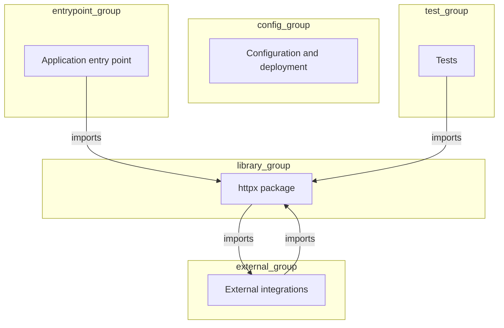

# Architecture report: encode/httpx

> Automated static analysis. **Observed** = directly seen in files/imports/AST; **Inferred** = interpretation from that evidence. Repository code was not executed.

## 1. Repository at a glance

| Item | Value |
| --- | --- |
| Repository | encode/httpx |
| Description | A next generation HTTP client for Python. 🦋 |
| Language | Python |
| Stars | 15788 |
| Licence | BSD-3-Clause |
| Analysed commit / branch | b5addb64f0161ff6bfe94c124ef76f6a1fba5254 / master |
| Framework(s) | None detected |
| Files analysed | 112 |
| Components | 5 |

## 2. Architecture in one minute

encode/httpx - A next generation HTTP client for Python. 🦋. This repository was analysed statically from 112 file(s) (60 Python). Detected technologies (observed from imports/manifests): GitHub Actions, Click, httpx, Uvicorn, Poetry, pytest. Files are grouped into 5 component(s): Configuration and deployment, Application entry point, External integrations, httpx package, Tests. Observed entry point(s): httpx/__init__.py, httpx/_main.py. Findings below distinguish observed facts from inferred interpretation.

## 3. High-level block diagram

## 4. Main components

### Configuration and deployment (`config`)

- **Kind:** config
- **Status:** Observed
- **Confidence:** 0.85
- **Responsibility:** Groups 3 file(s) under configuration and deployment (observed from repository paths and static analysis).
- **Paths:** `mkdocs.yml`, `pyproject.toml`, `requirements.txt`
- **Evidence:** [mkdocs.yml](https://github.com/encode/httpx/blob/b5addb64f0161ff6bfe94c124ef76f6a1fba5254/mkdocs.yml); [pyproject.toml](https://github.com/encode/httpx/blob/b5addb64f0161ff6bfe94c124ef76f6a1fba5254/pyproject.toml); [requirements.txt](https://github.com/encode/httpx/blob/b5addb64f0161ff6bfe94c124ef76f6a1fba5254/requirements.txt)

### Application entry point (`entrypoint`)

- **Kind:** entrypoint
- **Status:** Observed
- **Confidence:** 0.85
- **Responsibility:** Groups 2 file(s) under application entry point (observed from repository paths and static analysis). Observed top-level classes: ASGIResponseStream, ASGITransport, WSGIByteStream, WSGITransport. Observed top-level functions: _skip_leading_empty_chunks, create_event, is_running_trio.
- **Paths:** `httpx/_transports/asgi.py`, `httpx/_transports/wsgi.py`
- **Evidence:** [httpx/_transports/asgi.py:29](https://github.com/encode/httpx/blob/b5addb64f0161ff6bfe94c124ef76f6a1fba5254/httpx/_transports/asgi.py#L29); [httpx/_transports/wsgi.py:22](https://github.com/encode/httpx/blob/b5addb64f0161ff6bfe94c124ef76f6a1fba5254/httpx/_transports/wsgi.py#L22)

### External integrations (`external_integrations`)

- **Kind:** external
- **Status:** Observed
- **Confidence:** 0.85
- **Responsibility:** Groups 2 file(s) under external integrations (observed from repository paths and static analysis). Observed top-level classes: AsyncClient, BaseClient, BoundAsyncStream, BoundSyncStream, Client, ClientState. Observed top-level functions: _is_https_redirect, _port_or_default, _same_origin, delete, get, head.
- **Paths:** `httpx/_api.py`, `httpx/_client.py`
- **Evidence:** [httpx/_api.py:39](https://github.com/encode/httpx/blob/b5addb64f0161ff6bfe94c124ef76f6a1fba5254/httpx/_api.py#L39); [httpx/_client.py:62](https://github.com/encode/httpx/blob/b5addb64f0161ff6bfe94c124ef76f6a1fba5254/httpx/_client.py#L62)

### httpx package (`httpx`)

- **Kind:** library
- **Status:** Observed
- **Confidence:** 0.85
- **Responsibility:** Groups 19 file(s) under httpx package (observed from repository paths and static analysis). Observed top-level classes: AsyncBaseTransport, AsyncByteStream, AsyncHTTPTransport, AsyncIteratorByteStream, AsyncResponseStream, Auth. Observed top-level functions: PERCENT, _format_form_param, _guess_content_type, _is_known_encoding, _load_httpcore_exceptions, _normalize_header_key.
- **Paths:** `httpx/__init__.py`, `httpx/__version__.py`, `httpx/_auth.py`, `httpx/_config.py`, `httpx/_content.py`, `httpx/_decoders.py`, `httpx/_exceptions.py`, `httpx/_main.py`, `httpx/_models.py`, `httpx/_multipart.py`, `httpx/_status_codes.py`, `httpx/_transports/__init__.py`, `httpx/_transports/base.py`, `httpx/_transports/default.py`, `httpx/_transports/mock.py`, `httpx/_types.py`, `httpx/_urlparse.py`, `httpx/_urls.py`, `httpx/_utils.py`
- **Evidence:** [httpx/__init__.py](https://github.com/encode/httpx/blob/b5addb64f0161ff6bfe94c124ef76f6a1fba5254/httpx/__init__.py); [httpx/__version__.py](https://github.com/encode/httpx/blob/b5addb64f0161ff6bfe94c124ef76f6a1fba5254/httpx/__version__.py); [httpx/_auth.py:22](https://github.com/encode/httpx/blob/b5addb64f0161ff6bfe94c124ef76f6a1fba5254/httpx/_auth.py#L22); [httpx/_config.py:16](https://github.com/encode/httpx/blob/b5addb64f0161ff6bfe94c124ef76f6a1fba5254/httpx/_config.py#L16); [httpx/_content.py:31](https://github.com/encode/httpx/blob/b5addb64f0161ff6bfe94c124ef76f6a1fba5254/httpx/_content.py#L31); [httpx/_decoders.py:36](https://github.com/encode/httpx/blob/b5addb64f0161ff6bfe94c124ef76f6a1fba5254/httpx/_decoders.py#L36); [httpx/_exceptions.py:74](https://github.com/encode/httpx/blob/b5addb64f0161ff6bfe94c124ef76f6a1fba5254/httpx/_exceptions.py#L74); [httpx/_main.py:26](https://github.com/encode/httpx/blob/b5addb64f0161ff6bfe94c124ef76f6a1fba5254/httpx/_main.py#L26)

### Tests (`tests`)

- **Kind:** test
- **Status:** Observed
- **Confidence:** 0.85
- **Responsibility:** Groups 39 file(s) under tests (observed from repository paths and static analysis). Observed top-level classes: App, ConsumeBodyTransport, DigestApp, RepeatAuth, ResponseBodyAuth, StreamingBody. Observed top-level functions: app, application_factory, async_streaming_body, autodetect, cert_authority, cert_encrypted_private_key_file.
- **Paths:** `scripts/test`, `tests/__init__.py`, `tests/client/__init__.py`, `tests/client/test_async_client.py`, `tests/client/test_auth.py`, `tests/client/test_client.py`, `tests/client/test_cookies.py`, `tests/client/test_event_hooks.py`, `tests/client/test_headers.py`, `tests/client/test_properties.py`, `tests/client/test_proxies.py`, `tests/client/test_queryparams.py`, `tests/client/test_redirects.py`, `tests/common.py`, `tests/concurrency.py`, `tests/conftest.py`, `tests/fixtures/.netrc-nopassword`, `tests/models/__init__.py`, `tests/models/test_cookies.py`, `tests/models/test_headers.py`, `tests/models/test_queryparams.py`, `tests/models/test_requests.py`, `tests/models/test_responses.py`, `tests/models/test_url.py`, `tests/models/test_whatwg.py`, `tests/test_api.py`, `tests/test_asgi.py`, `tests/test_auth.py`, `tests/test_config.py`, `tests/test_content.py`, `tests/test_decoders.py`, `tests/test_exceptions.py`, `tests/test_exported_members.py`, `tests/test_main.py`, `tests/test_multipart.py`, `tests/test_status_codes.py`, `tests/test_timeouts.py`, `tests/test_utils.py`, `tests/test_wsgi.py`
- **Evidence:** [scripts/test](https://github.com/encode/httpx/blob/b5addb64f0161ff6bfe94c124ef76f6a1fba5254/scripts/test); [tests/__init__.py](https://github.com/encode/httpx/blob/b5addb64f0161ff6bfe94c124ef76f6a1fba5254/tests/__init__.py); [tests/client/__init__.py](https://github.com/encode/httpx/blob/b5addb64f0161ff6bfe94c124ef76f6a1fba5254/tests/client/__init__.py); [tests/client/test_async_client.py:12](https://github.com/encode/httpx/blob/b5addb64f0161ff6bfe94c124ef76f6a1fba5254/tests/client/test_async_client.py#L12); [tests/client/test_auth.py:23](https://github.com/encode/httpx/blob/b5addb64f0161ff6bfe94c124ef76f6a1fba5254/tests/client/test_auth.py#L23); [tests/client/test_client.py:12](https://github.com/encode/httpx/blob/b5addb64f0161ff6bfe94c124ef76f6a1fba5254/tests/client/test_client.py#L12); [tests/client/test_cookies.py:8](https://github.com/encode/httpx/blob/b5addb64f0161ff6bfe94c124ef76f6a1fba5254/tests/client/test_cookies.py#L8); [tests/client/test_event_hooks.py:6](https://github.com/encode/httpx/blob/b5addb64f0161ff6bfe94c124ef76f6a1fba5254/tests/client/test_event_hooks.py#L6)

## 5. Execution flow

**Observed** entry point(s):

- [httpx/__init__.py](https://github.com/encode/httpx/blob/b5addb64f0161ff6bfe94c124ef76f6a1fba5254/httpx/__init__.py)
- [httpx/_main.py:452](https://github.com/encode/httpx/blob/b5addb64f0161ff6bfe94c124ef76f6a1fba5254/httpx/_main.py#L452)

Representative flow (derived from observed entry points and the import graph; steps beyond the entry point are **Inferred**):

1. Execution starts at an observed entry point listed above, if present.
2. `entrypoint` imports `httpx` (Application entry point -> httpx package).
3. `external_integrations` imports `httpx` (External integrations -> httpx package).
4. `httpx` imports `external_integrations` (httpx package -> External integrations).
5. `tests` imports `httpx` (Tests -> httpx package).

## 6. Project structure

### `(root)`

- `.gitignore` - other (120 bytes)
- `CHANGELOG.md` - docs (53273 bytes)
- `LICENSE.md` - docs (1508 bytes)
- `README.md` - docs (4944 bytes)
- `mkdocs.yml` - config (1857 bytes)
- `pyproject.toml` - manifest (3640 bytes)
- `requirements.txt` - manifest (683 bytes)

### `.github`

- `.github/CONTRIBUTING.md` - docs (8370 bytes)
- `.github/FUNDING.yml` - config (15 bytes)
- `.github/ISSUE_TEMPLATE/1-issue.md` - docs (588 bytes)
- `.github/ISSUE_TEMPLATE/config.yml` - config (432 bytes)
- `.github/PULL_REQUEST_TEMPLATE.md` - docs (543 bytes)
- `.github/dependabot.yml` - config (275 bytes)
- `.github/workflows/publish.yml` - ci, YAML (606 bytes)
- `.github/workflows/test-suite.yml` - ci, YAML (809 bytes)

### `docs`

- `docs/CNAME` - docs (21 bytes)
- `docs/advanced/authentication.md` - docs (8554 bytes)
- `docs/advanced/clients.md` - docs (11456 bytes)
- `docs/advanced/event-hooks.md` - docs (2419 bytes)
- `docs/advanced/extensions.md` - docs (9447 bytes)
- `docs/advanced/proxies.md` - docs (3563 bytes)
- `docs/advanced/resource-limits.md` - docs (596 bytes)
- `docs/advanced/ssl.md` - docs (3623 bytes)
- `docs/advanced/text-encodings.md` - docs (3655 bytes)
- `docs/advanced/timeouts.md` - docs (2763 bytes)
- `docs/advanced/transports.md` - docs (14201 bytes)
- `docs/api.md` - docs (4484 bytes)
- `docs/async.md` - docs (6416 bytes)
- `docs/code_of_conduct.md` - docs (4635 bytes)
- `docs/compatibility.md` - docs (9891 bytes)
- `docs/contributing.md` - docs (8362 bytes)
- `docs/css/custom.css` - docs (187 bytes)
- `docs/environment_variables.md` - docs (2844 bytes)
- `docs/exceptions.md` - docs (2112 bytes)
- `docs/http2.md` - docs (2570 bytes)
- `docs/index.md` - docs (4160 bytes)
- `docs/logging.md` - docs (3962 bytes)
- `docs/overrides/partials/nav.html` - docs (1517 bytes)
- `docs/quickstart.md` - docs (14706 bytes)
- `docs/third_party_packages.md` - docs (3332 bytes)
- `docs/troubleshooting.md` - docs (2150 bytes)

### `httpx`

- `httpx/__init__.py` - source, Python (2191 bytes)
- `httpx/__version__.py` - source, Python (108 bytes)
- `httpx/_api.py` - source, Python (11743 bytes)
- `httpx/_auth.py` - source, Python (11907 bytes)
- `httpx/_client.py` - source, Python (65713 bytes)
- `httpx/_config.py` - source, Python (8547 bytes)
- `httpx/_content.py` - source, Python (8161 bytes)
- `httpx/_decoders.py` - source, Python (12041 bytes)
- `httpx/_exceptions.py` - source, Python (8500 bytes)
- `httpx/_main.py` - source, Python (15626 bytes)
- `httpx/_models.py` - source, Python (44697 bytes)
- `httpx/_multipart.py` - source, Python (9843 bytes)
- `httpx/_status_codes.py` - source, Python (5639 bytes)
- `httpx/_transports/__init__.py` - source, Python (275 bytes)
- `httpx/_transports/asgi.py` - source, Python (5501 bytes)
- `httpx/_transports/base.py` - source, Python (2523 bytes)
- `httpx/_transports/default.py` - source, Python (13984 bytes)
- `httpx/_transports/mock.py` - source, Python (1232 bytes)
- `httpx/_transports/wsgi.py` - source, Python (4825 bytes)
- `httpx/_types.py` - source, Python (2965 bytes)
- `httpx/_urlparse.py` - source, Python (18546 bytes)
- `httpx/_urls.py` - source, Python (21550 bytes)
- `httpx/_utils.py` - source, Python (8285 bytes)
- `httpx/py.typed` - other (0 bytes)

### `scripts`

- `scripts/check` - other (258 bytes)
- `scripts/clean` - other (208 bytes)
- `scripts/coverage` - other (203 bytes)
- `scripts/docs` - docs (119 bytes)
- `scripts/install` - other (357 bytes)
- `scripts/lint` - other (205 bytes)
- `scripts/publish` - other (592 bytes)
- `scripts/sync-version` - other (469 bytes)
- `scripts/test` - test (243 bytes)

### `tests`

- `tests/__init__.py` - test, Python (0 bytes)
- `tests/client/__init__.py` - test, Python (0 bytes)
- `tests/client/test_async_client.py` - test, Python (11670 bytes)
- `tests/client/test_auth.py` - test, Python (25250 bytes)
- `tests/client/test_client.py` - test, Python (14998 bytes)
- `tests/client/test_cookies.py` - test, Python (4943 bytes)
- `tests/client/test_event_hooks.py` - test, Python (7105 bytes)
- `tests/client/test_headers.py` - test, Python (8918 bytes)
- `tests/client/test_properties.py` - test, Python (1976 bytes)
- `tests/client/test_proxies.py` - test, Python (9649 bytes)
- `tests/client/test_queryparams.py` - test, Python (1083 bytes)
- `tests/client/test_redirects.py` - test, Python (17482 bytes)
- `tests/common.py` - test, Python (96 bytes)
- `tests/concurrency.py` - test, Python (324 bytes)
- `tests/conftest.py` - test, Python (8630 bytes)
- `tests/fixtures/.netrc-nopassword` - test (48 bytes)
- `tests/models/__init__.py` - test, Python (0 bytes)
- `tests/models/test_cookies.py` - test, Python (2917 bytes)
- `tests/models/test_headers.py` - test, Python (6995 bytes)
- `tests/models/test_queryparams.py` - test, Python (3567 bytes)
- `tests/models/test_requests.py` - test, Python (8183 bytes)
- `tests/models/test_responses.py` - test, Python (30337 bytes)
- `tests/models/test_url.py` - test, Python (26566 bytes)
- `tests/models/test_whatwg.py` - test, Python (1939 bytes)
- `tests/test_api.py` - test, Python (2631 bytes)
- `tests/test_asgi.py` - test, Python (7789 bytes)
- `tests/test_auth.py` - test, Python (11524 bytes)
- `tests/test_config.py` - test, Python (5561 bytes)
- `tests/test_content.py` - test, Python (17315 bytes)
- `tests/test_decoders.py` - test, Python (10307 bytes)
- `tests/test_exceptions.py` - test, Python (1847 bytes)
- `tests/test_exported_members.py` - test, Python (372 bytes)
- `tests/test_main.py` - test, Python (5544 bytes)
- `tests/test_multipart.py` - test, Python (17076 bytes)
- `tests/test_status_codes.py` - test, Python (711 bytes)
- `tests/test_timeouts.py` - test, Python (1750 bytes)
- `tests/test_utils.py` - test, Python (4565 bytes)
- `tests/test_wsgi.py` - test, Python (6009 bytes)

## 7. Key dependencies and integrations

| Name | Category | Status | Confidence | Evidence |
| --- | --- | --- | --- | --- |
| GitHub Actions | ci | Observed | 0.90 | [.github/workflows/publish.yml](https://github.com/encode/httpx/blob/b5addb64f0161ff6bfe94c124ef76f6a1fba5254/.github/workflows/publish.yml); [.github/workflows/test-suite.yml](https://github.com/encode/httpx/blob/b5addb64f0161ff6bfe94c124ef76f6a1fba5254/.github/workflows/test-suite.yml) |
| Click | library | Observed | 0.95 | [httpx/_main.py:8](https://github.com/encode/httpx/blob/b5addb64f0161ff6bfe94c124ef76f6a1fba5254/httpx/_main.py#L8); [pyproject.toml:44](https://github.com/encode/httpx/blob/b5addb64f0161ff6bfe94c124ef76f6a1fba5254/pyproject.toml#L44); [tests/test_main.py:4](https://github.com/encode/httpx/blob/b5addb64f0161ff6bfe94c124ef76f6a1fba5254/tests/test_main.py#L4) |
| httpx | library | Observed | 0.95 | [httpx/_transports/default.py:36](https://github.com/encode/httpx/blob/b5addb64f0161ff6bfe94c124ef76f6a1fba5254/httpx/_transports/default.py#L36); [tests/client/test_async_client.py:8](https://github.com/encode/httpx/blob/b5addb64f0161ff6bfe94c124ef76f6a1fba5254/tests/client/test_async_client.py#L8); [tests/client/test_auth.py:18](https://github.com/encode/httpx/blob/b5addb64f0161ff6bfe94c124ef76f6a1fba5254/tests/client/test_auth.py#L18); [tests/client/test_client.py:9](https://github.com/encode/httpx/blob/b5addb64f0161ff6bfe94c124ef76f6a1fba5254/tests/client/test_client.py#L9) |
| Uvicorn | library | Observed | 0.95 | [requirements.txt:29](https://github.com/encode/httpx/blob/b5addb64f0161ff6bfe94c124ef76f6a1fba5254/requirements.txt#L29); [tests/conftest.py:17](https://github.com/encode/httpx/blob/b5addb64f0161ff6bfe94c124ef76f6a1fba5254/tests/conftest.py#L17); [tests/conftest.py:18](https://github.com/encode/httpx/blob/b5addb64f0161ff6bfe94c124ef76f6a1fba5254/tests/conftest.py#L18) |
| Poetry | packaging | Observed | 0.85 | [pyproject.toml](https://github.com/encode/httpx/blob/b5addb64f0161ff6bfe94c124ef76f6a1fba5254/pyproject.toml) |
| pytest | tooling | Observed | 0.95 | [requirements.txt:24](https://github.com/encode/httpx/blob/b5addb64f0161ff6bfe94c124ef76f6a1fba5254/requirements.txt#L24); [tests/client/test_async_client.py:6](https://github.com/encode/httpx/blob/b5addb64f0161ff6bfe94c124ef76f6a1fba5254/tests/client/test_async_client.py#L6); [tests/client/test_auth.py:16](https://github.com/encode/httpx/blob/b5addb64f0161ff6bfe94c124ef76f6a1fba5254/tests/client/test_auth.py#L16); [tests/client/test_client.py:7](https://github.com/encode/httpx/blob/b5addb64f0161ff6bfe94c124ef76f6a1fba5254/tests/client/test_client.py#L7) |

## 8. Data and state

No database, cache, queue, or persistent-state usage was observed in the analysed files. State handling, if any, may be in-memory or in files that were not analysed.

## 9. Configuration and deployment clues

- `.github/FUNDING.yml` (config)
- `.github/ISSUE_TEMPLATE/config.yml` (config)
- `.github/dependabot.yml` (config)
- `.github/workflows/publish.yml` (ci)
- `.github/workflows/test-suite.yml` (ci)
- `mkdocs.yml` (config)
- `pyproject.toml` (manifest)
- `requirements.txt` (manifest)

Console scripts declared in packaging metadata (**Observed**):

- `httpx` -> `httpx:main`

## 10. Design observations

- An entry/API layer is separated from other code (Inferred from paths and decorators).
- Tests are present alongside source code (Observed from test file paths).
- External integrations appear isolated behind a boundary component (Inferred from imports/paths).

These observations are interpretations (**Inferred**) of the observed structure, not guarantees about runtime design.

## 11. Limitations and unknowns

- Static analysis only: repository code was not executed, installed, or imported at runtime.
- Components and relationships are inferred from file paths, imports, and AST structure; runtime behaviour, dynamic imports, and reflection may not be visible.
- 2 file(s) were skipped during inventory (1 x likely secret file excluded; 1 x vendored/generated directory excluded).
- Repository text was treated as untrusted data; no instructions found in repository files were followed, and likely secret values were redacted/excluded.

## 12. Source references

- [.github/workflows/publish.yml](https://github.com/encode/httpx/blob/b5addb64f0161ff6bfe94c124ef76f6a1fba5254/.github/workflows/publish.yml)
- [.github/workflows/test-suite.yml](https://github.com/encode/httpx/blob/b5addb64f0161ff6bfe94c124ef76f6a1fba5254/.github/workflows/test-suite.yml)
- [httpx/__init__.py](https://github.com/encode/httpx/blob/b5addb64f0161ff6bfe94c124ef76f6a1fba5254/httpx/__init__.py)
- [httpx/__version__.py](https://github.com/encode/httpx/blob/b5addb64f0161ff6bfe94c124ef76f6a1fba5254/httpx/__version__.py)
- [httpx/_api.py:39](https://github.com/encode/httpx/blob/b5addb64f0161ff6bfe94c124ef76f6a1fba5254/httpx/_api.py#L39)
- [httpx/_auth.py:22](https://github.com/encode/httpx/blob/b5addb64f0161ff6bfe94c124ef76f6a1fba5254/httpx/_auth.py#L22)
- [httpx/_client.py:62](https://github.com/encode/httpx/blob/b5addb64f0161ff6bfe94c124ef76f6a1fba5254/httpx/_client.py#L62)
- [httpx/_config.py:16](https://github.com/encode/httpx/blob/b5addb64f0161ff6bfe94c124ef76f6a1fba5254/httpx/_config.py#L16)
- [httpx/_content.py:31](https://github.com/encode/httpx/blob/b5addb64f0161ff6bfe94c124ef76f6a1fba5254/httpx/_content.py#L31)
- [httpx/_decoders.py:36](https://github.com/encode/httpx/blob/b5addb64f0161ff6bfe94c124ef76f6a1fba5254/httpx/_decoders.py#L36)
- [httpx/_exceptions.py:74](https://github.com/encode/httpx/blob/b5addb64f0161ff6bfe94c124ef76f6a1fba5254/httpx/_exceptions.py#L74)
- [httpx/_main.py:8](https://github.com/encode/httpx/blob/b5addb64f0161ff6bfe94c124ef76f6a1fba5254/httpx/_main.py#L8)
- [httpx/_main.py:26](https://github.com/encode/httpx/blob/b5addb64f0161ff6bfe94c124ef76f6a1fba5254/httpx/_main.py#L26)
- [httpx/_main.py:452](https://github.com/encode/httpx/blob/b5addb64f0161ff6bfe94c124ef76f6a1fba5254/httpx/_main.py#L452)
- [httpx/_transports/asgi.py:29](https://github.com/encode/httpx/blob/b5addb64f0161ff6bfe94c124ef76f6a1fba5254/httpx/_transports/asgi.py#L29)
- [httpx/_transports/default.py:36](https://github.com/encode/httpx/blob/b5addb64f0161ff6bfe94c124ef76f6a1fba5254/httpx/_transports/default.py#L36)
- [httpx/_transports/wsgi.py:22](https://github.com/encode/httpx/blob/b5addb64f0161ff6bfe94c124ef76f6a1fba5254/httpx/_transports/wsgi.py#L22)
- [mkdocs.yml](https://github.com/encode/httpx/blob/b5addb64f0161ff6bfe94c124ef76f6a1fba5254/mkdocs.yml)
- [pyproject.toml](https://github.com/encode/httpx/blob/b5addb64f0161ff6bfe94c124ef76f6a1fba5254/pyproject.toml)
- [pyproject.toml:44](https://github.com/encode/httpx/blob/b5addb64f0161ff6bfe94c124ef76f6a1fba5254/pyproject.toml#L44)
- [requirements.txt](https://github.com/encode/httpx/blob/b5addb64f0161ff6bfe94c124ef76f6a1fba5254/requirements.txt)
- [requirements.txt:24](https://github.com/encode/httpx/blob/b5addb64f0161ff6bfe94c124ef76f6a1fba5254/requirements.txt#L24)
- [requirements.txt:29](https://github.com/encode/httpx/blob/b5addb64f0161ff6bfe94c124ef76f6a1fba5254/requirements.txt#L29)
- [scripts/test](https://github.com/encode/httpx/blob/b5addb64f0161ff6bfe94c124ef76f6a1fba5254/scripts/test)
- [tests/__init__.py](https://github.com/encode/httpx/blob/b5addb64f0161ff6bfe94c124ef76f6a1fba5254/tests/__init__.py)
- [tests/client/__init__.py](https://github.com/encode/httpx/blob/b5addb64f0161ff6bfe94c124ef76f6a1fba5254/tests/client/__init__.py)
- [tests/client/test_async_client.py:6](https://github.com/encode/httpx/blob/b5addb64f0161ff6bfe94c124ef76f6a1fba5254/tests/client/test_async_client.py#L6)
- [tests/client/test_async_client.py:8](https://github.com/encode/httpx/blob/b5addb64f0161ff6bfe94c124ef76f6a1fba5254/tests/client/test_async_client.py#L8)
- [tests/client/test_async_client.py:12](https://github.com/encode/httpx/blob/b5addb64f0161ff6bfe94c124ef76f6a1fba5254/tests/client/test_async_client.py#L12)
- [tests/client/test_auth.py:16](https://github.com/encode/httpx/blob/b5addb64f0161ff6bfe94c124ef76f6a1fba5254/tests/client/test_auth.py#L16)
- [tests/client/test_auth.py:18](https://github.com/encode/httpx/blob/b5addb64f0161ff6bfe94c124ef76f6a1fba5254/tests/client/test_auth.py#L18)
- [tests/client/test_auth.py:23](https://github.com/encode/httpx/blob/b5addb64f0161ff6bfe94c124ef76f6a1fba5254/tests/client/test_auth.py#L23)
- [tests/client/test_client.py:7](https://github.com/encode/httpx/blob/b5addb64f0161ff6bfe94c124ef76f6a1fba5254/tests/client/test_client.py#L7)
- [tests/client/test_client.py:9](https://github.com/encode/httpx/blob/b5addb64f0161ff6bfe94c124ef76f6a1fba5254/tests/client/test_client.py#L9)
- [tests/client/test_client.py:12](https://github.com/encode/httpx/blob/b5addb64f0161ff6bfe94c124ef76f6a1fba5254/tests/client/test_client.py#L12)
- [tests/client/test_cookies.py:3](https://github.com/encode/httpx/blob/b5addb64f0161ff6bfe94c124ef76f6a1fba5254/tests/client/test_cookies.py#L3)
- [tests/client/test_cookies.py:5](https://github.com/encode/httpx/blob/b5addb64f0161ff6bfe94c124ef76f6a1fba5254/tests/client/test_cookies.py#L5)
- [tests/client/test_cookies.py:8](https://github.com/encode/httpx/blob/b5addb64f0161ff6bfe94c124ef76f6a1fba5254/tests/client/test_cookies.py#L8)
- [tests/client/test_event_hooks.py:1](https://github.com/encode/httpx/blob/b5addb64f0161ff6bfe94c124ef76f6a1fba5254/tests/client/test_event_hooks.py#L1)
- [tests/client/test_event_hooks.py:3](https://github.com/encode/httpx/blob/b5addb64f0161ff6bfe94c124ef76f6a1fba5254/tests/client/test_event_hooks.py#L3)
- [tests/client/test_event_hooks.py:6](https://github.com/encode/httpx/blob/b5addb64f0161ff6bfe94c124ef76f6a1fba5254/tests/client/test_event_hooks.py#L6)
- [tests/client/test_headers.py:3](https://github.com/encode/httpx/blob/b5addb64f0161ff6bfe94c124ef76f6a1fba5254/tests/client/test_headers.py#L3)
- [tests/client/test_headers.py:5](https://github.com/encode/httpx/blob/b5addb64f0161ff6bfe94c124ef76f6a1fba5254/tests/client/test_headers.py#L5)
- [tests/client/test_properties.py:1](https://github.com/encode/httpx/blob/b5addb64f0161ff6bfe94c124ef76f6a1fba5254/tests/client/test_properties.py#L1)
- [tests/client/test_proxies.py:2](https://github.com/encode/httpx/blob/b5addb64f0161ff6bfe94c124ef76f6a1fba5254/tests/client/test_proxies.py#L2)
- [tests/conftest.py:17](https://github.com/encode/httpx/blob/b5addb64f0161ff6bfe94c124ef76f6a1fba5254/tests/conftest.py#L17)
- [tests/conftest.py:18](https://github.com/encode/httpx/blob/b5addb64f0161ff6bfe94c124ef76f6a1fba5254/tests/conftest.py#L18)
- [tests/test_main.py:4](https://github.com/encode/httpx/blob/b5addb64f0161ff6bfe94c124ef76f6a1fba5254/tests/test_main.py#L4)
