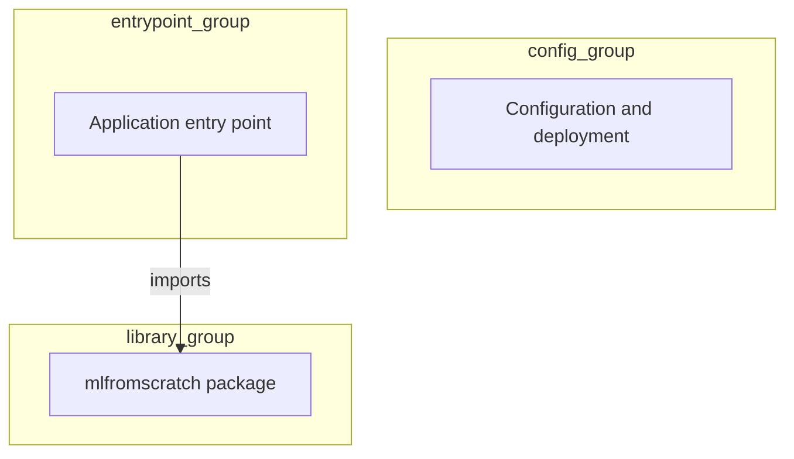

# Architecture report: eriklindernoren/ML-From-Scratch

> Automated static analysis. **Observed** = directly seen in files/imports/AST; **Inferred** = interpretation from that evidence. Repository code was not executed.

## 1. Repository at a glance

| Item | Value |
| --- | --- |
| Repository | eriklindernoren/ML-From-Scratch |
| Description | Machine Learning From Scratch. Bare bones NumPy implementations of machine learning models and algorithms with a focus on accessibility. Aims to cover everything from linear regression to deep learning. |
| Language | Python |
| Stars | 33359 |
| Licence | MIT |
| Analysed commit / branch | a2806c6732eee8d27762edd6d864e0c179d8e9e8 / master |
| Framework(s) | None detected |
| Files analysed | 89 |
| Components | 3 |

## 2. Architecture in one minute

eriklindernoren/ML-From-Scratch - Machine Learning From Scratch. Bare bones NumPy implementations of machine learning models and algorithms with a focus on accessibility. Aims to cover everything from linear regression to deep learni…. This repository was analysed statically from 89 file(s) (82 Python). Detected technologies (observed from imports/manifests): NumPy, pandas, setuptools. Files are grouped into 3 component(s): Configuration and deployment, Application entry point, mlfromscratch package. Observed entry point(s): mlfromscratch/supervised_learning/adaboost.py, mlfromscratch/supervised_learning/multilayer_perceptron.py, mlfromscratch/unsupervised_learning/autoencoder.py. Findings below distinguish observed facts from inferred interpretation.

## 3. High-level block diagram

## 4. Main components

### Configuration and deployment (`config`)

- **Kind:** config
- **Status:** Observed
- **Confidence:** 0.85
- **Responsibility:** Groups 4 file(s) under configuration and deployment (observed from repository paths and static analysis).
- **Paths:** `MANIFEST.in`, `requirements.txt`, `setup.cfg`, `setup.py`
- **Evidence:** [MANIFEST.in](https://github.com/eriklindernoren/ML-From-Scratch/blob/a2806c6732eee8d27762edd6d864e0c179d8e9e8/MANIFEST.in); [requirements.txt](https://github.com/eriklindernoren/ML-From-Scratch/blob/a2806c6732eee8d27762edd6d864e0c179d8e9e8/requirements.txt); [setup.cfg](https://github.com/eriklindernoren/ML-From-Scratch/blob/a2806c6732eee8d27762edd6d864e0c179d8e9e8/setup.cfg); [setup.py](https://github.com/eriklindernoren/ML-From-Scratch/blob/a2806c6732eee8d27762edd6d864e0c179d8e9e8/setup.py)

### Application entry point (`entrypoint`)

- **Kind:** entrypoint
- **Status:** Observed
- **Confidence:** 0.85
- **Responsibility:** Groups 40 file(s) under application entry point (observed from repository paths and static analysis). Observed top-level classes: Adaboost, Autoencoder, DCGAN, DecisionStump, GAN, MultilayerPerceptron. Observed top-level functions: main.
- **Paths:** `mlfromscratch/examples/adaboost.py`, `mlfromscratch/examples/apriori.py`, `mlfromscratch/examples/bayesian_regression.py`, `mlfromscratch/examples/convolutional_neural_network.py`, `mlfromscratch/examples/dbscan.py`, `mlfromscratch/examples/decision_tree_classifier.py`, `mlfromscratch/examples/decision_tree_regressor.py`, `mlfromscratch/examples/deep_q_network.py`, `mlfromscratch/examples/elastic_net.py`, `mlfromscratch/examples/fp_growth.py`, `mlfromscratch/examples/gaussian_mixture_model.py`, `mlfromscratch/examples/genetic_algorithm.py`, `mlfromscratch/examples/gradient_boosting_classifier.py`, `mlfromscratch/examples/gradient_boosting_regressor.py`, `mlfromscratch/examples/k_means.py`, `mlfromscratch/examples/k_nearest_neighbors.py`, `mlfromscratch/examples/lasso_regression.py`, `mlfromscratch/examples/linear_discriminant_analysis.py`, `mlfromscratch/examples/linear_regression.py`, `mlfromscratch/examples/logistic_regression.py`, `mlfromscratch/examples/multi_class_lda.py`, `mlfromscratch/examples/multilayer_perceptron.py`, `mlfromscratch/examples/naive_bayes.py`, `mlfromscratch/examples/neuroevolution.py`, `mlfromscratch/examples/particle_swarm_optimization.py`, `mlfromscratch/examples/partitioning_around_medoids.py`, `mlfromscratch/examples/perceptron.py`, `mlfromscratch/examples/polynomial_regression.py`, `mlfromscratch/examples/principal_component_analysis.py`, `mlfromscratch/examples/random_forest.py`, `mlfromscratch/examples/recurrent_neural_network.py`, `mlfromscratch/examples/restricted_boltzmann_machine.py`, `mlfromscratch/examples/ridge_regression.py`, `mlfromscratch/examples/support_vector_machine.py`, `mlfromscratch/examples/xgboost.py`, `mlfromscratch/supervised_learning/adaboost.py`, `mlfromscratch/supervised_learning/multilayer_perceptron.py`, `mlfromscratch/unsupervised_learning/autoencoder.py`, `mlfromscratch/unsupervised_learning/dcgan.py`, `mlfromscratch/unsupervised_learning/generative_adversarial_network.py`
- **Evidence:** [mlfromscratch/examples/adaboost.py:11](https://github.com/eriklindernoren/ML-From-Scratch/blob/a2806c6732eee8d27762edd6d864e0c179d8e9e8/mlfromscratch/examples/adaboost.py#L11); [mlfromscratch/examples/apriori.py:6](https://github.com/eriklindernoren/ML-From-Scratch/blob/a2806c6732eee8d27762edd6d864e0c179d8e9e8/mlfromscratch/examples/apriori.py#L6); [mlfromscratch/examples/bayesian_regression.py:10](https://github.com/eriklindernoren/ML-From-Scratch/blob/a2806c6732eee8d27762edd6d864e0c179d8e9e8/mlfromscratch/examples/bayesian_regression.py#L10); [mlfromscratch/examples/convolutional_neural_network.py:21](https://github.com/eriklindernoren/ML-From-Scratch/blob/a2806c6732eee8d27762edd6d864e0c179d8e9e8/mlfromscratch/examples/convolutional_neural_network.py#L21); [mlfromscratch/examples/dbscan.py:12](https://github.com/eriklindernoren/ML-From-Scratch/blob/a2806c6732eee8d27762edd6d864e0c179d8e9e8/mlfromscratch/examples/dbscan.py#L12); [mlfromscratch/examples/decision_tree_classifier.py:13](https://github.com/eriklindernoren/ML-From-Scratch/blob/a2806c6732eee8d27762edd6d864e0c179d8e9e8/mlfromscratch/examples/decision_tree_classifier.py#L13); [mlfromscratch/examples/decision_tree_regressor.py:10](https://github.com/eriklindernoren/ML-From-Scratch/blob/a2806c6732eee8d27762edd6d864e0c179d8e9e8/mlfromscratch/examples/decision_tree_regressor.py#L10); [mlfromscratch/examples/deep_q_network.py:11](https://github.com/eriklindernoren/ML-From-Scratch/blob/a2806c6732eee8d27762edd6d864e0c179d8e9e8/mlfromscratch/examples/deep_q_network.py#L11)

### mlfromscratch package (`mlfromscratch`)

- **Kind:** library
- **Status:** Observed
- **Confidence:** 0.85
- **Responsibility:** Groups 41 file(s) under mlfromscratch package (observed from repository paths and static analysis). Observed top-level classes: Activation, Adadelta, Adagrad, Adam, Apriori, AveragePooling2D. Observed top-level functions: accuracy_score, batch_iterator, calculate_correlation_matrix, calculate_covariance_matrix, calculate_entropy, calculate_std_dev.
- **Paths:** `mlfromscratch/__init__.py`, `mlfromscratch/deep_learning/__init__.py`, `mlfromscratch/deep_learning/activation_functions.py`, `mlfromscratch/deep_learning/layers.py`, `mlfromscratch/deep_learning/loss_functions.py`, `mlfromscratch/deep_learning/neural_network.py`, `mlfromscratch/deep_learning/optimizers.py`, `mlfromscratch/examples/demo.py`, `mlfromscratch/reinforcement_learning/__init__.py`, `mlfromscratch/reinforcement_learning/deep_q_network.py`, `mlfromscratch/supervised_learning/__init__.py`, `mlfromscratch/supervised_learning/bayesian_regression.py`, `mlfromscratch/supervised_learning/decision_tree.py`, `mlfromscratch/supervised_learning/gradient_boosting.py`, `mlfromscratch/supervised_learning/k_nearest_neighbors.py`, `mlfromscratch/supervised_learning/linear_discriminant_analysis.py`, `mlfromscratch/supervised_learning/logistic_regression.py`, `mlfromscratch/supervised_learning/multi_class_lda.py`, `mlfromscratch/supervised_learning/naive_bayes.py`, `mlfromscratch/supervised_learning/neuroevolution.py`, `mlfromscratch/supervised_learning/particle_swarm_optimization.py`, `mlfromscratch/supervised_learning/perceptron.py`, `mlfromscratch/supervised_learning/random_forest.py`, `mlfromscratch/supervised_learning/regression.py`, `mlfromscratch/supervised_learning/support_vector_machine.py`, `mlfromscratch/supervised_learning/xgboost.py`, `mlfromscratch/unsupervised_learning/__init__.py`, `mlfromscratch/unsupervised_learning/apriori.py`, `mlfromscratch/unsupervised_learning/dbscan.py`, `mlfromscratch/unsupervised_learning/fp_growth.py`, `mlfromscratch/unsupervised_learning/gaussian_mixture_model.py`, `mlfromscratch/unsupervised_learning/genetic_algorithm.py`, `mlfromscratch/unsupervised_learning/k_means.py`, `mlfromscratch/unsupervised_learning/partitioning_around_medoids.py`, `mlfromscratch/unsupervised_learning/principal_component_analysis.py`, `mlfromscratch/unsupervised_learning/restricted_boltzmann_machine.py`, `mlfromscratch/utils/__init__.py`, `mlfromscratch/utils/data_manipulation.py`, `mlfromscratch/utils/data_operation.py`, `mlfromscratch/utils/kernels.py`, `mlfromscratch/utils/misc.py`
- **Evidence:** [mlfromscratch/__init__.py](https://github.com/eriklindernoren/ML-From-Scratch/blob/a2806c6732eee8d27762edd6d864e0c179d8e9e8/mlfromscratch/__init__.py); [mlfromscratch/deep_learning/__init__.py](https://github.com/eriklindernoren/ML-From-Scratch/blob/a2806c6732eee8d27762edd6d864e0c179d8e9e8/mlfromscratch/deep_learning/__init__.py); [mlfromscratch/deep_learning/activation_functions.py:6](https://github.com/eriklindernoren/ML-From-Scratch/blob/a2806c6732eee8d27762edd6d864e0c179d8e9e8/mlfromscratch/deep_learning/activation_functions.py#L6); [mlfromscratch/deep_learning/layers.py:10](https://github.com/eriklindernoren/ML-From-Scratch/blob/a2806c6732eee8d27762edd6d864e0c179d8e9e8/mlfromscratch/deep_learning/layers.py#L10); [mlfromscratch/deep_learning/loss_functions.py:6](https://github.com/eriklindernoren/ML-From-Scratch/blob/a2806c6732eee8d27762edd6d864e0c179d8e9e8/mlfromscratch/deep_learning/loss_functions.py#L6); [mlfromscratch/deep_learning/neural_network.py:9](https://github.com/eriklindernoren/ML-From-Scratch/blob/a2806c6732eee8d27762edd6d864e0c179d8e9e8/mlfromscratch/deep_learning/neural_network.py#L9); [mlfromscratch/deep_learning/optimizers.py:9](https://github.com/eriklindernoren/ML-From-Scratch/blob/a2806c6732eee8d27762edd6d864e0c179d8e9e8/mlfromscratch/deep_learning/optimizers.py#L9); [mlfromscratch/examples/demo.py](https://github.com/eriklindernoren/ML-From-Scratch/blob/a2806c6732eee8d27762edd6d864e0c179d8e9e8/mlfromscratch/examples/demo.py)

## 5. Execution flow

**Observed** entry point(s):

- [mlfromscratch/supervised_learning/adaboost.py:145](https://github.com/eriklindernoren/ML-From-Scratch/blob/a2806c6732eee8d27762edd6d864e0c179d8e9e8/mlfromscratch/supervised_learning/adaboost.py#L145)
- [mlfromscratch/supervised_learning/multilayer_perceptron.py:117](https://github.com/eriklindernoren/ML-From-Scratch/blob/a2806c6732eee8d27762edd6d864e0c179d8e9e8/mlfromscratch/supervised_learning/multilayer_perceptron.py#L117)
- [mlfromscratch/unsupervised_learning/autoencoder.py:116](https://github.com/eriklindernoren/ML-From-Scratch/blob/a2806c6732eee8d27762edd6d864e0c179d8e9e8/mlfromscratch/unsupervised_learning/autoencoder.py#L116)
- [mlfromscratch/unsupervised_learning/dcgan.py:169](https://github.com/eriklindernoren/ML-From-Scratch/blob/a2806c6732eee8d27762edd6d864e0c179d8e9e8/mlfromscratch/unsupervised_learning/dcgan.py#L169)
- [mlfromscratch/unsupervised_learning/generative_adversarial_network.py:164](https://github.com/eriklindernoren/ML-From-Scratch/blob/a2806c6732eee8d27762edd6d864e0c179d8e9e8/mlfromscratch/unsupervised_learning/generative_adversarial_network.py#L164)

Representative flow (derived from observed entry points and the import graph; steps beyond the entry point are **Inferred**):

1. Execution starts at an observed entry point listed above, if present.
2. `entrypoint` imports `mlfromscratch` (Application entry point -> mlfromscratch package).

## 6. Project structure

### `(root)`

- `.gitignore` - other (76 bytes)
- `LICENSE` - docs (1074 bytes)
- `MANIFEST.in` - manifest (29 bytes)
- `README.md` - docs (13780 bytes)
- `requirements.txt` - manifest (78 bytes)
- `setup.cfg` - manifest (57 bytes)
- `setup.py` - manifest, Python (1078 bytes)

### `mlfromscratch`

- `mlfromscratch/__init__.py` - source, Python (0 bytes)
- `mlfromscratch/data/TempLinkoping2016.txt` - docs (6024 bytes)
- `mlfromscratch/deep_learning/__init__.py` - source, Python (42 bytes)
- `mlfromscratch/deep_learning/activation_functions.py` - source, Python (1992 bytes)
- `mlfromscratch/deep_learning/layers.py` - source, Python (27518 bytes)
- `mlfromscratch/deep_learning/loss_functions.py` - source, Python (1045 bytes)
- `mlfromscratch/deep_learning/neural_network.py` - source, Python (4750 bytes)
- `mlfromscratch/deep_learning/optimizers.py` - source, Python (4774 bytes)
- `mlfromscratch/examples/adaboost.py` - source, Python (1139 bytes)
- `mlfromscratch/examples/apriori.py` - source, Python (1178 bytes)
- `mlfromscratch/examples/bayesian_regression.py` - source, Python (2472 bytes)
- `mlfromscratch/examples/convolutional_neural_network.py` - source, Python (2904 bytes)
- `mlfromscratch/examples/dbscan.py` - source, Python (642 bytes)
- `mlfromscratch/examples/decision_tree_classifier.py` - source, Python (956 bytes)
- `mlfromscratch/examples/decision_tree_regressor.py` - source, Python (1599 bytes)
- `mlfromscratch/examples/deep_q_network.py` - source, Python (1117 bytes)
- `mlfromscratch/examples/demo.py` - source, Python (4677 bytes)
- `mlfromscratch/examples/elastic_net.py` - source, Python (1999 bytes)
- `mlfromscratch/examples/fp_growth.py` - source, Python (1119 bytes)
- `mlfromscratch/examples/gaussian_mixture_model.py` - source, Python (565 bytes)
- `mlfromscratch/examples/genetic_algorithm.py` - source, Python (1333 bytes)
- `mlfromscratch/examples/gradient_boosting_classifier.py` - source, Python (985 bytes)
- `mlfromscratch/examples/gradient_boosting_regressor.py` - source, Python (1849 bytes)
- `mlfromscratch/examples/k_means.py` - source, Python (572 bytes)
- `mlfromscratch/examples/k_nearest_neighbors.py` - source, Python (851 bytes)
- `mlfromscratch/examples/lasso_regression.py` - source, Python (1988 bytes)
- `mlfromscratch/examples/linear_discriminant_analysis.py` - source, Python (929 bytes)
- `mlfromscratch/examples/linear_regression.py` - source, Python (1610 bytes)
- `mlfromscratch/examples/logistic_regression.py` - source, Python (1062 bytes)
- `mlfromscratch/examples/multi_class_lda.py` - source, Python (486 bytes)
- `mlfromscratch/examples/multilayer_perceptron.py` - source, Python (2441 bytes)
- `mlfromscratch/examples/naive_bayes.py` - source, Python (789 bytes)
- `mlfromscratch/examples/neuroevolution.py` - source, Python (2167 bytes)
- `mlfromscratch/examples/particle_swarm_optimization.py` - source, Python (2569 bytes)
- `mlfromscratch/examples/partitioning_around_medoids.py` - source, Python (540 bytes)
- `mlfromscratch/examples/perceptron.py` - source, Python (1253 bytes)
- `mlfromscratch/examples/polynomial_regression.py` - source, Python (2985 bytes)
- `mlfromscratch/examples/principal_component_analysis.py` - source, Python (1201 bytes)
- `mlfromscratch/examples/random_forest.py` - source, Python (738 bytes)
- `mlfromscratch/examples/recurrent_neural_network.py` - source, Python (3225 bytes)
- `mlfromscratch/examples/restricted_boltzmann_machine.py` - source, Python (1821 bytes)
- `mlfromscratch/examples/ridge_regression.py` - source, Python (2967 bytes)
- `mlfromscratch/examples/support_vector_machine.py` - source, Python (969 bytes)
- `mlfromscratch/examples/xgboost.py` - source, Python (897 bytes)
- `mlfromscratch/reinforcement_learning/__init__.py` - source, Python (40 bytes)
- `mlfromscratch/reinforcement_learning/deep_q_network.py` - source, Python (5304 bytes)
- `mlfromscratch/supervised_learning/__init__.py` - source, Python (895 bytes)
- `mlfromscratch/supervised_learning/adaboost.py` - source, Python (5633 bytes)
- `mlfromscratch/supervised_learning/bayesian_regression.py` - source, Python (4595 bytes)
- `mlfromscratch/supervised_learning/decision_tree.py` - source, Python (11134 bytes)
- `mlfromscratch/supervised_learning/gradient_boosting.py` - source, Python (4281 bytes)
- `mlfromscratch/supervised_learning/k_nearest_neighbors.py` - source, Python (1265 bytes)
- `mlfromscratch/supervised_learning/linear_discriminant_analysis.py` - source, Python (1395 bytes)
- `mlfromscratch/supervised_learning/logistic_regression.py` - source, Python (2059 bytes)
- `mlfromscratch/supervised_learning/multi_class_lda.py` - source, Python (2627 bytes)
- `mlfromscratch/supervised_learning/multilayer_perceptron.py` - source, Python (4390 bytes)
- `mlfromscratch/supervised_learning/naive_bayes.py` - source, Python (3363 bytes)
- `mlfromscratch/supervised_learning/neuroevolution.py` - source, Python (6006 bytes)
- `mlfromscratch/supervised_learning/particle_swarm_optimization.py` - source, Python (5985 bytes)
- `mlfromscratch/supervised_learning/perceptron.py` - source, Python (2679 bytes)
- `mlfromscratch/supervised_learning/random_forest.py` - source, Python (3683 bytes)
- `mlfromscratch/supervised_learning/regression.py` - source, Python (10499 bytes)
- `mlfromscratch/supervised_learning/support_vector_machine.py` - source, Python (4024 bytes)
- `mlfromscratch/supervised_learning/xgboost.py` - source, Python (3726 bytes)
- `mlfromscratch/unsupervised_learning/__init__.py` - source, Python (358 bytes)
- `mlfromscratch/unsupervised_learning/apriori.py` - source, Python (7906 bytes)
- `mlfromscratch/unsupervised_learning/autoencoder.py` - source, Python (4017 bytes)
- `mlfromscratch/unsupervised_learning/dbscan.py` - source, Python (4067 bytes)
- `mlfromscratch/unsupervised_learning/dcgan.py` - source, Python (6384 bytes)
- `mlfromscratch/unsupervised_learning/fp_growth.py` - source, Python (7664 bytes)
- `mlfromscratch/unsupervised_learning/gaussian_mixture_model.py` - source, Python (4723 bytes)
- `mlfromscratch/unsupervised_learning/generative_adversarial_network.py` - source, Python (5842 bytes)
- `mlfromscratch/unsupervised_learning/genetic_algorithm.py` - source, Python (4227 bytes)
- `mlfromscratch/unsupervised_learning/k_means.py` - source, Python (3530 bytes)
- `mlfromscratch/unsupervised_learning/partitioning_around_medoids.py` - source, Python (4900 bytes)
- `mlfromscratch/unsupervised_learning/principal_component_analysis.py` - source, Python (1247 bytes)
- `mlfromscratch/unsupervised_learning/restricted_boltzmann_machine.py` - source, Python (3357 bytes)
- `mlfromscratch/utils/__init__.py` - source, Python (85 bytes)
- `mlfromscratch/utils/data_manipulation.py` - source, Python (5089 bytes)
- `mlfromscratch/utils/data_operation.py` - source, Python (2240 bytes)
- `mlfromscratch/utils/kernels.py` - source, Python (398 bytes)
- `mlfromscratch/utils/misc.py` - source, Python (3773 bytes)

## 7. Key dependencies and integrations

| Name | Category | Status | Confidence | Evidence |
| --- | --- | --- | --- | --- |
| NumPy | library | Observed | 0.95 | [mlfromscratch/deep_learning/activation_functions.py:1](https://github.com/eriklindernoren/ML-From-Scratch/blob/a2806c6732eee8d27762edd6d864e0c179d8e9e8/mlfromscratch/deep_learning/activation_functions.py#L1); [mlfromscratch/deep_learning/layers.py:4](https://github.com/eriklindernoren/ML-From-Scratch/blob/a2806c6732eee8d27762edd6d864e0c179d8e9e8/mlfromscratch/deep_learning/layers.py#L4); [mlfromscratch/deep_learning/loss_functions.py:2](https://github.com/eriklindernoren/ML-From-Scratch/blob/a2806c6732eee8d27762edd6d864e0c179d8e9e8/mlfromscratch/deep_learning/loss_functions.py#L2); [mlfromscratch/deep_learning/neural_network.py:3](https://github.com/eriklindernoren/ML-From-Scratch/blob/a2806c6732eee8d27762edd6d864e0c179d8e9e8/mlfromscratch/deep_learning/neural_network.py#L3) |
| pandas | library | Observed | 0.95 | [mlfromscratch/examples/bayesian_regression.py:2](https://github.com/eriklindernoren/ML-From-Scratch/blob/a2806c6732eee8d27762edd6d864e0c179d8e9e8/mlfromscratch/examples/bayesian_regression.py#L2); [mlfromscratch/examples/decision_tree_regressor.py:4](https://github.com/eriklindernoren/ML-From-Scratch/blob/a2806c6732eee8d27762edd6d864e0c179d8e9e8/mlfromscratch/examples/decision_tree_regressor.py#L4); [mlfromscratch/examples/elastic_net.py:4](https://github.com/eriklindernoren/ML-From-Scratch/blob/a2806c6732eee8d27762edd6d864e0c179d8e9e8/mlfromscratch/examples/elastic_net.py#L4); [mlfromscratch/examples/gradient_boosting_regressor.py:3](https://github.com/eriklindernoren/ML-From-Scratch/blob/a2806c6732eee8d27762edd6d864e0c179d8e9e8/mlfromscratch/examples/gradient_boosting_regressor.py#L3) |
| setuptools | packaging | Observed | 0.90 | [setup.py:1](https://github.com/eriklindernoren/ML-From-Scratch/blob/a2806c6732eee8d27762edd6d864e0c179d8e9e8/setup.py#L1) |

## 8. Data and state

No database, cache, queue, or persistent-state usage was observed in the analysed files. State handling, if any, may be in-memory or in files that were not analysed.

## 9. Configuration and deployment clues

- `MANIFEST.in` (manifest)
- `requirements.txt` (manifest)
- `setup.cfg` (manifest)
- `setup.py` (manifest)

## 10. Design observations

- An entry/API layer is separated from other code (Inferred from paths and decorators).

These observations are interpretations (**Inferred**) of the observed structure, not guarantees about runtime design.

## 11. Limitations and unknowns

- Static analysis only: repository code was not executed, installed, or imported at runtime.
- Components and relationships are inferred from file paths, imports, and AST structure; runtime behaviour, dynamic imports, and reflection may not be visible.
- Repository text was treated as untrusted data; no instructions found in repository files were followed, and likely secret values were redacted/excluded.

## 12. Source references

- [MANIFEST.in](https://github.com/eriklindernoren/ML-From-Scratch/blob/a2806c6732eee8d27762edd6d864e0c179d8e9e8/MANIFEST.in)
- [mlfromscratch/__init__.py](https://github.com/eriklindernoren/ML-From-Scratch/blob/a2806c6732eee8d27762edd6d864e0c179d8e9e8/mlfromscratch/__init__.py)
- [mlfromscratch/deep_learning/__init__.py](https://github.com/eriklindernoren/ML-From-Scratch/blob/a2806c6732eee8d27762edd6d864e0c179d8e9e8/mlfromscratch/deep_learning/__init__.py)
- [mlfromscratch/deep_learning/activation_functions.py:1](https://github.com/eriklindernoren/ML-From-Scratch/blob/a2806c6732eee8d27762edd6d864e0c179d8e9e8/mlfromscratch/deep_learning/activation_functions.py#L1)
- [mlfromscratch/deep_learning/activation_functions.py:6](https://github.com/eriklindernoren/ML-From-Scratch/blob/a2806c6732eee8d27762edd6d864e0c179d8e9e8/mlfromscratch/deep_learning/activation_functions.py#L6)
- [mlfromscratch/deep_learning/layers.py:4](https://github.com/eriklindernoren/ML-From-Scratch/blob/a2806c6732eee8d27762edd6d864e0c179d8e9e8/mlfromscratch/deep_learning/layers.py#L4)
- [mlfromscratch/deep_learning/layers.py:10](https://github.com/eriklindernoren/ML-From-Scratch/blob/a2806c6732eee8d27762edd6d864e0c179d8e9e8/mlfromscratch/deep_learning/layers.py#L10)
- [mlfromscratch/deep_learning/loss_functions.py:2](https://github.com/eriklindernoren/ML-From-Scratch/blob/a2806c6732eee8d27762edd6d864e0c179d8e9e8/mlfromscratch/deep_learning/loss_functions.py#L2)
- [mlfromscratch/deep_learning/loss_functions.py:6](https://github.com/eriklindernoren/ML-From-Scratch/blob/a2806c6732eee8d27762edd6d864e0c179d8e9e8/mlfromscratch/deep_learning/loss_functions.py#L6)
- [mlfromscratch/deep_learning/neural_network.py:3](https://github.com/eriklindernoren/ML-From-Scratch/blob/a2806c6732eee8d27762edd6d864e0c179d8e9e8/mlfromscratch/deep_learning/neural_network.py#L3)
- [mlfromscratch/deep_learning/neural_network.py:9](https://github.com/eriklindernoren/ML-From-Scratch/blob/a2806c6732eee8d27762edd6d864e0c179d8e9e8/mlfromscratch/deep_learning/neural_network.py#L9)
- [mlfromscratch/deep_learning/optimizers.py:1](https://github.com/eriklindernoren/ML-From-Scratch/blob/a2806c6732eee8d27762edd6d864e0c179d8e9e8/mlfromscratch/deep_learning/optimizers.py#L1)
- [mlfromscratch/deep_learning/optimizers.py:9](https://github.com/eriklindernoren/ML-From-Scratch/blob/a2806c6732eee8d27762edd6d864e0c179d8e9e8/mlfromscratch/deep_learning/optimizers.py#L9)
- [mlfromscratch/examples/adaboost.py:2](https://github.com/eriklindernoren/ML-From-Scratch/blob/a2806c6732eee8d27762edd6d864e0c179d8e9e8/mlfromscratch/examples/adaboost.py#L2)
- [mlfromscratch/examples/adaboost.py:11](https://github.com/eriklindernoren/ML-From-Scratch/blob/a2806c6732eee8d27762edd6d864e0c179d8e9e8/mlfromscratch/examples/adaboost.py#L11)
- [mlfromscratch/examples/apriori.py:2](https://github.com/eriklindernoren/ML-From-Scratch/blob/a2806c6732eee8d27762edd6d864e0c179d8e9e8/mlfromscratch/examples/apriori.py#L2)
- [mlfromscratch/examples/apriori.py:6](https://github.com/eriklindernoren/ML-From-Scratch/blob/a2806c6732eee8d27762edd6d864e0c179d8e9e8/mlfromscratch/examples/apriori.py#L6)
- [mlfromscratch/examples/bayesian_regression.py:1](https://github.com/eriklindernoren/ML-From-Scratch/blob/a2806c6732eee8d27762edd6d864e0c179d8e9e8/mlfromscratch/examples/bayesian_regression.py#L1)
- [mlfromscratch/examples/bayesian_regression.py:2](https://github.com/eriklindernoren/ML-From-Scratch/blob/a2806c6732eee8d27762edd6d864e0c179d8e9e8/mlfromscratch/examples/bayesian_regression.py#L2)
- [mlfromscratch/examples/bayesian_regression.py:10](https://github.com/eriklindernoren/ML-From-Scratch/blob/a2806c6732eee8d27762edd6d864e0c179d8e9e8/mlfromscratch/examples/bayesian_regression.py#L10)
- [mlfromscratch/examples/convolutional_neural_network.py:21](https://github.com/eriklindernoren/ML-From-Scratch/blob/a2806c6732eee8d27762edd6d864e0c179d8e9e8/mlfromscratch/examples/convolutional_neural_network.py#L21)
- [mlfromscratch/examples/dbscan.py:12](https://github.com/eriklindernoren/ML-From-Scratch/blob/a2806c6732eee8d27762edd6d864e0c179d8e9e8/mlfromscratch/examples/dbscan.py#L12)
- [mlfromscratch/examples/decision_tree_classifier.py:13](https://github.com/eriklindernoren/ML-From-Scratch/blob/a2806c6732eee8d27762edd6d864e0c179d8e9e8/mlfromscratch/examples/decision_tree_classifier.py#L13)
- [mlfromscratch/examples/decision_tree_regressor.py:4](https://github.com/eriklindernoren/ML-From-Scratch/blob/a2806c6732eee8d27762edd6d864e0c179d8e9e8/mlfromscratch/examples/decision_tree_regressor.py#L4)
- [mlfromscratch/examples/decision_tree_regressor.py:10](https://github.com/eriklindernoren/ML-From-Scratch/blob/a2806c6732eee8d27762edd6d864e0c179d8e9e8/mlfromscratch/examples/decision_tree_regressor.py#L10)
- [mlfromscratch/examples/deep_q_network.py:11](https://github.com/eriklindernoren/ML-From-Scratch/blob/a2806c6732eee8d27762edd6d864e0c179d8e9e8/mlfromscratch/examples/deep_q_network.py#L11)
- [mlfromscratch/examples/demo.py](https://github.com/eriklindernoren/ML-From-Scratch/blob/a2806c6732eee8d27762edd6d864e0c179d8e9e8/mlfromscratch/examples/demo.py)
- [mlfromscratch/examples/elastic_net.py:4](https://github.com/eriklindernoren/ML-From-Scratch/blob/a2806c6732eee8d27762edd6d864e0c179d8e9e8/mlfromscratch/examples/elastic_net.py#L4)
- [mlfromscratch/examples/gradient_boosting_regressor.py:3](https://github.com/eriklindernoren/ML-From-Scratch/blob/a2806c6732eee8d27762edd6d864e0c179d8e9e8/mlfromscratch/examples/gradient_boosting_regressor.py#L3)
- [mlfromscratch/examples/lasso_regression.py:4](https://github.com/eriklindernoren/ML-From-Scratch/blob/a2806c6732eee8d27762edd6d864e0c179d8e9e8/mlfromscratch/examples/lasso_regression.py#L4)
- [mlfromscratch/examples/linear_regression.py:2](https://github.com/eriklindernoren/ML-From-Scratch/blob/a2806c6732eee8d27762edd6d864e0c179d8e9e8/mlfromscratch/examples/linear_regression.py#L2)
- [mlfromscratch/examples/polynomial_regression.py:4](https://github.com/eriklindernoren/ML-From-Scratch/blob/a2806c6732eee8d27762edd6d864e0c179d8e9e8/mlfromscratch/examples/polynomial_regression.py#L4)
- [mlfromscratch/examples/ridge_regression.py:4](https://github.com/eriklindernoren/ML-From-Scratch/blob/a2806c6732eee8d27762edd6d864e0c179d8e9e8/mlfromscratch/examples/ridge_regression.py#L4)
- [mlfromscratch/supervised_learning/adaboost.py:145](https://github.com/eriklindernoren/ML-From-Scratch/blob/a2806c6732eee8d27762edd6d864e0c179d8e9e8/mlfromscratch/supervised_learning/adaboost.py#L145)
- [mlfromscratch/supervised_learning/multilayer_perceptron.py:117](https://github.com/eriklindernoren/ML-From-Scratch/blob/a2806c6732eee8d27762edd6d864e0c179d8e9e8/mlfromscratch/supervised_learning/multilayer_perceptron.py#L117)
- [mlfromscratch/unsupervised_learning/autoencoder.py:116](https://github.com/eriklindernoren/ML-From-Scratch/blob/a2806c6732eee8d27762edd6d864e0c179d8e9e8/mlfromscratch/unsupervised_learning/autoencoder.py#L116)
- [mlfromscratch/unsupervised_learning/dcgan.py:169](https://github.com/eriklindernoren/ML-From-Scratch/blob/a2806c6732eee8d27762edd6d864e0c179d8e9e8/mlfromscratch/unsupervised_learning/dcgan.py#L169)
- [mlfromscratch/unsupervised_learning/generative_adversarial_network.py:164](https://github.com/eriklindernoren/ML-From-Scratch/blob/a2806c6732eee8d27762edd6d864e0c179d8e9e8/mlfromscratch/unsupervised_learning/generative_adversarial_network.py#L164)
- [requirements.txt](https://github.com/eriklindernoren/ML-From-Scratch/blob/a2806c6732eee8d27762edd6d864e0c179d8e9e8/requirements.txt)
- [setup.cfg](https://github.com/eriklindernoren/ML-From-Scratch/blob/a2806c6732eee8d27762edd6d864e0c179d8e9e8/setup.cfg)
- [setup.py](https://github.com/eriklindernoren/ML-From-Scratch/blob/a2806c6732eee8d27762edd6d864e0c179d8e9e8/setup.py)
- [setup.py:1](https://github.com/eriklindernoren/ML-From-Scratch/blob/a2806c6732eee8d27762edd6d864e0c179d8e9e8/setup.py#L1)
