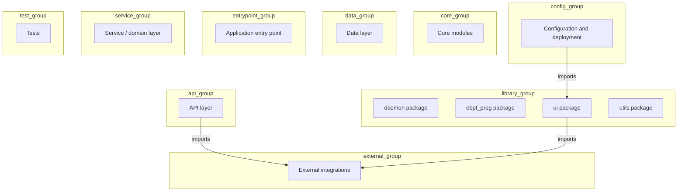

# Architecture report: evilsocket/opensnitch

> Automated static analysis. **Observed** = directly seen in files/imports/AST; **Inferred** = interpretation from that evidence. Repository code was not executed.

## 1. Repository at a glance

| Item | Value |
| --- | --- |
| Repository | evilsocket/opensnitch |
| Description | OpenSnitch is a GNU/Linux interactive application firewall inspired by Little Snitch. |
| Language | Python |
| Stars | 14298 |
| Licence | GPL-3.0 |
| Analysed commit / branch | a1353848ba1b660320e90cefea782c3fba272c00 / master |
| Framework(s) | None detected |
| Files analysed | 546 |
| Components | 12 |

## 2. Architecture in one minute

evilsocket/opensnitch - OpenSnitch is a GNU/Linux interactive application firewall inspired by Little Snitch.. This repository was analysed statically from 546 file(s) (175 Python). Detected technologies (observed from imports/manifests): GitHub Actions, requests, setuptools, pytest, unittest. Files are grouped into 12 component(s): API layer, Configuration and deployment, Core modules, daemon package, Data layer, ebpf_prog package, Application entry point, External integrations. Findings below distinguish observed facts from inferred interpretation.

## 3. High-level block diagram

## 4. Main components

### API layer (`api_layer`)

- **Kind:** api
- **Status:** Observed
- **Confidence:** 0.85
- **Responsibility:** Groups 27 file(s) under api layer (observed from repository paths and static analysis). Observed top-level classes: ActionFileController, AttachedRulesDialog, AttachedRulesIndex, BulkEditController, BulkEditDialog, ContextMenuController. Observed top-level functions: _apply_footer_separator_style, _apply_section_bar_style, _configure_modal_dialog, _is_memory_db_file, _is_shared_memory_db_file, _is_sqlite_uri.
- **Paths:** `ui/opensnitch/plugins/list_subscriptions/ui/controllers/__init__.py`, `ui/opensnitch/plugins/list_subscriptions/ui/controllers/action_file_controller.py`, `ui/opensnitch/plugins/list_subscriptions/ui/controllers/attached_rules_index.py`, `ui/opensnitch/plugins/list_subscriptions/ui/controllers/bulk_edit_controller.py`, `ui/opensnitch/plugins/list_subscriptions/ui/controllers/context_menu_controller.py`, `ui/opensnitch/plugins/list_subscriptions/ui/controllers/defaults_ui_controller.py`, `ui/opensnitch/plugins/list_subscriptions/ui/controllers/inspector_controller.py`, `ui/opensnitch/plugins/list_subscriptions/ui/controllers/rules_attachment_controller.py`, `ui/opensnitch/plugins/list_subscriptions/ui/controllers/rules_editor_controller.py`, `ui/opensnitch/plugins/list_subscriptions/ui/controllers/runtime_controller.py`, `ui/opensnitch/plugins/list_subscriptions/ui/controllers/selection_controller.py`, `ui/opensnitch/plugins/list_subscriptions/ui/controllers/status_controller.py`, `ui/opensnitch/plugins/list_subscriptions/ui/controllers/subscription_dialog_controller.py`, `ui/opensnitch/plugins/list_subscriptions/ui/controllers/subscription_edit_controller.py`, `ui/opensnitch/plugins/list_subscriptions/ui/controllers/subscription_status_controller.py`, `ui/opensnitch/plugins/list_subscriptions/ui/controllers/table_data_controller.py`, `ui/opensnitch/plugins/list_subscriptions/ui/controllers/table_view_controller.py`, `ui/opensnitch/plugins/list_subscriptions/ui/views/__init__.py`, `ui/opensnitch/plugins/list_subscriptions/ui/views/attached_rules_dialog.py`, `ui/opensnitch/plugins/list_subscriptions/ui/views/bulk_edit_dialog.py`, `ui/opensnitch/plugins/list_subscriptions/ui/views/helpers.py`, `ui/opensnitch/plugins/list_subscriptions/ui/views/inspector_panel.py`, `ui/opensnitch/plugins/list_subscriptions/ui/views/list_subscriptions_dialog.py`, `ui/opensnitch/plugins/list_subscriptions/ui/views/status_log_dialog.py`, `ui/opensnitch/plugins/list_subscriptions/ui/views/subscription_dialog.py`, `ui/opensnitch/plugins/list_subscriptions/ui/views/subscription_status_dialog.py`, `ui/opensnitch/plugins/list_subscriptions/ui/views/text_inspect_dialog.py`
- **Evidence:** [ui/opensnitch/plugins/list_subscriptions/ui/controllers/__init__.py](https://github.com/evilsocket/opensnitch/blob/a1353848ba1b660320e90cefea782c3fba272c00/ui/opensnitch/plugins/list_subscriptions/ui/controllers/__init__.py); [ui/opensnitch/plugins/list_subscriptions/ui/controllers/action_file_controller.py:24](https://github.com/evilsocket/opensnitch/blob/a1353848ba1b660320e90cefea782c3fba272c00/ui/opensnitch/plugins/list_subscriptions/ui/controllers/action_file_controller.py#L24); [ui/opensnitch/plugins/list_subscriptions/ui/controllers/attached_rules_index.py:5](https://github.com/evilsocket/opensnitch/blob/a1353848ba1b660320e90cefea782c3fba272c00/ui/opensnitch/plugins/list_subscriptions/ui/controllers/attached_rules_index.py#L5); [ui/opensnitch/plugins/list_subscriptions/ui/controllers/bulk_edit_controller.py:21](https://github.com/evilsocket/opensnitch/blob/a1353848ba1b660320e90cefea782c3fba272c00/ui/opensnitch/plugins/list_subscriptions/ui/controllers/bulk_edit_controller.py#L21); [ui/opensnitch/plugins/list_subscriptions/ui/controllers/context_menu_controller.py:11](https://github.com/evilsocket/opensnitch/blob/a1353848ba1b660320e90cefea782c3fba272c00/ui/opensnitch/plugins/list_subscriptions/ui/controllers/context_menu_controller.py#L11); [ui/opensnitch/plugins/list_subscriptions/ui/controllers/defaults_ui_controller.py:18](https://github.com/evilsocket/opensnitch/blob/a1353848ba1b660320e90cefea782c3fba272c00/ui/opensnitch/plugins/list_subscriptions/ui/controllers/defaults_ui_controller.py#L18); [ui/opensnitch/plugins/list_subscriptions/ui/controllers/inspector_controller.py:15](https://github.com/evilsocket/opensnitch/blob/a1353848ba1b660320e90cefea782c3fba272c00/ui/opensnitch/plugins/list_subscriptions/ui/controllers/inspector_controller.py#L15); [ui/opensnitch/plugins/list_subscriptions/ui/controllers/rules_attachment_controller.py:25](https://github.com/evilsocket/opensnitch/blob/a1353848ba1b660320e90cefea782c3fba272c00/ui/opensnitch/plugins/list_subscriptions/ui/controllers/rules_attachment_controller.py#L25)

### Configuration and deployment (`config`)

- **Kind:** config
- **Status:** Observed
- **Confidence:** 0.85
- **Responsibility:** Groups 43 file(s) under configuration and deployment (observed from repository paths and static analysis). Observed top-level classes: Config, ConfigManager. Observed top-level functions: build_node_config, load, save, save_node_auth_config, save_node_config, save_nodes_config.
- **Paths:** `daemon/Gopkg.toml`, `daemon/data/default-config.json`, `daemon/data/network_aliases.json`, `daemon/data/rules/000-allow-localhost.json`, `daemon/data/rules/000-allow-localhost6.json`, `daemon/data/system-fw.json`, `daemon/data/tasks/tasks.json`, `daemon/firewall/config/config.go`, `daemon/firewall/config/config_test.go`, `daemon/firewall/nftables/testdata/test-sysfw-conf.json`, `daemon/go.mod`, `daemon/rule/testdata/000-allow-chrome.json`, `daemon/rule/testdata/001-deny-chrome.json`, `daemon/rule/testdata/invalid-regexp-list.json`, `daemon/rule/testdata/invalid-regexp.json`, `daemon/rule/testdata/live_reload/test-live-reload-delete.json`, `daemon/rule/testdata/live_reload/test-live-reload-remove.json`, `daemon/rule/testdata/rule-disabled-operator-list-expanded.json`, `daemon/rule/testdata/rule-disabled-operator-list.json`, `daemon/rule/testdata/rule-operator-list-data-empty.json`, `daemon/rule/testdata/rule-operator-list.json`, `daemon/tasks/config/main.go`, `daemon/tasks/config/monitor.go`, `daemon/tasks/config/utils.go`, `daemon/tasks/iocscanner/config/config.go`, `daemon/ui/config/config.go`, `daemon/ui/testdata/config-invalid-procmon.json`, `daemon/ui/testdata/default-config.json`, `ui/MANIFEST.in`, `ui/opensnitch/config.py`, `ui/opensnitch/dialogs/events/config.py`, `ui/opensnitch/dialogs/preferences/settings.py`, `ui/opensnitch/plugins/downloader/example/downloaders.json`, `ui/opensnitch/plugins/highlight/example/commonActionsDelegate.json`, `ui/opensnitch/plugins/highlight/example/rulesActionsDelegate.json`, `ui/opensnitch/plugins/list_subscriptions/example/hagezi-light.txt.meta.json`, `ui/opensnitch/plugins/list_subscriptions/example/list_subscriptions.json`, `ui/opensnitch/plugins/versionchecker/versionchecker.json`, `ui/opensnitch/plugins/virustotal/example/virustotal.json`, `ui/opensnitch/utils/network_aliases/network_aliases.json`, `ui/requirements.txt`, `ui/setup.py`, `utils/packaging/daemon/deb/debian/gitlab-ci.yml`
- **Evidence:** [daemon/Gopkg.toml](https://github.com/evilsocket/opensnitch/blob/a1353848ba1b660320e90cefea782c3fba272c00/daemon/Gopkg.toml); [daemon/data/default-config.json](https://github.com/evilsocket/opensnitch/blob/a1353848ba1b660320e90cefea782c3fba272c00/daemon/data/default-config.json); [daemon/data/network_aliases.json](https://github.com/evilsocket/opensnitch/blob/a1353848ba1b660320e90cefea782c3fba272c00/daemon/data/network_aliases.json); [daemon/data/rules/000-allow-localhost.json](https://github.com/evilsocket/opensnitch/blob/a1353848ba1b660320e90cefea782c3fba272c00/daemon/data/rules/000-allow-localhost.json); [daemon/data/rules/000-allow-localhost6.json](https://github.com/evilsocket/opensnitch/blob/a1353848ba1b660320e90cefea782c3fba272c00/daemon/data/rules/000-allow-localhost6.json); [daemon/data/system-fw.json](https://github.com/evilsocket/opensnitch/blob/a1353848ba1b660320e90cefea782c3fba272c00/daemon/data/system-fw.json); [daemon/data/tasks/tasks.json](https://github.com/evilsocket/opensnitch/blob/a1353848ba1b660320e90cefea782c3fba272c00/daemon/data/tasks/tasks.json); [daemon/firewall/config/config.go](https://github.com/evilsocket/opensnitch/blob/a1353848ba1b660320e90cefea782c3fba272c00/daemon/firewall/config/config.go)

### Core modules (`core`)

- **Kind:** core
- **Status:** Observed
- **Confidence:** 0.85
- **Responsibility:** Groups 1 file(s) under core modules (observed from repository paths and static analysis).
- **Paths:** `release.sh`
- **Evidence:** [release.sh](https://github.com/evilsocket/opensnitch/blob/a1353848ba1b660320e90cefea782c3fba272c00/release.sh)

### daemon package (`daemon`)

- **Kind:** library
- **Status:** Observed
- **Confidence:** 0.85
- **Responsibility:** Groups 153 file(s) under daemon package (observed from repository paths and static analysis).
- **Paths:** `daemon/conman/connection.go`, `daemon/conman/connection_test.go`, `daemon/dns/ebpfhook.go`, `daemon/dns/parse.go`, `daemon/dns/systemd/monitor.go`, `daemon/dns/track.go`, `daemon/firewall/common/common.go`, `daemon/firewall/iptables/iptables.go`, `daemon/firewall/iptables/monitor.go`, `daemon/firewall/iptables/rules.go`, `daemon/firewall/iptables/system.go`, `daemon/firewall/nftables/chains.go`, `daemon/firewall/nftables/chains_test.go`, `daemon/firewall/nftables/exprs/counter.go`, `daemon/firewall/nftables/exprs/counter_test.go`, `daemon/firewall/nftables/exprs/ct.go`, `daemon/firewall/nftables/exprs/ct_test.go`, `daemon/firewall/nftables/exprs/enums.go`, `daemon/firewall/nftables/exprs/ether.go`, `daemon/firewall/nftables/exprs/ether_test.go`, `daemon/firewall/nftables/exprs/iface.go`, `daemon/firewall/nftables/exprs/iface_test.go`, `daemon/firewall/nftables/exprs/ip.go`, `daemon/firewall/nftables/exprs/ip_test.go`, `daemon/firewall/nftables/exprs/limit.go`, `daemon/firewall/nftables/exprs/log.go`, `daemon/firewall/nftables/exprs/log_test.go`, `daemon/firewall/nftables/exprs/meta.go`, `daemon/firewall/nftables/exprs/meta_test.go`, `daemon/firewall/nftables/exprs/nat.go`, `daemon/firewall/nftables/exprs/nat_test.go`, `daemon/firewall/nftables/exprs/notrack.go`, `daemon/firewall/nftables/exprs/operator.go`, `daemon/firewall/nftables/exprs/port.go`, `daemon/firewall/nftables/exprs/port_test.go`, `daemon/firewall/nftables/exprs/protocol.go`, `daemon/firewall/nftables/exprs/protocol_test.go`, `daemon/firewall/nftables/exprs/quota.go`, `daemon/firewall/nftables/exprs/quota_test.go`, `daemon/firewall/nftables/exprs/utils.go`, `daemon/firewall/nftables/exprs/verdict.go`, `daemon/firewall/nftables/exprs/verdict_test.go`, `daemon/firewall/nftables/monitor.go`, `daemon/firewall/nftables/monitor_test.go`, `daemon/firewall/nftables/nftables.go`, `daemon/firewall/nftables/nftest/nftest.go`, `daemon/firewall/nftables/nftest/utils.go`, `daemon/firewall/nftables/parser.go`, `daemon/firewall/nftables/rule_helpers.go`, `daemon/firewall/nftables/rules.go`, `daemon/firewall/nftables/rules_test.go`, `daemon/firewall/nftables/system.go`, `daemon/firewall/nftables/system_test.go`, `daemon/firewall/nftables/tables.go`, `daemon/firewall/nftables/tables_test.go`, `daemon/firewall/nftables/utils.go`, `daemon/firewall/nftables/utils_test.go`, `daemon/firewall/rules.go`, `daemon/internal/testutil/network.go`, `daemon/log/formats/csv.go`, `daemon/log/formats/formats.go`, `daemon/log/formats/json.go`, `daemon/log/formats/rfc3164.go`, `daemon/log/formats/rfc5424.go`, `daemon/log/log.go`, `daemon/log/loggers/logger.go`, `daemon/log/loggers/remote.go`, `daemon/log/loggers/remote_syslog.go`, `daemon/log/loggers/syslog.go`, `daemon/main.go`, `daemon/netfilter/netfilter_test.go`, `daemon/netfilter/packet.go`, `daemon/netfilter/queue.c`, `daemon/netfilter/queue.go`, `daemon/netfilter/queue.h`, `daemon/netlink/ifaces.go`, `daemon/netlink/procmon/procmon.go`, `daemon/netlink/socket.go`, `daemon/netlink/socket_linux.go`, `daemon/netlink/socket_packet.go`, `daemon/netlink/socket_test.go`, `daemon/netlink/socket_xdp.go`, `daemon/netstat/entry.go`, `daemon/netstat/find.go`, `daemon/netstat/parse.go`, `daemon/netstat/parse_packet.go`, `daemon/procmon/activepids.go`, `daemon/procmon/audit/client.go`, `daemon/procmon/audit/config.go`, `daemon/procmon/audit/parse.go`, `daemon/procmon/cache.go`, `daemon/procmon/cache_events.go`, `daemon/procmon/cache_events_test.go`, `daemon/procmon/cache_test.go`, `daemon/procmon/details.go`, `daemon/procmon/ebpf/cache.go`, `daemon/procmon/ebpf/config.go`, `daemon/procmon/ebpf/debug.go`, `daemon/procmon/ebpf/ebpf.go`, `daemon/procmon/ebpf/ebpf_test.go`, `daemon/procmon/ebpf/events.go`, `daemon/procmon/ebpf/find.go`, `daemon/procmon/ebpf/monitor.go`, `daemon/procmon/ebpf/utils.go`, `daemon/procmon/find.go`, `daemon/procmon/find_test.go`, `daemon/procmon/monitor/init.go`, `daemon/procmon/parse.go`, `daemon/procmon/process.go`, `daemon/procmon/process_test.go`, `daemon/rule/loader.go`, `daemon/rule/loader_test.go`, `daemon/rule/operator.go`, `daemon/rule/operator_aliases.go`, `daemon/rule/operator_lists.go`, `daemon/rule/operator_test.go`, `daemon/rule/rule.go`, `daemon/rule/rule_test.go`, `daemon/statistics/event.go`, `daemon/statistics/stats.go`, `daemon/tasks/base/main.go`, `daemon/tasks/doc.go`, `daemon/tasks/downloader/config.go`, `daemon/tasks/downloader/downloader.go`, `daemon/tasks/downloader/main.go`, `daemon/tasks/downloader/utils.go`, `daemon/tasks/iocscanner/main.go`, `daemon/tasks/iocscanner/run_tools.go`, `daemon/tasks/iocscanner/tools/base/base.go`, `daemon/tasks/iocscanner/tools/dpkg/dpkg.go`, `daemon/tasks/iocscanner/tools/executer/executer.go`, `daemon/tasks/iocscanner/tools/generic/generic.go`, `daemon/tasks/iocscanner/tools/yara/yara.go`, `daemon/tasks/load.go`, `daemon/tasks/looptask/main.go`, `daemon/tasks/main.go`, `daemon/tasks/main_test.go`, `daemon/tasks/nodemonitor/main.go`, `daemon/tasks/nodemonitor/main_test.go`, `daemon/tasks/pidmonitor/main.go`, `daemon/tasks/pidmonitor/main_test.go`, `daemon/tasks/scheduler/daily.go`, `daemon/tasks/scheduler/scheduler.go`, `daemon/tasks/socketsmonitor/dump.go`, `daemon/tasks/socketsmonitor/main.go`, `daemon/tasks/socketsmonitor/options.go`, `daemon/ui/alerts.go`, `daemon/ui/auth/auth.go`, `daemon/ui/client.go`, `daemon/ui/client_test.go`, `daemon/ui/config_utils.go`, `daemon/ui/notifications.go`, `daemon/ui/notifications_tasks.go`
- **Evidence:** [daemon/conman/connection.go](https://github.com/evilsocket/opensnitch/blob/a1353848ba1b660320e90cefea782c3fba272c00/daemon/conman/connection.go); [daemon/conman/connection_test.go](https://github.com/evilsocket/opensnitch/blob/a1353848ba1b660320e90cefea782c3fba272c00/daemon/conman/connection_test.go); [daemon/dns/ebpfhook.go](https://github.com/evilsocket/opensnitch/blob/a1353848ba1b660320e90cefea782c3fba272c00/daemon/dns/ebpfhook.go); [daemon/dns/parse.go](https://github.com/evilsocket/opensnitch/blob/a1353848ba1b660320e90cefea782c3fba272c00/daemon/dns/parse.go); [daemon/dns/systemd/monitor.go](https://github.com/evilsocket/opensnitch/blob/a1353848ba1b660320e90cefea782c3fba272c00/daemon/dns/systemd/monitor.go); [daemon/dns/track.go](https://github.com/evilsocket/opensnitch/blob/a1353848ba1b660320e90cefea782c3fba272c00/daemon/dns/track.go); [daemon/firewall/common/common.go](https://github.com/evilsocket/opensnitch/blob/a1353848ba1b660320e90cefea782c3fba272c00/daemon/firewall/common/common.go); [daemon/firewall/iptables/iptables.go](https://github.com/evilsocket/opensnitch/blob/a1353848ba1b660320e90cefea782c3fba272c00/daemon/firewall/iptables/iptables.go)

### Data layer (`data_layer`)

- **Kind:** data
- **Status:** Observed
- **Confidence:** 0.85
- **Responsibility:** Groups 10 file(s) under data layer (observed from repository paths and static analysis). Observed top-level classes: AlertFields, ConnFields, Database, GlobalDefaults, ListMetadata, MutableActionConfig. Observed top-level functions: enable_db_cleaner_options, enable_db_jrnl_wal, normalize_subscription_identities, save_config, type_changed.
- **Paths:** `ui/opensnitch/database/__init__.py`, `ui/opensnitch/database/enums.py`, `ui/opensnitch/dialogs/preferences/sections/db.py`, `ui/opensnitch/plugins/list_subscriptions/models/__init__.py`, `ui/opensnitch/plugins/list_subscriptions/models/action.py`, `ui/opensnitch/plugins/list_subscriptions/models/config.py`, `ui/opensnitch/plugins/list_subscriptions/models/events.py`, `ui/opensnitch/plugins/list_subscriptions/models/global_defaults.py`, `ui/opensnitch/plugins/list_subscriptions/models/metadata.py`, `ui/opensnitch/plugins/list_subscriptions/models/subscriptions.py`
- **Evidence:** [ui/opensnitch/database/__init__.py:9](https://github.com/evilsocket/opensnitch/blob/a1353848ba1b660320e90cefea782c3fba272c00/ui/opensnitch/database/__init__.py#L9); [ui/opensnitch/database/enums.py:2](https://github.com/evilsocket/opensnitch/blob/a1353848ba1b660320e90cefea782c3fba272c00/ui/opensnitch/database/enums.py#L2); [ui/opensnitch/dialogs/preferences/sections/db.py:8](https://github.com/evilsocket/opensnitch/blob/a1353848ba1b660320e90cefea782c3fba272c00/ui/opensnitch/dialogs/preferences/sections/db.py#L8); [ui/opensnitch/plugins/list_subscriptions/models/__init__.py](https://github.com/evilsocket/opensnitch/blob/a1353848ba1b660320e90cefea782c3fba272c00/ui/opensnitch/plugins/list_subscriptions/models/__init__.py); [ui/opensnitch/plugins/list_subscriptions/models/action.py:10](https://github.com/evilsocket/opensnitch/blob/a1353848ba1b660320e90cefea782c3fba272c00/ui/opensnitch/plugins/list_subscriptions/models/action.py#L10); [ui/opensnitch/plugins/list_subscriptions/models/config.py:11](https://github.com/evilsocket/opensnitch/blob/a1353848ba1b660320e90cefea782c3fba272c00/ui/opensnitch/plugins/list_subscriptions/models/config.py#L11); [ui/opensnitch/plugins/list_subscriptions/models/events.py:4](https://github.com/evilsocket/opensnitch/blob/a1353848ba1b660320e90cefea782c3fba272c00/ui/opensnitch/plugins/list_subscriptions/models/events.py#L4); [ui/opensnitch/plugins/list_subscriptions/models/global_defaults.py:9](https://github.com/evilsocket/opensnitch/blob/a1353848ba1b660320e90cefea782c3fba272c00/ui/opensnitch/plugins/list_subscriptions/models/global_defaults.py#L9)

### ebpf_prog package (`ebpf_prog`)

- **Kind:** library
- **Status:** Observed
- **Confidence:** 0.85
- **Responsibility:** Groups 9 file(s) under ebpf_prog package (observed from repository paths and static analysis).
- **Paths:** `ebpf_prog/bpf_headers/bpf_core_read.h`, `ebpf_prog/bpf_headers/bpf_helper_defs.h`, `ebpf_prog/bpf_headers/bpf_helpers.h`, `ebpf_prog/bpf_headers/bpf_tracing.h`, `ebpf_prog/common.h`, `ebpf_prog/common_defs.h`, `ebpf_prog/opensnitch-dns.c`, `ebpf_prog/opensnitch-procs.c`, `ebpf_prog/opensnitch.c`
- **Evidence:** [ebpf_prog/bpf_headers/bpf_core_read.h](https://github.com/evilsocket/opensnitch/blob/a1353848ba1b660320e90cefea782c3fba272c00/ebpf_prog/bpf_headers/bpf_core_read.h); [ebpf_prog/bpf_headers/bpf_helper_defs.h](https://github.com/evilsocket/opensnitch/blob/a1353848ba1b660320e90cefea782c3fba272c00/ebpf_prog/bpf_headers/bpf_helper_defs.h); [ebpf_prog/bpf_headers/bpf_helpers.h](https://github.com/evilsocket/opensnitch/blob/a1353848ba1b660320e90cefea782c3fba272c00/ebpf_prog/bpf_headers/bpf_helpers.h); [ebpf_prog/bpf_headers/bpf_tracing.h](https://github.com/evilsocket/opensnitch/blob/a1353848ba1b660320e90cefea782c3fba272c00/ebpf_prog/bpf_headers/bpf_tracing.h); [ebpf_prog/common.h](https://github.com/evilsocket/opensnitch/blob/a1353848ba1b660320e90cefea782c3fba272c00/ebpf_prog/common.h); [ebpf_prog/common_defs.h](https://github.com/evilsocket/opensnitch/blob/a1353848ba1b660320e90cefea782c3fba272c00/ebpf_prog/common_defs.h); [ebpf_prog/opensnitch-dns.c](https://github.com/evilsocket/opensnitch/blob/a1353848ba1b660320e90cefea782c3fba272c00/ebpf_prog/opensnitch-dns.c); [ebpf_prog/opensnitch-procs.c](https://github.com/evilsocket/opensnitch/blob/a1353848ba1b660320e90cefea782c3fba272c00/ebpf_prog/opensnitch-procs.c)

### Application entry point (`entrypoint`)

- **Kind:** entrypoint
- **Status:** Observed
- **Confidence:** 0.85
- **Responsibility:** Groups 1 file(s) under application entry point (observed from repository paths and static analysis). Observed top-level classes: ColorizedQSqlQueryModel, ConnectionsTableModel, ConnectionsTableView.
- **Paths:** `ui/opensnitch/customwidgets/main.py`
- **Evidence:** [ui/opensnitch/customwidgets/main.py:10](https://github.com/evilsocket/opensnitch/blob/a1353848ba1b660320e90cefea782c3fba272c00/ui/opensnitch/customwidgets/main.py#L10)

### External integrations (`external_integrations`)

- **Kind:** external
- **Status:** Inferred
- **Confidence:** 0.70
- **Responsibility:** Groups 0 file(s) under external integrations (observed from repository paths and static analysis).
- **Evidence:** [ui/opensnitch/plugins/downloader/downloader.py:4](https://github.com/evilsocket/opensnitch/blob/a1353848ba1b660320e90cefea782c3fba272c00/ui/opensnitch/plugins/downloader/downloader.py#L4); [ui/opensnitch/plugins/list_subscriptions/list_subscriptions.py:11](https://github.com/evilsocket/opensnitch/blob/a1353848ba1b660320e90cefea782c3fba272c00/ui/opensnitch/plugins/list_subscriptions/list_subscriptions.py#L11); [ui/opensnitch/plugins/list_subscriptions/ui/controllers/table_data_controller.py:6](https://github.com/evilsocket/opensnitch/blob/a1353848ba1b660320e90cefea782c3fba272c00/ui/opensnitch/plugins/list_subscriptions/ui/controllers/table_data_controller.py#L6); [ui/opensnitch/plugins/list_subscriptions/ui/workers/url_test_worker.py:32](https://github.com/evilsocket/opensnitch/blob/a1353848ba1b660320e90cefea782c3fba272c00/ui/opensnitch/plugins/list_subscriptions/ui/workers/url_test_worker.py#L32); [ui/opensnitch/plugins/versionchecker/versionchecker.py:4](https://github.com/evilsocket/opensnitch/blob/a1353848ba1b660320e90cefea782c3fba272c00/ui/opensnitch/plugins/versionchecker/versionchecker.py#L4); [ui/opensnitch/plugins/virustotal/_models.py:7](https://github.com/evilsocket/opensnitch/blob/a1353848ba1b660320e90cefea782c3fba272c00/ui/opensnitch/plugins/virustotal/_models.py#L7)

### Service / domain layer (`service_layer`)

- **Kind:** service
- **Status:** Observed
- **Confidence:** 0.85
- **Responsibility:** Groups 6 file(s) under service / domain layer (observed from repository paths and static analysis). Observed top-level classes: UIService.
- **Paths:** `daemon/core/core.go`, `daemon/core/ebpf.go`, `daemon/core/gzip.go`, `daemon/core/system.go`, `daemon/core/version.go`, `ui/opensnitch/service.py`
- **Evidence:** [daemon/core/core.go](https://github.com/evilsocket/opensnitch/blob/a1353848ba1b660320e90cefea782c3fba272c00/daemon/core/core.go); [daemon/core/ebpf.go](https://github.com/evilsocket/opensnitch/blob/a1353848ba1b660320e90cefea782c3fba272c00/daemon/core/ebpf.go); [daemon/core/gzip.go](https://github.com/evilsocket/opensnitch/blob/a1353848ba1b660320e90cefea782c3fba272c00/daemon/core/gzip.go); [daemon/core/system.go](https://github.com/evilsocket/opensnitch/blob/a1353848ba1b660320e90cefea782c3fba272c00/daemon/core/system.go); [daemon/core/version.go](https://github.com/evilsocket/opensnitch/blob/a1353848ba1b660320e90cefea782c3fba272c00/daemon/core/version.go); [ui/opensnitch/service.py:46](https://github.com/evilsocket/opensnitch/blob/a1353848ba1b660320e90cefea782c3fba272c00/ui/opensnitch/service.py#L46)

### Tests (`tests`)

- **Kind:** test
- **Status:** Observed
- **Confidence:** 0.85
- **Responsibility:** Groups 8 file(s) under tests (observed from repository paths and static analysis). Observed top-level classes: ClientConfig, Connection, NotifTest, TestNodes, TestPreferences, TestRulesEditor. Observed top-level functions: init_test_environment, mock_message_dialogs, qapp, qtbot, reset_node_before_each_test.
- **Paths:** `daemon/firewall/nftables/nftest/test_utils.go`, `ui/tests/README.md`, `ui/tests/__init__.py`, `ui/tests/conftest.py`, `ui/tests/dialogs/__init__.py`, `ui/tests/dialogs/test_preferences.py`, `ui/tests/dialogs/test_ruleseditor.py`, `ui/tests/test_nodes.py`
- **Evidence:** [daemon/firewall/nftables/nftest/test_utils.go](https://github.com/evilsocket/opensnitch/blob/a1353848ba1b660320e90cefea782c3fba272c00/daemon/firewall/nftables/nftest/test_utils.go); [ui/tests/README.md](https://github.com/evilsocket/opensnitch/blob/a1353848ba1b660320e90cefea782c3fba272c00/ui/tests/README.md); [ui/tests/__init__.py](https://github.com/evilsocket/opensnitch/blob/a1353848ba1b660320e90cefea782c3fba272c00/ui/tests/__init__.py); [ui/tests/conftest.py:13](https://github.com/evilsocket/opensnitch/blob/a1353848ba1b660320e90cefea782c3fba272c00/ui/tests/conftest.py#L13); [ui/tests/dialogs/__init__.py:7](https://github.com/evilsocket/opensnitch/blob/a1353848ba1b660320e90cefea782c3fba272c00/ui/tests/dialogs/__init__.py#L7); [ui/tests/dialogs/test_preferences.py:16](https://github.com/evilsocket/opensnitch/blob/a1353848ba1b660320e90cefea782c3fba272c00/ui/tests/dialogs/test_preferences.py#L16); [ui/tests/dialogs/test_ruleseditor.py:19](https://github.com/evilsocket/opensnitch/blob/a1353848ba1b660320e90cefea782c3fba272c00/ui/tests/dialogs/test_ruleseditor.py#L19); [ui/tests/test_nodes.py:14](https://github.com/evilsocket/opensnitch/blob/a1353848ba1b660320e90cefea782c3fba272c00/ui/tests/test_nodes.py#L14)

### ui package (`ui`)

- **Kind:** library
- **Status:** Observed
- **Confidence:** 0.85
- **Responsibility:** Groups 143 file(s) under ui package (observed from repository paths and static analysis). Observed top-level classes: Actions, AddressTableModel, AsnDB, AttachedRulesCountWorker, AttachedRulesFetchWorker, AttachedRulesProcessWorker. Observed top-level functions: __get_i18n_path, _cb_popup_link_clicked, _cb_proctab_changed, _close_worker_db, _configure_spin_and_units, _draw_toggle_switch.
- **Paths:** `ui/i18n/generate_i18n.sh`, `ui/i18n/locales/ar/opensnitch-ar.ts`, `ui/i18n/locales/cs_CZ/opensnitch-cs_CZ.ts`, `ui/i18n/locales/de_DE/opensnitch-de_DE.ts`, `ui/i18n/locales/eu_ES/opensnitch-eu_ES.ts`, `ui/i18n/locales/fi_FI/opensnitch-fi_FI.ts`, `ui/i18n/locales/he_IL/opensnitch-he_IL.ts`, `ui/i18n/locales/hu_HU/opensnitch-hu_HU.ts`, `ui/i18n/locales/id_ID/opensnitch-id_ID.ts`, `ui/i18n/locales/it_IT/opensnitch-it_IT.ts`, `ui/i18n/locales/ja_JP/opensnitch-ja_JP.ts`, `ui/i18n/locales/lt_LT/opensnitch-lt_LT.ts`, `ui/i18n/locales/nb_NO/opensnitch-nb_NO.ts`, `ui/i18n/locales/nl_NL/opensnitch-nl_NL.ts`, `ui/i18n/locales/ro_RO/opensnitch-ro_RO.ts`, `ui/i18n/locales/sq_AL/opensnitch-sq_AL.ts`, `ui/i18n/locales/zh_Hans/opensnitch-zh_Hans.ts`, `ui/i18n/locales/zh_TW/opensnitch-zh_TW.ts`, `ui/opensnitch/__init__.py`, `ui/opensnitch/actions/__init__.py`, `ui/opensnitch/actions/default_configs.py`, `ui/opensnitch/actions/enums.py`, `ui/opensnitch/actions/utils.py`, `ui/opensnitch/auth/__init__.py`, `ui/opensnitch/customwidgets/__init__.py`, `ui/opensnitch/customwidgets/addresstablemodel.py`, `ui/opensnitch/customwidgets/colorizeddelegate.py`, `ui/opensnitch/customwidgets/completer.py`, `ui/opensnitch/customwidgets/firewalltableview.py`, `ui/opensnitch/customwidgets/generictableview.py`, `ui/opensnitch/customwidgets/itemwidgetcentered.py`, `ui/opensnitch/customwidgets/netstattablemodel.py`, `ui/opensnitch/customwidgets/updownbtndelegate.py`, `ui/opensnitch/desktop_parser.py`, `ui/opensnitch/dialogs/__init__.py`, `ui/opensnitch/dialogs/conndetails.py`, `ui/opensnitch/dialogs/events/__init__.py`, `ui/opensnitch/dialogs/events/base.py`, `ui/opensnitch/dialogs/events/constants.py`, `ui/opensnitch/dialogs/events/dialog.py`, `ui/opensnitch/dialogs/events/menu_actions.py`, `ui/opensnitch/dialogs/events/menus.py`, `ui/opensnitch/dialogs/events/nodes.py`, `ui/opensnitch/dialogs/events/queries.py`, `ui/opensnitch/dialogs/events/tasks/__init__.py`, `ui/opensnitch/dialogs/events/tasks/netstat.py`, `ui/opensnitch/dialogs/events/tasks/nodemon.py`, `ui/opensnitch/dialogs/events/views.py`, `ui/opensnitch/dialogs/firewall.py`, `ui/opensnitch/dialogs/firewall_rule/__init__.py`, `ui/opensnitch/dialogs/firewall_rule/constants.py`, `ui/opensnitch/dialogs/firewall_rule/dialog.py`, `ui/opensnitch/dialogs/firewall_rule/notifications.py`, `ui/opensnitch/dialogs/firewall_rule/rules.py`, `ui/opensnitch/dialogs/firewall_rule/statements.py`, `ui/opensnitch/dialogs/firewall_rule/utils.py`, `ui/opensnitch/dialogs/preferences/__init__.py`, `ui/opensnitch/dialogs/preferences/dialog.py`, `ui/opensnitch/dialogs/preferences/sections/__init__.py`, `ui/opensnitch/dialogs/preferences/sections/nodes.py`, `ui/opensnitch/dialogs/preferences/sections/ui.py`, `ui/opensnitch/dialogs/preferences/signals.py`, `ui/opensnitch/dialogs/preferences/utils.py`, `ui/opensnitch/dialogs/processdetails.py`, `ui/opensnitch/dialogs/prompt/__init__.py`, `ui/opensnitch/dialogs/prompt/checksums.py`, `ui/opensnitch/dialogs/prompt/constants.py`, `ui/opensnitch/dialogs/prompt/details.py`, `ui/opensnitch/dialogs/prompt/dialog.py`, `ui/opensnitch/dialogs/prompt/utils.py`, `ui/opensnitch/dialogs/ruleseditor/__init__.py`, `ui/opensnitch/dialogs/ruleseditor/constants.py`, `ui/opensnitch/dialogs/ruleseditor/dialog.py`, `ui/opensnitch/dialogs/ruleseditor/nodes.py`, `ui/opensnitch/dialogs/ruleseditor/rules.py`, `ui/opensnitch/dialogs/ruleseditor/signals.py`, `ui/opensnitch/dialogs/ruleseditor/utils.py`, `ui/opensnitch/firewall/__init__.py`, `ui/opensnitch/firewall/chains.py`, `ui/opensnitch/firewall/enums.py`, `ui/opensnitch/firewall/exprs.py`, `ui/opensnitch/firewall/profiles.py`, `ui/opensnitch/firewall/rules.py`, `ui/opensnitch/firewall/utils.py`, `ui/opensnitch/nodes.py`, `ui/opensnitch/notifications.py`, `ui/opensnitch/plugins/__init__.py`, `ui/opensnitch/plugins/downloader/__init__.py`, `ui/opensnitch/plugins/downloader/_gui.py`, `ui/opensnitch/plugins/downloader/downloader.py`, `ui/opensnitch/plugins/highlight/__init__.py`, `ui/opensnitch/plugins/highlight/highlight.py`, `ui/opensnitch/plugins/list_subscriptions/__init__.py`, `ui/opensnitch/plugins/list_subscriptions/_annotations.py`, `ui/opensnitch/plugins/list_subscriptions/_compat.py`, `ui/opensnitch/plugins/list_subscriptions/_utils.py`, `ui/opensnitch/plugins/list_subscriptions/io/__init__.py`, `ui/opensnitch/plugins/list_subscriptions/io/lock.py`, `ui/opensnitch/plugins/list_subscriptions/io/storage.py`, `ui/opensnitch/plugins/list_subscriptions/list_subscriptions.py`, `ui/opensnitch/plugins/list_subscriptions/res/__init__.py`, `ui/opensnitch/plugins/list_subscriptions/ui/__init__.py`, `ui/opensnitch/plugins/list_subscriptions/ui/widgets/__init__.py`, `ui/opensnitch/plugins/list_subscriptions/ui/widgets/helpers.py`, `ui/opensnitch/plugins/list_subscriptions/ui/widgets/table_widgets.py`, `ui/opensnitch/plugins/list_subscriptions/ui/widgets/toggle_switch_widget.py`, `ui/opensnitch/plugins/list_subscriptions/ui/workers/__init__.py`, `ui/opensnitch/plugins/list_subscriptions/ui/workers/attached_rules_snapshot_worker.py`, `ui/opensnitch/plugins/list_subscriptions/ui/workers/state_refresh_worker.py`, `ui/opensnitch/plugins/list_subscriptions/ui/workers/url_test_worker.py`, `ui/opensnitch/plugins/sample/__init__.py`, `ui/opensnitch/plugins/sample/sample.py`, `ui/opensnitch/plugins/versionchecker/__init__.py`, `ui/opensnitch/plugins/versionchecker/versionchecker.py`, `ui/opensnitch/plugins/virustotal/__init__.py`, `ui/opensnitch/plugins/virustotal/_models.py`, `ui/opensnitch/plugins/virustotal/_popups.py`, `ui/opensnitch/plugins/virustotal/_procdialog.py`, `ui/opensnitch/plugins/virustotal/_utils.py`, `ui/opensnitch/plugins/virustotal/virustotal.py`, `ui/opensnitch/proto/__init__.py`, `ui/opensnitch/proto/enums.py`, `ui/opensnitch/proto/pre3200/ui_pb2.py`, `ui/opensnitch/proto/pre3200/ui_pb2_grpc.py`, `ui/opensnitch/proto/ui_pb2.py`, `ui/opensnitch/proto/ui_pb2_grpc.py`, `ui/opensnitch/res/__init__.py`, `ui/opensnitch/rules.py`, `ui/opensnitch/utils/__init__.py`, `ui/opensnitch/utils/duration/__init__.py`, `ui/opensnitch/utils/duration/duration.py`, `ui/opensnitch/utils/infowindow.py`, `ui/opensnitch/utils/languages.py`, `ui/opensnitch/utils/logger/__init__.py`, `ui/opensnitch/utils/logger/logger.py`, `ui/opensnitch/utils/network_aliases/__init__.py`, `ui/opensnitch/utils/network_aliases/network_aliases.py`, `ui/opensnitch/utils/qvalidator.py`, `ui/opensnitch/utils/sockets.py`, `ui/opensnitch/utils/themes/__init__.py`, `ui/opensnitch/utils/themes/themes.py`, `ui/opensnitch/utils/xdg.py`, `ui/opensnitch/version.py`
- **Evidence:** [ui/i18n/generate_i18n.sh](https://github.com/evilsocket/opensnitch/blob/a1353848ba1b660320e90cefea782c3fba272c00/ui/i18n/generate_i18n.sh); [ui/i18n/locales/ar/opensnitch-ar.ts](https://github.com/evilsocket/opensnitch/blob/a1353848ba1b660320e90cefea782c3fba272c00/ui/i18n/locales/ar/opensnitch-ar.ts); [ui/i18n/locales/cs_CZ/opensnitch-cs_CZ.ts](https://github.com/evilsocket/opensnitch/blob/a1353848ba1b660320e90cefea782c3fba272c00/ui/i18n/locales/cs_CZ/opensnitch-cs_CZ.ts); [ui/i18n/locales/de_DE/opensnitch-de_DE.ts](https://github.com/evilsocket/opensnitch/blob/a1353848ba1b660320e90cefea782c3fba272c00/ui/i18n/locales/de_DE/opensnitch-de_DE.ts); [ui/i18n/locales/eu_ES/opensnitch-eu_ES.ts](https://github.com/evilsocket/opensnitch/blob/a1353848ba1b660320e90cefea782c3fba272c00/ui/i18n/locales/eu_ES/opensnitch-eu_ES.ts); [ui/i18n/locales/fi_FI/opensnitch-fi_FI.ts](https://github.com/evilsocket/opensnitch/blob/a1353848ba1b660320e90cefea782c3fba272c00/ui/i18n/locales/fi_FI/opensnitch-fi_FI.ts); [ui/i18n/locales/he_IL/opensnitch-he_IL.ts](https://github.com/evilsocket/opensnitch/blob/a1353848ba1b660320e90cefea782c3fba272c00/ui/i18n/locales/he_IL/opensnitch-he_IL.ts); [ui/i18n/locales/hu_HU/opensnitch-hu_HU.ts](https://github.com/evilsocket/opensnitch/blob/a1353848ba1b660320e90cefea782c3fba272c00/ui/i18n/locales/hu_HU/opensnitch-hu_HU.ts)

### utils package (`utils`)

- **Kind:** library
- **Status:** Observed
- **Confidence:** 0.85
- **Responsibility:** Groups 7 file(s) under utils package (observed from repository paths and static analysis).
- **Paths:** `utils/legacy/make_ads_rules.py`, `utils/packaging/build_modules.sh`, `utils/scripts/ads/update_adlists.sh`, `utils/scripts/debug-ebpf-maps.sh`, `utils/scripts/ipasn_db_sync.sh`, `utils/scripts/ipasn_db_update.sh`, `utils/scripts/restart-opensnitch-onsleep.sh`
- **Evidence:** [utils/legacy/make_ads_rules.py](https://github.com/evilsocket/opensnitch/blob/a1353848ba1b660320e90cefea782c3fba272c00/utils/legacy/make_ads_rules.py); [utils/packaging/build_modules.sh](https://github.com/evilsocket/opensnitch/blob/a1353848ba1b660320e90cefea782c3fba272c00/utils/packaging/build_modules.sh); [utils/scripts/ads/update_adlists.sh](https://github.com/evilsocket/opensnitch/blob/a1353848ba1b660320e90cefea782c3fba272c00/utils/scripts/ads/update_adlists.sh); [utils/scripts/debug-ebpf-maps.sh](https://github.com/evilsocket/opensnitch/blob/a1353848ba1b660320e90cefea782c3fba272c00/utils/scripts/debug-ebpf-maps.sh); [utils/scripts/ipasn_db_sync.sh](https://github.com/evilsocket/opensnitch/blob/a1353848ba1b660320e90cefea782c3fba272c00/utils/scripts/ipasn_db_sync.sh); [utils/scripts/ipasn_db_update.sh](https://github.com/evilsocket/opensnitch/blob/a1353848ba1b660320e90cefea782c3fba272c00/utils/scripts/ipasn_db_update.sh); [utils/scripts/restart-opensnitch-onsleep.sh](https://github.com/evilsocket/opensnitch/blob/a1353848ba1b660320e90cefea782c3fba272c00/utils/scripts/restart-opensnitch-onsleep.sh)

## 5. Execution flow

No entry point was observed; the startup flow below is therefore limited.

Representative flow (derived from observed entry points and the import graph; steps beyond the entry point are **Inferred**):

1. Execution starts at an observed entry point listed above, if present.
2. `api_layer` imports `external_integrations` (API layer -> External integrations).
3. `config` imports `ui` (Configuration and deployment -> ui package).
4. `ui` imports `external_integrations` (ui package -> External integrations).

## 6. Project structure

### `(root)`

- `.gitignore` - other (92 bytes)
- `LICENSE` - docs (35149 bytes)
- `Makefile` - other (849 bytes)
- `README.md` - docs (4382 bytes)
- `release.sh` - source, Shell (675 bytes)

### `.github`

- `.github/FUNDING.yml` - config (654 bytes)
- `.github/ISSUE_TEMPLATE/bug_report.md` - docs (2089 bytes)
- `.github/ISSUE_TEMPLATE/config.yml` - config (139 bytes)
- `.github/ISSUE_TEMPLATE/feature-request.md` - docs (284 bytes)
- `.github/workflows/build_ebpf_modules.yml` - ci, YAML (2299 bytes)
- `.github/workflows/generic_validations.yml` - ci, YAML (886 bytes)
- `.github/workflows/go.yml` - ci, YAML (1308 bytes)

### `daemon`

- `daemon/.gitignore` - other (19 bytes)
- `daemon/Gopkg.toml` - config (352 bytes)
- `daemon/Makefile` - other (901 bytes)
- `daemon/conman/connection.go` - source, Go (9771 bytes)
- `daemon/conman/connection_test.go` - source, Go (3618 bytes)
- `daemon/core/core.go` - source, Go (1663 bytes)
- `daemon/core/ebpf.go` - source, Go (1839 bytes)
- `daemon/core/gzip.go` - source, Go (413 bytes)
- `daemon/core/system.go` - source, Go (6544 bytes)
- `daemon/core/version.go` - source, Go (200 bytes)
- `daemon/data/default-config.json` - config (1162 bytes)
- `daemon/data/init/opensnitchd-dinit` - other (178 bytes)
- `daemon/data/init/opensnitchd-openrc` - other (888 bytes)
- `daemon/data/init/opensnitchd.service` - other (256 bytes)
- `daemon/data/network_aliases.json` - config (221 bytes)
- `daemon/data/rules/000-allow-localhost.json` - config (503 bytes)
- `daemon/data/rules/000-allow-localhost6.json` - config (496 bytes)
- `daemon/data/system-fw.json` - config (7439 bytes)
- `daemon/data/tasks/tasks.json` - config (20 bytes)
- `daemon/dns/ebpfhook.go` - source, Go (6697 bytes)
- `daemon/dns/parse.go` - source, Go (511 bytes)
- `daemon/dns/systemd/monitor.go` - source, Go (6557 bytes)
- `daemon/dns/track.go` - source, Go (2139 bytes)
- `daemon/firewall/common/common.go` - source, Go (4436 bytes)
- `daemon/firewall/config/config.go` - source, Go (6850 bytes)
- `daemon/firewall/config/config_test.go` - source, Go (526 bytes)
- `daemon/firewall/iptables/iptables.go` - source, Go (5567 bytes)
- `daemon/firewall/iptables/monitor.go` - source, Go (2060 bytes)
- `daemon/firewall/iptables/rules.go` - source, Go (3160 bytes)
- `daemon/firewall/iptables/system.go` - source, Go (4873 bytes)
- `daemon/firewall/nftables/chains.go` - source, Go (6108 bytes)
- `daemon/firewall/nftables/chains_test.go` - source, Go (2444 bytes)
- `daemon/firewall/nftables/exprs/counter.go` - source, Go (255 bytes)
- `daemon/firewall/nftables/exprs/counter_test.go` - source, Go (1307 bytes)
- `daemon/firewall/nftables/exprs/ct.go` - source, Go (2912 bytes)
- `daemon/firewall/nftables/exprs/ct_test.go` - source, Go (5101 bytes)
- `daemon/firewall/nftables/exprs/enums.go` - source, Go (5734 bytes)
- `daemon/firewall/nftables/exprs/ether.go` - source, Go (1423 bytes)
- `daemon/firewall/nftables/exprs/ether_test.go` - source, Go (2747 bytes)
- `daemon/firewall/nftables/exprs/iface.go` - source, Go (690 bytes)
- `daemon/firewall/nftables/exprs/iface_test.go` - source, Go (2274 bytes)
- `daemon/firewall/nftables/exprs/ip.go` - source, Go (3903 bytes)
- `daemon/firewall/nftables/exprs/ip_test.go` - source, Go (6427 bytes)
- `daemon/firewall/nftables/exprs/limit.go` - source, Go (2060 bytes)
- `daemon/firewall/nftables/exprs/log.go` - source, Go (1810 bytes)
- `daemon/firewall/nftables/exprs/log_test.go` - source, Go (3277 bytes)
- `daemon/firewall/nftables/exprs/meta.go` - source, Go (3491 bytes)
- `daemon/firewall/nftables/exprs/meta_test.go` - source, Go (4095 bytes)
- `daemon/firewall/nftables/exprs/nat.go` - source, Go (4151 bytes)
- `daemon/firewall/nftables/exprs/nat_test.go` - source, Go (12322 bytes)
- `daemon/firewall/nftables/exprs/notrack.go` - source, Go (196 bytes)
- `daemon/firewall/nftables/exprs/operator.go` - source, Go (583 bytes)
- `daemon/firewall/nftables/exprs/port.go` - source, Go (2257 bytes)
- `daemon/firewall/nftables/exprs/port_test.go` - source, Go (5358 bytes)
- `daemon/firewall/nftables/exprs/protocol.go` - source, Go (2801 bytes)
- `daemon/firewall/nftables/exprs/protocol_test.go` - source, Go (2372 bytes)
- `daemon/firewall/nftables/exprs/quota.go` - source, Go (1672 bytes)
- `daemon/firewall/nftables/exprs/quota_test.go` - source, Go (4360 bytes)
- `daemon/firewall/nftables/exprs/utils.go` - source, Go (5520 bytes)
- `daemon/firewall/nftables/exprs/verdict.go` - source, Go (4939 bytes)
- `daemon/firewall/nftables/exprs/verdict_test.go` - source, Go (8883 bytes)
- `daemon/firewall/nftables/monitor.go` - source, Go (2299 bytes)
- `daemon/firewall/nftables/monitor_test.go` - source, Go (2985 bytes)
- `daemon/firewall/nftables/nftables.go` - source, Go (5264 bytes)
- `daemon/firewall/nftables/nftest/nftest.go` - source, Go (1772 bytes)
- `daemon/firewall/nftables/nftest/test_utils.go` - test, Go (6854 bytes)
- `daemon/firewall/nftables/nftest/utils.go` - source, Go (2819 bytes)
- `daemon/firewall/nftables/parser.go` - source, Go (6672 bytes)
- `daemon/firewall/nftables/rule_helpers.go` - source, Go (6203 bytes)
- `daemon/firewall/nftables/rules.go` - source, Go (7813 bytes)
- `daemon/firewall/nftables/rules_test.go` - source, Go (6254 bytes)
- `daemon/firewall/nftables/system.go` - source, Go (4948 bytes)
- `daemon/firewall/nftables/system_test.go` - source, Go (4679 bytes)
- `daemon/firewall/nftables/tables.go` - source, Go (1867 bytes)
- `daemon/firewall/nftables/tables_test.go` - source, Go (3040 bytes)
- `daemon/firewall/nftables/testdata/test-sysfw-conf.json` - config (4356 bytes)
- `daemon/firewall/nftables/utils.go` - source, Go (6193 bytes)
- `daemon/firewall/nftables/utils_test.go` - source, Go (7659 bytes)
- `daemon/firewall/rules.go` - source, Go (4745 bytes)
- `daemon/go.mod` - manifest (879 bytes)
- `daemon/go.sum` - other (10102 bytes)
- `daemon/internal/testutil/network.go` - source, Go (7688 bytes)
- `daemon/log/formats/csv.go` - source, Go (966 bytes)
- `daemon/log/formats/formats.go` - source, Go (1773 bytes)
- `daemon/log/formats/json.go` - source, Go (1796 bytes)
- `daemon/log/formats/rfc3164.go` - source, Go (1454 bytes)
- `daemon/log/formats/rfc5424.go` - source, Go (1532 bytes)
- `daemon/log/log.go` - source, Go (5088 bytes)
- `daemon/log/loggers/logger.go` - source, Go (4533 bytes)
- `daemon/log/loggers/remote.go` - source, Go (6292 bytes)
- `daemon/log/loggers/remote_syslog.go` - source, Go (772 bytes)
- `daemon/log/loggers/syslog.go` - source, Go (1733 bytes)
- `daemon/main.go` - source, Go (20406 bytes)
- `daemon/netfilter/netfilter_test.go` - source, Go (21229 bytes)
- `daemon/netfilter/packet.go` - source, Go (1553 bytes)
- `daemon/netfilter/queue.c` - source, C (20 bytes)
- `daemon/netfilter/queue.go` - source, Go (6810 bytes)
- `daemon/netfilter/queue.h` - source, C/C++ (3280 bytes)
- `daemon/netlink/ifaces.go` - source, Go (1234 bytes)
- `daemon/netlink/procmon/procmon.go` - source, Go (3688 bytes)
- `daemon/netlink/socket.go` - source, Go (8488 bytes)
- `daemon/netlink/socket_linux.go` - source, Go (6843 bytes)
- `daemon/netlink/socket_packet.go` - source, Go (5447 bytes)
- `daemon/netlink/socket_test.go` - source, Go (2982 bytes)
- `daemon/netlink/socket_xdp.go` - source, Go (239 bytes)
- `daemon/netstat/entry.go` - source, Go (785 bytes)
- `daemon/netstat/find.go` - source, Go (1330 bytes)
- `daemon/netstat/parse.go` - source, Go (2730 bytes)
- `daemon/netstat/parse_packet.go` - source, Go (1371 bytes)
- `daemon/procmon/activepids.go` - source, Go (1631 bytes)
- `daemon/procmon/audit/client.go` - source, Go (9305 bytes)
- `daemon/procmon/audit/config.go` - source, Go (325 bytes)
- `daemon/procmon/audit/parse.go` - source, Go (7846 bytes)
- `daemon/procmon/cache.go` - source, Go (7473 bytes)
- `daemon/procmon/cache_events.go` - source, Go (10125 bytes)
- `daemon/procmon/cache_events_test.go` - source, Go (5297 bytes)
- `daemon/procmon/cache_test.go` - source, Go (3461 bytes)
- `daemon/procmon/details.go` - source, Go (18678 bytes)
- `daemon/procmon/ebpf/cache.go` - source, Go (2330 bytes)
- `daemon/procmon/ebpf/config.go` - source, Go (1321 bytes)
- `daemon/procmon/ebpf/debug.go` - source, Go (1775 bytes)
- `daemon/procmon/ebpf/ebpf.go` - source, Go (9040 bytes)
- `daemon/procmon/ebpf/ebpf_test.go` - source, Go (44915 bytes)
- `daemon/procmon/ebpf/events.go` - source, Go (9700 bytes)
- `daemon/procmon/ebpf/find.go` - source, Go (7788 bytes)
- `daemon/procmon/ebpf/monitor.go` - source, Go (4011 bytes)
- `daemon/procmon/ebpf/utils.go` - source, Go (3684 bytes)
- `daemon/procmon/find.go` - source, Go (2836 bytes)
- `daemon/procmon/find_test.go` - source, Go (892 bytes)
- `daemon/procmon/monitor/init.go` - source, Go (3600 bytes)
- `daemon/procmon/parse.go` - source, Go (3523 bytes)
- `daemon/procmon/process.go` - source, Go (6236 bytes)
- `daemon/procmon/process_test.go` - source, Go (4323 bytes)
- `daemon/rule/loader.go` - source, Go (14423 bytes)
- `daemon/rule/loader_test.go` - source, Go (12342 bytes)
- `daemon/rule/operator.go` - source, Go (13930 bytes)
- `daemon/rule/operator_aliases.go` - source, Go (1361 bytes)
- `daemon/rule/operator_lists.go` - source, Go (12303 bytes)
- `daemon/rule/operator_test.go` - source, Go (38025 bytes)
- `daemon/rule/rule.go` - source, Go (4689 bytes)
- `daemon/rule/rule_test.go` - source, Go (3219 bytes)
- `daemon/rule/testdata/000-allow-chrome.json` - config (376 bytes)
- `daemon/rule/testdata/001-deny-chrome.json` - config (375 bytes)
- `daemon/rule/testdata/invalid-regexp-list.json` - config (854 bytes)
- `daemon/rule/testdata/invalid-regexp.json` - config (380 bytes)
- `daemon/rule/testdata/lists/domains/domainlists.txt` - docs (116 bytes)
- `daemon/rule/testdata/lists/ips/ips.txt` - docs (151 bytes)
- `daemon/rule/testdata/lists/nets/nets.txt` - docs (160 bytes)
- `daemon/rule/testdata/lists/regexp/domainsregexp.txt` - docs (90 bytes)
- `daemon/rule/testdata/live_reload/test-live-reload-delete.json` - config (400 bytes)
- `daemon/rule/testdata/live_reload/test-live-reload-remove.json` - config (400 bytes)
- `daemon/rule/testdata/rule-disabled-operator-list-expanded.json` - config (683 bytes)
- `daemon/rule/testdata/rule-disabled-operator-list.json` - config (580 bytes)
- `daemon/rule/testdata/rule-operator-list-data-empty.json` - config (675 bytes)
- `daemon/rule/testdata/rule-operator-list.json` - config (863 bytes)
- `daemon/statistics/event.go` - source, Go (681 bytes)
- `daemon/statistics/stats.go` - source, Go (6985 bytes)
- `daemon/tasks/base/main.go` - source, Go (2453 bytes)
- `daemon/tasks/config/main.go` - source, Go (2680 bytes)
- `daemon/tasks/config/monitor.go` - source, Go (2596 bytes)
- `daemon/tasks/config/utils.go` - source, Go (542 bytes)
- `daemon/tasks/doc.go` - source, Go (1008 bytes)
- `daemon/tasks/downloader/README.md` - docs (2310 bytes)
- `daemon/tasks/downloader/config.go` - source, Go (1053 bytes)
- `daemon/tasks/downloader/downloader.go` - source, Go (2547 bytes)
- `daemon/tasks/downloader/main.go` - source, Go (4618 bytes)
- `daemon/tasks/downloader/utils.go` - source, Go (1693 bytes)
- `daemon/tasks/iocscanner/README.md` - docs (6344 bytes)
- `daemon/tasks/iocscanner/config/config.go` - source, Go (4569 bytes)
- `daemon/tasks/iocscanner/main.go` - source, Go (4999 bytes)
- `daemon/tasks/iocscanner/run_tools.go` - source, Go (1664 bytes)
- `daemon/tasks/iocscanner/tools/base/base.go` - source, Go (1618 bytes)
- `daemon/tasks/iocscanner/tools/dpkg/dpkg.go` - source, Go (4089 bytes)
- `daemon/tasks/iocscanner/tools/executer/executer.go` - source, Go (2356 bytes)
- `daemon/tasks/iocscanner/tools/generic/generic.go` - source, Go (3465 bytes)
- `daemon/tasks/iocscanner/tools/yara/yara.go` - source, Go (6049 bytes)
- `daemon/tasks/load.go` - source, Go (4235 bytes)
- `daemon/tasks/looptask/main.go` - source, Go (2243 bytes)
- `daemon/tasks/main.go` - source, Go (4768 bytes)
- `daemon/tasks/main_test.go` - source, Go (1575 bytes)
- `daemon/tasks/nodemonitor/main.go` - source, Go (2639 bytes)
- `daemon/tasks/nodemonitor/main_test.go` - source, Go (1840 bytes)
- `daemon/tasks/pidmonitor/main.go` - source, Go (2822 bytes)
- `daemon/tasks/pidmonitor/main_test.go` - source, Go (1966 bytes)
- `daemon/tasks/scheduler/daily.go` - source, Go (5209 bytes)
- `daemon/tasks/scheduler/scheduler.go` - source, Go (4096 bytes)
- `daemon/tasks/socketsmonitor/dump.go` - source, Go (5106 bytes)
- `daemon/tasks/socketsmonitor/main.go` - source, Go (3320 bytes)
- `daemon/tasks/socketsmonitor/options.go` - source, Go (1211 bytes)
- `daemon/ui/alerts.go` - source, Go (3767 bytes)
- `daemon/ui/auth/auth.go` - source, Go (2811 bytes)
- `daemon/ui/client.go` - source, Go (10146 bytes)
- `daemon/ui/client_test.go` - source, Go (6362 bytes)
- `daemon/ui/config/config.go` - source, Go (4210 bytes)
- `daemon/ui/config_utils.go` - source, Go (9801 bytes)
- `daemon/ui/notifications.go` - source, Go (14213 bytes)
- `daemon/ui/notifications_tasks.go` - source, Go (3750 bytes)
- `daemon/ui/protocol/.gitkeep` - other (0 bytes)
- `daemon/ui/testdata/config-invalid-procmon.json` - config (1386 bytes)
- `daemon/ui/testdata/default-config.json` - config (1317 bytes)
- `daemon/ui/testdata/default-config.json.orig` - other (1317 bytes)

### `ebpf_prog`

- `ebpf_prog/Makefile` - other (3417 bytes)
- `ebpf_prog/README` - other (2532 bytes)
- `ebpf_prog/arm-clang-asm-fix.patch` - other (385 bytes)
- `ebpf_prog/bpf_headers/bpf_core_read.h` - source, C/C++ (19546 bytes)
- `ebpf_prog/bpf_headers/bpf_helper_defs.h` - source, C/C++ (166052 bytes)
- `ebpf_prog/bpf_headers/bpf_helpers.h` - source, C/C++ (10202 bytes)
- `ebpf_prog/bpf_headers/bpf_tracing.h` - source, C/C++ (22753 bytes)
- `ebpf_prog/common.h` - source, C/C++ (2159 bytes)
- `ebpf_prog/common_defs.h` - source, C/C++ (845 bytes)
- `ebpf_prog/opensnitch-dns.c` - source, C (7163 bytes)
- `ebpf_prog/opensnitch-procs.c` - source, C (7177 bytes)
- `ebpf_prog/opensnitch.c` - source, C (20877 bytes)

### `proto`

- `proto/.gitignore` - other (6 bytes)
- `proto/Makefile` - other (681 bytes)
- `proto/ui.proto` - other (6906 bytes)

### `ui`

- `ui/.gitignore` - other (40 bytes)
- `ui/LICENSE` - docs (1114 bytes)
- `ui/MANIFEST.in` - manifest (220 bytes)
- `ui/Makefile` - other (426 bytes)
- `ui/bin/opensnitch-ui` - other (13992 bytes)
- `ui/i18n/Makefile` - other (1101 bytes)
- `ui/i18n/README.md` - docs (1000 bytes)
- `ui/i18n/generate_i18n.sh` - source, Shell (703 bytes)
- `ui/i18n/locales/ar/opensnitch-ar.ts` - source, TypeScript (151575 bytes)
- `ui/i18n/locales/cs_CZ/opensnitch-cs_CZ.ts` - source, TypeScript (181900 bytes)
- `ui/i18n/locales/de_DE/opensnitch-de_DE.ts` - source, TypeScript (192764 bytes)
- `ui/i18n/locales/eu_ES/opensnitch-eu_ES.ts` - source, TypeScript (150430 bytes)
- `ui/i18n/locales/fi_FI/opensnitch-fi_FI.ts` - source, TypeScript (171419 bytes)
- `ui/i18n/locales/he_IL/opensnitch-he_IL.ts` - source, TypeScript (150640 bytes)
- `ui/i18n/locales/hu_HU/opensnitch-hu_HU.ts` - source, TypeScript (199588 bytes)
- `ui/i18n/locales/id_ID/opensnitch-id_ID.ts` - source, TypeScript (166312 bytes)
- `ui/i18n/locales/it_IT/opensnitch-it_IT.ts` - source, TypeScript (191267 bytes)
- `ui/i18n/locales/ja_JP/opensnitch-ja_JP.ts` - source, TypeScript (180043 bytes)
- `ui/i18n/locales/lt_LT/opensnitch-lt_LT.ts` - source, TypeScript (188988 bytes)
- `ui/i18n/locales/nb_NO/opensnitch-nb_NO.ts` - source, TypeScript (186975 bytes)
- `ui/i18n/locales/nl_NL/opensnitch-nl_NL.ts` - source, TypeScript (195875 bytes)
- `ui/i18n/locales/ro_RO/opensnitch-ro_RO.ts` - source, TypeScript (173693 bytes)
- `ui/i18n/locales/sq_AL/opensnitch-sq_AL.ts` - source, TypeScript (188076 bytes)
- `ui/i18n/locales/zh_Hans/opensnitch-zh_Hans.ts` - source, TypeScript (198934 bytes)
- `ui/i18n/locales/zh_TW/opensnitch-zh_TW.ts` - source, TypeScript (168120 bytes)
- `ui/i18n/opensnitch_i18n.pro` - other (4026 bytes)
- `ui/opensnitch/__init__.py` - source, Python (0 bytes)
- `ui/opensnitch/actions/__init__.py` - source, Python (9474 bytes)
- `ui/opensnitch/actions/default_configs.py` - source, Python (5218 bytes)
- `ui/opensnitch/actions/enums.py` - source, Python (61 bytes)
- `ui/opensnitch/actions/utils.py` - source, Python (315 bytes)
- `ui/opensnitch/auth/__init__.py` - source, Python (1054 bytes)
- `ui/opensnitch/config.py` - source, Python (11883 bytes)
- `ui/opensnitch/customwidgets/__init__.py` - source, Python (687 bytes)
- `ui/opensnitch/customwidgets/addresstablemodel.py` - source, Python (1852 bytes)
- `ui/opensnitch/customwidgets/colorizeddelegate.py` - source, Python (3268 bytes)
- `ui/opensnitch/customwidgets/completer.py` - source, Python (1709 bytes)
- `ui/opensnitch/customwidgets/firewalltableview.py` - source, Python (11981 bytes)
- `ui/opensnitch/customwidgets/generictableview.py` - source, Python (50802 bytes)
- `ui/opensnitch/customwidgets/itemwidgetcentered.py` - source, Python (1741 bytes)
- `ui/opensnitch/customwidgets/main.py` - source, Python (22396 bytes)
- `ui/opensnitch/customwidgets/netstattablemodel.py` - source, Python (1517 bytes)
- `ui/opensnitch/customwidgets/updownbtndelegate.py` - source, Python (1782 bytes)
- `ui/opensnitch/database/__init__.py` - source, Python (27543 bytes)
- `ui/opensnitch/database/enums.py` - source, Python (1023 bytes)
- `ui/opensnitch/database/migrations/upgrade_1.sql` - data, SQL (42 bytes)
- `ui/opensnitch/database/migrations/upgrade_2.sql` - data, SQL (36 bytes)
- `ui/opensnitch/database/migrations/upgrade_3.sql` - data, SQL (38 bytes)
- `ui/opensnitch/desktop_parser.py` - source, Python (7330 bytes)
- `ui/opensnitch/dialogs/__init__.py` - source, Python (0 bytes)
- `ui/opensnitch/dialogs/conndetails.py` - source, Python (1973 bytes)
- `ui/opensnitch/dialogs/events/__init__.py` - source, Python (730 bytes)
- `ui/opensnitch/dialogs/events/base.py` - source, Python (3696 bytes)
- `ui/opensnitch/dialogs/events/config.py` - source, Python (28398 bytes)
- `ui/opensnitch/dialogs/events/constants.py` - source, Python (1852 bytes)
- `ui/opensnitch/dialogs/events/dialog.py` - source, Python (64928 bytes)
- `ui/opensnitch/dialogs/events/menu_actions.py` - source, Python (18054 bytes)
- `ui/opensnitch/dialogs/events/menus.py` - source, Python (22475 bytes)
- `ui/opensnitch/dialogs/events/nodes.py` - source, Python (2352 bytes)
- `ui/opensnitch/dialogs/events/queries.py` - source, Python (25476 bytes)
- `ui/opensnitch/dialogs/events/tasks/__init__.py` - source, Python (698 bytes)
- `ui/opensnitch/dialogs/events/tasks/netstat.py` - source, Python (10743 bytes)
- `ui/opensnitch/dialogs/events/tasks/nodemon.py` - source, Python (6743 bytes)
- `ui/opensnitch/dialogs/events/views.py` - source, Python (29631 bytes)
- `ui/opensnitch/dialogs/firewall.py` - source, Python (19830 bytes)
- `ui/opensnitch/dialogs/firewall_rule/__init__.py` - source, Python (732 bytes)
- `ui/opensnitch/dialogs/firewall_rule/constants.py` - source, Python (223 bytes)
- `ui/opensnitch/dialogs/firewall_rule/dialog.py` - source, Python (24172 bytes)
- `ui/opensnitch/dialogs/firewall_rule/notifications.py` - source, Python (2830 bytes)
- `ui/opensnitch/dialogs/firewall_rule/rules.py` - source, Python (16706 bytes)
- `ui/opensnitch/dialogs/firewall_rule/statements.py` - source, Python (19522 bytes)
- `ui/opensnitch/dialogs/firewall_rule/utils.py` - source, Python (3782 bytes)
- `ui/opensnitch/dialogs/preferences/__init__.py` - source, Python (737 bytes)
- `ui/opensnitch/dialogs/preferences/dialog.py` - source, Python (17394 bytes)
- `ui/opensnitch/dialogs/preferences/sections/__init__.py` - source, Python (697 bytes)
- `ui/opensnitch/dialogs/preferences/sections/db.py` - source, Python (2627 bytes)
- `ui/opensnitch/dialogs/preferences/sections/nodes.py` - source, Python (8691 bytes)
- `ui/opensnitch/dialogs/preferences/sections/ui.py` - source, Python (7408 bytes)
- `ui/opensnitch/dialogs/preferences/settings.py` - source, Python (23367 bytes)
- `ui/opensnitch/dialogs/preferences/signals.py` - source, Python (6075 bytes)
- `ui/opensnitch/dialogs/preferences/utils.py` - source, Python (4919 bytes)
- `ui/opensnitch/dialogs/processdetails.py` - source, Python (15225 bytes)
- `ui/opensnitch/dialogs/prompt/__init__.py` - source, Python (732 bytes)
- `ui/opensnitch/dialogs/prompt/checksums.py` - source, Python (2104 bytes)
- `ui/opensnitch/dialogs/prompt/constants.py` - source, Python (1223 bytes)
- `ui/opensnitch/dialogs/prompt/details.py` - source, Python (1350 bytes)
- `ui/opensnitch/dialogs/prompt/dialog.py` - source, Python (30736 bytes)
- `ui/opensnitch/dialogs/prompt/utils.py` - source, Python (13816 bytes)
- `ui/opensnitch/dialogs/ruleseditor/__init__.py` - source, Python (737 bytes)
- `ui/opensnitch/dialogs/ruleseditor/constants.py` - source, Python (639 bytes)
- `ui/opensnitch/dialogs/ruleseditor/dialog.py` - source, Python (38212 bytes)
- `ui/opensnitch/dialogs/ruleseditor/nodes.py` - source, Python (1793 bytes)
- `ui/opensnitch/dialogs/ruleseditor/rules.py` - source, Python (8184 bytes)
- `ui/opensnitch/dialogs/ruleseditor/signals.py` - source, Python (2030 bytes)
- `ui/opensnitch/dialogs/ruleseditor/utils.py` - source, Python (5908 bytes)
- `ui/opensnitch/firewall/__init__.py` - source, Python (8773 bytes)
- `ui/opensnitch/firewall/chains.py` - source, Python (8097 bytes)
- `ui/opensnitch/firewall/enums.py` - source, Python (2493 bytes)
- `ui/opensnitch/firewall/exprs.py` - source, Python (3147 bytes)
- `ui/opensnitch/firewall/profiles.py` - source, Python (5027 bytes)
- `ui/opensnitch/firewall/rules.py` - source, Python (11732 bytes)
- `ui/opensnitch/firewall/utils.py` - source, Python (794 bytes)
- `ui/opensnitch/nodes.py` - source, Python (17649 bytes)
- `ui/opensnitch/notifications.py` - source, Python (5647 bytes)
- `ui/opensnitch/plugins/__init__.py` - source, Python (6936 bytes)
- `ui/opensnitch/plugins/downloader/__init__.py` - source, Python (687 bytes)
- `ui/opensnitch/plugins/downloader/_gui.py` - source, Python (703 bytes)
- `ui/opensnitch/plugins/downloader/downloader.py` - source, Python (8297 bytes)
- `ui/opensnitch/plugins/downloader/example/downloaders.json` - config (3058 bytes)
- `ui/opensnitch/plugins/highlight/README.md` - docs (4989 bytes)
- `ui/opensnitch/plugins/highlight/__init__.py` - source, Python (687 bytes)
- `ui/opensnitch/plugins/highlight/example/commonActionsDelegate.json` - config (1575 bytes)
- `ui/opensnitch/plugins/highlight/example/rulesActionsDelegate.json` - config (1280 bytes)
- `ui/opensnitch/plugins/highlight/highlight.py` - source, Python (11666 bytes)
- `ui/opensnitch/plugins/list_subscriptions/__init__.py` - source, Python (688 bytes)
- `ui/opensnitch/plugins/list_subscriptions/_annotations.py` - source, Python (1512 bytes)
- `ui/opensnitch/plugins/list_subscriptions/_compat.py` - source, Python (310 bytes)
- `ui/opensnitch/plugins/list_subscriptions/_utils.py` - source, Python (10864 bytes)
- `ui/opensnitch/plugins/list_subscriptions/example/hagezi-light.txt.meta.json` - config (410 bytes)
- `ui/opensnitch/plugins/list_subscriptions/example/list_subscriptions.json` - config (1138 bytes)
- `ui/opensnitch/plugins/list_subscriptions/io/__init__.py` - source, Python (1 bytes)
- `ui/opensnitch/plugins/list_subscriptions/io/lock.py` - source, Python (2628 bytes)
- `ui/opensnitch/plugins/list_subscriptions/io/storage.py` - source, Python (1624 bytes)
- `ui/opensnitch/plugins/list_subscriptions/list_subscriptions.py` - source, Python (67391 bytes)
- `ui/opensnitch/plugins/list_subscriptions/models/__init__.py` - source, Python (0 bytes)
- `ui/opensnitch/plugins/list_subscriptions/models/action.py` - source, Python (3273 bytes)
- `ui/opensnitch/plugins/list_subscriptions/models/config.py` - source, Python (4814 bytes)
- `ui/opensnitch/plugins/list_subscriptions/models/events.py` - source, Python (883 bytes)
- `ui/opensnitch/plugins/list_subscriptions/models/global_defaults.py` - source, Python (1395 bytes)
- `ui/opensnitch/plugins/list_subscriptions/models/metadata.py` - source, Python (1510 bytes)
- `ui/opensnitch/plugins/list_subscriptions/models/subscriptions.py` - source, Python (10260 bytes)
- `ui/opensnitch/plugins/list_subscriptions/res/__init__.py` - source, Python (0 bytes)
- `ui/opensnitch/plugins/list_subscriptions/res/attached_rules_dialog.ui` - other (2213 bytes)
- `ui/opensnitch/plugins/list_subscriptions/res/blocklist.svg` - other (1547 bytes)
- `ui/opensnitch/plugins/list_subscriptions/res/bulk_edit_dialog.ui` - other (2860 bytes)
- `ui/opensnitch/plugins/list_subscriptions/res/list_subscriptions_dialog.ui` - other (11869 bytes)
- `ui/opensnitch/plugins/list_subscriptions/res/status_log_dialog.ui` - other (1647 bytes)
- `ui/opensnitch/plugins/list_subscriptions/res/subscription_dialog.ui` - other (13021 bytes)
- `ui/opensnitch/plugins/list_subscriptions/res/subscription_status_dialog.ui` - other (2313 bytes)
- `ui/opensnitch/plugins/list_subscriptions/res/text_inspect_dialog.ui` - other (1653 bytes)
- `ui/opensnitch/plugins/list_subscriptions/ui/__init__.py` - source, Python (1126 bytes)
- `ui/opensnitch/plugins/list_subscriptions/ui/controllers/__init__.py` - source, Python (0 bytes)
- `ui/opensnitch/plugins/list_subscriptions/ui/controllers/action_file_controller.py` - source, Python (11072 bytes)
- `ui/opensnitch/plugins/list_subscriptions/ui/controllers/attached_rules_index.py` - source, Python (4069 bytes)
- `ui/opensnitch/plugins/list_subscriptions/ui/controllers/bulk_edit_controller.py` - source, Python (5526 bytes)
- `ui/opensnitch/plugins/list_subscriptions/ui/controllers/context_menu_controller.py` - source, Python (4647 bytes)
- `ui/opensnitch/plugins/list_subscriptions/ui/controllers/defaults_ui_controller.py` - source, Python (2802 bytes)
- `ui/opensnitch/plugins/list_subscriptions/ui/controllers/inspector_controller.py` - source, Python (15543 bytes)
- `ui/opensnitch/plugins/list_subscriptions/ui/controllers/rules_attachment_controller.py` - source, Python (37513 bytes)
- `ui/opensnitch/plugins/list_subscriptions/ui/controllers/rules_editor_controller.py` - source, Python (17613 bytes)
- `ui/opensnitch/plugins/list_subscriptions/ui/controllers/runtime_controller.py` - source, Python (17378 bytes)
- `ui/opensnitch/plugins/list_subscriptions/ui/controllers/selection_controller.py` - source, Python (2820 bytes)
- `ui/opensnitch/plugins/list_subscriptions/ui/controllers/status_controller.py` - source, Python (11005 bytes)
- `ui/opensnitch/plugins/list_subscriptions/ui/controllers/subscription_dialog_controller.py` - source, Python (11630 bytes)
- `ui/opensnitch/plugins/list_subscriptions/ui/controllers/subscription_edit_controller.py` - source, Python (11164 bytes)
- `ui/opensnitch/plugins/list_subscriptions/ui/controllers/subscription_status_controller.py` - source, Python (2987 bytes)
- `ui/opensnitch/plugins/list_subscriptions/ui/controllers/table_data_controller.py` - source, Python (47764 bytes)
- `ui/opensnitch/plugins/list_subscriptions/ui/controllers/table_view_controller.py` - source, Python (9820 bytes)
- `ui/opensnitch/plugins/list_subscriptions/ui/views/__init__.py` - source, Python (0 bytes)
- `ui/opensnitch/plugins/list_subscriptions/ui/views/attached_rules_dialog.py` - source, Python (10421 bytes)
- `ui/opensnitch/plugins/list_subscriptions/ui/views/bulk_edit_dialog.py` - source, Python (13890 bytes)
- `ui/opensnitch/plugins/list_subscriptions/ui/views/helpers.py` - source, Python (3397 bytes)
- `ui/opensnitch/plugins/list_subscriptions/ui/views/inspector_panel.py` - source, Python (11472 bytes)
- `ui/opensnitch/plugins/list_subscriptions/ui/views/list_subscriptions_dialog.py` - source, Python (34343 bytes)
- `ui/opensnitch/plugins/list_subscriptions/ui/views/status_log_dialog.py` - source, Python (5253 bytes)
- `ui/opensnitch/plugins/list_subscriptions/ui/views/subscription_dialog.py` - source, Python (22591 bytes)
- `ui/opensnitch/plugins/list_subscriptions/ui/views/subscription_status_dialog.py` - source, Python (5964 bytes)
- `ui/opensnitch/plugins/list_subscriptions/ui/views/text_inspect_dialog.py` - source, Python (1557 bytes)
- `ui/opensnitch/plugins/list_subscriptions/ui/widgets/__init__.py` - source, Python (0 bytes)
- `ui/opensnitch/plugins/list_subscriptions/ui/widgets/helpers.py` - source, Python (2875 bytes)
- `ui/opensnitch/plugins/list_subscriptions/ui/widgets/table_widgets.py` - source, Python (4925 bytes)
- `ui/opensnitch/plugins/list_subscriptions/ui/widgets/toggle_switch_widget.py` - source, Python (8509 bytes)
- `ui/opensnitch/plugins/list_subscriptions/ui/workers/__init__.py` - source, Python (470 bytes)
- `ui/opensnitch/plugins/list_subscriptions/ui/workers/attached_rules_snapshot_worker.py` - source, Python (10490 bytes)
- `ui/opensnitch/plugins/list_subscriptions/ui/workers/state_refresh_worker.py` - source, Python (6521 bytes)
- `ui/opensnitch/plugins/list_subscriptions/ui/workers/url_test_worker.py` - source, Python (4154 bytes)
- `ui/opensnitch/plugins/sample/__init__.py` - source, Python (687 bytes)
- `ui/opensnitch/plugins/sample/sample.py` - source, Python (1056 bytes)
- `ui/opensnitch/plugins/versionchecker/__init__.py` - source, Python (687 bytes)
- `ui/opensnitch/plugins/versionchecker/versionchecker.json` - config (455 bytes)
- `ui/opensnitch/plugins/versionchecker/versionchecker.py` - source, Python (7503 bytes)
- `ui/opensnitch/plugins/virustotal/README.md` - docs (4542 bytes)
- `ui/opensnitch/plugins/virustotal/__init__.py` - source, Python (687 bytes)
- `ui/opensnitch/plugins/virustotal/_models.py` - source, Python (8593 bytes)
- `ui/opensnitch/plugins/virustotal/_popups.py` - source, Python (4038 bytes)
- `ui/opensnitch/plugins/virustotal/_procdialog.py` - source, Python (2131 bytes)
- `ui/opensnitch/plugins/virustotal/_utils.py` - source, Python (4588 bytes)
- `ui/opensnitch/plugins/virustotal/example/virustotal.json` - config (1256 bytes)
- `ui/opensnitch/plugins/virustotal/virustotal.py` - source, Python (23488 bytes)
- `ui/opensnitch/proto/__init__.py` - source, Python (2247 bytes)
- `ui/opensnitch/proto/enums.py` - source, Python (1056 bytes)
- `ui/opensnitch/proto/pre3200/ui_pb2.py` - source, Python (98709 bytes)
- `ui/opensnitch/proto/pre3200/ui_pb2_grpc.py` - source, Python (4191 bytes)
- `ui/opensnitch/proto/ui_pb2.py` - source, Python (14110 bytes)
- `ui/opensnitch/proto/ui_pb2_grpc.py` - source, Python (8006 bytes)
- `ui/opensnitch/res/__init__.py` - source, Python (0 bytes)
- `ui/opensnitch/res/firewall.ui` - other (17096 bytes)
- `ui/opensnitch/res/firewall_rule.ui` - other (15467 bytes)
- `ui/opensnitch/res/icon-pause.svg` - other (6760 bytes)
- `ui/opensnitch/res/icon-white.svg` - other (5923 bytes)
- `ui/opensnitch/res/preferences.ui` - other (129531 bytes)
- `ui/opensnitch/res/process_details.ui` - other (11387 bytes)
- `ui/opensnitch/res/prompt.ui` - other (36066 bytes)
- `ui/opensnitch/res/resources.qrc` - other (176 bytes)
- `ui/opensnitch/res/ruleseditor.ui` - other (44417 bytes)
- `ui/opensnitch/res/stats.ui` - other (94197 bytes)
- `ui/opensnitch/res/terminal.svg` - other (4254 bytes)
- `ui/opensnitch/res/themes/dark/icons/LICENSE` - docs (2519 bytes)
- `ui/opensnitch/res/themes/dark/icons/accessories-text-editor.svg` - other (4174 bytes)
- `ui/opensnitch/res/themes/dark/icons/application-exit.svg` - other (5022 bytes)
- `ui/opensnitch/res/themes/dark/icons/applications-system.svg` - other (4660 bytes)
- `ui/opensnitch/res/themes/dark/icons/computer.svg` - other (8310 bytes)
- `ui/opensnitch/res/themes/dark/icons/dialog-cancel.svg` - other (4220 bytes)
- `ui/opensnitch/res/themes/dark/icons/dialog-close.svg` - other (2929 bytes)
- `ui/opensnitch/res/themes/dark/icons/dialog-error.svg` - other (3576 bytes)
- `ui/opensnitch/res/themes/dark/icons/dialog-information.svg` - other (5891 bytes)
- `ui/opensnitch/res/themes/dark/icons/dialog-ok.svg` - other (3400 bytes)
- `ui/opensnitch/res/themes/dark/icons/dialog-warning.svg` - other (4410 bytes)
- `ui/opensnitch/res/themes/dark/icons/document-new.svg` - other (4537 bytes)
- `ui/opensnitch/res/themes/dark/icons/document-open.svg` - other (4036 bytes)
- `ui/opensnitch/res/themes/dark/icons/document-properties.svg` - other (4191 bytes)
- `ui/opensnitch/res/themes/dark/icons/document-save.svg` - other (3087 bytes)
- `ui/opensnitch/res/themes/dark/icons/edit-clear-all.svg` - other (5250 bytes)
- `ui/opensnitch/res/themes/dark/icons/edit-clear.svg` - other (5250 bytes)
- `ui/opensnitch/res/themes/dark/icons/edit-delete.svg` - other (4023 bytes)
- `ui/opensnitch/res/themes/dark/icons/emblem-default.svg` - other (4400 bytes)
- `ui/opensnitch/res/themes/dark/icons/emblem-documents.svg` - other (4372 bytes)
- `ui/opensnitch/res/themes/dark/icons/emblem-important.svg` - other (4392 bytes)
- `ui/opensnitch/res/themes/dark/icons/emblem-system.svg` - other (6660 bytes)
- `ui/opensnitch/res/themes/dark/icons/folder-remote.svg` - other (4787 bytes)
- `ui/opensnitch/res/themes/dark/icons/format-justify-fill.svg` - other (3751 bytes)
- `ui/opensnitch/res/themes/dark/icons/go-bottom.svg` - other (3057 bytes)
- `ui/opensnitch/res/themes/dark/icons/go-down.svg` - other (3194 bytes)
- `ui/opensnitch/res/themes/dark/icons/go-jump.svg` - other (3139 bytes)
- `ui/opensnitch/res/themes/dark/icons/go-previous.svg` - other (3207 bytes)
- `ui/opensnitch/res/themes/dark/icons/go-top.svg` - other (3057 bytes)
- `ui/opensnitch/res/themes/dark/icons/go-up.svg` - other (3121 bytes)
- `ui/opensnitch/res/themes/dark/icons/help-browser.svg` - other (5244 bytes)
- `ui/opensnitch/res/themes/dark/icons/list-add.svg` - other (2800 bytes)
- `ui/opensnitch/res/themes/dark/icons/list-remove.svg` - other (2447 bytes)
- `ui/opensnitch/res/themes/dark/icons/media-playback-pause.svg` - other (4492 bytes)
- `ui/opensnitch/res/themes/dark/icons/media-playback-start.svg` - other (2583 bytes)
- `ui/opensnitch/res/themes/dark/icons/network-server.svg` - other (5754 bytes)
- `ui/opensnitch/res/themes/dark/icons/network-wired.svg` - other (4500 bytes)
- `ui/opensnitch/res/themes/dark/icons/network-workgroup.svg` - other (6043 bytes)
- `ui/opensnitch/res/themes/dark/icons/preferences-desktop.svg` - other (4645 bytes)
- `ui/opensnitch/res/themes/dark/icons/preferences-system.svg` - other (4326 bytes)
- `ui/opensnitch/res/themes/dark/icons/reload.svg` - other (4528 bytes)
- `ui/opensnitch/res/themes/dark/icons/security-high.svg` - other (2632 bytes)
- `ui/opensnitch/res/themes/dark/icons/system-run.svg` - other (3343 bytes)
- `ui/opensnitch/res/themes/dark/icons/system-search.svg` - other (6157 bytes)
- `ui/opensnitch/res/themes/dark/icons/view-sort-ascending.svg` - other (5686 bytes)
- `ui/opensnitch/res/themes/dark/icons/view-sort-descending.svg` - other (5514 bytes)
- `ui/opensnitch/res/themes/dark/icons/window-close.svg` - other (2929 bytes)
- `ui/opensnitch/rules.py` - source, Python (13310 bytes)
- `ui/opensnitch/service.py` - source, Python (49708 bytes)
- `ui/opensnitch/themes/README.md` - docs (1729 bytes)
- `ui/opensnitch/themes/dark_white.xml` - other (415 bytes)
- `ui/opensnitch/utils/__init__.py` - source, Python (16706 bytes)
- `ui/opensnitch/utils/duration/__init__.py` - source, Python (912 bytes)
- `ui/opensnitch/utils/duration/duration.py` - source, Python (1641 bytes)
- `ui/opensnitch/utils/infowindow.py` - source, Python (2434 bytes)
- `ui/opensnitch/utils/languages.py` - source, Python (1175 bytes)
- `ui/opensnitch/utils/logger/__init__.py` - source, Python (720 bytes)
- `ui/opensnitch/utils/logger/logger.py` - source, Python (1060 bytes)
- `ui/opensnitch/utils/network_aliases/__init__.py` - source, Python (777 bytes)
- `ui/opensnitch/utils/network_aliases/network_aliases.json` - config (221 bytes)
- `ui/opensnitch/utils/network_aliases/network_aliases.py` - source, Python (2200 bytes)
- `ui/opensnitch/utils/qvalidator.py` - source, Python (946 bytes)
- `ui/opensnitch/utils/sockets.py` - source, Python (1104 bytes)
- `ui/opensnitch/utils/themes/__init__.py` - source, Python (740 bytes)
- `ui/opensnitch/utils/themes/themes.py` - source, Python (4312 bytes)
- `ui/opensnitch/utils/xdg.py` - source, Python (4059 bytes)
- `ui/opensnitch/version.py` - source, Python (18 bytes)
- `ui/requirements.txt` - manifest (195 bytes)
- `ui/resources/icons/opensnitch-ui.svg` - other (6080 bytes)
- `ui/resources/io.github.evilsocket.opensnitch.appdata.xml` - other (2196 bytes)
- `ui/resources/kcm_opensnitch.desktop` - other (286 bytes)
- `ui/resources/opensnitch_ui.desktop` - other (533 bytes)
- `ui/setup.py` - manifest, Python (1721 bytes)
- `ui/tests/README.md` - test (956 bytes)
- `ui/tests/__init__.py` - test, Python (0 bytes)
- `ui/tests/conftest.py` - test, Python (2122 bytes)
- `ui/tests/dialogs/__init__.py` - test, Python (1073 bytes)
- `ui/tests/dialogs/test_preferences.py` - test, Python (19389 bytes)
- `ui/tests/dialogs/test_ruleseditor.py` - test, Python (37779 bytes)
- `ui/tests/test_nodes.py` - test, Python (18266 bytes)

### `utils`

- `utils/legacy/make_ads_rules.py` - source, Python (1784 bytes)
- `utils/packaging/build_modules.sh` - source, Shell (2351 bytes)
- `utils/packaging/daemon/deb/debian/NEWS` - other (810 bytes)
- `utils/packaging/daemon/deb/debian/changelog` - other (8222 bytes)
- `utils/packaging/daemon/deb/debian/control` - other (1624 bytes)
- `utils/packaging/daemon/deb/debian/copyright` - other (1129 bytes)
- `utils/packaging/daemon/deb/debian/gbp.conf` - other (30 bytes)
- `utils/packaging/daemon/deb/debian/gitlab-ci.yml` - config (1365 bytes)
- `utils/packaging/daemon/deb/debian/opensnitch.init` - other (1906 bytes)
- `utils/packaging/daemon/deb/debian/opensnitch.install` - other (386 bytes)
- `utils/packaging/daemon/deb/debian/opensnitch.logrotate` - other (235 bytes)
- `utils/packaging/daemon/deb/debian/opensnitch.service` - other (292 bytes)
- `utils/packaging/daemon/deb/debian/rules` - other (470 bytes)
- `utils/packaging/daemon/deb/debian/source/format` - other (12 bytes)
- `utils/packaging/daemon/deb/debian/watch` - other (234 bytes)
- `utils/packaging/daemon/rpm/opensnitch.spec` - other (3852 bytes)
- `utils/packaging/ui/deb/debian/changelog` - other (8688 bytes)
- `utils/packaging/ui/deb/debian/compat` - other (2 bytes)
- `utils/packaging/ui/deb/debian/control` - other (1306 bytes)
- `utils/packaging/ui/deb/debian/copyright` - other (1096 bytes)
- `utils/packaging/ui/deb/debian/postinst` - other (1744 bytes)
- `utils/packaging/ui/deb/debian/postrm` - other (639 bytes)
- `utils/packaging/ui/deb/debian/rules` - other (757 bytes)
- `utils/packaging/ui/deb/debian/source/format` - other (12 bytes)
- `utils/packaging/ui/deb/debian/source/options` - other (32 bytes)
- `utils/packaging/ui/rpm/opensnitch-ui.spec` - other (3100 bytes)
- `utils/scripts/ads/update_adlists.sh` - source, Shell (3372 bytes)
- `utils/scripts/debug-ebpf-maps.sh` - source, Shell (2316 bytes)
- `utils/scripts/ipasn_db_sync.sh` - source, Shell (1721 bytes)
- `utils/scripts/ipasn_db_update.sh` - source, Shell (2327 bytes)
- `utils/scripts/restart-opensnitch-onsleep.sh` - source, Shell (413 bytes)

## 7. Key dependencies and integrations

| Name | Category | Status | Confidence | Evidence |
| --- | --- | --- | --- | --- |
| GitHub Actions | ci | Observed | 0.90 | [.github/workflows/build_ebpf_modules.yml](https://github.com/evilsocket/opensnitch/blob/a1353848ba1b660320e90cefea782c3fba272c00/.github/workflows/build_ebpf_modules.yml); [.github/workflows/generic_validations.yml](https://github.com/evilsocket/opensnitch/blob/a1353848ba1b660320e90cefea782c3fba272c00/.github/workflows/generic_validations.yml); [.github/workflows/go.yml](https://github.com/evilsocket/opensnitch/blob/a1353848ba1b660320e90cefea782c3fba272c00/.github/workflows/go.yml) |
| requests | library | Observed | 0.95 | [ui/opensnitch/plugins/downloader/downloader.py:4](https://github.com/evilsocket/opensnitch/blob/a1353848ba1b660320e90cefea782c3fba272c00/ui/opensnitch/plugins/downloader/downloader.py#L4); [ui/opensnitch/plugins/list_subscriptions/list_subscriptions.py:11](https://github.com/evilsocket/opensnitch/blob/a1353848ba1b660320e90cefea782c3fba272c00/ui/opensnitch/plugins/list_subscriptions/list_subscriptions.py#L11); [ui/opensnitch/plugins/list_subscriptions/ui/controllers/table_data_controller.py:6](https://github.com/evilsocket/opensnitch/blob/a1353848ba1b660320e90cefea782c3fba272c00/ui/opensnitch/plugins/list_subscriptions/ui/controllers/table_data_controller.py#L6); [ui/opensnitch/plugins/list_subscriptions/ui/workers/url_test_worker.py:32](https://github.com/evilsocket/opensnitch/blob/a1353848ba1b660320e90cefea782c3fba272c00/ui/opensnitch/plugins/list_subscriptions/ui/workers/url_test_worker.py#L32) |
| setuptools | packaging | Observed | 0.90 | [ui/setup.py:1](https://github.com/evilsocket/opensnitch/blob/a1353848ba1b660320e90cefea782c3fba272c00/ui/setup.py#L1) |
| pytest | tooling | Observed | 0.90 | [ui/tests/conftest.py:5](https://github.com/evilsocket/opensnitch/blob/a1353848ba1b660320e90cefea782c3fba272c00/ui/tests/conftest.py#L5) |
| unittest | tooling | Observed | 0.90 | [ui/tests/conftest.py:7](https://github.com/evilsocket/opensnitch/blob/a1353848ba1b660320e90cefea782c3fba272c00/ui/tests/conftest.py#L7) |

## 8. Data and state

- Data component `data_layer` (Observed): Groups 10 file(s) under data layer (observed from repository paths and static analysis). Observed top-level classes: AlertFields, ConnFields, Database, GlobalDefaults, ListMetadata, MutableActionConfig. Observed top-level functions: enable_db_cleaner_options, enable_db_jrnl_wal, normalize_subscript…

## 9. Configuration and deployment clues

- `.github/FUNDING.yml` (config)
- `.github/ISSUE_TEMPLATE/config.yml` (config)
- `.github/workflows/build_ebpf_modules.yml` (ci)
- `.github/workflows/generic_validations.yml` (ci)
- `.github/workflows/go.yml` (ci)
- `daemon/Gopkg.toml` (config)
- `daemon/data/default-config.json` (config)
- `daemon/data/network_aliases.json` (config)
- `daemon/data/rules/000-allow-localhost.json` (config)
- `daemon/data/rules/000-allow-localhost6.json` (config)
- `daemon/data/system-fw.json` (config)
- `daemon/data/tasks/tasks.json` (config)
- `daemon/firewall/nftables/testdata/test-sysfw-conf.json` (config)
- `daemon/go.mod` (manifest)
- `daemon/rule/testdata/000-allow-chrome.json` (config)
- `daemon/rule/testdata/001-deny-chrome.json` (config)
- `daemon/rule/testdata/invalid-regexp-list.json` (config)
- `daemon/rule/testdata/invalid-regexp.json` (config)
- `daemon/rule/testdata/live_reload/test-live-reload-delete.json` (config)
- `daemon/rule/testdata/live_reload/test-live-reload-remove.json` (config)
- `daemon/rule/testdata/rule-disabled-operator-list-expanded.json` (config)
- `daemon/rule/testdata/rule-disabled-operator-list.json` (config)
- `daemon/rule/testdata/rule-operator-list-data-empty.json` (config)
- `daemon/rule/testdata/rule-operator-list.json` (config)
- `daemon/ui/testdata/config-invalid-procmon.json` (config)
- `daemon/ui/testdata/default-config.json` (config)
- `ui/MANIFEST.in` (manifest)
- `ui/opensnitch/plugins/downloader/example/downloaders.json` (config)
- `ui/opensnitch/plugins/highlight/example/commonActionsDelegate.json` (config)
- `ui/opensnitch/plugins/highlight/example/rulesActionsDelegate.json` (config)
- `ui/opensnitch/plugins/list_subscriptions/example/hagezi-light.txt.meta.json` (config)
- `ui/opensnitch/plugins/list_subscriptions/example/list_subscriptions.json` (config)
- `ui/opensnitch/plugins/versionchecker/versionchecker.json` (config)
- `ui/opensnitch/plugins/virustotal/example/virustotal.json` (config)
- `ui/opensnitch/utils/network_aliases/network_aliases.json` (config)
- `ui/requirements.txt` (manifest)
- `ui/setup.py` (manifest)
- `utils/packaging/daemon/deb/debian/gitlab-ci.yml` (config)

## 10. Design observations

- An entry/API layer is separated from other code (Inferred from paths and decorators).
- Data-related code is grouped separately, suggesting a data-layer boundary (Inferred).
- Service/domain code is distinct from entry and data code, suggesting layered separation (Inferred).
- Tests are present alongside source code (Observed from test file paths).
- External integrations appear isolated behind a boundary component (Inferred from imports/paths).

These observations are interpretations (**Inferred**) of the observed structure, not guarantees about runtime design.

## 11. Limitations and unknowns

- Static analysis only: repository code was not executed, installed, or imported at runtime.
- Components and relationships are inferred from file paths, imports, and AST structure; runtime behaviour, dynamic imports, and reflection may not be visible.
- File utils/legacy/make_ads_rules.py could not be parsed as Python (possible SyntaxError) and was skipped for AST analysis.
- No clear application entry point was observed in the analysed files.
- Repository text was treated as untrusted data; no instructions found in repository files were followed, and likely secret values were redacted/excluded.

## 12. Source references

- [.github/workflows/build_ebpf_modules.yml](https://github.com/evilsocket/opensnitch/blob/a1353848ba1b660320e90cefea782c3fba272c00/.github/workflows/build_ebpf_modules.yml)
- [.github/workflows/generic_validations.yml](https://github.com/evilsocket/opensnitch/blob/a1353848ba1b660320e90cefea782c3fba272c00/.github/workflows/generic_validations.yml)
- [.github/workflows/go.yml](https://github.com/evilsocket/opensnitch/blob/a1353848ba1b660320e90cefea782c3fba272c00/.github/workflows/go.yml)
- [daemon/Gopkg.toml](https://github.com/evilsocket/opensnitch/blob/a1353848ba1b660320e90cefea782c3fba272c00/daemon/Gopkg.toml)
- [daemon/conman/connection.go](https://github.com/evilsocket/opensnitch/blob/a1353848ba1b660320e90cefea782c3fba272c00/daemon/conman/connection.go)
- [daemon/conman/connection_test.go](https://github.com/evilsocket/opensnitch/blob/a1353848ba1b660320e90cefea782c3fba272c00/daemon/conman/connection_test.go)
- [daemon/core/core.go](https://github.com/evilsocket/opensnitch/blob/a1353848ba1b660320e90cefea782c3fba272c00/daemon/core/core.go)
- [daemon/core/ebpf.go](https://github.com/evilsocket/opensnitch/blob/a1353848ba1b660320e90cefea782c3fba272c00/daemon/core/ebpf.go)
- [daemon/core/gzip.go](https://github.com/evilsocket/opensnitch/blob/a1353848ba1b660320e90cefea782c3fba272c00/daemon/core/gzip.go)
- [daemon/core/system.go](https://github.com/evilsocket/opensnitch/blob/a1353848ba1b660320e90cefea782c3fba272c00/daemon/core/system.go)
- [daemon/core/version.go](https://github.com/evilsocket/opensnitch/blob/a1353848ba1b660320e90cefea782c3fba272c00/daemon/core/version.go)
- [daemon/data/default-config.json](https://github.com/evilsocket/opensnitch/blob/a1353848ba1b660320e90cefea782c3fba272c00/daemon/data/default-config.json)
- [daemon/data/network_aliases.json](https://github.com/evilsocket/opensnitch/blob/a1353848ba1b660320e90cefea782c3fba272c00/daemon/data/network_aliases.json)
- [daemon/data/rules/000-allow-localhost.json](https://github.com/evilsocket/opensnitch/blob/a1353848ba1b660320e90cefea782c3fba272c00/daemon/data/rules/000-allow-localhost.json)
- [daemon/data/rules/000-allow-localhost6.json](https://github.com/evilsocket/opensnitch/blob/a1353848ba1b660320e90cefea782c3fba272c00/daemon/data/rules/000-allow-localhost6.json)
- [daemon/data/system-fw.json](https://github.com/evilsocket/opensnitch/blob/a1353848ba1b660320e90cefea782c3fba272c00/daemon/data/system-fw.json)
- [daemon/data/tasks/tasks.json](https://github.com/evilsocket/opensnitch/blob/a1353848ba1b660320e90cefea782c3fba272c00/daemon/data/tasks/tasks.json)
- [daemon/dns/ebpfhook.go](https://github.com/evilsocket/opensnitch/blob/a1353848ba1b660320e90cefea782c3fba272c00/daemon/dns/ebpfhook.go)
- [daemon/dns/parse.go](https://github.com/evilsocket/opensnitch/blob/a1353848ba1b660320e90cefea782c3fba272c00/daemon/dns/parse.go)
- [daemon/dns/systemd/monitor.go](https://github.com/evilsocket/opensnitch/blob/a1353848ba1b660320e90cefea782c3fba272c00/daemon/dns/systemd/monitor.go)
- [daemon/dns/track.go](https://github.com/evilsocket/opensnitch/blob/a1353848ba1b660320e90cefea782c3fba272c00/daemon/dns/track.go)
- [daemon/firewall/common/common.go](https://github.com/evilsocket/opensnitch/blob/a1353848ba1b660320e90cefea782c3fba272c00/daemon/firewall/common/common.go)
- [daemon/firewall/config/config.go](https://github.com/evilsocket/opensnitch/blob/a1353848ba1b660320e90cefea782c3fba272c00/daemon/firewall/config/config.go)
- [daemon/firewall/iptables/iptables.go](https://github.com/evilsocket/opensnitch/blob/a1353848ba1b660320e90cefea782c3fba272c00/daemon/firewall/iptables/iptables.go)
- [daemon/firewall/nftables/nftest/test_utils.go](https://github.com/evilsocket/opensnitch/blob/a1353848ba1b660320e90cefea782c3fba272c00/daemon/firewall/nftables/nftest/test_utils.go)
- [ebpf_prog/bpf_headers/bpf_core_read.h](https://github.com/evilsocket/opensnitch/blob/a1353848ba1b660320e90cefea782c3fba272c00/ebpf_prog/bpf_headers/bpf_core_read.h)
- [ebpf_prog/bpf_headers/bpf_helper_defs.h](https://github.com/evilsocket/opensnitch/blob/a1353848ba1b660320e90cefea782c3fba272c00/ebpf_prog/bpf_headers/bpf_helper_defs.h)
- [ebpf_prog/bpf_headers/bpf_helpers.h](https://github.com/evilsocket/opensnitch/blob/a1353848ba1b660320e90cefea782c3fba272c00/ebpf_prog/bpf_headers/bpf_helpers.h)
- [ebpf_prog/bpf_headers/bpf_tracing.h](https://github.com/evilsocket/opensnitch/blob/a1353848ba1b660320e90cefea782c3fba272c00/ebpf_prog/bpf_headers/bpf_tracing.h)
- [ebpf_prog/common.h](https://github.com/evilsocket/opensnitch/blob/a1353848ba1b660320e90cefea782c3fba272c00/ebpf_prog/common.h)
- [ebpf_prog/common_defs.h](https://github.com/evilsocket/opensnitch/blob/a1353848ba1b660320e90cefea782c3fba272c00/ebpf_prog/common_defs.h)
- [ebpf_prog/opensnitch-dns.c](https://github.com/evilsocket/opensnitch/blob/a1353848ba1b660320e90cefea782c3fba272c00/ebpf_prog/opensnitch-dns.c)
- [ebpf_prog/opensnitch-procs.c](https://github.com/evilsocket/opensnitch/blob/a1353848ba1b660320e90cefea782c3fba272c00/ebpf_prog/opensnitch-procs.c)
- [release.sh](https://github.com/evilsocket/opensnitch/blob/a1353848ba1b660320e90cefea782c3fba272c00/release.sh)
- [ui/i18n/generate_i18n.sh](https://github.com/evilsocket/opensnitch/blob/a1353848ba1b660320e90cefea782c3fba272c00/ui/i18n/generate_i18n.sh)
- [ui/i18n/locales/ar/opensnitch-ar.ts](https://github.com/evilsocket/opensnitch/blob/a1353848ba1b660320e90cefea782c3fba272c00/ui/i18n/locales/ar/opensnitch-ar.ts)
- [ui/i18n/locales/cs_CZ/opensnitch-cs_CZ.ts](https://github.com/evilsocket/opensnitch/blob/a1353848ba1b660320e90cefea782c3fba272c00/ui/i18n/locales/cs_CZ/opensnitch-cs_CZ.ts)
- [ui/i18n/locales/de_DE/opensnitch-de_DE.ts](https://github.com/evilsocket/opensnitch/blob/a1353848ba1b660320e90cefea782c3fba272c00/ui/i18n/locales/de_DE/opensnitch-de_DE.ts)
- [ui/i18n/locales/eu_ES/opensnitch-eu_ES.ts](https://github.com/evilsocket/opensnitch/blob/a1353848ba1b660320e90cefea782c3fba272c00/ui/i18n/locales/eu_ES/opensnitch-eu_ES.ts)
- [ui/i18n/locales/fi_FI/opensnitch-fi_FI.ts](https://github.com/evilsocket/opensnitch/blob/a1353848ba1b660320e90cefea782c3fba272c00/ui/i18n/locales/fi_FI/opensnitch-fi_FI.ts)
- [ui/i18n/locales/he_IL/opensnitch-he_IL.ts](https://github.com/evilsocket/opensnitch/blob/a1353848ba1b660320e90cefea782c3fba272c00/ui/i18n/locales/he_IL/opensnitch-he_IL.ts)
- [ui/i18n/locales/hu_HU/opensnitch-hu_HU.ts](https://github.com/evilsocket/opensnitch/blob/a1353848ba1b660320e90cefea782c3fba272c00/ui/i18n/locales/hu_HU/opensnitch-hu_HU.ts)
- [ui/opensnitch/customwidgets/main.py:10](https://github.com/evilsocket/opensnitch/blob/a1353848ba1b660320e90cefea782c3fba272c00/ui/opensnitch/customwidgets/main.py#L10)
- [ui/opensnitch/database/__init__.py:9](https://github.com/evilsocket/opensnitch/blob/a1353848ba1b660320e90cefea782c3fba272c00/ui/opensnitch/database/__init__.py#L9)
- [ui/opensnitch/database/enums.py:2](https://github.com/evilsocket/opensnitch/blob/a1353848ba1b660320e90cefea782c3fba272c00/ui/opensnitch/database/enums.py#L2)
- [ui/opensnitch/dialogs/preferences/sections/db.py:8](https://github.com/evilsocket/opensnitch/blob/a1353848ba1b660320e90cefea782c3fba272c00/ui/opensnitch/dialogs/preferences/sections/db.py#L8)
- [ui/opensnitch/plugins/downloader/downloader.py:4](https://github.com/evilsocket/opensnitch/blob/a1353848ba1b660320e90cefea782c3fba272c00/ui/opensnitch/plugins/downloader/downloader.py#L4)
- [ui/opensnitch/plugins/list_subscriptions/list_subscriptions.py:11](https://github.com/evilsocket/opensnitch/blob/a1353848ba1b660320e90cefea782c3fba272c00/ui/opensnitch/plugins/list_subscriptions/list_subscriptions.py#L11)
- [ui/opensnitch/plugins/list_subscriptions/models/__init__.py](https://github.com/evilsocket/opensnitch/blob/a1353848ba1b660320e90cefea782c3fba272c00/ui/opensnitch/plugins/list_subscriptions/models/__init__.py)
- [ui/opensnitch/plugins/list_subscriptions/models/action.py:10](https://github.com/evilsocket/opensnitch/blob/a1353848ba1b660320e90cefea782c3fba272c00/ui/opensnitch/plugins/list_subscriptions/models/action.py#L10)
- [ui/opensnitch/plugins/list_subscriptions/models/config.py:11](https://github.com/evilsocket/opensnitch/blob/a1353848ba1b660320e90cefea782c3fba272c00/ui/opensnitch/plugins/list_subscriptions/models/config.py#L11)
- [ui/opensnitch/plugins/list_subscriptions/models/events.py:4](https://github.com/evilsocket/opensnitch/blob/a1353848ba1b660320e90cefea782c3fba272c00/ui/opensnitch/plugins/list_subscriptions/models/events.py#L4)
- [ui/opensnitch/plugins/list_subscriptions/models/global_defaults.py:9](https://github.com/evilsocket/opensnitch/blob/a1353848ba1b660320e90cefea782c3fba272c00/ui/opensnitch/plugins/list_subscriptions/models/global_defaults.py#L9)
- [ui/opensnitch/plugins/list_subscriptions/ui/controllers/__init__.py](https://github.com/evilsocket/opensnitch/blob/a1353848ba1b660320e90cefea782c3fba272c00/ui/opensnitch/plugins/list_subscriptions/ui/controllers/__init__.py)
- [ui/opensnitch/plugins/list_subscriptions/ui/controllers/action_file_controller.py:24](https://github.com/evilsocket/opensnitch/blob/a1353848ba1b660320e90cefea782c3fba272c00/ui/opensnitch/plugins/list_subscriptions/ui/controllers/action_file_controller.py#L24)
- [ui/opensnitch/plugins/list_subscriptions/ui/controllers/attached_rules_index.py:5](https://github.com/evilsocket/opensnitch/blob/a1353848ba1b660320e90cefea782c3fba272c00/ui/opensnitch/plugins/list_subscriptions/ui/controllers/attached_rules_index.py#L5)
- [ui/opensnitch/plugins/list_subscriptions/ui/controllers/bulk_edit_controller.py:21](https://github.com/evilsocket/opensnitch/blob/a1353848ba1b660320e90cefea782c3fba272c00/ui/opensnitch/plugins/list_subscriptions/ui/controllers/bulk_edit_controller.py#L21)
- [ui/opensnitch/plugins/list_subscriptions/ui/controllers/context_menu_controller.py:11](https://github.com/evilsocket/opensnitch/blob/a1353848ba1b660320e90cefea782c3fba272c00/ui/opensnitch/plugins/list_subscriptions/ui/controllers/context_menu_controller.py#L11)
- [ui/opensnitch/plugins/list_subscriptions/ui/controllers/defaults_ui_controller.py:18](https://github.com/evilsocket/opensnitch/blob/a1353848ba1b660320e90cefea782c3fba272c00/ui/opensnitch/plugins/list_subscriptions/ui/controllers/defaults_ui_controller.py#L18)
- [ui/opensnitch/plugins/list_subscriptions/ui/controllers/inspector_controller.py:15](https://github.com/evilsocket/opensnitch/blob/a1353848ba1b660320e90cefea782c3fba272c00/ui/opensnitch/plugins/list_subscriptions/ui/controllers/inspector_controller.py#L15)
- [ui/opensnitch/plugins/list_subscriptions/ui/controllers/rules_attachment_controller.py:25](https://github.com/evilsocket/opensnitch/blob/a1353848ba1b660320e90cefea782c3fba272c00/ui/opensnitch/plugins/list_subscriptions/ui/controllers/rules_attachment_controller.py#L25)
- [ui/opensnitch/plugins/list_subscriptions/ui/controllers/table_data_controller.py:6](https://github.com/evilsocket/opensnitch/blob/a1353848ba1b660320e90cefea782c3fba272c00/ui/opensnitch/plugins/list_subscriptions/ui/controllers/table_data_controller.py#L6)
- [ui/opensnitch/plugins/list_subscriptions/ui/workers/url_test_worker.py:32](https://github.com/evilsocket/opensnitch/blob/a1353848ba1b660320e90cefea782c3fba272c00/ui/opensnitch/plugins/list_subscriptions/ui/workers/url_test_worker.py#L32)
- [ui/opensnitch/plugins/versionchecker/versionchecker.py:4](https://github.com/evilsocket/opensnitch/blob/a1353848ba1b660320e90cefea782c3fba272c00/ui/opensnitch/plugins/versionchecker/versionchecker.py#L4)
- [ui/opensnitch/plugins/virustotal/_models.py:7](https://github.com/evilsocket/opensnitch/blob/a1353848ba1b660320e90cefea782c3fba272c00/ui/opensnitch/plugins/virustotal/_models.py#L7)
- [ui/opensnitch/plugins/virustotal/virustotal.py:4](https://github.com/evilsocket/opensnitch/blob/a1353848ba1b660320e90cefea782c3fba272c00/ui/opensnitch/plugins/virustotal/virustotal.py#L4)
- [ui/opensnitch/service.py:46](https://github.com/evilsocket/opensnitch/blob/a1353848ba1b660320e90cefea782c3fba272c00/ui/opensnitch/service.py#L46)
- [ui/setup.py:1](https://github.com/evilsocket/opensnitch/blob/a1353848ba1b660320e90cefea782c3fba272c00/ui/setup.py#L1)
- [ui/tests/README.md](https://github.com/evilsocket/opensnitch/blob/a1353848ba1b660320e90cefea782c3fba272c00/ui/tests/README.md)
- [ui/tests/__init__.py](https://github.com/evilsocket/opensnitch/blob/a1353848ba1b660320e90cefea782c3fba272c00/ui/tests/__init__.py)
- [ui/tests/conftest.py:5](https://github.com/evilsocket/opensnitch/blob/a1353848ba1b660320e90cefea782c3fba272c00/ui/tests/conftest.py#L5)
- [ui/tests/conftest.py:7](https://github.com/evilsocket/opensnitch/blob/a1353848ba1b660320e90cefea782c3fba272c00/ui/tests/conftest.py#L7)
- [ui/tests/conftest.py:13](https://github.com/evilsocket/opensnitch/blob/a1353848ba1b660320e90cefea782c3fba272c00/ui/tests/conftest.py#L13)
- [ui/tests/dialogs/__init__.py:7](https://github.com/evilsocket/opensnitch/blob/a1353848ba1b660320e90cefea782c3fba272c00/ui/tests/dialogs/__init__.py#L7)
- [ui/tests/dialogs/test_preferences.py:16](https://github.com/evilsocket/opensnitch/blob/a1353848ba1b660320e90cefea782c3fba272c00/ui/tests/dialogs/test_preferences.py#L16)
- [ui/tests/dialogs/test_ruleseditor.py:19](https://github.com/evilsocket/opensnitch/blob/a1353848ba1b660320e90cefea782c3fba272c00/ui/tests/dialogs/test_ruleseditor.py#L19)
- [ui/tests/test_nodes.py:14](https://github.com/evilsocket/opensnitch/blob/a1353848ba1b660320e90cefea782c3fba272c00/ui/tests/test_nodes.py#L14)
- [utils/legacy/make_ads_rules.py](https://github.com/evilsocket/opensnitch/blob/a1353848ba1b660320e90cefea782c3fba272c00/utils/legacy/make_ads_rules.py)
- [utils/packaging/build_modules.sh](https://github.com/evilsocket/opensnitch/blob/a1353848ba1b660320e90cefea782c3fba272c00/utils/packaging/build_modules.sh)
- [utils/scripts/ads/update_adlists.sh](https://github.com/evilsocket/opensnitch/blob/a1353848ba1b660320e90cefea782c3fba272c00/utils/scripts/ads/update_adlists.sh)
- [utils/scripts/debug-ebpf-maps.sh](https://github.com/evilsocket/opensnitch/blob/a1353848ba1b660320e90cefea782c3fba272c00/utils/scripts/debug-ebpf-maps.sh)
- [utils/scripts/ipasn_db_sync.sh](https://github.com/evilsocket/opensnitch/blob/a1353848ba1b660320e90cefea782c3fba272c00/utils/scripts/ipasn_db_sync.sh)
- [utils/scripts/ipasn_db_update.sh](https://github.com/evilsocket/opensnitch/blob/a1353848ba1b660320e90cefea782c3fba272c00/utils/scripts/ipasn_db_update.sh)
- [utils/scripts/restart-opensnitch-onsleep.sh](https://github.com/evilsocket/opensnitch/blob/a1353848ba1b660320e90cefea782c3fba272c00/utils/scripts/restart-opensnitch-onsleep.sh)
