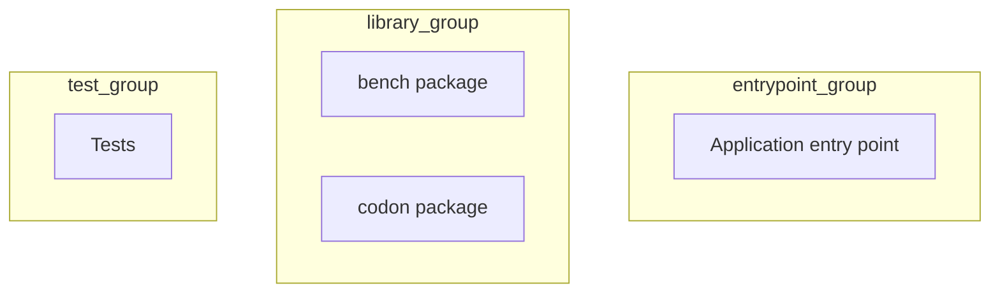

# Architecture report: exaloop/codon

> Automated static analysis. **Observed** = directly seen in files/imports/AST; **Inferred** = interpretation from that evidence. Repository code was not executed.

## 1. Repository at a glance

| Item | Value |
| --- | --- |
| Repository | exaloop/codon |
| Description | A high-performance, zero-overhead, extensible Python compiler with built-in NumPy support |
| Language | Python |
| Stars | 16861 |
| Licence | Apache-2.0 |
| Analysed commit / branch | 1aeec848835cb7fba3026c393c72eb73b2399791 / develop |
| Framework(s) | None detected |
| Files analysed | 800 |
| Components | 4 |

## 2. Architecture in one minute

exaloop/codon - A high-performance, zero-overhead, extensible Python compiler with built-in NumPy support. This repository was analysed statically from 800 file(s) (344 Python). Detected technologies (observed from imports/manifests): GitHub Actions, NumPy, Docker, unittest. Files are grouped into 4 component(s): bench package, codon package, Application entry point, Tests. Observed entry point(s): bench/codon/go.py, bench/export.py, bench/refresh.py. Findings below distinguish observed facts from inferred interpretation.

## 3. High-level block diagram

## 4. Main components

### bench package (`bench`)

- **Kind:** library
- **Status:** Observed
- **Confidence:** 0.85
- **Responsibility:** Groups 18 file(s) under bench package (observed from repository paths and static analysis). Observed top-level classes: Chaosgame, GVector, Node, Point, Spline. Observed top-level functions: advance, bench_spectral_norm, benchmark, check_tree, combinations, conforms.
- **Paths:** `bench/codon/binary_trees.cpp`, `bench/codon/binary_trees.py`, `bench/codon/chaos.py`, `bench/codon/fannkuch.py`, `bench/codon/float.py`, `bench/codon/mandelbrot.py`, `bench/codon/nbody.cpp`, `bench/codon/nbody.py`, `bench/codon/primes.py`, `bench/codon/set_partition.cpp`, `bench/codon/set_partition.py`, `bench/codon/spectral_norm.py`, `bench/codon/sum.py`, `bench/codon/taq.cpp`, `bench/codon/taq.py`, `bench/codon/word_count.cpp`, `bench/codon/word_count.py`, `bench/run.sh`
- **Evidence:** [bench/codon/binary_trees.cpp](https://github.com/exaloop/codon/blob/1aeec848835cb7fba3026c393c72eb73b2399791/bench/codon/binary_trees.cpp); [bench/codon/binary_trees.py:12](https://github.com/exaloop/codon/blob/1aeec848835cb7fba3026c393c72eb73b2399791/bench/codon/binary_trees.py#L12); [bench/codon/chaos.py:19](https://github.com/exaloop/codon/blob/1aeec848835cb7fba3026c393c72eb73b2399791/bench/codon/chaos.py#L19); [bench/codon/fannkuch.py:6](https://github.com/exaloop/codon/blob/1aeec848835cb7fba3026c393c72eb73b2399791/bench/codon/fannkuch.py#L6); [bench/codon/float.py:7](https://github.com/exaloop/codon/blob/1aeec848835cb7fba3026c393c72eb73b2399791/bench/codon/float.py#L7); [bench/codon/mandelbrot.py:6](https://github.com/exaloop/codon/blob/1aeec848835cb7fba3026c393c72eb73b2399791/bench/codon/mandelbrot.py#L6); [bench/codon/nbody.cpp](https://github.com/exaloop/codon/blob/1aeec848835cb7fba3026c393c72eb73b2399791/bench/codon/nbody.cpp); [bench/codon/nbody.py:13](https://github.com/exaloop/codon/blob/1aeec848835cb7fba3026c393c72eb73b2399791/bench/codon/nbody.py#L13)

### codon package (`codon`)

- **Kind:** library
- **Status:** Observed
- **Confidence:** 0.85
- **Responsibility:** Groups 234 file(s) under codon package (observed from repository paths and static analysis).
- **Paths:** `codon/app/main.cpp`, `codon/cir/analyze/analysis.cpp`, `codon/cir/analyze/analysis.h`, `codon/cir/analyze/dataflow/capture.cpp`, `codon/cir/analyze/dataflow/capture.h`, `codon/cir/analyze/dataflow/cfg.cpp`, `codon/cir/analyze/dataflow/cfg.h`, `codon/cir/analyze/dataflow/dominator.cpp`, `codon/cir/analyze/dataflow/dominator.h`, `codon/cir/analyze/dataflow/reaching.cpp`, `codon/cir/analyze/dataflow/reaching.h`, `codon/cir/analyze/module/global_vars.cpp`, `codon/cir/analyze/module/global_vars.h`, `codon/cir/analyze/module/side_effect.cpp`, `codon/cir/analyze/module/side_effect.h`, `codon/cir/attribute.cpp`, `codon/cir/attribute.h`, `codon/cir/base.cpp`, `codon/cir/base.h`, `codon/cir/cir.h`, `codon/cir/const.cpp`, `codon/cir/const.h`, `codon/cir/dsl/codegen.h`, `codon/cir/dsl/nodes.cpp`, `codon/cir/dsl/nodes.h`, `codon/cir/flow.cpp`, `codon/cir/flow.h`, `codon/cir/func.cpp`, `codon/cir/func.h`, `codon/cir/instr.cpp`, `codon/cir/instr.h`, `codon/cir/llvm/gpu.cpp`, `codon/cir/llvm/gpu.h`, `codon/cir/llvm/llvisitor.h`, `codon/cir/llvm/llvm.h`, `codon/cir/llvm/native/native.cpp`, `codon/cir/llvm/native/native.h`, `codon/cir/llvm/native/targets/aarch64.cpp`, `codon/cir/llvm/native/targets/aarch64.h`, `codon/cir/llvm/native/targets/arm.cpp`, `codon/cir/llvm/native/targets/arm.h`, `codon/cir/llvm/native/targets/target.h`, `codon/cir/llvm/native/targets/x86.cpp`, `codon/cir/llvm/native/targets/x86.h`, `codon/cir/llvm/optimize.cpp`, `codon/cir/llvm/optimize.h`, `codon/cir/module.cpp`, `codon/cir/module.h`, `codon/cir/pyextension.h`, `codon/cir/transform/cleanup/canonical.cpp`, `codon/cir/transform/cleanup/canonical.h`, `codon/cir/transform/cleanup/dead_code.cpp`, `codon/cir/transform/cleanup/dead_code.h`, `codon/cir/transform/cleanup/devirtualize.cpp`, `codon/cir/transform/cleanup/devirtualize.h`, `codon/cir/transform/cleanup/global_demote.cpp`, `codon/cir/transform/cleanup/global_demote.h`, `codon/cir/transform/cleanup/replacer.cpp`, `codon/cir/transform/cleanup/replacer.h`, `codon/cir/transform/folding/const_fold.cpp`, `codon/cir/transform/folding/const_fold.h`, `codon/cir/transform/folding/const_prop.cpp`, `codon/cir/transform/folding/const_prop.h`, `codon/cir/transform/folding/folding.cpp`, `codon/cir/transform/folding/folding.h`, `codon/cir/transform/folding/rule.h`, `codon/cir/transform/lowering/async_for.cpp`, `codon/cir/transform/lowering/async_for.h`, `codon/cir/transform/lowering/await.cpp`, `codon/cir/transform/lowering/await.h`, `codon/cir/transform/lowering/imperative.cpp`, `codon/cir/transform/lowering/imperative.h`, `codon/cir/transform/lowering/pipeline.cpp`, `codon/cir/transform/lowering/pipeline.h`, `codon/cir/transform/lowering/return.cpp`, `codon/cir/transform/lowering/return.h`, `codon/cir/transform/lowering/throw.cpp`, `codon/cir/transform/lowering/throw.h`, `codon/cir/transform/manager.cpp`, `codon/cir/transform/manager.h`, `codon/cir/transform/numpy/expr.cpp`, `codon/cir/transform/numpy/forward.cpp`, `codon/cir/transform/numpy/indexing.cpp`, `codon/cir/transform/numpy/indexing.h`, `codon/cir/transform/numpy/numpy.cpp`, `codon/cir/transform/numpy/numpy.h`, `codon/cir/transform/parallel/openmp.cpp`, `codon/cir/transform/parallel/openmp.h`, `codon/cir/transform/parallel/schedule.cpp`, `codon/cir/transform/parallel/schedule.h`, `codon/cir/transform/pass.cpp`, `codon/cir/transform/pass.h`, `codon/cir/transform/pythonic/dict.cpp`, `codon/cir/transform/pythonic/dict.h`, `codon/cir/transform/pythonic/enumerate.cpp`, `codon/cir/transform/pythonic/enumerate.h`, `codon/cir/transform/pythonic/format.cpp`, `codon/cir/transform/pythonic/format.h`, `codon/cir/transform/pythonic/generator.cpp`, `codon/cir/transform/pythonic/generator.h`, `codon/cir/transform/pythonic/io.cpp`, `codon/cir/transform/pythonic/io.h`, `codon/cir/transform/pythonic/list.cpp`, `codon/cir/transform/pythonic/list.h`, `codon/cir/transform/pythonic/str.cpp`, `codon/cir/transform/pythonic/str.h`, `codon/cir/transform/rewrite.h`, `codon/cir/type.cpp`, `codon/cir/type.h`, `codon/cir/util/cloning.cpp`, `codon/cir/util/cloning.h`, `codon/cir/util/context.h`, `codon/cir/util/format.cpp`, `codon/cir/util/format.h`, `codon/cir/util/inlining.cpp`, `codon/cir/util/inlining.h`, `codon/cir/util/irtools.cpp`, `codon/cir/util/irtools.h`, `codon/cir/util/iterators.h`, `codon/cir/util/matching.cpp`, `codon/cir/util/matching.h`, `codon/cir/util/operator.h`, `codon/cir/util/outlining.cpp`, `codon/cir/util/outlining.h`, `codon/cir/util/packs.h`, `codon/cir/util/side_effect.cpp`, `codon/cir/util/side_effect.h`, `codon/cir/util/visitor.cpp`, `codon/cir/util/visitor.h`, `codon/cir/value.cpp`, `codon/cir/value.h`, `codon/cir/var.cpp`, `codon/cir/var.h`, `codon/compiler/compiler.cpp`, `codon/compiler/compiler.h`, `codon/compiler/debug_listener.cpp`, `codon/compiler/debug_listener.h`, `codon/compiler/engine.cpp`, `codon/compiler/engine.h`, `codon/compiler/error.cpp`, `codon/compiler/error.h`, `codon/compiler/jit.cpp`, `codon/compiler/jit.h`, `codon/compiler/jit_extern.h`, `codon/compiler/memory_manager.cpp`, `codon/compiler/memory_manager.h`, `codon/compiler/options.cpp`, `codon/compiler/options.h`, `codon/dsl/dsl.h`, `codon/dsl/plugins.cpp`, `codon/dsl/plugins.h`, `codon/parser/ast.h`, `codon/parser/ast/attr.cpp`, `codon/parser/ast/attr.h`, `codon/parser/ast/codon_string.cpp`, `codon/parser/ast/error.h`, `codon/parser/ast/expr.cpp`, `codon/parser/ast/expr.h`, `codon/parser/ast/node.h`, `codon/parser/ast/stmt.cpp`, `codon/parser/ast/stmt.h`, `codon/parser/ast/types.h`, `codon/parser/ast/types/class.cpp`, `codon/parser/ast/types/class.h`, `codon/parser/ast/types/function.cpp`, `codon/parser/ast/types/function.h`, `codon/parser/ast/types/link.cpp`, `codon/parser/ast/types/link.h`, `codon/parser/ast/types/static.cpp`, `codon/parser/ast/types/static.h`, `codon/parser/ast/types/traits.cpp`, `codon/parser/ast/types/traits.h`, `codon/parser/ast/types/type.cpp`, `codon/parser/ast/types/type.h`, `codon/parser/ast/types/union.cpp`, `codon/parser/ast/types/union.h`, `codon/parser/cache.cpp`, `codon/parser/cache.h`, `codon/parser/capi.cpp`, `codon/parser/capi.h`, `codon/parser/common.cpp`, `codon/parser/common.h`, `codon/parser/ctx.h`, `codon/parser/match.cpp`, `codon/parser/match.h`, `codon/parser/peg/peg.cpp`, `codon/parser/peg/peg.h`, `codon/parser/peg/rules.h`, `codon/parser/visitors/doc/doc.cpp`, `codon/parser/visitors/doc/doc.h`, `codon/parser/visitors/format/format.cpp`, `codon/parser/visitors/format/format.h`, `codon/parser/visitors/scoping/scoping.cpp`, `codon/parser/visitors/scoping/scoping.h`, `codon/parser/visitors/translate/translate.cpp`, `codon/parser/visitors/translate/translate.h`, `codon/parser/visitors/translate/translate_ctx.cpp`, `codon/parser/visitors/translate/translate_ctx.h`, `codon/parser/visitors/typecheck/access.cpp`, `codon/parser/visitors/typecheck/assign.cpp`, `codon/parser/visitors/typecheck/basic.cpp`, `codon/parser/visitors/typecheck/call.cpp`, `codon/parser/visitors/typecheck/class.cpp`, `codon/parser/visitors/typecheck/collections.cpp`, `codon/parser/visitors/typecheck/cond.cpp`, `codon/parser/visitors/typecheck/ctx.cpp`, `codon/parser/visitors/typecheck/ctx.h`, `codon/parser/visitors/typecheck/error.cpp`, `codon/parser/visitors/typecheck/function.cpp`, `codon/parser/visitors/typecheck/import.cpp`, `codon/parser/visitors/typecheck/infer.cpp`, `codon/parser/visitors/typecheck/loops.cpp`, `codon/parser/visitors/typecheck/op.cpp`, `codon/parser/visitors/typecheck/special.cpp`, `codon/parser/visitors/typecheck/typecheck.cpp`, `codon/parser/visitors/typecheck/typecheck.h`, `codon/parser/visitors/visitor.cpp`, `codon/parser/visitors/visitor.h`, `codon/runtime/emutls.cpp`, `codon/runtime/exc.cpp`, `codon/runtime/lib.cpp`, `codon/runtime/lib.h`, `codon/runtime/numpy/loops.cpp`, `codon/runtime/numpy/sort.cpp`, `codon/runtime/numpy/zmath.cpp`, `codon/runtime/re.cpp`, `codon/runtime/rtti.h`, `codon/util/common.cpp`, `codon/util/common.h`, `codon/util/jupyter.cpp`, `codon/util/jupyter.h`, `codon/util/peg2cpp.cpp`, `codon/util/serialize.h`, `codon/util/tser.h`
- **Evidence:** [codon/app/main.cpp](https://github.com/exaloop/codon/blob/1aeec848835cb7fba3026c393c72eb73b2399791/codon/app/main.cpp); [codon/cir/analyze/analysis.cpp](https://github.com/exaloop/codon/blob/1aeec848835cb7fba3026c393c72eb73b2399791/codon/cir/analyze/analysis.cpp); [codon/cir/analyze/analysis.h](https://github.com/exaloop/codon/blob/1aeec848835cb7fba3026c393c72eb73b2399791/codon/cir/analyze/analysis.h); [codon/cir/analyze/dataflow/capture.cpp](https://github.com/exaloop/codon/blob/1aeec848835cb7fba3026c393c72eb73b2399791/codon/cir/analyze/dataflow/capture.cpp); [codon/cir/analyze/dataflow/capture.h](https://github.com/exaloop/codon/blob/1aeec848835cb7fba3026c393c72eb73b2399791/codon/cir/analyze/dataflow/capture.h); [codon/cir/analyze/dataflow/cfg.cpp](https://github.com/exaloop/codon/blob/1aeec848835cb7fba3026c393c72eb73b2399791/codon/cir/analyze/dataflow/cfg.cpp); [codon/cir/analyze/dataflow/cfg.h](https://github.com/exaloop/codon/blob/1aeec848835cb7fba3026c393c72eb73b2399791/codon/cir/analyze/dataflow/cfg.h); [codon/cir/analyze/dataflow/dominator.cpp](https://github.com/exaloop/codon/blob/1aeec848835cb7fba3026c393c72eb73b2399791/codon/cir/analyze/dataflow/dominator.cpp)

### Application entry point (`entrypoint`)

- **Kind:** entrypoint
- **Status:** Observed
- **Confidence:** 0.85
- **Responsibility:** Groups 3 file(s) under application entry point (observed from repository paths and static analysis). Observed top-level classes: Board, EmptySet, Square, UCTNode, ZobristHash. Observed top-level functions: application_output, application_source, benchmark_environment, catalogue, check_fingerprints, check_npbench_outputs.
- **Paths:** `bench/codon/go.py`, `bench/export.py`, `bench/refresh.py`
- **Evidence:** [bench/codon/go.py:19](https://github.com/exaloop/codon/blob/1aeec848835cb7fba3026c393c72eb73b2399791/bench/codon/go.py#L19); [bench/export.py:26](https://github.com/exaloop/codon/blob/1aeec848835cb7fba3026c393c72eb73b2399791/bench/export.py#L26); [bench/refresh.py:41](https://github.com/exaloop/codon/blob/1aeec848835cb7fba3026c393c72eb73b2399791/bench/refresh.py#L41)

### Tests (`tests`)

- **Kind:** test
- **Status:** Observed
- **Confidence:** 0.85
- **Responsibility:** Groups 1 file(s) under tests (observed from repository paths and static analysis). Observed top-level classes: SourceStorageTests.
- **Paths:** `bench/test_export.py`
- **Evidence:** [bench/test_export.py:10](https://github.com/exaloop/codon/blob/1aeec848835cb7fba3026c393c72eb73b2399791/bench/test_export.py#L10)

## 5. Execution flow

**Observed** entry point(s):

- [bench/codon/go.py:453](https://github.com/exaloop/codon/blob/1aeec848835cb7fba3026c393c72eb73b2399791/bench/codon/go.py#L453)
- [bench/export.py:286](https://github.com/exaloop/codon/blob/1aeec848835cb7fba3026c393c72eb73b2399791/bench/export.py#L286)
- [bench/refresh.py:930](https://github.com/exaloop/codon/blob/1aeec848835cb7fba3026c393c72eb73b2399791/bench/refresh.py#L930)

Representative flow (derived from observed entry points and the import graph; steps beyond the entry point are **Inferred**):

1. Execution starts at an observed entry point listed above, if present.
2. No internal import relationships between components were observed.

## 6. Project structure

### `(root)`

- `.clang-format` - other (39 bytes)
- `.clang-tidy` - other (563 bytes)
- `.gitattributes` - other (893 bytes)
- `.gitignore` - other (1084 bytes)
- `.pre-commit-config.yaml` - config (269 bytes)
- `CMakeLists.txt` - docs (36431 bytes)
- `CODEOWNERS` - other (103 bytes)
- `CONTRIBUTING.md` - docs (2691 bytes)
- `LICENSE` - docs (11357 bytes)
- `README.md` - docs (9448 bytes)

### `.github`

- `.github/ci/Dockerfile.linux-aarch64` - container (1514 bytes)
- `.github/ci/Dockerfile.linux-x86_64` - container (1507 bytes)
- `.github/ci/Dockerfile.manylinux2014-aarch64` - container (1564 bytes)
- `.github/ci/Dockerfile.manylinux2014-x86_64` - container (1099 bytes)
- `.github/ci/build-image.sh` - source, Shell (509 bytes)
- `.github/ci/entrypoint.sh` - source, Shell (2485 bytes)
- `.github/ci/test.sh` - source, Shell (3792 bytes)
- `.github/dependabot.yml` - config (119 bytes)
- `.github/workflows/ci.yml` - ci, YAML (16329 bytes)

### `bench`

- `bench/README.md` - docs (16865 bytes)
- `bench/codon/binary_trees.codon` - other (1616 bytes)
- `bench/codon/binary_trees.cpp` - source, C++ (2219 bytes)
- `bench/codon/binary_trees.py` - source, Python (1654 bytes)
- `bench/codon/chaos.codon` - other (9356 bytes)
- `bench/codon/chaos.py` - source, Python (8924 bytes)
- `bench/codon/fannkuch.codon` - other (810 bytes)
- `bench/codon/fannkuch.py` - source, Python (770 bytes)
- `bench/codon/float.py` - source, Python (1096 bytes)
- `bench/codon/go.codon` - other (14789 bytes)
- `bench/codon/go.py` - source, Python (13866 bytes)
- `bench/codon/mandelbrot.codon` - other (572 bytes)
- `bench/codon/mandelbrot.py` - source, Python (545 bytes)
- `bench/codon/nbody.cpp` - source, C++ (4817 bytes)
- `bench/codon/nbody.py` - source, Python (3522 bytes)
- `bench/codon/npbench.codon` - other (20367 bytes)
- `bench/codon/npbench_lib.codon` - other (41718 bytes)
- `bench/codon/primes.codon` - other (351 bytes)
- `bench/codon/primes.py` - source, Python (326 bytes)
- `bench/codon/set_partition.cpp` - source, C++ (2495 bytes)
- `bench/codon/set_partition.py` - source, Python (1594 bytes)
- `bench/codon/spectral_norm.py` - source, Python (1554 bytes)
- `bench/codon/sum.py` - source, Python (247 bytes)
- `bench/codon/taq.cpp` - source, C++ (3699 bytes)
- `bench/codon/taq.py` - source, Python (1861 bytes)
- `bench/codon/word_count.cpp` - source, C++ (858 bytes)
- `bench/codon/word_count.py` - source, Python (235 bytes)
- `bench/export.py` - source, Python (15625 bytes)
- `bench/refresh.py` - source, Python (51581 bytes)
- `bench/run.sh` - source, Shell (7060 bytes)
- `bench/test_export.py` - test, Python (6106 bytes)

### `cmake`

- `cmake/CMakeRC.cmake` - other (21551 bytes)
- `cmake/UnicodeTables.cmake` - other (2516 bytes)
- `cmake/backtrace-config.h.in` - other (2500 bytes)
- `cmake/backtrace-supported.h.in` - other (3036 bytes)
- `cmake/codon-utf8.manifest` - other (368 bytes)
- `cmake/config.h.in` - other (218 bytes)
- `cmake/config.py.in` - other (231 bytes)
- `cmake/deps.cmake` - other (8597 bytes)
- `cmake/windows-builtins.cmake` - other (2214 bytes)

### `codon`

- `codon/app/main.cpp` - source, C++ (18576 bytes)
- `codon/cir/analyze/analysis.cpp` - source, C++ (366 bytes)
- `codon/cir/analyze/analysis.h` - source, C/C++ (1171 bytes)
- `codon/cir/analyze/dataflow/capture.cpp` - source, C++ (24270 bytes)
- `codon/cir/analyze/dataflow/capture.h` - source, C/C++ (2753 bytes)
- `codon/cir/analyze/dataflow/cfg.cpp` - source, C++ (14068 bytes)
- `codon/cir/analyze/dataflow/cfg.h` - source, C/C++ (18310 bytes)
- `codon/cir/analyze/dataflow/dominator.cpp` - source, C++ (3275 bytes)
- `codon/cir/analyze/dataflow/dominator.h` - source, C/C++ (1745 bytes)
- `codon/cir/analyze/dataflow/reaching.cpp` - source, C++ (9582 bytes)
- `codon/cir/analyze/dataflow/reaching.h` - source, C/C++ (3610 bytes)
- `codon/cir/analyze/module/global_vars.cpp` - source, C++ (1143 bytes)
- `codon/cir/analyze/module/global_vars.h` - source, C/C++ (714 bytes)
- `codon/cir/analyze/module/side_effect.cpp` - source, C++ (11464 bytes)
- `codon/cir/analyze/module/side_effect.h` - source, C/C++ (1596 bytes)
- `codon/cir/attribute.cpp` - source, C++ (7488 bytes)
- `codon/cir/attribute.h` - source, C/C++ (12047 bytes)
- `codon/cir/base.cpp` - source, C++ (951 bytes)
- `codon/cir/base.h` - source, C/C++ (11852 bytes)
- `codon/cir/cir.h` - source, C/C++ (337 bytes)
- `codon/cir/const.cpp` - source, C++ (467 bytes)
- `codon/cir/const.h` - source, C/C++ (2613 bytes)
- `codon/cir/dsl/codegen.h` - source, C/C++ (1355 bytes)
- `codon/cir/dsl/nodes.cpp` - source, C++ (336 bytes)
- `codon/cir/dsl/nodes.h` - source, C/C++ (4625 bytes)
- `codon/cir/flow.cpp` - source, C++ (7350 bytes)
- `codon/cir/flow.h` - source, C/C++ (21185 bytes)
- `codon/cir/func.cpp` - source, C++ (7933 bytes)
- `codon/cir/func.h` - source, C/C++ (11892 bytes)
- `codon/cir/instr.cpp` - source, C++ (5808 bytes)
- `codon/cir/instr.h` - source, C/C++ (19650 bytes)
- `codon/cir/llvm/gpu.cpp` - source, C++ (41830 bytes)
- `codon/cir/llvm/gpu.h` - source, C/C++ (1335 bytes)
- `codon/cir/llvm/llvisitor.h` - source, C/C++ (22703 bytes)
- `codon/cir/llvm/llvm.h` - source, C/C++ (5851 bytes)
- `codon/cir/llvm/native/native.cpp` - source, C++ (3422 bytes)
- `codon/cir/llvm/native/native.h` - source, C/C++ (233 bytes)
- `codon/cir/llvm/native/targets/aarch64.cpp` - source, C++ (1754 bytes)
- `codon/cir/llvm/native/targets/aarch64.h` - source, C/C++ (379 bytes)
- `codon/cir/llvm/native/targets/arm.cpp` - source, C++ (13028 bytes)
- `codon/cir/llvm/native/targets/arm.h` - source, C/C++ (375 bytes)
- `codon/cir/llvm/native/targets/target.h` - source, C/C++ (412 bytes)
- `codon/cir/llvm/native/targets/x86.cpp` - source, C++ (2876 bytes)
- `codon/cir/llvm/native/targets/x86.h` - source, C/C++ (375 bytes)
- `codon/cir/llvm/optimize.cpp` - source, C++ (64932 bytes)
- `codon/cir/llvm/optimize.h` - source, C/C++ (773 bytes)
- `codon/cir/module.cpp` - source, C++ (17600 bytes)
- `codon/cir/module.h` - source, C/C++ (19840 bytes)
- `codon/cir/pyextension.h` - source, C/C++ (2874 bytes)
- `codon/cir/transform/cleanup/canonical.cpp` - source, C++ (11054 bytes)
- `codon/cir/transform/cleanup/canonical.h` - source, C/C++ (1039 bytes)
- `codon/cir/transform/cleanup/dead_code.cpp` - source, C++ (2732 bytes)
- `codon/cir/transform/cleanup/dead_code.h` - source, C/C++ (1212 bytes)
- `codon/cir/transform/cleanup/devirtualize.cpp` - source, C++ (19942 bytes)
- `codon/cir/transform/cleanup/devirtualize.h` - source, C/C++ (902 bytes)
- `codon/cir/transform/cleanup/global_demote.cpp` - source, C++ (1891 bytes)
- `codon/cir/transform/cleanup/global_demote.h` - source, C/C++ (832 bytes)
- `codon/cir/transform/cleanup/replacer.cpp` - source, C++ (3795 bytes)
- `codon/cir/transform/cleanup/replacer.h` - source, C/C++ (513 bytes)
- `codon/cir/transform/folding/const_fold.cpp` - source, C++ (17120 bytes)
- `codon/cir/transform/folding/const_fold.h` - source, C/C++ (749 bytes)
- `codon/cir/transform/folding/const_prop.cpp` - source, C++ (3011 bytes)
- `codon/cir/transform/folding/const_prop.h` - source, C/C++ (1026 bytes)
- `codon/cir/transform/folding/folding.cpp` - source, C++ (1731 bytes)
- `codon/cir/transform/folding/folding.h` - source, C/C++ (1372 bytes)
- `codon/cir/transform/folding/rule.h` - source, C/C++ (8033 bytes)
- `codon/cir/transform/lowering/async_for.cpp` - source, C++ (2693 bytes)
- `codon/cir/transform/lowering/async_for.h` - source, C/C++ (471 bytes)
- `codon/cir/transform/lowering/await.cpp` - source, C++ (3402 bytes)
- `codon/cir/transform/lowering/await.h` - source, C/C++ (471 bytes)
- `codon/cir/transform/lowering/imperative.cpp` - source, C++ (4403 bytes)
- `codon/cir/transform/lowering/imperative.h` - source, C/C++ (480 bytes)
- `codon/cir/transform/lowering/pipeline.cpp` - source, C++ (2187 bytes)
- `codon/cir/transform/lowering/pipeline.h` - source, C/C++ (512 bytes)
- `codon/cir/transform/lowering/return.cpp` - source, C++ (11771 bytes)
- `codon/cir/transform/lowering/return.h` - source, C/C++ (469 bytes)
- `codon/cir/transform/lowering/throw.cpp` - source, C++ (757 bytes)
- `codon/cir/transform/lowering/throw.h` - source, C/C++ (475 bytes)
- `codon/cir/transform/manager.cpp` - source, C++ (9873 bytes)
- `codon/cir/transform/manager.h` - source, C/C++ (5701 bytes)
- `codon/cir/transform/numpy/expr.cpp` - source, C++ (43577 bytes)
- `codon/cir/transform/numpy/forward.cpp` - source, C++ (17838 bytes)
- `codon/cir/transform/numpy/indexing.cpp` - source, C++ (13204 bytes)
- `codon/cir/transform/numpy/indexing.h` - source, C/C++ (865 bytes)
- `codon/cir/transform/numpy/numpy.cpp` - source, C++ (108958 bytes)
- `codon/cir/transform/numpy/numpy.h` - source, C/C++ (10601 bytes)
- `codon/cir/transform/parallel/openmp.cpp` - source, C++ (59142 bytes)
- `codon/cir/transform/parallel/openmp.h` - source, C/C++ (601 bytes)
- `codon/cir/transform/parallel/schedule.cpp` - source, C++ (2503 bytes)
- `codon/cir/transform/parallel/schedule.h` - source, C/C++ (1096 bytes)
- `codon/cir/transform/pass.cpp` - source, C++ (670 bytes)
- `codon/cir/transform/pass.h` - source, C/C++ (2652 bytes)
- `codon/cir/transform/pythonic/dict.cpp` - source, C++ (4681 bytes)
- `codon/cir/transform/pythonic/dict.h` - source, C/C++ (656 bytes)
- `codon/cir/transform/pythonic/enumerate.cpp` - source, C++ (7503 bytes)
- `codon/cir/transform/pythonic/enumerate.h` - source, C/C++ (479 bytes)
- `codon/cir/transform/pythonic/format.cpp` - source, C++ (15717 bytes)
- `codon/cir/transform/pythonic/format.h` - source, C/C++ (547 bytes)
- `codon/cir/transform/pythonic/generator.cpp` - source, C++ (22242 bytes)
- `codon/cir/transform/pythonic/generator.h` - source, C/C++ (1118 bytes)
- `codon/cir/transform/pythonic/io.cpp` - source, C++ (3663 bytes)
- `codon/cir/transform/pythonic/io.h` - source, C/C++ (543 bytes)
- `codon/cir/transform/pythonic/list.cpp` - source, C++ (8322 bytes)
- `codon/cir/transform/pythonic/list.h` - source, C/C++ (582 bytes)
- `codon/cir/transform/pythonic/str.cpp` - source, C++ (1866 bytes)
- `codon/cir/transform/pythonic/str.h` - source, C/C++ (519 bytes)
- `codon/cir/transform/rewrite.h` - source, C/C++ (1894 bytes)
- `codon/cir/type.cpp` - source, C++ (8096 bytes)
- `codon/cir/type.h` - source, C/C++ (20355 bytes)
- `codon/cir/util/cloning.cpp` - source, C++ (10035 bytes)
- `codon/cir/util/cloning.h` - source, C/C++ (4720 bytes)
- `codon/cir/util/context.h` - source, C/C++ (910 bytes)
- `codon/cir/util/format.cpp` - source, C++ (16861 bytes)
- `codon/cir/util/format.h` - source, C/C++ (550 bytes)
- `codon/cir/util/inlining.cpp` - source, C++ (3654 bytes)
- `codon/cir/util/inlining.h` - source, C/C++ (1131 bytes)
- `codon/cir/util/irtools.cpp` - source, C++ (9880 bytes)
- `codon/cir/util/irtools.h` - source, C/C++ (10500 bytes)
- `codon/cir/util/iterators.h` - source, C/C++ (4262 bytes)
- `codon/cir/util/matching.cpp` - source, C++ (11462 bytes)
- `codon/cir/util/matching.h` - source, C/C++ (1451 bytes)
- `codon/cir/util/operator.h` - source, C/C++ (6742 bytes)
- `codon/cir/util/outlining.cpp` - source, C++ (13482 bytes)
- `codon/cir/util/outlining.h` - source, C/C++ (3370 bytes)
- `codon/cir/util/packs.h` - source, C/C++ (950 bytes)
- `codon/cir/util/side_effect.cpp` - source, C++ (780 bytes)
- `codon/cir/util/side_effect.h` - source, C/C++ (1228 bytes)
- `codon/cir/util/visitor.cpp` - source, C++ (7678 bytes)
- `codon/cir/util/visitor.h` - source, C/C++ (4900 bytes)
- `codon/cir/value.cpp` - source, C++ (3851 bytes)
- `codon/cir/value.h` - source, C/C++ (3829 bytes)
- `codon/cir/var.cpp` - source, C++ (1007 bytes)
- `codon/cir/var.h` - source, C/C++ (6252 bytes)
- `codon/compiler/compiler.cpp` - source, C++ (6194 bytes)
- `codon/compiler/compiler.h` - source, C/C++ (2433 bytes)
- `codon/compiler/debug_listener.cpp` - source, C++ (7649 bytes)
- `codon/compiler/debug_listener.h` - source, C/C++ (3467 bytes)
- `codon/compiler/engine.cpp` - source, C++ (4454 bytes)
- `codon/compiler/engine.h` - source, C/C++ (1007 bytes)
- `codon/compiler/error.cpp` - source, C++ (2171 bytes)
- `codon/compiler/error.h` - source, C/C++ (18310 bytes)
- `codon/compiler/jit.cpp` - source, C++ (25851 bytes)
- `codon/compiler/jit.h` - source, C/C++ (3625 bytes)
- `codon/compiler/jit_extern.h` - source, C/C++ (846 bytes)
- `codon/compiler/memory_manager.cpp` - source, C++ (19862 bytes)
- `codon/compiler/memory_manager.h` - source, C/C++ (2288 bytes)
- `codon/compiler/options.cpp` - source, C++ (5406 bytes)
- `codon/compiler/options.h` - source, C/C++ (2714 bytes)
- `codon/config/.gitignore` - other (17 bytes)
- `codon/dsl/dsl.h` - source, C/C++ (3092 bytes)
- `codon/dsl/plugins.cpp` - source, C++ (5622 bytes)
- `codon/dsl/plugins.h` - source, C/C++ (1882 bytes)
- `codon/parser/ast.h` - source, C/C++ (405 bytes)
- `codon/parser/ast/attr.cpp` - source, C++ (129 bytes)
- `codon/parser/ast/attr.h` - source, C/C++ (1109 bytes)
- `codon/parser/ast/codon_string.cpp` - source, C++ (28012 bytes)
- `codon/parser/ast/error.h` - source, C/C++ (6698 bytes)
- `codon/parser/ast/expr.cpp` - source, C++ (44423 bytes)
- `codon/parser/ast/expr.h` - source, C/C++ (21174 bytes)
- `codon/parser/ast/node.h` - source, C/C++ (4023 bytes)
- `codon/parser/ast/stmt.cpp` - source, C++ (41312 bytes)
- `codon/parser/ast/stmt.h` - source, C/C++ (22140 bytes)
- `codon/parser/ast/types.h` - source, C/C++ (373 bytes)
- `codon/parser/ast/types/class.cpp` - source, C++ (16104 bytes)
- `codon/parser/ast/types/class.h` - source, C/C++ (3506 bytes)
- `codon/parser/ast/types/function.cpp` - source, C++ (8581 bytes)
- `codon/parser/ast/types/function.h` - source, C/C++ (2090 bytes)
- `codon/parser/ast/types/link.cpp` - source, C++ (9237 bytes)
- `codon/parser/ast/types/link.h` - source, C/C++ (2675 bytes)
- `codon/parser/ast/types/static.cpp` - source, C++ (4183 bytes)
- `codon/parser/ast/types/static.h` - source, C/C++ (2541 bytes)
- `codon/parser/ast/types/traits.cpp` - source, C++ (3572 bytes)
- `codon/parser/ast/types/traits.h` - source, C/C++ (1332 bytes)
- `codon/parser/ast/types/type.cpp` - source, C++ (2354 bytes)
- `codon/parser/ast/types/type.h` - source, C/C++ (6435 bytes)
- `codon/parser/ast/types/union.cpp` - source, C++ (2679 bytes)
- `codon/parser/ast/types/union.h` - source, C/C++ (885 bytes)
- `codon/parser/cache.cpp` - source, C++ (13909 bytes)
- `codon/parser/cache.h` - source, C/C++ (15711 bytes)
- `codon/parser/capi.cpp` - source, C++ (3815 bytes)
- `codon/parser/capi.h` - source, C/C++ (1173 bytes)
- `codon/parser/common.cpp` - source, C++ (19493 bytes)
- `codon/parser/common.h` - source, C/C++ (9332 bytes)
- `codon/parser/ctx.h` - source, C/C++ (7473 bytes)
- `codon/parser/match.cpp` - source, C++ (1523 bytes)
- `codon/parser/match.h` - source, C/C++ (4842 bytes)
- `codon/parser/peg/grammar.peg` - other (31193 bytes)
- `codon/parser/peg/openmp.peg` - other (1640 bytes)
- `codon/parser/peg/peg.cpp` - source, C++ (6549 bytes)
- `codon/parser/peg/peg.h` - source, C/C++ (996 bytes)
- `codon/parser/peg/rules.h` - source, C/C++ (1015 bytes)
- `codon/parser/visitors/doc/doc.cpp` - source, C++ (18674 bytes)
- `codon/parser/visitors/doc/doc.h` - source, C/C++ (2637 bytes)
- `codon/parser/visitors/format/format.cpp` - source, C++ (15871 bytes)
- `codon/parser/visitors/format/format.h` - source, C/C++ (4853 bytes)
- `codon/parser/visitors/scoping/scoping.cpp` - source, C++ (38136 bytes)
- `codon/parser/visitors/scoping/scoping.h` - source, C/C++ (6595 bytes)
- `codon/parser/visitors/translate/translate.cpp` - source, C++ (32512 bytes)
- `codon/parser/visitors/translate/translate.h` - source, C/C++ (2557 bytes)
- `codon/parser/visitors/translate/translate_ctx.cpp` - source, C++ (2780 bytes)
- `codon/parser/visitors/translate/translate_ctx.h` - source, C/C++ (2492 bytes)
- `codon/parser/visitors/typecheck/access.cpp` - source, C++ (24118 bytes)
- `codon/parser/visitors/typecheck/assign.cpp` - source, C++ (25572 bytes)
- `codon/parser/visitors/typecheck/basic.cpp` - source, C++ (5831 bytes)
- `codon/parser/visitors/typecheck/call.cpp` - source, C++ (47971 bytes)
- `codon/parser/visitors/typecheck/class.cpp` - source, C++ (57141 bytes)
- `codon/parser/visitors/typecheck/collections.cpp` - source, C++ (14755 bytes)
- `codon/parser/visitors/typecheck/cond.cpp` - source, C++ (17164 bytes)
- `codon/parser/visitors/typecheck/ctx.cpp` - source, C++ (9335 bytes)
- `codon/parser/visitors/typecheck/ctx.h` - source, C/C++ (10398 bytes)
- `codon/parser/visitors/typecheck/error.cpp` - source, C++ (15051 bytes)
- `codon/parser/visitors/typecheck/function.cpp` - source, C++ (35016 bytes)
- `codon/parser/visitors/typecheck/import.cpp` - source, C++ (19212 bytes)
- `codon/parser/visitors/typecheck/infer.cpp` - source, C++ (38254 bytes)
- `codon/parser/visitors/typecheck/loops.cpp` - source, C++ (14207 bytes)
- `codon/parser/visitors/typecheck/op.cpp` - source, C++ (48743 bytes)
- `codon/parser/visitors/typecheck/special.cpp` - source, C++ (90676 bytes)
- `codon/parser/visitors/typecheck/typecheck.cpp` - source, C++ (88390 bytes)
- `codon/parser/visitors/typecheck/typecheck.h` - source, C/C++ (25774 bytes)
- `codon/parser/visitors/visitor.cpp` - source, C++ (3934 bytes)
- `codon/parser/visitors/visitor.h` - source, C/C++ (16192 bytes)
- `codon/runtime/emutls.cpp` - source, C++ (1981 bytes)
- `codon/runtime/exc.cpp` - source, C++ (23944 bytes)
- `codon/runtime/lib.cpp` - source, C++ (25394 bytes)
- `codon/runtime/lib.h` - source, C/C++ (5366 bytes)
- `codon/runtime/numpy/loops.cpp` - source, C++ (33456 bytes)
- `codon/runtime/numpy/sort.cpp` - source, C++ (4789 bytes)
- `codon/runtime/numpy/zmath.cpp` - source, C++ (2472 bytes)
- `codon/runtime/re.cpp` - source, C++ (5567 bytes)
- `codon/runtime/rtti.h` - source, C/C++ (1876 bytes)
- `codon/util/common.cpp` - source, C++ (3482 bytes)
- `codon/util/common.h` - source, C/C++ (6286 bytes)
- `codon/util/jupyter.cpp` - source, C++ (448 bytes)
- `codon/util/jupyter.h` - source, C/C++ (320 bytes)
- `codon/util/peg2cpp.cpp` - source, C++ (8424 bytes)
- `codon/util/serialize.h` - source, C/C++ (3772 bytes)
- `codon/util/tser.h` - source, C/C++ (17314 bytes)

### `docs`

- `docs/.gitignore` - docs (46 bytes)
- `docs/README.md` - docs (4727 bytes)
- `docs/data/benchmarks/NPBench-LICENSE.txt` - docs (1512 bytes)
- `docs/data/benchmarks/aws/NPBench-LICENSE.txt` - docs (1512 bytes)
- `docs/data/benchmarks/aws/reproduction.md` - docs (16865 bytes)
- `docs/data/benchmarks/reproduction.md` - docs (16865 bytes)
- `docs/data/benchmarks/source/00be1d79cbe2fe71862fbc982300acbefe6bd1bee69d02689bd209e37bffd75d.py` - docs (2581 bytes)
- `docs/data/benchmarks/source/011f61c685cc762428ca99b93be2c9722845b5cc00216f5b8983812c3ec86496.py` - docs (483 bytes)
- `docs/data/benchmarks/source/013c114421340f96db380c430b4e6bc172323b517bde6cb63fb8050b09c39c97.py` - docs (2155 bytes)
- `docs/data/benchmarks/source/013ec9d8d4460d0a66db67e40081be17fb037d79d449d30d9e1c38ff54051132.codon` - docs (1821 bytes)
- `docs/data/benchmarks/source/01937d19c65af33e15cadd51a826290e68d3ddb47b19f30362c28da00a419f21.codon` - docs (2501 bytes)
- `docs/data/benchmarks/source/02216c3b82064b91f827c73bafe826ead67b26b5568dee165751008a145a1bc6.codon` - docs (1143 bytes)
- `docs/data/benchmarks/source/024dea207a152705e8e36e6faf9d06d294701b058d880ccc7178fd143c28ccd9.py` - docs (951 bytes)
- `docs/data/benchmarks/source/02bce70304d959774e15c05d35fb067946adaa1c7705df0e37fa86959a6d8777.codon` - docs (306 bytes)
- `docs/data/benchmarks/source/02c936b6e025e344d908f934f8472b596455a453e608aaae80c9bf278d38373c.py` - docs (1957 bytes)
- `docs/data/benchmarks/source/02d26a9786e8dade42f012416d0fe96e5f007836503fd3cdd24f3b5c347159ba.py` - docs (1621 bytes)
- `docs/data/benchmarks/source/0327d10966908c0e3be719f73cf17616f4b369aabaa310c1b6568b7de428fadb.py` - docs (292 bytes)
- `docs/data/benchmarks/source/03c73cbc243988df75672a9b8f8c68fb9962739c1b690aec4453b28a149f0acc.py` - docs (1637 bytes)
- `docs/data/benchmarks/source/04977dac9ca05c47ba1ffcd7c5ce369ef605e72e4403556811af5ba3cee808ab.py` - docs (1836 bytes)
- `docs/data/benchmarks/source/04a4b26746391d0a3bcca836195ef8ce75f08ff1868e386cbbc30bbb6fb1636e.py` - docs (2410 bytes)
- `docs/data/benchmarks/source/05841df417e53d46aefb2b395b796f277a9faa3c78d6da54847d5e9f62a79261.codon` - docs (2100 bytes)
- `docs/data/benchmarks/source/06a18c6527502adfeecf33eae25a6e76fc0bbbe1a5e4b10914df34783eddf59f.py` - docs (1822 bytes)
- `docs/data/benchmarks/source/07ecabc8b73ab1b0c9cb7f028a5178dad113ea0d9255b3a7ceeb786c16cf7069.py` - docs (2429 bytes)
- `docs/data/benchmarks/source/08167b6447c4dee800e8033ab287f7f7433ee3a5494cce9ecbe3fbb07664ffe3.py` - docs (407 bytes)
- `docs/data/benchmarks/source/08528e6e63f7651ed2cb780ee1923f09eebac4bf869526716fb7933ad17a26f5.py` - docs (1167 bytes)
- `docs/data/benchmarks/source/088f2ad7e1e832e683f86c9b9d82934460027317dffd7fd1ccb92fa25b068887.codon` - docs (1781 bytes)
- `docs/data/benchmarks/source/098ee03b48999350ee808bdc53c541483e75eb177a99a6e3f8063b424a0476f9.codon` - docs (381 bytes)
- `docs/data/benchmarks/source/09aa77abc04a12f50dbfbef6eda3a7b609aae168c1716d9da7622d34a8240113.codon` - docs (2553 bytes)
- `docs/data/benchmarks/source/0a3d61207dd27d9778068f44df0599d9545edfda159f2d988daa7aa98dfd258f.py` - docs (2412 bytes)
- `docs/data/benchmarks/source/0a8649d3da02bf0664e7a497e54982df0753771e5e78c6a02340a7ad541db3bb.py` - docs (2677 bytes)
- `docs/data/benchmarks/source/0be2e56271cdbf958622deba268639a16695657b59e022a55574e0dc181760b0.codon` - docs (245 bytes)
- `docs/data/benchmarks/source/0bf83e22705d6eb9f88121083b6762edb7512b98e57b60df119ed76322592c5d.py` - docs (2188 bytes)
- `docs/data/benchmarks/source/0c3e082ac6d75d53b8aef77b30fd6356945ae8c796843c2a2c5dbe267fdce21b.codon` - docs (1770 bytes)
- `docs/data/benchmarks/source/0cec294424f01a865bde5dca259960c73565ac72d2fa7587b1ce5cee6c8f34a2.codon` - docs (1464 bytes)
- `docs/data/benchmarks/source/0cf99b88f1dfeb7f745b617776073fd6fadb0032337d9ef3e5cec6f95b5169e1.codon` - docs (2598 bytes)
- `docs/data/benchmarks/source/0d3cdd735e71ae991f04b7d211d1cda0cb8d4310ad1cdac5cf55ef72d3e9278c.py` - docs (3845 bytes)
- `docs/data/benchmarks/source/0d482e747a8991d9ad233eddcaf747248a2747a1efd8317da8e219c1caff89f3.py` - docs (3208 bytes)
- `docs/data/benchmarks/source/0d8189f3aebd63c5940ffd6fb700c72712e68b4e5d3f72d38cdb5210b0c90c6c.codon` - docs (683 bytes)
- `docs/data/benchmarks/source/0d8a028b2fedb98e192f80dc6011e629936584106b91dc64219f16097f5a2ec8.py` - docs (2845 bytes)
- `docs/data/benchmarks/source/0dac147a5c7d53fd42b528c84b9be7bdfb0bf8d1455fd635b1a2cf7286a5f374.codon` - docs (306 bytes)
- `docs/data/benchmarks/source/0e6a0d09a0f0bc926ff70559462d2e115e2fc6f939b113010df1884fba2f1cbb.py` - docs (2587 bytes)
- `docs/data/benchmarks/source/1011880406cdd9c655d9d848b39470bc75ad3ab3072d77aadcb5e98a89559c08.py` - docs (561 bytes)
- `docs/data/benchmarks/source/102f205b46b689a3992203462ae25e7954717ccff17af03f7e112ae63000c133.py` - docs (1003 bytes)
- `docs/data/benchmarks/source/112718edefb1aaa98592baf76c8da7bf2d32e345ab7073df9d6f90e805ca1a24.codon` - docs (2276 bytes)
- `docs/data/benchmarks/source/120a4ae389b9f1200a4c093c389c97b7fcf8fc368dcb9d3c81f603cf28ded889.py` - docs (2614 bytes)
- `docs/data/benchmarks/source/125fdfa974fce2e96ada61f62fe3682784640593f17a7efd3e9db0923cd36047.py` - docs (1753 bytes)
- `docs/data/benchmarks/source/12ace3a9a23259542b2f2bd77b55e5f5953f4bf2d19a15fdf877ae9c3764fbff.py` - docs (13922 bytes)
- `docs/data/benchmarks/source/12ad96086fa87d99e0bc32d9d1cf98e628848609c5e0e6ecb1fb371bd997d2ad.py` - docs (2570 bytes)
- `docs/data/benchmarks/source/135309a3eedbbbd929a8723434a1adc4ac39b0d12ccd3868d54576974a011175.codon` - docs (270 bytes)
- `docs/data/benchmarks/source/135ae825bb94eb405452c766496971e10d2030dc61366f55742a6342284c9be1.codon` - docs (812 bytes)
- `docs/data/benchmarks/source/13b2ceed84174c129b93b84c2d7935821e88a6bc29308682e3b7c94d5dfeea6c.py` - docs (1853 bytes)
- `docs/data/benchmarks/source/14d83438b6ab3d2969c530c077ce235e7e028ad40fe5bfc169ee7ff959412ec4.py` - docs (3095 bytes)
- `docs/data/benchmarks/source/15cfdb53d487c3aab4c2e9e092a96d79ebf364b2219b4db15d60acda134e4ebb.codon` - docs (2253 bytes)
- `docs/data/benchmarks/source/16a3b59535eec199b7c1c13faf343bd843fb82725f10dfa22acf7345de162870.codon` - docs (1972 bytes)
- `docs/data/benchmarks/source/1704e4ead30e430840aa3aebe542e22d7bead1d79d6800a32ef58a06017b8c09.codon` - docs (9403 bytes)
- `docs/data/benchmarks/source/1877aa28e65ec64b694bd8898f31cec091eed2c4f060b1a4638f5555f61d510a.py` - docs (1554 bytes)
- `docs/data/benchmarks/source/18acafcc808d1cb2f9031c995ff5eb6bbb29fcd7401712d39334a812a56848a1.cpp` - docs (3741 bytes)
- `docs/data/benchmarks/source/193a91e3e915e64bc7c4d73982fb45aad4767d8840fb14dc810ec8d2e1a934d4.py` - docs (2481 bytes)
- `docs/data/benchmarks/source/19924da373d6f7ef90ebf2f7196655f145cd5997de519ca67f222d4e65597f1a.codon` - docs (2580 bytes)
- `docs/data/benchmarks/source/1b3cd9cac95b2f533bfc14e3ef924a142ade47bff4cc8c26effb393401a91fa8.codon` - docs (302 bytes)
- `docs/data/benchmarks/source/1bb662395952982472341422afb8a799dc3c8709241ca74f71bd1df1cccfe699.codon` - docs (433 bytes)
- `docs/data/benchmarks/source/1bd3a6826d86db8358087702c4fab3a2a4da5d9a117b4ee9bb09a85c2b46cc99.py` - docs (2675 bytes)
- `docs/data/benchmarks/source/1ca3cdfdfb2b1cdfff57b08ffc6b5eed3e3930f7556a500950ce632a0b352a88.codon` - docs (1010 bytes)
- `docs/data/benchmarks/source/1cf9f44307e31cb05d5c779cc6083dc0f94f4859df2e6f7156b7e4a621cba394.py` - docs (2791 bytes)
- `docs/data/benchmarks/source/1d230bfc760add2c656ea43763947d799c3fe54a3a473a17716f9f6b5c8189ef.py` - docs (2204 bytes)
- `docs/data/benchmarks/source/1d8cb91b47f2def392c55502a52ebc3497e33063d4f08d9aaaf2c40d39791934.codon` - docs (293 bytes)
- `docs/data/benchmarks/source/1da2df89a12f5f8f6d3dd9efc85ebd8b3bd2c289ef932cab63862389a095faf8.py` - docs (338 bytes)
- `docs/data/benchmarks/source/1e343a9bb7ca0097bd84832ec7e88f65fa3e4788615e4c791bf9ba708f39c1b6.py` - docs (3100 bytes)
- `docs/data/benchmarks/source/1ef0a5a65d37d174d5e94ee35785f62a248ca7c0806d54f899d207a1d691ac84.codon` - docs (2075 bytes)
- `docs/data/benchmarks/source/2209604218aba8f81331d4c3a3e1a8aaeebecbc502b790c7c151c767061b97b3.codon` - docs (2306 bytes)
- `docs/data/benchmarks/source/2276bdea4db03b258446b243387e824358c630420e08dbbd4a09c46be367f5b1.py` - docs (3001 bytes)
- `docs/data/benchmarks/source/22ee25dfe7387592fcc7a36ff4ab8a0977a9d7e8906f6d64ee9a2c75d6493d4b.codon` - docs (3147 bytes)
- `docs/data/benchmarks/source/232b3cdae787beea0c607a1b5706fe0e0fc2f1f20de9735e8947d05ffce8dc25.codon` - docs (1773 bytes)
- `docs/data/benchmarks/source/2432549e55cb2ab29514a7dcaf98399b2ad9589fb8cbded5609ce0b486cb76e8.py` - docs (2930 bytes)
- `docs/data/benchmarks/source/24568215998a73d2e098b59ddf983a29644f31fec679ce29c7fd16d3a2dac908.codon` - docs (2052 bytes)
- `docs/data/benchmarks/source/248e62b04572f7f79c7597caf88350c2328afdf9e41daeb10521fd2a303c04da.py` - docs (246 bytes)
- `docs/data/benchmarks/source/25b06bcc015401a3d45bfc4609af023bd4130af635326ca779e215cf05dc6f45.py` - docs (2438 bytes)
- `docs/data/benchmarks/source/2651db356f8bead633c2f00723c051b3defbc14b419aad1b92087bcdde2c65d7.py` - docs (71 bytes)
- `docs/data/benchmarks/source/26655e6073961aba7eade4a03805b92b319cf7303e9fb4534a8c0698477cf2bc.codon` - docs (557 bytes)
- `docs/data/benchmarks/source/270da903c2bb2e34ded83355e1f41cdcdced3e5658f718554e813dc4ebf36948.py` - docs (2171 bytes)
- `docs/data/benchmarks/source/273a1648dc0a1dcc2b6845dcecc47d0c901d0131d14f56a77b0367bd97c0062a.codon` - docs (1884 bytes)
- `docs/data/benchmarks/source/28304e75368ed524a7af462092aae005e5f4cf00a768a5eb030201cb49eec451.py` - docs (1652 bytes)
- `docs/data/benchmarks/source/287af312f55e9c454eae5302a141100b019352dad57f671c260f5dda8fb20078.py` - docs (141 bytes)
- `docs/data/benchmarks/source/2a190705b162230377a2be353d6638a90bf4054c497c53b7b91875224b2555c3.py` - docs (343 bytes)
- `docs/data/benchmarks/source/2ae26a44fe38b016b8e64b9bc89406ebbe8150a2a1387156d0b0e1a4c0cf3ca0.codon` - docs (3037 bytes)
- `docs/data/benchmarks/source/2b026f79be97d2c1c8e11ecdf7c9b7d67c28fa95f5ff200ba91a38d020f775ef.py` - docs (2350 bytes)
- `docs/data/benchmarks/source/2b0fc3307f2dfa5a30e334c99519e92974d8092307bc53befb2a9bfacb07163f.py` - docs (242 bytes)
- `docs/data/benchmarks/source/2b13844a1464dcd79bb5d3125938f702f9154ea72279a12fd2aee58b3ade7572.py` - docs (2665 bytes)
- `docs/data/benchmarks/source/2bc65cd7931034db6dab50786b152d90cc24ee91b62653d9efc12b7e4c168960.codon` - docs (4159 bytes)
- `docs/data/benchmarks/source/2c149b61bb15a5d396da19bd2167dc99a2017f6d5be2760a0c2f7afee4e5de2e.py` - docs (408 bytes)
- `docs/data/benchmarks/source/2dddade616d5df6290334708051bacea227ebc7ca5c6a2fd90ae81304d625f6f.py` - docs (200 bytes)
- `docs/data/benchmarks/source/2dfebb51d02a3401333c7d25fa119c7f4308a3c9dc367479c7e43a13f91d8867.py` - docs (188 bytes)
- `docs/data/benchmarks/source/2e8b78a05ac95698985e07c2fa4a0cc40488b48d7e64b9b77ded711ccaeb1e5d.py` - docs (350 bytes)
- `docs/data/benchmarks/source/2ea34bf8b1cc45b9531dd0ffb037749ec19c96c980a2b5174384bfa3d8bed5ce.py` - docs (2592 bytes)
- `docs/data/benchmarks/source/2edb39ecdd9f81eb28192c451ea4f0a9016a691fac131fa44b46772b0d8f218c.py` - docs (3500 bytes)
- `docs/data/benchmarks/source/2f02823544f8bdfe3d365f04f6e4d13a16b57625c42ac5e947d33df1db414d61.py` - docs (2187 bytes)
- `docs/data/benchmarks/source/30073a4d715cba51c58fee47f5b1ae6da2aae3e2e6c68da1532282fdf5fba73a.py` - docs (2348 bytes)
- `docs/data/benchmarks/source/30462c4ca82fd4fb350207b3e8592736f39dcee27539099bb40bb5f9e2cc3182.codon` - docs (2772 bytes)
- `docs/data/benchmarks/source/30817b191fc214d58b239354041f0578c98b7aa81a8193eac60fedc9f9a29bcc.codon` - docs (1675 bytes)
- `docs/data/benchmarks/source/30824cd4a9fd417f0f0857164d5434275cee0e569afffa8ba171bbdb1f2d46fa.py` - docs (525 bytes)
- `docs/data/benchmarks/source/30a4c7784e88d5947072796f77fb74d31b1f545842a5ebe64c66de8dcb3aa807.py` - docs (3262 bytes)
- `docs/data/benchmarks/source/310b5aafad120a5b797364f9c395ecde0479b3e754d3b91fde856f348cdf75a0.codon` - docs (463 bytes)
- `docs/data/benchmarks/source/319857ae942bb158e8ff1b6090fa3534a64fee291ec85e11d82f7a4009e3d537.py` - docs (322 bytes)
- `docs/data/benchmarks/source/31b3da7a8f9abeb950f82bb3f591167951d1431eb270894b64eef08d06cf2835.py` - docs (2847 bytes)
- `docs/data/benchmarks/source/3219fe9f0146687c9b93a3077a161bb5dce8f556df7288b41c3c8415ad9c07b0.py` - docs (5609 bytes)
- `docs/data/benchmarks/source/32256eebb039c0139562fb8f0aedf86ee8f3e4ac9d4c532f7ce0f590f1f5f88c.py` - docs (3202 bytes)
- `docs/data/benchmarks/source/32366f93d58c686bb4781fea893d655e565fe056ac65dfe04edd2dd2c695d885.codon` - docs (351 bytes)
- `docs/data/benchmarks/source/329426f71050d608575fd8e436d9bbd2fc590d43e23d8da91850885e526835f6.py` - docs (2941 bytes)
- `docs/data/benchmarks/source/332003b3f9143b53e80f8143a80bfbef743f4ce4e12c3c682a95a6b6e5064db7.py` - docs (3173 bytes)
- `docs/data/benchmarks/source/33554a446791e59dc11a2bb61d20f3944bf7337ba2a5dafd0f50c0613a4aed2a.codon` - docs (222 bytes)
- `docs/data/benchmarks/source/33d84de3259df013fcabad631434c62602b15c7631d82d0140ed596783f42939.codon` - docs (532 bytes)
- `docs/data/benchmarks/source/34e97505a55660e223ca41d5a095b621be8d411d102ed814328241a70553ae26.py` - docs (2334 bytes)
- `docs/data/benchmarks/source/353f54503d4bfaf07614d818485906bd08f8d61b68f46394497e0976f1719482.codon` - docs (3120 bytes)
- `docs/data/benchmarks/source/3603e63e92b432b970326b5f24b3a2388c2038d8f752621404cc534a5de21b0d.py` - docs (5004 bytes)
- `docs/data/benchmarks/source/3664e644f6995db1b7cb216ff37ecf87d75d39be43b2bc1c39073916f3e66303.py` - docs (2607 bytes)
- `docs/data/benchmarks/source/38884abc838ece780eeb143e7121d3caa8c7db6db20751fa8a5cd60ccdecb3ed.codon` - docs (1973 bytes)
- `docs/data/benchmarks/source/38caefb7290b73f023c2bb12da17804d82094a621fc929f1f4d1aac7e74d904e.py` - docs (2399 bytes)
- `docs/data/benchmarks/source/3914529f9e557248e8f0055f7c38b16bb1e911f09f9ee03cf46559073367f129.py` - docs (2630 bytes)
- `docs/data/benchmarks/source/397b43596549de2489a10f1439d3bfb1d645afd691b18bb74e173ba33f9480ee.py` - docs (1954 bytes)
- `docs/data/benchmarks/source/3b31986f8d2d9e30dfa5d76350e554b234114d329e13393d24f245d135fb4310.py` - docs (326 bytes)
- `docs/data/benchmarks/source/3b9f53c9ca7618188fb63a25717a9ca79ddf8e5b56814c3f3ce9aff4f07d9a88.py` - docs (877 bytes)
- `docs/data/benchmarks/source/3bb49c2f9d615cfce1922ce973c39df5d5cff2c67889d4244cb3a42675a3a2a0.py` - docs (571 bytes)
- `docs/data/benchmarks/source/3bf52e6fa9ed17d542ee1d9945a6d541c478f29c971cf38fb3245b3e9af8af9b.py` - docs (2350 bytes)
- `docs/data/benchmarks/source/3c2d52b68c640c3d7041ee9e2df517bd490af412e7b0b37939b704e32cbdff60.py` - docs (151 bytes)
- `docs/data/benchmarks/source/3cb980af368a210d06c54ce8f3fea9ba0f2bc2d2d22cb893816b52d65597f7df.codon` - docs (2038 bytes)
- `docs/data/benchmarks/source/3cbb198b7f80d2cf38e04d3987bc52d516fc39d9404a8357d3a943b3892e6707.codon` - docs (2781 bytes)
- `docs/data/benchmarks/source/3cbc3c1180f9f599a9ecfcee8873c7eb30410014dfb8c7fcc9c9d75ae875fdb5.py` - docs (137 bytes)
- `docs/data/benchmarks/source/3cc9f903c2c952328d973c554bf32ee8bf7ab0b86ed64d39002ba5035dd0a2ce.codon` - docs (2424 bytes)
- `docs/data/benchmarks/source/3d27a5ac38bf04ad4fa5072609595208901ba791fc79902aee6b34ee39dd9ce6.codon` - docs (2085 bytes)
- `docs/data/benchmarks/source/3db2123cdafc4a22715cfcc0ebd182c88db51ed322108140df4a7314dec62cdf.py` - docs (262 bytes)
- `docs/data/benchmarks/source/3e55133456ec68bf4c695a46f8ceaca075ed08590059def65f540bc8ebd0bb1a.py` - docs (486 bytes)
- `docs/data/benchmarks/source/3e779e779effaaf1cffc9f64147dc48de9cce8539b27e32581a1c18093291d6b.py` - docs (2199 bytes)
- `docs/data/benchmarks/source/3f1f38914818a34f293ecb8c8ab7aa933204a9928542b6a589ee835e30d19200.py` - docs (2187 bytes)
- `docs/data/benchmarks/source/3f598aa31bc028729d647ae45b0c6d29dad9643b12bacd1f695f37a3b67e4bd2.py` - docs (1953 bytes)
- `docs/data/benchmarks/source/40458a7d1406024311b9fc7878bbe60f1564548a744a3a9fd5bf80898d98c5c0.cpp` - docs (4859 bytes)
- `docs/data/benchmarks/source/4050765b5929d15222740ab8bf9ea64f7bda15a0b770c675a9c4de10d664dc09.py` - docs (2380 bytes)
- `docs/data/benchmarks/source/408bcfd6cc6663a63ea3a3cd16cbe450bc782b3527ea62bb0bfcfee53d3a62c7.py` - docs (165 bytes)
- `docs/data/benchmarks/source/428c582c0cab42a359e5207f2a99d6f75fb5df55a2c36ecda02554a993eb9132.codon` - docs (534 bytes)
- `docs/data/benchmarks/source/4324bb20e6aa6dcf898c4de6b5209cdee63500fb3dbd63b4b4f337a3969c04e2.py` - docs (1862 bytes)
- `docs/data/benchmarks/source/437139b8bc3061a328964cc3bdea40f6116531e873aa01cdf3ac3645d82298e0.py` - docs (2665 bytes)
- `docs/data/benchmarks/source/43918e774696ca7eca75081fa8f2f6eb3b4752a1ea93b2be50526eddcd121234.py` - docs (126 bytes)
- `docs/data/benchmarks/source/43ecdc1ffbc00bbfc25080a9223aa07150b735288522fd068732bc6e789d05f3.cpp` - docs (909 bytes)
- `docs/data/benchmarks/source/44ef8ea541681c4aa5c08ded1af7197b41732a7351f7ae9bf10ae17eb08a706e.py` - docs (2899 bytes)
- `docs/data/benchmarks/source/451eeb4eb5d2313c826b7548e4b4ac4a9510834bca6b688fa6f486900b0e874e.py` - docs (98 bytes)
- `docs/data/benchmarks/source/460b6152199063acf4c125d6caf6eadda24bc960c88b577a8896e6cbd4bc07c0.py` - docs (3355 bytes)
- `docs/data/benchmarks/source/468c1aa197cdbee53c72794fe4365c43d66de63e37fffa9429f7564d7abb5ff2.codon` - docs (576 bytes)
- `docs/data/benchmarks/source/46ac1059356392811566ca288ec18d985a24afdd2b73dcf1a6aa5a7cf3dfd678.py` - docs (1516 bytes)
- `docs/data/benchmarks/source/47b4d6eafbdbf9ae9a70dff4789a844bd4cef5138ae36967a2ae6e6c34672edf.codon` - docs (2579 bytes)
- `docs/data/benchmarks/source/483687777be0e97eb1c9cd84db9048f8a9aa1e4a435360a93ee91aa4c3acfa52.py` - docs (921 bytes)
- `docs/data/benchmarks/source/4918fbe078a0e2b49d98ddec35d7565d7457a9601ab9794dbe7c7d9edddbc696.py` - docs (209 bytes)
- `docs/data/benchmarks/source/49515f5af9371576059ef9334f6c2b43c8fea70a043aa36fac98e8ba0fa38261.py` - docs (1752 bytes)
- `docs/data/benchmarks/source/49c9fd1df4fe0687fcb33fa317d36c4e6b74f995934756cfd4573af32fad238f.py` - docs (1953 bytes)
- `docs/data/benchmarks/source/49e8bf7a2acc53d141408f63367f8551b8f4e54e834659bcc2d43a8831e03f1b.codon` - docs (295 bytes)
- `docs/data/benchmarks/source/4aec862b32d4ce3de509d8c2e452939ebb0e5ca8f2615184c66c59303a1c9f96.codon` - docs (2223 bytes)
- `docs/data/benchmarks/source/4b3bd94997383c2633204d6acc811a99d32c7fc43e3322b4c8bdd6385618febb.py` - docs (2085 bytes)
- `docs/data/benchmarks/source/4beb14d669619d37b2c9544ebde5544252e21247d1c2c4fa55289bd6bf257545.codon` - docs (2028 bytes)
- `docs/data/benchmarks/source/4c0d7e1754e62affec499f8de1d902a40706632d0948febbd2754dc9df5bc01b.py` - docs (1936 bytes)
- `docs/data/benchmarks/source/4cf1271a0f54812195f2f6acdf427b7c5e37a1a4691c0b7f85048e93eccb90ca.py` - docs (2029 bytes)
- `docs/data/benchmarks/source/4e471474bbc6666fb097ace03e45600e279febedb73ed7064f291c0d060384b9.py` - docs (2388 bytes)
- `docs/data/benchmarks/source/4e7aff6ccd01a351b0db354b71d51955c120910aac6b54dfa8ee1faf89f97480.codon` - docs (3371 bytes)
- `docs/data/benchmarks/source/4ea36f704556af0f0b1d7e83f26036927fc3bfb0c731c7ec3e02bad22a8c2aa6.py` - docs (91 bytes)
- `docs/data/benchmarks/source/4eb75fe15aaff915f1a158f99a0c92db83bf84fe7d259c5b19b816928fe4f115.codon` - docs (2553 bytes)
- `docs/data/benchmarks/source/4eeef088dc9d85f6a394b5da4391c68a38de0cd784348333459804bd0dfe2c46.py` - docs (1838 bytes)
- `docs/data/benchmarks/source/4f6de1b59754e25f95356dd124ec6c1f3ed0aaf0b3ba3b6a48f02a2987b87030.py` - docs (2849 bytes)
- `docs/data/benchmarks/source/4fa9d510dbb2e081fb19086fd73b36b7041e1dccd9db2e8d6f5cfda39eaaa9a2.codon` - docs (2309 bytes)
- `docs/data/benchmarks/source/5021d9142cec4245156ffb17be575558e5b0b082f762f92d60418d3f695016fb.py` - docs (166 bytes)
- `docs/data/benchmarks/source/50e9f2768416b0c19232acab6aeb57089d55affe67598741444812c6a6396378.codon` - docs (1772 bytes)
- `docs/data/benchmarks/source/513c5730ef5ee3b31e244b97933b0907b90c5ea2e7f1b3455e42a2f41e23513a.codon` - docs (588 bytes)
- `docs/data/benchmarks/source/51fe9e1f67f88157bceff1a7f87c595bf1059fbfc7d821a7591a4cbec188309e.codon` - docs (2578 bytes)
- `docs/data/benchmarks/source/52ad6a6aa35d6dcaf084bcdad0d8408b2601365610c39059b7f616e931102ff1.py` - docs (1829 bytes)
- `docs/data/benchmarks/source/533ed670e9e91425469fc63d7141e31beb4f931d8d3cef3107550eae10587feb.codon` - docs (2507 bytes)
- `docs/data/benchmarks/source/5355774cc08bfb0d5fa755c802ef5fcad35a845ad1a1640d12c79c721783c1c4.py` - docs (2149 bytes)
- `docs/data/benchmarks/source/53d5a8cb360f0b5c7f39f878acdb00ab022417c2e6f5e2a6a0895cfbc45a84d8.codon` - docs (3001 bytes)
- `docs/data/benchmarks/source/544ec0e0157bb524cac98642f9c9916ae4bb73d4792e232b674bb6a082be8ae7.py` - docs (2406 bytes)
- `docs/data/benchmarks/source/54b6122e22e04aea6b253d5d5925f18cb23457d5463dbf1ab33d48fb1e53dac2.py` - docs (2740 bytes)
- `docs/data/benchmarks/source/5500843d8f374f1ffb3a53203a84543fac615261b1f712497b3cbe6823c87ae0.py` - docs (2639 bytes)
- `docs/data/benchmarks/source/557a84b4c8edab3c302b350e928b5416f70717e971083046930765fedb946239.py` - docs (2972 bytes)
- `docs/data/benchmarks/source/557d1e1abb356e5f933857f10ad8c3b56fd8f5090057505bef62b126dcccc818.py` - docs (365 bytes)
- `docs/data/benchmarks/source/55984e65a91df2438a04b1c3cbdf1ad23e026275dd3336af1d70948826192263.py` - docs (891 bytes)
- `docs/data/benchmarks/source/565a1e1700a7c8e3f9c051a52a2d45cd431f89ff1dabc9848f5a6257bcacffaa.py` - docs (656 bytes)
- `docs/data/benchmarks/source/5905dff1b50342063d5317ef0f5f78a39a735b4e8559148cb5879d4b8fef5d69.codon` - docs (3682 bytes)
- `docs/data/benchmarks/source/5a2131ff5c862eb944c72e7397929a5eb583b651e6e6e3f2d63597b89f238428.py` - docs (1831 bytes)
- `docs/data/benchmarks/source/5a250eb35ed1d5f4a484e517c4b96627629d700a1f6107fef175d0742d2a171f.codon` - docs (2856 bytes)
- `docs/data/benchmarks/source/5b0d8babd23f7c7a7abdfe7712881f17272c4468eb20bf766f41a7cb27c61a14.codon` - docs (317 bytes)
- `docs/data/benchmarks/source/5bfbaedbbd779b4fe5e129d590a7811d1d2c68b9df32f1cca58a75fd600df4bc.py` - docs (317 bytes)
- `docs/data/benchmarks/source/5c3a0e60bfca3912baf7e9c668ae916115f011ec70b84b4761fa6da353397f03.py` - docs (3409 bytes)
- `docs/data/benchmarks/source/5c608bfee984cd775be151e5b24e6fab469990b6182959e3e27d7c6d75dff03c.py` - docs (1828 bytes)
- `docs/data/benchmarks/source/5cdcf60077a1209e4cbd77d7c556adf3022575261dbcf7b1db3f293725a5b17a.py` - docs (2854 bytes)
- `docs/data/benchmarks/source/5d1128c95b184c51434eb559ab98f2066e18c127af80ff98257af5652c747634.py` - docs (1940 bytes)
- `docs/data/benchmarks/source/5d76d089931f24294d05a72d1425bd6ee3183154e4e62220b83fb76ffda41271.py` - docs (2919 bytes)
- `docs/data/benchmarks/source/5dfaf626ff7f060bb433f99f4f2c62515366a03344ffb7939afa162e8f631ddd.codon` - docs (1983 bytes)
- `docs/data/benchmarks/source/5e84b1569463e810a89553418e368f3d9242943ca09885adc8e13117b175dbd4.codon` - docs (2650 bytes)
- `docs/data/benchmarks/source/5ebf1fc6e25b3c27d02800ad7439985c5165e2c840f7a64724b10da5ff69eedc.py` - docs (2462 bytes)
- `docs/data/benchmarks/source/5f8ecfceb6458c6d76298c09f866cf9469acd6296368e3928208420b01b6a2ea.py` - docs (2368 bytes)
- `docs/data/benchmarks/source/5fa1ef5ca02dfa811fbbf09648f184427f2a58f1b5adf10f70d014057249b170.codon` - docs (3204 bytes)
- `docs/data/benchmarks/source/60f2108cbda4ed37436331655aec94fee93e1117727f6bba33a0bc0f91768331.codon` - docs (2322 bytes)
- `docs/data/benchmarks/source/635e39fda59dc4d4de47ca438b2beef95bb80d2b3857fda97611245321bc6678.py` - docs (3624 bytes)
- `docs/data/benchmarks/source/638e732a5da46e8e1581c0f4d2e9201cb7c002229e55c9906e72a800e142e893.py` - docs (2205 bytes)
- `docs/data/benchmarks/source/6390e188ddc9570ba638299df32188daef5c26a6184a58927822b9beb129984c.py` - docs (2671 bytes)
- `docs/data/benchmarks/source/64d05858e7ceada5baf9d9a8da302b45ef5a8e373b79a745f53856cfe123f195.py` - docs (412 bytes)
- `docs/data/benchmarks/source/6527a682d8a88c916b4be78b7e9195dd4da1baf28b29bc5cc1b2c8d739a57de2.codon` - docs (4360 bytes)
- `docs/data/benchmarks/source/65579ca866054a886e9ddd868fcc4ce913bdf4384156b57e55fe7db857b0c92a.codon` - docs (425 bytes)
- `docs/data/benchmarks/source/656d282a5f0695ebc40b7b05a9b394dea51fcf094cde5bfdb4d7df728ba4a22c.codon` - docs (1983 bytes)
- `docs/data/benchmarks/source/6624b54343fced0e7c4184bc14481e4f2459c307d53a613c0205e943e52da934.py` - docs (2769 bytes)
- `docs/data/benchmarks/source/67f4a7f1bb48f0864565a177028961aede58a28f295eb69406e8563384d6ac93.codon` - docs (1120 bytes)
- `docs/data/benchmarks/source/67f747cad86929dd7e38d8244d75b33c033da254a9935920542fef515af306db.codon` - docs (472 bytes)
- `docs/data/benchmarks/source/6885574f402893a70c35e52da23c914fda913a887302ad6d29952c35537fa42f.py` - docs (3154 bytes)
- `docs/data/benchmarks/source/6995e8eb66e708d60f24bd9dca9fd1de335763c04cb32edecefe0f83456cde21.py` - docs (2279 bytes)
- `docs/data/benchmarks/source/69de1b4f1847135eb87c0086b5cb81ab1b26eff8b1dbf6ef88b17e75a1680a58.py` - docs (2133 bytes)
- `docs/data/benchmarks/source/6ad19f9e9430539e554a77a93a0d66b5a485821d2623a109459726b0561a2fc1.py` - docs (2149 bytes)
- `docs/data/benchmarks/source/6b0c992b3de29be70196216b4bebfdedf1a1ae61041653d82706f279248fc284.codon` - docs (41696 bytes)
- `docs/data/benchmarks/source/6be73db6b363eec77c19f500cfab2dec5863eebee9311517c0913c8227ba0dee.codon` - docs (622 bytes)
- `docs/data/benchmarks/source/6bf935ef62856d5fe720750e44e48d8af4c875e039f9184bf925e254800ec11a.codon` - docs (512 bytes)
- `docs/data/benchmarks/source/6ca0cf367a49deefb132bf9d5a4e37e91826627b120d6247e5ded7d23699d553.py` - docs (2140 bytes)
- `docs/data/benchmarks/source/6d2f6356bbae4f84d4fa3f997b85e17a0d92d78b42350df603451a229ef1ec6a.py` - docs (2391 bytes)
- `docs/data/benchmarks/source/6fa15e986d85da1db44f05c3bc1b537c12555cd4c918916b13fb3bb0dc334cd6.codon` - docs (1837 bytes)
- `docs/data/benchmarks/source/7087813b072e020d79ba7afbeb440cb8714b4ac34c2799da4e58829c4148783c.codon` - docs (3035 bytes)
- `docs/data/benchmarks/source/712bdbb43d27ec56fff1818a4b15b6e75157536607bcfb23f14fdd3e0bebb85a.py` - docs (3716 bytes)
- `docs/data/benchmarks/source/7132e5c91d59d27c994529142bac5d2a54bdedc72a903fb4d3c5921e0376fdcd.py` - docs (2600 bytes)
- `docs/data/benchmarks/source/7246225a1c9283bc88deca3c49683f2daed6aff9b219deb95c1b5dec9945a84d.py` - docs (1675 bytes)
- `docs/data/benchmarks/source/724e39b1ed32a0ff4dd23125e34e116c7c1d824ee85bcb6fb20d921e137074a5.py` - docs (3423 bytes)
- `docs/data/benchmarks/source/726d8d3eb0ed8eeeea1f6772ccb29c27e1b112c97f87308776edd3672ee2ad5f.codon` - docs (2655 bytes)
- `docs/data/benchmarks/source/72707595749886b85a237ceafc9c93b3c9973a277593aa252c4f9762ff41f530.codon` - docs (2800 bytes)
- `docs/data/benchmarks/source/72cdf776fa2ca240d61f6e1d52f0905fcb3c8b3879248efbb9fadd3b7f24e202.py` - docs (1884 bytes)
- `docs/data/benchmarks/source/72f894fe1de7c820634c575fdf755b0a565dff73eba4f3dd24c2c48559464b0b.codon` - docs (352 bytes)
- `docs/data/benchmarks/source/741e0e38e7233354fc5e80bae28fcdb6e2ad95ef1de7b4fbf34b3eb746a5f55b.py` - docs (5810 bytes)
- `docs/data/benchmarks/source/746596b3f13a5fe41fc574558cf65af4d939d646a7ad8cdd719176819afa3056.py` - docs (1891 bytes)
- `docs/data/benchmarks/source/74a6dd2d8d0f282f7ef4a4eed4bf6a6ba4f982054a4b2072b0746b4126381121.py` - docs (2142 bytes)
- `docs/data/benchmarks/source/74f7a3e17b0a7551e7a03baa1f7c2f65ea017ab644ae0eb2e0c97997b1db64ec.py` - docs (3202 bytes)
- `docs/data/benchmarks/source/7538c48af1e42bc1c397e215fcb4d1a8a85ccaf2a11fbb74ac25b0cbc1106389.py` - docs (2343 bytes)
- `docs/data/benchmarks/source/7612c7ba1c934010fe1878750764633821b89431226899396ef23128e471f4f5.py` - docs (2920 bytes)
- `docs/data/benchmarks/source/76a5546aee01b23c789aced5b2fbd7c51a0df6cec606ee4bd40f43623816f277.codon` - docs (1782 bytes)
- `docs/data/benchmarks/source/77d99e464c25a33a1bf14e2921aeda6afceb8e43fc1f705b9a5e62bf7846ab1b.py` - docs (170 bytes)
- `docs/data/benchmarks/source/783c5625a72623c1b2856ccbe8ec8241f0a807937ac0334d3942ca67b1d5272f.py` - docs (235 bytes)
- `docs/data/benchmarks/source/79199a13fc6562ce5c7e9b5d2ed43bbd360ea9a07ab660ea557d621e2836e9c2.codon` - docs (296 bytes)
- `docs/data/benchmarks/source/79389119b015c9686196ec9c574641d1132e4b1a997ea31f989a808684a56995.py` - docs (3117 bytes)
- `docs/data/benchmarks/source/793b7f957215ba0d94398915385716d62d0460bbc8929b94fcd87b97c84cba27.codon` - docs (1834 bytes)
- `docs/data/benchmarks/source/7959995189a625701dcae779170f84b3d0178ed7726cdf6d4edb78fb0b9d84d1.py` - docs (1629 bytes)
- `docs/data/benchmarks/source/7a22215a77cd9d7160af1d98073907e70e9d740ea6d8771867f4929f8d88e106.py` - docs (1122 bytes)
- `docs/data/benchmarks/source/7a32307c98a8df5b9e5d978aebfd7ae13a6cb1bee2912fac8c51f5109ff50749.codon` - docs (2377 bytes)
- `docs/data/benchmarks/source/7aaed88d42f06dd5b108bd5ac9c77c65a2cb4d1f05965a9e52c1f575908d9d14.codon` - docs (541 bytes)
- `docs/data/benchmarks/source/7bbf38c49d546dfd576bffa871bfa88db408b3f91f40228d4537c1d70533b0f9.py` - docs (3108 bytes)
- `docs/data/benchmarks/source/7bd88a73aa28493a2e822b185af634960b60e96310e9f78a1376f82286355d57.codon` - docs (2578 bytes)
- `docs/data/benchmarks/source/7bf10fa1cf1291af808b988b9822d4f221d1d1d739ed375c1c4a5d6c7c3af895.py` - docs (1681 bytes)
- `docs/data/benchmarks/source/7cbaba8d96ea5e0ad3d7bf097ed811862f1cefc6ecfafd906b462eb16f0cf3b3.codon` - docs (1782 bytes)
- `docs/data/benchmarks/source/7cf22775c6539561f9a2948b85556a6f2c35033dc0b471c24ec1ac011d10369c.py` - docs (2604 bytes)
- `docs/data/benchmarks/source/7d3169277254c331e7d88234fe4e17842401f1b6c8378988c535e81f8386b154.codon` - docs (1898 bytes)
- `docs/data/benchmarks/source/7d840d7cd4106b984bc5f0eb1fcc189837a3ea40be39502155f34977148fc848.py` - docs (339 bytes)
- `docs/data/benchmarks/source/7d849df663747d6654ff4c2c3c76da8972f72c5126760d4de08e6ded1676ab1d.codon` - docs (1827 bytes)
- `docs/data/benchmarks/source/7ddea1b39dd699040c4e5a60153fcbe9b9c02aef2bb4e85b66bbf64e9572a841.py` - docs (3281 bytes)
- `docs/data/benchmarks/source/7df08b445819fe4480dec6eb7e7746d6e1329b82a4dd3a3b82dc30f50d5663fd.py` - docs (2141 bytes)
- `docs/data/benchmarks/source/7ff44bb589545afcada42313a087b851923cc4cf24f517453c316ec6889b22ce.codon` - docs (2119 bytes)
- `docs/data/benchmarks/source/81c3b9adf91cf4890bfed8375c25fc781972c5b23dca92a18c3a4100d68bf112.codon` - docs (2022 bytes)
- `docs/data/benchmarks/source/81cef652373bd1b14f5d81db0ed0e117167926e97264885398e9eaeb6594a4e2.py` - docs (2665 bytes)
- `docs/data/benchmarks/source/820e0e2b8aaa331599b90fe64ab7351a494322d3abd5d15f9cb1c9e434a1a946.codon` - docs (2799 bytes)
- `docs/data/benchmarks/source/825744b5486957048186823b52a9efcb94538ddd9e4e973108018a37c77dba35.codon` - docs (1899 bytes)
- `docs/data/benchmarks/source/82f42c486ea756ac55ebf4b527e2d5749482b0e56b4171354e275ea4fa82afa7.py` - docs (2569 bytes)
- `docs/data/benchmarks/source/83d3768a99314f31386e2c37a2405ae905610d6e73f2d3779769c553522f43b3.py` - docs (2205 bytes)
- `docs/data/benchmarks/source/83f72afcdd4f911dd6dcfbe7651852ee20fccf0c31299746e9c0f84dd6187e95.codon` - docs (2318 bytes)
- `docs/data/benchmarks/source/8432200cfc9a13e6245613c4a25278d9c78b82dca3a42c16f0023e604a4c6574.py` - docs (172 bytes)
- `docs/data/benchmarks/source/844268d682a5f7ba5bad1dbd28dec8e0ab10aafcbd3a370910df6d5d6cfedcad.py` - docs (3170 bytes)
- `docs/data/benchmarks/source/84ae6cd2d2c0a80999a00fbaeeca789df1cc9ebef5acb81228d3c563a2c1edfe.py` - docs (770 bytes)
- `docs/data/benchmarks/source/85aa4a6ffea32a95dcd1bb933f9fa3675e0c9397e9b598006c716be062560ffe.py` - docs (3632 bytes)
- `docs/data/benchmarks/source/86de5ab9d73e98519c9bb6ac8ef4abdf8c12faaf5c170e3bc5cfa99c89179af6.py` - docs (63 bytes)
- `docs/data/benchmarks/source/87020cdbbc22bb9cc2e78cd0dfeb6a8f34ec10d42907fd809190f274ac7dcded.py` - docs (2062 bytes)
- `docs/data/benchmarks/source/877c4856b769fb7b43eb6ae21bd907e7609fb147870c5baae1c91d495f01d7cb.codon` - docs (2300 bytes)
- `docs/data/benchmarks/source/8791b1775967c90b9dc016441102f6bb4d1bc32ab2cc75a7571e9859f29baa80.py` - docs (173 bytes)
- `docs/data/benchmarks/source/87ff6c26a30845191b185c781b72c5323d948ad4be4f430700d2e52bc29f0781.py` - docs (2789 bytes)
- `docs/data/benchmarks/source/8812884564bb7f5ad9511dff1820262ce418c68bd7025bbd3f918dcc744ce105.py` - docs (2108 bytes)
- `docs/data/benchmarks/source/8871d520dc74048ab064a33a2bbfcfb2442d7a00374e3710fcdaacd1814451e9.codon` - docs (2099 bytes)
- `docs/data/benchmarks/source/8956d3195ee185717c0dab58e3f38854b8a2f99b2c5c81f166f6da2d825aaf10.py` - docs (1348 bytes)
- `docs/data/benchmarks/source/89818a47cee22fe7218b65a17a2b9016b6aad7fab2a66af570ef27dc3a92453a.codon` - docs (3003 bytes)
- `docs/data/benchmarks/source/89e19fc43abc1b431cf64a4b72fde765949b588de4d26783261028f35cf67f60.py` - docs (6371 bytes)
- `docs/data/benchmarks/source/8a250cc9708db373cf63931c5f8ecf522112a8a16859090cc2f8ba7ef64e5bb3.py` - docs (2128 bytes)
- `docs/data/benchmarks/source/8a8e752490d520e7427beae42045aee494f27679832246e5542edd9d379b3522.py` - docs (2464 bytes)
- `docs/data/benchmarks/source/8acd2f983a2e80cf39752df75513cbadb7a6b362abd9a5a191ecf1a1785a3ae8.py` - docs (2805 bytes)
- `docs/data/benchmarks/source/8b80b7de32a6dd548a580bdf4a6139f31166d33dea4d48d4497518f6c1a0c04b.py` - docs (195 bytes)
- `docs/data/benchmarks/source/8b8da702fb95232566f32158caaf3769ea0ab18603c0086c3ace84040c5ba83d.py` - docs (2907 bytes)
- `docs/data/benchmarks/source/8d28277ae874ba3c96372f61c90a3567cd88be306a6a9e4f1164e1e669b29a0b.cpp` - docs (2537 bytes)
- `docs/data/benchmarks/source/8d940c0272e4ed05c6ce06f71b860305a2091a61bcb2fad27f9e9fdbbc8b0cd5.py` - docs (2464 bytes)
- `docs/data/benchmarks/source/8dd706126c2bdb2a6652e865676e4f4cd1ac71725afed9501aaaf1903d99abd1.py` - docs (571 bytes)
- `docs/data/benchmarks/source/8e9a4994fa38aec18bc48a4433a4cda1124094ab6e91298e59a4bf09f150d57b.codon` - docs (2946 bytes)
- `docs/data/benchmarks/source/8ed01c366e5c40187ea81723aa28b40d698fe70960b7c3ea74a1ffd0c960510c.py` - docs (2341 bytes)
- `docs/data/benchmarks/source/8fc7ade666545f29c938532123818ab9949567d5fa25a1856550d011384a3d41.py` - docs (2678 bytes)
- `docs/data/benchmarks/source/9048d147ef211e0ccdde178b05f22f2e9a894ce6a525afc37ef6ff1c2e85c173.py` - docs (1096 bytes)
- `docs/data/benchmarks/source/9055b646de2f5c05d83715d3ce143a5196785ecaef268da3c8673e1ccbfe6ca9.py` - docs (2588 bytes)
- `docs/data/benchmarks/source/922529afe30f05f329466fe76a70bee3251fa8cef90b1df16a3af5e32da6412b.codon` - docs (1051 bytes)
- `docs/data/benchmarks/source/922b7fbbfdf5d17475954848f5f650d73898924d0a77061f33594c78f96c7774.py` - docs (2209 bytes)
- `docs/data/benchmarks/source/9259cf1ab82f3318b319e2ec48132b0a2efc820b30d3260c3587957d24d5ab93.py` - docs (2261 bytes)
- `docs/data/benchmarks/source/93ac3e7dbb57681854ddfbd90ce5273e04bdc4fb518f754a0a69769b4c38a62d.py` - docs (1610 bytes)
- `docs/data/benchmarks/source/9451d19d7b7efa92af1f30bd372e430c1b1a6377c0aacd58d44191be2bbdc080.codon` - docs (5370 bytes)
- `docs/data/benchmarks/source/945f747b8fa455968de92d8edfb4df36d3cd5bc36dfbf05ca4f086f3bc94e265.codon` - docs (2033 bytes)
- `docs/data/benchmarks/source/946f33f1ebabe8772712f6ec1ae824531e586e914a7d81271ceefd891ecdb3d1.py` - docs (1590 bytes)
- `docs/data/benchmarks/source/9497ed1e1c10ed31eb2269ec01f1bd14f702585b020b55b45e895823d465765a.codon` - docs (1614 bytes)
- `docs/data/benchmarks/source/950a18db69d482d6507d0f33115b051b8e8c28f7682f65e7324770653bcab787.py` - docs (2400 bytes)
- `docs/data/benchmarks/source/952e3cc44c0232437a52aab4e1590e95e3e9f0f0ea72ba564dd7eea91ec521b7.py` - docs (1885 bytes)
- `docs/data/benchmarks/source/953fb94bc7ad4fcd28babc4618da0f727e1cd197769f2c2a7b57762ec161af41.py` - docs (2211 bytes)
- `docs/data/benchmarks/source/960c9f77f946e257f6d4d9cc1294fba2e909ce14e1f6fddd009bd8e3af1116b0.py` - docs (2932 bytes)
- `docs/data/benchmarks/source/9622c65f044055de7687ae39c6e4b201900177f9cfe8e868ef45c7dbe817daef.py` - docs (1635 bytes)
- `docs/data/benchmarks/source/962d9c528d30ff61b3858cd9664ee2a3c81df3ddcdb5e4af581b8a366e604fc5.py` - docs (1630 bytes)
- `docs/data/benchmarks/source/96a8f4f9a295da74908e4db6fc6e4b28812e055f1e1fe05f49cc750e7caebf8b.py` - docs (2919 bytes)
- `docs/data/benchmarks/source/96fac9168fb3cd5b05d952ec4a8babd7a74297962b0edc1b1e63ac56784af961.py` - docs (2592 bytes)
- `docs/data/benchmarks/source/9709d62f39fcc9e36b28a87d2a7415194b71e9cb611dc1f6ca35049890768fae.py` - docs (2916 bytes)
- `docs/data/benchmarks/source/972475e2748156b34e9337fea64f08b04576d3b2313470bab3df0e5970f5d042.py` - docs (3431 bytes)
- `docs/data/benchmarks/source/97543c568d6b93839e08821be4af94d1b11d26e9d148e85d6dc94bc25c49c505.codon` - docs (2320 bytes)
- `docs/data/benchmarks/source/98b4324c31de18fd17cb77c2bee2ce7a825e14e81b35878e863fca70a1d1c115.py` - docs (2480 bytes)
- `docs/data/benchmarks/source/991cbd4e2f2470d3c5d0aeb17d0bcd4e6da6474cf5ac574da947f872cf8d92cf.py` - docs (2369 bytes)
- `docs/data/benchmarks/source/99d33dabe1a75bacd2ee64fe93284cd064a2f8634e60b1dc8ecc3aa8fdb18937.py` - docs (3071 bytes)
- `docs/data/benchmarks/source/99e1ae322575df585953bc008d135752c0b161e680dd1265b4394af495e7e768.codon` - docs (3883 bytes)
- `docs/data/benchmarks/source/9a2d3ced84169570efcb016fcfb26edf0d12195ed33daf0fda3d9f33ec60d312.py` - docs (2405 bytes)
- `docs/data/benchmarks/source/9a3e68525d972438a5e8c80c3bd0250c385bbb3cb24e201fd43f35e9cc476f5c.codon` - docs (1971 bytes)
- `docs/data/benchmarks/source/9ac5e4756d000d3d5ade418a75b51a14200be5a078e7e00d1abd42fdcdb6ce3a.py` - docs (3139 bytes)
- `docs/data/benchmarks/source/9b4d5e8ff45d7bf0990bc699282abf78158cb21fe4ba8e13d9c424cc1f01e958.py` - docs (1851 bytes)
- `docs/data/benchmarks/source/9b6b2f30d2265e50ab6190d2f1ea7977cba6e42a361424667fd021afde98b8f8.py` - docs (3322 bytes)
- `docs/data/benchmarks/source/9bb8c5cf1bc6f002738d683061f502caf976e4c729cd170da2ed37bcd9417dcf.codon` - docs (2305 bytes)
- `docs/data/benchmarks/source/9d21e704cc93a37eac4b8db34929507303b0a30f72041aea2713a082fc2da3e1.codon` - docs (2956 bytes)
- `docs/data/benchmarks/source/9d3ae9eddb1159d5dda513dea776ead832f37e0b9e8c42c339c8817f0c06ce43.py` - docs (2399 bytes)
- `docs/data/benchmarks/source/9d9002cbd899bdcdffab6cc21a0c07124634e539051e57fec7ccf56404976008.py` - docs (7010 bytes)
- `docs/data/benchmarks/source/9e81dfa82181b88d93ff9ffb27017e3764dcb398c0b48e85c41c4ddce61346ba.py` - docs (5205 bytes)
- `docs/data/benchmarks/source/9ed7b19e7522aba932a214ca2c81aa10936d4743212f9df06f0cc9e388c5fced.py` - docs (276 bytes)
- `docs/data/benchmarks/source/9f1b607108c6f91412056937abc52dc26489ec2b631bbf30b70890e7f62d8040.py` - docs (1670 bytes)
- `docs/data/benchmarks/source/a0165f38ef8449b6cb3d16cb8536f63aed242edd51260ca80f9432e12e8947cc.py` - docs (2340 bytes)
- `docs/data/benchmarks/source/a07e94d0eebdb45aabd26d52f1394631e14eacce71cae0af8beec84c0e0d8bb0.py` - docs (145 bytes)
- `docs/data/benchmarks/source/a08b4f6bf48a120d80cc8982b75714adef8ec7dd5afb0344eb5625d529078dbd.py` - docs (3883 bytes)
- `docs/data/benchmarks/source/a08d1433298ab2327c3d3257749205f0ccea07ec823b8a04eef5fdbbef628728.codon` - docs (2872 bytes)
- `docs/data/benchmarks/source/a13640c597e5857a409868b452e55a688662cba1fcf333be8d18b100b405ef1e.py` - docs (2198 bytes)
- `docs/data/benchmarks/source/a2f642d1bd663563d45fe64bdd8bf34e865f34532c4049a841b652cc23548c2a.py` - docs (2731 bytes)
- `docs/data/benchmarks/source/a447ec9e39dd602e1cd6520d41512079084ba87a531e828ca4bd6cf869cda047.py` - docs (2686 bytes)
- `docs/data/benchmarks/source/a4c180129923213751ea2b05e3a936dc35218864c0afcbde6d29bdbb4d8c6110.py` - docs (4591 bytes)
- `docs/data/benchmarks/source/a60e86253c4f734a95b57192b4c9de88741decc40f8bcd7111f4baa9b9f40633.py` - docs (2624 bytes)
- `docs/data/benchmarks/source/a673c31bc0a47188cd596ba512b90d0a97645371bcc9c4f96eecf8f3849909bf.py` - docs (2406 bytes)
- `docs/data/benchmarks/source/a681ff85aeb311cf29f11b5804bb7ae16dbfe158b63151528b077ba5e27014d7.py` - docs (2147 bytes)
- `docs/data/benchmarks/source/a6db6fe04533bd655ef58661cda60d4b7a4529004530794e71b08e75f0d28b21.py` - docs (2338 bytes)
- `docs/data/benchmarks/source/a74818bea6b3011057824801bfc27cb737934e0e2917c103449c00d91bf24452.py` - docs (1684 bytes)
- `docs/data/benchmarks/source/a755e8fb4efb5e8f60d79f4e8475703c68100d51c27993aef7a1e1a354a82745.py` - docs (2386 bytes)
- `docs/data/benchmarks/source/a7b8cac2470929d0d272aa57ea44875e092ca7de9139b620fc0368c3bb8782cb.py` - docs (576 bytes)
- `docs/data/benchmarks/source/a8794de452c1105a5a9e2ff2cd516aa5a77ec55e8f4b4f4cd575323b12ac1b01.codon` - docs (2108 bytes)
- `docs/data/benchmarks/source/a912831c2ab4a507cb0c6ab358bca2f5a4265153171d02b4eee00942489723bb.codon` - docs (6375 bytes)
- `docs/data/benchmarks/source/a96a3462229d891effb848ddf99280338bdf560c8b6697c5e107f24e8c9ac7d1.py` - docs (1954 bytes)
- `docs/data/benchmarks/source/a9b6936d0db8bcbf462051b78f5f687efe62ede604a7c1196c6f64cdafeab31e.py` - docs (189 bytes)
- `docs/data/benchmarks/source/aa37ba7992fbcdb6cb636576dc61514ef9466bd4b05a1cb380d431ae85c81400.codon` - docs (1982 bytes)
- `docs/data/benchmarks/source/aa7f1ef26cd33469cb464d8a8fd1db9174962302329be3d9e3ed52a5fb01ef28.codon` - docs (990 bytes)
- `docs/data/benchmarks/source/ab5b25520f123198d360077e3fe4205e7ab09a47dd5b7e2dc09244fb5700a413.codon` - docs (1674 bytes)
- `docs/data/benchmarks/source/ababb9fb15aeb2765c82b738c8a31db832be4a128e79bbe4bfab83c175e562b7.codon` - docs (369 bytes)
- `docs/data/benchmarks/source/ac11f613efa6b3e763036a672ee4ff19fecc37a276d0dd1346768ba73f42bfdc.codon` - docs (2526 bytes)
- `docs/data/benchmarks/source/ac7dec609d2906d4a4a99b32a028e0f7bc276707a0c5f8d9d3feed5cc6036a78.codon` - docs (3591 bytes)
- `docs/data/benchmarks/source/addb91a14726e92b1319113a186c91f56ba132cf63937a313a581dd3affe65fc.py` - docs (3159 bytes)
- `docs/data/benchmarks/source/ade54daa52c955e6b631296d3844983baf94ce6d6cbf17bf281db8c33aeb82c9.py` - docs (2938 bytes)
- `docs/data/benchmarks/source/af2cfb66378018712f2ba4c0b90ee91da7cd2658ce53abca86719171283504e4.py` - docs (3039 bytes)
- `docs/data/benchmarks/source/af5bdff39c034ae2651fa2e96db01c9ed9d0ddf7f12bf0a050ff7c735355d7b6.py` - docs (2263 bytes)
- `docs/data/benchmarks/source/b04c85c54178fb55f76c5ec1effa15fa0092c5c69ddf5e967d784c311b7c086d.py` - docs (2825 bytes)
- `docs/data/benchmarks/source/b08f7f0a1d8295d534cfaa9eb933fb7a0f8162ae147aacfc025869eb5e578e85.py` - docs (92 bytes)
- `docs/data/benchmarks/source/b115209e4c2c20b4bbba47afcd9ac902e42288dc602d21acb3df7676c748dbd4.py` - docs (2154 bytes)
- `docs/data/benchmarks/source/b133016963a4adc3378f4c513038410b1a02efb81579287c1bb348efdba1f114.py` - docs (67 bytes)
- `docs/data/benchmarks/source/b16080014621c6a9d6ba875e21d07f396b868dc6688cdfe7b35e009d8f817c1e.py` - docs (2590 bytes)
- `docs/data/benchmarks/source/b1c8a7ca9dc50e4325f5b4ad047f313dd0d49209b755b1ea475442dcc409e20a.py` - docs (2391 bytes)
- `docs/data/benchmarks/source/b228a27e89e309673e11cfdebf6007030c4b08d0127ccbf678bb175a35f9458f.py` - docs (3837 bytes)
- `docs/data/benchmarks/source/b2660a4575974607799af4ca5b68de10b2ae4c9ec95558f0750db54cb988a666.py` - docs (1690 bytes)
- `docs/data/benchmarks/source/b3357f40a933e8fbcd70ffa1061c2dcd47550c2788e1e1f6185ab3f89f896d15.py` - docs (2874 bytes)
- `docs/data/benchmarks/source/b3b14b8fa32b40b6d3da2f43bc653b9d13e93f6bd77b7dbd0c258d26219288e0.codon` - docs (1066 bytes)
- `docs/data/benchmarks/source/b3be0bd5407da61f81f9f59a820b76c0406339f9c136482269a12e1decba8ba1.codon` - docs (314 bytes)
- `docs/data/benchmarks/source/b3f985cf02609936fc7929929fdee514f18d11b224798a1ac5568bca9ce6ee10.py` - docs (2476 bytes)
- `docs/data/benchmarks/source/b492cbd179eecaa9d51adccd9680032267a431bc96ffbc2708933e9872f97d7f.py` - docs (419 bytes)
- `docs/data/benchmarks/source/b5b73abd9d1bb5f0bd77d358ecfdbc8bb2d22d509238987b37b6640d0cec0cbd.py` - docs (3299 bytes)
- `docs/data/benchmarks/source/b7c03973b9ba93436e0602ad1207caa72792cb748576a2e71d186c0851b0ccda.codon` - docs (2799 bytes)
- `docs/data/benchmarks/source/b82285eb55c9243898b765ae9b686dbb4d14cc2ec626b3b77453a929bdb020af.py` - docs (1861 bytes)
- `docs/data/benchmarks/source/b865d2774b7e0d681a29173c512a089763bd422bc321da97d0e54238f75e5c2b.codon` - docs (1767 bytes)
- `docs/data/benchmarks/source/ba7d2e9bf76b9f539785dde8bf54f041abaefb53b3823f2cc980ce1f328eb051.codon` - docs (2323 bytes)
- `docs/data/benchmarks/source/babc38f77197efc9de53f15cf2ac6cdb842f311c7b506027270cb2308b3d31f1.py` - docs (1650 bytes)
- `docs/data/benchmarks/source/bb2e0ce778ffebea759e3ed42ef79e2761ec6b8125aaa529b0c73457668d521b.codon` - docs (1832 bytes)
- `docs/data/benchmarks/source/bb4505fbd6a09839a352291a628ecd0a72f9fe51fcd9b3d9a9c8a0156aee6c2f.codon` - docs (2571 bytes)
- `docs/data/benchmarks/source/bb58170b14c8ef35bde9c653df43b31c4be5145e8d4b760364c9e70d5e9cba50.py` - docs (2653 bytes)
- `docs/data/benchmarks/source/bb82695e3acf4bbb680571f8cab7e96d58cdee07e5ff7ac64c121596f834d6c2.py` - docs (1738 bytes)
- `docs/data/benchmarks/source/bca2fc2329121413d0ef5af150004639d1e43ffee82accf97f0611e65da990c7.codon` - docs (1776 bytes)
- `docs/data/benchmarks/source/bd3fa90d6383bb3a862b6c59b60b012ec60e3dc4c149ae39fae4ce1a854b9c5f.py` - docs (396 bytes)
- `docs/data/benchmarks/source/be665958ddf694caba1f92736ef2b7bc3b2b4a4410582b30247c2848ba5a6690.py` - docs (2135 bytes)
- `docs/data/benchmarks/source/bfac51a2b9f57f335194b85469d6cfeb5778b1d46e448cf648b041befbeaf7bc.py` - docs (1955 bytes)
- `docs/data/benchmarks/source/c0b70fbb8c965003ededd0ab34952cbb02f8739a69b23e1a8979fc0593251b54.py` - docs (1876 bytes)
- `docs/data/benchmarks/source/c13a570f6941ef635d88b56204f8a85f46d33b40a6045e5541053634d3d4f120.py` - docs (2200 bytes)
- `docs/data/benchmarks/source/c182bede5cd90280a3de8f8ea4f394d442bb4976c1ae9676c2641d63332a5eb3.py` - docs (1628 bytes)
- `docs/data/benchmarks/source/c1edc1f74f05482554ba7bbbf1f46922af890442fa6c39f198865d91daa09e22.py` - docs (906 bytes)
- `docs/data/benchmarks/source/c2d95a690c0ab9e54b581d3765e98275c725081f2b376fd8222ba976d9296f39.cpp` - docs (2261 bytes)
- `docs/data/benchmarks/source/c33e18c74f6beb6c1054748a6f2fc262615db21568db85802b87788e43d6df46.py` - docs (3121 bytes)
- `docs/data/benchmarks/source/c3910f40ead8d9bb75d39516987dbd1537b2006c8c6357d0f98b1d553bf895c3.codon` - docs (2377 bytes)
- `docs/data/benchmarks/source/c451ef034315780cd3558df8eb6add6424d1c1d745940c7102b336d4a76606cd.py` - docs (423 bytes)
- `docs/data/benchmarks/source/c45b262096b0bd6d788b2a89aeb84cbf1537fb35ea151704af679ea52f9a64ea.codon` - docs (2378 bytes)
- `docs/data/benchmarks/source/c5ef7ff5cb4d847bf24b66f1548893ad18eb1b7845d461223b6ae903b19603ee.codon` - docs (2138 bytes)
- `docs/data/benchmarks/source/c5f28d1c02b842aef4e802811c10577cb2de40330aab7dfd8fd95d8a994c3375.codon` - docs (2598 bytes)
- `docs/data/benchmarks/source/c66749c12b86d6e36d752f467373b795f31829d2108b246eac02262cdb0642e0.py` - docs (2719 bytes)
- `docs/data/benchmarks/source/c6d25fe5e6c0624b03380f33ec71f1d8b22f84f885bd6dbacc9ff43c3561fcd0.py` - docs (481 bytes)
- `docs/data/benchmarks/source/c72b98054ad230fd95630a81cddeb353b6545f13a5e5f6fa38a5f5cb1071f318.codon` - docs (1975 bytes)
- `docs/data/benchmarks/source/c7aeea439a4bb5f879f437bb3a3639a562d5486c0289bad23b1159c78f38b5d4.codon` - docs (2044 bytes)
- `docs/data/benchmarks/source/c83c3e7e89a7c98d4845145d45c521d1b2ab32e703b5f575507f400953f5a7f9.codon` - docs (376 bytes)
- `docs/data/benchmarks/source/c870fac7c46e20e107e065d8649f08ad2ab7e4e007f7ee4d37602fd40874e5b4.codon` - docs (2754 bytes)
- `docs/data/benchmarks/source/c8b89e171c4811134fabb573c65b12b2221825283b62e6082d8b7e63942859b0.py` - docs (1689 bytes)
- `docs/data/benchmarks/source/c8c45db5ff13194fc165e6d6feeb1c63a22c66c3ea30fd145c1cf2f0631d8e9e.py` - docs (266 bytes)
- `docs/data/benchmarks/source/c95d51501bb8670ca0071fbf61110c382454f9d0a3dacf7fc0f592892dca2bd8.py` - docs (2718 bytes)
- `docs/data/benchmarks/source/c999e7bc156ced4d92c1862a9bcc49e2d717e001be004a8dd589189c107bf1cb.py` - docs (4038 bytes)
- `docs/data/benchmarks/source/c9c09f6ea186d4cd354de5d24eb2e14ae1eb9357f5bd6dce41164aaca1c241d4.py` - docs (2474 bytes)
- `docs/data/benchmarks/source/c9e95473494a18419e705206e67c4794a4f42901718065ca3d0a0b4a5cffdae9.codon` - docs (516 bytes)
- `docs/data/benchmarks/source/ca95cc738ecea0de935a7f3a413db7526922e8722a2d4b8ca8480164c6605437.py` - docs (1627 bytes)
- `docs/data/benchmarks/source/cb4c1a4db42f96db4c54c43adb451a6c616d6f3abd72e35886f8df480d4ff338.py` - docs (2872 bytes)
- `docs/data/benchmarks/source/cbcf0edd9203a5c2879723e8878d48e145a1dbe78892a8292ae43bb48d93ba0e.py` - docs (1939 bytes)
- `docs/data/benchmarks/source/cc4531c4d70ba252807d542c4bb77e475b37a41437ec6ae43ab8590af15b0240.py` - docs (2388 bytes)
- `docs/data/benchmarks/source/cc4cdee62a671907ad31e71313a102b354a4d6140957538e34f5bdda2b2fcda8.py` - docs (2485 bytes)
- `docs/data/benchmarks/source/cc788125a7dae6ee356adcd2c86afef3b714bb8755348e145e2cbc10f1c31d45.py` - docs (412 bytes)
- `docs/data/benchmarks/source/cd0031759b99ded0516c7187c678bbeccecd73bde2cfe611ecbf98a669eea06b.py` - docs (2336 bytes)
- `docs/data/benchmarks/source/cd4667aec494347ce174cb0e6326dce83f187600251793231feda60ec65733a8.codon` - docs (5571 bytes)
- `docs/data/benchmarks/source/cdaed4bb00894aee78c247193ad988aa7e0e43cf8500746fcbb015b84ae17ca0.py` - docs (1889 bytes)
- `docs/data/benchmarks/source/cdc106bdb2b72837aeda87b1bbf27bfdd304569d20212022e697071422cc909f.codon` - docs (2591 bytes)
- `docs/data/benchmarks/source/ce6107b638d100c06d796214dbb097d44a0e7b1e8b579a9b7df50a2c5a65e24c.py` - docs (2280 bytes)
- `docs/data/benchmarks/source/ce702156032817e2921ad190577f6e4dc71c6e7e6d6638cff407c15b1d2e82f0.py` - docs (2646 bytes)
- `docs/data/benchmarks/source/ceaa4ae5f22102c84bb10f928fa7b6fa46b3f81fbe0a29a04dfa7e9098651a6a.py` - docs (1539 bytes)
- `docs/data/benchmarks/source/cf3ead217699c85f901843968c43b88445ed1683b0a279081b671bc40ec98ff6.py` - docs (2389 bytes)
- `docs/data/benchmarks/source/cfe59c92ec444b3d52c5138bd77eeb2097bed3e4c7f09bd5742d307a4332e03c.codon` - docs (486 bytes)
- `docs/data/benchmarks/source/d00c373ae3cb68aaf153d1d5c2d9ac58413fc665567be9c73f77288e30af90e1.codon` - docs (278 bytes)
- `docs/data/benchmarks/source/d04bd2804a4d9a21f9677de36e2eda4f843c6a838d76b0deaa2ee88f7e518ee9.codon` - docs (2836 bytes)
- `docs/data/benchmarks/source/d05ad4efbbbccd082f7049ec6f2715703a46ea8d027dc90c9dda5330b72e626b.py` - docs (8940 bytes)
- `docs/data/benchmarks/source/d07a061db4d1fd48ce1091b66d4586d7bd84bee9763e825d891a3e70d287f481.py` - docs (2401 bytes)
- `docs/data/benchmarks/source/d0dca217943624a8551858fc2b48411b4b840e9e6767473b8d19b79e544ea02c.codon` - docs (1774 bytes)
- `docs/data/benchmarks/source/d19a8e582789903524e4e8aa1fc21c5795e7bd660e27a8177f2358674f4de425.py` - docs (87 bytes)
- `docs/data/benchmarks/source/d1d58160ef4e1030790caa53ebbdccfe49fe3bc05cc1dadab7682a4ad751963e.py` - docs (874 bytes)
- `docs/data/benchmarks/source/d21c8a82ff0f5893f5d1f29ca0de295537f270b9cdbc76b13407c34868ca3001.py` - docs (2137 bytes)
- `docs/data/benchmarks/source/d299f01fa2cbf337ba48964a8e237c1c070cd3d19eaa63920c65c6cd102125a2.py` - docs (6555 bytes)
- `docs/data/benchmarks/source/d367854d0ad4c817882fb373f85e99fb527942f305edbb964776892085a150e1.py` - docs (2077 bytes)
- `docs/data/benchmarks/source/d3797e9b8623bd2f579e3653eee7431ad50642ae7063305aada4f39a89077d83.py` - docs (965 bytes)
- `docs/data/benchmarks/source/d3b538cc174540aab70292d358a259a77216e43956d31c8aa17a2fa5de2c26c2.codon` - docs (639 bytes)
- `docs/data/benchmarks/source/d3d61eea86cc42532a14f19e93ac5fb9df486c2ae62745a265e0601abb91d4bb.codon` - docs (304 bytes)
- `docs/data/benchmarks/source/d4a61518f08bb4c24f6976243cae7f69f320d23bbb6a9f9a3331d99345b3d726.py` - docs (2139 bytes)
- `docs/data/benchmarks/source/d4d0f581d9ebfd5285523c3037c7ea8bcdc6b4cf2dddfbb95404a910adcfaa9a.codon` - docs (810 bytes)
- `docs/data/benchmarks/source/d4d5812dc0b4b80f97aca226e281b0b28e83b117a7aed8cf244aa5f8462a801f.py` - docs (550 bytes)
- `docs/data/benchmarks/source/d51625b62112365ad0733de5ad5fa1dd9b66bd866583c1f3c042e4b9e0c7b825.codon` - docs (2851 bytes)
- `docs/data/benchmarks/source/d53b942c292a6422d902639e7aa726be72997f9903737696cfdf062aeb08f498.py` - docs (1882 bytes)
- `docs/data/benchmarks/source/d569eb607620164e0adb8db21fbb214f5f356708b01b869de00d2202743f240a.py` - docs (202 bytes)
- `docs/data/benchmarks/source/d5c03272a8a24e4fe593b51d445c2b9c2b1db2d522e11fd4dbba0485b33ea694.codon` - docs (2104 bytes)
- `docs/data/benchmarks/source/d5ed86cc532e99763fd2bc39db15a1d13d5679cbec79ccd6ebf217d72fef2f36.codon` - docs (3073 bytes)
- `docs/data/benchmarks/source/d61bd2c9c268c55b7598d0624882b2bbe741d624aca2fa4ecf7b303584d4addf.codon` - docs (2390 bytes)
- `docs/data/benchmarks/source/d692674f884521c93bbe5139e1ed2b6545c17ff0e2819dad4f8b7b80508cab1d.py` - docs (3917 bytes)
- `docs/data/benchmarks/source/d729d167477023e32aa29b6f0b63df2e4aad848d20b3cdd2ed79c1d4c64d146d.py` - docs (1635 bytes)
- `docs/data/benchmarks/source/d73928103fb6e26cb315a8952b2319deddaee6f05efce58c7d23b81769475c25.codon` - docs (2121 bytes)
- `docs/data/benchmarks/source/d7cfc39a45020d22220d5c007e1db082ef46a41a9df8fbfd623a2724f6f20149.py` - docs (4390 bytes)
- `docs/data/benchmarks/source/d7e71a9e30d765233cb529729c34815ff4a1a4cb64733810c5ccaacf7863d2cd.codon` - docs (2754 bytes)
- `docs/data/benchmarks/source/d85b18b5497b678669dd8e67c5c8e36333a7c962b436b0a63981a5049632f7db.py` - docs (4046 bytes)
- `docs/data/benchmarks/source/d8d2ec8cdb04fb2b17fc8b2783b3b2f4b9dc5481e3153dc621902f224c27e7e5.py` - docs (1907 bytes)
- `docs/data/benchmarks/source/d9362d99994d832db1384ef095e3c69b9ea8d374e67617ccadbc122cc7f4e547.py` - docs (980 bytes)
- `docs/data/benchmarks/source/d9693f26e09e895088b7d85d35a44af07e850b337a919e348fa414d94c35c787.codon` - docs (2325 bytes)
- `docs/data/benchmarks/source/d96967f49e512b5dcff62a6e60de82185c243f42d040f16af4948f450d8a092c.py` - docs (283 bytes)
- `docs/data/benchmarks/source/d99b1565c44202111dca07bac4fa861c7276fc97e3493a6f1e047ad04adc76f6.codon` - docs (3390 bytes)
- `docs/data/benchmarks/source/d99fec04fba176a69ab6beaa20f672fe3a8ee869108d971d9181d2c9de578dc1.py` - docs (1951 bytes)
- `docs/data/benchmarks/source/da4bdb85608b7e5b45bf0aa9dd8eed8c043042f48b196379c45ed4b57209a53c.py` - docs (3482 bytes)
- `docs/data/benchmarks/source/da5a0195ae1e49e00fd2fee964607c8956ff3781afa191683852c7696aa7cf77.codon` - docs (1974 bytes)
- `docs/data/benchmarks/source/db44b8acb434c16cd8f4f47d36a516ec9e6608a07a1eef3fde54dd651c64e2eb.py` - docs (2673 bytes)
- `docs/data/benchmarks/source/dbe9e3b040087a06c3ed14076344eb0252f670fd32de4fd46aa8f6322240f9b2.py` - docs (1876 bytes)
- `docs/data/benchmarks/source/dbea813e9832c58d0b1c2dfb435dd88e0e31726381333cc64a4dcdcfac35d439.py` - docs (252 bytes)
- `docs/data/benchmarks/source/dd248c11c15d3105c890016104ce034552c5781453f8c13034f550b1ffd77a9d.py` - docs (2329 bytes)
- `docs/data/benchmarks/source/dd82dd80c18b5e85a16c7846e8c777ff4085cf7e4889427483337a09fbe03e11.py` - docs (482 bytes)
- `docs/data/benchmarks/source/de00832697ee07e5a310d789e0fdbea4b1a70e963fb92bc9365d9cef2610f195.py` - docs (2953 bytes)
- `docs/data/benchmarks/source/dea44c9c2f4790dbfe05e06b26a360cc592b857b70b6eda8b6a01edf32eefa13.py` - docs (1093 bytes)
- `docs/data/benchmarks/source/dfbfd6f17d9dab5562ecd00bd7f49cc8d95abe9e5b499c128ce95fc6c101cb0c.py` - docs (2894 bytes)
- `docs/data/benchmarks/source/dffbc09e8ad584fb456c4590b014c0904c8e57af0a3419fb7a30db75b8741e44.py` - docs (161 bytes)
- `docs/data/benchmarks/source/e02918220b2af1705ab5c093c2ab041fb44650769adb7ddfa508f323c5c1302d.py` - docs (2718 bytes)
- `docs/data/benchmarks/source/e1643190bd02ce6df6983b1ca901de22cd2f7257fdc7ccdc6684f349621d0b7d.py` - docs (326 bytes)
- `docs/data/benchmarks/source/e1fc8e4a795d9aa5e63524ae80feac6cd6efee78bd32945ffb2afb8f1d02ee0f.py` - docs (276 bytes)
- `docs/data/benchmarks/source/e2049668c18ecb0db36709371b117f9c4bfffc1c2f55d9297e6060038a156f3b.py` - docs (2413 bytes)
- `docs/data/benchmarks/source/e2235ec37b4257ce4cf82ec8de751269595d71852435f6febd27db143a664e85.codon` - docs (1968 bytes)
- `docs/data/benchmarks/source/e231473bcf08de1ef3e72f23947188d8e99bca9c975565dca1a7379702305cfe.codon` - docs (346 bytes)
- `docs/data/benchmarks/source/e391030a30e25bdcbd8ba6b5e8532154c255cd69e722233009693f87f5e8006d.py` - docs (3522 bytes)
- `docs/data/benchmarks/source/e52f3bf9357824daa3822087cc7db103ff93f556d5a8dd2ebdf4775d6d511188.py` - docs (1770 bytes)
- `docs/data/benchmarks/source/e622bdd8ff831efdf753484a373360815c410bd4685b0b8cab7bc0b0540b9c20.py` - docs (2969 bytes)
- `docs/data/benchmarks/source/e645d959fe448be585e753004bbbc8023cec8eb865a0cbb5ceeae69a9ec31702.codon` - docs (3194 bytes)
- `docs/data/benchmarks/source/e64f27c72b154f922d635517eb236e03444b3d83eae0587942a69467b4dca713.py` - docs (1688 bytes)
- `docs/data/benchmarks/source/e6b859f6ae57dc90f40f9845da89b28608bfe286e49db7d7db58397ee391fa5a.codon` - docs (681 bytes)
- `docs/data/benchmarks/source/ea437bdc1ea2aa7c9f11048fb7483d8d13fc133140cde0bdc9c225e09bb8ad6a.py` - docs (1838 bytes)
- `docs/data/benchmarks/source/eb76bac4f4923742f403cd01e0f6691e9471d9568d46bf8ad0fe18aeea9036a3.py` - docs (96 bytes)
- `docs/data/benchmarks/source/ebf59eeab5ec013d4fec19be2ec880a48fac019117fee0bb62b8d85e40a582bf.py` - docs (349 bytes)
- `docs/data/benchmarks/source/ec5078c8860f46ca6fd158d706604b3b30eff59c323740b161eb5975a5142255.py` - docs (2158 bytes)
- `docs/data/benchmarks/source/ed08afaf85e29cbd852397c9b52e3af8c0d77f9284ea0186f659793cda2054bc.py` - docs (923 bytes)
- `docs/data/benchmarks/source/ed683f8afb415b342ed86910ffcf1af19d4771f2d77a137d00a656bb1e9b02c4.py` - docs (2464 bytes)
- `docs/data/benchmarks/source/efb8755b77ca3eee3c79f1ced6933d0af818cd9ffa4b753c57fb7205ad079739.py` - docs (657 bytes)
- `docs/data/benchmarks/source/f09db5c57a520514b767e532e3a47b8c0da2a7549861a06664aaee5afc096dd2.codon` - docs (2326 bytes)
- `docs/data/benchmarks/source/f0af8f7f60688dcc6bc2060568d3873d978acf421728363f4157ee5094e245ae.py` - docs (345 bytes)
- `docs/data/benchmarks/source/f0f8c8c5f0011b3869ae25a9f6abecda22e12e42add0abd478834a9ad167cff1.py` - docs (252 bytes)
- `docs/data/benchmarks/source/f1a0eaa5a8223aed133bdcea87fb942c6f73b5c2c4abf619730b696c65ec0127.codon` - docs (2122 bytes)
- `docs/data/benchmarks/source/f2a8a0e432f09d9f5f400bfb64260194467d6609a110ba066c7e0147dae74651.py` - docs (497 bytes)
- `docs/data/benchmarks/source/f30105b61daa824a84f9696cbcab2c1adffa9d4d0ac2aa8959147f025a88161d.codon` - docs (14845 bytes)
- `docs/data/benchmarks/source/f392f5454c689e134522eac1af928161435957fc08cac6ced31f83c1f97912e4.py` - docs (2477 bytes)
- `docs/data/benchmarks/source/f3d7b736b1e38c641952f78b94fedd4e9c0527c858a1f1a24ade3d6d5f7b050b.codon` - docs (1977 bytes)
- `docs/data/benchmarks/source/f3edd0754df93546c269b3b3ad6c21db3c2002f3dbbfec46d5a2d555eb5fc500.codon` - docs (2245 bytes)
- `docs/data/benchmarks/source/f4dbb61936984bb897c796b5b1839a0f12037237b538900c159e542fe84bdd1b.codon` - docs (508 bytes)
- `docs/data/benchmarks/source/f4ec654c6c816d116b235c23f03fb6cb6b024edbe41461102488dc3e63b2fe39.py` - docs (3360 bytes)
- `docs/data/benchmarks/source/f536f736bc88b59471e5748a4587066fcfe170649f9eaaafc9a3a3387ef2d2a6.codon` - docs (2519 bytes)
- `docs/data/benchmarks/source/f561e8cf31a437101a44a147ec9b0ba9f4a33538f5ba9d1041dd1d6baa088511.py` - docs (263 bytes)
- `docs/data/benchmarks/source/f6f3df2e55a3cceafc4ffc8c3ed043460b130f82df6f9f300055628ae223ad0c.codon` - docs (3321 bytes)
- `docs/data/benchmarks/source/f7a26d060376af97986fa4c21f1b98e25adbf7b3c0b7d4ea19e233bd6f1eee13.py` - docs (2970 bytes)
- `docs/data/benchmarks/source/f7b0378fc396daa054f8159d972e25605fad78e3f82c187ec5c220d34b16810d.py` - docs (3131 bytes)
- `docs/data/benchmarks/source/f85044597cc4a41661710ea8ddb5c1a0315a9a6c04ecfe9442252df1de8163dc.codon` - docs (2125 bytes)
- `docs/data/benchmarks/source/fa186c3e41ec69e7570b8f9124547075d6a775694c2f87eed64d085d6da691bf.py` - docs (2372 bytes)
- `docs/data/benchmarks/source/fa833f7d368e1cc93d957c8a9ec4f56edb6811441213319f7223f9fa5be93dde.py` - docs (3237 bytes)
- `docs/data/benchmarks/source/faf2dd52ab77b75ef164171dfb3d0178c1804d96e5d1c7fd73648d2b35014d54.codon` - docs (1632 bytes)
- `docs/data/benchmarks/source/fb719338bc80811b6e720f4cab59ec4cb8008ceb7a20ea48538b7bf041fd94a5.py` - docs (599 bytes)
- `docs/data/benchmarks/source/fc80576ce3a150402c6bd434fafcce80781016ec766647ac12ed1472ec202c4e.py` - docs (2152 bytes)
- `docs/data/benchmarks/source/fd8968f82ace0cf6340a7a29b9d4357ac4d6f783e28b39e4be34f7e01476cf6d.py` - docs (1637 bytes)
- `docs/data/benchmarks/source/fe68d78972ddb00afffa75fcb7146b4922aaef567398523d69b4911735613d2f.py` - docs (1678 bytes)
- `docs/data/benchmarks/source/fef1cad5857b1f4faab33f715af0799e32417e8bb24fadc392fdce2d05709e49.py` - docs (886 bytes)

## 7. Key dependencies and integrations

| Name | Category | Status | Confidence | Evidence |
| --- | --- | --- | --- | --- |
| GitHub Actions | ci | Observed | 0.85 | [.github/workflows/ci.yml](https://github.com/exaloop/codon/blob/1aeec848835cb7fba3026c393c72eb73b2399791/.github/workflows/ci.yml) |
| NumPy | library | Observed | 0.95 | [bench/refresh.py:144](https://github.com/exaloop/codon/blob/1aeec848835cb7fba3026c393c72eb73b2399791/bench/refresh.py#L144); [bench/refresh.py:312](https://github.com/exaloop/codon/blob/1aeec848835cb7fba3026c393c72eb73b2399791/bench/refresh.py#L312); [bench/refresh.py:614](https://github.com/exaloop/codon/blob/1aeec848835cb7fba3026c393c72eb73b2399791/bench/refresh.py#L614); [docs/data/benchmarks/source/00be1d79cbe2fe71862fbc982300acbefe6bd1bee69d02689bd209e37bffd75d.py:1](https://github.com/exaloop/codon/blob/1aeec848835cb7fba3026c393c72eb73b2399791/docs/data/benchmarks/source/00be1d79cbe2fe71862fbc982300acbefe6bd1bee69d02689bd209e37bffd75d.py#L1) |
| Docker | tooling | Observed | 0.90 | [.github/ci/Dockerfile.linux-aarch64](https://github.com/exaloop/codon/blob/1aeec848835cb7fba3026c393c72eb73b2399791/.github/ci/Dockerfile.linux-aarch64); [.github/ci/Dockerfile.linux-x86_64](https://github.com/exaloop/codon/blob/1aeec848835cb7fba3026c393c72eb73b2399791/.github/ci/Dockerfile.linux-x86_64); [.github/ci/Dockerfile.manylinux2014-aarch64](https://github.com/exaloop/codon/blob/1aeec848835cb7fba3026c393c72eb73b2399791/.github/ci/Dockerfile.manylinux2014-aarch64); [.github/ci/Dockerfile.manylinux2014-x86_64](https://github.com/exaloop/codon/blob/1aeec848835cb7fba3026c393c72eb73b2399791/.github/ci/Dockerfile.manylinux2014-x86_64) |
| unittest | tooling | Observed | 0.90 | [bench/test_export.py:4](https://github.com/exaloop/codon/blob/1aeec848835cb7fba3026c393c72eb73b2399791/bench/test_export.py#L4) |

## 8. Data and state

No database, cache, queue, or persistent-state usage was observed in the analysed files. State handling, if any, may be in-memory or in files that were not analysed.

## 9. Configuration and deployment clues

- `.github/ci/Dockerfile.linux-aarch64` (container)
- `.github/ci/Dockerfile.linux-x86_64` (container)
- `.github/ci/Dockerfile.manylinux2014-aarch64` (container)
- `.github/ci/Dockerfile.manylinux2014-x86_64` (container)
- `.github/dependabot.yml` (config)
- `.github/workflows/ci.yml` (ci)
- `.pre-commit-config.yaml` (config)

## 10. Design observations

- An entry/API layer is separated from other code (Inferred from paths and decorators).
- Tests are present alongside source code (Observed from test file paths).

These observations are interpretations (**Inferred**) of the observed structure, not guarantees about runtime design.

## 11. Limitations and unknowns

- Static analysis only: repository code was not executed, installed, or imported at runtime.
- Components and relationships are inferred from file paths, imports, and AST structure; runtime behaviour, dynamic imports, and reflection may not be visible.
- Repository text was treated as untrusted data; no instructions found in repository files were followed, and likely secret values were redacted/excluded.

## 12. Source references

- [.github/ci/Dockerfile.linux-aarch64](https://github.com/exaloop/codon/blob/1aeec848835cb7fba3026c393c72eb73b2399791/.github/ci/Dockerfile.linux-aarch64)
- [.github/ci/Dockerfile.linux-x86_64](https://github.com/exaloop/codon/blob/1aeec848835cb7fba3026c393c72eb73b2399791/.github/ci/Dockerfile.linux-x86_64)
- [.github/ci/Dockerfile.manylinux2014-aarch64](https://github.com/exaloop/codon/blob/1aeec848835cb7fba3026c393c72eb73b2399791/.github/ci/Dockerfile.manylinux2014-aarch64)
- [.github/ci/Dockerfile.manylinux2014-x86_64](https://github.com/exaloop/codon/blob/1aeec848835cb7fba3026c393c72eb73b2399791/.github/ci/Dockerfile.manylinux2014-x86_64)
- [.github/workflows/ci.yml](https://github.com/exaloop/codon/blob/1aeec848835cb7fba3026c393c72eb73b2399791/.github/workflows/ci.yml)
- [.github/workflows/ci.yml:60](https://github.com/exaloop/codon/blob/1aeec848835cb7fba3026c393c72eb73b2399791/.github/workflows/ci.yml#L60)
- [bench/codon/binary_trees.cpp](https://github.com/exaloop/codon/blob/1aeec848835cb7fba3026c393c72eb73b2399791/bench/codon/binary_trees.cpp)
- [bench/codon/binary_trees.py:12](https://github.com/exaloop/codon/blob/1aeec848835cb7fba3026c393c72eb73b2399791/bench/codon/binary_trees.py#L12)
- [bench/codon/chaos.py:19](https://github.com/exaloop/codon/blob/1aeec848835cb7fba3026c393c72eb73b2399791/bench/codon/chaos.py#L19)
- [bench/codon/fannkuch.py:6](https://github.com/exaloop/codon/blob/1aeec848835cb7fba3026c393c72eb73b2399791/bench/codon/fannkuch.py#L6)
- [bench/codon/float.py:7](https://github.com/exaloop/codon/blob/1aeec848835cb7fba3026c393c72eb73b2399791/bench/codon/float.py#L7)
- [bench/codon/go.py:19](https://github.com/exaloop/codon/blob/1aeec848835cb7fba3026c393c72eb73b2399791/bench/codon/go.py#L19)
- [bench/codon/go.py:453](https://github.com/exaloop/codon/blob/1aeec848835cb7fba3026c393c72eb73b2399791/bench/codon/go.py#L453)
- [bench/codon/mandelbrot.py:6](https://github.com/exaloop/codon/blob/1aeec848835cb7fba3026c393c72eb73b2399791/bench/codon/mandelbrot.py#L6)
- [bench/codon/nbody.cpp](https://github.com/exaloop/codon/blob/1aeec848835cb7fba3026c393c72eb73b2399791/bench/codon/nbody.cpp)
- [bench/codon/nbody.py:13](https://github.com/exaloop/codon/blob/1aeec848835cb7fba3026c393c72eb73b2399791/bench/codon/nbody.py#L13)
- [bench/export.py:26](https://github.com/exaloop/codon/blob/1aeec848835cb7fba3026c393c72eb73b2399791/bench/export.py#L26)
- [bench/export.py:286](https://github.com/exaloop/codon/blob/1aeec848835cb7fba3026c393c72eb73b2399791/bench/export.py#L286)
- [bench/refresh.py:41](https://github.com/exaloop/codon/blob/1aeec848835cb7fba3026c393c72eb73b2399791/bench/refresh.py#L41)
- [bench/refresh.py:144](https://github.com/exaloop/codon/blob/1aeec848835cb7fba3026c393c72eb73b2399791/bench/refresh.py#L144)
- [bench/refresh.py:312](https://github.com/exaloop/codon/blob/1aeec848835cb7fba3026c393c72eb73b2399791/bench/refresh.py#L312)
- [bench/refresh.py:614](https://github.com/exaloop/codon/blob/1aeec848835cb7fba3026c393c72eb73b2399791/bench/refresh.py#L614)
- [bench/refresh.py:930](https://github.com/exaloop/codon/blob/1aeec848835cb7fba3026c393c72eb73b2399791/bench/refresh.py#L930)
- [bench/test_export.py:4](https://github.com/exaloop/codon/blob/1aeec848835cb7fba3026c393c72eb73b2399791/bench/test_export.py#L4)
- [bench/test_export.py:10](https://github.com/exaloop/codon/blob/1aeec848835cb7fba3026c393c72eb73b2399791/bench/test_export.py#L10)
- [codon/app/main.cpp](https://github.com/exaloop/codon/blob/1aeec848835cb7fba3026c393c72eb73b2399791/codon/app/main.cpp)
- [codon/cir/analyze/analysis.cpp](https://github.com/exaloop/codon/blob/1aeec848835cb7fba3026c393c72eb73b2399791/codon/cir/analyze/analysis.cpp)
- [codon/cir/analyze/analysis.h](https://github.com/exaloop/codon/blob/1aeec848835cb7fba3026c393c72eb73b2399791/codon/cir/analyze/analysis.h)
- [codon/cir/analyze/dataflow/capture.cpp](https://github.com/exaloop/codon/blob/1aeec848835cb7fba3026c393c72eb73b2399791/codon/cir/analyze/dataflow/capture.cpp)
- [codon/cir/analyze/dataflow/capture.h](https://github.com/exaloop/codon/blob/1aeec848835cb7fba3026c393c72eb73b2399791/codon/cir/analyze/dataflow/capture.h)
- [codon/cir/analyze/dataflow/cfg.cpp](https://github.com/exaloop/codon/blob/1aeec848835cb7fba3026c393c72eb73b2399791/codon/cir/analyze/dataflow/cfg.cpp)
- [codon/cir/analyze/dataflow/cfg.h](https://github.com/exaloop/codon/blob/1aeec848835cb7fba3026c393c72eb73b2399791/codon/cir/analyze/dataflow/cfg.h)
- [codon/cir/analyze/dataflow/dominator.cpp](https://github.com/exaloop/codon/blob/1aeec848835cb7fba3026c393c72eb73b2399791/codon/cir/analyze/dataflow/dominator.cpp)
- [docs/data/benchmarks/source/00be1d79cbe2fe71862fbc982300acbefe6bd1bee69d02689bd209e37bffd75d.py:1](https://github.com/exaloop/codon/blob/1aeec848835cb7fba3026c393c72eb73b2399791/docs/data/benchmarks/source/00be1d79cbe2fe71862fbc982300acbefe6bd1bee69d02689bd209e37bffd75d.py#L1)
- [docs/data/benchmarks/source/011f61c685cc762428ca99b93be2c9722845b5cc00216f5b8983812c3ec86496.py:1](https://github.com/exaloop/codon/blob/1aeec848835cb7fba3026c393c72eb73b2399791/docs/data/benchmarks/source/011f61c685cc762428ca99b93be2c9722845b5cc00216f5b8983812c3ec86496.py#L1)
- [docs/data/benchmarks/source/013c114421340f96db380c430b4e6bc172323b517bde6cb63fb8050b09c39c97.py:1](https://github.com/exaloop/codon/blob/1aeec848835cb7fba3026c393c72eb73b2399791/docs/data/benchmarks/source/013c114421340f96db380c430b4e6bc172323b517bde6cb63fb8050b09c39c97.py#L1)
- [docs/data/benchmarks/source/024dea207a152705e8e36e6faf9d06d294701b058d880ccc7178fd143c28ccd9.py:3](https://github.com/exaloop/codon/blob/1aeec848835cb7fba3026c393c72eb73b2399791/docs/data/benchmarks/source/024dea207a152705e8e36e6faf9d06d294701b058d880ccc7178fd143c28ccd9.py#L3)
- [docs/data/benchmarks/source/02c936b6e025e344d908f934f8472b596455a453e608aaae80c9bf278d38373c.py:1](https://github.com/exaloop/codon/blob/1aeec848835cb7fba3026c393c72eb73b2399791/docs/data/benchmarks/source/02c936b6e025e344d908f934f8472b596455a453e608aaae80c9bf278d38373c.py#L1)
