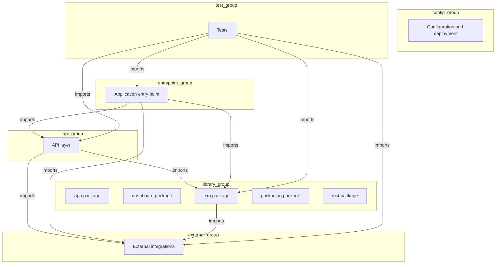

# Architecture report: exo-explore/exo

> Automated static analysis. **Observed** = directly seen in files/imports/AST; **Inferred** = interpretation from that evidence. Repository code was not executed.

## 1. Repository at a glance

| Item | Value |
| --- | --- |
| Repository | exo-explore/exo |
| Description | Run frontier AI locally. |
| Language | Python |
| Stars | 48406 |
| Licence | Apache-2.0 |
| Analysed commit / branch | a60b95698ca81737d367443674dd5563cbc9559b / main |
| Framework(s) | FastAPI, Starlette, Svelte |
| Files analysed | 787 |
| Components | 10 |

## 2. Architecture in one minute

exo-explore/exo - Run frontier AI locally.. This repository was analysed statically from 787 file(s) (83 Python). Detected technologies (observed from imports/manifests): GitHub Actions, FastAPI, Starlette, Svelte, aiohttp, httpx. Files are grouped into 10 component(s): API layer, app package, Configuration and deployment, dashboard package, Application entry point, exo package, External integrations, packaging package. Observed entry point(s): bench/eval_tool_calls.py, bench/exo_bench.py, bench/exo_eval.py. Findings below distinguish observed facts from inferred interpretation.

## 3. High-level block diagram

## 4. Main components

### API layer (`api_layer`)

- **Kind:** api
- **Status:** Observed
- **Confidence:** 0.85
- **Responsibility:** Groups 26 file(s) under api layer (observed from repository paths and static analysis). Observed top-level classes: AddCustomModelParams, AdvancedImageParams, ApiPortInUseError, ApplyPatchCallInputItem, ApplyPatchCallOutputInputItem, AwaitInstanceReadyMessage. Observed top-level functions: _append_tool_call, _build_response_usage, _build_tool_calls, _extract_content, _extract_tool_result_text, _format_sse.
- **Paths:** `dashboard/src/routes/+layout.svelte`, `dashboard/src/routes/advanced/+page.svelte`, `dashboard/src/routes/downloads/+page.svelte`, `dashboard/src/routes/integrations/+page.svelte`, `dashboard/src/routes/traces/+page.svelte`, `dashboard/src/routes/traces/[taskId]/+page.svelte`, `src/exo/api/__init__.py`, `src/exo/api/adapters/__init__.py`, `src/exo/api/adapters/chat_completions.py`, `src/exo/api/adapters/claude.py`, `src/exo/api/adapters/ollama.py`, `src/exo/api/adapters/responses.py`, `src/exo/api/closes_streams.py`, `src/exo/api/cluster_routes.py`, `src/exo/api/collected_response.py`, `src/exo/api/command_acceptance.py`, `src/exo/api/keepalive.py`, `src/exo/api/listening_socket.py`, `src/exo/api/recent_events.py`, `src/exo/api/request_logger.py`, `src/exo/api/serving_client.py`, `src/exo/api/types/__init__.py`, `src/exo/api/types/api.py`, `src/exo/api/types/claude_api.py`, `src/exo/api/types/ollama_api.py`, `src/exo/api/types/openai_responses.py`
- **Evidence:** [dashboard/src/routes/+layout.svelte](https://github.com/exo-explore/exo/blob/a60b95698ca81737d367443674dd5563cbc9559b/dashboard/src/routes/%2Blayout.svelte); [dashboard/src/routes/advanced/+page.svelte](https://github.com/exo-explore/exo/blob/a60b95698ca81737d367443674dd5563cbc9559b/dashboard/src/routes/advanced/%2Bpage.svelte); [dashboard/src/routes/downloads/+page.svelte](https://github.com/exo-explore/exo/blob/a60b95698ca81737d367443674dd5563cbc9559b/dashboard/src/routes/downloads/%2Bpage.svelte); [dashboard/src/routes/integrations/+page.svelte](https://github.com/exo-explore/exo/blob/a60b95698ca81737d367443674dd5563cbc9559b/dashboard/src/routes/integrations/%2Bpage.svelte); [dashboard/src/routes/traces/+page.svelte](https://github.com/exo-explore/exo/blob/a60b95698ca81737d367443674dd5563cbc9559b/dashboard/src/routes/traces/%2Bpage.svelte); [dashboard/src/routes/traces/[taskId]/+page.svelte](https://github.com/exo-explore/exo/blob/a60b95698ca81737d367443674dd5563cbc9559b/dashboard/src/routes/traces/%5BtaskId%5D/%2Bpage.svelte); [src/exo/api/__init__.py](https://github.com/exo-explore/exo/blob/a60b95698ca81737d367443674dd5563cbc9559b/src/exo/api/__init__.py); [src/exo/api/adapters/__init__.py](https://github.com/exo-explore/exo/blob/a60b95698ca81737d367443674dd5563cbc9559b/src/exo/api/adapters/__init__.py)

### app package (`app`)

- **Kind:** library
- **Status:** Observed
- **Confidence:** 0.85
- **Responsibility:** Groups 1 file(s) under app package (observed from repository paths and static analysis).
- **Paths:** `app/EXO/uninstall-exo.sh`
- **Evidence:** [app/EXO/uninstall-exo.sh](https://github.com/exo-explore/exo/blob/a60b95698ca81737d367443674dd5563cbc9559b/app/EXO/uninstall-exo.sh)

### Configuration and deployment (`config`)

- **Kind:** config
- **Status:** Observed
- **Confidence:** 0.85
- **Responsibility:** Groups 195 file(s) under configuration and deployment (observed from repository paths and static analysis).
- **Paths:** `Cargo.toml`, `app/EXO/EXO/Assets.xcassets/AccentColor.colorset/Contents.json`, `app/EXO/EXO/Assets.xcassets/AppIcon.appiconset/Contents.json`, `app/EXO/EXO/Assets.xcassets/Contents.json`, `app/EXO/EXO/Preview Content/Preview Assets.xcassets/Contents.json`, `app/EXO/EXOTests/Fixtures/state.json`, `bench/bench.toml`, `bench/eval_configs/models.toml`, `bench/prefill-decode.toml`, `bench/pyproject.toml`, `bench/scenarios.toml`, `bench/single-m3-ultra.toml`, `dashboard/package.json`, `dashboard/tsconfig.json`, `nix/apple-sdk/metadata/versions.json`, `pyproject.toml`, `resources/image_model_cards/exolabs--FLUX.1-Kontext-dev-4bit.toml`, `resources/image_model_cards/exolabs--FLUX.1-Kontext-dev-8bit.toml`, `resources/image_model_cards/exolabs--FLUX.1-Kontext-dev.toml`, `resources/image_model_cards/exolabs--FLUX.1-Krea-dev-4bit.toml`, `resources/image_model_cards/exolabs--FLUX.1-Krea-dev-8bit.toml`, `resources/image_model_cards/exolabs--FLUX.1-Krea-dev.toml`, `resources/image_model_cards/exolabs--FLUX.1-dev-4bit.toml`, `resources/image_model_cards/exolabs--FLUX.1-dev-8bit.toml`, `resources/image_model_cards/exolabs--FLUX.1-dev.toml`, `resources/image_model_cards/exolabs--FLUX.1-schnell-4bit.toml`, `resources/image_model_cards/exolabs--FLUX.1-schnell-8bit.toml`, `resources/image_model_cards/exolabs--FLUX.1-schnell.toml`, `resources/image_model_cards/exolabs--Qwen-Image-4bit.toml`, `resources/image_model_cards/exolabs--Qwen-Image-8bit.toml`, `resources/image_model_cards/exolabs--Qwen-Image-Edit-2509-4bit.toml`, `resources/image_model_cards/exolabs--Qwen-Image-Edit-2509-8bit.toml`, `resources/image_model_cards/exolabs--Qwen-Image-Edit-2509.toml`, `resources/image_model_cards/exolabs--Qwen-Image.toml`, `resources/inference_model_cards/deepseek_v3/mlx-community--DeepSeek-V3.1-4bit.toml`, `resources/inference_model_cards/deepseek_v3/mlx-community--DeepSeek-V3.1-8bit.toml`, `resources/inference_model_cards/deepseek_v3/mlx-community--DeepSeek-V3.2-4bit.toml`, `resources/inference_model_cards/deepseek_v3/mlx-community--DeepSeek-V3.2-8bit.toml`, `resources/inference_model_cards/deepseek_v4/deepseek-ai--DeepSeek-V4-Flash-0731.toml`, `resources/inference_model_cards/deepseek_v4/deepseek-ai--DeepSeek-V4-Pro-0813.toml`, `resources/inference_model_cards/deepseek_v4/mlx-community--DeepSeek-V4-Flash.toml`, `resources/inference_model_cards/deepseek_v4/mlx-community--DeepSeek-V4-Pro.toml`, `resources/inference_model_cards/deepseek_v41/deepseek-ai--DeepSeek-V4.1-Flash-1017.toml`, `resources/inference_model_cards/deepseek_v41/deepseek-ai--DeepSeek-V4.1-Flash.toml`, `resources/inference_model_cards/flint/RecursiveSI--flint-int4.toml`, `resources/inference_model_cards/flint/RecursiveSI--flint.toml`, `resources/inference_model_cards/flint/mlx-community--flint-mixed-3-4bit.toml`, `resources/inference_model_cards/gemma/mlx-community--gemma-4-26b-a4b-it-4bit.toml`, `resources/inference_model_cards/gemma/mlx-community--gemma-4-26b-a4b-it-6bit.toml`, `resources/inference_model_cards/gemma/mlx-community--gemma-4-26b-a4b-it-8bit.toml`, `resources/inference_model_cards/gemma/mlx-community--gemma-4-26b-a4b-it-bf16.toml`, `resources/inference_model_cards/gemma/mlx-community--gemma-4-31b-it-4bit.toml`, `resources/inference_model_cards/gemma/mlx-community--gemma-4-31b-it-6bit.toml`, `resources/inference_model_cards/gemma/mlx-community--gemma-4-31b-it-8bit.toml`, `resources/inference_model_cards/gemma/mlx-community--gemma-4-31b-it-bf16.toml`, `resources/inference_model_cards/gemma/mlx-community--gemma-4-e2b-it-4bit.toml`, `resources/inference_model_cards/gemma/mlx-community--gemma-4-e2b-it-6bit.toml`, `resources/inference_model_cards/gemma/mlx-community--gemma-4-e2b-it-8bit.toml`, `resources/inference_model_cards/gemma/mlx-community--gemma-4-e2b-it-bf16.toml`, `resources/inference_model_cards/gemma/mlx-community--gemma-4-e4b-it-4bit.toml`, `resources/inference_model_cards/gemma/mlx-community--gemma-4-e4b-it-6bit.toml`, `resources/inference_model_cards/gemma/mlx-community--gemma-4-e4b-it-8bit.toml`, `resources/inference_model_cards/gemma/mlx-community--gemma-4-e4b-it-bf16.toml`, `resources/inference_model_cards/glm/mlx-community--GLM-4.5-Air-8bit.toml`, `resources/inference_model_cards/glm/mlx-community--GLM-4.5-Air-bf16.toml`, `resources/inference_model_cards/glm/mlx-community--GLM-4.7-4bit.toml`, `resources/inference_model_cards/glm/mlx-community--GLM-4.7-6bit.toml`, `resources/inference_model_cards/glm/mlx-community--GLM-4.7-8bit.toml`, `resources/inference_model_cards/glm/mlx-community--GLM-4.7-Flash-4bit.toml`, `resources/inference_model_cards/glm/mlx-community--GLM-4.7-Flash-5bit.toml`, `resources/inference_model_cards/glm/mlx-community--GLM-4.7-Flash-6bit.toml`, `resources/inference_model_cards/glm/mlx-community--GLM-4.7-Flash-8bit.toml`, `resources/inference_model_cards/glm/mlx-community--GLM-5-8bit.toml`, `resources/inference_model_cards/glm/mlx-community--GLM-5-MXFP4-Q8.toml`, `resources/inference_model_cards/glm/mlx-community--GLM-5-bf16.toml`, `resources/inference_model_cards/glm/mlx-community--GLM-5.1-DQ4plus-q8.toml`, `resources/inference_model_cards/glm/mlx-community--GLM-5.1-MXFP4-Q8.toml`, `resources/inference_model_cards/glm/mlx-community--GLM-5.1.toml`, `resources/inference_model_cards/glm/mlx-community--GLM-5.3-4bit.toml`, `resources/inference_model_cards/glm/mlx-community--GLM-5.3-Flash-4bit.toml`, `resources/inference_model_cards/gpt_oss/mlx-community--gpt-oss-120b-MXFP4-Q8.toml`, `resources/inference_model_cards/gpt_oss/mlx-community--gpt-oss-20b-MXFP4-Q8.toml`, `resources/inference_model_cards/hy_v3/XavierLocalAI--Hy3-4bit.toml`, `resources/inference_model_cards/inkling/mlx-community--Inkling-Small-mlx-4bit.toml`, `resources/inference_model_cards/inkling/thinkingmachines--Inkling-Small.toml`, `resources/inference_model_cards/kimi/mlx-community--Kimi-K2-Instruct-4bit.toml`, `resources/inference_model_cards/kimi/mlx-community--Kimi-K2-Thinking.toml`, `resources/inference_model_cards/kimi/mlx-community--Kimi-K2.5.toml`, `resources/inference_model_cards/kimi/mlx-community--Kimi-K2.6-mlx-DQ3_K_M-q8.toml`, `resources/inference_model_cards/kimi/moonshotai--Kimi-K2.6.toml`, `resources/inference_model_cards/kimi/moonshotai--Kimi-K2.7-Code.toml`, `resources/inference_model_cards/laguna/mlx-community--Laguna-S-2.1-oQ4e.toml`, `resources/inference_model_cards/laguna/mlx-community--Laguna-S-2.1-oQ6e.toml`, `resources/inference_model_cards/laguna/poolside--Laguna-S-2.1.toml`, `resources/inference_model_cards/laguna/poolside--Laguna-XS-2.1-NVFP4-mlx.toml`, `resources/inference_model_cards/laguna/poolside--Laguna-XS-2.1.toml`, `resources/inference_model_cards/llama/mlx-community--Llama-3.1-Nemotron-70B-Instruct-HF-4bit.toml`, `resources/inference_model_cards/llama/mlx-community--Llama-3.1-Nemotron-70B-Instruct-HF-8bit.toml`, `resources/inference_model_cards/llama/mlx-community--Llama-3.1-Nemotron-70B-Instruct-HF-bf16.toml`, `resources/inference_model_cards/llama/mlx-community--Llama-3.1-Nemotron-Nano-4B-v1.1-4bit.toml`, `resources/inference_model_cards/llama/mlx-community--Llama-3.1-Nemotron-Nano-4B-v1.1-8bit.toml`, `resources/inference_model_cards/llama/mlx-community--Llama-3.1-Nemotron-Nano-4B-v1.1-bf16.toml`, `resources/inference_model_cards/llama/mlx-community--Llama-3.2-1B-Instruct-4bit.toml`, `resources/inference_model_cards/llama/mlx-community--Llama-3.2-3B-Instruct-4bit.toml`, `resources/inference_model_cards/llama/mlx-community--Llama-3.2-3B-Instruct-8bit.toml`, `resources/inference_model_cards/llama/mlx-community--Llama-3.3-70B-Instruct-4bit.toml`, `resources/inference_model_cards/llama/mlx-community--Llama-3.3-70B-Instruct-8bit.toml`, `resources/inference_model_cards/llama/mlx-community--Meta-Llama-3.1-70B-Instruct-4bit.toml`, `resources/inference_model_cards/llama/mlx-community--Meta-Llama-3.1-8B-Instruct-4bit.toml`, `resources/inference_model_cards/llama/mlx-community--Meta-Llama-3.1-8B-Instruct-8bit.toml`, `resources/inference_model_cards/llama/mlx-community--Meta-Llama-3.1-8B-Instruct-bf16.toml`, `resources/inference_model_cards/llama/mlx-community--llama-3.3-70b-instruct-fp16.toml`, `resources/inference_model_cards/minimax/MiniMaxAI--MiniMax-M3-MXFP8.toml`, `resources/inference_model_cards/minimax/MiniMaxAI--MiniMax-M3.1-Flash.toml`, `resources/inference_model_cards/minimax/mlx-community--MiniMax-M2.1-3bit.toml`, `resources/inference_model_cards/minimax/mlx-community--MiniMax-M2.1-8bit.toml`, `resources/inference_model_cards/minimax/mlx-community--MiniMax-M2.5-4bit.toml`, `resources/inference_model_cards/minimax/mlx-community--MiniMax-M2.5-6bit.toml`, `resources/inference_model_cards/minimax/mlx-community--MiniMax-M2.5-8bit.toml`, `resources/inference_model_cards/minimax/mlx-community--MiniMax-M2.7-4bit-mxfp4.toml`, `resources/inference_model_cards/minimax/mlx-community--MiniMax-M2.7-4bit.toml`, `resources/inference_model_cards/minimax/mlx-community--MiniMax-M2.7-5bit.toml`, `resources/inference_model_cards/minimax/mlx-community--MiniMax-M2.7-6bit.toml`, `resources/inference_model_cards/minimax/mlx-community--MiniMax-M2.7-8bit.toml`, `resources/inference_model_cards/minimax/mlx-community--MiniMax-M2.7.toml`, `resources/inference_model_cards/minimax/mlx-community--MiniMax-M3-4bit.toml`, `resources/inference_model_cards/minimax/mlx-community--MiniMax-M3.1-Flash-Text-3bit.toml`, `resources/inference_model_cards/minimax/mlx-community--MiniMax-M3.1-Flash-Text-4bit.toml`, `resources/inference_model_cards/muse_spark/mlx-community--Muse-Spark-Open-816B-A42B-3bit.toml`, `resources/inference_model_cards/muse_spark/mlx-community--Muse-Spark-Open-816B-A42B-4bit.toml`, `resources/inference_model_cards/nemotron_h/mlx-community--NVIDIA-Nemotron-3-Nano-30B-A3B-MLX-4Bit.toml`, `resources/inference_model_cards/nemotron_h/mlx-community--NVIDIA-Nemotron-3-Nano-30B-A3B-MLX-5Bit.toml`, `resources/inference_model_cards/nemotron_h/mlx-community--NVIDIA-Nemotron-3-Nano-30B-A3B-MLX-6Bit.toml`, `resources/inference_model_cards/nemotron_h/mlx-community--NVIDIA-Nemotron-3-Nano-30B-A3B-MLX-8Bit.toml`, `resources/inference_model_cards/nemotron_h/mlx-community--NVIDIA-Nemotron-3-Nano-30B-A3B-MLX-BF16.toml`, `resources/inference_model_cards/nemotron_h/mlx-community--NVIDIA-Nemotron-3-Nano-30B-A3B-MLX-MXFP4.toml`, `resources/inference_model_cards/nemotron_h/mlx-community--NVIDIA-Nemotron-3-Nano-30B-A3B-NVFP4.toml`, `resources/inference_model_cards/nemotron_h/mlx-community--NVIDIA-Nemotron-3.5-Lightning-30B-A3B-4bit.toml`, `resources/inference_model_cards/nemotron_h/mlx-community--NVIDIA-Nemotron-3.5-Lightning-30B-A3B-8bit.toml`, `resources/inference_model_cards/nemotron_h/mlx-community--NVIDIA-Nemotron-3.5-Lightning-30B-A3B-bf16.toml`, `resources/inference_model_cards/nemotron_h/mlx-community--NVIDIA-Nemotron-Nano-9B-v2-4bits.toml`, `resources/inference_model_cards/nemotron_h/mlx-community--NVIDIA-Nemotron-Nano-9B-v2-6bit.toml`, `resources/inference_model_cards/nemotron_h/mlx-community--Nemotron-3-Ultra-550B-A55B-4bit.toml`, `resources/inference_model_cards/nemotron_h/mlx-community--Nemotron-3-Ultra-550B-A55B.toml`, `resources/inference_model_cards/qwen3/mlx-community--Qwen3-0.6B-4bit.toml`, `resources/inference_model_cards/qwen3/mlx-community--Qwen3-0.6B-8bit.toml`, `resources/inference_model_cards/qwen3/mlx-community--Qwen3-235B-A22B-Instruct-2507-4bit.toml`, `resources/inference_model_cards/qwen3/mlx-community--Qwen3-235B-A22B-Instruct-2507-8bit.toml`, `resources/inference_model_cards/qwen3/mlx-community--Qwen3-30B-A3B-4bit.toml`, `resources/inference_model_cards/qwen3/mlx-community--Qwen3-30B-A3B-8bit.toml`, `resources/inference_model_cards/qwen3/mlx-community--Qwen3-Coder-480B-A35B-Instruct-4bit.toml`, `resources/inference_model_cards/qwen3/mlx-community--Qwen3-Coder-480B-A35B-Instruct-8bit.toml`, `resources/inference_model_cards/qwen3/mlx-community--Qwen3-Coder-Next-4bit.toml`, `resources/inference_model_cards/qwen3/mlx-community--Qwen3-Coder-Next-5bit.toml`, `resources/inference_model_cards/qwen3/mlx-community--Qwen3-Coder-Next-6bit.toml`, `resources/inference_model_cards/qwen3/mlx-community--Qwen3-Coder-Next-8bit.toml`, `resources/inference_model_cards/qwen3/mlx-community--Qwen3-Coder-Next-bf16.toml`, `resources/inference_model_cards/qwen3/mlx-community--Qwen3-Next-80B-A3B-Instruct-4bit.toml`, `resources/inference_model_cards/qwen3/mlx-community--Qwen3-Next-80B-A3B-Instruct-8bit.toml`, `resources/inference_model_cards/qwen3/mlx-community--Qwen3-Next-80B-A3B-Thinking-4bit.toml`, `resources/inference_model_cards/qwen3/mlx-community--Qwen3-Next-80B-A3B-Thinking-8bit.toml`, `resources/inference_model_cards/qwen3/mlx-community--Qwen3-VL-4B-Instruct-4bit.toml`, `resources/inference_model_cards/qwen3/mlx-community--Qwen3.5-122B-A10B-4bit.toml`, `resources/inference_model_cards/qwen3/mlx-community--Qwen3.5-122B-A10B-6bit.toml`, `resources/inference_model_cards/qwen3/mlx-community--Qwen3.5-122B-A10B-8bit.toml`, `resources/inference_model_cards/qwen3/mlx-community--Qwen3.5-122B-A10B-bf16.toml`, `resources/inference_model_cards/qwen3/mlx-community--Qwen3.5-27B-4bit.toml`, `resources/inference_model_cards/qwen3/mlx-community--Qwen3.5-27B-8bit.toml`, `resources/inference_model_cards/qwen3/mlx-community--Qwen3.5-2B-MLX-8bit.toml`, `resources/inference_model_cards/qwen3/mlx-community--Qwen3.5-35B-A3B-4bit.toml`, `resources/inference_model_cards/qwen3/mlx-community--Qwen3.5-35B-A3B-8bit.toml`, `resources/inference_model_cards/qwen3/mlx-community--Qwen3.5-397B-A17B-4bit.toml`, `resources/inference_model_cards/qwen3/mlx-community--Qwen3.5-397B-A17B-6bit.toml`, `resources/inference_model_cards/qwen3/mlx-community--Qwen3.5-397B-A17B-8bit.toml`, `resources/inference_model_cards/qwen3/mlx-community--Qwen3.5-9B-4bit.toml`, `resources/inference_model_cards/qwen3/mlx-community--Qwen3.5-9B-8bit.toml`, `resources/inference_model_cards/qwen3/mlx-community--Qwen3.6-27B-4bit.toml`, `resources/inference_model_cards/qwen3/mlx-community--Qwen3.6-27B-8bit.toml`, `resources/inference_model_cards/qwen3/mlx-community--Qwen3.6-27B-bf16.toml`, `resources/inference_model_cards/qwen3/mlx-community--Qwen3.6-35B-A3B-4bit.toml`, `resources/inference_model_cards/qwen3/mlx-community--Qwen3.6-35B-A3B-5bit.toml`, `resources/inference_model_cards/qwen3/mlx-community--Qwen3.6-35B-A3B-8bit.toml`, `resources/inference_model_cards/qwen3/mlx-community--Qwen3.6-35B-A3B-bf16.toml`, `resources/inference_model_cards/qwen3/mlx-community--Qwen3.8-27B-4bit.toml`, `resources/inference_model_cards/qwen3/mlx-community--Qwen3.8-27B-8bit.toml`, `resources/inference_model_cards/qwen3/mlx-community--Qwen3.8-27B-bf16.toml`, `resources/inference_model_cards/qwen3/mlx-community--Qwen3.8-27B-mxfp4.toml`, `resources/inference_model_cards/qwen3/mlx-community--Qwen3.8-27B-nvfp4.toml`, `resources/inference_model_cards/qwen3/mlx-community--Qwen3.8-Flash-Next-4bit.toml`, `resources/inference_model_cards/step/mlx-community--Step-3.5-Flash-4bit.toml`, `resources/inference_model_cards/step/mlx-community--Step-3.5-Flash-6bit.toml`, `resources/inference_model_cards/step/mlx-community--Step-3.5-Flash-8bit.toml`, `rust/exo_rs/Cargo.toml`, `rust/exo_rs/pyproject.toml`, `rust/networking/Cargo.toml`
- **Evidence:** [Cargo.toml](https://github.com/exo-explore/exo/blob/a60b95698ca81737d367443674dd5563cbc9559b/Cargo.toml); [app/EXO/EXO/Assets.xcassets/AccentColor.colorset/Contents.json](https://github.com/exo-explore/exo/blob/a60b95698ca81737d367443674dd5563cbc9559b/app/EXO/EXO/Assets.xcassets/AccentColor.colorset/Contents.json); [app/EXO/EXO/Assets.xcassets/AppIcon.appiconset/Contents.json](https://github.com/exo-explore/exo/blob/a60b95698ca81737d367443674dd5563cbc9559b/app/EXO/EXO/Assets.xcassets/AppIcon.appiconset/Contents.json); [app/EXO/EXO/Assets.xcassets/Contents.json](https://github.com/exo-explore/exo/blob/a60b95698ca81737d367443674dd5563cbc9559b/app/EXO/EXO/Assets.xcassets/Contents.json); [app/EXO/EXO/Preview Content/Preview Assets.xcassets/Contents.json](https://github.com/exo-explore/exo/blob/a60b95698ca81737d367443674dd5563cbc9559b/app/EXO/EXO/Preview%20Content/Preview%20Assets.xcassets/Contents.json); [app/EXO/EXOTests/Fixtures/state.json](https://github.com/exo-explore/exo/blob/a60b95698ca81737d367443674dd5563cbc9559b/app/EXO/EXOTests/Fixtures/state.json); [bench/bench.toml](https://github.com/exo-explore/exo/blob/a60b95698ca81737d367443674dd5563cbc9559b/bench/bench.toml); [bench/eval_configs/models.toml](https://github.com/exo-explore/exo/blob/a60b95698ca81737d367443674dd5563cbc9559b/bench/eval_configs/models.toml)

### dashboard package (`dashboard`)

- **Kind:** library
- **Status:** Observed
- **Confidence:** 0.85
- **Responsibility:** Groups 47 file(s) under dashboard package (observed from repository paths and static analysis).
- **Paths:** `dashboard/src/app.d.ts`, `dashboard/src/lib/components/ChatAttachments.svelte`, `dashboard/src/lib/components/ChatForm.svelte`, `dashboard/src/lib/components/ChatMessages.svelte`, `dashboard/src/lib/components/ChatModelSelector.svelte`, `dashboard/src/lib/components/ChatSidebar.svelte`, `dashboard/src/lib/components/ConnectionBanner.svelte`, `dashboard/src/lib/components/DeviceIcon.svelte`, `dashboard/src/lib/components/FamilyLogos.svelte`, `dashboard/src/lib/components/FamilySidebar.svelte`, `dashboard/src/lib/components/HeaderNav.svelte`, `dashboard/src/lib/components/HuggingFaceResultItem.svelte`, `dashboard/src/lib/components/ImageLightbox.svelte`, `dashboard/src/lib/components/ImageParamsPanel.svelte`, `dashboard/src/lib/components/IntegrationCard.svelte`, `dashboard/src/lib/components/MarkdownContent.svelte`, `dashboard/src/lib/components/ModelCard.svelte`, `dashboard/src/lib/components/ModelFilterPopover.svelte`, `dashboard/src/lib/components/ModelPickerGroup.svelte`, `dashboard/src/lib/components/ModelPickerModal.svelte`, `dashboard/src/lib/components/PrefillDecodeDisaggregation.svelte`, `dashboard/src/lib/components/PrefillProgressBar.svelte`, `dashboard/src/lib/components/ToastContainer.svelte`, `dashboard/src/lib/components/TokenHeatmap.svelte`, `dashboard/src/lib/components/TopologyGraph.svelte`, `dashboard/src/lib/components/index.ts`, `dashboard/src/lib/stores/app.svelte.ts`, `dashboard/src/lib/stores/favorites.svelte.ts`, `dashboard/src/lib/stores/recents.svelte.ts`, `dashboard/src/lib/stores/toast.svelte.ts`, `dashboard/src/lib/types/files.ts`, `dashboard/src/lib/utils/api_errors.ts`, `dashboard/src/lib/utils/brand_colors.ts`, `dashboard/src/lib/utils/clipboard.ts`, `dashboard/src/lib/utils/conversation_sync.ts`, `dashboard/src/lib/utils/deployments.ts`, `dashboard/src/lib/utils/disk_fit.ts`, `dashboard/src/lib/utils/download_activity.ts`, `dashboard/src/lib/utils/download_progress.ts`, `dashboard/src/lib/utils/downloads.ts`, `dashboard/src/lib/utils/instance_health.ts`, `dashboard/src/lib/utils/model_family.ts`, `dashboard/src/lib/utils/other_versions.ts`, `dashboard/src/lib/utils/rdma.ts`, `dashboard/src/lib/utils/stream_errors.ts`, `dashboard/svelte.config.js`, `dashboard/vite.config.ts`
- **Evidence:** [dashboard/src/app.d.ts](https://github.com/exo-explore/exo/blob/a60b95698ca81737d367443674dd5563cbc9559b/dashboard/src/app.d.ts); [dashboard/src/lib/components/ChatAttachments.svelte](https://github.com/exo-explore/exo/blob/a60b95698ca81737d367443674dd5563cbc9559b/dashboard/src/lib/components/ChatAttachments.svelte); [dashboard/src/lib/components/ChatForm.svelte](https://github.com/exo-explore/exo/blob/a60b95698ca81737d367443674dd5563cbc9559b/dashboard/src/lib/components/ChatForm.svelte); [dashboard/src/lib/components/ChatMessages.svelte](https://github.com/exo-explore/exo/blob/a60b95698ca81737d367443674dd5563cbc9559b/dashboard/src/lib/components/ChatMessages.svelte); [dashboard/src/lib/components/ChatModelSelector.svelte](https://github.com/exo-explore/exo/blob/a60b95698ca81737d367443674dd5563cbc9559b/dashboard/src/lib/components/ChatModelSelector.svelte); [dashboard/src/lib/components/ChatSidebar.svelte](https://github.com/exo-explore/exo/blob/a60b95698ca81737d367443674dd5563cbc9559b/dashboard/src/lib/components/ChatSidebar.svelte); [dashboard/src/lib/components/ConnectionBanner.svelte](https://github.com/exo-explore/exo/blob/a60b95698ca81737d367443674dd5563cbc9559b/dashboard/src/lib/components/ConnectionBanner.svelte); [dashboard/src/lib/components/DeviceIcon.svelte](https://github.com/exo-explore/exo/blob/a60b95698ca81737d367443674dd5563cbc9559b/dashboard/src/lib/components/DeviceIcon.svelte)

### Application entry point (`entrypoint`)

- **Kind:** entrypoint
- **Status:** Observed
- **Confidence:** 0.85
- **Responsibility:** Groups 12 file(s) under application entry point (observed from repository paths and static analysis). Observed top-level classes: API, ApiResult, AppliedClusterCommand, Args, BenchmarkConfig, InstanceFailedError. Observed top-level functions: _call_api, _check_instance_health, _checkpoint_path, _claude_build_followup, _claude_build_request, _claude_parse_response.
- **Paths:** `bench/eval_tool_calls.py`, `bench/exo_bench.py`, `bench/exo_eval.py`, `bench/parallel_requests.py`, `bench/prefill_decode_bench.py`, `packaging/dmg/generate-background.py`, `scripts/download_model_to_cluster.py`, `scripts/fetch_kv_heads.py`, `src/exo/__main__.py`, `src/exo/api/main.py`, `src/exo/main.py`, `src/exo/master/main.py`
- **Evidence:** [bench/eval_tool_calls.py:35](https://github.com/exo-explore/exo/blob/a60b95698ca81737d367443674dd5563cbc9559b/bench/eval_tool_calls.py#L35); [bench/exo_bench.py:63](https://github.com/exo-explore/exo/blob/a60b95698ca81737d367443674dd5563cbc9559b/bench/exo_bench.py#L63); [bench/exo_eval.py:70](https://github.com/exo-explore/exo/blob/a60b95698ca81737d367443674dd5563cbc9559b/bench/exo_eval.py#L70); [bench/parallel_requests.py:28](https://github.com/exo-explore/exo/blob/a60b95698ca81737d367443674dd5563cbc9559b/bench/parallel_requests.py#L28); [bench/prefill_decode_bench.py:54](https://github.com/exo-explore/exo/blob/a60b95698ca81737d367443674dd5563cbc9559b/bench/prefill_decode_bench.py#L54); [packaging/dmg/generate-background.py:39](https://github.com/exo-explore/exo/blob/a60b95698ca81737d367443674dd5563cbc9559b/packaging/dmg/generate-background.py#L39); [scripts/download_model_to_cluster.py:31](https://github.com/exo-explore/exo/blob/a60b95698ca81737d367443674dd5563cbc9559b/scripts/download_model_to_cluster.py#L31); [scripts/fetch_kv_heads.py:29](https://github.com/exo-explore/exo/blob/a60b95698ca81737d367443674dd5563cbc9559b/scripts/fetch_kv_heads.py#L29)

### exo package (`exo`)

- **Kind:** library
- **Status:** Observed
- **Confidence:** 0.85
- **Responsibility:** Groups 12 file(s) under exo package (observed from repository paths and static analysis). Observed top-level classes: Decisions, DownloadCoordinator, DownloadSettings, FileProgress, FileState, Hasher. Observed top-level functions: _allocate_and_validate_layers, _already_there, _check_index, _compute_total_memory, _content_type_to_extension, _cycle_download_score.
- **Paths:** `src/exo/__init__.py`, `src/exo/download/coordinator.py`, `src/exo/download/download_utils.py`, `src/exo/download/hub.py`, `src/exo/download/huggingface_utils.py`, `src/exo/download/store.py`, `src/exo/download/transfer.py`, `src/exo/master/__init__.py`, `src/exo/master/deployments.py`, `src/exo/master/image_store.py`, `src/exo/master/placement.py`, `src/exo/master/placement_utils.py`
- **Evidence:** [src/exo/__init__.py](https://github.com/exo-explore/exo/blob/a60b95698ca81737d367443674dd5563cbc9559b/src/exo/__init__.py); [src/exo/download/coordinator.py:69](https://github.com/exo-explore/exo/blob/a60b95698ca81737d367443674dd5563cbc9559b/src/exo/download/coordinator.py#L69); [src/exo/download/download_utils.py:19](https://github.com/exo-explore/exo/blob/a60b95698ca81737d367443674dd5563cbc9559b/src/exo/download/download_utils.py#L19); [src/exo/download/hub.py:29](https://github.com/exo-explore/exo/blob/a60b95698ca81737d367443674dd5563cbc9559b/src/exo/download/hub.py#L29); [src/exo/download/huggingface_utils.py:10](https://github.com/exo-explore/exo/blob/a60b95698ca81737d367443674dd5563cbc9559b/src/exo/download/huggingface_utils.py#L10); [src/exo/download/store.py:39](https://github.com/exo-explore/exo/blob/a60b95698ca81737d367443674dd5563cbc9559b/src/exo/download/store.py#L39); [src/exo/download/transfer.py:51](https://github.com/exo-explore/exo/blob/a60b95698ca81737d367443674dd5563cbc9559b/src/exo/download/transfer.py#L51); [src/exo/master/__init__.py](https://github.com/exo-explore/exo/blob/a60b95698ca81737d367443674dd5563cbc9559b/src/exo/master/__init__.py)

### External integrations (`external_integrations`)

- **Kind:** external
- **Status:** Inferred
- **Confidence:** 0.70
- **Responsibility:** Groups 0 file(s) under external integrations (observed from repository paths and static analysis).
- **Evidence:** [bench/eval_tool_calls.py:17](https://github.com/exo-explore/exo/blob/a60b95698ca81737d367443674dd5563cbc9559b/bench/eval_tool_calls.py#L17); [bench/exo_eval.py:44](https://github.com/exo-explore/exo/blob/a60b95698ca81737d367443674dd5563cbc9559b/bench/exo_eval.py#L44); [bench/parallel_requests.py:9](https://github.com/exo-explore/exo/blob/a60b95698ca81737d367443674dd5563cbc9559b/bench/parallel_requests.py#L9); [scripts/download_model_to_cluster.py:24](https://github.com/exo-explore/exo/blob/a60b95698ca81737d367443674dd5563cbc9559b/scripts/download_model_to_cluster.py#L24); [src/exo/api/cluster_routes.py:11](https://github.com/exo-explore/exo/blob/a60b95698ca81737d367443674dd5563cbc9559b/src/exo/api/cluster_routes.py#L11); [src/exo/api/listening_socket.py:2](https://github.com/exo-explore/exo/blob/a60b95698ca81737d367443674dd5563cbc9559b/src/exo/api/listening_socket.py#L2)

### packaging package (`packaging`)

- **Kind:** library
- **Status:** Observed
- **Confidence:** 0.85
- **Responsibility:** Groups 1 file(s) under packaging package (observed from repository paths and static analysis).
- **Paths:** `packaging/dmg/create-dmg.sh`
- **Evidence:** [packaging/dmg/create-dmg.sh](https://github.com/exo-explore/exo/blob/a60b95698ca81737d367443674dd5563cbc9559b/packaging/dmg/create-dmg.sh)

### rust package (`rust`)

- **Kind:** library
- **Status:** Observed
- **Confidence:** 0.85
- **Responsibility:** Groups 15 file(s) under rust package (observed from repository paths and static analysis).
- **Paths:** `rust/exo_rs/src/allow_threading.rs`, `rust/exo_rs/src/bin/stub_gen.rs`, `rust/exo_rs/src/lib.rs`, `rust/exo_rs/src/logging.rs`, `rust/exo_rs/src/networking.rs`, `rust/exo_rs/src/pidfile.rs`, `rust/networking/examples/do_nothing.rs`, `rust/networking/examples/heartbeat.rs`, `rust/networking/examples/put_string.rs`, `rust/networking/examples/z_get.rs`, `rust/networking/src/discovery.rs`, `rust/networking/src/lib.rs`, `rust/networking/src/membership.rs`, `rust/networking/src/swarm.rs`, `rust/networking/src/wire.rs`
- **Evidence:** [rust/exo_rs/src/allow_threading.rs](https://github.com/exo-explore/exo/blob/a60b95698ca81737d367443674dd5563cbc9559b/rust/exo_rs/src/allow_threading.rs); [rust/exo_rs/src/bin/stub_gen.rs](https://github.com/exo-explore/exo/blob/a60b95698ca81737d367443674dd5563cbc9559b/rust/exo_rs/src/bin/stub_gen.rs); [rust/exo_rs/src/lib.rs](https://github.com/exo-explore/exo/blob/a60b95698ca81737d367443674dd5563cbc9559b/rust/exo_rs/src/lib.rs); [rust/exo_rs/src/logging.rs](https://github.com/exo-explore/exo/blob/a60b95698ca81737d367443674dd5563cbc9559b/rust/exo_rs/src/logging.rs); [rust/exo_rs/src/networking.rs](https://github.com/exo-explore/exo/blob/a60b95698ca81737d367443674dd5563cbc9559b/rust/exo_rs/src/networking.rs); [rust/exo_rs/src/pidfile.rs](https://github.com/exo-explore/exo/blob/a60b95698ca81737d367443674dd5563cbc9559b/rust/exo_rs/src/pidfile.rs); [rust/networking/examples/do_nothing.rs](https://github.com/exo-explore/exo/blob/a60b95698ca81737d367443674dd5563cbc9559b/rust/networking/examples/do_nothing.rs); [rust/networking/examples/heartbeat.rs](https://github.com/exo-explore/exo/blob/a60b95698ca81737d367443674dd5563cbc9559b/rust/networking/examples/heartbeat.rs)

### Tests (`tests`)

- **Kind:** test
- **Status:** Observed
- **Confidence:** 0.85
- **Responsibility:** Groups 54 file(s) under tests (observed from repository paths and static analysis). Observed application object created via FastAPI. Observed top-level classes: Blob, Commit, Corrupt, DiskUsage, DownloadNode, Drop. Observed top-level functions: _api, _assert_delta_spec_compliant, _await_recv, _chunks, _chunks_to_stream, _client.
- **Paths:** `dashboard/tests/api_errors.test.ts`, `dashboard/tests/conversation_sync.test.ts`, `dashboard/tests/deployments.test.ts`, `dashboard/tests/disk_fit.test.ts`, `dashboard/tests/download_activity.test.ts`, `dashboard/tests/download_progress.test.ts`, `dashboard/tests/download_total_review.test.ts`, `dashboard/tests/downloads.test.ts`, `dashboard/tests/downloads_catalogue.test.ts`, `dashboard/tests/instance_health.test.ts`, `dashboard/tests/model_download_index.test.ts`, `dashboard/tests/other_versions.test.ts`, `dashboard/tests/rdma.test.ts`, `dashboard/tests/stream_errors.test.ts`, `rust/exo_rs/tests/dummy.rs`, `rust/exo_rs/tests/test_python.py`, `src/exo/api/tests/applying_master.py`, `src/exo/api/tests/test_api_error_handling.py`, `src/exo/api/tests/test_api_startup.py`, `src/exo/api/tests/test_app_state_fixture.py`, `src/exo/api/tests/test_chat_completions_stream.py`, `src/exo/api/tests/test_claude_api.py`, `src/exo/api/tests/test_claude_tool_use.py`, `src/exo/api/tests/test_cluster_commands_resent.py`, `src/exo/api/tests/test_collected_response.py`, `src/exo/api/tests/test_command_acceptance.py`, `src/exo/api/tests/test_context_length_errors.py`, `src/exo/api/tests/test_deployment_endpoints.py`, `src/exo/api/tests/test_devices_on_other_versions.py`, `src/exo/api/tests/test_launches_at_once.py`, `src/exo/api/tests/test_membership_endpoint.py`, `src/exo/api/tests/test_model_not_ready.py`, `src/exo/api/tests/test_openai_responses_api.py`, `src/exo/api/tests/test_place_instance_validation.py`, `src/exo/api/tests/test_placement_node_shares_api.py`, `src/exo/api/tests/test_recent_events.py`, `src/exo/api/tests/test_review2_stream_errors_swallowed.py`, `src/exo/api/tests/test_serving_client.py`, `src/exo/api/tests/test_serving_http.py`, `src/exo/api/tests/test_start_download.py`, `src/exo/api/tests/test_stream_error_codes.py`, `src/exo/api/tests/test_unreachable_devices.py`, `src/exo/api/tests/test_unreachable_placement.py`, `src/exo/download/tests/__init__.py`, `src/exo/download/tests/fake_hub.py`, `src/exo/download/tests/harness.py`, `src/exo/download/tests/test_download_coordinator.py`, `src/exo/download/tests/test_download_edge_cases.py`, `src/exo/download/tests/test_download_failure_modes.py`, `src/exo/download/tests/test_fake_hub.py`, `src/exo/download/tests/test_hub.py`, `src/exo/download/tests/test_model_id_paths.py`, `src/exo/download/tests/test_safetensors_index.py`, `src/exo/download/tests/test_store.py`
- **Evidence:** [dashboard/tests/api_errors.test.ts](https://github.com/exo-explore/exo/blob/a60b95698ca81737d367443674dd5563cbc9559b/dashboard/tests/api_errors.test.ts); [dashboard/tests/conversation_sync.test.ts](https://github.com/exo-explore/exo/blob/a60b95698ca81737d367443674dd5563cbc9559b/dashboard/tests/conversation_sync.test.ts); [dashboard/tests/deployments.test.ts](https://github.com/exo-explore/exo/blob/a60b95698ca81737d367443674dd5563cbc9559b/dashboard/tests/deployments.test.ts); [dashboard/tests/disk_fit.test.ts](https://github.com/exo-explore/exo/blob/a60b95698ca81737d367443674dd5563cbc9559b/dashboard/tests/disk_fit.test.ts); [dashboard/tests/download_activity.test.ts](https://github.com/exo-explore/exo/blob/a60b95698ca81737d367443674dd5563cbc9559b/dashboard/tests/download_activity.test.ts); [dashboard/tests/download_progress.test.ts](https://github.com/exo-explore/exo/blob/a60b95698ca81737d367443674dd5563cbc9559b/dashboard/tests/download_progress.test.ts); [dashboard/tests/download_total_review.test.ts](https://github.com/exo-explore/exo/blob/a60b95698ca81737d367443674dd5563cbc9559b/dashboard/tests/download_total_review.test.ts); [dashboard/tests/downloads.test.ts](https://github.com/exo-explore/exo/blob/a60b95698ca81737d367443674dd5563cbc9559b/dashboard/tests/downloads.test.ts)

## 5. Execution flow

**Observed** entry point(s):

- [bench/eval_tool_calls.py:1152](https://github.com/exo-explore/exo/blob/a60b95698ca81737d367443674dd5563cbc9559b/bench/eval_tool_calls.py#L1152)
- [bench/exo_bench.py:935](https://github.com/exo-explore/exo/blob/a60b95698ca81737d367443674dd5563cbc9559b/bench/exo_bench.py#L935)
- [bench/exo_eval.py:1751](https://github.com/exo-explore/exo/blob/a60b95698ca81737d367443674dd5563cbc9559b/bench/exo_eval.py#L1751)
- [bench/parallel_requests.py:254](https://github.com/exo-explore/exo/blob/a60b95698ca81737d367443674dd5563cbc9559b/bench/parallel_requests.py#L254)
- [bench/prefill_decode_bench.py:783](https://github.com/exo-explore/exo/blob/a60b95698ca81737d367443674dd5563cbc9559b/bench/prefill_decode_bench.py#L783)
- [packaging/dmg/generate-background.py:87](https://github.com/exo-explore/exo/blob/a60b95698ca81737d367443674dd5563cbc9559b/packaging/dmg/generate-background.py#L87)
- [scripts/download_model_to_cluster.py:211](https://github.com/exo-explore/exo/blob/a60b95698ca81737d367443674dd5563cbc9559b/scripts/download_model_to_cluster.py#L211)
- [scripts/fetch_kv_heads.py:132](https://github.com/exo-explore/exo/blob/a60b95698ca81737d367443674dd5563cbc9559b/scripts/fetch_kv_heads.py#L132)
- [src/exo/__main__.py:35](https://github.com/exo-explore/exo/blob/a60b95698ca81737d367443674dd5563cbc9559b/src/exo/__main__.py#L35)
- [src/exo/main.py](https://github.com/exo-explore/exo/blob/a60b95698ca81737d367443674dd5563cbc9559b/src/exo/main.py)

Representative flow (derived from observed entry points and the import graph; steps beyond the entry point are **Inferred**):

1. Execution starts at an observed entry point listed above, if present.
2. `api_layer` imports `exo` (API layer -> exo package).
3. `api_layer` imports `external_integrations` (API layer -> External integrations).
4. `entrypoint` imports `api_layer` (Application entry point -> API layer).
5. `entrypoint` imports `exo` (Application entry point -> exo package).
6. `entrypoint` imports `external_integrations` (Application entry point -> External integrations).
7. `exo` imports `external_integrations` (exo package -> External integrations).
8. `tests` imports `api_layer` (Tests -> API layer).
9. `tests` imports `entrypoint` (Tests -> Application entry point).

## 6. Project structure

### `(root)`

- `.clauderules` - other (3004 bytes)
- `.cursorrules` - other (3126 bytes)
- `.envrc` - other (10 bytes)
- `.gitignore` - other (450 bytes)
- `.python-version` - other (5 bytes)
- `.swift-format` - other (59 bytes)
- `AGENTS.md` - docs (6925 bytes)
- `CONTRIBUTING.md` - docs (9897 bytes)
- `Cargo.toml` - manifest (5776 bytes)
- `LICENSE` - docs (11351 bytes)
- `PLATFORMS.md` - docs (637 bytes)
- `README.md` - docs (29103 bytes)
- `RULES.md` - docs (4653 bytes)
- `TODO.md` - docs (1359 bytes)
- `flake.lock` - other (7798 bytes)
- `flake.nix` - other (5449 bytes)
- `justfile` - other (1193 bytes)
- `pyproject.toml` - manifest (6510 bytes)

### `.githooks`

- `.githooks/post-checkout` - other (360 bytes)
- `.githooks/post-commit` - other (356 bytes)
- `.githooks/post-merge` - other (354 bytes)
- `.githooks/pre-push` - other (350 bytes)

### `.github`

- `.github/CODEOWNERS` - other (47 bytes)
- `.github/ISSUE_TEMPLATE/bug_report.md` - docs (813 bytes)
- `.github/ISSUE_TEMPLATE/feature_request.md` - docs (215 bytes)
- `.github/actions/conditional-commit/action.yml` - config (340 bytes)
- `.github/actions/format/action.yml` - config (246 bytes)
- `.github/actions/lint-check/action.yml` - config (254 bytes)
- `.github/actions/lint/action.yml` - config (240 bytes)
- `.github/actions/regenerate-protobufs/action.yml` - config (288 bytes)
- `.github/actions/setup-python-uv/action.yml` - config (413 bytes)
- `.github/actions/unit-test/action.yml` - config (377 bytes)
- `.github/actions/verify-clean/action.yml` - config (468 bytes)
- `.github/pull_request_template.md` - docs (561 bytes)
- `.github/workflows/build-app.yml` - ci, YAML (25248 bytes)
- `.github/workflows/cluster-nightly.yml` - ci, YAML (1376 bytes)
- `.github/workflows/pipeline.yml` - ci, YAML (6017 bytes)

### `.typings`

- `.typings/.gitkeep` - other (0 bytes)
- `.typings/mflux/__init__.pyi` - other (117 bytes)
- `.typings/mflux/callbacks/__init__.pyi` - other (54 bytes)
- `.typings/mflux/callbacks/callback.pyi` - other (1075 bytes)
- `.typings/mflux/callbacks/callback_registry.pyi` - other (816 bytes)
- `.typings/mflux/callbacks/generation_context.pyi` - other (864 bytes)
- `.typings/mflux/cli/__init__.pyi` - other (54 bytes)
- `.typings/mflux/cli/defaults/defaults.pyi` - other (482 bytes)
- `.typings/mflux/models/__init__.pyi` - other (54 bytes)
- `.typings/mflux/models/common/__init__.pyi` - other (54 bytes)
- `.typings/mflux/models/common/cli/__init__.pyi` - other (54 bytes)
- `.typings/mflux/models/common/config/__init__.pyi` - other (209 bytes)
- `.typings/mflux/models/common/config/config.pyi` - other (1904 bytes)
- `.typings/mflux/models/common/config/model_config.pyi` - other (2268 bytes)
- `.typings/mflux/models/common/latent_creator/__init__.pyi` - other (109 bytes)
- `.typings/mflux/models/common/latent_creator/latent_creator.pyi` - other (1514 bytes)
- `.typings/mflux/models/common/lora/__init__.pyi` - other (54 bytes)
- `.typings/mflux/models/common/lora/layer/fused_linear_lora_layer.pyi` - other (353 bytes)
- `.typings/mflux/models/common/lora/layer/linear_lora_layer.pyi` - other (491 bytes)
- `.typings/mflux/models/common/lora/mapping/lora_loader.pyi` - other (687 bytes)
- `.typings/mflux/models/common/lora/mapping/lora_mapping.pyi` - other (572 bytes)
- `.typings/mflux/models/common/lora/mapping/lora_saver.pyi` - other (176 bytes)
- `.typings/mflux/models/common/lora/mapping/lora_transforms.pyi` - other (1182 bytes)
- `.typings/mflux/models/common/resolution/__init__.pyi` - other (493 bytes)
- `.typings/mflux/models/common/resolution/actions.pyi` - other (777 bytes)
- `.typings/mflux/models/common/resolution/config_resolution.pyi` - other (330 bytes)
- `.typings/mflux/models/common/resolution/lora_resolution.pyi` - other (572 bytes)
- `.typings/mflux/models/common/resolution/path_resolution.pyi` - other (239 bytes)
- `.typings/mflux/models/common/resolution/quantization_resolution.pyi` - other (244 bytes)
- `.typings/mflux/models/common/schedulers/__init__.pyi` - other (696 bytes)
- `.typings/mflux/models/common/schedulers/base_scheduler.pyi` - other (419 bytes)
- `.typings/mflux/models/common/schedulers/flow_match_euler_discrete_scheduler.pyi` - other (901 bytes)
- `.typings/mflux/models/common/schedulers/linear_scheduler.pyi` - other (567 bytes)
- `.typings/mflux/models/common/schedulers/seedvr2_euler_scheduler.pyi` - other (573 bytes)
- `.typings/mflux/models/common/tokenizer/__init__.pyi` - other (556 bytes)
- `.typings/mflux/models/common/tokenizer/tokenizer.pyi` - other (2019 bytes)
- `.typings/mflux/models/common/tokenizer/tokenizer_loader.pyi` - other (651 bytes)
- `.typings/mflux/models/common/tokenizer/tokenizer_output.pyi` - other (336 bytes)
- `.typings/mflux/models/common/vae/__init__.pyi` - other (213 bytes)
- `.typings/mflux/models/common/vae/tiling_config.pyi` - other (335 bytes)
- `.typings/mflux/models/common/vae/vae_tiler.pyi` - other (707 bytes)
- `.typings/mflux/models/common/vae/vae_util.pyi` - other (454 bytes)
- `.typings/mflux/models/common/weights/__init__.pyi` - other (588 bytes)
- `.typings/mflux/models/common/weights/loading/loaded_weights.pyi` - other (499 bytes)
- `.typings/mflux/models/common/weights/loading/weight_applier.pyi` - other (821 bytes)
- `.typings/mflux/models/common/weights/loading/weight_definition.pyi` - other (2418 bytes)
- `.typings/mflux/models/common/weights/loading/weight_loader.pyi` - other (626 bytes)
- `.typings/mflux/models/common/weights/mapping/weight_mapper.pyi` - other (434 bytes)
- `.typings/mflux/models/common/weights/mapping/weight_mapping.pyi` - other (522 bytes)
- `.typings/mflux/models/common/weights/mapping/weight_transforms.pyi` - other (531 bytes)
- `.typings/mflux/models/common/weights/saving/model_saver.pyi` - other (366 bytes)
- `.typings/mflux/models/depth_pro/depth_pro_initializer.pyi` - other (248 bytes)
- `.typings/mflux/models/depth_pro/model/decoder/feature_fusion_block_2d.pyi` - other (293 bytes)
- `.typings/mflux/models/depth_pro/model/decoder/multires_conv_decoder.pyi` - other (384 bytes)
- `.typings/mflux/models/depth_pro/model/decoder/residual_block.pyi` - other (238 bytes)
- `.typings/mflux/models/depth_pro/model/depth_pro.pyi` - other (450 bytes)
- `.typings/mflux/models/depth_pro/model/depth_pro_model.pyi` - other (279 bytes)
- `.typings/mflux/models/depth_pro/model/depth_pro_util.pyi` - other (404 bytes)
- `.typings/mflux/models/depth_pro/model/dino_v2/attention.pyi` - other (287 bytes)
- `.typings/mflux/models/depth_pro/model/dino_v2/dino_vision_transformer.pyi` - other (254 bytes)
- `.typings/mflux/models/depth_pro/model/dino_v2/layer_scale.pyi` - other (253 bytes)
- `.typings/mflux/models/depth_pro/model/dino_v2/mlp.pyi` - other (209 bytes)
- `.typings/mflux/models/depth_pro/model/dino_v2/patch_embed.pyi` - other (216 bytes)
- `.typings/mflux/models/depth_pro/model/dino_v2/transformer_block.pyi` - other (222 bytes)
- `.typings/mflux/models/depth_pro/model/encoder/depth_pro_encoder.pyi` - other (311 bytes)
- `.typings/mflux/models/depth_pro/model/encoder/upsample_block.pyi` - other (353 bytes)
- `.typings/mflux/models/depth_pro/model/head/fov_head.pyi` - other (213 bytes)
- `.typings/mflux/models/depth_pro/weights/depth_pro_weight_definition.pyi` - other (590 bytes)
- `.typings/mflux/models/depth_pro/weights/depth_pro_weight_mapping.pyi` - other (295 bytes)
- `.typings/mflux/models/fibo/latent_creator/fibo_latent_creator.pyi` - other (397 bytes)
- `.typings/mflux/models/fibo/weights/fibo_weight_definition.pyi` - other (586 bytes)
- `.typings/mflux/models/fibo/weights/fibo_weight_mapping.pyi` - other (454 bytes)
- `.typings/mflux/models/fibo_vlm/tokenizer/qwen2vl_image_processor.pyi` - other (221 bytes)
- `.typings/mflux/models/fibo_vlm/tokenizer/qwen2vl_processor.pyi` - other (744 bytes)
- `.typings/mflux/models/fibo_vlm/weights/fibo_vlm_weight_definition.pyi` - other (617 bytes)
- `.typings/mflux/models/fibo_vlm/weights/fibo_vlm_weight_mapping.pyi` - other (421 bytes)
- `.typings/mflux/models/flux/__init__.pyi` - other (54 bytes)
- `.typings/mflux/models/flux/cli/__init__.pyi` - other (54 bytes)
- `.typings/mflux/models/flux/flux_initializer.pyi` - other (1493 bytes)
- `.typings/mflux/models/flux/latent_creator/__init__.pyi` - other (109 bytes)
- `.typings/mflux/models/flux/latent_creator/flux_latent_creator.pyi` - other (499 bytes)
- `.typings/mflux/models/flux/model/__init__.pyi` - other (109 bytes)
- `.typings/mflux/models/flux/model/flux_text_encoder/clip_encoder/clip_embeddings.pyi` - other (235 bytes)
- `.typings/mflux/models/flux/model/flux_text_encoder/clip_encoder/clip_encoder.pyi` - other (276 bytes)
- `.typings/mflux/models/flux/model/flux_text_encoder/clip_encoder/clip_encoder_layer.pyi` - other (292 bytes)
- `.typings/mflux/models/flux/model/flux_text_encoder/clip_encoder/clip_mlp.pyi` - other (301 bytes)
- `.typings/mflux/models/flux/model/flux_text_encoder/clip_encoder/clip_sdpa_attention.pyi` - other (457 bytes)
- `.typings/mflux/models/flux/model/flux_text_encoder/clip_encoder/clip_text_model.pyi` - other (368 bytes)
- `.typings/mflux/models/flux/model/flux_text_encoder/clip_encoder/encoder_clip.pyi` - other (293 bytes)
- `.typings/mflux/models/flux/model/flux_text_encoder/prompt_encoder.pyi` - other (699 bytes)
- `.typings/mflux/models/flux/model/flux_text_encoder/t5_encoder/t5_attention.pyi` - other (228 bytes)
- `.typings/mflux/models/flux/model/flux_text_encoder/t5_encoder/t5_block.pyi` - other (236 bytes)
- `.typings/mflux/models/flux/model/flux_text_encoder/t5_encoder/t5_dense_relu_dense.pyi` - other (308 bytes)
- `.typings/mflux/models/flux/model/flux_text_encoder/t5_encoder/t5_encoder.pyi` - other (262 bytes)
- `.typings/mflux/models/flux/model/flux_text_encoder/t5_encoder/t5_feed_forward.pyi` - other (230 bytes)
- `.typings/mflux/models/flux/model/flux_text_encoder/t5_encoder/t5_layer_norm.pyi` - other (228 bytes)
- `.typings/mflux/models/flux/model/flux_text_encoder/t5_encoder/t5_self_attention.pyi` - other (367 bytes)
- `.typings/mflux/models/flux/model/flux_transformer/ada_layer_norm_continuous.pyi` - other (307 bytes)
- `.typings/mflux/models/flux/model/flux_transformer/ada_layer_norm_zero.pyi` - other (321 bytes)
- `.typings/mflux/models/flux/model/flux_transformer/ada_layer_norm_zero_single.pyi` - other (297 bytes)
- `.typings/mflux/models/flux/model/flux_transformer/common/attention_utils.pyi` - other (1118 bytes)
- `.typings/mflux/models/flux/model/flux_transformer/embed_nd.pyi` - other (301 bytes)
- `.typings/mflux/models/flux/model/flux_transformer/feed_forward.pyi` - other (249 bytes)
- `.typings/mflux/models/flux/model/flux_transformer/guidance_embedder.pyi` - other (226 bytes)
- `.typings/mflux/models/flux/model/flux_transformer/joint_attention.pyi` - other (705 bytes)
- `.typings/mflux/models/flux/model/flux_transformer/joint_transformer_block.pyi` - other (1109 bytes)
- `.typings/mflux/models/flux/model/flux_transformer/single_block_attention.pyi` - other (429 bytes)
- `.typings/mflux/models/flux/model/flux_transformer/single_transformer_block.pyi` - other (818 bytes)
- `.typings/mflux/models/flux/model/flux_transformer/text_embedder.pyi` - other (223 bytes)
- `.typings/mflux/models/flux/model/flux_transformer/time_text_embed.pyi` - other (367 bytes)
- `.typings/mflux/models/flux/model/flux_transformer/timestep_embedder.pyi` - other (226 bytes)
- `.typings/mflux/models/flux/model/flux_transformer/transformer.pyi` - other (1863 bytes)
- `.typings/mflux/models/flux/model/flux_vae/common/attention.pyi` - other (224 bytes)
- `.typings/mflux/models/flux/model/flux_vae/common/resnet_block_2d.pyi` - other (504 bytes)
- `.typings/mflux/models/flux/model/flux_vae/common/unet_mid_block.pyi` - other (227 bytes)
- `.typings/mflux/models/flux/model/flux_vae/decoder/conv_in.pyi` - other (222 bytes)
- `.typings/mflux/models/flux/model/flux_vae/decoder/conv_norm_out.pyi` - other (227 bytes)
- `.typings/mflux/models/flux/model/flux_vae/decoder/conv_out.pyi` - other (223 bytes)
- `.typings/mflux/models/flux/model/flux_vae/decoder/decoder.pyi` - other (287 bytes)
- `.typings/mflux/models/flux/model/flux_vae/decoder/up_block_1_or_2.pyi` - other (226 bytes)
- `.typings/mflux/models/flux/model/flux_vae/decoder/up_block_3.pyi` - other (223 bytes)
- `.typings/mflux/models/flux/model/flux_vae/decoder/up_block_4.pyi` - other (223 bytes)
- `.typings/mflux/models/flux/model/flux_vae/decoder/up_sampler.pyi` - other (354 bytes)
- `.typings/mflux/models/flux/model/flux_vae/encoder/conv_in.pyi` - other (222 bytes)
- `.typings/mflux/models/flux/model/flux_vae/encoder/conv_norm_out.pyi` - other (227 bytes)
- `.typings/mflux/models/flux/model/flux_vae/encoder/conv_out.pyi` - other (223 bytes)
- `.typings/mflux/models/flux/model/flux_vae/encoder/down_block_1.pyi` - other (225 bytes)
- `.typings/mflux/models/flux/model/flux_vae/encoder/down_block_2.pyi` - other (225 bytes)
- `.typings/mflux/models/flux/model/flux_vae/encoder/down_block_3.pyi` - other (225 bytes)
- `.typings/mflux/models/flux/model/flux_vae/encoder/down_block_4.pyi` - other (225 bytes)
- `.typings/mflux/models/flux/model/flux_vae/encoder/down_sampler.pyi` - other (255 bytes)
- `.typings/mflux/models/flux/model/flux_vae/encoder/encoder.pyi` - other (218 bytes)
- `.typings/mflux/models/flux/model/flux_vae/vae.pyi` - other (375 bytes)
- `.typings/mflux/models/flux/model/redux_encoder/redux_encoder.pyi` - other (217 bytes)
- `.typings/mflux/models/flux/model/siglip_vision_transformer/siglip_encoder.pyi` - other (230 bytes)
- `.typings/mflux/models/flux/model/siglip_vision_transformer/siglip_encoder_layer.pyi` - other (235 bytes)
- `.typings/mflux/models/flux/model/siglip_vision_transformer/siglip_mlp.pyi` - other (226 bytes)
- `.typings/mflux/models/flux/model/siglip_vision_transformer/siglip_multi_head_attention_pooling_head.pyi` - other (252 bytes)
- `.typings/mflux/models/flux/model/siglip_vision_transformer/siglip_sdpa_attention.pyi` - other (412 bytes)
- `.typings/mflux/models/flux/model/siglip_vision_transformer/siglip_vision_embeddings.pyi` - other (300 bytes)
- `.typings/mflux/models/flux/model/siglip_vision_transformer/siglip_vision_transformer.pyi` - other (239 bytes)
- `.typings/mflux/models/flux/variants/__init__.pyi` - other (109 bytes)
- `.typings/mflux/models/flux/variants/concept_attention/attention_data.pyi` - other (1103 bytes)
- `.typings/mflux/models/flux/variants/concept_attention/joint_attention_concept.pyi` - other (478 bytes)
- `.typings/mflux/models/flux/variants/concept_attention/joint_transformer_block_concept.pyi` - other (751 bytes)
- `.typings/mflux/models/flux/variants/concept_attention/transformer_concept.pyi` - other (853 bytes)
- `.typings/mflux/models/flux/variants/controlnet/transformer_controlnet.pyi` - other (703 bytes)
- `.typings/mflux/models/flux/variants/kontext/__init__.pyi` - other (156 bytes)
- `.typings/mflux/models/flux/variants/kontext/flux_kontext.pyi` - other (1462 bytes)
- `.typings/mflux/models/flux/variants/kontext/kontext_util.pyi` - other (336 bytes)
- `.typings/mflux/models/flux/variants/txt2img/flux.pyi` - other (1701 bytes)
- `.typings/mflux/models/flux/weights/__init__.pyi` - other (270 bytes)
- `.typings/mflux/models/flux/weights/flux_lora_mapping.pyi` - other (239 bytes)
- `.typings/mflux/models/flux/weights/flux_weight_definition.pyi` - other (1346 bytes)
- `.typings/mflux/models/flux/weights/flux_weight_mapping.pyi` - other (622 bytes)
- `.typings/mflux/models/qwen/__init__.pyi` - other (54 bytes)
- `.typings/mflux/models/qwen/cli/__init__.pyi` - other (54 bytes)
- `.typings/mflux/models/qwen/latent_creator/__init__.pyi` - other (109 bytes)
- `.typings/mflux/models/qwen/latent_creator/qwen_latent_creator.pyi` - other (499 bytes)
- `.typings/mflux/models/qwen/model/__init__.pyi` - other (109 bytes)
- `.typings/mflux/models/qwen/model/qwen_text_encoder/qwen_attention.pyi` - other (595 bytes)
- `.typings/mflux/models/qwen/model/qwen_text_encoder/qwen_encoder.pyi` - other (680 bytes)
- `.typings/mflux/models/qwen/model/qwen_text_encoder/qwen_encoder_layer.pyi` - other (649 bytes)
- `.typings/mflux/models/qwen/model/qwen_text_encoder/qwen_mlp.pyi` - other (266 bytes)
- `.typings/mflux/models/qwen/model/qwen_text_encoder/qwen_patch_merger.pyi` - other (317 bytes)
- `.typings/mflux/models/qwen/model/qwen_text_encoder/qwen_prompt_encoder.pyi` - other (609 bytes)
- `.typings/mflux/models/qwen/model/qwen_text_encoder/qwen_rms_norm.pyi` - other (264 bytes)
- `.typings/mflux/models/qwen/model/qwen_text_encoder/qwen_rope.pyi` - other (497 bytes)
- `.typings/mflux/models/qwen/model/qwen_text_encoder/qwen_text_encoder.pyi` - other (340 bytes)
- `.typings/mflux/models/qwen/model/qwen_text_encoder/qwen_vision_attention.pyi` - other (319 bytes)
- `.typings/mflux/models/qwen/model/qwen_text_encoder/qwen_vision_block.pyi` - other (353 bytes)
- `.typings/mflux/models/qwen/model/qwen_text_encoder/qwen_vision_language_encoder.pyi` - other (430 bytes)
- `.typings/mflux/models/qwen/model/qwen_text_encoder/qwen_vision_mlp.pyi` - other (241 bytes)
- `.typings/mflux/models/qwen/model/qwen_text_encoder/qwen_vision_patch_embed.pyi` - other (381 bytes)
- `.typings/mflux/models/qwen/model/qwen_text_encoder/qwen_vision_rotary_embedding.pyi` - other (263 bytes)
- `.typings/mflux/models/qwen/model/qwen_text_encoder/qwen_vision_transformer.pyi` - other (789 bytes)
- `.typings/mflux/models/qwen/model/qwen_transformer/qwen_attention.pyi` - other (1394 bytes)
- `.typings/mflux/models/qwen/model/qwen_transformer/qwen_feed_forward.pyi` - other (248 bytes)
- `.typings/mflux/models/qwen/model/qwen_transformer/qwen_rope.pyi` - other (448 bytes)
- `.typings/mflux/models/qwen/model/qwen_transformer/qwen_time_text_embed.pyi` - other (306 bytes)
- `.typings/mflux/models/qwen/model/qwen_transformer/qwen_timestep_embedding.pyi` - other (257 bytes)
- `.typings/mflux/models/qwen/model/qwen_transformer/qwen_timesteps.pyi` - other (267 bytes)
- `.typings/mflux/models/qwen/model/qwen_transformer/qwen_transformer.pyi` - other (1534 bytes)
- `.typings/mflux/models/qwen/model/qwen_transformer/qwen_transformer_block.pyi` - other (1052 bytes)
- `.typings/mflux/models/qwen/model/qwen_transformer/qwen_transformer_rms_norm.pyi` - other (267 bytes)
- `.typings/mflux/models/qwen/model/qwen_vae/qwen_image_attention_block_3d.pyi` - other (240 bytes)
- `.typings/mflux/models/qwen/model/qwen_vae/qwen_image_causal_conv_3d.pyi` - other (381 bytes)
- `.typings/mflux/models/qwen/model/qwen_vae/qwen_image_decoder_3d.pyi` - other (223 bytes)
- `.typings/mflux/models/qwen/model/qwen_vae/qwen_image_down_block_3d.pyi` - other (364 bytes)
- `.typings/mflux/models/qwen/model/qwen_vae/qwen_image_encoder_3d.pyi` - other (223 bytes)
- `.typings/mflux/models/qwen/model/qwen_vae/qwen_image_mid_block_3d.pyi` - other (257 bytes)
- `.typings/mflux/models/qwen/model/qwen_vae/qwen_image_res_block_3d.pyi` - other (261 bytes)
- `.typings/mflux/models/qwen/model/qwen_vae/qwen_image_resample_3d.pyi` - other (245 bytes)
- `.typings/mflux/models/qwen/model/qwen_vae/qwen_image_rms_norm.pyi` - other (292 bytes)
- `.typings/mflux/models/qwen/model/qwen_vae/qwen_image_up_block_3d.pyi` - other (360 bytes)
- `.typings/mflux/models/qwen/model/qwen_vae/qwen_vae.pyi` - other (368 bytes)
- `.typings/mflux/models/qwen/qwen_initializer.pyi` - other (660 bytes)
- `.typings/mflux/models/qwen/tokenizer/__init__.pyi` - other (54 bytes)
- `.typings/mflux/models/qwen/tokenizer/qwen_image_processor.pyi` - other (987 bytes)
- `.typings/mflux/models/qwen/tokenizer/qwen_vision_language_processor.pyi` - other (672 bytes)
- `.typings/mflux/models/qwen/tokenizer/qwen_vision_language_tokenizer.pyi` - other (792 bytes)
- `.typings/mflux/models/qwen/variants/__init__.pyi` - other (109 bytes)
- `.typings/mflux/models/qwen/variants/edit/qwen_edit_util.pyi` - other (492 bytes)
- `.typings/mflux/models/qwen/variants/edit/qwen_image_edit.pyi` - other (1748 bytes)
- `.typings/mflux/models/qwen/variants/txt2img/qwen_image.pyi` - other (1596 bytes)
- `.typings/mflux/models/qwen/weights/__init__.pyi` - other (270 bytes)
- `.typings/mflux/models/qwen/weights/qwen_lora_mapping.pyi` - other (263 bytes)
- `.typings/mflux/models/qwen/weights/qwen_weight_definition.pyi` - other (586 bytes)
- `.typings/mflux/models/qwen/weights/qwen_weight_mapping.pyi` - other (521 bytes)
- `.typings/mflux/models/seedvr2/weights/seedvr2_weight_definition.pyi` - other (589 bytes)
- `.typings/mflux/models/seedvr2/weights/seedvr2_weight_mapping.pyi` - other (377 bytes)
- `.typings/mflux/models/z_image/latent_creator/z_image_latent_creator.pyi` - other (399 bytes)
- `.typings/mflux/models/z_image/weights/z_image_weight_definition.pyi` - other (588 bytes)
- `.typings/mflux/models/z_image/weights/z_image_weight_mapping.pyi` - other (432 bytes)
- `.typings/mflux/release/__init__.pyi` - other (54 bytes)
- `.typings/mflux/utils/__init__.pyi` - other (109 bytes)
- `.typings/mflux/utils/box_values.pyi` - other (492 bytes)
- `.typings/mflux/utils/exceptions.pyi` - other (767 bytes)
- `.typings/mflux/utils/generated_image.pyi` - other (1834 bytes)
- `.typings/mflux/utils/image_util.pyi` - other (3344 bytes)
- `.typings/mflux/utils/metadata_builder.pyi` - other (381 bytes)
- `.typings/mflux/utils/version_util.pyi` - other (187 bytes)
- `.typings/mlx/core/__init__.pyi` - other (155088 bytes)
- `.typings/mlx/core/cuda/__init__.pyi` - other (79 bytes)
- `.typings/mlx/core/distributed/__init__.pyi` - other (6980 bytes)
- `.typings/mlx/core/fast.pyi` - other (1948 bytes)
- `.typings/mlx/core/metal/__init__.pyi` - other (1016 bytes)
- `.typings/mlx/core/random/__init__.pyi` - other (10002 bytes)
- `.typings/mlx/nn/__init__.pyi` - other (102 bytes)
- `.typings/mlx/nn/init.pyi` - other (9689 bytes)
- `.typings/mlx/nn/layers/__init__.pyi` - other (422 bytes)
- `.typings/mlx/nn/layers/activations.pyi` - other (14316 bytes)
- `.typings/mlx/nn/layers/base.pyi` - other (14769 bytes)
- `.typings/mlx/nn/layers/containers.pyi` - other (623 bytes)
- `.typings/mlx/nn/layers/convolution.pyi` - other (4292 bytes)
- `.typings/mlx/nn/layers/convolution_transpose.pyi` - other (4557 bytes)
- `.typings/mlx/nn/layers/distributed.pyi` - other (8749 bytes)
- `.typings/mlx/nn/layers/dropout.pyi` - other (2715 bytes)
- `.typings/mlx/nn/layers/embedding.pyi` - other (1118 bytes)
- `.typings/mlx/nn/layers/linear.pyi` - other (2601 bytes)
- `.typings/mlx/nn/layers/normalization.pyi` - other (6593 bytes)
- `.typings/mlx/nn/layers/pooling.pyi` - other (9109 bytes)
- `.typings/mlx/nn/layers/positional_encoding.pyi` - other (2926 bytes)
- `.typings/mlx/nn/layers/quantized.pyi` - other (4789 bytes)
- `.typings/mlx/nn/layers/recurrent.pyi` - other (3891 bytes)
- `.typings/mlx/nn/layers/transformer.pyi` - other (6507 bytes)
- `.typings/mlx/nn/layers/upsample.pyi` - other (3423 bytes)
- `.typings/mlx/nn/losses.pyi` - other (14538 bytes)
- `.typings/mlx/nn/utils.pyi` - other (2960 bytes)
- `.typings/mlx/utils.pyi` - other (6573 bytes)
- `.typings/mlx_lm/__init__.pyi` - other (89 bytes)
- `.typings/mlx_lm/_version.pyi` - other (73 bytes)
- `.typings/mlx_lm/convert.pyi` - other (1068 bytes)
- `.typings/mlx_lm/generate.pyi` - other (19736 bytes)
- `.typings/mlx_lm/kernels/__init__.pyi` - other (430 bytes)
- `.typings/mlx_lm/models/__init__.pyi` - other (22 bytes)
- `.typings/mlx_lm/models/activations.pyi` - other (506 bytes)
- `.typings/mlx_lm/models/base.pyi` - other (1237 bytes)
- `.typings/mlx_lm/models/bitlinear_layers.pyi` - other (715 bytes)
- `.typings/mlx_lm/models/cache.pyi` - other (11380 bytes)
- `.typings/mlx_lm/models/deepseek_v3.pyi` - other (4147 bytes)
- `.typings/mlx_lm/models/flint.pyi` - other (3283 bytes)
- `.typings/mlx_lm/models/gated_delta.pyi` - other (845 bytes)
- `.typings/mlx_lm/models/gemma4.pyi` - other (871 bytes)
- `.typings/mlx_lm/models/gemma4_text.pyi` - other (5337 bytes)
- `.typings/mlx_lm/models/glm4_moe.pyi` - other (3878 bytes)
- `.typings/mlx_lm/models/glm_moe_dsa.pyi` - other (1192 bytes)
- `.typings/mlx_lm/models/gpt_oss.pyi` - other (2548 bytes)
- `.typings/mlx_lm/models/laguna.pyi` - other (4184 bytes)
- `.typings/mlx_lm/models/minimax.pyi` - other (2353 bytes)
- `.typings/mlx_lm/models/minimax_m3_vl.pyi` - other (5250 bytes)
- `.typings/mlx_lm/models/mla.pyi` - other (795 bytes)
- `.typings/mlx_lm/models/muse_spark.pyi` - other (5285 bytes)
- `.typings/mlx_lm/models/nemotron_h.pyi` - other (5524 bytes)
- `.typings/mlx_lm/models/pipeline.pyi` - other (428 bytes)
- `.typings/mlx_lm/models/qwen3_5.pyi` - other (4066 bytes)
- `.typings/mlx_lm/models/qwen3_5_moe.pyi` - other (482 bytes)
- `.typings/mlx_lm/models/qwen3_moe.pyi` - other (3176 bytes)
- `.typings/mlx_lm/models/qwen3_next.pyi` - other (3287 bytes)
- `.typings/mlx_lm/models/rope_utils.pyi` - other (1382 bytes)
- `.typings/mlx_lm/models/step3p5.pyi` - other (4128 bytes)
- `.typings/mlx_lm/models/switch_layers.pyi` - other (2051 bytes)
- `.typings/mlx_lm/sample_utils.pyi` - other (5389 bytes)
- `.typings/mlx_lm/tokenizer_utils.pyi` - other (6015 bytes)
- `.typings/mlx_lm/tuner/dora.pyi` - other (1297 bytes)
- `.typings/mlx_lm/tuner/lora.pyi` - other (1777 bytes)
- `.typings/mlx_lm/tuner/utils.pyi` - other (1487 bytes)
- `.typings/mlx_lm/utils.pyi` - other (6925 bytes)
- `.typings/mlx_vlm/__init__.pyi` - other (0 bytes)
- `.typings/mlx_vlm/prompt_utils.pyi` - other (274 bytes)
- `.typings/mlx_vlm/utils.pyi` - other (456 bytes)
- `.typings/pynvml/__init__.pyi` - other (111921 bytes)
- `.typings/safetensors/__init__.pyi` - other (291 bytes)

### `.vscode`

- `.vscode/extensions.json` - config (300 bytes)
- `.vscode/settings.json` - config (1092 bytes)

### `.zed`

- `.zed/settings.json` - config (658 bytes)

### `app`

- `app/EXO/EXO.xcodeproj/project.pbxproj` - other (20891 bytes)
- `app/EXO/EXO.xcodeproj/project.xcworkspace/contents.xcworkspacedata` - other (135 bytes)
- `app/EXO/EXO.xcodeproj/project.xcworkspace/xcshareddata/swiftpm/Package.resolved` - other (398 bytes)
- `app/EXO/EXO.xcodeproj/xcshareddata/xcschemes/EXO.xcscheme` - other (4239 bytes)
- `app/EXO/EXO.xcodeproj/xcuserdata/samikhan.xcuserdatad/xcschemes/xcschememanagement.plist` - other (667 bytes)
- `app/EXO/EXO/AppDelegate.swift` - other (2853 bytes)
- `app/EXO/EXO/Assets.xcassets/AccentColor.colorset/Contents.json` - config (123 bytes)
- `app/EXO/EXO/Assets.xcassets/AppIcon.appiconset/Contents.json` - config (1247 bytes)
- `app/EXO/EXO/Assets.xcassets/Contents.json` - config (63 bytes)
- `app/EXO/EXO/EXO.entitlements` - other (375 bytes)
- `app/EXO/EXO/EXOApp.swift` - other (7023 bytes)
- `app/EXO/EXO/ExoProcessController.swift` - other (23110 bytes)
- `app/EXO/EXO/Info.plist` - other (916 bytes)
- `app/EXO/EXO/Models/APIResponsiveness.swift` - other (1044 bytes)
- `app/EXO/EXO/Models/AppLaunchKind.swift` - other (1305 bytes)
- `app/EXO/EXO/Models/ClusterState.swift` - other (9789 bytes)
- `app/EXO/EXO/Models/CustomEnvironmentVariable.swift` - other (2532 bytes)
- `app/EXO/EXO/Models/ExoExitReason.swift` - other (2083 bytes)
- `app/EXO/EXO/Models/ExoLaunchSettings.swift` - other (2492 bytes)
- `app/EXO/EXO/Models/ExoLogFile.swift` - other (3236 bytes)
- `app/EXO/EXO/Models/ExoPidLock.swift` - other (1524 bytes)
- `app/EXO/EXO/Models/ExoReadiness.swift` - other (1634 bytes)
- `app/EXO/EXO/Models/FastSynchSetting.swift` - other (1879 bytes)
- `app/EXO/EXO/Models/HuggingFaceEndpoint.swift` - other (946 bytes)
- `app/EXO/EXO/Models/KeychainPassword.swift` - other (3928 bytes)
- `app/EXO/EXO/Models/MenuBarIconStyle.swift` - other (3053 bytes)
- `app/EXO/EXO/Models/MenuBarMenu.swift` - other (8602 bytes)
- `app/EXO/EXO/Models/ModelFolder.swift` - other (3103 bytes)
- `app/EXO/EXO/Models/SettingsRestartPolicy.swift` - other (1571 bytes)
- `app/EXO/EXO/Models/StartupPreferences.swift` - other (6238 bytes)
- `app/EXO/EXO/Models/WelcomeFlow.swift` - other (2430 bytes)
- `app/EXO/EXO/Preview Content/Preview Assets.xcassets/Contents.json` - config (63 bytes)
- `app/EXO/EXO/Services/BugReportRedactor.swift` - other (5857 bytes)
- `app/EXO/EXO/Services/BugReportService.swift` - other (20298 bytes)
- `app/EXO/EXO/Services/ClusterStateService+ThisMac.swift` - other (677 bytes)
- `app/EXO/EXO/Services/ClusterStateService.swift` - other (8549 bytes)
- `app/EXO/EXO/Services/LocalNetworkChecker.swift` - other (8423 bytes)
- `app/EXO/EXO/Services/NetworkSetupHelper.swift` - other (23536 bytes)
- `app/EXO/EXO/Services/NetworkStatusService.swift` - other (7320 bytes)
- `app/EXO/EXO/Services/SparkleUpdater.swift` - other (9095 bytes)
- `app/EXO/EXO/Services/ThunderboltBridgeDetector.swift` - other (7874 bytes)
- `app/EXO/EXO/Services/ThunderboltBridgeService.swift` - other (7471 bytes)
- `app/EXO/EXO/Services/ThunderboltLinks.swift` - other (1582 bytes)
- `app/EXO/EXO/ViewModels/ClusterDevice.swift` - other (2023 bytes)
- `app/EXO/EXO/ViewModels/RunningModel.swift` - other (4260 bytes)
- `app/EXO/EXO/Views/BugReportWindowController.swift` - other (11818 bytes)
- `app/EXO/EXO/Views/CustomEnvironmentVariableBinding.swift` - other (1060 bytes)
- `app/EXO/EXO/Views/MenuBarController.swift` - other (12772 bytes)
- `app/EXO/EXO/Views/MenuBarGlyph.swift` - other (3992 bytes)
- `app/EXO/EXO/Views/NSAlert+RunInFront.swift` - other (459 bytes)
- `app/EXO/EXO/Views/Settings/AdvancedSettingsPane.swift` - other (6368 bytes)
- `app/EXO/EXO/Views/Settings/ClusterSettingsPane.swift` - other (6535 bytes)
- `app/EXO/EXO/Views/Settings/DiagnosticsView.swift` - other (6751 bytes)
- `app/EXO/EXO/Views/Settings/GeneralSettingsPane.swift` - other (4380 bytes)
- `app/EXO/EXO/Views/Settings/ModelsSettingsPane.swift` - other (9562 bytes)
- `app/EXO/EXO/Views/Settings/SettingTextField.swift` - other (1927 bytes)
- `app/EXO/EXO/Views/Settings/SettingsPane.swift` - other (2624 bytes)
- `app/EXO/EXO/Views/Settings/UninstallEXO.swift` - other (6800 bytes)
- `app/EXO/EXO/Views/SettingsOpener.swift` - other (416 bytes)
- `app/EXO/EXO/Views/SettingsView.swift` - other (1039 bytes)
- `app/EXO/EXO/Views/SettingsWindowController.swift` - other (2093 bytes)
- `app/EXO/EXO/Views/StartupDashboardOpener.swift` - other (1826 bytes)
- `app/EXO/EXO/Views/WelcomeView.swift` - other (7164 bytes)
- `app/EXO/EXO/Views/WelcomeWindowController.swift` - other (6797 bytes)
- `app/EXO/EXO/Views/WindowActivation.swift` - other (2242 bytes)
- `app/EXO/EXO/main.swift` - other (2675 bytes)
- `app/EXO/EXOTests/BugReportTests.swift` - other (7623 bytes)
- `app/EXO/EXOTests/ClusterHealthTests.swift` - other (5617 bytes)
- `app/EXO/EXOTests/CustomEnvironmentVariableTests.swift` - other (5131 bytes)
- `app/EXO/EXOTests/EXOTests.swift` - other (283 bytes)
- `app/EXO/EXOTests/ExoLogTests.swift` - other (6487 bytes)
- `app/EXO/EXOTests/ExoProcessStopTests.swift` - other (1160 bytes)
- `app/EXO/EXOTests/ExoReadinessTests.swift` - other (3689 bytes)
- `app/EXO/EXOTests/Fixtures/state.json` - config (23559 bytes)
- `app/EXO/EXOTests/KeychainTests.swift` - other (3767 bytes)
- `app/EXO/EXOTests/MenuBarTests.swift` - other (23380 bytes)
- `app/EXO/EXOTests/NetworkSetupHelperTests.swift` - other (11738 bytes)
- `app/EXO/EXOTests/QuietStartupTests.swift` - other (5526 bytes)
- `app/EXO/EXOTests/SaferDefaultsTests.swift` - other (1829 bytes)
- `app/EXO/EXOTests/SettingsTests.swift` - other (15334 bytes)
- `app/EXO/EXOTests/StartupPreferencesTests.swift` - other (12732 bytes)
- `app/EXO/EXOTests/UninstallRestoresBridgeTests.swift` - other (9564 bytes)
- `app/EXO/EXOUITests/EXOUITests.swift` - other (1392 bytes)
- `app/EXO/EXOUITests/EXOUITestsLaunchTests.swift` - other (805 bytes)
- `app/EXO/uninstall-exo.sh` - source, Shell (10795 bytes)

### `bench`

- `bench/METHODOLOGY.md` - docs (8652 bytes)
- `bench/bench.toml` - config (185 bytes)
- `bench/eval_configs/models.toml` - config (9117 bytes)
- `bench/eval_tool_calls.py` - source, Python (36630 bytes)
- `bench/exo_bench.py` - source, Python (37935 bytes)
- `bench/exo_eval.py` - source, Python (61850 bytes)
- `bench/parallel_requests.py` - source, Python (8166 bytes)
- `bench/prefill-decode.toml` - config (738 bytes)
- `bench/prefill_decode_bench.py` - source, Python (26351 bytes)
- `bench/pyproject.toml` - manifest (504 bytes)
- `bench/scenarios.toml` - config (8063 bytes)
- `bench/single-m3-ultra.toml` - config (5011 bytes)

### `dashboard`

- `dashboard/dashboard.nix` - other (1443 bytes)
- `dashboard/package.json` - manifest (968 bytes)
- `dashboard/parts.nix` - other (4060 bytes)
- `dashboard/src/app.css` - other (9265 bytes)
- `dashboard/src/app.d.ts` - source, TypeScript (286 bytes)
- `dashboard/src/app.html` - other (368 bytes)
- `dashboard/src/lib/components/ChatAttachments.svelte` - source, Svelte (2939 bytes)
- `dashboard/src/lib/components/ChatForm.svelte` - source, Svelte (20762 bytes)
- `dashboard/src/lib/components/ChatMessages.svelte` - source, Svelte (34695 bytes)
- `dashboard/src/lib/components/ChatModelSelector.svelte` - source, Svelte (13276 bytes)
- `dashboard/src/lib/components/ChatSidebar.svelte` - source, Svelte (22025 bytes)
- `dashboard/src/lib/components/ConnectionBanner.svelte` - source, Svelte (635 bytes)
- `dashboard/src/lib/components/DeviceIcon.svelte` - source, Svelte (7651 bytes)
- `dashboard/src/lib/components/FamilyLogos.svelte` - source, Svelte (20130 bytes)
- `dashboard/src/lib/components/FamilySidebar.svelte` - source, Svelte (5172 bytes)
- `dashboard/src/lib/components/HeaderNav.svelte` - source, Svelte (10880 bytes)
- `dashboard/src/lib/components/HuggingFaceResultItem.svelte` - source, Svelte (4569 bytes)
- `dashboard/src/lib/components/ImageLightbox.svelte` - source, Svelte (2956 bytes)
- `dashboard/src/lib/components/ImageParamsPanel.svelte` - source, Svelte (23412 bytes)
- `dashboard/src/lib/components/IntegrationCard.svelte` - source, Svelte (1773 bytes)
- `dashboard/src/lib/components/MarkdownContent.svelte` - source, Svelte (33409 bytes)
- `dashboard/src/lib/components/ModelCard.svelte` - source, Svelte (39258 bytes)
- `dashboard/src/lib/components/ModelFilterPopover.svelte` - source, Svelte (9548 bytes)
- `dashboard/src/lib/components/ModelPickerGroup.svelte` - source, Svelte (23727 bytes)
- `dashboard/src/lib/components/ModelPickerModal.svelte` - source, Svelte (42881 bytes)
- `dashboard/src/lib/components/PrefillDecodeDisaggregation.svelte` - source, Svelte (21165 bytes)
- `dashboard/src/lib/components/PrefillProgressBar.svelte` - source, Svelte (2076 bytes)
- `dashboard/src/lib/components/ToastContainer.svelte` - source, Svelte (4050 bytes)
- `dashboard/src/lib/components/TokenHeatmap.svelte` - source, Svelte (7187 bytes)
- `dashboard/src/lib/components/TopologyGraph.svelte` - source, Svelte (43728 bytes)
- `dashboard/src/lib/components/index.ts` - source, TypeScript (1108 bytes)
- `dashboard/src/lib/stores/app.svelte.ts` - source, TypeScript (125881 bytes)
- `dashboard/src/lib/stores/favorites.svelte.ts` - source, TypeScript (2445 bytes)
- `dashboard/src/lib/stores/recents.svelte.ts` - source, TypeScript (1908 bytes)
- `dashboard/src/lib/stores/toast.svelte.ts` - source, TypeScript (2657 bytes)
- `dashboard/src/lib/types/files.ts` - source, TypeScript (8277 bytes)
- `dashboard/src/lib/utils/api_errors.ts` - source, TypeScript (1239 bytes)
- `dashboard/src/lib/utils/brand_colors.ts` - source, TypeScript (531 bytes)
- `dashboard/src/lib/utils/clipboard.ts` - source, TypeScript (1495 bytes)
- `dashboard/src/lib/utils/conversation_sync.ts` - source, TypeScript (2828 bytes)
- `dashboard/src/lib/utils/deployments.ts` - source, TypeScript (6557 bytes)
- `dashboard/src/lib/utils/disk_fit.ts` - source, TypeScript (2851 bytes)
- `dashboard/src/lib/utils/download_activity.ts` - source, TypeScript (5071 bytes)
- `dashboard/src/lib/utils/download_progress.ts` - source, TypeScript (3846 bytes)
- `dashboard/src/lib/utils/downloads.ts` - source, TypeScript (11495 bytes)
- `dashboard/src/lib/utils/instance_health.ts` - source, TypeScript (6389 bytes)
- `dashboard/src/lib/utils/model_family.ts` - source, TypeScript (1430 bytes)
- `dashboard/src/lib/utils/other_versions.ts` - source, TypeScript (4675 bytes)
- `dashboard/src/lib/utils/rdma.ts` - source, TypeScript (1601 bytes)
- `dashboard/src/lib/utils/stream_errors.ts` - source, TypeScript (3152 bytes)
- `dashboard/src/routes/+layout.svelte` - source, Svelte (492 bytes)
- `dashboard/src/routes/advanced/+page.svelte` - source, Svelte (2551 bytes)
- `dashboard/src/routes/downloads/+page.svelte` - source, Svelte (37170 bytes)
- `dashboard/src/routes/integrations/+page.svelte` - source, Svelte (23797 bytes)
- `dashboard/src/routes/traces/+page.svelte` - source, Svelte (9059 bytes)
- `dashboard/src/routes/traces/[taskId]/+page.svelte` - source, Svelte (13186 bytes)
- `dashboard/svelte.config.js` - source, JavaScript (514 bytes)
- `dashboard/tests/api_errors.test.ts` - test, TypeScript (627 bytes)
- `dashboard/tests/conversation_sync.test.ts` - test, TypeScript (2523 bytes)
- `dashboard/tests/deployments.test.ts` - test, TypeScript (4418 bytes)
- `dashboard/tests/disk_fit.test.ts` - test, TypeScript (2479 bytes)
- `dashboard/tests/download_activity.test.ts` - test, TypeScript (4254 bytes)
- `dashboard/tests/download_progress.test.ts` - test, TypeScript (4575 bytes)
- `dashboard/tests/download_total_review.test.ts` - test, TypeScript (2767 bytes)
- `dashboard/tests/downloads.test.ts` - test, TypeScript (2488 bytes)
- `dashboard/tests/downloads_catalogue.test.ts` - test, TypeScript (1191 bytes)
- `dashboard/tests/instance_health.test.ts` - test, TypeScript (4958 bytes)
- `dashboard/tests/model_download_index.test.ts` - test, TypeScript (1416 bytes)
- `dashboard/tests/other_versions.test.ts` - test, TypeScript (4589 bytes)
- `dashboard/tests/rdma.test.ts` - test, TypeScript (2043 bytes)
- `dashboard/tests/stream_errors.test.ts` - test, TypeScript (3247 bytes)
- `dashboard/tsconfig.json` - config (344 bytes)
- `dashboard/vite.config.ts` - source, TypeScript (412 bytes)

### `docs`

- `docs/api.md` - docs (24042 bytes)

### `nix`

- `nix/apple-sdk-overlay.nix` - other (665 bytes)
- `nix/apple-sdk/metadata/versions.json` - config (1350 bytes)
- `nix/darwin-build-fixes.patch` - other (4171 bytes)
- `nix/metal-toolchain.nix` - other (1668 bytes)

### `packaging`

- `packaging/dmg/create-dmg.sh` - source, Shell (4418 bytes)
- `packaging/dmg/generate-background.py` - source, Python (2984 bytes)
- `packaging/pyinstaller/exo.spec` - other (3433 bytes)

### `python`

- `python/parts.nix` - other (14899 bytes)

### `resources`

- `resources/image_model_cards/exolabs--FLUX.1-Kontext-dev-4bit.toml` - config (1022 bytes)
- `resources/image_model_cards/exolabs--FLUX.1-Kontext-dev-8bit.toml` - config (1023 bytes)
- `resources/image_model_cards/exolabs--FLUX.1-Kontext-dev.toml` - config (1014 bytes)
- `resources/image_model_cards/exolabs--FLUX.1-Krea-dev-4bit.toml` - config (1014 bytes)
- `resources/image_model_cards/exolabs--FLUX.1-Krea-dev-8bit.toml` - config (1015 bytes)
- `resources/image_model_cards/exolabs--FLUX.1-Krea-dev.toml` - config (1006 bytes)
- `resources/image_model_cards/exolabs--FLUX.1-dev-4bit.toml` - config (1008 bytes)
- `resources/image_model_cards/exolabs--FLUX.1-dev-8bit.toml` - config (1009 bytes)
- `resources/image_model_cards/exolabs--FLUX.1-dev.toml` - config (1000 bytes)
- `resources/image_model_cards/exolabs--FLUX.1-schnell-4bit.toml` - config (1016 bytes)
- `resources/image_model_cards/exolabs--FLUX.1-schnell-8bit.toml` - config (1017 bytes)
- `resources/image_model_cards/exolabs--FLUX.1-schnell.toml` - config (1008 bytes)
- `resources/image_model_cards/exolabs--Qwen-Image-4bit.toml` - config (815 bytes)
- `resources/image_model_cards/exolabs--Qwen-Image-8bit.toml` - config (815 bytes)
- `resources/image_model_cards/exolabs--Qwen-Image-Edit-2509-4bit.toml` - config (832 bytes)
- `resources/image_model_cards/exolabs--Qwen-Image-Edit-2509-8bit.toml` - config (832 bytes)
- `resources/image_model_cards/exolabs--Qwen-Image-Edit-2509.toml` - config (823 bytes)
- `resources/image_model_cards/exolabs--Qwen-Image.toml` - config (806 bytes)
- `resources/inference_model_cards/deepseek_v3/mlx-community--DeepSeek-V3.1-4bit.toml` - config (672 bytes)
- `resources/inference_model_cards/deepseek_v3/mlx-community--DeepSeek-V3.1-8bit.toml` - config (672 bytes)
- `resources/inference_model_cards/deepseek_v3/mlx-community--DeepSeek-V3.2-4bit.toml` - config (687 bytes)
- `resources/inference_model_cards/deepseek_v3/mlx-community--DeepSeek-V3.2-8bit.toml` - config (687 bytes)
- `resources/inference_model_cards/deepseek_v4/deepseek-ai--DeepSeek-V4-Flash-0731.toml` - config (766 bytes)
- `resources/inference_model_cards/deepseek_v4/deepseek-ai--DeepSeek-V4-Pro-0813.toml` - config (760 bytes)
- `resources/inference_model_cards/deepseek_v4/mlx-community--DeepSeek-V4-Flash.toml` - config (572 bytes)
- `resources/inference_model_cards/deepseek_v4/mlx-community--DeepSeek-V4-Pro.toml` - config (566 bytes)
- `resources/inference_model_cards/deepseek_v41/deepseek-ai--DeepSeek-V4.1-Flash-1017.toml` - config (881 bytes)
- `resources/inference_model_cards/deepseek_v41/deepseek-ai--DeepSeek-V4.1-Flash.toml` - config (866 bytes)
- `resources/inference_model_cards/flint/RecursiveSI--flint-int4.toml` - config (725 bytes)
- `resources/inference_model_cards/flint/RecursiveSI--flint.toml` - config (715 bytes)
- `resources/inference_model_cards/flint/mlx-community--flint-mixed-3-4bit.toml` - config (753 bytes)
- `resources/inference_model_cards/gemma/mlx-community--gemma-4-26b-a4b-it-4bit.toml` - config (609 bytes)
- `resources/inference_model_cards/gemma/mlx-community--gemma-4-26b-a4b-it-6bit.toml` - config (609 bytes)
- `resources/inference_model_cards/gemma/mlx-community--gemma-4-26b-a4b-it-8bit.toml` - config (609 bytes)
- `resources/inference_model_cards/gemma/mlx-community--gemma-4-26b-a4b-it-bf16.toml` - config (608 bytes)
- `resources/inference_model_cards/gemma/mlx-community--gemma-4-31b-it-4bit.toml` - config (597 bytes)
- `resources/inference_model_cards/gemma/mlx-community--gemma-4-31b-it-6bit.toml` - config (597 bytes)
- `resources/inference_model_cards/gemma/mlx-community--gemma-4-31b-it-8bit.toml` - config (597 bytes)
- `resources/inference_model_cards/gemma/mlx-community--gemma-4-31b-it-bf16.toml` - config (597 bytes)
- `resources/inference_model_cards/gemma/mlx-community--gemma-4-e2b-it-4bit.toml` - config (595 bytes)
- `resources/inference_model_cards/gemma/mlx-community--gemma-4-e2b-it-6bit.toml` - config (595 bytes)
- `resources/inference_model_cards/gemma/mlx-community--gemma-4-e2b-it-8bit.toml` - config (595 bytes)
- `resources/inference_model_cards/gemma/mlx-community--gemma-4-e2b-it-bf16.toml` - config (596 bytes)
- `resources/inference_model_cards/gemma/mlx-community--gemma-4-e4b-it-4bit.toml` - config (595 bytes)
- `resources/inference_model_cards/gemma/mlx-community--gemma-4-e4b-it-6bit.toml` - config (595 bytes)
- `resources/inference_model_cards/gemma/mlx-community--gemma-4-e4b-it-8bit.toml` - config (595 bytes)
- `resources/inference_model_cards/gemma/mlx-community--gemma-4-e4b-it-bf16.toml` - config (596 bytes)
- `resources/inference_model_cards/glm/mlx-community--GLM-4.5-Air-8bit.toml` - config (554 bytes)
- `resources/inference_model_cards/glm/mlx-community--GLM-4.5-Air-bf16.toml` - config (553 bytes)
- `resources/inference_model_cards/glm/mlx-community--GLM-4.7-4bit.toml` - config (649 bytes)
- `resources/inference_model_cards/glm/mlx-community--GLM-4.7-6bit.toml` - config (649 bytes)
- `resources/inference_model_cards/glm/mlx-community--GLM-4.7-8bit.toml` - config (649 bytes)
- `resources/inference_model_cards/glm/mlx-community--GLM-4.7-Flash-4bit.toml` - config (672 bytes)
- `resources/inference_model_cards/glm/mlx-community--GLM-4.7-Flash-5bit.toml` - config (672 bytes)
- `resources/inference_model_cards/glm/mlx-community--GLM-4.7-Flash-6bit.toml` - config (672 bytes)
- `resources/inference_model_cards/glm/mlx-community--GLM-4.7-Flash-8bit.toml` - config (672 bytes)
- `resources/inference_model_cards/glm/mlx-community--GLM-5-8bit.toml` - config (579 bytes)
- `resources/inference_model_cards/glm/mlx-community--GLM-5-MXFP4-Q8.toml` - config (581 bytes)
- `resources/inference_model_cards/glm/mlx-community--GLM-5-bf16.toml` - config (569 bytes)
- `resources/inference_model_cards/glm/mlx-community--GLM-5.1-DQ4plus-q8.toml` - config (585 bytes)
- `resources/inference_model_cards/glm/mlx-community--GLM-5.1-MXFP4-Q8.toml` - config (587 bytes)
- `resources/inference_model_cards/glm/mlx-community--GLM-5.1.toml` - config (575 bytes)
- `resources/inference_model_cards/glm/mlx-community--GLM-5.3-4bit.toml` - config (543 bytes)
- `resources/inference_model_cards/glm/mlx-community--GLM-5.3-Flash-4bit.toml` - config (559 bytes)
- `resources/inference_model_cards/gpt_oss/mlx-community--gpt-oss-120b-MXFP4-Q8.toml` - config (624 bytes)
- `resources/inference_model_cards/gpt_oss/mlx-community--gpt-oss-20b-MXFP4-Q8.toml` - config (622 bytes)
- `resources/inference_model_cards/hy_v3/XavierLocalAI--Hy3-4bit.toml` - config (720 bytes)
- `resources/inference_model_cards/inkling/mlx-community--Inkling-Small-mlx-4bit.toml` - config (729 bytes)
- `resources/inference_model_cards/inkling/thinkingmachines--Inkling-Small.toml` - config (673 bytes)
- `resources/inference_model_cards/kimi/mlx-community--Kimi-K2-Instruct-4bit.toml` - config (539 bytes)
- `resources/inference_model_cards/kimi/mlx-community--Kimi-K2-Thinking.toml` - config (597 bytes)
- `resources/inference_model_cards/kimi/mlx-community--Kimi-K2.5.toml` - config (973 bytes)
- `resources/inference_model_cards/kimi/mlx-community--Kimi-K2.6-mlx-DQ3_K_M-q8.toml` - config (839 bytes)
- `resources/inference_model_cards/kimi/moonshotai--Kimi-K2.6.toml` - config (789 bytes)
- `resources/inference_model_cards/kimi/moonshotai--Kimi-K2.7-Code.toml` - config (1064 bytes)
- `resources/inference_model_cards/laguna/mlx-community--Laguna-S-2.1-oQ4e.toml` - config (690 bytes)
- `resources/inference_model_cards/laguna/mlx-community--Laguna-S-2.1-oQ6e.toml` - config (690 bytes)
- `resources/inference_model_cards/laguna/poolside--Laguna-S-2.1.toml` - config (681 bytes)
- `resources/inference_model_cards/laguna/poolside--Laguna-XS-2.1-NVFP4-mlx.toml` - config (693 bytes)
- `resources/inference_model_cards/laguna/poolside--Laguna-XS-2.1.toml` - config (682 bytes)
- `resources/inference_model_cards/llama/mlx-community--Llama-3.1-Nemotron-70B-Instruct-HF-4bit.toml` - config (611 bytes)
- `resources/inference_model_cards/llama/mlx-community--Llama-3.1-Nemotron-70B-Instruct-HF-8bit.toml` - config (611 bytes)
- `resources/inference_model_cards/llama/mlx-community--Llama-3.1-Nemotron-70B-Instruct-HF-bf16.toml` - config (612 bytes)
- `resources/inference_model_cards/llama/mlx-community--Llama-3.1-Nemotron-Nano-4B-v1.1-4bit.toml` - config (640 bytes)
- `resources/inference_model_cards/llama/mlx-community--Llama-3.1-Nemotron-Nano-4B-v1.1-8bit.toml` - config (640 bytes)
- `resources/inference_model_cards/llama/mlx-community--Llama-3.1-Nemotron-Nano-4B-v1.1-bf16.toml` - config (640 bytes)
- `resources/inference_model_cards/llama/mlx-community--Llama-3.2-1B-Instruct-4bit.toml` - config (625 bytes)
- `resources/inference_model_cards/llama/mlx-community--Llama-3.2-3B-Instruct-4bit.toml` - config (626 bytes)
- `resources/inference_model_cards/llama/mlx-community--Llama-3.2-3B-Instruct-8bit.toml` - config (626 bytes)
- `resources/inference_model_cards/llama/mlx-community--Llama-3.3-70B-Instruct-4bit.toml` - config (631 bytes)
- `resources/inference_model_cards/llama/mlx-community--Llama-3.3-70B-Instruct-8bit.toml` - config (631 bytes)
- `resources/inference_model_cards/llama/mlx-community--Meta-Llama-3.1-70B-Instruct-4bit.toml` - config (646 bytes)
- `resources/inference_model_cards/llama/mlx-community--Meta-Llama-3.1-8B-Instruct-4bit.toml` - config (641 bytes)
- `resources/inference_model_cards/llama/mlx-community--Meta-Llama-3.1-8B-Instruct-8bit.toml` - config (641 bytes)
- `resources/inference_model_cards/llama/mlx-community--Meta-Llama-3.1-8B-Instruct-bf16.toml` - config (642 bytes)
- `resources/inference_model_cards/llama/mlx-community--llama-3.3-70b-instruct-fp16.toml` - config (632 bytes)
- `resources/inference_model_cards/minimax/MiniMaxAI--MiniMax-M3-MXFP8.toml` - config (584 bytes)
- `resources/inference_model_cards/minimax/MiniMaxAI--MiniMax-M3.1-Flash.toml` - config (608 bytes)
- `resources/inference_model_cards/minimax/mlx-community--MiniMax-M2.1-3bit.toml` - config (616 bytes)
- `resources/inference_model_cards/minimax/mlx-community--MiniMax-M2.1-8bit.toml` - config (616 bytes)
- `resources/inference_model_cards/minimax/mlx-community--MiniMax-M2.5-4bit.toml` - config (600 bytes)
- `resources/inference_model_cards/minimax/mlx-community--MiniMax-M2.5-6bit.toml` - config (600 bytes)
- `resources/inference_model_cards/minimax/mlx-community--MiniMax-M2.5-8bit.toml` - config (600 bytes)
- `resources/inference_model_cards/minimax/mlx-community--MiniMax-M2.7-4bit-mxfp4.toml` - config (665 bytes)
- `resources/inference_model_cards/minimax/mlx-community--MiniMax-M2.7-4bit.toml` - config (653 bytes)
- `resources/inference_model_cards/minimax/mlx-community--MiniMax-M2.7-5bit.toml` - config (653 bytes)
- `resources/inference_model_cards/minimax/mlx-community--MiniMax-M2.7-6bit.toml` - config (653 bytes)
- `resources/inference_model_cards/minimax/mlx-community--MiniMax-M2.7-8bit.toml` - config (653 bytes)
- `resources/inference_model_cards/minimax/mlx-community--MiniMax-M2.7.toml` - config (648 bytes)
- `resources/inference_model_cards/minimax/mlx-community--MiniMax-M3-4bit.toml` - config (586 bytes)
- `resources/inference_model_cards/minimax/mlx-community--MiniMax-M3.1-Flash-Text-3bit.toml` - config (615 bytes)
- `resources/inference_model_cards/minimax/mlx-community--MiniMax-M3.1-Flash-Text-4bit.toml` - config (622 bytes)
- `resources/inference_model_cards/muse_spark/mlx-community--Muse-Spark-Open-816B-A42B-3bit.toml` - config (1057 bytes)
- `resources/inference_model_cards/muse_spark/mlx-community--Muse-Spark-Open-816B-A42B-4bit.toml` - config (1057 bytes)
- `resources/inference_model_cards/nemotron_h/mlx-community--NVIDIA-Nemotron-3-Nano-30B-A3B-MLX-4Bit.toml` - config (570 bytes)
- `resources/inference_model_cards/nemotron_h/mlx-community--NVIDIA-Nemotron-3-Nano-30B-A3B-MLX-5Bit.toml` - config (570 bytes)
- `resources/inference_model_cards/nemotron_h/mlx-community--NVIDIA-Nemotron-3-Nano-30B-A3B-MLX-6Bit.toml` - config (570 bytes)
- `resources/inference_model_cards/nemotron_h/mlx-community--NVIDIA-Nemotron-3-Nano-30B-A3B-MLX-8Bit.toml` - config (570 bytes)
- `resources/inference_model_cards/nemotron_h/mlx-community--NVIDIA-Nemotron-3-Nano-30B-A3B-MLX-BF16.toml` - config (570 bytes)
- `resources/inference_model_cards/nemotron_h/mlx-community--NVIDIA-Nemotron-3-Nano-30B-A3B-MLX-MXFP4.toml` - config (571 bytes)
- `resources/inference_model_cards/nemotron_h/mlx-community--NVIDIA-Nemotron-3-Nano-30B-A3B-NVFP4.toml` - config (567 bytes)
- `resources/inference_model_cards/nemotron_h/mlx-community--NVIDIA-Nemotron-3.5-Lightning-30B-A3B-4bit.toml` - config (657 bytes)
- `resources/inference_model_cards/nemotron_h/mlx-community--NVIDIA-Nemotron-3.5-Lightning-30B-A3B-8bit.toml` - config (657 bytes)
- `resources/inference_model_cards/nemotron_h/mlx-community--NVIDIA-Nemotron-3.5-Lightning-30B-A3B-bf16.toml` - config (657 bytes)
- `resources/inference_model_cards/nemotron_h/mlx-community--NVIDIA-Nemotron-Nano-9B-v2-4bits.toml` - config (780 bytes)
- `resources/inference_model_cards/nemotron_h/mlx-community--NVIDIA-Nemotron-Nano-9B-v2-6bit.toml` - config (779 bytes)
- `resources/inference_model_cards/nemotron_h/mlx-community--Nemotron-3-Ultra-550B-A55B-4bit.toml` - config (640 bytes)
- `resources/inference_model_cards/nemotron_h/mlx-community--Nemotron-3-Ultra-550B-A55B.toml` - config (640 bytes)
- `resources/inference_model_cards/qwen3/mlx-community--Qwen3-0.6B-4bit.toml` - config (686 bytes)
- `resources/inference_model_cards/qwen3/mlx-community--Qwen3-0.6B-8bit.toml` - config (686 bytes)
- `resources/inference_model_cards/qwen3/mlx-community--Qwen3-235B-A22B-Instruct-2507-4bit.toml` - config (579 bytes)
- `resources/inference_model_cards/qwen3/mlx-community--Qwen3-235B-A22B-Instruct-2507-8bit.toml` - config (579 bytes)
- `resources/inference_model_cards/qwen3/mlx-community--Qwen3-30B-A3B-4bit.toml` - config (699 bytes)
- `resources/inference_model_cards/qwen3/mlx-community--Qwen3-30B-A3B-8bit.toml` - config (699 bytes)
- `resources/inference_model_cards/qwen3/mlx-community--Qwen3-Coder-480B-A35B-Instruct-4bit.toml` - config (641 bytes)
- `resources/inference_model_cards/qwen3/mlx-community--Qwen3-Coder-480B-A35B-Instruct-8bit.toml` - config (641 bytes)
- `resources/inference_model_cards/qwen3/mlx-community--Qwen3-Coder-Next-4bit.toml` - config (620 bytes)
- `resources/inference_model_cards/qwen3/mlx-community--Qwen3-Coder-Next-5bit.toml` - config (620 bytes)
- `resources/inference_model_cards/qwen3/mlx-community--Qwen3-Coder-Next-6bit.toml` - config (620 bytes)
- `resources/inference_model_cards/qwen3/mlx-community--Qwen3-Coder-Next-8bit.toml` - config (620 bytes)
- `resources/inference_model_cards/qwen3/mlx-community--Qwen3-Coder-Next-bf16.toml` - config (621 bytes)
- `resources/inference_model_cards/qwen3/mlx-community--Qwen3-Next-80B-A3B-Instruct-4bit.toml` - config (548 bytes)
- `resources/inference_model_cards/qwen3/mlx-community--Qwen3-Next-80B-A3B-Instruct-8bit.toml` - config (548 bytes)
- `resources/inference_model_cards/qwen3/mlx-community--Qwen3-Next-80B-A3B-Thinking-4bit.toml` - config (616 bytes)
- `resources/inference_model_cards/qwen3/mlx-community--Qwen3-Next-80B-A3B-Thinking-8bit.toml` - config (616 bytes)
- `resources/inference_model_cards/qwen3/mlx-community--Qwen3-VL-4B-Instruct-4bit.toml` - config (680 bytes)
- `resources/inference_model_cards/qwen3/mlx-community--Qwen3.5-122B-A10B-4bit.toml` - config (962 bytes)
- `resources/inference_model_cards/qwen3/mlx-community--Qwen3.5-122B-A10B-6bit.toml` - config (963 bytes)
- `resources/inference_model_cards/qwen3/mlx-community--Qwen3.5-122B-A10B-8bit.toml` - config (963 bytes)
- `resources/inference_model_cards/qwen3/mlx-community--Qwen3.5-122B-A10B-bf16.toml` - config (963 bytes)
- `resources/inference_model_cards/qwen3/mlx-community--Qwen3.5-27B-4bit.toml` - config (934 bytes)
- `resources/inference_model_cards/qwen3/mlx-community--Qwen3.5-27B-8bit.toml` - config (934 bytes)
- `resources/inference_model_cards/qwen3/mlx-community--Qwen3.5-2B-MLX-8bit.toml` - config (933 bytes)
- `resources/inference_model_cards/qwen3/mlx-community--Qwen3.5-35B-A3B-4bit.toml` - config (954 bytes)
- `resources/inference_model_cards/qwen3/mlx-community--Qwen3.5-35B-A3B-8bit.toml` - config (954 bytes)
- `resources/inference_model_cards/qwen3/mlx-community--Qwen3.5-397B-A17B-4bit.toml` - config (963 bytes)
- `resources/inference_model_cards/qwen3/mlx-community--Qwen3.5-397B-A17B-6bit.toml` - config (963 bytes)
- `resources/inference_model_cards/qwen3/mlx-community--Qwen3.5-397B-A17B-8bit.toml` - config (963 bytes)
- `resources/inference_model_cards/qwen3/mlx-community--Qwen3.5-9B-4bit.toml` - config (929 bytes)
- `resources/inference_model_cards/qwen3/mlx-community--Qwen3.5-9B-8bit.toml` - config (930 bytes)
- `resources/inference_model_cards/qwen3/mlx-community--Qwen3.6-27B-4bit.toml` - config (934 bytes)
- `resources/inference_model_cards/qwen3/mlx-community--Qwen3.6-27B-8bit.toml` - config (934 bytes)
- `resources/inference_model_cards/qwen3/mlx-community--Qwen3.6-27B-bf16.toml` - config (934 bytes)
- `resources/inference_model_cards/qwen3/mlx-community--Qwen3.6-35B-A3B-4bit.toml` - config (954 bytes)
- `resources/inference_model_cards/qwen3/mlx-community--Qwen3.6-35B-A3B-5bit.toml` - config (954 bytes)
- `resources/inference_model_cards/qwen3/mlx-community--Qwen3.6-35B-A3B-8bit.toml` - config (954 bytes)
- `resources/inference_model_cards/qwen3/mlx-community--Qwen3.6-35B-A3B-bf16.toml` - config (954 bytes)
- `resources/inference_model_cards/qwen3/mlx-community--Qwen3.8-27B-4bit.toml` - config (836 bytes)
- `resources/inference_model_cards/qwen3/mlx-community--Qwen3.8-27B-8bit.toml` - config (836 bytes)
- `resources/inference_model_cards/qwen3/mlx-community--Qwen3.8-27B-bf16.toml` - config (836 bytes)
- `resources/inference_model_cards/qwen3/mlx-community--Qwen3.8-27B-mxfp4.toml` - config (838 bytes)
- `resources/inference_model_cards/qwen3/mlx-community--Qwen3.8-27B-nvfp4.toml` - config (838 bytes)
- `resources/inference_model_cards/qwen3/mlx-community--Qwen3.8-Flash-Next-4bit.toml` - config (1009 bytes)
- `resources/inference_model_cards/step/mlx-community--Step-3.5-Flash-4bit.toml` - config (862 bytes)
- `resources/inference_model_cards/step/mlx-community--Step-3.5-Flash-6bit.toml` - config (862 bytes)
- `resources/inference_model_cards/step/mlx-community--Step-3.5-Flash-8bit.toml` - config (862 bytes)

### `rust`

- `rust/exo_rs/Cargo.toml` - manifest (1056 bytes)
- `rust/exo_rs/README.md` - docs (28 bytes)
- `rust/exo_rs/exo_rs.pyi` - other (9962 bytes)
- `rust/exo_rs/pyproject.toml` - manifest (736 bytes)
- `rust/exo_rs/src/allow_threading.rs` - source, Rust (843 bytes)
- `rust/exo_rs/src/bin/stub_gen.rs` - source, Rust (226 bytes)
- `rust/exo_rs/src/lib.rs` - source, Rust (5623 bytes)
- `rust/exo_rs/src/logging.rs` - source, Rust (12540 bytes)
- `rust/exo_rs/src/networking.rs` - source, Rust (17168 bytes)
- `rust/exo_rs/src/pidfile.rs` - source, Rust (4146 bytes)
- `rust/exo_rs/tests/dummy.rs` - test, Rust (1481 bytes)
- `rust/exo_rs/tests/test_python.py` - test, Python (1190 bytes)
- `rust/networking/Cargo.toml` - manifest (710 bytes)
- `rust/networking/examples/do_nothing.rs` - source, Rust (1175 bytes)
- `rust/networking/examples/heartbeat.rs` - source, Rust (1137 bytes)
- `rust/networking/examples/put_string.rs` - source, Rust (1759 bytes)
- `rust/networking/examples/z_get.rs` - source, Rust (1496 bytes)
- `rust/networking/src/discovery.rs` - source, Rust (27554 bytes)
- `rust/networking/src/lib.rs` - source, Rust (5239 bytes)
- `rust/networking/src/membership.rs` - source, Rust (99690 bytes)
- `rust/networking/src/swarm.rs` - source, Rust (43228 bytes)
- `rust/networking/src/wire.rs` - source, Rust (14103 bytes)
- `rust/parts.nix` - other (4148 bytes)

### `scripts`

- `scripts/download_model_to_cluster.py` - source, Python (7390 bytes)
- `scripts/fetch_kv_heads.py` - source, Python (3957 bytes)

### `src`

- `src/exo/__init__.py` - source, Python (69 bytes)
- `src/exo/__main__.py` - source, Python (947 bytes)
- `src/exo/api/__init__.py` - source, Python (0 bytes)
- `src/exo/api/adapters/__init__.py` - source, Python (79 bytes)
- `src/exo/api/adapters/chat_completions.py` - source, Python (14017 bytes)
- `src/exo/api/adapters/claude.py` - source, Python (18774 bytes)
- `src/exo/api/adapters/ollama.py` - source, Python (18363 bytes)
- `src/exo/api/adapters/responses.py` - source, Python (30939 bytes)
- `src/exo/api/closes_streams.py` - source, Python (1655 bytes)
- `src/exo/api/cluster_routes.py` - source, Python (5844 bytes)
- `src/exo/api/collected_response.py` - source, Python (3639 bytes)
- `src/exo/api/command_acceptance.py` - source, Python (6481 bytes)
- `src/exo/api/keepalive.py` - source, Python (958 bytes)
- `src/exo/api/listening_socket.py` - source, Python (2812 bytes)
- `src/exo/api/main.py` - source, Python (109909 bytes)
- `src/exo/api/recent_events.py` - source, Python (761 bytes)
- `src/exo/api/request_logger.py` - source, Python (924 bytes)
- `src/exo/api/serving_client.py` - source, Python (15441 bytes)
- `src/exo/api/tests/applying_master.py` - test, Python (4296 bytes)
- `src/exo/api/tests/test_api_error_handling.py` - test, Python (1517 bytes)
- `src/exo/api/tests/test_api_startup.py` - test, Python (3826 bytes)
- `src/exo/api/tests/test_app_state_fixture.py` - test, Python (9520 bytes)
- `src/exo/api/tests/test_chat_completions_stream.py` - test, Python (6655 bytes)
- `src/exo/api/tests/test_claude_api.py` - test, Python (6388 bytes)
- `src/exo/api/tests/test_claude_tool_use.py` - test, Python (10138 bytes)
- `src/exo/api/tests/test_cluster_commands_resent.py` - test, Python (22133 bytes)
- `src/exo/api/tests/test_collected_response.py` - test, Python (4661 bytes)
- `src/exo/api/tests/test_command_acceptance.py` - test, Python (7878 bytes)
- `src/exo/api/tests/test_context_length_errors.py` - test, Python (3575 bytes)
- `src/exo/api/tests/test_deployment_endpoints.py` - test, Python (11058 bytes)
- `src/exo/api/tests/test_devices_on_other_versions.py` - test, Python (1906 bytes)
- `src/exo/api/tests/test_launches_at_once.py` - test, Python (15213 bytes)
- `src/exo/api/tests/test_membership_endpoint.py` - test, Python (2435 bytes)
- `src/exo/api/tests/test_model_not_ready.py` - test, Python (12269 bytes)
- `src/exo/api/tests/test_openai_responses_api.py` - test, Python (9420 bytes)
- `src/exo/api/tests/test_place_instance_validation.py` - test, Python (2803 bytes)
- `src/exo/api/tests/test_placement_node_shares_api.py` - test, Python (6154 bytes)
- `src/exo/api/tests/test_recent_events.py` - test, Python (1241 bytes)
- `src/exo/api/tests/test_review2_stream_errors_swallowed.py` - test, Python (1842 bytes)
- `src/exo/api/tests/test_serving_client.py` - test, Python (12766 bytes)
- `src/exo/api/tests/test_serving_http.py` - test, Python (20562 bytes)
- `src/exo/api/tests/test_start_download.py` - test, Python (3302 bytes)
- `src/exo/api/tests/test_stream_error_codes.py` - test, Python (7564 bytes)
- `src/exo/api/tests/test_unreachable_devices.py` - test, Python (7186 bytes)
- `src/exo/api/tests/test_unreachable_placement.py` - test, Python (6791 bytes)
- `src/exo/api/types/__init__.py` - source, Python (4065 bytes)
- `src/exo/api/types/api.py` - source, Python (15845 bytes)
- `src/exo/api/types/claude_api.py` - source, Python (6825 bytes)
- `src/exo/api/types/ollama_api.py` - source, Python (4426 bytes)
- `src/exo/api/types/openai_responses.py` - source, Python (18970 bytes)
- `src/exo/download/coordinator.py` - source, Python (22681 bytes)
- `src/exo/download/download_utils.py` - source, Python (4115 bytes)
- `src/exo/download/hub.py` - source, Python (11559 bytes)
- `src/exo/download/huggingface_utils.py` - source, Python (1102 bytes)
- `src/exo/download/store.py` - source, Python (12091 bytes)
- `src/exo/download/tests/__init__.py` - test, Python (0 bytes)
- `src/exo/download/tests/fake_hub.py` - test, Python (28426 bytes)
- `src/exo/download/tests/harness.py` - test, Python (22042 bytes)
- `src/exo/download/tests/test_download_coordinator.py` - test, Python (8980 bytes)
- `src/exo/download/tests/test_download_edge_cases.py` - test, Python (33753 bytes)
- `src/exo/download/tests/test_download_failure_modes.py` - test, Python (35316 bytes)
- `src/exo/download/tests/test_fake_hub.py` - test, Python (6445 bytes)
- `src/exo/download/tests/test_hub.py` - test, Python (4591 bytes)
- `src/exo/download/tests/test_model_id_paths.py` - test, Python (2102 bytes)
- `src/exo/download/tests/test_safetensors_index.py` - test, Python (1618 bytes)
- `src/exo/download/tests/test_store.py` - test, Python (9193 bytes)
- `src/exo/download/transfer.py` - source, Python (24394 bytes)
- `src/exo/main.py` - source, Python (27787 bytes)
- `src/exo/master/__init__.py` - source, Python (0 bytes)
- `src/exo/master/deployments.py` - source, Python (17569 bytes)
- `src/exo/master/image_store.py` - source, Python (2227 bytes)
- `src/exo/master/main.py` - source, Python (34146 bytes)
- `src/exo/master/placement.py` - source, Python (22708 bytes)
- `src/exo/master/placement_utils.py` - source, Python (15127 bytes)

## 7. Key dependencies and integrations

| Name | Category | Status | Confidence | Evidence |
| --- | --- | --- | --- | --- |
| GitHub Actions | ci | Observed | 0.90 | [.github/workflows/build-app.yml](https://github.com/exo-explore/exo/blob/a60b95698ca81737d367443674dd5563cbc9559b/.github/workflows/build-app.yml); [.github/workflows/cluster-nightly.yml](https://github.com/exo-explore/exo/blob/a60b95698ca81737d367443674dd5563cbc9559b/.github/workflows/cluster-nightly.yml); [.github/workflows/pipeline.yml](https://github.com/exo-explore/exo/blob/a60b95698ca81737d367443674dd5563cbc9559b/.github/workflows/pipeline.yml) |
| FastAPI | framework | Observed | 0.95 | [pyproject.toml:12](https://github.com/exo-explore/exo/blob/a60b95698ca81737d367443674dd5563cbc9559b/pyproject.toml#L12); [src/exo/api/cluster_routes.py:16](https://github.com/exo-explore/exo/blob/a60b95698ca81737d367443674dd5563cbc9559b/src/exo/api/cluster_routes.py#L16); [src/exo/api/cluster_routes.py:17](https://github.com/exo-explore/exo/blob/a60b95698ca81737d367443674dd5563cbc9559b/src/exo/api/cluster_routes.py#L17); [src/exo/api/main.py:21](https://github.com/exo-explore/exo/blob/a60b95698ca81737d367443674dd5563cbc9559b/src/exo/api/main.py#L21) |
| Starlette | framework | Observed | 0.95 | [src/exo/api/closes_streams.py:12](https://github.com/exo-explore/exo/blob/a60b95698ca81737d367443674dd5563cbc9559b/src/exo/api/closes_streams.py#L12); [src/exo/api/collected_response.py:4](https://github.com/exo-explore/exo/blob/a60b95698ca81737d367443674dd5563cbc9559b/src/exo/api/collected_response.py#L4); [src/exo/api/collected_response.py:5](https://github.com/exo-explore/exo/blob/a60b95698ca81737d367443674dd5563cbc9559b/src/exo/api/collected_response.py#L5); [src/exo/api/listening_socket.py:11](https://github.com/exo-explore/exo/blob/a60b95698ca81737d367443674dd5563cbc9559b/src/exo/api/listening_socket.py#L11) |
| Svelte | framework | Observed | 0.85 | [dashboard/package.json:10](https://github.com/exo-explore/exo/blob/a60b95698ca81737d367443674dd5563cbc9559b/dashboard/package.json#L10) |
| aiohttp | library | Observed | 0.95 | [bench/parallel_requests.py:9](https://github.com/exo-explore/exo/blob/a60b95698ca81737d367443674dd5563cbc9559b/bench/parallel_requests.py#L9); [pyproject.toml:9](https://github.com/exo-explore/exo/blob/a60b95698ca81737d367443674dd5563cbc9559b/pyproject.toml#L9); [src/exo/download/download_utils.py:8](https://github.com/exo-explore/exo/blob/a60b95698ca81737d367443674dd5563cbc9559b/src/exo/download/download_utils.py#L8); [src/exo/download/hub.py:19](https://github.com/exo-explore/exo/blob/a60b95698ca81737d367443674dd5563cbc9559b/src/exo/download/hub.py#L19) |
| httpx | library | Observed | 0.95 | [bench/eval_tool_calls.py:17](https://github.com/exo-explore/exo/blob/a60b95698ca81737d367443674dd5563cbc9559b/bench/eval_tool_calls.py#L17); [bench/exo_eval.py:44](https://github.com/exo-explore/exo/blob/a60b95698ca81737d367443674dd5563cbc9559b/bench/exo_eval.py#L44); [bench/pyproject.toml:7](https://github.com/exo-explore/exo/blob/a60b95698ca81737d367443674dd5563cbc9559b/bench/pyproject.toml#L7); [pyproject.toml:23](https://github.com/exo-explore/exo/blob/a60b95698ca81737d367443674dd5563cbc9559b/pyproject.toml#L23) |
| NumPy | library | Observed | 0.85 | [bench/pyproject.toml:18](https://github.com/exo-explore/exo/blob/a60b95698ca81737d367443674dd5563cbc9559b/bench/pyproject.toml#L18) |
| Pydantic | library | Observed | 0.95 | [pyproject.toml:11](https://github.com/exo-explore/exo/blob/a60b95698ca81737d367443674dd5563cbc9559b/pyproject.toml#L11); [src/exo/api/tests/test_claude_api.py:3](https://github.com/exo-explore/exo/blob/a60b95698ca81737d367443674dd5563cbc9559b/src/exo/api/tests/test_claude_api.py#L3); [src/exo/api/tests/test_openai_responses_api.py:11](https://github.com/exo-explore/exo/blob/a60b95698ca81737d367443674dd5563cbc9559b/src/exo/api/tests/test_openai_responses_api.py#L11); [src/exo/api/tests/test_start_download.py:7](https://github.com/exo-explore/exo/blob/a60b95698ca81737d367443674dd5563cbc9559b/src/exo/api/tests/test_start_download.py#L7) |
| Tailwind CSS | library | Observed | 0.85 | [dashboard/package.json:18](https://github.com/exo-explore/exo/blob/a60b95698ca81737d367443674dd5563cbc9559b/dashboard/package.json#L18) |
| Poetry | packaging | Observed | 0.90 | [bench/pyproject.toml](https://github.com/exo-explore/exo/blob/a60b95698ca81737d367443674dd5563cbc9559b/bench/pyproject.toml); [pyproject.toml](https://github.com/exo-explore/exo/blob/a60b95698ca81737d367443674dd5563cbc9559b/pyproject.toml); [rust/exo_rs/pyproject.toml](https://github.com/exo-explore/exo/blob/a60b95698ca81737d367443674dd5563cbc9559b/rust/exo_rs/pyproject.toml) |
| pytest | tooling | Observed | 0.95 | [.github/workflows/cluster-nightly.yml:46](https://github.com/exo-explore/exo/blob/a60b95698ca81737d367443674dd5563cbc9559b/.github/workflows/cluster-nightly.yml#L46); [.github/workflows/pipeline.yml:109](https://github.com/exo-explore/exo/blob/a60b95698ca81737d367443674dd5563cbc9559b/.github/workflows/pipeline.yml#L109); [rust/exo_rs/tests/test_python.py:4](https://github.com/exo-explore/exo/blob/a60b95698ca81737d367443674dd5563cbc9559b/rust/exo_rs/tests/test_python.py#L4); [src/exo/api/tests/test_api_startup.py:15](https://github.com/exo-explore/exo/blob/a60b95698ca81737d367443674dd5563cbc9559b/src/exo/api/tests/test_api_startup.py#L15) |
| TypeScript | tooling | Observed | 0.85 | [dashboard/package.json:28](https://github.com/exo-explore/exo/blob/a60b95698ca81737d367443674dd5563cbc9559b/dashboard/package.json#L28) |
| unittest | tooling | Observed | 0.95 | [src/exo/api/tests/test_model_not_ready.py:12](https://github.com/exo-explore/exo/blob/a60b95698ca81737d367443674dd5563cbc9559b/src/exo/api/tests/test_model_not_ready.py#L12); [src/exo/api/tests/test_start_download.py:2](https://github.com/exo-explore/exo/blob/a60b95698ca81737d367443674dd5563cbc9559b/src/exo/api/tests/test_start_download.py#L2); [src/exo/download/tests/harness.py:29](https://github.com/exo-explore/exo/blob/a60b95698ca81737d367443674dd5563cbc9559b/src/exo/download/tests/harness.py#L29); [src/exo/download/tests/test_model_id_paths.py:4](https://github.com/exo-explore/exo/blob/a60b95698ca81737d367443674dd5563cbc9559b/src/exo/download/tests/test_model_id_paths.py#L4) |
| Vite | tooling | Observed | 0.85 | [dashboard/package.json:7](https://github.com/exo-explore/exo/blob/a60b95698ca81737d367443674dd5563cbc9559b/dashboard/package.json#L7) |

## 8. Data and state

No database, cache, queue, or persistent-state usage was observed in the analysed files. State handling, if any, may be in-memory or in files that were not analysed.

## 9. Configuration and deployment clues

- `.github/actions/conditional-commit/action.yml` (config)
- `.github/actions/format/action.yml` (config)
- `.github/actions/lint-check/action.yml` (config)
- `.github/actions/lint/action.yml` (config)
- `.github/actions/regenerate-protobufs/action.yml` (config)
- `.github/actions/setup-python-uv/action.yml` (config)
- `.github/actions/unit-test/action.yml` (config)
- `.github/actions/verify-clean/action.yml` (config)
- `.github/workflows/build-app.yml` (ci)
- `.github/workflows/cluster-nightly.yml` (ci)
- `.github/workflows/pipeline.yml` (ci)
- `.vscode/extensions.json` (config)
- `.vscode/settings.json` (config)
- `.zed/settings.json` (config)
- `Cargo.toml` (manifest)
- `app/EXO/EXO/Assets.xcassets/AccentColor.colorset/Contents.json` (config)
- `app/EXO/EXO/Assets.xcassets/AppIcon.appiconset/Contents.json` (config)
- `app/EXO/EXO/Assets.xcassets/Contents.json` (config)
- `app/EXO/EXO/Preview Content/Preview Assets.xcassets/Contents.json` (config)
- `app/EXO/EXOTests/Fixtures/state.json` (config)
- `bench/bench.toml` (config)
- `bench/eval_configs/models.toml` (config)
- `bench/prefill-decode.toml` (config)
- `bench/pyproject.toml` (manifest)
- `bench/scenarios.toml` (config)
- `bench/single-m3-ultra.toml` (config)
- `dashboard/package.json` (manifest)
- `dashboard/tsconfig.json` (config)
- `nix/apple-sdk/metadata/versions.json` (config)
- `pyproject.toml` (manifest)
- `resources/image_model_cards/exolabs--FLUX.1-Kontext-dev-4bit.toml` (config)
- `resources/image_model_cards/exolabs--FLUX.1-Kontext-dev-8bit.toml` (config)
- `resources/image_model_cards/exolabs--FLUX.1-Kontext-dev.toml` (config)
- `resources/image_model_cards/exolabs--FLUX.1-Krea-dev-4bit.toml` (config)
- `resources/image_model_cards/exolabs--FLUX.1-Krea-dev-8bit.toml` (config)
- `resources/image_model_cards/exolabs--FLUX.1-Krea-dev.toml` (config)
- `resources/image_model_cards/exolabs--FLUX.1-dev-4bit.toml` (config)
- `resources/image_model_cards/exolabs--FLUX.1-dev-8bit.toml` (config)
- `resources/image_model_cards/exolabs--FLUX.1-dev.toml` (config)
- `resources/image_model_cards/exolabs--FLUX.1-schnell-4bit.toml` (config)
- `resources/image_model_cards/exolabs--FLUX.1-schnell-8bit.toml` (config)
- `resources/image_model_cards/exolabs--FLUX.1-schnell.toml` (config)
- `resources/image_model_cards/exolabs--Qwen-Image-4bit.toml` (config)
- `resources/image_model_cards/exolabs--Qwen-Image-8bit.toml` (config)
- `resources/image_model_cards/exolabs--Qwen-Image-Edit-2509-4bit.toml` (config)
- `resources/image_model_cards/exolabs--Qwen-Image-Edit-2509-8bit.toml` (config)
- `resources/image_model_cards/exolabs--Qwen-Image-Edit-2509.toml` (config)
- `resources/image_model_cards/exolabs--Qwen-Image.toml` (config)
- `resources/inference_model_cards/deepseek_v3/mlx-community--DeepSeek-V3.1-4bit.toml` (config)
- `resources/inference_model_cards/deepseek_v3/mlx-community--DeepSeek-V3.1-8bit.toml` (config)
- `resources/inference_model_cards/deepseek_v3/mlx-community--DeepSeek-V3.2-4bit.toml` (config)
- `resources/inference_model_cards/deepseek_v3/mlx-community--DeepSeek-V3.2-8bit.toml` (config)
- `resources/inference_model_cards/deepseek_v4/deepseek-ai--DeepSeek-V4-Flash-0731.toml` (config)
- `resources/inference_model_cards/deepseek_v4/deepseek-ai--DeepSeek-V4-Pro-0813.toml` (config)
- `resources/inference_model_cards/deepseek_v4/mlx-community--DeepSeek-V4-Flash.toml` (config)
- `resources/inference_model_cards/deepseek_v4/mlx-community--DeepSeek-V4-Pro.toml` (config)
- `resources/inference_model_cards/deepseek_v41/deepseek-ai--DeepSeek-V4.1-Flash-1017.toml` (config)
- `resources/inference_model_cards/deepseek_v41/deepseek-ai--DeepSeek-V4.1-Flash.toml` (config)
- `resources/inference_model_cards/flint/RecursiveSI--flint-int4.toml` (config)
- `resources/inference_model_cards/flint/RecursiveSI--flint.toml` (config)
- `resources/inference_model_cards/flint/mlx-community--flint-mixed-3-4bit.toml` (config)
- `resources/inference_model_cards/gemma/mlx-community--gemma-4-26b-a4b-it-4bit.toml` (config)
- `resources/inference_model_cards/gemma/mlx-community--gemma-4-26b-a4b-it-6bit.toml` (config)
- `resources/inference_model_cards/gemma/mlx-community--gemma-4-26b-a4b-it-8bit.toml` (config)
- `resources/inference_model_cards/gemma/mlx-community--gemma-4-26b-a4b-it-bf16.toml` (config)
- `resources/inference_model_cards/gemma/mlx-community--gemma-4-31b-it-4bit.toml` (config)
- `resources/inference_model_cards/gemma/mlx-community--gemma-4-31b-it-6bit.toml` (config)
- `resources/inference_model_cards/gemma/mlx-community--gemma-4-31b-it-8bit.toml` (config)
- `resources/inference_model_cards/gemma/mlx-community--gemma-4-31b-it-bf16.toml` (config)
- `resources/inference_model_cards/gemma/mlx-community--gemma-4-e2b-it-4bit.toml` (config)
- `resources/inference_model_cards/gemma/mlx-community--gemma-4-e2b-it-6bit.toml` (config)
- `resources/inference_model_cards/gemma/mlx-community--gemma-4-e2b-it-8bit.toml` (config)
- `resources/inference_model_cards/gemma/mlx-community--gemma-4-e2b-it-bf16.toml` (config)
- `resources/inference_model_cards/gemma/mlx-community--gemma-4-e4b-it-4bit.toml` (config)
- `resources/inference_model_cards/gemma/mlx-community--gemma-4-e4b-it-6bit.toml` (config)
- `resources/inference_model_cards/gemma/mlx-community--gemma-4-e4b-it-8bit.toml` (config)
- `resources/inference_model_cards/gemma/mlx-community--gemma-4-e4b-it-bf16.toml` (config)
- `resources/inference_model_cards/glm/mlx-community--GLM-4.5-Air-8bit.toml` (config)
- `resources/inference_model_cards/glm/mlx-community--GLM-4.5-Air-bf16.toml` (config)
- `resources/inference_model_cards/glm/mlx-community--GLM-4.7-4bit.toml` (config)
- `resources/inference_model_cards/glm/mlx-community--GLM-4.7-6bit.toml` (config)
- `resources/inference_model_cards/glm/mlx-community--GLM-4.7-8bit.toml` (config)
- `resources/inference_model_cards/glm/mlx-community--GLM-4.7-Flash-4bit.toml` (config)
- `resources/inference_model_cards/glm/mlx-community--GLM-4.7-Flash-5bit.toml` (config)
- `resources/inference_model_cards/glm/mlx-community--GLM-4.7-Flash-6bit.toml` (config)
- `resources/inference_model_cards/glm/mlx-community--GLM-4.7-Flash-8bit.toml` (config)
- `resources/inference_model_cards/glm/mlx-community--GLM-5-8bit.toml` (config)
- `resources/inference_model_cards/glm/mlx-community--GLM-5-MXFP4-Q8.toml` (config)
- `resources/inference_model_cards/glm/mlx-community--GLM-5-bf16.toml` (config)
- `resources/inference_model_cards/glm/mlx-community--GLM-5.1-DQ4plus-q8.toml` (config)
- `resources/inference_model_cards/glm/mlx-community--GLM-5.1-MXFP4-Q8.toml` (config)
- `resources/inference_model_cards/glm/mlx-community--GLM-5.1.toml` (config)
- `resources/inference_model_cards/glm/mlx-community--GLM-5.3-4bit.toml` (config)
- `resources/inference_model_cards/glm/mlx-community--GLM-5.3-Flash-4bit.toml` (config)
- `resources/inference_model_cards/gpt_oss/mlx-community--gpt-oss-120b-MXFP4-Q8.toml` (config)
- `resources/inference_model_cards/gpt_oss/mlx-community--gpt-oss-20b-MXFP4-Q8.toml` (config)
- `resources/inference_model_cards/hy_v3/XavierLocalAI--Hy3-4bit.toml` (config)
- `resources/inference_model_cards/inkling/mlx-community--Inkling-Small-mlx-4bit.toml` (config)
- `resources/inference_model_cards/inkling/thinkingmachines--Inkling-Small.toml` (config)
- `resources/inference_model_cards/kimi/mlx-community--Kimi-K2-Instruct-4bit.toml` (config)
- `resources/inference_model_cards/kimi/mlx-community--Kimi-K2-Thinking.toml` (config)
- `resources/inference_model_cards/kimi/mlx-community--Kimi-K2.5.toml` (config)
- `resources/inference_model_cards/kimi/mlx-community--Kimi-K2.6-mlx-DQ3_K_M-q8.toml` (config)
- `resources/inference_model_cards/kimi/moonshotai--Kimi-K2.6.toml` (config)
- `resources/inference_model_cards/kimi/moonshotai--Kimi-K2.7-Code.toml` (config)
- `resources/inference_model_cards/laguna/mlx-community--Laguna-S-2.1-oQ4e.toml` (config)
- `resources/inference_model_cards/laguna/mlx-community--Laguna-S-2.1-oQ6e.toml` (config)
- `resources/inference_model_cards/laguna/poolside--Laguna-S-2.1.toml` (config)
- `resources/inference_model_cards/laguna/poolside--Laguna-XS-2.1-NVFP4-mlx.toml` (config)
- `resources/inference_model_cards/laguna/poolside--Laguna-XS-2.1.toml` (config)
- `resources/inference_model_cards/llama/mlx-community--Llama-3.1-Nemotron-70B-Instruct-HF-4bit.toml` (config)
- `resources/inference_model_cards/llama/mlx-community--Llama-3.1-Nemotron-70B-Instruct-HF-8bit.toml` (config)
- `resources/inference_model_cards/llama/mlx-community--Llama-3.1-Nemotron-70B-Instruct-HF-bf16.toml` (config)
- `resources/inference_model_cards/llama/mlx-community--Llama-3.1-Nemotron-Nano-4B-v1.1-4bit.toml` (config)
- `resources/inference_model_cards/llama/mlx-community--Llama-3.1-Nemotron-Nano-4B-v1.1-8bit.toml` (config)
- `resources/inference_model_cards/llama/mlx-community--Llama-3.1-Nemotron-Nano-4B-v1.1-bf16.toml` (config)
- `resources/inference_model_cards/llama/mlx-community--Llama-3.2-1B-Instruct-4bit.toml` (config)
- `resources/inference_model_cards/llama/mlx-community--Llama-3.2-3B-Instruct-4bit.toml` (config)
- `resources/inference_model_cards/llama/mlx-community--Llama-3.2-3B-Instruct-8bit.toml` (config)
- `resources/inference_model_cards/llama/mlx-community--Llama-3.3-70B-Instruct-4bit.toml` (config)
- `resources/inference_model_cards/llama/mlx-community--Llama-3.3-70B-Instruct-8bit.toml` (config)
- `resources/inference_model_cards/llama/mlx-community--Meta-Llama-3.1-70B-Instruct-4bit.toml` (config)
- `resources/inference_model_cards/llama/mlx-community--Meta-Llama-3.1-8B-Instruct-4bit.toml` (config)
- `resources/inference_model_cards/llama/mlx-community--Meta-Llama-3.1-8B-Instruct-8bit.toml` (config)
- `resources/inference_model_cards/llama/mlx-community--Meta-Llama-3.1-8B-Instruct-bf16.toml` (config)
- `resources/inference_model_cards/llama/mlx-community--llama-3.3-70b-instruct-fp16.toml` (config)
- `resources/inference_model_cards/minimax/MiniMaxAI--MiniMax-M3-MXFP8.toml` (config)
- `resources/inference_model_cards/minimax/MiniMaxAI--MiniMax-M3.1-Flash.toml` (config)
- `resources/inference_model_cards/minimax/mlx-community--MiniMax-M2.1-3bit.toml` (config)
- `resources/inference_model_cards/minimax/mlx-community--MiniMax-M2.1-8bit.toml` (config)
- `resources/inference_model_cards/minimax/mlx-community--MiniMax-M2.5-4bit.toml` (config)
- `resources/inference_model_cards/minimax/mlx-community--MiniMax-M2.5-6bit.toml` (config)
- `resources/inference_model_cards/minimax/mlx-community--MiniMax-M2.5-8bit.toml` (config)
- `resources/inference_model_cards/minimax/mlx-community--MiniMax-M2.7-4bit-mxfp4.toml` (config)
- `resources/inference_model_cards/minimax/mlx-community--MiniMax-M2.7-4bit.toml` (config)
- `resources/inference_model_cards/minimax/mlx-community--MiniMax-M2.7-5bit.toml` (config)
- `resources/inference_model_cards/minimax/mlx-community--MiniMax-M2.7-6bit.toml` (config)
- `resources/inference_model_cards/minimax/mlx-community--MiniMax-M2.7-8bit.toml` (config)
- `resources/inference_model_cards/minimax/mlx-community--MiniMax-M2.7.toml` (config)
- `resources/inference_model_cards/minimax/mlx-community--MiniMax-M3-4bit.toml` (config)
- `resources/inference_model_cards/minimax/mlx-community--MiniMax-M3.1-Flash-Text-3bit.toml` (config)
- `resources/inference_model_cards/minimax/mlx-community--MiniMax-M3.1-Flash-Text-4bit.toml` (config)
- `resources/inference_model_cards/muse_spark/mlx-community--Muse-Spark-Open-816B-A42B-3bit.toml` (config)
- `resources/inference_model_cards/muse_spark/mlx-community--Muse-Spark-Open-816B-A42B-4bit.toml` (config)
- `resources/inference_model_cards/nemotron_h/mlx-community--NVIDIA-Nemotron-3-Nano-30B-A3B-MLX-4Bit.toml` (config)
- `resources/inference_model_cards/nemotron_h/mlx-community--NVIDIA-Nemotron-3-Nano-30B-A3B-MLX-5Bit.toml` (config)
- `resources/inference_model_cards/nemotron_h/mlx-community--NVIDIA-Nemotron-3-Nano-30B-A3B-MLX-6Bit.toml` (config)
- `resources/inference_model_cards/nemotron_h/mlx-community--NVIDIA-Nemotron-3-Nano-30B-A3B-MLX-8Bit.toml` (config)
- `resources/inference_model_cards/nemotron_h/mlx-community--NVIDIA-Nemotron-3-Nano-30B-A3B-MLX-BF16.toml` (config)
- `resources/inference_model_cards/nemotron_h/mlx-community--NVIDIA-Nemotron-3-Nano-30B-A3B-MLX-MXFP4.toml` (config)
- `resources/inference_model_cards/nemotron_h/mlx-community--NVIDIA-Nemotron-3-Nano-30B-A3B-NVFP4.toml` (config)
- `resources/inference_model_cards/nemotron_h/mlx-community--NVIDIA-Nemotron-3.5-Lightning-30B-A3B-4bit.toml` (config)
- `resources/inference_model_cards/nemotron_h/mlx-community--NVIDIA-Nemotron-3.5-Lightning-30B-A3B-8bit.toml` (config)
- `resources/inference_model_cards/nemotron_h/mlx-community--NVIDIA-Nemotron-3.5-Lightning-30B-A3B-bf16.toml` (config)
- `resources/inference_model_cards/nemotron_h/mlx-community--NVIDIA-Nemotron-Nano-9B-v2-4bits.toml` (config)
- `resources/inference_model_cards/nemotron_h/mlx-community--NVIDIA-Nemotron-Nano-9B-v2-6bit.toml` (config)
- `resources/inference_model_cards/nemotron_h/mlx-community--Nemotron-3-Ultra-550B-A55B-4bit.toml` (config)
- `resources/inference_model_cards/nemotron_h/mlx-community--Nemotron-3-Ultra-550B-A55B.toml` (config)
- `resources/inference_model_cards/qwen3/mlx-community--Qwen3-0.6B-4bit.toml` (config)
- `resources/inference_model_cards/qwen3/mlx-community--Qwen3-0.6B-8bit.toml` (config)
- `resources/inference_model_cards/qwen3/mlx-community--Qwen3-235B-A22B-Instruct-2507-4bit.toml` (config)
- `resources/inference_model_cards/qwen3/mlx-community--Qwen3-235B-A22B-Instruct-2507-8bit.toml` (config)
- `resources/inference_model_cards/qwen3/mlx-community--Qwen3-30B-A3B-4bit.toml` (config)
- `resources/inference_model_cards/qwen3/mlx-community--Qwen3-30B-A3B-8bit.toml` (config)
- `resources/inference_model_cards/qwen3/mlx-community--Qwen3-Coder-480B-A35B-Instruct-4bit.toml` (config)
- `resources/inference_model_cards/qwen3/mlx-community--Qwen3-Coder-480B-A35B-Instruct-8bit.toml` (config)
- `resources/inference_model_cards/qwen3/mlx-community--Qwen3-Coder-Next-4bit.toml` (config)
- `resources/inference_model_cards/qwen3/mlx-community--Qwen3-Coder-Next-5bit.toml` (config)
- `resources/inference_model_cards/qwen3/mlx-community--Qwen3-Coder-Next-6bit.toml` (config)
- `resources/inference_model_cards/qwen3/mlx-community--Qwen3-Coder-Next-8bit.toml` (config)
- `resources/inference_model_cards/qwen3/mlx-community--Qwen3-Coder-Next-bf16.toml` (config)
- `resources/inference_model_cards/qwen3/mlx-community--Qwen3-Next-80B-A3B-Instruct-4bit.toml` (config)
- `resources/inference_model_cards/qwen3/mlx-community--Qwen3-Next-80B-A3B-Instruct-8bit.toml` (config)
- `resources/inference_model_cards/qwen3/mlx-community--Qwen3-Next-80B-A3B-Thinking-4bit.toml` (config)
- `resources/inference_model_cards/qwen3/mlx-community--Qwen3-Next-80B-A3B-Thinking-8bit.toml` (config)
- `resources/inference_model_cards/qwen3/mlx-community--Qwen3-VL-4B-Instruct-4bit.toml` (config)
- `resources/inference_model_cards/qwen3/mlx-community--Qwen3.5-122B-A10B-4bit.toml` (config)
- `resources/inference_model_cards/qwen3/mlx-community--Qwen3.5-122B-A10B-6bit.toml` (config)
- `resources/inference_model_cards/qwen3/mlx-community--Qwen3.5-122B-A10B-8bit.toml` (config)
- `resources/inference_model_cards/qwen3/mlx-community--Qwen3.5-122B-A10B-bf16.toml` (config)
- `resources/inference_model_cards/qwen3/mlx-community--Qwen3.5-27B-4bit.toml` (config)
- `resources/inference_model_cards/qwen3/mlx-community--Qwen3.5-27B-8bit.toml` (config)
- `resources/inference_model_cards/qwen3/mlx-community--Qwen3.5-2B-MLX-8bit.toml` (config)
- `resources/inference_model_cards/qwen3/mlx-community--Qwen3.5-35B-A3B-4bit.toml` (config)
- `resources/inference_model_cards/qwen3/mlx-community--Qwen3.5-35B-A3B-8bit.toml` (config)
- `resources/inference_model_cards/qwen3/mlx-community--Qwen3.5-397B-A17B-4bit.toml` (config)
- `resources/inference_model_cards/qwen3/mlx-community--Qwen3.5-397B-A17B-6bit.toml` (config)
- `resources/inference_model_cards/qwen3/mlx-community--Qwen3.5-397B-A17B-8bit.toml` (config)
- `resources/inference_model_cards/qwen3/mlx-community--Qwen3.5-9B-4bit.toml` (config)
- `resources/inference_model_cards/qwen3/mlx-community--Qwen3.5-9B-8bit.toml` (config)
- `resources/inference_model_cards/qwen3/mlx-community--Qwen3.6-27B-4bit.toml` (config)
- `resources/inference_model_cards/qwen3/mlx-community--Qwen3.6-27B-8bit.toml` (config)
- `resources/inference_model_cards/qwen3/mlx-community--Qwen3.6-27B-bf16.toml` (config)
- `resources/inference_model_cards/qwen3/mlx-community--Qwen3.6-35B-A3B-4bit.toml` (config)
- `resources/inference_model_cards/qwen3/mlx-community--Qwen3.6-35B-A3B-5bit.toml` (config)
- `resources/inference_model_cards/qwen3/mlx-community--Qwen3.6-35B-A3B-8bit.toml` (config)
- `resources/inference_model_cards/qwen3/mlx-community--Qwen3.6-35B-A3B-bf16.toml` (config)
- `resources/inference_model_cards/qwen3/mlx-community--Qwen3.8-27B-4bit.toml` (config)
- `resources/inference_model_cards/qwen3/mlx-community--Qwen3.8-27B-8bit.toml` (config)
- `resources/inference_model_cards/qwen3/mlx-community--Qwen3.8-27B-bf16.toml` (config)
- `resources/inference_model_cards/qwen3/mlx-community--Qwen3.8-27B-mxfp4.toml` (config)
- `resources/inference_model_cards/qwen3/mlx-community--Qwen3.8-27B-nvfp4.toml` (config)
- `resources/inference_model_cards/qwen3/mlx-community--Qwen3.8-Flash-Next-4bit.toml` (config)
- `resources/inference_model_cards/step/mlx-community--Step-3.5-Flash-4bit.toml` (config)
- `resources/inference_model_cards/step/mlx-community--Step-3.5-Flash-6bit.toml` (config)
- `resources/inference_model_cards/step/mlx-community--Step-3.5-Flash-8bit.toml` (config)
- `rust/exo_rs/Cargo.toml` (manifest)
- `rust/exo_rs/pyproject.toml` (manifest)
- `rust/networking/Cargo.toml` (manifest)

Console scripts declared in packaging metadata (**Observed**):

- `exo` -> `exo.main:main`

## 10. Design observations

- An entry/API layer is separated from other code (Inferred from paths and decorators).
- Tests are present alongside source code (Observed from test file paths).
- External integrations appear isolated behind a boundary component (Inferred from imports/paths).

These observations are interpretations (**Inferred**) of the observed structure, not guarantees about runtime design.

## 11. Limitations and unknowns

- Static analysis only: repository code was not executed, installed, or imported at runtime.
- Components and relationships are inferred from file paths, imports, and AST structure; runtime behaviour, dynamic imports, and reflection may not be visible.
- 13 file(s) were skipped during inventory (3 x lockfile excluded; 10 x vendored/generated directory excluded).
- Repository text was treated as untrusted data; no instructions found in repository files were followed, and likely secret values were redacted/excluded.

## 12. Source references

- [.github/workflows/build-app.yml](https://github.com/exo-explore/exo/blob/a60b95698ca81737d367443674dd5563cbc9559b/.github/workflows/build-app.yml)
- [.github/workflows/cluster-nightly.yml](https://github.com/exo-explore/exo/blob/a60b95698ca81737d367443674dd5563cbc9559b/.github/workflows/cluster-nightly.yml)
- [.github/workflows/cluster-nightly.yml:46](https://github.com/exo-explore/exo/blob/a60b95698ca81737d367443674dd5563cbc9559b/.github/workflows/cluster-nightly.yml#L46)
- [.github/workflows/pipeline.yml](https://github.com/exo-explore/exo/blob/a60b95698ca81737d367443674dd5563cbc9559b/.github/workflows/pipeline.yml)
- [.github/workflows/pipeline.yml:109](https://github.com/exo-explore/exo/blob/a60b95698ca81737d367443674dd5563cbc9559b/.github/workflows/pipeline.yml#L109)
- [Cargo.toml](https://github.com/exo-explore/exo/blob/a60b95698ca81737d367443674dd5563cbc9559b/Cargo.toml)
- [app/EXO/EXO/Assets.xcassets/AccentColor.colorset/Contents.json](https://github.com/exo-explore/exo/blob/a60b95698ca81737d367443674dd5563cbc9559b/app/EXO/EXO/Assets.xcassets/AccentColor.colorset/Contents.json)
- [app/EXO/EXO/Assets.xcassets/AppIcon.appiconset/Contents.json](https://github.com/exo-explore/exo/blob/a60b95698ca81737d367443674dd5563cbc9559b/app/EXO/EXO/Assets.xcassets/AppIcon.appiconset/Contents.json)
- [app/EXO/EXO/Assets.xcassets/Contents.json](https://github.com/exo-explore/exo/blob/a60b95698ca81737d367443674dd5563cbc9559b/app/EXO/EXO/Assets.xcassets/Contents.json)
- [app/EXO/EXO/Preview Content/Preview Assets.xcassets/Contents.json](https://github.com/exo-explore/exo/blob/a60b95698ca81737d367443674dd5563cbc9559b/app/EXO/EXO/Preview%20Content/Preview%20Assets.xcassets/Contents.json)
- [app/EXO/EXOTests/Fixtures/state.json](https://github.com/exo-explore/exo/blob/a60b95698ca81737d367443674dd5563cbc9559b/app/EXO/EXOTests/Fixtures/state.json)
- [app/EXO/uninstall-exo.sh](https://github.com/exo-explore/exo/blob/a60b95698ca81737d367443674dd5563cbc9559b/app/EXO/uninstall-exo.sh)
- [bench/bench.toml](https://github.com/exo-explore/exo/blob/a60b95698ca81737d367443674dd5563cbc9559b/bench/bench.toml)
- [bench/eval_configs/models.toml](https://github.com/exo-explore/exo/blob/a60b95698ca81737d367443674dd5563cbc9559b/bench/eval_configs/models.toml)
- [bench/eval_tool_calls.py:17](https://github.com/exo-explore/exo/blob/a60b95698ca81737d367443674dd5563cbc9559b/bench/eval_tool_calls.py#L17)
- [bench/eval_tool_calls.py:35](https://github.com/exo-explore/exo/blob/a60b95698ca81737d367443674dd5563cbc9559b/bench/eval_tool_calls.py#L35)
- [bench/eval_tool_calls.py:1152](https://github.com/exo-explore/exo/blob/a60b95698ca81737d367443674dd5563cbc9559b/bench/eval_tool_calls.py#L1152)
- [bench/exo_bench.py:63](https://github.com/exo-explore/exo/blob/a60b95698ca81737d367443674dd5563cbc9559b/bench/exo_bench.py#L63)
- [bench/exo_bench.py:935](https://github.com/exo-explore/exo/blob/a60b95698ca81737d367443674dd5563cbc9559b/bench/exo_bench.py#L935)
- [bench/exo_eval.py:44](https://github.com/exo-explore/exo/blob/a60b95698ca81737d367443674dd5563cbc9559b/bench/exo_eval.py#L44)
- [bench/exo_eval.py:70](https://github.com/exo-explore/exo/blob/a60b95698ca81737d367443674dd5563cbc9559b/bench/exo_eval.py#L70)
- [bench/exo_eval.py:1751](https://github.com/exo-explore/exo/blob/a60b95698ca81737d367443674dd5563cbc9559b/bench/exo_eval.py#L1751)
- [bench/parallel_requests.py:9](https://github.com/exo-explore/exo/blob/a60b95698ca81737d367443674dd5563cbc9559b/bench/parallel_requests.py#L9)
- [bench/parallel_requests.py:28](https://github.com/exo-explore/exo/blob/a60b95698ca81737d367443674dd5563cbc9559b/bench/parallel_requests.py#L28)
- [bench/parallel_requests.py:254](https://github.com/exo-explore/exo/blob/a60b95698ca81737d367443674dd5563cbc9559b/bench/parallel_requests.py#L254)
- [bench/prefill_decode_bench.py:54](https://github.com/exo-explore/exo/blob/a60b95698ca81737d367443674dd5563cbc9559b/bench/prefill_decode_bench.py#L54)
- [bench/prefill_decode_bench.py:783](https://github.com/exo-explore/exo/blob/a60b95698ca81737d367443674dd5563cbc9559b/bench/prefill_decode_bench.py#L783)
- [bench/pyproject.toml](https://github.com/exo-explore/exo/blob/a60b95698ca81737d367443674dd5563cbc9559b/bench/pyproject.toml)
- [bench/pyproject.toml:7](https://github.com/exo-explore/exo/blob/a60b95698ca81737d367443674dd5563cbc9559b/bench/pyproject.toml#L7)
- [bench/pyproject.toml:18](https://github.com/exo-explore/exo/blob/a60b95698ca81737d367443674dd5563cbc9559b/bench/pyproject.toml#L18)
- [dashboard/package.json:7](https://github.com/exo-explore/exo/blob/a60b95698ca81737d367443674dd5563cbc9559b/dashboard/package.json#L7)
- [dashboard/package.json:10](https://github.com/exo-explore/exo/blob/a60b95698ca81737d367443674dd5563cbc9559b/dashboard/package.json#L10)
- [dashboard/package.json:18](https://github.com/exo-explore/exo/blob/a60b95698ca81737d367443674dd5563cbc9559b/dashboard/package.json#L18)
- [dashboard/package.json:28](https://github.com/exo-explore/exo/blob/a60b95698ca81737d367443674dd5563cbc9559b/dashboard/package.json#L28)
- [dashboard/src/app.d.ts](https://github.com/exo-explore/exo/blob/a60b95698ca81737d367443674dd5563cbc9559b/dashboard/src/app.d.ts)
- [dashboard/src/lib/components/ChatAttachments.svelte](https://github.com/exo-explore/exo/blob/a60b95698ca81737d367443674dd5563cbc9559b/dashboard/src/lib/components/ChatAttachments.svelte)
- [dashboard/src/lib/components/ChatForm.svelte](https://github.com/exo-explore/exo/blob/a60b95698ca81737d367443674dd5563cbc9559b/dashboard/src/lib/components/ChatForm.svelte)
- [dashboard/src/lib/components/ChatMessages.svelte](https://github.com/exo-explore/exo/blob/a60b95698ca81737d367443674dd5563cbc9559b/dashboard/src/lib/components/ChatMessages.svelte)
- [dashboard/src/lib/components/ChatModelSelector.svelte](https://github.com/exo-explore/exo/blob/a60b95698ca81737d367443674dd5563cbc9559b/dashboard/src/lib/components/ChatModelSelector.svelte)
- [dashboard/src/lib/components/ChatSidebar.svelte](https://github.com/exo-explore/exo/blob/a60b95698ca81737d367443674dd5563cbc9559b/dashboard/src/lib/components/ChatSidebar.svelte)
- [dashboard/src/lib/components/ConnectionBanner.svelte](https://github.com/exo-explore/exo/blob/a60b95698ca81737d367443674dd5563cbc9559b/dashboard/src/lib/components/ConnectionBanner.svelte)
- [dashboard/src/lib/components/DeviceIcon.svelte](https://github.com/exo-explore/exo/blob/a60b95698ca81737d367443674dd5563cbc9559b/dashboard/src/lib/components/DeviceIcon.svelte)
- [dashboard/src/routes/+layout.svelte](https://github.com/exo-explore/exo/blob/a60b95698ca81737d367443674dd5563cbc9559b/dashboard/src/routes/%2Blayout.svelte)
- [dashboard/src/routes/advanced/+page.svelte](https://github.com/exo-explore/exo/blob/a60b95698ca81737d367443674dd5563cbc9559b/dashboard/src/routes/advanced/%2Bpage.svelte)
- [dashboard/src/routes/downloads/+page.svelte](https://github.com/exo-explore/exo/blob/a60b95698ca81737d367443674dd5563cbc9559b/dashboard/src/routes/downloads/%2Bpage.svelte)
- [dashboard/src/routes/integrations/+page.svelte](https://github.com/exo-explore/exo/blob/a60b95698ca81737d367443674dd5563cbc9559b/dashboard/src/routes/integrations/%2Bpage.svelte)
- [dashboard/src/routes/traces/+page.svelte](https://github.com/exo-explore/exo/blob/a60b95698ca81737d367443674dd5563cbc9559b/dashboard/src/routes/traces/%2Bpage.svelte)
- [dashboard/src/routes/traces/[taskId]/+page.svelte](https://github.com/exo-explore/exo/blob/a60b95698ca81737d367443674dd5563cbc9559b/dashboard/src/routes/traces/%5BtaskId%5D/%2Bpage.svelte)
- [dashboard/tests/api_errors.test.ts](https://github.com/exo-explore/exo/blob/a60b95698ca81737d367443674dd5563cbc9559b/dashboard/tests/api_errors.test.ts)
- [dashboard/tests/conversation_sync.test.ts](https://github.com/exo-explore/exo/blob/a60b95698ca81737d367443674dd5563cbc9559b/dashboard/tests/conversation_sync.test.ts)
- [dashboard/tests/deployments.test.ts](https://github.com/exo-explore/exo/blob/a60b95698ca81737d367443674dd5563cbc9559b/dashboard/tests/deployments.test.ts)
- [dashboard/tests/disk_fit.test.ts](https://github.com/exo-explore/exo/blob/a60b95698ca81737d367443674dd5563cbc9559b/dashboard/tests/disk_fit.test.ts)
- [dashboard/tests/download_activity.test.ts](https://github.com/exo-explore/exo/blob/a60b95698ca81737d367443674dd5563cbc9559b/dashboard/tests/download_activity.test.ts)
- [dashboard/tests/download_progress.test.ts](https://github.com/exo-explore/exo/blob/a60b95698ca81737d367443674dd5563cbc9559b/dashboard/tests/download_progress.test.ts)
- [dashboard/tests/download_total_review.test.ts](https://github.com/exo-explore/exo/blob/a60b95698ca81737d367443674dd5563cbc9559b/dashboard/tests/download_total_review.test.ts)
- [dashboard/tests/downloads.test.ts](https://github.com/exo-explore/exo/blob/a60b95698ca81737d367443674dd5563cbc9559b/dashboard/tests/downloads.test.ts)
- [packaging/dmg/create-dmg.sh](https://github.com/exo-explore/exo/blob/a60b95698ca81737d367443674dd5563cbc9559b/packaging/dmg/create-dmg.sh)
- [packaging/dmg/generate-background.py:39](https://github.com/exo-explore/exo/blob/a60b95698ca81737d367443674dd5563cbc9559b/packaging/dmg/generate-background.py#L39)
- [packaging/dmg/generate-background.py:87](https://github.com/exo-explore/exo/blob/a60b95698ca81737d367443674dd5563cbc9559b/packaging/dmg/generate-background.py#L87)
- [pyproject.toml](https://github.com/exo-explore/exo/blob/a60b95698ca81737d367443674dd5563cbc9559b/pyproject.toml)
- [pyproject.toml:9](https://github.com/exo-explore/exo/blob/a60b95698ca81737d367443674dd5563cbc9559b/pyproject.toml#L9)
- [pyproject.toml:11](https://github.com/exo-explore/exo/blob/a60b95698ca81737d367443674dd5563cbc9559b/pyproject.toml#L11)
- [pyproject.toml:12](https://github.com/exo-explore/exo/blob/a60b95698ca81737d367443674dd5563cbc9559b/pyproject.toml#L12)
- [pyproject.toml:23](https://github.com/exo-explore/exo/blob/a60b95698ca81737d367443674dd5563cbc9559b/pyproject.toml#L23)
- [rust/exo_rs/pyproject.toml](https://github.com/exo-explore/exo/blob/a60b95698ca81737d367443674dd5563cbc9559b/rust/exo_rs/pyproject.toml)
- [rust/exo_rs/src/allow_threading.rs](https://github.com/exo-explore/exo/blob/a60b95698ca81737d367443674dd5563cbc9559b/rust/exo_rs/src/allow_threading.rs)
- [rust/exo_rs/src/bin/stub_gen.rs](https://github.com/exo-explore/exo/blob/a60b95698ca81737d367443674dd5563cbc9559b/rust/exo_rs/src/bin/stub_gen.rs)
- [rust/exo_rs/src/lib.rs](https://github.com/exo-explore/exo/blob/a60b95698ca81737d367443674dd5563cbc9559b/rust/exo_rs/src/lib.rs)
- [rust/exo_rs/src/logging.rs](https://github.com/exo-explore/exo/blob/a60b95698ca81737d367443674dd5563cbc9559b/rust/exo_rs/src/logging.rs)
- [rust/exo_rs/src/networking.rs](https://github.com/exo-explore/exo/blob/a60b95698ca81737d367443674dd5563cbc9559b/rust/exo_rs/src/networking.rs)
- [rust/exo_rs/src/pidfile.rs](https://github.com/exo-explore/exo/blob/a60b95698ca81737d367443674dd5563cbc9559b/rust/exo_rs/src/pidfile.rs)
- [rust/exo_rs/tests/test_python.py:4](https://github.com/exo-explore/exo/blob/a60b95698ca81737d367443674dd5563cbc9559b/rust/exo_rs/tests/test_python.py#L4)
- [rust/networking/examples/do_nothing.rs](https://github.com/exo-explore/exo/blob/a60b95698ca81737d367443674dd5563cbc9559b/rust/networking/examples/do_nothing.rs)
- [rust/networking/examples/heartbeat.rs](https://github.com/exo-explore/exo/blob/a60b95698ca81737d367443674dd5563cbc9559b/rust/networking/examples/heartbeat.rs)
- [scripts/download_model_to_cluster.py:24](https://github.com/exo-explore/exo/blob/a60b95698ca81737d367443674dd5563cbc9559b/scripts/download_model_to_cluster.py#L24)
- [scripts/download_model_to_cluster.py:31](https://github.com/exo-explore/exo/blob/a60b95698ca81737d367443674dd5563cbc9559b/scripts/download_model_to_cluster.py#L31)
- [scripts/download_model_to_cluster.py:211](https://github.com/exo-explore/exo/blob/a60b95698ca81737d367443674dd5563cbc9559b/scripts/download_model_to_cluster.py#L211)
- [scripts/fetch_kv_heads.py:29](https://github.com/exo-explore/exo/blob/a60b95698ca81737d367443674dd5563cbc9559b/scripts/fetch_kv_heads.py#L29)
- [scripts/fetch_kv_heads.py:132](https://github.com/exo-explore/exo/blob/a60b95698ca81737d367443674dd5563cbc9559b/scripts/fetch_kv_heads.py#L132)
- [src/exo/__init__.py](https://github.com/exo-explore/exo/blob/a60b95698ca81737d367443674dd5563cbc9559b/src/exo/__init__.py)
- [src/exo/__main__.py:35](https://github.com/exo-explore/exo/blob/a60b95698ca81737d367443674dd5563cbc9559b/src/exo/__main__.py#L35)
- [src/exo/api/__init__.py](https://github.com/exo-explore/exo/blob/a60b95698ca81737d367443674dd5563cbc9559b/src/exo/api/__init__.py)
- [src/exo/api/adapters/__init__.py](https://github.com/exo-explore/exo/blob/a60b95698ca81737d367443674dd5563cbc9559b/src/exo/api/adapters/__init__.py)
- [src/exo/api/closes_streams.py:12](https://github.com/exo-explore/exo/blob/a60b95698ca81737d367443674dd5563cbc9559b/src/exo/api/closes_streams.py#L12)
- [src/exo/api/cluster_routes.py:11](https://github.com/exo-explore/exo/blob/a60b95698ca81737d367443674dd5563cbc9559b/src/exo/api/cluster_routes.py#L11)
- [src/exo/api/cluster_routes.py:16](https://github.com/exo-explore/exo/blob/a60b95698ca81737d367443674dd5563cbc9559b/src/exo/api/cluster_routes.py#L16)
- [src/exo/api/cluster_routes.py:17](https://github.com/exo-explore/exo/blob/a60b95698ca81737d367443674dd5563cbc9559b/src/exo/api/cluster_routes.py#L17)
- [src/exo/api/collected_response.py:4](https://github.com/exo-explore/exo/blob/a60b95698ca81737d367443674dd5563cbc9559b/src/exo/api/collected_response.py#L4)
- [src/exo/api/collected_response.py:5](https://github.com/exo-explore/exo/blob/a60b95698ca81737d367443674dd5563cbc9559b/src/exo/api/collected_response.py#L5)
- [src/exo/api/listening_socket.py:2](https://github.com/exo-explore/exo/blob/a60b95698ca81737d367443674dd5563cbc9559b/src/exo/api/listening_socket.py#L2)
- [src/exo/api/listening_socket.py:11](https://github.com/exo-explore/exo/blob/a60b95698ca81737d367443674dd5563cbc9559b/src/exo/api/listening_socket.py#L11)
- [src/exo/api/main.py:19](https://github.com/exo-explore/exo/blob/a60b95698ca81737d367443674dd5563cbc9559b/src/exo/api/main.py#L19)
- [src/exo/api/main.py:21](https://github.com/exo-explore/exo/blob/a60b95698ca81737d367443674dd5563cbc9559b/src/exo/api/main.py#L21)
- [src/exo/api/main.py:22](https://github.com/exo-explore/exo/blob/a60b95698ca81737d367443674dd5563cbc9559b/src/exo/api/main.py#L22)
- [src/exo/api/main.py:23](https://github.com/exo-explore/exo/blob/a60b95698ca81737d367443674dd5563cbc9559b/src/exo/api/main.py#L23)
- [src/exo/api/main.py:29](https://github.com/exo-explore/exo/blob/a60b95698ca81737d367443674dd5563cbc9559b/src/exo/api/main.py#L29)
- [src/exo/api/request_logger.py:4](https://github.com/exo-explore/exo/blob/a60b95698ca81737d367443674dd5563cbc9559b/src/exo/api/request_logger.py#L4)
- [src/exo/api/serving_client.py:20](https://github.com/exo-explore/exo/blob/a60b95698ca81737d367443674dd5563cbc9559b/src/exo/api/serving_client.py#L20)
- [src/exo/api/tests/test_api_error_handling.py:4](https://github.com/exo-explore/exo/blob/a60b95698ca81737d367443674dd5563cbc9559b/src/exo/api/tests/test_api_error_handling.py#L4)
- [src/exo/api/tests/test_api_startup.py:14](https://github.com/exo-explore/exo/blob/a60b95698ca81737d367443674dd5563cbc9559b/src/exo/api/tests/test_api_startup.py#L14)
- [src/exo/api/tests/test_api_startup.py:15](https://github.com/exo-explore/exo/blob/a60b95698ca81737d367443674dd5563cbc9559b/src/exo/api/tests/test_api_startup.py#L15)
- [src/exo/api/tests/test_claude_api.py:3](https://github.com/exo-explore/exo/blob/a60b95698ca81737d367443674dd5563cbc9559b/src/exo/api/tests/test_claude_api.py#L3)
- [src/exo/api/tests/test_claude_api.py:4](https://github.com/exo-explore/exo/blob/a60b95698ca81737d367443674dd5563cbc9559b/src/exo/api/tests/test_claude_api.py#L4)
- [src/exo/api/tests/test_cluster_commands_resent.py:10](https://github.com/exo-explore/exo/blob/a60b95698ca81737d367443674dd5563cbc9559b/src/exo/api/tests/test_cluster_commands_resent.py#L10)
- [src/exo/api/tests/test_collected_response.py:9](https://github.com/exo-explore/exo/blob/a60b95698ca81737d367443674dd5563cbc9559b/src/exo/api/tests/test_collected_response.py#L9)
- [src/exo/api/tests/test_deployment_endpoints.py:8](https://github.com/exo-explore/exo/blob/a60b95698ca81737d367443674dd5563cbc9559b/src/exo/api/tests/test_deployment_endpoints.py#L8)
- [src/exo/api/tests/test_launches_at_once.py:19](https://github.com/exo-explore/exo/blob/a60b95698ca81737d367443674dd5563cbc9559b/src/exo/api/tests/test_launches_at_once.py#L19)
- [src/exo/api/tests/test_model_not_ready.py:12](https://github.com/exo-explore/exo/blob/a60b95698ca81737d367443674dd5563cbc9559b/src/exo/api/tests/test_model_not_ready.py#L12)
- [src/exo/api/tests/test_openai_responses_api.py:11](https://github.com/exo-explore/exo/blob/a60b95698ca81737d367443674dd5563cbc9559b/src/exo/api/tests/test_openai_responses_api.py#L11)
- [src/exo/api/tests/test_start_download.py:2](https://github.com/exo-explore/exo/blob/a60b95698ca81737d367443674dd5563cbc9559b/src/exo/api/tests/test_start_download.py#L2)
- [src/exo/api/tests/test_start_download.py:7](https://github.com/exo-explore/exo/blob/a60b95698ca81737d367443674dd5563cbc9559b/src/exo/api/tests/test_start_download.py#L7)
- [src/exo/api/types/api.py:6](https://github.com/exo-explore/exo/blob/a60b95698ca81737d367443674dd5563cbc9559b/src/exo/api/types/api.py#L6)
- [src/exo/api/types/claude_api.py:5](https://github.com/exo-explore/exo/blob/a60b95698ca81737d367443674dd5563cbc9559b/src/exo/api/types/claude_api.py#L5)
- [src/exo/api/types/ollama_api.py:6](https://github.com/exo-explore/exo/blob/a60b95698ca81737d367443674dd5563cbc9559b/src/exo/api/types/ollama_api.py#L6)
- [src/exo/api/types/openai_responses.py:12](https://github.com/exo-explore/exo/blob/a60b95698ca81737d367443674dd5563cbc9559b/src/exo/api/types/openai_responses.py#L12)
- [src/exo/download/coordinator.py:69](https://github.com/exo-explore/exo/blob/a60b95698ca81737d367443674dd5563cbc9559b/src/exo/download/coordinator.py#L69)
- [src/exo/download/download_utils.py:8](https://github.com/exo-explore/exo/blob/a60b95698ca81737d367443674dd5563cbc9559b/src/exo/download/download_utils.py#L8)
- [src/exo/download/download_utils.py:19](https://github.com/exo-explore/exo/blob/a60b95698ca81737d367443674dd5563cbc9559b/src/exo/download/download_utils.py#L19)
- [src/exo/download/hub.py:19](https://github.com/exo-explore/exo/blob/a60b95698ca81737d367443674dd5563cbc9559b/src/exo/download/hub.py#L19)
- [src/exo/download/hub.py:29](https://github.com/exo-explore/exo/blob/a60b95698ca81737d367443674dd5563cbc9559b/src/exo/download/hub.py#L29)
- [src/exo/download/huggingface_utils.py:10](https://github.com/exo-explore/exo/blob/a60b95698ca81737d367443674dd5563cbc9559b/src/exo/download/huggingface_utils.py#L10)
- [src/exo/download/store.py:39](https://github.com/exo-explore/exo/blob/a60b95698ca81737d367443674dd5563cbc9559b/src/exo/download/store.py#L39)
- [src/exo/download/tests/harness.py:29](https://github.com/exo-explore/exo/blob/a60b95698ca81737d367443674dd5563cbc9559b/src/exo/download/tests/harness.py#L29)
- [src/exo/download/tests/test_fake_hub.py:7](https://github.com/exo-explore/exo/blob/a60b95698ca81737d367443674dd5563cbc9559b/src/exo/download/tests/test_fake_hub.py#L7)
- [src/exo/download/tests/test_model_id_paths.py:4](https://github.com/exo-explore/exo/blob/a60b95698ca81737d367443674dd5563cbc9559b/src/exo/download/tests/test_model_id_paths.py#L4)
- [src/exo/download/tests/test_store.py:8](https://github.com/exo-explore/exo/blob/a60b95698ca81737d367443674dd5563cbc9559b/src/exo/download/tests/test_store.py#L8)
- [src/exo/download/transfer.py:51](https://github.com/exo-explore/exo/blob/a60b95698ca81737d367443674dd5563cbc9559b/src/exo/download/transfer.py#L51)
- [src/exo/main.py](https://github.com/exo-explore/exo/blob/a60b95698ca81737d367443674dd5563cbc9559b/src/exo/main.py)
- [src/exo/master/__init__.py](https://github.com/exo-explore/exo/blob/a60b95698ca81737d367443674dd5563cbc9559b/src/exo/master/__init__.py)
