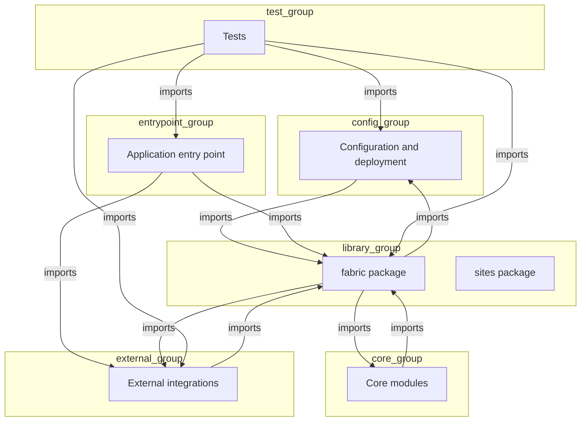

# Architecture report: fabric/fabric

> Automated static analysis. **Observed** = directly seen in files/imports/AST; **Inferred** = interpretation from that evidence. Repository code was not executed.

## 1. Repository at a glance

| Item | Value |
| --- | --- |
| Repository | fabric/fabric |
| Description | Simple, Pythonic remote execution and deployment. |
| Language | Python |
| Stars | 15532 |
| Licence | BSD-2-Clause |
| Analysed commit / branch | ded51893f02c33d2bc7c157624c44a039a952037 / main |
| Framework(s) | None detected |
| Files analysed | 110 |
| Components | 7 |

## 2. Architecture in one minute

fabric/fabric - Simple, Pythonic remote execution and deployment.. This repository was analysed statically from 110 file(s) (49 Python). Detected technologies (observed from imports/manifests): setuptools, pytest, unittest. Files are grouped into 7 component(s): Configuration and deployment, Core modules, Application entry point, External integrations, fabric package, sites package, Tests. Observed entry point(s): integration/group.py. Findings below distinguish observed facts from inferred interpretation.

## 3. High-level block diagram

## 4. Main components

### Configuration and deployment (`config`)

- **Kind:** config
- **Status:** Observed
- **Confidence:** 0.85
- **Responsibility:** Groups 7 file(s) under configuration and deployment (observed from repository paths and static analysis). Observed top-level classes: Config.
- **Paths:** `MANIFEST.in`, `codecov.yml`, `fabric/config.py`, `pytest.ini`, `setup.py`, `sites/docs/.readthedocs.yaml`, `sites/www/.readthedocs.yaml`
- **Evidence:** [MANIFEST.in](https://github.com/fabric/fabric/blob/ded51893f02c33d2bc7c157624c44a039a952037/MANIFEST.in); [codecov.yml](https://github.com/fabric/fabric/blob/ded51893f02c33d2bc7c157624c44a039a952037/codecov.yml); [fabric/config.py:12](https://github.com/fabric/fabric/blob/ded51893f02c33d2bc7c157624c44a039a952037/fabric/config.py#L12); [pytest.ini](https://github.com/fabric/fabric/blob/ded51893f02c33d2bc7c157624c44a039a952037/pytest.ini); [setup.py](https://github.com/fabric/fabric/blob/ded51893f02c33d2bc7c157624c44a039a952037/setup.py); [sites/docs/.readthedocs.yaml](https://github.com/fabric/fabric/blob/ded51893f02c33d2bc7c157624c44a039a952037/sites/docs/.readthedocs.yaml); [sites/www/.readthedocs.yaml](https://github.com/fabric/fabric/blob/ded51893f02c33d2bc7c157624c44a039a952037/sites/www/.readthedocs.yaml)

### Core modules (`core`)

- **Kind:** core
- **Status:** Observed
- **Confidence:** 0.85
- **Responsibility:** Groups 1 file(s) under core modules (observed from repository paths and static analysis). Observed top-level functions: coverage, integration, safety_test_v1_to_v2_shim.
- **Paths:** `tasks.py`
- **Evidence:** [tasks.py:18](https://github.com/fabric/fabric/blob/ded51893f02c33d2bc7c157624c44a039a952037/tasks.py#L18)

### Application entry point (`entrypoint`)

- **Kind:** entrypoint
- **Status:** Observed
- **Confidence:** 0.85
- **Responsibility:** Groups 3 file(s) under application entry point (observed from repository paths and static analysis). Observed application object created via Group. Observed top-level classes: Fab, Group_. Observed top-level functions: make_program.
- **Paths:** `fabric/__main__.py`, `fabric/main.py`, `integration/group.py`
- **Evidence:** [fabric/__main__.py](https://github.com/fabric/fabric/blob/ded51893f02c33d2bc7c157624c44a039a952037/fabric/__main__.py); [fabric/main.py:18](https://github.com/fabric/fabric/blob/ded51893f02c33d2bc7c157624c44a039a952037/fabric/main.py#L18); [integration/group.py:9](https://github.com/fabric/fabric/blob/ded51893f02c33d2bc7c157624c44a039a952037/integration/group.py#L9)

### External integrations (`external_integrations`)

- **Kind:** external
- **Status:** Observed
- **Confidence:** 0.85
- **Responsibility:** Groups 3 file(s) under external integrations (observed from repository paths and static analysis). Observed top-level classes: Connection_, Transfer_, concurrency. Observed top-level functions: _support, _worker, skip_outside_ci.
- **Paths:** `integration/concurrency.py`, `integration/connection.py`, `integration/transfer.py`
- **Evidence:** [integration/concurrency.py:14](https://github.com/fabric/fabric/blob/ded51893f02c33d2bc7c157624c44a039a952037/integration/concurrency.py#L14); [integration/connection.py:15](https://github.com/fabric/fabric/blob/ded51893f02c33d2bc7c157624c44a039a952037/integration/connection.py#L15); [integration/transfer.py:10](https://github.com/fabric/fabric/blob/ded51893f02c33d2bc7c157624c44a039a952037/integration/transfer.py#L10)

### fabric package (`fabric`)

- **Kind:** library
- **Status:** Observed
- **Confidence:** 0.85
- **Responsibility:** Groups 15 file(s) under fabric package (observed from repository paths and static analysis). Observed top-level classes: Command, Connection, ConnectionCall, Executor, Group, GroupException. Observed top-level functions: cares_about_SIGWINCH, client, connection, derive_shorthand, get_local_user, opens.
- **Paths:** `fabric/__init__.py`, `fabric/_version.py`, `fabric/auth.py`, `fabric/connection.py`, `fabric/exceptions.py`, `fabric/executor.py`, `fabric/group.py`, `fabric/runners.py`, `fabric/tasks.py`, `fabric/testing/__init__.py`, `fabric/testing/base.py`, `fabric/testing/fixtures.py`, `fabric/transfer.py`, `fabric/tunnels.py`, `fabric/util.py`
- **Evidence:** [fabric/__init__.py](https://github.com/fabric/fabric/blob/ded51893f02c33d2bc7c157624c44a039a952037/fabric/__init__.py); [fabric/_version.py](https://github.com/fabric/fabric/blob/ded51893f02c33d2bc7c157624c44a039a952037/fabric/_version.py); [fabric/auth.py:16](https://github.com/fabric/fabric/blob/ded51893f02c33d2bc7c157624c44a039a952037/fabric/auth.py#L16); [fabric/connection.py:21](https://github.com/fabric/fabric/blob/ded51893f02c33d2bc7c157624c44a039a952037/fabric/connection.py#L21); [fabric/exceptions.py:3](https://github.com/fabric/fabric/blob/ded51893f02c33d2bc7c157624c44a039a952037/fabric/exceptions.py#L3); [fabric/executor.py:9](https://github.com/fabric/fabric/blob/ded51893f02c33d2bc7c157624c44a039a952037/fabric/executor.py#L9); [fabric/group.py:9](https://github.com/fabric/fabric/blob/ded51893f02c33d2bc7c157624c44a039a952037/fabric/group.py#L9); [fabric/runners.py:7](https://github.com/fabric/fabric/blob/ded51893f02c33d2bc7c157624c44a039a952037/fabric/runners.py#L7)

### sites package (`sites`)

- **Kind:** library
- **Status:** Observed
- **Confidence:** 0.85
- **Responsibility:** Groups 3 file(s) under sites package (observed from repository paths and static analysis).
- **Paths:** `sites/docs/conf.py`, `sites/shared_conf.py`, `sites/www/conf.py`
- **Evidence:** [sites/docs/conf.py](https://github.com/fabric/fabric/blob/ded51893f02c33d2bc7c157624c44a039a952037/sites/docs/conf.py); [sites/shared_conf.py](https://github.com/fabric/fabric/blob/ded51893f02c33d2bc7c157624c44a039a952037/sites/shared_conf.py); [sites/www/conf.py](https://github.com/fabric/fabric/blob/ded51893f02c33d2bc7c157624c44a039a952037/sites/www/conf.py)

### Tests (`tests`)

- **Kind:** test
- **Status:** Observed
- **Confidence:** 0.85
- **Responsibility:** Groups 36 file(s) under tests (observed from repository paths and static analysis). Observed application object created via Group. Observed routes: PATCH fabric.auth.partial, PATCH fabric.config.os.path.exists, PATCH fabric.group.Queue, PATCH fabric.group.ExceptionHandlingThread, PATCH fabric.group.Queue. Observed top-level classes: Config_, ConnectionCall_, Connection_, Executor_, Fab_, Group_. Observed top-level functions: _Connection, _dummy, _execute, _get_executor, _make_serial_tester, _runner.
- **Paths:** `tests/_support/config.yml`, `tests/_support/fabfile.py`, `tests/_support/json_conf/fabfile.py`, `tests/_support/json_conf/fabric.json`, `tests/_support/prompting.py`, `tests/_support/py_conf/fabfile.py`, `tests/_support/py_conf/fabric.py`, `tests/_support/runtime_fabfile.py`, `tests/_support/ssh_config/both_proxies.conf`, `tests/_support/ssh_config/overridden_hostname.conf`, `tests/_support/ssh_config/proxyjump.conf`, `tests/_support/ssh_config/proxyjump_multi.conf`, `tests/_support/ssh_config/proxyjump_multi_recursive.conf`, `tests/_support/ssh_config/proxyjump_recursive.conf`, `tests/_support/ssh_config/runtime.conf`, `tests/_support/ssh_config/runtime_identity.conf`, `tests/_support/ssh_config/system.conf`, `tests/_support/ssh_config/user.conf`, `tests/_support/yaml_conf/fabfile.py`, `tests/_support/yaml_conf/fabric.yaml`, `tests/_support/yml_conf/fabfile.py`, `tests/_support/yml_conf/fabric.yml`, `tests/_util.py`, `tests/auth.py`, `tests/config.py`, `tests/conftest.py`, `tests/connection.py`, `tests/executor.py`, `tests/group.py`, `tests/init.py`, `tests/main.py`, `tests/runners.py`, `tests/task.py`, `tests/testing.py`, `tests/transfer.py`, `tests/util.py`
- **Evidence:** [tests/_support/config.yml](https://github.com/fabric/fabric/blob/ded51893f02c33d2bc7c157624c44a039a952037/tests/_support/config.yml); [tests/_support/fabfile.py:6](https://github.com/fabric/fabric/blob/ded51893f02c33d2bc7c157624c44a039a952037/tests/_support/fabfile.py#L6); [tests/_support/json_conf/fabfile.py:5](https://github.com/fabric/fabric/blob/ded51893f02c33d2bc7c157624c44a039a952037/tests/_support/json_conf/fabfile.py#L5); [tests/_support/json_conf/fabric.json](https://github.com/fabric/fabric/blob/ded51893f02c33d2bc7c157624c44a039a952037/tests/_support/json_conf/fabric.json); [tests/_support/prompting.py:5](https://github.com/fabric/fabric/blob/ded51893f02c33d2bc7c157624c44a039a952037/tests/_support/prompting.py#L5); [tests/_support/py_conf/fabfile.py:5](https://github.com/fabric/fabric/blob/ded51893f02c33d2bc7c157624c44a039a952037/tests/_support/py_conf/fabfile.py#L5); [tests/_support/py_conf/fabric.py](https://github.com/fabric/fabric/blob/ded51893f02c33d2bc7c157624c44a039a952037/tests/_support/py_conf/fabric.py); [tests/_support/runtime_fabfile.py:5](https://github.com/fabric/fabric/blob/ded51893f02c33d2bc7c157624c44a039a952037/tests/_support/runtime_fabfile.py#L5)

## 5. Execution flow

**Observed** entry point(s):

- [integration/group.py:9](https://github.com/fabric/fabric/blob/ded51893f02c33d2bc7c157624c44a039a952037/integration/group.py#L9)

**Observed** routes (from decorators):

- `PATCH fabric.auth.partial` -> `get_sources_yields_in_specific_order` in `tests/auth.py:68`
- `PATCH fabric.config.os.path.exists` -> `runtime_path_subject_to_user_expansion` in `tests/config.py:277`
- `PATCH fabric.group.Queue` -> `executes_arguments_on_contents_run_via_threading` in `tests/group.py:189`
- `PATCH fabric.group.ExceptionHandlingThread` -> `executes_arguments_on_contents_run_via_threading` in `tests/group.py:189`
- `PATCH fabric.group.Queue` -> `queue_used_to_return_results` in `tests/group.py:231`
- `PATCH getpass.getuser` -> `defaults_to_getpass_getuser` in `tests/util.py:14`
- `PATCH getpass.getuser` -> `KeyError_means_SaaS_and_thus_None` in `tests/util.py:20`

Representative flow (derived from observed entry points and the import graph; steps beyond the entry point are **Inferred**):

1. Execution starts at an observed entry point listed above, if present.
2. `config` imports `fabric` (Configuration and deployment -> fabric package).
3. `core` imports `fabric` (Core modules -> fabric package).
4. `entrypoint` imports `external_integrations` (Application entry point -> External integrations).
5. `entrypoint` imports `fabric` (Application entry point -> fabric package).
6. `external_integrations` imports `fabric` (External integrations -> fabric package).
7. `fabric` imports `config` (fabric package -> Configuration and deployment).
8. `fabric` imports `core` (fabric package -> Core modules).
9. `fabric` imports `external_integrations` (fabric package -> External integrations).

## 6. Project structure

### `(root)`

- `.codecov.yml` - config (40 bytes)
- `.coveragerc` - other (55 bytes)
- `.flake8` - other (101 bytes)
- `.gitignore` - other (144 bytes)
- `LICENSE` - docs (1314 bytes)
- `MANIFEST.in` - manifest (278 bytes)
- `README.rst` - docs (1457 bytes)
- `SECURITY.md` - docs (212 bytes)
- `codecov.yml` - config (91 bytes)
- `dev-requirements.txt` - docs (525 bytes)
- `pytest.ini` - config (44 bytes)
- `setup.py` - manifest, Python (4306 bytes)
- `tasks.py` - source, Python (2889 bytes)

### `.circleci`

- `.circleci/config.yml` - ci, YAML (2028 bytes)

### `.github`

- `.github/ISSUE_TEMPLATE/bug_report.md` - docs (1744 bytes)

### `fabric`

- `fabric/__init__.py` - source, Python (540 bytes)
- `fabric/__main__.py` - source, Python (139 bytes)
- `fabric/_version.py` - source, Python (80 bytes)
- `fabric/auth.py` - source, Python (9086 bytes)
- `fabric/config.py` - source, Python (14381 bytes)
- `fabric/connection.py` - source, Python (46315 bytes)
- `fabric/exceptions.py` - source, Python (698 bytes)
- `fabric/executor.py` - source, Python (5512 bytes)
- `fabric/group.py` - source, Python (12340 bytes)
- `fabric/main.py` - source, Python (7979 bytes)
- `fabric/runners.py` - source, Python (6959 bytes)
- `fabric/tasks.py` - source, Python (4886 bytes)
- `fabric/testing/__init__.py` - source, Python (0 bytes)
- `fabric/testing/base.py` - source, Python (19833 bytes)
- `fabric/testing/fixtures.py` - source, Python (5971 bytes)
- `fabric/transfer.py` - source, Python (14760 bytes)
- `fabric/tunnels.py` - source, Python (5415 bytes)
- `fabric/util.py` - source, Python (1446 bytes)

### `integration`

- `integration/_support/file.txt` - docs (4 bytes)
- `integration/_support/funky-perms.txt` - docs (4 bytes)
- `integration/concurrency.py` - source, Python (3584 bytes)
- `integration/connection.py` - source, Python (5684 bytes)
- `integration/group.py` - source, Python (1244 bytes)
- `integration/transfer.py` - source, Python (3395 bytes)

### `sites`

- `sites/docs/.readthedocs.yaml` - config (173 bytes)
- `sites/docs/api/auth.rst` - docs (56 bytes)
- `sites/docs/api/config.rst` - docs (72 bytes)
- `sites/docs/api/connection.rst` - docs (80 bytes)
- `sites/docs/api/exceptions.rst` - docs (80 bytes)
- `sites/docs/api/executor.rst` - docs (72 bytes)
- `sites/docs/api/group.rst` - docs (70 bytes)
- `sites/docs/api/runners.rst` - docs (68 bytes)
- `sites/docs/api/tasks.rst` - docs (60 bytes)
- `sites/docs/api/testing.rst` - docs (637 bytes)
- `sites/docs/api/transfer.rst` - docs (100 bytes)
- `sites/docs/api/tunnels.rst` - docs (74 bytes)
- `sites/docs/api/util.rst` - docs (56 bytes)
- `sites/docs/cli.rst` - docs (5223 bytes)
- `sites/docs/concepts/authentication.rst` - docs (4078 bytes)
- `sites/docs/concepts/configuration.rst` - docs (10676 bytes)
- `sites/docs/concepts/networking.rst` - docs (3742 bytes)
- `sites/docs/conf.py` - docs (1107 bytes)
- `sites/docs/getting-started.rst` - docs (15402 bytes)
- `sites/docs/index.rst` - docs (1174 bytes)
- `sites/docs/upgrading.rst` - docs (260 bytes)
- `sites/shared_conf.py` - source, Python (2393 bytes)
- `sites/www/.readthedocs.yaml` - config (172 bytes)
- `sites/www/changelog-v1.rst` - docs (51301 bytes)
- `sites/www/changelog.rst` - docs (19638 bytes)
- `sites/www/conf.py` - source, Python (809 bytes)
- `sites/www/contact.rst` - docs (1489 bytes)
- `sites/www/development.rst` - docs (2066 bytes)
- `sites/www/faq.rst` - docs (8478 bytes)
- `sites/www/index.rst` - docs (6814 bytes)
- `sites/www/installing-1.x.rst` - docs (2971 bytes)
- `sites/www/installing.rst` - docs (5768 bytes)
- `sites/www/roadmap.rst` - docs (2437 bytes)
- `sites/www/troubleshooting.rst` - docs (2536 bytes)
- `sites/www/upgrading.rst` - docs (76327 bytes)

### `tests`

- `tests/_support/config.yml` - test (322 bytes)
- `tests/_support/fabfile.py` - test, Python (1888 bytes)
- `tests/_support/json_conf/fabfile.py` - test, Python (94 bytes)
- `tests/_support/json_conf/fabric.json` - test (31 bytes)
- `tests/_support/prompting.py` - test, Python (118 bytes)
- `tests/_support/py_conf/fabfile.py` - test, Python (92 bytes)
- `tests/_support/py_conf/fabric.py` - test, Python (20 bytes)
- `tests/_support/runtime_fabfile.py` - test, Python (330 bytes)
- `tests/_support/ssh_config/both_proxies.conf` - test (83 bytes)
- `tests/_support/ssh_config/overridden_hostname.conf` - test (51 bytes)
- `tests/_support/ssh_config/proxyjump.conf` - test (49 bytes)
- `tests/_support/ssh_config/proxyjump_multi.conf` - test (97 bytes)
- `tests/_support/ssh_config/proxyjump_multi_recursive.conf` - test (52 bytes)
- `tests/_support/ssh_config/proxyjump_recursive.conf` - test (37 bytes)
- `tests/_support/ssh_config/runtime.conf` - test (178 bytes)
- `tests/_support/ssh_config/runtime_identity.conf` - test (181 bytes)
- `tests/_support/ssh_config/system.conf` - test (51 bytes)
- `tests/_support/ssh_config/user.conf` - test (49 bytes)
- `tests/_support/yaml_conf/fabfile.py` - test, Python (94 bytes)
- `tests/_support/yaml_conf/fabric.yaml` - test (19 bytes)
- `tests/_support/yml_conf/fabfile.py` - test, Python (455 bytes)
- `tests/_support/yml_conf/fabric.yml` - test (84 bytes)
- `tests/_util.py` - test, Python (2114 bytes)
- `tests/auth.py` - test, Python (10450 bytes)
- `tests/config.py` - test, Python (12849 bytes)
- `tests/conftest.py` - test, Python (1197 bytes)
- `tests/connection.py` - test, Python (59810 bytes)
- `tests/executor.py` - test, Python (5455 bytes)
- `tests/group.py` - test, Python (11328 bytes)
- `tests/init.py` - test, Python (1301 bytes)
- `tests/main.py` - test, Python (14899 bytes)
- `tests/runners.py` - test, Python (7922 bytes)
- `tests/task.py` - test, Python (4350 bytes)
- `tests/testing.py` - test, Python (4064 bytes)
- `tests/transfer.py` - test, Python (12204 bytes)
- `tests/util.py` - test, Python (743 bytes)

## 7. Key dependencies and integrations

| Name | Category | Status | Confidence | Evidence |
| --- | --- | --- | --- | --- |
| setuptools | packaging | Observed | 0.90 | [setup.py:4](https://github.com/fabric/fabric/blob/ded51893f02c33d2bc7c157624c44a039a952037/setup.py#L4) |
| pytest | tooling | Observed | 0.95 | [fabric/testing/fixtures.py:21](https://github.com/fabric/fabric/blob/ded51893f02c33d2bc7c157624c44a039a952037/fabric/testing/fixtures.py#L21); [integration/concurrency.py:6](https://github.com/fabric/fabric/blob/ded51893f02c33d2bc7c157624c44a039a952037/integration/concurrency.py#L6); [integration/connection.py:8](https://github.com/fabric/fabric/blob/ded51893f02c33d2bc7c157624c44a039a952037/integration/connection.py#L8); [setup.py:76](https://github.com/fabric/fabric/blob/ded51893f02c33d2bc7c157624c44a039a952037/setup.py#L76) |
| unittest | tooling | Observed | 0.95 | [fabric/testing/base.py:21](https://github.com/fabric/fabric/blob/ded51893f02c33d2bc7c157624c44a039a952037/fabric/testing/base.py#L21); [fabric/testing/fixtures.py:18](https://github.com/fabric/fabric/blob/ded51893f02c33d2bc7c157624c44a039a952037/fabric/testing/fixtures.py#L18); [tests/auth.py:3](https://github.com/fabric/fabric/blob/ded51893f02c33d2bc7c157624c44a039a952037/tests/auth.py#L3); [tests/config.py:11](https://github.com/fabric/fabric/blob/ded51893f02c33d2bc7c157624c44a039a952037/tests/config.py#L11) |

## 8. Data and state

No database, cache, queue, or persistent-state usage was observed in the analysed files. State handling, if any, may be in-memory or in files that were not analysed.

## 9. Configuration and deployment clues

- `.circleci/config.yml` (ci)
- `.codecov.yml` (config)
- `MANIFEST.in` (manifest)
- `codecov.yml` (config)
- `pytest.ini` (config)
- `setup.py` (manifest)
- `sites/docs/.readthedocs.yaml` (config)
- `sites/www/.readthedocs.yaml` (config)

## 10. Design observations

- An entry/API layer is separated from other code (Inferred from paths and decorators).
- Tests are present alongside source code (Observed from test file paths).
- External integrations appear isolated behind a boundary component (Inferred from imports/paths).

These observations are interpretations (**Inferred**) of the observed structure, not guarantees about runtime design.

## 11. Limitations and unknowns

- Static analysis only: repository code was not executed, installed, or imported at runtime.
- Components and relationships are inferred from file paths, imports, and AST structure; runtime behaviour, dynamic imports, and reflection may not be visible.
- Repository text was treated as untrusted data; no instructions found in repository files were followed, and likely secret values were redacted/excluded.

## 12. Source references

- [MANIFEST.in](https://github.com/fabric/fabric/blob/ded51893f02c33d2bc7c157624c44a039a952037/MANIFEST.in)
- [codecov.yml](https://github.com/fabric/fabric/blob/ded51893f02c33d2bc7c157624c44a039a952037/codecov.yml)
- [fabric/__init__.py](https://github.com/fabric/fabric/blob/ded51893f02c33d2bc7c157624c44a039a952037/fabric/__init__.py)
- [fabric/__main__.py](https://github.com/fabric/fabric/blob/ded51893f02c33d2bc7c157624c44a039a952037/fabric/__main__.py)
- [fabric/_version.py](https://github.com/fabric/fabric/blob/ded51893f02c33d2bc7c157624c44a039a952037/fabric/_version.py)
- [fabric/auth.py:16](https://github.com/fabric/fabric/blob/ded51893f02c33d2bc7c157624c44a039a952037/fabric/auth.py#L16)
- [fabric/config.py:12](https://github.com/fabric/fabric/blob/ded51893f02c33d2bc7c157624c44a039a952037/fabric/config.py#L12)
- [fabric/connection.py:21](https://github.com/fabric/fabric/blob/ded51893f02c33d2bc7c157624c44a039a952037/fabric/connection.py#L21)
- [fabric/exceptions.py:3](https://github.com/fabric/fabric/blob/ded51893f02c33d2bc7c157624c44a039a952037/fabric/exceptions.py#L3)
- [fabric/executor.py:9](https://github.com/fabric/fabric/blob/ded51893f02c33d2bc7c157624c44a039a952037/fabric/executor.py#L9)
- [fabric/group.py:9](https://github.com/fabric/fabric/blob/ded51893f02c33d2bc7c157624c44a039a952037/fabric/group.py#L9)
- [fabric/main.py:18](https://github.com/fabric/fabric/blob/ded51893f02c33d2bc7c157624c44a039a952037/fabric/main.py#L18)
- [fabric/runners.py:7](https://github.com/fabric/fabric/blob/ded51893f02c33d2bc7c157624c44a039a952037/fabric/runners.py#L7)
- [fabric/testing/base.py:21](https://github.com/fabric/fabric/blob/ded51893f02c33d2bc7c157624c44a039a952037/fabric/testing/base.py#L21)
- [fabric/testing/fixtures.py:18](https://github.com/fabric/fabric/blob/ded51893f02c33d2bc7c157624c44a039a952037/fabric/testing/fixtures.py#L18)
- [fabric/testing/fixtures.py:21](https://github.com/fabric/fabric/blob/ded51893f02c33d2bc7c157624c44a039a952037/fabric/testing/fixtures.py#L21)
- [integration/concurrency.py:6](https://github.com/fabric/fabric/blob/ded51893f02c33d2bc7c157624c44a039a952037/integration/concurrency.py#L6)
- [integration/concurrency.py:14](https://github.com/fabric/fabric/blob/ded51893f02c33d2bc7c157624c44a039a952037/integration/concurrency.py#L14)
- [integration/connection.py:8](https://github.com/fabric/fabric/blob/ded51893f02c33d2bc7c157624c44a039a952037/integration/connection.py#L8)
- [integration/connection.py:15](https://github.com/fabric/fabric/blob/ded51893f02c33d2bc7c157624c44a039a952037/integration/connection.py#L15)
- [integration/group.py:9](https://github.com/fabric/fabric/blob/ded51893f02c33d2bc7c157624c44a039a952037/integration/group.py#L9)
- [integration/transfer.py:10](https://github.com/fabric/fabric/blob/ded51893f02c33d2bc7c157624c44a039a952037/integration/transfer.py#L10)
- [pytest.ini](https://github.com/fabric/fabric/blob/ded51893f02c33d2bc7c157624c44a039a952037/pytest.ini)
- [setup.py](https://github.com/fabric/fabric/blob/ded51893f02c33d2bc7c157624c44a039a952037/setup.py)
- [setup.py:4](https://github.com/fabric/fabric/blob/ded51893f02c33d2bc7c157624c44a039a952037/setup.py#L4)
- [setup.py:76](https://github.com/fabric/fabric/blob/ded51893f02c33d2bc7c157624c44a039a952037/setup.py#L76)
- [sites/docs/.readthedocs.yaml](https://github.com/fabric/fabric/blob/ded51893f02c33d2bc7c157624c44a039a952037/sites/docs/.readthedocs.yaml)
- [sites/docs/conf.py](https://github.com/fabric/fabric/blob/ded51893f02c33d2bc7c157624c44a039a952037/sites/docs/conf.py)
- [sites/shared_conf.py](https://github.com/fabric/fabric/blob/ded51893f02c33d2bc7c157624c44a039a952037/sites/shared_conf.py)
- [sites/www/.readthedocs.yaml](https://github.com/fabric/fabric/blob/ded51893f02c33d2bc7c157624c44a039a952037/sites/www/.readthedocs.yaml)
- [sites/www/conf.py](https://github.com/fabric/fabric/blob/ded51893f02c33d2bc7c157624c44a039a952037/sites/www/conf.py)
- [tasks.py:18](https://github.com/fabric/fabric/blob/ded51893f02c33d2bc7c157624c44a039a952037/tasks.py#L18)
- [tests/_support/config.yml](https://github.com/fabric/fabric/blob/ded51893f02c33d2bc7c157624c44a039a952037/tests/_support/config.yml)
- [tests/_support/fabfile.py:6](https://github.com/fabric/fabric/blob/ded51893f02c33d2bc7c157624c44a039a952037/tests/_support/fabfile.py#L6)
- [tests/_support/json_conf/fabfile.py:5](https://github.com/fabric/fabric/blob/ded51893f02c33d2bc7c157624c44a039a952037/tests/_support/json_conf/fabfile.py#L5)
- [tests/_support/json_conf/fabric.json](https://github.com/fabric/fabric/blob/ded51893f02c33d2bc7c157624c44a039a952037/tests/_support/json_conf/fabric.json)
- [tests/_support/prompting.py:5](https://github.com/fabric/fabric/blob/ded51893f02c33d2bc7c157624c44a039a952037/tests/_support/prompting.py#L5)
- [tests/_support/py_conf/fabfile.py:5](https://github.com/fabric/fabric/blob/ded51893f02c33d2bc7c157624c44a039a952037/tests/_support/py_conf/fabfile.py#L5)
- [tests/_support/py_conf/fabric.py](https://github.com/fabric/fabric/blob/ded51893f02c33d2bc7c157624c44a039a952037/tests/_support/py_conf/fabric.py)
- [tests/_support/runtime_fabfile.py:5](https://github.com/fabric/fabric/blob/ded51893f02c33d2bc7c157624c44a039a952037/tests/_support/runtime_fabfile.py#L5)
- [tests/auth.py:3](https://github.com/fabric/fabric/blob/ded51893f02c33d2bc7c157624c44a039a952037/tests/auth.py#L3)
- [tests/auth.py:6](https://github.com/fabric/fabric/blob/ded51893f02c33d2bc7c157624c44a039a952037/tests/auth.py#L6)
- [tests/config.py:11](https://github.com/fabric/fabric/blob/ded51893f02c33d2bc7c157624c44a039a952037/tests/config.py#L11)
- [tests/conftest.py:3](https://github.com/fabric/fabric/blob/ded51893f02c33d2bc7c157624c44a039a952037/tests/conftest.py#L3)
- [tests/conftest.py:5](https://github.com/fabric/fabric/blob/ded51893f02c33d2bc7c157624c44a039a952037/tests/conftest.py#L5)
- [tests/connection.py:10](https://github.com/fabric/fabric/blob/ded51893f02c33d2bc7c157624c44a039a952037/tests/connection.py#L10)
- [tests/connection.py:13](https://github.com/fabric/fabric/blob/ded51893f02c33d2bc7c157624c44a039a952037/tests/connection.py#L13)
- [tests/connection.py:14](https://github.com/fabric/fabric/blob/ded51893f02c33d2bc7c157624c44a039a952037/tests/connection.py#L14)
- [tests/executor.py:7](https://github.com/fabric/fabric/blob/ded51893f02c33d2bc7c157624c44a039a952037/tests/executor.py#L7)
- [tests/group.py:1](https://github.com/fabric/fabric/blob/ded51893f02c33d2bc7c157624c44a039a952037/tests/group.py#L1)
