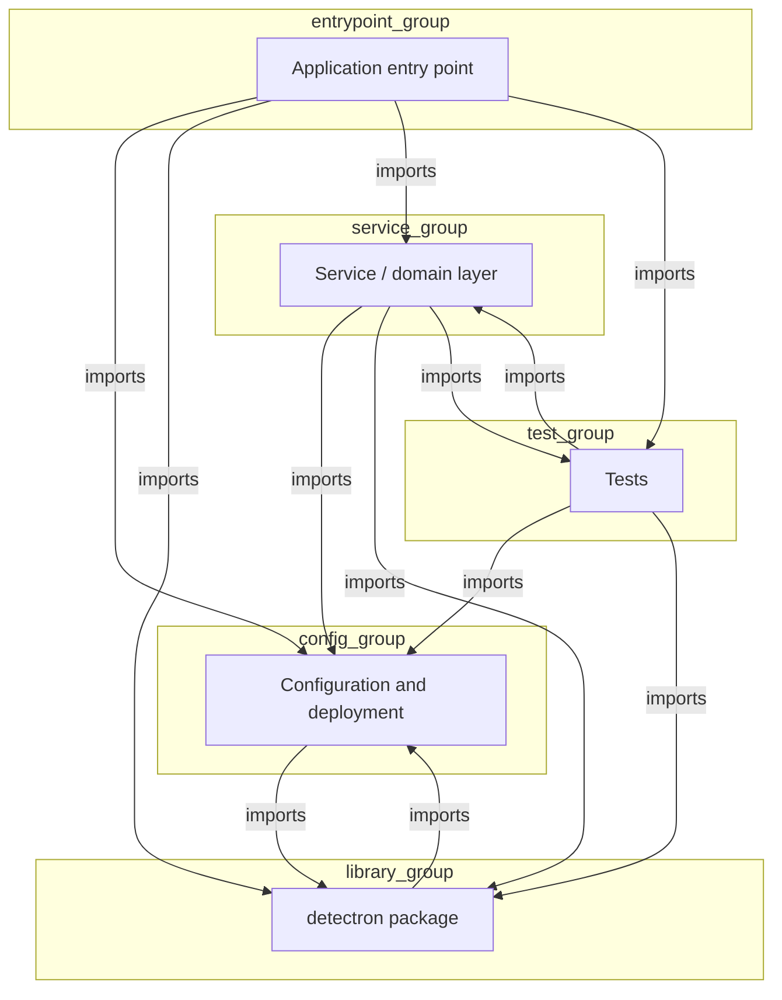

# Architecture report: facebookresearch/Detectron

> Automated static analysis. **Observed** = directly seen in files/imports/AST; **Inferred** = interpretation from that evidence. Repository code was not executed.

## 1. Repository at a glance

| Item | Value |
| --- | --- |
| Repository | facebookresearch/Detectron |
| Description | FAIR's research platform for object detection research, implementing popular algorithms like Mask R-CNN and RetinaNet. |
| Language | Python |
| Stars | 26335 |
| Licence | Apache-2.0 |
| Analysed commit / branch | 04155a01a6ea68f22ac27c79a822066457941ece / main |
| Framework(s) | None detected |
| Files analysed | 210 |
| Components | 5 |

## 2. Architecture in one minute

facebookresearch/Detectron - FAIR's research platform for object detection research, implementing popular algorithms like Mask R-CNN and RetinaNet.. This repository was analysed statically from 210 file(s) (90 Python). Detected technologies (observed from imports/manifests): NumPy, setuptools, Docker, unittest. Files are grouped into 5 component(s): Configuration and deployment, detectron package, Application entry point, Service / domain layer, Tests. Observed entry point(s): tools/convert_cityscapes_to_coco.py, tools/convert_coco_model_to_cityscapes.py, tools/convert_pkl_to_pb.py. Findings below distinguish observed facts from inferred interpretation.

## 3. High-level block diagram

## 4. Main components

### Configuration and deployment (`config`)

- **Kind:** config
- **Status:** Observed
- **Confidence:** 0.85
- **Responsibility:** Groups 91 file(s) under configuration and deployment (observed from repository paths and static analysis). Observed top-level functions: _check_and_coerce_cfg_value_type, _decode_cfg_value, _key_is_deprecated, _key_is_renamed, _merge_a_into_b, _raise_key_rename_error.
- **Paths:** `configs/04_2018_gn_baselines/e2e_mask_rcnn_R-101-FPN_2x_gn.yaml`, `configs/04_2018_gn_baselines/e2e_mask_rcnn_R-101-FPN_3x_gn.yaml`, `configs/04_2018_gn_baselines/e2e_mask_rcnn_R-50-FPN_2x_gn.yaml`, `configs/04_2018_gn_baselines/e2e_mask_rcnn_R-50-FPN_3x_gn.yaml`, `configs/04_2018_gn_baselines/mask_rcnn_R-50-FPN_1x_gn.yaml`, `configs/04_2018_gn_baselines/scratch_e2e_mask_rcnn_R-101-FPN_3x_gn.yaml`, `configs/04_2018_gn_baselines/scratch_e2e_mask_rcnn_R-50-FPN_3x_gn.yaml`, `configs/12_2017_baselines/e2e_faster_rcnn_R-101-FPN_1x.yaml`, `configs/12_2017_baselines/e2e_faster_rcnn_R-101-FPN_2x.yaml`, `configs/12_2017_baselines/e2e_faster_rcnn_R-50-C4_1x.yaml`, `configs/12_2017_baselines/e2e_faster_rcnn_R-50-C4_2x.yaml`, `configs/12_2017_baselines/e2e_faster_rcnn_R-50-FPN_1x.yaml`, `configs/12_2017_baselines/e2e_faster_rcnn_R-50-FPN_2x.yaml`, `configs/12_2017_baselines/e2e_faster_rcnn_X-101-32x8d-FPN_1x.yaml`, `configs/12_2017_baselines/e2e_faster_rcnn_X-101-32x8d-FPN_2x.yaml`, `configs/12_2017_baselines/e2e_faster_rcnn_X-101-64x4d-FPN_1x.yaml`, `configs/12_2017_baselines/e2e_faster_rcnn_X-101-64x4d-FPN_2x.yaml`, `configs/12_2017_baselines/e2e_keypoint_rcnn_R-101-FPN_1x.yaml`, `configs/12_2017_baselines/e2e_keypoint_rcnn_R-101-FPN_s1x.yaml`, `configs/12_2017_baselines/e2e_keypoint_rcnn_R-50-FPN_1x.yaml`, `configs/12_2017_baselines/e2e_keypoint_rcnn_R-50-FPN_s1x.yaml`, `configs/12_2017_baselines/e2e_keypoint_rcnn_X-101-32x8d-FPN_1x.yaml`, `configs/12_2017_baselines/e2e_keypoint_rcnn_X-101-32x8d-FPN_s1x.yaml`, `configs/12_2017_baselines/e2e_keypoint_rcnn_X-101-64x4d-FPN_1x.yaml`, `configs/12_2017_baselines/e2e_keypoint_rcnn_X-101-64x4d-FPN_s1x.yaml`, `configs/12_2017_baselines/e2e_mask_rcnn_R-101-FPN_1x.yaml`, `configs/12_2017_baselines/e2e_mask_rcnn_R-101-FPN_2x.yaml`, `configs/12_2017_baselines/e2e_mask_rcnn_R-50-C4_1x.yaml`, `configs/12_2017_baselines/e2e_mask_rcnn_R-50-C4_2x.yaml`, `configs/12_2017_baselines/e2e_mask_rcnn_R-50-FPN_1x.yaml`, `configs/12_2017_baselines/e2e_mask_rcnn_R-50-FPN_2x.yaml`, `configs/12_2017_baselines/e2e_mask_rcnn_X-101-32x8d-FPN_1x.yaml`, `configs/12_2017_baselines/e2e_mask_rcnn_X-101-32x8d-FPN_2x.yaml`, `configs/12_2017_baselines/e2e_mask_rcnn_X-101-64x4d-FPN_1x.yaml`, `configs/12_2017_baselines/e2e_mask_rcnn_X-101-64x4d-FPN_2x.yaml`, `configs/12_2017_baselines/e2e_mask_rcnn_X-152-32x8d-FPN-IN5k_1.44x.yaml`, `configs/12_2017_baselines/fast_rcnn_R-101-FPN_1x.yaml`, `configs/12_2017_baselines/fast_rcnn_R-101-FPN_2x.yaml`, `configs/12_2017_baselines/fast_rcnn_R-50-C4_1x.yaml`, `configs/12_2017_baselines/fast_rcnn_R-50-C4_2x.yaml`, `configs/12_2017_baselines/fast_rcnn_R-50-FPN_1x.yaml`, `configs/12_2017_baselines/fast_rcnn_R-50-FPN_2x.yaml`, `configs/12_2017_baselines/fast_rcnn_X-101-32x8d-FPN_1x.yaml`, `configs/12_2017_baselines/fast_rcnn_X-101-32x8d-FPN_2x.yaml`, `configs/12_2017_baselines/fast_rcnn_X-101-64x4d-FPN_1x.yaml`, `configs/12_2017_baselines/fast_rcnn_X-101-64x4d-FPN_2x.yaml`, `configs/12_2017_baselines/keypoint_rcnn_R-101-FPN_1x.yaml`, `configs/12_2017_baselines/keypoint_rcnn_R-101-FPN_s1x.yaml`, `configs/12_2017_baselines/keypoint_rcnn_R-50-FPN_1x.yaml`, `configs/12_2017_baselines/keypoint_rcnn_R-50-FPN_s1x.yaml`, `configs/12_2017_baselines/keypoint_rcnn_X-101-32x8d-FPN_1x.yaml`, `configs/12_2017_baselines/keypoint_rcnn_X-101-32x8d-FPN_s1x.yaml`, `configs/12_2017_baselines/keypoint_rcnn_X-101-64x4d-FPN_1x.yaml`, `configs/12_2017_baselines/keypoint_rcnn_X-101-64x4d-FPN_s1x.yaml`, `configs/12_2017_baselines/mask_rcnn_R-101-FPN_1x.yaml`, `configs/12_2017_baselines/mask_rcnn_R-101-FPN_2x.yaml`, `configs/12_2017_baselines/mask_rcnn_R-50-C4_1x.yaml`, `configs/12_2017_baselines/mask_rcnn_R-50-C4_2x.yaml`, `configs/12_2017_baselines/mask_rcnn_R-50-FPN_1x.yaml`, `configs/12_2017_baselines/mask_rcnn_R-50-FPN_2x.yaml`, `configs/12_2017_baselines/mask_rcnn_X-101-32x8d-FPN_1x.yaml`, `configs/12_2017_baselines/mask_rcnn_X-101-32x8d-FPN_2x.yaml`, `configs/12_2017_baselines/mask_rcnn_X-101-64x4d-FPN_1x.yaml`, `configs/12_2017_baselines/mask_rcnn_X-101-64x4d-FPN_2x.yaml`, `configs/12_2017_baselines/retinanet_R-101-FPN_1x.yaml`, `configs/12_2017_baselines/retinanet_R-101-FPN_2x.yaml`, `configs/12_2017_baselines/retinanet_R-50-FPN_1x.yaml`, `configs/12_2017_baselines/retinanet_R-50-FPN_2x.yaml`, `configs/12_2017_baselines/retinanet_X-101-32x8d-FPN_1x.yaml`, `configs/12_2017_baselines/retinanet_X-101-32x8d-FPN_2x.yaml`, `configs/12_2017_baselines/retinanet_X-101-64x4d-FPN_1x.yaml`, `configs/12_2017_baselines/retinanet_X-101-64x4d-FPN_2x.yaml`, `configs/12_2017_baselines/rpn_R-101-FPN_1x.yaml`, `configs/12_2017_baselines/rpn_R-50-C4_1x.yaml`, `configs/12_2017_baselines/rpn_R-50-FPN_1x.yaml`, `configs/12_2017_baselines/rpn_X-101-32x8d-FPN_1x.yaml`, `configs/12_2017_baselines/rpn_X-101-64x4d-FPN_1x.yaml`, `configs/12_2017_baselines/rpn_person_only_R-101-FPN_1x.yaml`, `configs/12_2017_baselines/rpn_person_only_R-50-FPN_1x.yaml`, `configs/12_2017_baselines/rpn_person_only_X-101-32x8d-FPN_1x.yaml`, `configs/12_2017_baselines/rpn_person_only_X-101-64x4d-FPN_1x.yaml`, `configs/getting_started/tutorial_1gpu_e2e_faster_rcnn_R-50-FPN.yaml`, `configs/getting_started/tutorial_2gpu_e2e_faster_rcnn_R-50-FPN.yaml`, `configs/getting_started/tutorial_4gpu_e2e_faster_rcnn_R-50-FPN.yaml`, `configs/getting_started/tutorial_8gpu_e2e_faster_rcnn_R-50-FPN.yaml`, `configs/test_time_aug/e2e_mask_rcnn_R-50-FPN_2x.yaml`, `configs/test_time_aug/keypoint_rcnn_R-50-FPN_1x.yaml`, `detectron/core/config.py`, `docker/Dockerfile`, `requirements.txt`, `setup.py`
- **Evidence:** [configs/04_2018_gn_baselines/e2e_mask_rcnn_R-101-FPN_2x_gn.yaml](https://github.com/facebookresearch/Detectron/blob/04155a01a6ea68f22ac27c79a822066457941ece/configs/04_2018_gn_baselines/e2e_mask_rcnn_R-101-FPN_2x_gn.yaml); [configs/04_2018_gn_baselines/e2e_mask_rcnn_R-101-FPN_3x_gn.yaml](https://github.com/facebookresearch/Detectron/blob/04155a01a6ea68f22ac27c79a822066457941ece/configs/04_2018_gn_baselines/e2e_mask_rcnn_R-101-FPN_3x_gn.yaml); [configs/04_2018_gn_baselines/e2e_mask_rcnn_R-50-FPN_2x_gn.yaml](https://github.com/facebookresearch/Detectron/blob/04155a01a6ea68f22ac27c79a822066457941ece/configs/04_2018_gn_baselines/e2e_mask_rcnn_R-50-FPN_2x_gn.yaml); [configs/04_2018_gn_baselines/e2e_mask_rcnn_R-50-FPN_3x_gn.yaml](https://github.com/facebookresearch/Detectron/blob/04155a01a6ea68f22ac27c79a822066457941ece/configs/04_2018_gn_baselines/e2e_mask_rcnn_R-50-FPN_3x_gn.yaml); [configs/04_2018_gn_baselines/mask_rcnn_R-50-FPN_1x_gn.yaml](https://github.com/facebookresearch/Detectron/blob/04155a01a6ea68f22ac27c79a822066457941ece/configs/04_2018_gn_baselines/mask_rcnn_R-50-FPN_1x_gn.yaml); [configs/04_2018_gn_baselines/scratch_e2e_mask_rcnn_R-101-FPN_3x_gn.yaml](https://github.com/facebookresearch/Detectron/blob/04155a01a6ea68f22ac27c79a822066457941ece/configs/04_2018_gn_baselines/scratch_e2e_mask_rcnn_R-101-FPN_3x_gn.yaml); [configs/04_2018_gn_baselines/scratch_e2e_mask_rcnn_R-50-FPN_3x_gn.yaml](https://github.com/facebookresearch/Detectron/blob/04155a01a6ea68f22ac27c79a822066457941ece/configs/04_2018_gn_baselines/scratch_e2e_mask_rcnn_R-50-FPN_3x_gn.yaml); [configs/12_2017_baselines/e2e_faster_rcnn_R-101-FPN_1x.yaml](https://github.com/facebookresearch/Detectron/blob/04155a01a6ea68f22ac27c79a822066457941ece/configs/12_2017_baselines/e2e_faster_rcnn_R-101-FPN_1x.yaml)

### detectron package (`detectron`)

- **Kind:** library
- **Status:** Observed
- **Confidence:** 0.85
- **Responsibility:** Groups 63 file(s) under detectron package (observed from repository paths and static analysis). Observed top-level classes: AttrDict, CollectAndDistributeFpnRpnProposalsOp, Coordinator, DetectionModelHelper, GenerateProposalLabelsOp, GenerateProposalsOp. Observed top-level functions: BlobReferenceList, CpuScope, CudaDevice, CudaScope, GpuNameScope, NamedCudaScope.
- **Paths:** `detectron/__init__.py`, `detectron/datasets/__init__.py`, `detectron/datasets/cityscapes_json_dataset_evaluator.py`, `detectron/datasets/coco_to_cityscapes_id.py`, `detectron/datasets/dataset_catalog.py`, `detectron/datasets/dummy_datasets.py`, `detectron/datasets/json_dataset.py`, `detectron/datasets/json_dataset_evaluator.py`, `detectron/datasets/roidb.py`, `detectron/datasets/task_evaluation.py`, `detectron/datasets/voc_dataset_evaluator.py`, `detectron/datasets/voc_eval.py`, `detectron/modeling/FPN.py`, `detectron/modeling/ResNet.py`, `detectron/modeling/VGG16.py`, `detectron/modeling/VGG_CNN_M_1024.py`, `detectron/modeling/__init__.py`, `detectron/modeling/detector.py`, `detectron/modeling/fast_rcnn_heads.py`, `detectron/modeling/generate_anchors.py`, `detectron/modeling/keypoint_rcnn_heads.py`, `detectron/modeling/mask_rcnn_heads.py`, `detectron/modeling/model_builder.py`, `detectron/modeling/name_compat.py`, `detectron/modeling/optimizer.py`, `detectron/modeling/retinanet_heads.py`, `detectron/modeling/rfcn_heads.py`, `detectron/modeling/rpn_heads.py`, `detectron/ops/__init__.py`, `detectron/ops/collect_and_distribute_fpn_rpn_proposals.py`, `detectron/ops/generate_proposal_labels.py`, `detectron/ops/generate_proposals.py`, `detectron/ops/zero_even_op.h`, `detectron/roi_data/__init__.py`, `detectron/roi_data/data_utils.py`, `detectron/roi_data/fast_rcnn.py`, `detectron/roi_data/keypoint_rcnn.py`, `detectron/roi_data/loader.py`, `detectron/roi_data/mask_rcnn.py`, `detectron/roi_data/minibatch.py`, `detectron/roi_data/retinanet.py`, `detectron/roi_data/rpn.py`, `detectron/utils/__init__.py`, `detectron/utils/blob.py`, `detectron/utils/boxes.py`, `detectron/utils/c2.py`, `detectron/utils/collections.py`, `detectron/utils/colormap.py`, `detectron/utils/coordinator.py`, `detectron/utils/env.py`, `detectron/utils/image.py`, `detectron/utils/io.py`, `detectron/utils/keypoints.py`, `detectron/utils/logging.py`, `detectron/utils/lr_policy.py`, `detectron/utils/model_convert_utils.py`, `detectron/utils/net.py`, `detectron/utils/segms.py`, `detectron/utils/subprocess.py`, `detectron/utils/timer.py`, `detectron/utils/train.py`, `detectron/utils/training_stats.py`, `detectron/utils/vis.py`
- **Evidence:** [detectron/__init__.py](https://github.com/facebookresearch/Detectron/blob/04155a01a6ea68f22ac27c79a822066457941ece/detectron/__init__.py); [detectron/datasets/__init__.py](https://github.com/facebookresearch/Detectron/blob/04155a01a6ea68f22ac27c79a822066457941ece/detectron/datasets/__init__.py); [detectron/datasets/cityscapes_json_dataset_evaluator.py:36](https://github.com/facebookresearch/Detectron/blob/04155a01a6ea68f22ac27c79a822066457941ece/detectron/datasets/cityscapes_json_dataset_evaluator.py#L36); [detectron/datasets/coco_to_cityscapes_id.py:38](https://github.com/facebookresearch/Detectron/blob/04155a01a6ea68f22ac27c79a822066457941ece/detectron/datasets/coco_to_cityscapes_id.py#L38); [detectron/datasets/dataset_catalog.py:208](https://github.com/facebookresearch/Detectron/blob/04155a01a6ea68f22ac27c79a822066457941ece/detectron/datasets/dataset_catalog.py#L208); [detectron/datasets/dummy_datasets.py:28](https://github.com/facebookresearch/Detectron/blob/04155a01a6ea68f22ac27c79a822066457941ece/detectron/datasets/dummy_datasets.py#L28); [detectron/datasets/json_dataset.py:51](https://github.com/facebookresearch/Detectron/blob/04155a01a6ea68f22ac27c79a822066457941ece/detectron/datasets/json_dataset.py#L51); [detectron/datasets/json_dataset_evaluator.py:39](https://github.com/facebookresearch/Detectron/blob/04155a01a6ea68f22ac27c79a822066457941ece/detectron/datasets/json_dataset_evaluator.py#L39)

### Application entry point (`entrypoint`)

- **Kind:** entrypoint
- **Status:** Observed
- **Confidence:** 0.85
- **Responsibility:** Groups 10 file(s) under application entry point (observed from repository paths and static analysis). Observed top-level functions: _export_to_logfiledb, _get_result_blobs, _prepare_blobs, _save_image_graphs, _save_models, _sort_results.
- **Paths:** `tools/convert_cityscapes_to_coco.py`, `tools/convert_coco_model_to_cityscapes.py`, `tools/convert_pkl_to_pb.py`, `tools/convert_selective_search.py`, `tools/infer.py`, `tools/infer_simple.py`, `tools/pickle_caffe_blobs.py`, `tools/reval.py`, `tools/train_net.py`, `tools/visualize_results.py`
- **Evidence:** [tools/convert_cityscapes_to_coco.py:36](https://github.com/facebookresearch/Detectron/blob/04155a01a6ea68f22ac27c79a822066457941ece/tools/convert_cityscapes_to_coco.py#L36); [tools/convert_coco_model_to_cityscapes.py:41](https://github.com/facebookresearch/Detectron/blob/04155a01a6ea68f22ac27c79a822066457941ece/tools/convert_coco_model_to_cityscapes.py#L41); [tools/convert_pkl_to_pb.py:69](https://github.com/facebookresearch/Detectron/blob/04155a01a6ea68f22ac27c79a822066457941ece/tools/convert_pkl_to_pb.py#L69); [tools/convert_selective_search.py](https://github.com/facebookresearch/Detectron/blob/04155a01a6ea68f22ac27c79a822066457941ece/tools/convert_selective_search.py); [tools/infer.py:66](https://github.com/facebookresearch/Detectron/blob/04155a01a6ea68f22ac27c79a822066457941ece/tools/infer.py#L66); [tools/infer_simple.py:56](https://github.com/facebookresearch/Detectron/blob/04155a01a6ea68f22ac27c79a822066457941ece/tools/infer_simple.py#L56); [tools/pickle_caffe_blobs.py:41](https://github.com/facebookresearch/Detectron/blob/04155a01a6ea68f22ac27c79a822066457941ece/tools/pickle_caffe_blobs.py#L41); [tools/reval.py:45](https://github.com/facebookresearch/Detectron/blob/04155a01a6ea68f22ac27c79a822066457941ece/tools/reval.py#L45)

### Service / domain layer (`service_layer`)

- **Kind:** service
- **Status:** Observed
- **Confidence:** 0.85
- **Responsibility:** Groups 3 file(s) under service / domain layer (observed from repository paths and static analysis). Observed top-level functions: _add_multilevel_rois_for_test, _get_blobs, _get_rois_blob, _project_im_rois, box_results_with_nms_and_limit, combine_heatmaps_size_dep.
- **Paths:** `detectron/core/__init__.py`, `detectron/core/rpn_generator.py`, `detectron/core/test.py`
- **Evidence:** [detectron/core/__init__.py](https://github.com/facebookresearch/Detectron/blob/04155a01a6ea68f22ac27c79a822066457941ece/detectron/core/__init__.py); [detectron/core/rpn_generator.py:55](https://github.com/facebookresearch/Detectron/blob/04155a01a6ea68f22ac27c79a822066457941ece/detectron/core/rpn_generator.py#L55); [detectron/core/test.py:52](https://github.com/facebookresearch/Detectron/blob/04155a01a6ea68f22ac27c79a822066457941ece/detectron/core/test.py#L52)

### Tests (`tests`)

- **Kind:** test
- **Status:** Observed
- **Confidence:** 0.85
- **Responsibility:** Groups 13 file(s) under tests (observed from repository paths and static analysis). Observed routes: PATCH detectron.roi_data.loader.get_minibatch_blob_names, PATCH detectron.roi_data.loader.get_minibatch. Observed top-level classes: BatchPermutationOpTest, SmoothL1LossTest, SpatialNarrowAsOpTest, TestAttrDict, TestBboxTransform, TestCfg. Observed top-level functions: _create_cell_anchors, add_momentum_init_ops, convert, create_loader_and_network, empty_results, extend_results.
- **Paths:** `detectron/core/test_engine.py`, `detectron/core/test_retinanet.py`, `detectron/tests/data_loader_benchmark.py`, `detectron/tests/test_batch_permutation_op.py`, `detectron/tests/test_bbox_transform.py`, `detectron/tests/test_cfg.py`, `detectron/tests/test_loader.py`, `detectron/tests/test_restore_checkpoint.py`, `detectron/tests/test_smooth_l1_loss_op.py`, `detectron/tests/test_spatial_narrow_as_op.py`, `detectron/tests/test_zero_even_op.py`, `tools/generate_testdev_from_test.py`, `tools/test_net.py`
- **Evidence:** [detectron/core/test_engine.py:51](https://github.com/facebookresearch/Detectron/blob/04155a01a6ea68f22ac27c79a822066457941ece/detectron/core/test_engine.py#L51); [detectron/core/test_retinanet.py:38](https://github.com/facebookresearch/Detectron/blob/04155a01a6ea68f22ac27c79a822066457941ece/detectron/core/test_retinanet.py#L38); [detectron/tests/data_loader_benchmark.py:51](https://github.com/facebookresearch/Detectron/blob/04155a01a6ea68f22ac27c79a822066457941ece/detectron/tests/data_loader_benchmark.py#L51); [detectron/tests/test_batch_permutation_op.py:33](https://github.com/facebookresearch/Detectron/blob/04155a01a6ea68f22ac27c79a822066457941ece/detectron/tests/test_batch_permutation_op.py#L33); [detectron/tests/test_bbox_transform.py:29](https://github.com/facebookresearch/Detectron/blob/04155a01a6ea68f22ac27c79a822066457941ece/detectron/tests/test_bbox_transform.py#L29); [detectron/tests/test_cfg.py:32](https://github.com/facebookresearch/Detectron/blob/04155a01a6ea68f22ac27c79a822066457941ece/detectron/tests/test_cfg.py#L32); [detectron/tests/test_loader.py:37](https://github.com/facebookresearch/Detectron/blob/04155a01a6ea68f22ac27c79a822066457941ece/detectron/tests/test_loader.py#L37); [detectron/tests/test_restore_checkpoint.py:41](https://github.com/facebookresearch/Detectron/blob/04155a01a6ea68f22ac27c79a822066457941ece/detectron/tests/test_restore_checkpoint.py#L41)

## 5. Execution flow

**Observed** entry point(s):

- [tools/convert_cityscapes_to_coco.py:212](https://github.com/facebookresearch/Detectron/blob/04155a01a6ea68f22ac27c79a822066457941ece/tools/convert_cityscapes_to_coco.py#L212)
- [tools/convert_coco_model_to_cityscapes.py:119](https://github.com/facebookresearch/Detectron/blob/04155a01a6ea68f22ac27c79a822066457941ece/tools/convert_coco_model_to_cityscapes.py#L119)
- [tools/convert_pkl_to_pb.py:695](https://github.com/facebookresearch/Detectron/blob/04155a01a6ea68f22ac27c79a822066457941ece/tools/convert_pkl_to_pb.py#L695)
- [tools/convert_selective_search.py:35](https://github.com/facebookresearch/Detectron/blob/04155a01a6ea68f22ac27c79a822066457941ece/tools/convert_selective_search.py#L35)
- [tools/generate_testdev_from_test.py:94](https://github.com/facebookresearch/Detectron/blob/04155a01a6ea68f22ac27c79a822066457941ece/tools/generate_testdev_from_test.py#L94)
- [tools/infer.py:193](https://github.com/facebookresearch/Detectron/blob/04155a01a6ea68f22ac27c79a822066457941ece/tools/infer.py#L193)
- [tools/infer_simple.py:181](https://github.com/facebookresearch/Detectron/blob/04155a01a6ea68f22ac27c79a822066457941ece/tools/infer_simple.py#L181)
- [tools/pickle_caffe_blobs.py:215](https://github.com/facebookresearch/Detectron/blob/04155a01a6ea68f22ac27c79a822066457941ece/tools/pickle_caffe_blobs.py#L215)
- [tools/reval.py:105](https://github.com/facebookresearch/Detectron/blob/04155a01a6ea68f22ac27c79a822066457941ece/tools/reval.py#L105)
- [tools/train_net.py:131](https://github.com/facebookresearch/Detectron/blob/04155a01a6ea68f22ac27c79a822066457941ece/tools/train_net.py#L131)
- [tools/visualize_results.py:135](https://github.com/facebookresearch/Detectron/blob/04155a01a6ea68f22ac27c79a822066457941ece/tools/visualize_results.py#L135)

**Observed** routes (from decorators):

- `PATCH detectron.roi_data.loader.get_minibatch_blob_names` -> `test_two_parallel_loaders` in `detectron/tests/test_loader.py:96`
- `PATCH detectron.roi_data.loader.get_minibatch` -> `test_two_parallel_loaders` in `detectron/tests/test_loader.py:96`

Representative flow (derived from observed entry points and the import graph; steps beyond the entry point are **Inferred**):

1. Execution starts at an observed entry point listed above, if present.
2. `config` imports `detectron` (Configuration and deployment -> detectron package).
3. `detectron` imports `config` (detectron package -> Configuration and deployment).
4. `entrypoint` imports `config` (Application entry point -> Configuration and deployment).
5. `entrypoint` imports `detectron` (Application entry point -> detectron package).
6. `entrypoint` imports `service_layer` (Application entry point -> Service / domain layer).
7. `entrypoint` imports `tests` (Application entry point -> Tests).
8. `service_layer` imports `config` (Service / domain layer -> Configuration and deployment).
9. `service_layer` imports `detectron` (Service / domain layer -> detectron package).

## 6. Project structure

### `(root)`

- `.gitignore` - other (316 bytes)
- `CMakeLists.txt` - docs (2107 bytes)
- `CODE_OF_CONDUCT.md` - docs (3356 bytes)
- `CONTRIBUTING.md` - docs (1449 bytes)
- `FAQ.md` - docs (3486 bytes)
- `GETTING_STARTED.md` - docs (6200 bytes)
- `INSTALL.md` - docs (8922 bytes)
- `LICENSE` - docs (10255 bytes)
- `MODEL_ZOO.md` - docs (119276 bytes)
- `Makefile` - other (487 bytes)
- `NOTICE` - docs (1344 bytes)
- `README.md` - docs (7039 bytes)
- `requirements.txt` - manifest (104 bytes)
- `setup.py` - manifest, Python (1603 bytes)

### `.github`

- `.github/issue_template.md` - docs (982 bytes)

### `cmake`

- `cmake/Summary.cmake` - other (1691 bytes)
- `cmake/legacy/Cuda.cmake` - other (10202 bytes)
- `cmake/legacy/Dependencies.cmake` - other (2012 bytes)
- `cmake/legacy/Modules/FindCuDNN.cmake` - other (2771 bytes)
- `cmake/legacy/Summary.cmake` - other (1611 bytes)
- `cmake/legacy/Utils.cmake` - other (11395 bytes)
- `cmake/legacy/legacymake.cmake` - other (2292 bytes)

### `configs`

- `configs/04_2018_gn_baselines/e2e_mask_rcnn_R-101-FPN_2x_gn.yaml` - config (1689 bytes)
- `configs/04_2018_gn_baselines/e2e_mask_rcnn_R-101-FPN_3x_gn.yaml` - config (1689 bytes)
- `configs/04_2018_gn_baselines/e2e_mask_rcnn_R-50-FPN_2x_gn.yaml` - config (1687 bytes)
- `configs/04_2018_gn_baselines/e2e_mask_rcnn_R-50-FPN_3x_gn.yaml` - config (1687 bytes)
- `configs/04_2018_gn_baselines/mask_rcnn_R-50-FPN_1x_gn.yaml` - config (2242 bytes)
- `configs/04_2018_gn_baselines/scratch_e2e_mask_rcnn_R-101-FPN_3x_gn.yaml` - config (1596 bytes)
- `configs/04_2018_gn_baselines/scratch_e2e_mask_rcnn_R-50-FPN_3x_gn.yaml` - config (1595 bytes)
- `configs/12_2017_baselines/e2e_faster_rcnn_R-101-FPN_1x.yaml` - config (898 bytes)
- `configs/12_2017_baselines/e2e_faster_rcnn_R-101-FPN_2x.yaml` - config (901 bytes)
- `configs/12_2017_baselines/e2e_faster_rcnn_R-50-C4_1x.yaml` - config (817 bytes)
- `configs/12_2017_baselines/e2e_faster_rcnn_R-50-C4_2x.yaml` - config (817 bytes)
- `configs/12_2017_baselines/e2e_faster_rcnn_R-50-FPN_1x.yaml` - config (896 bytes)
- `configs/12_2017_baselines/e2e_faster_rcnn_R-50-FPN_2x.yaml` - config (899 bytes)
- `configs/12_2017_baselines/e2e_faster_rcnn_X-101-32x8d-FPN_1x.yaml` - config (1138 bytes)
- `configs/12_2017_baselines/e2e_faster_rcnn_X-101-32x8d-FPN_2x.yaml` - config (1138 bytes)
- `configs/12_2017_baselines/e2e_faster_rcnn_X-101-64x4d-FPN_1x.yaml` - config (1139 bytes)
- `configs/12_2017_baselines/e2e_faster_rcnn_X-101-64x4d-FPN_2x.yaml` - config (1204 bytes)
- `configs/12_2017_baselines/e2e_keypoint_rcnn_R-101-FPN_1x.yaml` - config (1371 bytes)
- `configs/12_2017_baselines/e2e_keypoint_rcnn_R-101-FPN_s1x.yaml` - config (1374 bytes)
- `configs/12_2017_baselines/e2e_keypoint_rcnn_R-50-FPN_1x.yaml` - config (1369 bytes)
- `configs/12_2017_baselines/e2e_keypoint_rcnn_R-50-FPN_s1x.yaml` - config (1372 bytes)
- `configs/12_2017_baselines/e2e_keypoint_rcnn_X-101-32x8d-FPN_1x.yaml` - config (1543 bytes)
- `configs/12_2017_baselines/e2e_keypoint_rcnn_X-101-32x8d-FPN_s1x.yaml` - config (1546 bytes)
- `configs/12_2017_baselines/e2e_keypoint_rcnn_X-101-64x4d-FPN_1x.yaml` - config (1609 bytes)
- `configs/12_2017_baselines/e2e_keypoint_rcnn_X-101-64x4d-FPN_s1x.yaml` - config (1612 bytes)
- `configs/12_2017_baselines/e2e_mask_rcnn_R-101-FPN_1x.yaml` - config (1225 bytes)
- `configs/12_2017_baselines/e2e_mask_rcnn_R-101-FPN_2x.yaml` - config (1228 bytes)
- `configs/12_2017_baselines/e2e_mask_rcnn_R-50-C4_1x.yaml` - config (1049 bytes)
- `configs/12_2017_baselines/e2e_mask_rcnn_R-50-C4_2x.yaml` - config (1049 bytes)
- `configs/12_2017_baselines/e2e_mask_rcnn_R-50-FPN_1x.yaml` - config (1223 bytes)
- `configs/12_2017_baselines/e2e_mask_rcnn_R-50-FPN_2x.yaml` - config (1226 bytes)
- `configs/12_2017_baselines/e2e_mask_rcnn_X-101-32x8d-FPN_1x.yaml` - config (1465 bytes)
- `configs/12_2017_baselines/e2e_mask_rcnn_X-101-32x8d-FPN_2x.yaml` - config (1465 bytes)
- `configs/12_2017_baselines/e2e_mask_rcnn_X-101-64x4d-FPN_1x.yaml` - config (1531 bytes)
- `configs/12_2017_baselines/e2e_mask_rcnn_X-101-64x4d-FPN_2x.yaml` - config (1531 bytes)
- `configs/12_2017_baselines/e2e_mask_rcnn_X-152-32x8d-FPN-IN5k_1.44x.yaml` - config (2072 bytes)
- `configs/12_2017_baselines/fast_rcnn_R-101-FPN_1x.yaml` - config (1361 bytes)
- `configs/12_2017_baselines/fast_rcnn_R-101-FPN_2x.yaml` - config (1364 bytes)
- `configs/12_2017_baselines/fast_rcnn_R-50-C4_1x.yaml` - config (1295 bytes)
- `configs/12_2017_baselines/fast_rcnn_R-50-C4_2x.yaml` - config (1295 bytes)
- `configs/12_2017_baselines/fast_rcnn_R-50-FPN_1x.yaml` - config (1356 bytes)
- `configs/12_2017_baselines/fast_rcnn_R-50-FPN_2x.yaml` - config (1359 bytes)
- `configs/12_2017_baselines/fast_rcnn_X-101-32x8d-FPN_1x.yaml` - config (1619 bytes)
- `configs/12_2017_baselines/fast_rcnn_X-101-32x8d-FPN_2x.yaml` - config (1619 bytes)
- `configs/12_2017_baselines/fast_rcnn_X-101-64x4d-FPN_1x.yaml` - config (1620 bytes)
- `configs/12_2017_baselines/fast_rcnn_X-101-64x4d-FPN_2x.yaml` - config (1620 bytes)
- `configs/12_2017_baselines/keypoint_rcnn_R-101-FPN_1x.yaml` - config (1900 bytes)
- `configs/12_2017_baselines/keypoint_rcnn_R-101-FPN_s1x.yaml` - config (1903 bytes)
- `configs/12_2017_baselines/keypoint_rcnn_R-50-FPN_1x.yaml` - config (1895 bytes)
- `configs/12_2017_baselines/keypoint_rcnn_R-50-FPN_s1x.yaml` - config (1898 bytes)
- `configs/12_2017_baselines/keypoint_rcnn_X-101-32x8d-FPN_1x.yaml` - config (2090 bytes)
- `configs/12_2017_baselines/keypoint_rcnn_X-101-32x8d-FPN_s1x.yaml` - config (2093 bytes)
- `configs/12_2017_baselines/keypoint_rcnn_X-101-64x4d-FPN_1x.yaml` - config (2156 bytes)
- `configs/12_2017_baselines/keypoint_rcnn_X-101-64x4d-FPN_s1x.yaml` - config (2159 bytes)
- `configs/12_2017_baselines/mask_rcnn_R-101-FPN_1x.yaml` - config (1688 bytes)
- `configs/12_2017_baselines/mask_rcnn_R-101-FPN_2x.yaml` - config (1691 bytes)
- `configs/12_2017_baselines/mask_rcnn_R-50-C4_1x.yaml` - config (1527 bytes)
- `configs/12_2017_baselines/mask_rcnn_R-50-C4_2x.yaml` - config (1527 bytes)
- `configs/12_2017_baselines/mask_rcnn_R-50-FPN_1x.yaml` - config (1683 bytes)
- `configs/12_2017_baselines/mask_rcnn_R-50-FPN_2x.yaml` - config (1686 bytes)
- `configs/12_2017_baselines/mask_rcnn_X-101-32x8d-FPN_1x.yaml` - config (1946 bytes)
- `configs/12_2017_baselines/mask_rcnn_X-101-32x8d-FPN_2x.yaml` - config (1946 bytes)
- `configs/12_2017_baselines/mask_rcnn_X-101-64x4d-FPN_1x.yaml` - config (2012 bytes)
- `configs/12_2017_baselines/mask_rcnn_X-101-64x4d-FPN_2x.yaml` - config (2012 bytes)
- `configs/12_2017_baselines/retinanet_R-101-FPN_1x.yaml` - config (918 bytes)
- `configs/12_2017_baselines/retinanet_R-101-FPN_2x.yaml` - config (921 bytes)
- `configs/12_2017_baselines/retinanet_R-50-FPN_1x.yaml` - config (916 bytes)
- `configs/12_2017_baselines/retinanet_R-50-FPN_2x.yaml` - config (919 bytes)
- `configs/12_2017_baselines/retinanet_X-101-32x8d-FPN_1x.yaml` - config (1090 bytes)
- `configs/12_2017_baselines/retinanet_X-101-32x8d-FPN_2x.yaml` - config (1093 bytes)
- `configs/12_2017_baselines/retinanet_X-101-64x4d-FPN_1x.yaml` - config (1091 bytes)
- `configs/12_2017_baselines/retinanet_X-101-64x4d-FPN_2x.yaml` - config (1094 bytes)
- `configs/12_2017_baselines/rpn_R-101-FPN_1x.yaml` - config (790 bytes)
- `configs/12_2017_baselines/rpn_R-50-C4_1x.yaml` - config (616 bytes)
- `configs/12_2017_baselines/rpn_R-50-FPN_1x.yaml` - config (788 bytes)
- `configs/12_2017_baselines/rpn_X-101-32x8d-FPN_1x.yaml` - config (962 bytes)
- `configs/12_2017_baselines/rpn_X-101-64x4d-FPN_1x.yaml` - config (963 bytes)
- `configs/12_2017_baselines/rpn_person_only_R-101-FPN_1x.yaml` - config (869 bytes)
- `configs/12_2017_baselines/rpn_person_only_R-50-FPN_1x.yaml` - config (867 bytes)
- `configs/12_2017_baselines/rpn_person_only_X-101-32x8d-FPN_1x.yaml` - config (1041 bytes)
- `configs/12_2017_baselines/rpn_person_only_X-101-64x4d-FPN_1x.yaml` - config (1042 bytes)
- `configs/getting_started/tutorial_1gpu_e2e_faster_rcnn_R-50-FPN.yaml` - config (1239 bytes)
- `configs/getting_started/tutorial_2gpu_e2e_faster_rcnn_R-50-FPN.yaml` - config (1238 bytes)
- `configs/getting_started/tutorial_4gpu_e2e_faster_rcnn_R-50-FPN.yaml` - config (1236 bytes)
- `configs/getting_started/tutorial_8gpu_e2e_faster_rcnn_R-50-FPN.yaml` - config (1234 bytes)
- `configs/test_time_aug/e2e_mask_rcnn_R-50-FPN_2x.yaml` - config (2271 bytes)
- `configs/test_time_aug/keypoint_rcnn_R-50-FPN_1x.yaml` - config (2802 bytes)

### `demo`

- `demo/NOTICE` - docs (917 bytes)

### `detectron`

- `detectron/__init__.py` - source, Python (0 bytes)
- `detectron/core/__init__.py` - source, Python (0 bytes)
- `detectron/core/config.py` - source, Python (47408 bytes)
- `detectron/core/rpn_generator.py` - source, Python (9673 bytes)
- `detectron/core/test.py` - source, Python (34439 bytes)
- `detectron/core/test_engine.py` - test, Python (14753 bytes)
- `detectron/core/test_retinanet.py` - test, Python (7825 bytes)
- `detectron/datasets/VOCdevkit-matlab-wrapper/get_voc_opts.m` - other (231 bytes)
- `detectron/datasets/VOCdevkit-matlab-wrapper/voc_eval.m` - other (1332 bytes)
- `detectron/datasets/VOCdevkit-matlab-wrapper/xVOCap.m` - other (258 bytes)
- `detectron/datasets/__init__.py` - source, Python (0 bytes)
- `detectron/datasets/cityscapes_json_dataset_evaluator.py` - source, Python (3355 bytes)
- `detectron/datasets/coco_to_cityscapes_id.py` - source, Python (2890 bytes)
- `detectron/datasets/data/README.md` - docs (3209 bytes)
- `detectron/datasets/dataset_catalog.py` - source, Python (7397 bytes)
- `detectron/datasets/dummy_datasets.py` - source, Python (2294 bytes)
- `detectron/datasets/json_dataset.py` - source, Python (19540 bytes)
- `detectron/datasets/json_dataset_evaluator.py` - source, Python (17096 bytes)
- `detectron/datasets/roidb.py` - source, Python (7726 bytes)
- `detectron/datasets/task_evaluation.py` - source, Python (14320 bytes)
- `detectron/datasets/voc_dataset_evaluator.py` - source, Python (7114 bytes)
- `detectron/datasets/voc_eval.py` - source, Python (7761 bytes)
- `detectron/modeling/FPN.py` - source, Python (20613 bytes)
- `detectron/modeling/ResNet.py` - source, Python (10909 bytes)
- `detectron/modeling/VGG16.py` - source, Python (3145 bytes)
- `detectron/modeling/VGG_CNN_M_1024.py` - source, Python (2444 bytes)
- `detectron/modeling/__init__.py` - source, Python (670 bytes)
- `detectron/modeling/detector.py` - source, Python (22526 bytes)
- `detectron/modeling/fast_rcnn_heads.py` - source, Python (6454 bytes)
- `detectron/modeling/generate_anchors.py` - source, Python (3994 bytes)
- `detectron/modeling/keypoint_rcnn_heads.py` - source, Python (7943 bytes)
- `detectron/modeling/mask_rcnn_heads.py` - source, Python (10094 bytes)
- `detectron/modeling/model_builder.py` - source, Python (23922 bytes)
- `detectron/modeling/name_compat.py` - source, Python (2634 bytes)
- `detectron/modeling/optimizer.py` - source, Python (5306 bytes)
- `detectron/modeling/retinanet_heads.py` - source, Python (12027 bytes)
- `detectron/modeling/rfcn_heads.py` - source, Python (3265 bytes)
- `detectron/modeling/rpn_heads.py` - source, Python (5368 bytes)
- `detectron/ops/__init__.py` - source, Python (0 bytes)
- `detectron/ops/collect_and_distribute_fpn_rpn_proposals.py` - source, Python (4874 bytes)
- `detectron/ops/generate_proposal_labels.py` - source, Python (2277 bytes)
- `detectron/ops/generate_proposals.py` - source, Python (8723 bytes)
- `detectron/ops/zero_even_op.cc` - other (1386 bytes)
- `detectron/ops/zero_even_op.cu` - other (1685 bytes)
- `detectron/ops/zero_even_op.h` - source, C/C++ (1395 bytes)
- `detectron/roi_data/__init__.py` - source, Python (0 bytes)
- `detectron/roi_data/data_utils.py` - source, Python (4246 bytes)
- `detectron/roi_data/fast_rcnn.py` - source, Python (11030 bytes)
- `detectron/roi_data/keypoint_rcnn.py` - source, Python (4791 bytes)
- `detectron/roi_data/loader.py` - source, Python (11979 bytes)
- `detectron/roi_data/mask_rcnn.py` - source, Python (5177 bytes)
- `detectron/roi_data/minibatch.py` - source, Python (4360 bytes)
- `detectron/roi_data/retinanet.py` - source, Python (13198 bytes)
- `detectron/roi_data/rpn.py` - source, Python (11665 bytes)
- `detectron/tests/data_loader_benchmark.py` - test, Python (5914 bytes)
- `detectron/tests/test_batch_permutation_op.py` - test, Python (4250 bytes)
- `detectron/tests/test_bbox_transform.py` - test, Python (4370 bytes)
- `detectron/tests/test_cfg.py` - test, Python (6896 bytes)
- `detectron/tests/test_loader.py` - test, Python (4164 bytes)
- `detectron/tests/test_restore_checkpoint.py` - test, Python (5006 bytes)
- `detectron/tests/test_smooth_l1_loss_op.py` - test, Python (2711 bytes)
- `detectron/tests/test_spatial_narrow_as_op.py` - test, Python (3410 bytes)
- `detectron/tests/test_zero_even_op.py` - test, Python (4670 bytes)
- `detectron/utils/__init__.py` - source, Python (0 bytes)
- `detectron/utils/blob.py` - source, Python (6531 bytes)
- `detectron/utils/boxes.py` - source, Python (12897 bytes)
- `detectron/utils/c2.py` - source, Python (5081 bytes)
- `detectron/utils/collections.py` - source, Python (2301 bytes)
- `detectron/utils/colormap.py` - source, Python (3734 bytes)
- `detectron/utils/coordinator.py` - source, Python (2118 bytes)
- `detectron/utils/cython_bbox.pyx` - other (2575 bytes)
- `detectron/utils/cython_nms.pyx` - other (6789 bytes)
- `detectron/utils/env.py` - source, Python (2770 bytes)
- `detectron/utils/image.py` - source, Python (1514 bytes)
- `detectron/utils/io.py` - source, Python (6996 bytes)
- `detectron/utils/keypoints.py` - source, Python (9323 bytes)
- `detectron/utils/logging.py` - source, Python (2541 bytes)
- `detectron/utils/lr_policy.py` - source, Python (4332 bytes)
- `detectron/utils/model_convert_utils.py` - source, Python (12632 bytes)
- `detectron/utils/net.py` - source, Python (12580 bytes)
- `detectron/utils/segms.py` - source, Python (9915 bytes)
- `detectron/utils/subprocess.py` - source, Python (5146 bytes)
- `detectron/utils/timer.py` - source, Python (1852 bytes)
- `detectron/utils/train.py` - source, Python (7974 bytes)
- `detectron/utils/training_stats.py` - source, Python (3982 bytes)
- `detectron/utils/vis.py` - source, Python (14723 bytes)

### `docker`

- `docker/Dockerfile` - container (742 bytes)

### `projects`

- `projects/GN/README.md` - docs (17087 bytes)

### `tools`

- `tools/convert_cityscapes_to_coco.py` - source, Python (8287 bytes)
- `tools/convert_coco_model_to_cityscapes.py` - source, Python (4289 bytes)
- `tools/convert_pkl_to_pb.py` - source, Python (22380 bytes)
- `tools/convert_selective_search.py` - source, Python (1878 bytes)
- `tools/generate_testdev_from_test.py` - test, Python (3208 bytes)
- `tools/infer.py` - source, Python (6628 bytes)
- `tools/infer_simple.py` - source, Python (5789 bytes)
- `tools/pickle_caffe_blobs.py` - source, Python (8069 bytes)
- `tools/reval.py` - source, Python (3320 bytes)
- `tools/test_net.py` - test, Python (3542 bytes)
- `tools/train_net.py` - source, Python (4286 bytes)
- `tools/visualize_results.py` - source, Python (3926 bytes)

## 7. Key dependencies and integrations

| Name | Category | Status | Confidence | Evidence |
| --- | --- | --- | --- | --- |
| NumPy | library | Observed | 0.95 | [detectron/core/config.py:50](https://github.com/facebookresearch/Detectron/blob/04155a01a6ea68f22ac27c79a822066457941ece/detectron/core/config.py#L50); [detectron/core/rpn_generator.py:34](https://github.com/facebookresearch/Detectron/blob/04155a01a6ea68f22ac27c79a822066457941ece/detectron/core/rpn_generator.py#L34); [detectron/core/test.py:34](https://github.com/facebookresearch/Detectron/blob/04155a01a6ea68f22ac27c79a822066457941ece/detectron/core/test.py#L34); [detectron/core/test_engine.py:27](https://github.com/facebookresearch/Detectron/blob/04155a01a6ea68f22ac27c79a822066457941ece/detectron/core/test_engine.py#L27) |
| setuptools | packaging | Observed | 0.95 | [requirements.txt:5](https://github.com/facebookresearch/Detectron/blob/04155a01a6ea68f22ac27c79a822066457941ece/requirements.txt#L5); [setup.py:21](https://github.com/facebookresearch/Detectron/blob/04155a01a6ea68f22ac27c79a822066457941ece/setup.py#L21); [setup.py:22](https://github.com/facebookresearch/Detectron/blob/04155a01a6ea68f22ac27c79a822066457941ece/setup.py#L22) |
| Docker | tooling | Observed | 0.85 | [docker/Dockerfile](https://github.com/facebookresearch/Detectron/blob/04155a01a6ea68f22ac27c79a822066457941ece/docker/Dockerfile) |
| unittest | tooling | Observed | 0.95 | [detectron/tests/test_batch_permutation_op.py:22](https://github.com/facebookresearch/Detectron/blob/04155a01a6ea68f22ac27c79a822066457941ece/detectron/tests/test_batch_permutation_op.py#L22); [detectron/tests/test_bbox_transform.py:22](https://github.com/facebookresearch/Detectron/blob/04155a01a6ea68f22ac27c79a822066457941ece/detectron/tests/test_bbox_transform.py#L22); [detectron/tests/test_cfg.py:23](https://github.com/facebookresearch/Detectron/blob/04155a01a6ea68f22ac27c79a822066457941ece/detectron/tests/test_cfg.py#L23); [detectron/tests/test_loader.py:23](https://github.com/facebookresearch/Detectron/blob/04155a01a6ea68f22ac27c79a822066457941ece/detectron/tests/test_loader.py#L23) |

## 8. Data and state

No database, cache, queue, or persistent-state usage was observed in the analysed files. State handling, if any, may be in-memory or in files that were not analysed.

## 9. Configuration and deployment clues

- `configs/04_2018_gn_baselines/e2e_mask_rcnn_R-101-FPN_2x_gn.yaml` (config)
- `configs/04_2018_gn_baselines/e2e_mask_rcnn_R-101-FPN_3x_gn.yaml` (config)
- `configs/04_2018_gn_baselines/e2e_mask_rcnn_R-50-FPN_2x_gn.yaml` (config)
- `configs/04_2018_gn_baselines/e2e_mask_rcnn_R-50-FPN_3x_gn.yaml` (config)
- `configs/04_2018_gn_baselines/mask_rcnn_R-50-FPN_1x_gn.yaml` (config)
- `configs/04_2018_gn_baselines/scratch_e2e_mask_rcnn_R-101-FPN_3x_gn.yaml` (config)
- `configs/04_2018_gn_baselines/scratch_e2e_mask_rcnn_R-50-FPN_3x_gn.yaml` (config)
- `configs/12_2017_baselines/e2e_faster_rcnn_R-101-FPN_1x.yaml` (config)
- `configs/12_2017_baselines/e2e_faster_rcnn_R-101-FPN_2x.yaml` (config)
- `configs/12_2017_baselines/e2e_faster_rcnn_R-50-C4_1x.yaml` (config)
- `configs/12_2017_baselines/e2e_faster_rcnn_R-50-C4_2x.yaml` (config)
- `configs/12_2017_baselines/e2e_faster_rcnn_R-50-FPN_1x.yaml` (config)
- `configs/12_2017_baselines/e2e_faster_rcnn_R-50-FPN_2x.yaml` (config)
- `configs/12_2017_baselines/e2e_faster_rcnn_X-101-32x8d-FPN_1x.yaml` (config)
- `configs/12_2017_baselines/e2e_faster_rcnn_X-101-32x8d-FPN_2x.yaml` (config)
- `configs/12_2017_baselines/e2e_faster_rcnn_X-101-64x4d-FPN_1x.yaml` (config)
- `configs/12_2017_baselines/e2e_faster_rcnn_X-101-64x4d-FPN_2x.yaml` (config)
- `configs/12_2017_baselines/e2e_keypoint_rcnn_R-101-FPN_1x.yaml` (config)
- `configs/12_2017_baselines/e2e_keypoint_rcnn_R-101-FPN_s1x.yaml` (config)
- `configs/12_2017_baselines/e2e_keypoint_rcnn_R-50-FPN_1x.yaml` (config)
- `configs/12_2017_baselines/e2e_keypoint_rcnn_R-50-FPN_s1x.yaml` (config)
- `configs/12_2017_baselines/e2e_keypoint_rcnn_X-101-32x8d-FPN_1x.yaml` (config)
- `configs/12_2017_baselines/e2e_keypoint_rcnn_X-101-32x8d-FPN_s1x.yaml` (config)
- `configs/12_2017_baselines/e2e_keypoint_rcnn_X-101-64x4d-FPN_1x.yaml` (config)
- `configs/12_2017_baselines/e2e_keypoint_rcnn_X-101-64x4d-FPN_s1x.yaml` (config)
- `configs/12_2017_baselines/e2e_mask_rcnn_R-101-FPN_1x.yaml` (config)
- `configs/12_2017_baselines/e2e_mask_rcnn_R-101-FPN_2x.yaml` (config)
- `configs/12_2017_baselines/e2e_mask_rcnn_R-50-C4_1x.yaml` (config)
- `configs/12_2017_baselines/e2e_mask_rcnn_R-50-C4_2x.yaml` (config)
- `configs/12_2017_baselines/e2e_mask_rcnn_R-50-FPN_1x.yaml` (config)
- `configs/12_2017_baselines/e2e_mask_rcnn_R-50-FPN_2x.yaml` (config)
- `configs/12_2017_baselines/e2e_mask_rcnn_X-101-32x8d-FPN_1x.yaml` (config)
- `configs/12_2017_baselines/e2e_mask_rcnn_X-101-32x8d-FPN_2x.yaml` (config)
- `configs/12_2017_baselines/e2e_mask_rcnn_X-101-64x4d-FPN_1x.yaml` (config)
- `configs/12_2017_baselines/e2e_mask_rcnn_X-101-64x4d-FPN_2x.yaml` (config)
- `configs/12_2017_baselines/e2e_mask_rcnn_X-152-32x8d-FPN-IN5k_1.44x.yaml` (config)
- `configs/12_2017_baselines/fast_rcnn_R-101-FPN_1x.yaml` (config)
- `configs/12_2017_baselines/fast_rcnn_R-101-FPN_2x.yaml` (config)
- `configs/12_2017_baselines/fast_rcnn_R-50-C4_1x.yaml` (config)
- `configs/12_2017_baselines/fast_rcnn_R-50-C4_2x.yaml` (config)
- `configs/12_2017_baselines/fast_rcnn_R-50-FPN_1x.yaml` (config)
- `configs/12_2017_baselines/fast_rcnn_R-50-FPN_2x.yaml` (config)
- `configs/12_2017_baselines/fast_rcnn_X-101-32x8d-FPN_1x.yaml` (config)
- `configs/12_2017_baselines/fast_rcnn_X-101-32x8d-FPN_2x.yaml` (config)
- `configs/12_2017_baselines/fast_rcnn_X-101-64x4d-FPN_1x.yaml` (config)
- `configs/12_2017_baselines/fast_rcnn_X-101-64x4d-FPN_2x.yaml` (config)
- `configs/12_2017_baselines/keypoint_rcnn_R-101-FPN_1x.yaml` (config)
- `configs/12_2017_baselines/keypoint_rcnn_R-101-FPN_s1x.yaml` (config)
- `configs/12_2017_baselines/keypoint_rcnn_R-50-FPN_1x.yaml` (config)
- `configs/12_2017_baselines/keypoint_rcnn_R-50-FPN_s1x.yaml` (config)
- `configs/12_2017_baselines/keypoint_rcnn_X-101-32x8d-FPN_1x.yaml` (config)
- `configs/12_2017_baselines/keypoint_rcnn_X-101-32x8d-FPN_s1x.yaml` (config)
- `configs/12_2017_baselines/keypoint_rcnn_X-101-64x4d-FPN_1x.yaml` (config)
- `configs/12_2017_baselines/keypoint_rcnn_X-101-64x4d-FPN_s1x.yaml` (config)
- `configs/12_2017_baselines/mask_rcnn_R-101-FPN_1x.yaml` (config)
- `configs/12_2017_baselines/mask_rcnn_R-101-FPN_2x.yaml` (config)
- `configs/12_2017_baselines/mask_rcnn_R-50-C4_1x.yaml` (config)
- `configs/12_2017_baselines/mask_rcnn_R-50-C4_2x.yaml` (config)
- `configs/12_2017_baselines/mask_rcnn_R-50-FPN_1x.yaml` (config)
- `configs/12_2017_baselines/mask_rcnn_R-50-FPN_2x.yaml` (config)
- `configs/12_2017_baselines/mask_rcnn_X-101-32x8d-FPN_1x.yaml` (config)
- `configs/12_2017_baselines/mask_rcnn_X-101-32x8d-FPN_2x.yaml` (config)
- `configs/12_2017_baselines/mask_rcnn_X-101-64x4d-FPN_1x.yaml` (config)
- `configs/12_2017_baselines/mask_rcnn_X-101-64x4d-FPN_2x.yaml` (config)
- `configs/12_2017_baselines/retinanet_R-101-FPN_1x.yaml` (config)
- `configs/12_2017_baselines/retinanet_R-101-FPN_2x.yaml` (config)
- `configs/12_2017_baselines/retinanet_R-50-FPN_1x.yaml` (config)
- `configs/12_2017_baselines/retinanet_R-50-FPN_2x.yaml` (config)
- `configs/12_2017_baselines/retinanet_X-101-32x8d-FPN_1x.yaml` (config)
- `configs/12_2017_baselines/retinanet_X-101-32x8d-FPN_2x.yaml` (config)
- `configs/12_2017_baselines/retinanet_X-101-64x4d-FPN_1x.yaml` (config)
- `configs/12_2017_baselines/retinanet_X-101-64x4d-FPN_2x.yaml` (config)
- `configs/12_2017_baselines/rpn_R-101-FPN_1x.yaml` (config)
- `configs/12_2017_baselines/rpn_R-50-C4_1x.yaml` (config)
- `configs/12_2017_baselines/rpn_R-50-FPN_1x.yaml` (config)
- `configs/12_2017_baselines/rpn_X-101-32x8d-FPN_1x.yaml` (config)
- `configs/12_2017_baselines/rpn_X-101-64x4d-FPN_1x.yaml` (config)
- `configs/12_2017_baselines/rpn_person_only_R-101-FPN_1x.yaml` (config)
- `configs/12_2017_baselines/rpn_person_only_R-50-FPN_1x.yaml` (config)
- `configs/12_2017_baselines/rpn_person_only_X-101-32x8d-FPN_1x.yaml` (config)
- `configs/12_2017_baselines/rpn_person_only_X-101-64x4d-FPN_1x.yaml` (config)
- `configs/getting_started/tutorial_1gpu_e2e_faster_rcnn_R-50-FPN.yaml` (config)
- `configs/getting_started/tutorial_2gpu_e2e_faster_rcnn_R-50-FPN.yaml` (config)
- `configs/getting_started/tutorial_4gpu_e2e_faster_rcnn_R-50-FPN.yaml` (config)
- `configs/getting_started/tutorial_8gpu_e2e_faster_rcnn_R-50-FPN.yaml` (config)
- `configs/test_time_aug/e2e_mask_rcnn_R-50-FPN_2x.yaml` (config)
- `configs/test_time_aug/keypoint_rcnn_R-50-FPN_1x.yaml` (config)
- `docker/Dockerfile` (container)
- `requirements.txt` (manifest)
- `setup.py` (manifest)

## 10. Design observations

- An entry/API layer is separated from other code (Inferred from paths and decorators).
- Service/domain code is distinct from entry and data code, suggesting layered separation (Inferred).
- Tests are present alongside source code (Observed from test file paths).

These observations are interpretations (**Inferred**) of the observed structure, not guarantees about runtime design.

## 11. Limitations and unknowns

- Static analysis only: repository code was not executed, installed, or imported at runtime.
- Components and relationships are inferred from file paths, imports, and AST structure; runtime behaviour, dynamic imports, and reflection may not be visible.
- Repository text was treated as untrusted data; no instructions found in repository files were followed, and likely secret values were redacted/excluded.
- The GitHub repository was marked archived at selection time.

## 12. Source references

- [configs/04_2018_gn_baselines/e2e_mask_rcnn_R-101-FPN_2x_gn.yaml](https://github.com/facebookresearch/Detectron/blob/04155a01a6ea68f22ac27c79a822066457941ece/configs/04_2018_gn_baselines/e2e_mask_rcnn_R-101-FPN_2x_gn.yaml)
- [configs/04_2018_gn_baselines/e2e_mask_rcnn_R-101-FPN_3x_gn.yaml](https://github.com/facebookresearch/Detectron/blob/04155a01a6ea68f22ac27c79a822066457941ece/configs/04_2018_gn_baselines/e2e_mask_rcnn_R-101-FPN_3x_gn.yaml)
- [configs/04_2018_gn_baselines/e2e_mask_rcnn_R-50-FPN_2x_gn.yaml](https://github.com/facebookresearch/Detectron/blob/04155a01a6ea68f22ac27c79a822066457941ece/configs/04_2018_gn_baselines/e2e_mask_rcnn_R-50-FPN_2x_gn.yaml)
- [configs/04_2018_gn_baselines/e2e_mask_rcnn_R-50-FPN_3x_gn.yaml](https://github.com/facebookresearch/Detectron/blob/04155a01a6ea68f22ac27c79a822066457941ece/configs/04_2018_gn_baselines/e2e_mask_rcnn_R-50-FPN_3x_gn.yaml)
- [configs/04_2018_gn_baselines/mask_rcnn_R-50-FPN_1x_gn.yaml](https://github.com/facebookresearch/Detectron/blob/04155a01a6ea68f22ac27c79a822066457941ece/configs/04_2018_gn_baselines/mask_rcnn_R-50-FPN_1x_gn.yaml)
- [configs/04_2018_gn_baselines/scratch_e2e_mask_rcnn_R-101-FPN_3x_gn.yaml](https://github.com/facebookresearch/Detectron/blob/04155a01a6ea68f22ac27c79a822066457941ece/configs/04_2018_gn_baselines/scratch_e2e_mask_rcnn_R-101-FPN_3x_gn.yaml)
- [configs/04_2018_gn_baselines/scratch_e2e_mask_rcnn_R-50-FPN_3x_gn.yaml](https://github.com/facebookresearch/Detectron/blob/04155a01a6ea68f22ac27c79a822066457941ece/configs/04_2018_gn_baselines/scratch_e2e_mask_rcnn_R-50-FPN_3x_gn.yaml)
- [configs/12_2017_baselines/e2e_faster_rcnn_R-101-FPN_1x.yaml](https://github.com/facebookresearch/Detectron/blob/04155a01a6ea68f22ac27c79a822066457941ece/configs/12_2017_baselines/e2e_faster_rcnn_R-101-FPN_1x.yaml)
- [detectron/__init__.py](https://github.com/facebookresearch/Detectron/blob/04155a01a6ea68f22ac27c79a822066457941ece/detectron/__init__.py)
- [detectron/core/__init__.py](https://github.com/facebookresearch/Detectron/blob/04155a01a6ea68f22ac27c79a822066457941ece/detectron/core/__init__.py)
- [detectron/core/config.py:50](https://github.com/facebookresearch/Detectron/blob/04155a01a6ea68f22ac27c79a822066457941ece/detectron/core/config.py#L50)
- [detectron/core/rpn_generator.py:34](https://github.com/facebookresearch/Detectron/blob/04155a01a6ea68f22ac27c79a822066457941ece/detectron/core/rpn_generator.py#L34)
- [detectron/core/rpn_generator.py:55](https://github.com/facebookresearch/Detectron/blob/04155a01a6ea68f22ac27c79a822066457941ece/detectron/core/rpn_generator.py#L55)
- [detectron/core/test.py:34](https://github.com/facebookresearch/Detectron/blob/04155a01a6ea68f22ac27c79a822066457941ece/detectron/core/test.py#L34)
- [detectron/core/test.py:52](https://github.com/facebookresearch/Detectron/blob/04155a01a6ea68f22ac27c79a822066457941ece/detectron/core/test.py#L52)
- [detectron/core/test_engine.py:27](https://github.com/facebookresearch/Detectron/blob/04155a01a6ea68f22ac27c79a822066457941ece/detectron/core/test_engine.py#L27)
- [detectron/core/test_engine.py:51](https://github.com/facebookresearch/Detectron/blob/04155a01a6ea68f22ac27c79a822066457941ece/detectron/core/test_engine.py#L51)
- [detectron/core/test_retinanet.py:23](https://github.com/facebookresearch/Detectron/blob/04155a01a6ea68f22ac27c79a822066457941ece/detectron/core/test_retinanet.py#L23)
- [detectron/core/test_retinanet.py:38](https://github.com/facebookresearch/Detectron/blob/04155a01a6ea68f22ac27c79a822066457941ece/detectron/core/test_retinanet.py#L38)
- [detectron/datasets/__init__.py](https://github.com/facebookresearch/Detectron/blob/04155a01a6ea68f22ac27c79a822066457941ece/detectron/datasets/__init__.py)
- [detectron/datasets/cityscapes_json_dataset_evaluator.py:36](https://github.com/facebookresearch/Detectron/blob/04155a01a6ea68f22ac27c79a822066457941ece/detectron/datasets/cityscapes_json_dataset_evaluator.py#L36)
- [detectron/datasets/coco_to_cityscapes_id.py:38](https://github.com/facebookresearch/Detectron/blob/04155a01a6ea68f22ac27c79a822066457941ece/detectron/datasets/coco_to_cityscapes_id.py#L38)
- [detectron/datasets/dataset_catalog.py:208](https://github.com/facebookresearch/Detectron/blob/04155a01a6ea68f22ac27c79a822066457941ece/detectron/datasets/dataset_catalog.py#L208)
- [detectron/datasets/dummy_datasets.py:28](https://github.com/facebookresearch/Detectron/blob/04155a01a6ea68f22ac27c79a822066457941ece/detectron/datasets/dummy_datasets.py#L28)
- [detectron/datasets/json_dataset.py:30](https://github.com/facebookresearch/Detectron/blob/04155a01a6ea68f22ac27c79a822066457941ece/detectron/datasets/json_dataset.py#L30)
- [detectron/datasets/json_dataset.py:51](https://github.com/facebookresearch/Detectron/blob/04155a01a6ea68f22ac27c79a822066457941ece/detectron/datasets/json_dataset.py#L51)
- [detectron/datasets/json_dataset_evaluator.py:25](https://github.com/facebookresearch/Detectron/blob/04155a01a6ea68f22ac27c79a822066457941ece/detectron/datasets/json_dataset_evaluator.py#L25)
- [detectron/datasets/json_dataset_evaluator.py:39](https://github.com/facebookresearch/Detectron/blob/04155a01a6ea68f22ac27c79a822066457941ece/detectron/datasets/json_dataset_evaluator.py#L39)
- [detectron/datasets/roidb.py:25](https://github.com/facebookresearch/Detectron/blob/04155a01a6ea68f22ac27c79a822066457941ece/detectron/datasets/roidb.py#L25)
- [detectron/tests/data_loader_benchmark.py:51](https://github.com/facebookresearch/Detectron/blob/04155a01a6ea68f22ac27c79a822066457941ece/detectron/tests/data_loader_benchmark.py#L51)
- [detectron/tests/test_batch_permutation_op.py:22](https://github.com/facebookresearch/Detectron/blob/04155a01a6ea68f22ac27c79a822066457941ece/detectron/tests/test_batch_permutation_op.py#L22)
- [detectron/tests/test_batch_permutation_op.py:33](https://github.com/facebookresearch/Detectron/blob/04155a01a6ea68f22ac27c79a822066457941ece/detectron/tests/test_batch_permutation_op.py#L33)
- [detectron/tests/test_bbox_transform.py:22](https://github.com/facebookresearch/Detectron/blob/04155a01a6ea68f22ac27c79a822066457941ece/detectron/tests/test_bbox_transform.py#L22)
- [detectron/tests/test_bbox_transform.py:29](https://github.com/facebookresearch/Detectron/blob/04155a01a6ea68f22ac27c79a822066457941ece/detectron/tests/test_bbox_transform.py#L29)
- [detectron/tests/test_cfg.py:23](https://github.com/facebookresearch/Detectron/blob/04155a01a6ea68f22ac27c79a822066457941ece/detectron/tests/test_cfg.py#L23)
- [detectron/tests/test_cfg.py:32](https://github.com/facebookresearch/Detectron/blob/04155a01a6ea68f22ac27c79a822066457941ece/detectron/tests/test_cfg.py#L32)
- [detectron/tests/test_loader.py:23](https://github.com/facebookresearch/Detectron/blob/04155a01a6ea68f22ac27c79a822066457941ece/detectron/tests/test_loader.py#L23)
- [detectron/tests/test_loader.py:24](https://github.com/facebookresearch/Detectron/blob/04155a01a6ea68f22ac27c79a822066457941ece/detectron/tests/test_loader.py#L24)
- [detectron/tests/test_loader.py:37](https://github.com/facebookresearch/Detectron/blob/04155a01a6ea68f22ac27c79a822066457941ece/detectron/tests/test_loader.py#L37)
- [detectron/tests/test_restore_checkpoint.py:41](https://github.com/facebookresearch/Detectron/blob/04155a01a6ea68f22ac27c79a822066457941ece/detectron/tests/test_restore_checkpoint.py#L41)
- [detectron/tests/test_smooth_l1_loss_op.py:22](https://github.com/facebookresearch/Detectron/blob/04155a01a6ea68f22ac27c79a822066457941ece/detectron/tests/test_smooth_l1_loss_op.py#L22)
- [detectron/tests/test_spatial_narrow_as_op.py:22](https://github.com/facebookresearch/Detectron/blob/04155a01a6ea68f22ac27c79a822066457941ece/detectron/tests/test_spatial_narrow_as_op.py#L22)
- [detectron/tests/test_zero_even_op.py:22](https://github.com/facebookresearch/Detectron/blob/04155a01a6ea68f22ac27c79a822066457941ece/detectron/tests/test_zero_even_op.py#L22)
- [docker/Dockerfile](https://github.com/facebookresearch/Detectron/blob/04155a01a6ea68f22ac27c79a822066457941ece/docker/Dockerfile)
- [requirements.txt:5](https://github.com/facebookresearch/Detectron/blob/04155a01a6ea68f22ac27c79a822066457941ece/requirements.txt#L5)
- [setup.py:21](https://github.com/facebookresearch/Detectron/blob/04155a01a6ea68f22ac27c79a822066457941ece/setup.py#L21)
- [setup.py:22](https://github.com/facebookresearch/Detectron/blob/04155a01a6ea68f22ac27c79a822066457941ece/setup.py#L22)
- [tools/convert_cityscapes_to_coco.py:36](https://github.com/facebookresearch/Detectron/blob/04155a01a6ea68f22ac27c79a822066457941ece/tools/convert_cityscapes_to_coco.py#L36)
- [tools/convert_cityscapes_to_coco.py:212](https://github.com/facebookresearch/Detectron/blob/04155a01a6ea68f22ac27c79a822066457941ece/tools/convert_cityscapes_to_coco.py#L212)
- [tools/convert_coco_model_to_cityscapes.py:41](https://github.com/facebookresearch/Detectron/blob/04155a01a6ea68f22ac27c79a822066457941ece/tools/convert_coco_model_to_cityscapes.py#L41)
- [tools/convert_coco_model_to_cityscapes.py:119](https://github.com/facebookresearch/Detectron/blob/04155a01a6ea68f22ac27c79a822066457941ece/tools/convert_coco_model_to_cityscapes.py#L119)
- [tools/convert_pkl_to_pb.py:69](https://github.com/facebookresearch/Detectron/blob/04155a01a6ea68f22ac27c79a822066457941ece/tools/convert_pkl_to_pb.py#L69)
- [tools/convert_pkl_to_pb.py:695](https://github.com/facebookresearch/Detectron/blob/04155a01a6ea68f22ac27c79a822066457941ece/tools/convert_pkl_to_pb.py#L695)
- [tools/convert_selective_search.py](https://github.com/facebookresearch/Detectron/blob/04155a01a6ea68f22ac27c79a822066457941ece/tools/convert_selective_search.py)
- [tools/convert_selective_search.py:35](https://github.com/facebookresearch/Detectron/blob/04155a01a6ea68f22ac27c79a822066457941ece/tools/convert_selective_search.py#L35)
- [tools/generate_testdev_from_test.py:94](https://github.com/facebookresearch/Detectron/blob/04155a01a6ea68f22ac27c79a822066457941ece/tools/generate_testdev_from_test.py#L94)
- [tools/infer.py:66](https://github.com/facebookresearch/Detectron/blob/04155a01a6ea68f22ac27c79a822066457941ece/tools/infer.py#L66)
- [tools/infer.py:193](https://github.com/facebookresearch/Detectron/blob/04155a01a6ea68f22ac27c79a822066457941ece/tools/infer.py#L193)
- [tools/infer_simple.py:56](https://github.com/facebookresearch/Detectron/blob/04155a01a6ea68f22ac27c79a822066457941ece/tools/infer_simple.py#L56)
- [tools/infer_simple.py:181](https://github.com/facebookresearch/Detectron/blob/04155a01a6ea68f22ac27c79a822066457941ece/tools/infer_simple.py#L181)
- [tools/pickle_caffe_blobs.py:41](https://github.com/facebookresearch/Detectron/blob/04155a01a6ea68f22ac27c79a822066457941ece/tools/pickle_caffe_blobs.py#L41)
- [tools/pickle_caffe_blobs.py:215](https://github.com/facebookresearch/Detectron/blob/04155a01a6ea68f22ac27c79a822066457941ece/tools/pickle_caffe_blobs.py#L215)
- [tools/reval.py:45](https://github.com/facebookresearch/Detectron/blob/04155a01a6ea68f22ac27c79a822066457941ece/tools/reval.py#L45)
- [tools/reval.py:105](https://github.com/facebookresearch/Detectron/blob/04155a01a6ea68f22ac27c79a822066457941ece/tools/reval.py#L105)
- [tools/train_net.py:131](https://github.com/facebookresearch/Detectron/blob/04155a01a6ea68f22ac27c79a822066457941ece/tools/train_net.py#L131)
- [tools/visualize_results.py:135](https://github.com/facebookresearch/Detectron/blob/04155a01a6ea68f22ac27c79a822066457941ece/tools/visualize_results.py#L135)
