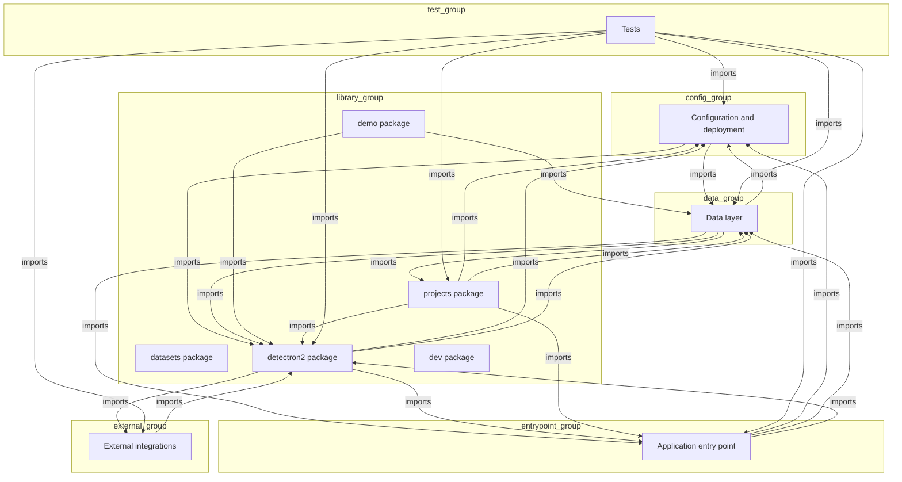

# Architecture report: facebookresearch/detectron2

> Automated static analysis. **Observed** = directly seen in files/imports/AST; **Inferred** = interpretation from that evidence. Repository code was not executed.

## 1. Repository at a glance

| Item | Value |
| --- | --- |
| Repository | facebookresearch/detectron2 |
| Description | Detectron2 is a platform for object detection, segmentation and other visual recognition tasks. |
| Language | Python |
| Stars | 34984 |
| Licence | Apache-2.0 |
| Analysed commit / branch | 247691a1c292654867deb35cabb27f18d75a1363 / main |
| Framework(s) | None detected |
| Files analysed | 800 |
| Components | 10 |

## 2. Architecture in one minute

facebookresearch/detectron2 - Detectron2 is a platform for object detection, segmentation and other visual recognition tasks.. This repository was analysed statically from 800 file(s) (478 Python). Detected technologies (observed from imports/manifests): GitHub Actions, NumPy, setuptools, Docker, Docker Compose, pytest. Files are grouped into 10 component(s): Configuration and deployment, Data layer, datasets package, demo package, detectron2 package, dev package, Application entry point, External integrations. Observed entry point(s): datasets/prepare_ade20k_sem_seg.py, datasets/prepare_cocofied_lvis.py, datasets/prepare_panoptic_fpn.py. Findings below distinguish observed facts from inferred interpretation.

## 3. High-level block diagram

## 4. Main components

### Configuration and deployment (`config`)

- **Kind:** config
- **Status:** Observed
- **Confidence:** 0.85
- **Responsibility:** Groups 264 file(s) under configuration and deployment (observed from repository paths and static analysis). Observed top-level classes: BatchNormBatchStat, CfgNode, ClassificationAcc, ClassificationNet, ConverterV1, ConverterV2. Observed top-level functions: _called_with_cfg, _cast_to_config, _get_args_from_config, _patch_import, _random_package_name, _rename.
- **Paths:** `configs/Base-RCNN-C4.yaml`, `configs/Base-RCNN-DilatedC5.yaml`, `configs/Base-RCNN-FPN.yaml`, `configs/Base-RetinaNet.yaml`, `configs/COCO-Detection/fast_rcnn_R_50_FPN_1x.yaml`, `configs/COCO-Detection/faster_rcnn_R_101_C4_3x.yaml`, `configs/COCO-Detection/faster_rcnn_R_101_DC5_3x.yaml`, `configs/COCO-Detection/faster_rcnn_R_101_FPN_3x.yaml`, `configs/COCO-Detection/faster_rcnn_R_50_C4_1x.yaml`, `configs/COCO-Detection/faster_rcnn_R_50_C4_3x.yaml`, `configs/COCO-Detection/faster_rcnn_R_50_DC5_1x.yaml`, `configs/COCO-Detection/faster_rcnn_R_50_DC5_3x.yaml`, `configs/COCO-Detection/faster_rcnn_R_50_FPN_1x.yaml`, `configs/COCO-Detection/faster_rcnn_R_50_FPN_3x.yaml`, `configs/COCO-Detection/faster_rcnn_X_101_32x8d_FPN_3x.yaml`, `configs/COCO-Detection/fcos_R_50_FPN_1x.py`, `configs/COCO-Detection/retinanet_R_101_FPN_3x.yaml`, `configs/COCO-Detection/retinanet_R_50_FPN_1x.py`, `configs/COCO-Detection/retinanet_R_50_FPN_1x.yaml`, `configs/COCO-Detection/retinanet_R_50_FPN_3x.yaml`, `configs/COCO-Detection/rpn_R_50_C4_1x.yaml`, `configs/COCO-Detection/rpn_R_50_FPN_1x.yaml`, `configs/COCO-InstanceSegmentation/mask_rcnn_R_101_C4_3x.yaml`, `configs/COCO-InstanceSegmentation/mask_rcnn_R_101_DC5_3x.yaml`, `configs/COCO-InstanceSegmentation/mask_rcnn_R_101_FPN_3x.yaml`, `configs/COCO-InstanceSegmentation/mask_rcnn_R_50_C4_1x.py`, `configs/COCO-InstanceSegmentation/mask_rcnn_R_50_C4_1x.yaml`, `configs/COCO-InstanceSegmentation/mask_rcnn_R_50_C4_3x.yaml`, `configs/COCO-InstanceSegmentation/mask_rcnn_R_50_DC5_1x.yaml`, `configs/COCO-InstanceSegmentation/mask_rcnn_R_50_DC5_3x.yaml`, `configs/COCO-InstanceSegmentation/mask_rcnn_R_50_FPN_1x.py`, `configs/COCO-InstanceSegmentation/mask_rcnn_R_50_FPN_1x.yaml`, `configs/COCO-InstanceSegmentation/mask_rcnn_R_50_FPN_1x_giou.yaml`, `configs/COCO-InstanceSegmentation/mask_rcnn_R_50_FPN_3x.yaml`, `configs/COCO-InstanceSegmentation/mask_rcnn_X_101_32x8d_FPN_3x.yaml`, `configs/COCO-InstanceSegmentation/mask_rcnn_regnetx_4gf_dds_fpn_1x.py`, `configs/COCO-InstanceSegmentation/mask_rcnn_regnety_4gf_dds_fpn_1x.py`, `configs/COCO-Keypoints/Base-Keypoint-RCNN-FPN.yaml`, `configs/COCO-Keypoints/keypoint_rcnn_R_101_FPN_3x.yaml`, `configs/COCO-Keypoints/keypoint_rcnn_R_50_FPN_1x.py`, `configs/COCO-Keypoints/keypoint_rcnn_R_50_FPN_1x.yaml`, `configs/COCO-Keypoints/keypoint_rcnn_R_50_FPN_3x.yaml`, `configs/COCO-Keypoints/keypoint_rcnn_X_101_32x8d_FPN_3x.yaml`, `configs/COCO-PanopticSegmentation/Base-Panoptic-FPN.yaml`, `configs/COCO-PanopticSegmentation/panoptic_fpn_R_101_3x.yaml`, `configs/COCO-PanopticSegmentation/panoptic_fpn_R_50_1x.py`, `configs/COCO-PanopticSegmentation/panoptic_fpn_R_50_1x.yaml`, `configs/COCO-PanopticSegmentation/panoptic_fpn_R_50_3x.yaml`, `configs/Cityscapes/mask_rcnn_R_50_FPN.yaml`, `configs/Detectron1-Comparisons/faster_rcnn_R_50_FPN_noaug_1x.yaml`, `configs/Detectron1-Comparisons/keypoint_rcnn_R_50_FPN_1x.yaml`, `configs/Detectron1-Comparisons/mask_rcnn_R_50_FPN_noaug_1x.yaml`, `configs/LVISv0.5-InstanceSegmentation/mask_rcnn_R_101_FPN_1x.yaml`, `configs/LVISv0.5-InstanceSegmentation/mask_rcnn_R_50_FPN_1x.yaml`, `configs/LVISv0.5-InstanceSegmentation/mask_rcnn_X_101_32x8d_FPN_1x.yaml`, `configs/LVISv1-InstanceSegmentation/mask_rcnn_R_101_FPN_1x.yaml`, `configs/LVISv1-InstanceSegmentation/mask_rcnn_R_50_FPN_1x.yaml`, `configs/LVISv1-InstanceSegmentation/mask_rcnn_X_101_32x8d_FPN_1x.yaml`, `configs/Misc/cascade_mask_rcnn_R_50_FPN_1x.yaml`, `configs/Misc/cascade_mask_rcnn_R_50_FPN_3x.yaml`, `configs/Misc/cascade_mask_rcnn_X_152_32x8d_FPN_IN5k_gn_dconv.yaml`, `configs/Misc/mask_rcnn_R_50_FPN_1x_cls_agnostic.yaml`, `configs/Misc/mask_rcnn_R_50_FPN_1x_dconv_c3-c5.yaml`, `configs/Misc/mask_rcnn_R_50_FPN_3x_dconv_c3-c5.yaml`, `configs/Misc/mask_rcnn_R_50_FPN_3x_gn.yaml`, `configs/Misc/mask_rcnn_R_50_FPN_3x_syncbn.yaml`, `configs/Misc/mmdet_mask_rcnn_R_50_FPN_1x.py`, `configs/Misc/panoptic_fpn_R_101_dconv_cascade_gn_3x.yaml`, `configs/Misc/scratch_mask_rcnn_R_50_FPN_3x_gn.yaml`, `configs/Misc/scratch_mask_rcnn_R_50_FPN_9x_gn.yaml`, `configs/Misc/scratch_mask_rcnn_R_50_FPN_9x_syncbn.yaml`, `configs/Misc/semantic_R_50_FPN_1x.yaml`, `configs/Misc/torchvision_imagenet_R_50.py`, `configs/PascalVOC-Detection/faster_rcnn_R_50_C4.yaml`, `configs/PascalVOC-Detection/faster_rcnn_R_50_FPN.yaml`, `configs/common/coco_schedule.py`, `configs/common/optim.py`, `configs/common/train.py`, `configs/new_baselines/mask_rcnn_R_101_FPN_100ep_LSJ.py`, `configs/new_baselines/mask_rcnn_R_101_FPN_200ep_LSJ.py`, `configs/new_baselines/mask_rcnn_R_101_FPN_400ep_LSJ.py`, `configs/new_baselines/mask_rcnn_R_50_FPN_100ep_LSJ.py`, `configs/new_baselines/mask_rcnn_R_50_FPN_200ep_LSJ.py`, `configs/new_baselines/mask_rcnn_R_50_FPN_400ep_LSJ.py`, `configs/new_baselines/mask_rcnn_R_50_FPN_50ep_LSJ.py`, `configs/new_baselines/mask_rcnn_regnetx_4gf_dds_FPN_100ep_LSJ.py`, `configs/new_baselines/mask_rcnn_regnetx_4gf_dds_FPN_200ep_LSJ.py`, `configs/new_baselines/mask_rcnn_regnetx_4gf_dds_FPN_400ep_LSJ.py`, `configs/new_baselines/mask_rcnn_regnety_4gf_dds_FPN_100ep_LSJ.py`, `configs/new_baselines/mask_rcnn_regnety_4gf_dds_FPN_200ep_LSJ.py`, `configs/new_baselines/mask_rcnn_regnety_4gf_dds_FPN_400ep_LSJ.py`, `configs/quick_schedules/cascade_mask_rcnn_R_50_FPN_inference_acc_test.yaml`, `configs/quick_schedules/cascade_mask_rcnn_R_50_FPN_instant_test.yaml`, `configs/quick_schedules/fast_rcnn_R_50_FPN_inference_acc_test.yaml`, `configs/quick_schedules/fast_rcnn_R_50_FPN_instant_test.yaml`, `configs/quick_schedules/keypoint_rcnn_R_50_FPN_inference_acc_test.yaml`, `configs/quick_schedules/keypoint_rcnn_R_50_FPN_instant_test.yaml`, `configs/quick_schedules/keypoint_rcnn_R_50_FPN_normalized_training_acc_test.yaml`, `configs/quick_schedules/keypoint_rcnn_R_50_FPN_training_acc_test.yaml`, `configs/quick_schedules/mask_rcnn_R_50_C4_GCV_instant_test.yaml`, `configs/quick_schedules/mask_rcnn_R_50_C4_inference_acc_test.yaml`, `configs/quick_schedules/mask_rcnn_R_50_C4_instant_test.yaml`, `configs/quick_schedules/mask_rcnn_R_50_C4_training_acc_test.yaml`, `configs/quick_schedules/mask_rcnn_R_50_DC5_inference_acc_test.yaml`, `configs/quick_schedules/mask_rcnn_R_50_FPN_inference_acc_test.yaml`, `configs/quick_schedules/mask_rcnn_R_50_FPN_instant_test.yaml`, `configs/quick_schedules/mask_rcnn_R_50_FPN_pred_boxes_training_acc_test.yaml`, `configs/quick_schedules/mask_rcnn_R_50_FPN_training_acc_test.yaml`, `configs/quick_schedules/panoptic_fpn_R_50_inference_acc_test.yaml`, `configs/quick_schedules/panoptic_fpn_R_50_instant_test.yaml`, `configs/quick_schedules/panoptic_fpn_R_50_training_acc_test.yaml`, `configs/quick_schedules/retinanet_R_50_FPN_inference_acc_test.yaml`, `configs/quick_schedules/retinanet_R_50_FPN_instant_test.yaml`, `configs/quick_schedules/rpn_R_50_FPN_inference_acc_test.yaml`, `configs/quick_schedules/rpn_R_50_FPN_instant_test.yaml`, `configs/quick_schedules/semantic_R_50_FPN_inference_acc_test.yaml`, `configs/quick_schedules/semantic_R_50_FPN_instant_test.yaml`, `configs/quick_schedules/semantic_R_50_FPN_training_acc_test.yaml`, `detectron2/config/__init__.py`, `detectron2/config/compat.py`, `detectron2/config/config.py`, `detectron2/config/defaults.py`, `detectron2/config/instantiate.py`, `detectron2/config/lazy.py`, `docker/Dockerfile`, `docker/docker-compose.yml`, `projects/DeepLab/configs/Cityscapes-SemanticSegmentation/Base-DeepLabV3-OS16-Semantic.yaml`, `projects/DeepLab/configs/Cityscapes-SemanticSegmentation/deeplab_v3_R_103_os16_mg124_poly_90k_bs16.yaml`, `projects/DeepLab/configs/Cityscapes-SemanticSegmentation/deeplab_v3_plus_R_103_os16_mg124_poly_90k_bs16.yaml`, `projects/DeepLab/deeplab/config.py`, `projects/DensePose/configs/Base-DensePose-RCNN-FPN.yaml`, `projects/DensePose/configs/HRNet/densepose_rcnn_HRFPN_HRNet_w32_s1x.yaml`, `projects/DensePose/configs/HRNet/densepose_rcnn_HRFPN_HRNet_w40_s1x.yaml`, `projects/DensePose/configs/HRNet/densepose_rcnn_HRFPN_HRNet_w48_s1x.yaml`, `projects/DensePose/configs/cse/Base-DensePose-RCNN-FPN-Human.yaml`, `projects/DensePose/configs/cse/Base-DensePose-RCNN-FPN.yaml`, `projects/DensePose/configs/cse/densepose_rcnn_R_101_FPN_DL_s1x.yaml`, `projects/DensePose/configs/cse/densepose_rcnn_R_101_FPN_DL_soft_s1x.yaml`, `projects/DensePose/configs/cse/densepose_rcnn_R_101_FPN_s1x.yaml`, `projects/DensePose/configs/cse/densepose_rcnn_R_101_FPN_soft_s1x.yaml`, `projects/DensePose/configs/cse/densepose_rcnn_R_50_FPN_DL_s1x.yaml`, `projects/DensePose/configs/cse/densepose_rcnn_R_50_FPN_DL_soft_s1x.yaml`, `projects/DensePose/configs/cse/densepose_rcnn_R_50_FPN_s1x.yaml`, `projects/DensePose/configs/cse/densepose_rcnn_R_50_FPN_soft_animals_CA_finetune_16k.yaml`, `projects/DensePose/configs/cse/densepose_rcnn_R_50_FPN_soft_animals_CA_finetune_4k.yaml`, `projects/DensePose/configs/cse/densepose_rcnn_R_50_FPN_soft_animals_I0_finetune_16k.yaml`, `projects/DensePose/configs/cse/densepose_rcnn_R_50_FPN_soft_animals_I0_finetune_i2m_16k.yaml`, `projects/DensePose/configs/cse/densepose_rcnn_R_50_FPN_soft_animals_I0_finetune_m2m_16k.yaml`, `projects/DensePose/configs/cse/densepose_rcnn_R_50_FPN_soft_animals_finetune_16k.yaml`, `projects/DensePose/configs/cse/densepose_rcnn_R_50_FPN_soft_animals_finetune_4k.yaml`, `projects/DensePose/configs/cse/densepose_rcnn_R_50_FPN_soft_animals_finetune_maskonly_24k.yaml`, `projects/DensePose/configs/cse/densepose_rcnn_R_50_FPN_soft_chimps_finetune_4k.yaml`, `projects/DensePose/configs/cse/densepose_rcnn_R_50_FPN_soft_s1x.yaml`, `projects/DensePose/configs/densepose_rcnn_R_101_FPN_DL_WC1M_s1x.yaml`, `projects/DensePose/configs/densepose_rcnn_R_101_FPN_DL_WC1_s1x.yaml`, `projects/DensePose/configs/densepose_rcnn_R_101_FPN_DL_WC2M_s1x.yaml`, `projects/DensePose/configs/densepose_rcnn_R_101_FPN_DL_WC2_s1x.yaml`, `projects/DensePose/configs/densepose_rcnn_R_101_FPN_DL_s1x.yaml`, `projects/DensePose/configs/densepose_rcnn_R_101_FPN_WC1M_s1x.yaml`, `projects/DensePose/configs/densepose_rcnn_R_101_FPN_WC1_s1x.yaml`, `projects/DensePose/configs/densepose_rcnn_R_101_FPN_WC2M_s1x.yaml`, `projects/DensePose/configs/densepose_rcnn_R_101_FPN_WC2_s1x.yaml`, `projects/DensePose/configs/densepose_rcnn_R_101_FPN_s1x.yaml`, `projects/DensePose/configs/densepose_rcnn_R_101_FPN_s1x_legacy.yaml`, `projects/DensePose/configs/densepose_rcnn_R_50_FPN_DL_WC1M_s1x.yaml`, `projects/DensePose/configs/densepose_rcnn_R_50_FPN_DL_WC1_s1x.yaml`, `projects/DensePose/configs/densepose_rcnn_R_50_FPN_DL_WC2M_s1x.yaml`, `projects/DensePose/configs/densepose_rcnn_R_50_FPN_DL_WC2_s1x.yaml`, `projects/DensePose/configs/densepose_rcnn_R_50_FPN_DL_s1x.yaml`, `projects/DensePose/configs/densepose_rcnn_R_50_FPN_WC1M_s1x.yaml`, `projects/DensePose/configs/densepose_rcnn_R_50_FPN_WC1_s1x.yaml`, `projects/DensePose/configs/densepose_rcnn_R_50_FPN_WC2M_s1x.yaml`, `projects/DensePose/configs/densepose_rcnn_R_50_FPN_WC2_s1x.yaml`, `projects/DensePose/configs/densepose_rcnn_R_50_FPN_s1x.yaml`, `projects/DensePose/configs/densepose_rcnn_R_50_FPN_s1x_legacy.yaml`, `projects/DensePose/configs/evolution/Base-RCNN-FPN-Atop10P_CA.yaml`, `projects/DensePose/configs/evolution/densepose_R_50_FPN_DL_WC1M_3x_Atop10P_CA.yaml`, `projects/DensePose/configs/evolution/densepose_R_50_FPN_DL_WC1M_3x_Atop10P_CA_B_coarsesegm.yaml`, `projects/DensePose/configs/evolution/densepose_R_50_FPN_DL_WC1M_3x_Atop10P_CA_B_finesegm.yaml`, `projects/DensePose/configs/evolution/densepose_R_50_FPN_DL_WC1M_3x_Atop10P_CA_B_uniform.yaml`, `projects/DensePose/configs/evolution/densepose_R_50_FPN_DL_WC1M_3x_Atop10P_CA_B_uv.yaml`, `projects/DensePose/configs/quick_schedules/cse/densepose_rcnn_R_50_FPN_DL_instant_test.yaml`, `projects/DensePose/configs/quick_schedules/cse/densepose_rcnn_R_50_FPN_soft_animals_finetune_instant_test.yaml`, `projects/DensePose/configs/quick_schedules/densepose_rcnn_HRFPN_HRNet_w32_instant_test.yaml`, `projects/DensePose/configs/quick_schedules/densepose_rcnn_R_50_FPN_DL_instant_test.yaml`, `projects/DensePose/configs/quick_schedules/densepose_rcnn_R_50_FPN_TTA_inference_acc_test.yaml`, `projects/DensePose/configs/quick_schedules/densepose_rcnn_R_50_FPN_WC1_instant_test.yaml`, `projects/DensePose/configs/quick_schedules/densepose_rcnn_R_50_FPN_WC2_instant_test.yaml`, `projects/DensePose/configs/quick_schedules/densepose_rcnn_R_50_FPN_inference_acc_test.yaml`, `projects/DensePose/configs/quick_schedules/densepose_rcnn_R_50_FPN_instant_test.yaml`, `projects/DensePose/configs/quick_schedules/densepose_rcnn_R_50_FPN_training_acc_test.yaml`, `projects/DensePose/densepose/config.py`, `projects/DensePose/setup.py`, `projects/MViTv2/configs/cascade_mask_rcnn_mvitv2_b_3x.py`, `projects/MViTv2/configs/cascade_mask_rcnn_mvitv2_b_in21k_3x.py`, `projects/MViTv2/configs/cascade_mask_rcnn_mvitv2_h_in21k_lsj_3x.py`, `projects/MViTv2/configs/cascade_mask_rcnn_mvitv2_l_in21k_lsj_50ep.py`, `projects/MViTv2/configs/cascade_mask_rcnn_mvitv2_s_3x.py`, `projects/MViTv2/configs/cascade_mask_rcnn_mvitv2_t_3x.py`, `projects/MViTv2/configs/common/coco_loader.py`, `projects/MViTv2/configs/common/coco_loader_lsj.py`, `projects/MViTv2/configs/mask_rcnn_mvitv2_t_3x.py`, `projects/Panoptic-DeepLab/configs/COCO-PanopticSegmentation/panoptic_deeplab_R_52_os16_mg124_poly_200k_bs64_crop_640_640_coco_dsconv.yaml`, `projects/Panoptic-DeepLab/configs/Cityscapes-PanopticSegmentation/Base-PanopticDeepLab-OS16.yaml`, `projects/Panoptic-DeepLab/configs/Cityscapes-PanopticSegmentation/panoptic_deeplab_R_52_os16_mg124_poly_90k_bs32_crop_512_1024.yaml`, `projects/Panoptic-DeepLab/configs/Cityscapes-PanopticSegmentation/panoptic_deeplab_R_52_os16_mg124_poly_90k_bs32_crop_512_1024_dsconv.yaml`, `projects/Panoptic-DeepLab/panoptic_deeplab/config.py`, `projects/PointRend/configs/InstanceSegmentation/Base-Implicit-PointRend.yaml`, `projects/PointRend/configs/InstanceSegmentation/Base-PointRend-RCNN-FPN.yaml`, `projects/PointRend/configs/InstanceSegmentation/implicit_pointrend_R_50_FPN_1x_coco.yaml`, `projects/PointRend/configs/InstanceSegmentation/implicit_pointrend_R_50_FPN_3x_coco.yaml`, `projects/PointRend/configs/InstanceSegmentation/pointrend_rcnn_R_101_FPN_3x_coco.yaml`, `projects/PointRend/configs/InstanceSegmentation/pointrend_rcnn_R_50_FPN_1x_cityscapes.yaml`, `projects/PointRend/configs/InstanceSegmentation/pointrend_rcnn_R_50_FPN_1x_coco.yaml`, `projects/PointRend/configs/InstanceSegmentation/pointrend_rcnn_R_50_FPN_3x_coco.yaml`, `projects/PointRend/configs/InstanceSegmentation/pointrend_rcnn_X_101_32x8d_FPN_3x_coco.yaml`, `projects/PointRend/configs/SemanticSegmentation/Base-PointRend-Semantic-FPN.yaml`, `projects/PointRend/configs/SemanticSegmentation/pointrend_semantic_R_101_FPN_1x_cityscapes.yaml`, `projects/PointRend/point_rend/config.py`, `projects/PointSup/configs/implicit_pointrend_R_50_FPN_3x_point_sup_point_aug_coco.yaml`, `projects/PointSup/configs/mask_rcnn_R_50_FPN_3x_point_sup_coco.yaml`, `projects/PointSup/configs/mask_rcnn_R_50_FPN_3x_point_sup_point_aug_coco.yaml`, `projects/PointSup/point_sup/config.py`, `projects/Rethinking-BatchNorm/configs/mask_rcnn_BNhead.py`, `projects/Rethinking-BatchNorm/configs/mask_rcnn_BNhead_batch_stats.py`, `projects/Rethinking-BatchNorm/configs/mask_rcnn_BNhead_shuffle.py`, `projects/Rethinking-BatchNorm/configs/mask_rcnn_SyncBNhead.py`, `projects/Rethinking-BatchNorm/configs/retinanet_SyncBNhead.py`, `projects/Rethinking-BatchNorm/configs/retinanet_SyncBNhead_SharedTraining.py`, `projects/TensorMask/configs/Base-TensorMask.yaml`, `projects/TensorMask/configs/tensormask_R_50_FPN_1x.yaml`, `projects/TensorMask/configs/tensormask_R_50_FPN_6x.yaml`, `projects/TensorMask/setup.py`, `projects/TensorMask/tensormask/config.py`, `projects/TridentNet/configs/Base-TridentNet-Fast-C4.yaml`, `projects/TridentNet/configs/tridentnet_fast_R_101_C4_3x.yaml`, `projects/TridentNet/configs/tridentnet_fast_R_50_C4_1x.yaml`, `projects/TridentNet/configs/tridentnet_fast_R_50_C4_3x.yaml`, `projects/TridentNet/tridentnet/config.py`, `projects/ViTDet/configs/COCO/cascade_mask_rcnn_mvitv2_b_in21k_100ep.py`, `projects/ViTDet/configs/COCO/cascade_mask_rcnn_mvitv2_h_in21k_36ep.py`, `projects/ViTDet/configs/COCO/cascade_mask_rcnn_mvitv2_l_in21k_50ep.py`, `projects/ViTDet/configs/COCO/cascade_mask_rcnn_swin_b_in21k_50ep.py`, `projects/ViTDet/configs/COCO/cascade_mask_rcnn_swin_l_in21k_50ep.py`, `projects/ViTDet/configs/COCO/cascade_mask_rcnn_vitdet_b_100ep.py`, `projects/ViTDet/configs/COCO/cascade_mask_rcnn_vitdet_h_75ep.py`, `projects/ViTDet/configs/COCO/cascade_mask_rcnn_vitdet_l_100ep.py`, `projects/ViTDet/configs/COCO/mask_rcnn_vitdet_b_100ep.py`, `projects/ViTDet/configs/COCO/mask_rcnn_vitdet_h_75ep.py`, `projects/ViTDet/configs/COCO/mask_rcnn_vitdet_l_100ep.py`, `projects/ViTDet/configs/LVIS/cascade_mask_rcnn_mvitv2_b_in21k_100ep.py`, `projects/ViTDet/configs/LVIS/cascade_mask_rcnn_mvitv2_h_in21k_50ep.py`, `projects/ViTDet/configs/LVIS/cascade_mask_rcnn_mvitv2_l_in21k_50ep.py`, `projects/ViTDet/configs/LVIS/cascade_mask_rcnn_swin_b_in21k_50ep.py`, `projects/ViTDet/configs/LVIS/cascade_mask_rcnn_swin_l_in21k_50ep.py`, `projects/ViTDet/configs/LVIS/cascade_mask_rcnn_vitdet_b_100ep.py`, `projects/ViTDet/configs/LVIS/cascade_mask_rcnn_vitdet_h_100ep.py`, `projects/ViTDet/configs/LVIS/cascade_mask_rcnn_vitdet_l_100ep.py`, `projects/ViTDet/configs/LVIS/mask_rcnn_vitdet_b_100ep.py`, `projects/ViTDet/configs/LVIS/mask_rcnn_vitdet_h_100ep.py`, `projects/ViTDet/configs/LVIS/mask_rcnn_vitdet_l_100ep.py`, `projects/ViTDet/configs/common/coco_loader_lsj.py`, `setup.cfg`, `setup.py`
- **Evidence:** [configs/Base-RCNN-C4.yaml](https://github.com/facebookresearch/detectron2/blob/247691a1c292654867deb35cabb27f18d75a1363/configs/Base-RCNN-C4.yaml); [configs/Base-RCNN-DilatedC5.yaml](https://github.com/facebookresearch/detectron2/blob/247691a1c292654867deb35cabb27f18d75a1363/configs/Base-RCNN-DilatedC5.yaml); [configs/Base-RCNN-FPN.yaml](https://github.com/facebookresearch/detectron2/blob/247691a1c292654867deb35cabb27f18d75a1363/configs/Base-RCNN-FPN.yaml); [configs/Base-RetinaNet.yaml](https://github.com/facebookresearch/detectron2/blob/247691a1c292654867deb35cabb27f18d75a1363/configs/Base-RetinaNet.yaml); [configs/COCO-Detection/fast_rcnn_R_50_FPN_1x.yaml](https://github.com/facebookresearch/detectron2/blob/247691a1c292654867deb35cabb27f18d75a1363/configs/COCO-Detection/fast_rcnn_R_50_FPN_1x.yaml); [configs/COCO-Detection/faster_rcnn_R_101_C4_3x.yaml](https://github.com/facebookresearch/detectron2/blob/247691a1c292654867deb35cabb27f18d75a1363/configs/COCO-Detection/faster_rcnn_R_101_C4_3x.yaml); [configs/COCO-Detection/faster_rcnn_R_101_DC5_3x.yaml](https://github.com/facebookresearch/detectron2/blob/247691a1c292654867deb35cabb27f18d75a1363/configs/COCO-Detection/faster_rcnn_R_101_DC5_3x.yaml); [configs/COCO-Detection/faster_rcnn_R_101_FPN_3x.yaml](https://github.com/facebookresearch/detectron2/blob/247691a1c292654867deb35cabb27f18d75a1363/configs/COCO-Detection/faster_rcnn_R_101_FPN_3x.yaml)

### Data layer (`data_layer`)

- **Kind:** data
- **Status:** Observed
- **Confidence:** 0.85
- **Responsibility:** Groups 63 file(s) under data layer (observed from repository paths and static analysis). Observed top-level classes: AspectRatioGroupedDataset, AugInput, Augmentation, AugmentationList, CocoDatasetInfo, ColorTransform. Observed top-level functions: HFlip_rotated_box, Resize_rotated_box, _add_categories_metadata, _add_category_id_to_contiguous_id_maps_to_metadata, _add_category_info_to_bootstrapping_metadata, _add_category_maps_to_metadata.
- **Paths:** `configs/common/data/coco.py`, `configs/common/data/coco_keypoint.py`, `configs/common/data/coco_panoptic_separated.py`, `configs/common/data/constants.py`, `configs/common/models/cascade_rcnn.py`, `configs/common/models/fcos.py`, `configs/common/models/keypoint_rcnn_fpn.py`, `configs/common/models/mask_rcnn_c4.py`, `configs/common/models/mask_rcnn_fpn.py`, `configs/common/models/mask_rcnn_vitdet.py`, `configs/common/models/panoptic_fpn.py`, `configs/common/models/retinanet.py`, `detectron2/data/__init__.py`, `detectron2/data/benchmark.py`, `detectron2/data/build.py`, `detectron2/data/catalog.py`, `detectron2/data/common.py`, `detectron2/data/dataset_mapper.py`, `detectron2/data/datasets/__init__.py`, `detectron2/data/datasets/builtin.py`, `detectron2/data/datasets/builtin_meta.py`, `detectron2/data/datasets/cityscapes_panoptic.py`, `detectron2/data/datasets/lvis_v1_category_image_count.py`, `detectron2/data/datasets/pascal_voc.py`, `detectron2/data/datasets/register_coco.py`, `detectron2/data/detection_utils.py`, `detectron2/data/samplers/__init__.py`, `detectron2/data/samplers/distributed_sampler.py`, `detectron2/data/samplers/grouped_batch_sampler.py`, `detectron2/data/transforms/__init__.py`, `detectron2/data/transforms/augmentation.py`, `detectron2/data/transforms/augmentation_impl.py`, `detectron2/data/transforms/transform.py`, `projects/DensePose/densepose/data/__init__.py`, `projects/DensePose/densepose/data/build.py`, `projects/DensePose/densepose/data/combined_loader.py`, `projects/DensePose/densepose/data/dataset_mapper.py`, `projects/DensePose/densepose/data/datasets/__init__.py`, `projects/DensePose/densepose/data/datasets/builtin.py`, `projects/DensePose/densepose/data/datasets/chimpnsee.py`, `projects/DensePose/densepose/data/datasets/coco.py`, `projects/DensePose/densepose/data/datasets/dataset_type.py`, `projects/DensePose/densepose/data/datasets/lvis.py`, `projects/DensePose/densepose/data/image_list_dataset.py`, `projects/DensePose/densepose/data/inference_based_loader.py`, `projects/DensePose/densepose/data/meshes/__init__.py`, `projects/DensePose/densepose/data/meshes/builtin.py`, `projects/DensePose/densepose/data/meshes/catalog.py`, `projects/DensePose/densepose/data/samplers/__init__.py`, `projects/DensePose/densepose/data/samplers/densepose_base.py`, `projects/DensePose/densepose/data/samplers/densepose_confidence_based.py`, `projects/DensePose/densepose/data/samplers/densepose_cse_base.py`, `projects/DensePose/densepose/data/samplers/densepose_cse_confidence_based.py`, `projects/DensePose/densepose/data/samplers/densepose_cse_uniform.py`, `projects/DensePose/densepose/data/samplers/densepose_uniform.py`, `projects/DensePose/densepose/data/samplers/mask_from_densepose.py`, `projects/DensePose/densepose/data/samplers/prediction_to_gt.py`, `projects/DensePose/densepose/data/transform/__init__.py`, `projects/DensePose/densepose/data/transform/image.py`, `projects/DensePose/densepose/data/utils.py`, `projects/DensePose/densepose/data/video/__init__.py`, `projects/DensePose/densepose/data/video/frame_selector.py`, `projects/DensePose/densepose/data/video/video_keyframe_dataset.py`
- **Evidence:** [configs/common/data/coco.py](https://github.com/facebookresearch/detectron2/blob/247691a1c292654867deb35cabb27f18d75a1363/configs/common/data/coco.py); [configs/common/data/coco_keypoint.py](https://github.com/facebookresearch/detectron2/blob/247691a1c292654867deb35cabb27f18d75a1363/configs/common/data/coco_keypoint.py); [configs/common/data/coco_panoptic_separated.py](https://github.com/facebookresearch/detectron2/blob/247691a1c292654867deb35cabb27f18d75a1363/configs/common/data/coco_panoptic_separated.py); [configs/common/data/constants.py](https://github.com/facebookresearch/detectron2/blob/247691a1c292654867deb35cabb27f18d75a1363/configs/common/data/constants.py); [configs/common/models/cascade_rcnn.py](https://github.com/facebookresearch/detectron2/blob/247691a1c292654867deb35cabb27f18d75a1363/configs/common/models/cascade_rcnn.py); [configs/common/models/fcos.py](https://github.com/facebookresearch/detectron2/blob/247691a1c292654867deb35cabb27f18d75a1363/configs/common/models/fcos.py); [configs/common/models/keypoint_rcnn_fpn.py](https://github.com/facebookresearch/detectron2/blob/247691a1c292654867deb35cabb27f18d75a1363/configs/common/models/keypoint_rcnn_fpn.py); [configs/common/models/mask_rcnn_c4.py](https://github.com/facebookresearch/detectron2/blob/247691a1c292654867deb35cabb27f18d75a1363/configs/common/models/mask_rcnn_c4.py)

### datasets package (`datasets`)

- **Kind:** library
- **Status:** Observed
- **Confidence:** 0.85
- **Responsibility:** Groups 1 file(s) under datasets package (observed from repository paths and static analysis).
- **Paths:** `datasets/prepare_for_tests.sh`
- **Evidence:** [datasets/prepare_for_tests.sh](https://github.com/facebookresearch/detectron2/blob/247691a1c292654867deb35cabb27f18d75a1363/datasets/prepare_for_tests.sh)

### demo package (`demo`)

- **Kind:** library
- **Status:** Observed
- **Confidence:** 0.85
- **Responsibility:** Groups 1 file(s) under demo package (observed from repository paths and static analysis). Observed top-level classes: AsyncPredictor, VisualizationDemo.
- **Paths:** `demo/predictor.py`
- **Evidence:** [demo/predictor.py:15](https://github.com/facebookresearch/detectron2/blob/247691a1c292654867deb35cabb27f18d75a1363/demo/predictor.py#L15)

### detectron2 package (`detectron2`)

- **Kind:** library
- **Status:** Observed
- **Confidence:** 0.85
- **Responsibility:** Groups 129 file(s) under detectron2 package (observed from repository paths and static analysis). Observed top-level classes: AMPTrainer, ASPP, AnyNet, AnyStage, Attention, AutogradProfiler. Observed top-level functions: BilinearInterpolation, _add_instances_conversion_methods, _assert_strides_are_log2_contiguous, _assign_device_option, _broadcast_params, _cached_log_stream.
- **Paths:** `detectron2/__init__.py`, `detectron2/checkpoint/__init__.py`, `detectron2/checkpoint/c2_model_loading.py`, `detectron2/checkpoint/catalog.py`, `detectron2/checkpoint/detection_checkpoint.py`, `detectron2/engine/__init__.py`, `detectron2/engine/defaults.py`, `detectron2/engine/hooks.py`, `detectron2/engine/launch.py`, `detectron2/engine/train_loop.py`, `detectron2/evaluation/__init__.py`, `detectron2/evaluation/cityscapes_evaluation.py`, `detectron2/evaluation/coco_evaluation.py`, `detectron2/evaluation/evaluator.py`, `detectron2/evaluation/lvis_evaluation.py`, `detectron2/evaluation/pascal_voc_evaluation.py`, `detectron2/evaluation/rotated_coco_evaluation.py`, `detectron2/evaluation/sem_seg_evaluation.py`, `detectron2/evaluation/testing.py`, `detectron2/export/__init__.py`, `detectron2/export/api.py`, `detectron2/export/c10.py`, `detectron2/export/caffe2_export.py`, `detectron2/export/caffe2_inference.py`, `detectron2/export/caffe2_modeling.py`, `detectron2/export/caffe2_patch.py`, `detectron2/export/flatten.py`, `detectron2/export/shared.py`, `detectron2/export/torchscript.py`, `detectron2/export/torchscript_patch.py`, `detectron2/layers/__init__.py`, `detectron2/layers/aspp.py`, `detectron2/layers/batch_norm.py`, `detectron2/layers/blocks.py`, `detectron2/layers/csrc/ROIAlignRotated/ROIAlignRotated.h`, `detectron2/layers/csrc/ROIAlignRotated/ROIAlignRotated_cpu.cpp`, `detectron2/layers/csrc/box_iou_rotated/box_iou_rotated.h`, `detectron2/layers/csrc/box_iou_rotated/box_iou_rotated_cpu.cpp`, `detectron2/layers/csrc/box_iou_rotated/box_iou_rotated_utils.h`, `detectron2/layers/csrc/cocoeval/cocoeval.cpp`, `detectron2/layers/csrc/cocoeval/cocoeval.h`, `detectron2/layers/csrc/deformable/deform_conv.h`, `detectron2/layers/csrc/nms_rotated/nms_rotated.h`, `detectron2/layers/csrc/nms_rotated/nms_rotated_cpu.cpp`, `detectron2/layers/csrc/vision.cpp`, `detectron2/layers/deform_conv.py`, `detectron2/layers/losses.py`, `detectron2/layers/mask_ops.py`, `detectron2/layers/nms.py`, `detectron2/layers/roi_align.py`, `detectron2/layers/roi_align_rotated.py`, `detectron2/layers/rotated_boxes.py`, `detectron2/layers/shape_spec.py`, `detectron2/layers/wrappers.py`, `detectron2/model_zoo/__init__.py`, `detectron2/model_zoo/model_zoo.py`, `detectron2/modeling/__init__.py`, `detectron2/modeling/anchor_generator.py`, `detectron2/modeling/backbone/__init__.py`, `detectron2/modeling/backbone/backbone.py`, `detectron2/modeling/backbone/build.py`, `detectron2/modeling/backbone/fpn.py`, `detectron2/modeling/backbone/mvit.py`, `detectron2/modeling/backbone/regnet.py`, `detectron2/modeling/backbone/resnet.py`, `detectron2/modeling/backbone/swin.py`, `detectron2/modeling/backbone/utils.py`, `detectron2/modeling/backbone/vit.py`, `detectron2/modeling/box_regression.py`, `detectron2/modeling/matcher.py`, `detectron2/modeling/meta_arch/__init__.py`, `detectron2/modeling/meta_arch/build.py`, `detectron2/modeling/meta_arch/dense_detector.py`, `detectron2/modeling/meta_arch/fcos.py`, `detectron2/modeling/meta_arch/panoptic_fpn.py`, `detectron2/modeling/meta_arch/rcnn.py`, `detectron2/modeling/meta_arch/retinanet.py`, `detectron2/modeling/meta_arch/semantic_seg.py`, `detectron2/modeling/mmdet_wrapper.py`, `detectron2/modeling/poolers.py`, `detectron2/modeling/postprocessing.py`, `detectron2/modeling/proposal_generator/__init__.py`, `detectron2/modeling/proposal_generator/build.py`, `detectron2/modeling/proposal_generator/proposal_utils.py`, `detectron2/modeling/proposal_generator/rpn.py`, `detectron2/modeling/proposal_generator/rrpn.py`, `detectron2/modeling/roi_heads/__init__.py`, `detectron2/modeling/roi_heads/box_head.py`, `detectron2/modeling/roi_heads/cascade_rcnn.py`, `detectron2/modeling/roi_heads/fast_rcnn.py`, `detectron2/modeling/roi_heads/keypoint_head.py`, `detectron2/modeling/roi_heads/mask_head.py`, `detectron2/modeling/roi_heads/roi_heads.py`, `detectron2/modeling/roi_heads/rotated_fast_rcnn.py`, `detectron2/modeling/sampling.py`, `detectron2/projects/__init__.py`, `detectron2/solver/__init__.py`, `detectron2/solver/build.py`, `detectron2/solver/lr_scheduler.py`, `detectron2/structures/__init__.py`, `detectron2/structures/boxes.py`, `detectron2/structures/image_list.py`, `detectron2/structures/instances.py`, `detectron2/structures/keypoints.py`, `detectron2/structures/masks.py`, `detectron2/structures/rotated_boxes.py`, `detectron2/tracking/__init__.py`, `detectron2/tracking/base_tracker.py`, `detectron2/tracking/bbox_iou_tracker.py`, `detectron2/tracking/hungarian_tracker.py`, `detectron2/tracking/iou_weighted_hungarian_bbox_iou_tracker.py`, `detectron2/tracking/utils.py`, `detectron2/tracking/vanilla_hungarian_bbox_iou_tracker.py`, `detectron2/utils/__init__.py`, `detectron2/utils/analysis.py`, `detectron2/utils/comm.py`, `detectron2/utils/develop.py`, `detectron2/utils/env.py`, `detectron2/utils/events.py`, `detectron2/utils/file_io.py`, `detectron2/utils/logger.py`, `detectron2/utils/memory.py`, `detectron2/utils/registry.py`, `detectron2/utils/serialize.py`, `detectron2/utils/testing.py`, `detectron2/utils/torch_version_utils.py`, `detectron2/utils/tracing.py`, `detectron2/utils/video_visualizer.py`, `detectron2/utils/visualizer.py`
- **Evidence:** [detectron2/__init__.py](https://github.com/facebookresearch/detectron2/blob/247691a1c292654867deb35cabb27f18d75a1363/detectron2/__init__.py); [detectron2/checkpoint/__init__.py](https://github.com/facebookresearch/detectron2/blob/247691a1c292654867deb35cabb27f18d75a1363/detectron2/checkpoint/__init__.py); [detectron2/checkpoint/c2_model_loading.py:9](https://github.com/facebookresearch/detectron2/blob/247691a1c292654867deb35cabb27f18d75a1363/detectron2/checkpoint/c2_model_loading.py#L9); [detectron2/checkpoint/catalog.py:7](https://github.com/facebookresearch/detectron2/blob/247691a1c292654867deb35cabb27f18d75a1363/detectron2/checkpoint/catalog.py#L7); [detectron2/checkpoint/detection_checkpoint.py:16](https://github.com/facebookresearch/detectron2/blob/247691a1c292654867deb35cabb27f18d75a1363/detectron2/checkpoint/detection_checkpoint.py#L16); [detectron2/engine/__init__.py](https://github.com/facebookresearch/detectron2/blob/247691a1c292654867deb35cabb27f18d75a1363/detectron2/engine/__init__.py); [detectron2/engine/defaults.py:60](https://github.com/facebookresearch/detectron2/blob/247691a1c292654867deb35cabb27f18d75a1363/detectron2/engine/defaults.py#L60); [detectron2/engine/hooks.py:50](https://github.com/facebookresearch/detectron2/blob/247691a1c292654867deb35cabb27f18d75a1363/detectron2/engine/hooks.py#L50)

### dev package (`dev`)

- **Kind:** library
- **Status:** Observed
- **Confidence:** 0.85
- **Responsibility:** Groups 7 file(s) under dev package (observed from repository paths and static analysis).
- **Paths:** `dev/linter.sh`, `dev/packaging/build_all_wheels.sh`, `dev/packaging/build_wheel.sh`, `dev/packaging/gen_wheel_index.sh`, `dev/parse_results.sh`, `dev/run_inference_tests.sh`, `dev/run_instant_tests.sh`
- **Evidence:** [dev/linter.sh](https://github.com/facebookresearch/detectron2/blob/247691a1c292654867deb35cabb27f18d75a1363/dev/linter.sh); [dev/packaging/build_all_wheels.sh](https://github.com/facebookresearch/detectron2/blob/247691a1c292654867deb35cabb27f18d75a1363/dev/packaging/build_all_wheels.sh); [dev/packaging/build_wheel.sh](https://github.com/facebookresearch/detectron2/blob/247691a1c292654867deb35cabb27f18d75a1363/dev/packaging/build_wheel.sh); [dev/packaging/gen_wheel_index.sh](https://github.com/facebookresearch/detectron2/blob/247691a1c292654867deb35cabb27f18d75a1363/dev/packaging/gen_wheel_index.sh); [dev/parse_results.sh](https://github.com/facebookresearch/detectron2/blob/247691a1c292654867deb35cabb27f18d75a1363/dev/parse_results.sh); [dev/run_inference_tests.sh](https://github.com/facebookresearch/detectron2/blob/247691a1c292654867deb35cabb27f18d75a1363/dev/run_inference_tests.sh); [dev/run_instant_tests.sh](https://github.com/facebookresearch/detectron2/blob/247691a1c292654867deb35cabb27f18d75a1363/dev/run_instant_tests.sh)

### Application entry point (`entrypoint`)

- **Kind:** entrypoint
- **Status:** Observed
- **Confidence:** 0.85
- **Responsibility:** Groups 23 file(s) under application entry point (observed from repository paths and static analysis). Observed top-level classes: Action, COCOPanopticEvaluator, DumpAction, EntrywiseAction, InferenceAction, PrintAction. Observed top-level functions: _cityscapes_files_to_dict, _get_cityscapes_files, _get_lvis_instances_meta_v0_5, _get_lvis_instances_meta_v1, _print_panoptic_results, _process_panoptic_to_semantic.
- **Paths:** `datasets/prepare_ade20k_sem_seg.py`, `datasets/prepare_cocofied_lvis.py`, `datasets/prepare_panoptic_fpn.py`, `demo/demo.py`, `detectron2/data/datasets/cityscapes.py`, `detectron2/data/datasets/coco.py`, `detectron2/data/datasets/coco_panoptic.py`, `detectron2/data/datasets/lvis.py`, `detectron2/evaluation/panoptic_evaluation.py`, `detectron2/utils/collect_env.py`, `detectron2/utils/colormap.py`, `dev/packaging/gen_install_table.py`, `projects/DeepLab/train_net.py`, `projects/DensePose/apply_net.py`, `projects/DensePose/query_db.py`, `projects/DensePose/train_net.py`, `projects/Panoptic-DeepLab/train_net.py`, `projects/PointRend/train_net.py`, `projects/PointSup/tools/prepare_coco_point_annotations_without_masks.py`, `projects/PointSup/train_net.py`, `projects/Rethinking-BatchNorm/retinanet-eval-domain-specific.py`, `projects/TensorMask/train_net.py`, `projects/TridentNet/train_net.py`
- **Evidence:** [datasets/prepare_ade20k_sem_seg.py:11](https://github.com/facebookresearch/detectron2/blob/247691a1c292654867deb35cabb27f18d75a1363/datasets/prepare_ade20k_sem_seg.py#L11); [datasets/prepare_cocofied_lvis.py:96](https://github.com/facebookresearch/detectron2/blob/247691a1c292654867deb35cabb27f18d75a1363/datasets/prepare_cocofied_lvis.py#L96); [datasets/prepare_panoptic_fpn.py:18](https://github.com/facebookresearch/detectron2/blob/247691a1c292654867deb35cabb27f18d75a1363/datasets/prepare_panoptic_fpn.py#L18); [demo/demo.py:23](https://github.com/facebookresearch/detectron2/blob/247691a1c292654867deb35cabb27f18d75a1363/demo/demo.py#L23); [detectron2/data/datasets/cityscapes.py:27](https://github.com/facebookresearch/detectron2/blob/247691a1c292654867deb35cabb27f18d75a1363/detectron2/data/datasets/cityscapes.py#L27); [detectron2/data/datasets/coco.py:35](https://github.com/facebookresearch/detectron2/blob/247691a1c292654867deb35cabb27f18d75a1363/detectron2/data/datasets/coco.py#L35); [detectron2/data/datasets/coco_panoptic.py:14](https://github.com/facebookresearch/detectron2/blob/247691a1c292654867deb35cabb27f18d75a1363/detectron2/data/datasets/coco_panoptic.py#L14); [detectron2/data/datasets/lvis.py:25](https://github.com/facebookresearch/detectron2/blob/247691a1c292654867deb35cabb27f18d75a1363/detectron2/data/datasets/lvis.py#L25)

### External integrations (`external_integrations`)

- **Kind:** external
- **Status:** Observed
- **Confidence:** 0.85
- **Responsibility:** Groups 1 file(s) under external integrations (observed from repository paths and static analysis). Observed top-level classes: COCOeval_opt.
- **Paths:** `detectron2/evaluation/fast_eval_api.py`
- **Evidence:** [detectron2/evaluation/fast_eval_api.py:13](https://github.com/facebookresearch/detectron2/blob/247691a1c292654867deb35cabb27f18d75a1363/detectron2/evaluation/fast_eval_api.py#L13)

### projects package (`projects`)

- **Kind:** library
- **Status:** Observed
- **Confidence:** 0.85
- **Responsibility:** Groups 119 file(s) under projects package (observed from repository paths and static analysis). Observed top-level classes: ASPP, ASPPConv, ASPPPooling, AllEntrySelector, AnnotationsAccumulator, BaseConverter. Observed top-level functions: _assignment_rule, _calculate_record_field_size_b, _calculate_record_field_sizes_b, _calculate_record_size_b, _create_pixel_dist_matrix, _densepose_data_i_for_cmap.
- **Paths:** `projects/DeepLab/deeplab/__init__.py`, `projects/DeepLab/deeplab/build_solver.py`, `projects/DeepLab/deeplab/loss.py`, `projects/DeepLab/deeplab/lr_scheduler.py`, `projects/DeepLab/deeplab/resnet.py`, `projects/DeepLab/deeplab/semantic_seg.py`, `projects/DensePose/densepose/__init__.py`, `projects/DensePose/densepose/converters/__init__.py`, `projects/DensePose/densepose/converters/base.py`, `projects/DensePose/densepose/converters/builtin.py`, `projects/DensePose/densepose/converters/chart_output_hflip.py`, `projects/DensePose/densepose/converters/chart_output_to_chart_result.py`, `projects/DensePose/densepose/converters/hflip.py`, `projects/DensePose/densepose/converters/segm_to_mask.py`, `projects/DensePose/densepose/converters/to_chart_result.py`, `projects/DensePose/densepose/converters/to_mask.py`, `projects/DensePose/densepose/engine/__init__.py`, `projects/DensePose/densepose/engine/trainer.py`, `projects/DensePose/densepose/evaluation/__init__.py`, `projects/DensePose/densepose/evaluation/d2_evaluator_adapter.py`, `projects/DensePose/densepose/evaluation/densepose_coco_evaluation.py`, `projects/DensePose/densepose/evaluation/evaluator.py`, `projects/DensePose/densepose/evaluation/mesh_alignment_evaluator.py`, `projects/DensePose/densepose/evaluation/tensor_storage.py`, `projects/DensePose/densepose/modeling/__init__.py`, `projects/DensePose/densepose/modeling/build.py`, `projects/DensePose/densepose/modeling/confidence.py`, `projects/DensePose/densepose/modeling/cse/__init__.py`, `projects/DensePose/densepose/modeling/cse/embedder.py`, `projects/DensePose/densepose/modeling/cse/utils.py`, `projects/DensePose/densepose/modeling/cse/vertex_direct_embedder.py`, `projects/DensePose/densepose/modeling/cse/vertex_feature_embedder.py`, `projects/DensePose/densepose/modeling/densepose_checkpoint.py`, `projects/DensePose/densepose/modeling/filter.py`, `projects/DensePose/densepose/modeling/hrfpn.py`, `projects/DensePose/densepose/modeling/hrnet.py`, `projects/DensePose/densepose/modeling/inference.py`, `projects/DensePose/densepose/modeling/losses/__init__.py`, `projects/DensePose/densepose/modeling/losses/chart.py`, `projects/DensePose/densepose/modeling/losses/chart_with_confidences.py`, `projects/DensePose/densepose/modeling/losses/cse.py`, `projects/DensePose/densepose/modeling/losses/cycle_pix2shape.py`, `projects/DensePose/densepose/modeling/losses/cycle_shape2shape.py`, `projects/DensePose/densepose/modeling/losses/embed.py`, `projects/DensePose/densepose/modeling/losses/embed_utils.py`, `projects/DensePose/densepose/modeling/losses/mask.py`, `projects/DensePose/densepose/modeling/losses/mask_or_segm.py`, `projects/DensePose/densepose/modeling/losses/registry.py`, `projects/DensePose/densepose/modeling/losses/segm.py`, `projects/DensePose/densepose/modeling/losses/soft_embed.py`, `projects/DensePose/densepose/modeling/losses/utils.py`, `projects/DensePose/densepose/modeling/predictors/__init__.py`, `projects/DensePose/densepose/modeling/predictors/chart.py`, `projects/DensePose/densepose/modeling/predictors/chart_confidence.py`, `projects/DensePose/densepose/modeling/predictors/chart_with_confidence.py`, `projects/DensePose/densepose/modeling/predictors/cse.py`, `projects/DensePose/densepose/modeling/predictors/cse_confidence.py`, `projects/DensePose/densepose/modeling/predictors/cse_with_confidence.py`, `projects/DensePose/densepose/modeling/predictors/registry.py`, `projects/DensePose/densepose/modeling/roi_heads/__init__.py`, `projects/DensePose/densepose/modeling/roi_heads/deeplab.py`, `projects/DensePose/densepose/modeling/roi_heads/registry.py`, `projects/DensePose/densepose/modeling/roi_heads/roi_head.py`, `projects/DensePose/densepose/modeling/roi_heads/v1convx.py`, `projects/DensePose/densepose/modeling/utils.py`, `projects/DensePose/densepose/structures/__init__.py`, `projects/DensePose/densepose/structures/chart.py`, `projects/DensePose/densepose/structures/chart_confidence.py`, `projects/DensePose/densepose/structures/chart_result.py`, `projects/DensePose/densepose/structures/cse.py`, `projects/DensePose/densepose/structures/cse_confidence.py`, `projects/DensePose/densepose/structures/data_relative.py`, `projects/DensePose/densepose/structures/list.py`, `projects/DensePose/densepose/structures/mesh.py`, `projects/DensePose/densepose/structures/transform_data.py`, `projects/DensePose/densepose/utils/__init__.py`, `projects/DensePose/densepose/utils/dbhelper.py`, `projects/DensePose/densepose/utils/logger.py`, `projects/DensePose/densepose/utils/transform.py`, `projects/DensePose/densepose/vis/__init__.py`, `projects/DensePose/densepose/vis/base.py`, `projects/DensePose/densepose/vis/bounding_box.py`, `projects/DensePose/densepose/vis/densepose_data_points.py`, `projects/DensePose/densepose/vis/densepose_outputs_iuv.py`, `projects/DensePose/densepose/vis/densepose_outputs_vertex.py`, `projects/DensePose/densepose/vis/densepose_results.py`, `projects/DensePose/densepose/vis/densepose_results_textures.py`, `projects/DensePose/densepose/vis/extractor.py`, `projects/DensePose/dev/run_inference_tests.sh`, `projects/DensePose/dev/run_instant_tests.sh`, `projects/Panoptic-DeepLab/panoptic_deeplab/__init__.py`, `projects/Panoptic-DeepLab/panoptic_deeplab/dataset_mapper.py`, `projects/Panoptic-DeepLab/panoptic_deeplab/panoptic_seg.py`, `projects/Panoptic-DeepLab/panoptic_deeplab/post_processing.py`, `projects/Panoptic-DeepLab/panoptic_deeplab/target_generator.py`, `projects/PointRend/point_rend/__init__.py`, `projects/PointRend/point_rend/color_augmentation.py`, `projects/PointRend/point_rend/mask_head.py`, `projects/PointRend/point_rend/point_features.py`, `projects/PointRend/point_rend/point_head.py`, `projects/PointRend/point_rend/roi_heads.py`, `projects/PointRend/point_rend/semantic_seg.py`, `projects/PointSup/point_sup/__init__.py`, `projects/PointSup/point_sup/dataset_mapper.py`, `projects/PointSup/point_sup/detection_utils.py`, `projects/PointSup/point_sup/mask_head.py`, `projects/PointSup/point_sup/point_utils.py`, `projects/PointSup/point_sup/register_point_annotations.py`, `projects/TensorMask/tensormask/__init__.py`, `projects/TensorMask/tensormask/arch.py`, `projects/TensorMask/tensormask/layers/__init__.py`, `projects/TensorMask/tensormask/layers/csrc/SwapAlign2Nat/SwapAlign2Nat.h`, `projects/TensorMask/tensormask/layers/csrc/vision.cpp`, `projects/TensorMask/tensormask/layers/swap_align2nat.py`, `projects/TridentNet/tridentnet/__init__.py`, `projects/TridentNet/tridentnet/trident_backbone.py`, `projects/TridentNet/tridentnet/trident_conv.py`, `projects/TridentNet/tridentnet/trident_rcnn.py`, `projects/TridentNet/tridentnet/trident_rpn.py`
- **Evidence:** [projects/DeepLab/deeplab/__init__.py](https://github.com/facebookresearch/detectron2/blob/247691a1c292654867deb35cabb27f18d75a1363/projects/DeepLab/deeplab/__init__.py); [projects/DeepLab/deeplab/build_solver.py:11](https://github.com/facebookresearch/detectron2/blob/247691a1c292654867deb35cabb27f18d75a1363/projects/DeepLab/deeplab/build_solver.py#L11); [projects/DeepLab/deeplab/loss.py:6](https://github.com/facebookresearch/detectron2/blob/247691a1c292654867deb35cabb27f18d75a1363/projects/DeepLab/deeplab/loss.py#L6); [projects/DeepLab/deeplab/lr_scheduler.py:17](https://github.com/facebookresearch/detectron2/blob/247691a1c292654867deb35cabb27f18d75a1363/projects/DeepLab/deeplab/lr_scheduler.py#L17); [projects/DeepLab/deeplab/resnet.py:15](https://github.com/facebookresearch/detectron2/blob/247691a1c292654867deb35cabb27f18d75a1363/projects/DeepLab/deeplab/resnet.py#L15); [projects/DeepLab/deeplab/semantic_seg.py:16](https://github.com/facebookresearch/detectron2/blob/247691a1c292654867deb35cabb27f18d75a1363/projects/DeepLab/deeplab/semantic_seg.py#L16); [projects/DensePose/densepose/__init__.py](https://github.com/facebookresearch/detectron2/blob/247691a1c292654867deb35cabb27f18d75a1363/projects/DensePose/densepose/__init__.py); [projects/DensePose/densepose/converters/__init__.py](https://github.com/facebookresearch/detectron2/blob/247691a1c292654867deb35cabb27f18d75a1363/projects/DensePose/densepose/converters/__init__.py)

### Tests (`tests`)

- **Kind:** test
- **Status:** Observed
- **Confidence:** 0.85
- **Responsibility:** Groups 77 file(s) under tests (observed from repository paths and static analysis). Observed top-level classes: A, DatasetMapperTTA, DeformableTest, DensePoseDatasetMapperTTA, DensePoseGeneralizedRCNNWithTTA, DensePoseRCNNE2ETest. Observed top-level functions: _a_slow_func, _collect_config_files, _create_video_frames, _find_free_port, _get_base_config_dir, _get_evolution_config_dir.
- **Paths:** `detectron2/modeling/test_time_augmentation.py`, `projects/DensePose/densepose/modeling/test_time_augmentation.py`, `projects/DensePose/tests/common.py`, `projects/DensePose/tests/test_chart_based_annotations_accumulator.py`, `projects/DensePose/tests/test_combine_data_loader.py`, `projects/DensePose/tests/test_cse_annotations_accumulator.py`, `projects/DensePose/tests/test_dataset_loaded_annotations.py`, `projects/DensePose/tests/test_frame_selector.py`, `projects/DensePose/tests/test_image_list_dataset.py`, `projects/DensePose/tests/test_image_resize_transform.py`, `projects/DensePose/tests/test_model_e2e.py`, `projects/DensePose/tests/test_setup.py`, `projects/DensePose/tests/test_structures.py`, `projects/DensePose/tests/test_tensor_storage.py`, `projects/DensePose/tests/test_video_keyframe_dataset.py`, `projects/TensorMask/tests/__init__.py`, `projects/TensorMask/tests/test_swap_align2nat.py`, `tests/README.md`, `tests/__init__.py`, `tests/config/dir1/bad_import.py`, `tests/config/dir1/bad_import2.py`, `tests/config/dir1/dir1_a.py`, `tests/config/dir1/dir1_b.py`, `tests/config/dir1/load_rel.py`, `tests/config/root_cfg.py`, `tests/config/test_instantiate_config.py`, `tests/config/test_lazy_config.py`, `tests/config/test_yacs_config.py`, `tests/data/__init__.py`, `tests/data/test_coco.py`, `tests/data/test_coco_evaluation.py`, `tests/data/test_dataset.py`, `tests/data/test_detection_utils.py`, `tests/data/test_rotation_transform.py`, `tests/data/test_sampler.py`, `tests/data/test_transforms.py`, `tests/export/test_c10.py`, `tests/layers/__init__.py`, `tests/layers/test_blocks.py`, `tests/layers/test_deformable.py`, `tests/layers/test_losses.py`, `tests/layers/test_mask_ops.py`, `tests/layers/test_nms.py`, `tests/layers/test_nms_rotated.py`, `tests/layers/test_roi_align.py`, `tests/layers/test_roi_align_rotated.py`, `tests/modeling/__init__.py`, `tests/modeling/test_anchor_generator.py`, `tests/modeling/test_backbone.py`, `tests/modeling/test_box2box_transform.py`, `tests/modeling/test_fast_rcnn.py`, `tests/modeling/test_matcher.py`, `tests/modeling/test_mmdet.py`, `tests/modeling/test_model_e2e.py`, `tests/modeling/test_roi_heads.py`, `tests/modeling/test_roi_pooler.py`, `tests/modeling/test_rpn.py`, `tests/structures/__init__.py`, `tests/structures/test_boxes.py`, `tests/structures/test_imagelist.py`, `tests/structures/test_instances.py`, `tests/structures/test_keypoints.py`, `tests/structures/test_masks.py`, `tests/structures/test_rotated_boxes.py`, `tests/test_checkpoint.py`, `tests/test_engine.py`, `tests/test_events.py`, `tests/test_export_caffe2.py`, `tests/test_export_onnx.py`, `tests/test_export_torchscript.py`, `tests/test_model_analysis.py`, `tests/test_model_zoo.py`, `tests/test_packaging.py`, `tests/test_registry.py`, `tests/test_scheduler.py`, `tests/test_solver.py`, `tests/test_visualizer.py`
- **Evidence:** [detectron2/modeling/test_time_augmentation.py:29](https://github.com/facebookresearch/detectron2/blob/247691a1c292654867deb35cabb27f18d75a1363/detectron2/modeling/test_time_augmentation.py#L29); [projects/DensePose/densepose/modeling/test_time_augmentation.py:17](https://github.com/facebookresearch/detectron2/blob/247691a1c292654867deb35cabb27f18d75a1363/projects/DensePose/densepose/modeling/test_time_augmentation.py#L17); [projects/DensePose/tests/common.py:20](https://github.com/facebookresearch/detectron2/blob/247691a1c292654867deb35cabb27f18d75a1363/projects/DensePose/tests/common.py#L20); [projects/DensePose/tests/test_chart_based_annotations_accumulator.py:19](https://github.com/facebookresearch/detectron2/blob/247691a1c292654867deb35cabb27f18d75a1363/projects/DensePose/tests/test_chart_based_annotations_accumulator.py#L19); [projects/DensePose/tests/test_combine_data_loader.py:10](https://github.com/facebookresearch/detectron2/blob/247691a1c292654867deb35cabb27f18d75a1363/projects/DensePose/tests/test_combine_data_loader.py#L10); [projects/DensePose/tests/test_cse_annotations_accumulator.py:12](https://github.com/facebookresearch/detectron2/blob/247691a1c292654867deb35cabb27f18d75a1363/projects/DensePose/tests/test_cse_annotations_accumulator.py#L12); [projects/DensePose/tests/test_dataset_loaded_annotations.py:12](https://github.com/facebookresearch/detectron2/blob/247691a1c292654867deb35cabb27f18d75a1363/projects/DensePose/tests/test_dataset_loaded_annotations.py#L12); [projects/DensePose/tests/test_frame_selector.py:9](https://github.com/facebookresearch/detectron2/blob/247691a1c292654867deb35cabb27f18d75a1363/projects/DensePose/tests/test_frame_selector.py#L9)

## 5. Execution flow

**Observed** entry point(s):

- [datasets/prepare_ade20k_sem_seg.py:18](https://github.com/facebookresearch/detectron2/blob/247691a1c292654867deb35cabb27f18d75a1363/datasets/prepare_ade20k_sem_seg.py#L18)
- [datasets/prepare_cocofied_lvis.py:169](https://github.com/facebookresearch/detectron2/blob/247691a1c292654867deb35cabb27f18d75a1363/datasets/prepare_cocofied_lvis.py#L169)
- [datasets/prepare_panoptic_fpn.py:80](https://github.com/facebookresearch/detectron2/blob/247691a1c292654867deb35cabb27f18d75a1363/datasets/prepare_panoptic_fpn.py#L80)
- [demo/demo.py:193](https://github.com/facebookresearch/detectron2/blob/247691a1c292654867deb35cabb27f18d75a1363/demo/demo.py#L193)
- [detectron2/data/datasets/cityscapes.py:336](https://github.com/facebookresearch/detectron2/blob/247691a1c292654867deb35cabb27f18d75a1363/detectron2/data/datasets/cityscapes.py#L336)
- [detectron2/data/datasets/coco.py:555](https://github.com/facebookresearch/detectron2/blob/247691a1c292654867deb35cabb27f18d75a1363/detectron2/data/datasets/coco.py#L555)
- [detectron2/data/datasets/coco_panoptic.py:193](https://github.com/facebookresearch/detectron2/blob/247691a1c292654867deb35cabb27f18d75a1363/detectron2/data/datasets/coco_panoptic.py#L193)
- [detectron2/data/datasets/lvis.py:249](https://github.com/facebookresearch/detectron2/blob/247691a1c292654867deb35cabb27f18d75a1363/detectron2/data/datasets/lvis.py#L249)
- [detectron2/evaluation/panoptic_evaluation.py:180](https://github.com/facebookresearch/detectron2/blob/247691a1c292654867deb35cabb27f18d75a1363/detectron2/evaluation/panoptic_evaluation.py#L180)
- [detectron2/utils/collect_env.py:262](https://github.com/facebookresearch/detectron2/blob/247691a1c292654867deb35cabb27f18d75a1363/detectron2/utils/collect_env.py#L262)
- [detectron2/utils/colormap.py:145](https://github.com/facebookresearch/detectron2/blob/247691a1c292654867deb35cabb27f18d75a1363/detectron2/utils/colormap.py#L145)
- [dev/packaging/gen_install_table.py:32](https://github.com/facebookresearch/detectron2/blob/247691a1c292654867deb35cabb27f18d75a1363/dev/packaging/gen_install_table.py#L32)

Representative flow (derived from observed entry points and the import graph; steps beyond the entry point are **Inferred**):

1. Execution starts at an observed entry point listed above, if present.
2. `config` imports `data_layer` (Configuration and deployment -> Data layer).
3. `config` imports `detectron2` (Configuration and deployment -> detectron2 package).
4. `data_layer` imports `config` (Data layer -> Configuration and deployment).
5. `data_layer` imports `detectron2` (Data layer -> detectron2 package).
6. `data_layer` imports `entrypoint` (Data layer -> Application entry point).
7. `data_layer` imports `projects` (Data layer -> projects package).
8. `demo` imports `data_layer` (demo package -> Data layer).
9. `demo` imports `detectron2` (demo package -> detectron2 package).

## 6. Project structure

### `(root)`

- `.clang-format` - other (2544 bytes)
- `.flake8` - other (487 bytes)
- `.gitignore` - other (556 bytes)
- `GETTING_STARTED.md` - docs (3224 bytes)
- `INSTALL.md` - docs (8907 bytes)
- `LICENSE` - docs (10256 bytes)
- `MODEL_ZOO.md` - docs (57938 bytes)
- `README.md` - docs (2527 bytes)
- `setup.cfg` - manifest (994 bytes)
- `setup.py` - manifest, Python (8278 bytes)

### `.github`

- `.github/CODE_OF_CONDUCT.md` - docs (244 bytes)
- `.github/CONTRIBUTING.md` - docs (3713 bytes)
- `.github/Detectron2-Logo-Horz.svg` - other (6440 bytes)
- `.github/ISSUE_TEMPLATE.md` - docs (143 bytes)
- `.github/ISSUE_TEMPLATE/bugs.md` - docs (1133 bytes)
- `.github/ISSUE_TEMPLATE/config.yml` - config (859 bytes)
- `.github/ISSUE_TEMPLATE/documentation.md` - docs (414 bytes)
- `.github/ISSUE_TEMPLATE/feature-request.md` - docs (1224 bytes)
- `.github/ISSUE_TEMPLATE/unexpected-problems-bugs.md` - docs (1468 bytes)
- `.github/actions/install_detectron2/action.yml` - config (333 bytes)
- `.github/actions/install_detectron2_win/action.yml` - config (404 bytes)
- `.github/actions/install_linux_dep/action.yml` - config (1740 bytes)
- `.github/actions/install_linux_gpu_dep/action.yml` - config (606 bytes)
- `.github/actions/install_windows_dep/action.yml` - config (1067 bytes)
- `.github/actions/run_unittests/action.yml` - config (197 bytes)
- `.github/actions/run_unittests_win/action.yml` - config (149 bytes)
- `.github/actions/uninstall_tests/action.yml` - config (332 bytes)
- `.github/import-tests.sh` - source, Shell (579 bytes)
- `.github/pull_request_template.md` - docs (380 bytes)
- `.github/workflows/check-template.yml` - ci, YAML (3853 bytes)
- `.github/workflows/levenshtein.js` - ci, YAML (1980 bytes)
- `.github/workflows/needs-reply.yml` - ci, YAML (4128 bytes)
- `.github/workflows/remove-needs-reply.yml` - ci, YAML (838 bytes)
- `.github/workflows/workflow.yml` - ci, YAML (7914 bytes)

### `configs`

- `configs/Base-RCNN-C4.yaml` - config (368 bytes)
- `configs/Base-RCNN-DilatedC5.yaml` - config (665 bytes)
- `configs/Base-RCNN-FPN.yaml` - config (1318 bytes)
- `configs/Base-RetinaNet.yaml` - config (720 bytes)
- `configs/COCO-Detection/fast_rcnn_R_50_FPN_1x.yaml` - config (628 bytes)
- `configs/COCO-Detection/faster_rcnn_R_101_C4_3x.yaml` - config (194 bytes)
- `configs/COCO-Detection/faster_rcnn_R_101_DC5_3x.yaml` - config (201 bytes)
- `configs/COCO-Detection/faster_rcnn_R_101_FPN_3x.yaml` - config (195 bytes)
- `configs/COCO-Detection/faster_rcnn_R_50_C4_1x.yaml` - config (139 bytes)
- `configs/COCO-Detection/faster_rcnn_R_50_C4_3x.yaml` - config (192 bytes)
- `configs/COCO-Detection/faster_rcnn_R_50_DC5_1x.yaml` - config (146 bytes)
- `configs/COCO-Detection/faster_rcnn_R_50_DC5_3x.yaml` - config (199 bytes)
- `configs/COCO-Detection/faster_rcnn_R_50_FPN_1x.yaml` - config (140 bytes)
- `configs/COCO-Detection/faster_rcnn_R_50_FPN_3x.yaml` - config (193 bytes)
- `configs/COCO-Detection/faster_rcnn_X_101_32x8d_FPN_3x.yaml` - config (328 bytes)
- `configs/COCO-Detection/fcos_R_50_FPN_1x.py` - source, Python (410 bytes)
- `configs/COCO-Detection/retinanet_R_101_FPN_3x.yaml` - config (179 bytes)
- `configs/COCO-Detection/retinanet_R_50_FPN_1x.py` - source, Python (415 bytes)
- `configs/COCO-Detection/retinanet_R_50_FPN_1x.yaml` - config (124 bytes)
- `configs/COCO-Detection/retinanet_R_50_FPN_3x.yaml` - config (177 bytes)
- `configs/COCO-Detection/rpn_R_50_C4_1x.yaml` - config (243 bytes)
- `configs/COCO-Detection/rpn_R_50_FPN_1x.yaml` - config (215 bytes)
- `configs/COCO-InstanceSegmentation/mask_rcnn_R_101_C4_3x.yaml` - config (193 bytes)
- `configs/COCO-InstanceSegmentation/mask_rcnn_R_101_DC5_3x.yaml` - config (200 bytes)
- `configs/COCO-InstanceSegmentation/mask_rcnn_R_101_FPN_3x.yaml` - config (194 bytes)
- `configs/COCO-InstanceSegmentation/mask_rcnn_R_50_C4_1x.py` - source, Python (337 bytes)
- `configs/COCO-InstanceSegmentation/mask_rcnn_R_50_C4_1x.yaml` - config (138 bytes)
- `configs/COCO-InstanceSegmentation/mask_rcnn_R_50_C4_3x.yaml` - config (191 bytes)
- `configs/COCO-InstanceSegmentation/mask_rcnn_R_50_DC5_1x.yaml` - config (145 bytes)
- `configs/COCO-InstanceSegmentation/mask_rcnn_R_50_DC5_3x.yaml` - config (198 bytes)
- `configs/COCO-InstanceSegmentation/mask_rcnn_R_50_FPN_1x.py` - source, Python (348 bytes)
- `configs/COCO-InstanceSegmentation/mask_rcnn_R_50_FPN_1x.yaml` - config (139 bytes)
- `configs/COCO-InstanceSegmentation/mask_rcnn_R_50_FPN_1x_giou.yaml` - config (285 bytes)
- `configs/COCO-InstanceSegmentation/mask_rcnn_R_50_FPN_3x.yaml` - config (192 bytes)
- `configs/COCO-InstanceSegmentation/mask_rcnn_X_101_32x8d_FPN_3x.yaml` - config (327 bytes)
- `configs/COCO-InstanceSegmentation/mask_rcnn_regnetx_4gf_dds_fpn_1x.py` - source, Python (1206 bytes)
- `configs/COCO-InstanceSegmentation/mask_rcnn_regnety_4gf_dds_fpn_1x.py` - source, Python (1226 bytes)
- `configs/COCO-Keypoints/Base-Keypoint-RCNN-FPN.yaml` - config (527 bytes)
- `configs/COCO-Keypoints/keypoint_rcnn_R_101_FPN_3x.yaml` - config (184 bytes)
- `configs/COCO-Keypoints/keypoint_rcnn_R_50_FPN_1x.py` - source, Python (361 bytes)
- `configs/COCO-Keypoints/keypoint_rcnn_R_50_FPN_1x.yaml` - config (129 bytes)
- `configs/COCO-Keypoints/keypoint_rcnn_R_50_FPN_3x.yaml` - config (182 bytes)
- `configs/COCO-Keypoints/keypoint_rcnn_X_101_32x8d_FPN_3x.yaml` - config (317 bytes)
- `configs/COCO-PanopticSegmentation/Base-Panoptic-FPN.yaml` - config (278 bytes)
- `configs/COCO-PanopticSegmentation/panoptic_fpn_R_101_3x.yaml` - config (179 bytes)
- `configs/COCO-PanopticSegmentation/panoptic_fpn_R_50_1x.py` - source, Python (366 bytes)
- `configs/COCO-PanopticSegmentation/panoptic_fpn_R_50_1x.yaml` - config (124 bytes)
- `configs/COCO-PanopticSegmentation/panoptic_fpn_R_50_3x.yaml` - config (177 bytes)
- `configs/Cityscapes/mask_rcnn_R_50_FPN.yaml` - config (889 bytes)
- `configs/Detectron1-Comparisons/README.md` - docs (4266 bytes)
- `configs/Detectron1-Comparisons/faster_rcnn_R_50_FPN_noaug_1x.yaml` - config (449 bytes)
- `configs/Detectron1-Comparisons/keypoint_rcnn_R_50_FPN_1x.yaml` - config (843 bytes)
- `configs/Detectron1-Comparisons/mask_rcnn_R_50_FPN_noaug_1x.yaml` - config (522 bytes)
- `configs/LVISv0.5-InstanceSegmentation/mask_rcnn_R_101_FPN_1x.yaml` - config (473 bytes)
- `configs/LVISv0.5-InstanceSegmentation/mask_rcnn_R_50_FPN_1x.yaml` - config (471 bytes)
- `configs/LVISv0.5-InstanceSegmentation/mask_rcnn_X_101_32x8d_FPN_1x.yaml` - config (606 bytes)
- `configs/LVISv1-InstanceSegmentation/mask_rcnn_R_101_FPN_1x.yaml` - config (560 bytes)
- `configs/LVISv1-InstanceSegmentation/mask_rcnn_R_50_FPN_1x.yaml` - config (558 bytes)
- `configs/LVISv1-InstanceSegmentation/mask_rcnn_X_101_32x8d_FPN_1x.yaml` - config (693 bytes)
- `configs/Misc/cascade_mask_rcnn_R_50_FPN_1x.yaml` - config (263 bytes)
- `configs/Misc/cascade_mask_rcnn_R_50_FPN_3x.yaml` - config (316 bytes)
- `configs/Misc/cascade_mask_rcnn_X_152_32x8d_FPN_IN5k_gn_dconv.yaml` - config (768 bytes)
- `configs/Misc/mask_rcnn_R_50_FPN_1x_cls_agnostic.yaml` - config (232 bytes)
- `configs/Misc/mask_rcnn_R_50_FPN_1x_dconv_c3-c5.yaml` - config (238 bytes)
- `configs/Misc/mask_rcnn_R_50_FPN_3x_dconv_c3-c5.yaml` - config (291 bytes)
- `configs/Misc/mask_rcnn_R_50_FPN_3x_gn.yaml` - config (390 bytes)
- `configs/Misc/mask_rcnn_R_50_FPN_3x_syncbn.yaml` - config (447 bytes)
- `configs/Misc/mmdet_mask_rcnn_R_50_FPN_1x.py` - source, Python (5358 bytes)
- `configs/Misc/panoptic_fpn_R_101_dconv_cascade_gn_3x.yaml` - config (649 bytes)
- `configs/Misc/scratch_mask_rcnn_R_50_FPN_3x_gn.yaml` - config (516 bytes)
- `configs/Misc/scratch_mask_rcnn_R_50_FPN_9x_gn.yaml` - config (523 bytes)
- `configs/Misc/scratch_mask_rcnn_R_50_FPN_9x_syncbn.yaml` - config (527 bytes)
- `configs/Misc/semantic_R_50_FPN_1x.yaml` - config (325 bytes)
- `configs/Misc/torchvision_imagenet_R_50.py` - source, Python (4496 bytes)
- `configs/PascalVOC-Detection/faster_rcnn_R_50_C4.yaml` - config (448 bytes)
- `configs/PascalVOC-Detection/faster_rcnn_R_50_FPN.yaml` - config (449 bytes)
- `configs/common/README.md` - docs (371 bytes)
- `configs/common/coco_schedule.py` - source, Python (1657 bytes)
- `configs/common/data/coco.py` - source, Python (1377 bytes)
- `configs/common/data/coco_keypoint.py` - source, Python (444 bytes)
- `configs/common/data/coco_panoptic_separated.py` - source, Python (659 bytes)
- `configs/common/data/constants.py` - source, Python (437 bytes)
- `configs/common/models/cascade_rcnn.py` - source, Python (1259 bytes)
- `configs/common/models/fcos.py` - source, Python (606 bytes)
- `configs/common/models/keypoint_rcnn_fpn.py` - source, Python (1178 bytes)
- `configs/common/models/mask_rcnn_c4.py` - source, Python (3220 bytes)
- `configs/common/models/mask_rcnn_fpn.py` - source, Python (3558 bytes)
- `configs/common/models/mask_rcnn_vitdet.py` - source, Python (1639 bytes)
- `configs/common/models/panoptic_fpn.py` - source, Python (604 bytes)
- `configs/common/models/retinanet.py` - source, Python (2054 bytes)
- `configs/common/optim.py` - source, Python (707 bytes)
- `configs/common/train.py` - source, Python (635 bytes)
- `configs/new_baselines/mask_rcnn_R_101_FPN_100ep_LSJ.py` - source, Python (163 bytes)
- `configs/new_baselines/mask_rcnn_R_101_FPN_200ep_LSJ.py` - source, Python (323 bytes)
- `configs/new_baselines/mask_rcnn_R_101_FPN_400ep_LSJ.py` - source, Python (323 bytes)
- `configs/new_baselines/mask_rcnn_R_50_FPN_100ep_LSJ.py` - source, Python (2515 bytes)
- `configs/new_baselines/mask_rcnn_R_50_FPN_200ep_LSJ.py` - source, Python (322 bytes)
- `configs/new_baselines/mask_rcnn_R_50_FPN_400ep_LSJ.py` - source, Python (322 bytes)
- `configs/new_baselines/mask_rcnn_R_50_FPN_50ep_LSJ.py` - source, Python (323 bytes)
- `configs/new_baselines/mask_rcnn_regnetx_4gf_dds_FPN_100ep_LSJ.py` - source, Python (829 bytes)
- `configs/new_baselines/mask_rcnn_regnetx_4gf_dds_FPN_200ep_LSJ.py` - source, Python (333 bytes)
- `configs/new_baselines/mask_rcnn_regnetx_4gf_dds_FPN_400ep_LSJ.py` - source, Python (333 bytes)
- `configs/new_baselines/mask_rcnn_regnety_4gf_dds_FPN_100ep_LSJ.py` - source, Python (848 bytes)
- `configs/new_baselines/mask_rcnn_regnety_4gf_dds_FPN_200ep_LSJ.py` - source, Python (333 bytes)
- `configs/new_baselines/mask_rcnn_regnety_4gf_dds_FPN_400ep_LSJ.py` - source, Python (333 bytes)
- `configs/quick_schedules/README.md` - docs (572 bytes)
- `configs/quick_schedules/cascade_mask_rcnn_R_50_FPN_inference_acc_test.yaml` - config (310 bytes)
- `configs/quick_schedules/cascade_mask_rcnn_R_50_FPN_instant_test.yaml` - config (229 bytes)
- `configs/quick_schedules/fast_rcnn_R_50_FPN_inference_acc_test.yaml` - config (284 bytes)
- `configs/quick_schedules/fast_rcnn_R_50_FPN_instant_test.yaml` - config (542 bytes)
- `configs/quick_schedules/keypoint_rcnn_R_50_FPN_inference_acc_test.yaml` - config (336 bytes)
- `configs/quick_schedules/keypoint_rcnn_R_50_FPN_instant_test.yaml` - config (346 bytes)
- `configs/quick_schedules/keypoint_rcnn_R_50_FPN_normalized_training_acc_test.yaml` - config (842 bytes)
- `configs/quick_schedules/keypoint_rcnn_R_50_FPN_training_acc_test.yaml` - config (772 bytes)
- `configs/quick_schedules/mask_rcnn_R_50_C4_GCV_instant_test.yaml` - config (368 bytes)
- `configs/quick_schedules/mask_rcnn_R_50_C4_inference_acc_test.yaml` - config (333 bytes)
- `configs/quick_schedules/mask_rcnn_R_50_C4_instant_test.yaml` - config (289 bytes)
- `configs/quick_schedules/mask_rcnn_R_50_C4_training_acc_test.yaml` - config (532 bytes)
- `configs/quick_schedules/mask_rcnn_R_50_DC5_inference_acc_test.yaml` - config (335 bytes)
- `configs/quick_schedules/mask_rcnn_R_50_FPN_inference_acc_test.yaml` - config (474 bytes)
- `configs/quick_schedules/mask_rcnn_R_50_FPN_instant_test.yaml` - config (290 bytes)
- `configs/quick_schedules/mask_rcnn_R_50_FPN_pred_boxes_training_acc_test.yaml` - config (188 bytes)
- `configs/quick_schedules/mask_rcnn_R_50_FPN_training_acc_test.yaml` - config (495 bytes)
- `configs/quick_schedules/panoptic_fpn_R_50_inference_acc_test.yaml` - config (423 bytes)
- `configs/quick_schedules/panoptic_fpn_R_50_instant_test.yaml` - config (425 bytes)
- `configs/quick_schedules/panoptic_fpn_R_50_training_acc_test.yaml` - config (566 bytes)
- `configs/quick_schedules/retinanet_R_50_FPN_inference_acc_test.yaml` - config (255 bytes)
- `configs/quick_schedules/retinanet_R_50_FPN_instant_test.yaml` - config (297 bytes)
- `configs/quick_schedules/rpn_R_50_FPN_inference_acc_test.yaml` - config (286 bytes)
- `configs/quick_schedules/rpn_R_50_FPN_instant_test.yaml` - config (291 bytes)
- `configs/quick_schedules/semantic_R_50_FPN_inference_acc_test.yaml` - config (366 bytes)
- `configs/quick_schedules/semantic_R_50_FPN_instant_test.yaml` - config (434 bytes)
- `configs/quick_schedules/semantic_R_50_FPN_training_acc_test.yaml` - config (520 bytes)

### `datasets`

- `datasets/README.md` - docs (4652 bytes)
- `datasets/prepare_ade20k_sem_seg.py` - source, Python (895 bytes)
- `datasets/prepare_cocofied_lvis.py` - source, Python (7617 bytes)
- `datasets/prepare_for_tests.sh` - source, Shell (823 bytes)
- `datasets/prepare_panoptic_fpn.py` - source, Python (4351 bytes)

### `demo`

- `demo/README.md` - docs (327 bytes)
- `demo/demo.py` - source, Python (7215 bytes)
- `demo/predictor.py` - source, Python (7836 bytes)

### `detectron2`

- `detectron2/__init__.py` - source, Python (258 bytes)
- `detectron2/checkpoint/__init__.py` - source, Python (347 bytes)
- `detectron2/checkpoint/c2_model_loading.py` - source, Python (17696 bytes)
- `detectron2/checkpoint/catalog.py` - source, Python (5677 bytes)
- `detectron2/checkpoint/detection_checkpoint.py` - source, Python (6270 bytes)
- `detectron2/config/__init__.py` - source, Python (599 bytes)
- `detectron2/config/compat.py` - source, Python (7890 bytes)
- `detectron2/config/config.py` - source, Python (9211 bytes)
- `detectron2/config/defaults.py` - source, Python (30045 bytes)
- `detectron2/config/instantiate.py` - source, Python (3015 bytes)
- `detectron2/config/lazy.py` - source, Python (16584 bytes)
- `detectron2/data/__init__.py` - source, Python (644 bytes)
- `detectron2/data/benchmark.py` - source, Python (7378 bytes)
- `detectron2/data/build.py` - source, Python (27138 bytes)
- `detectron2/data/catalog.py` - source, Python (7224 bytes)
- `detectron2/data/common.py` - source, Python (12443 bytes)
- `detectron2/data/dataset_mapper.py` - source, Python (8169 bytes)
- `detectron2/data/datasets/README.md` - docs (347 bytes)
- `detectron2/data/datasets/__init__.py` - source, Python (523 bytes)
- `detectron2/data/datasets/builtin.py` - source, Python (10174 bytes)
- `detectron2/data/datasets/builtin_meta.py` - source, Python (21841 bytes)
- `detectron2/data/datasets/cityscapes.py` - source, Python (13379 bytes)
- `detectron2/data/datasets/cityscapes_panoptic.py` - source, Python (7821 bytes)
- `detectron2/data/datasets/coco.py` - source, Python (23631 bytes)
- `detectron2/data/datasets/coco_panoptic.py` - source, Python (8977 bytes)
- `detectron2/data/datasets/lvis.py` - source, Python (9717 bytes)
- `detectron2/data/datasets/lvis_v1_category_image_count.py` - source, Python (39414 bytes)
- `detectron2/data/datasets/pascal_voc.py` - source, Python (3125 bytes)
- `detectron2/data/datasets/register_coco.py` - source, Python (169 bytes)
- `detectron2/data/detection_utils.py` - source, Python (23330 bytes)
- `detectron2/data/samplers/__init__.py` - source, Python (412 bytes)
- `detectron2/data/samplers/distributed_sampler.py` - source, Python (12199 bytes)
- `detectron2/data/samplers/grouped_batch_sampler.py` - source, Python (1944 bytes)
- `detectron2/data/transforms/__init__.py` - source, Python (466 bytes)
- `detectron2/data/transforms/augmentation.py` - source, Python (14116 bytes)
- `detectron2/data/transforms/augmentation_impl.py` - source, Python (27325 bytes)
- `detectron2/data/transforms/transform.py` - source, Python (12631 bytes)
- `detectron2/engine/__init__.py` - source, Python (475 bytes)
- `detectron2/engine/defaults.py` - source, Python (28424 bytes)
- `detectron2/engine/hooks.py` - source, Python (25505 bytes)
- `detectron2/engine/launch.py` - source, Python (3926 bytes)
- `detectron2/engine/train_loop.py` - source, Python (18198 bytes)
- `detectron2/evaluation/__init__.py` - source, Python (671 bytes)
- `detectron2/evaluation/cityscapes_evaluation.py` - source, Python (8566 bytes)
- `detectron2/evaluation/coco_evaluation.py` - source, Python (30391 bytes)
- `detectron2/evaluation/evaluator.py` - source, Python (8613 bytes)
- `detectron2/evaluation/fast_eval_api.py` - source, Python (5078 bytes)
- `detectron2/evaluation/lvis_evaluation.py` - source, Python (14986 bytes)
- `detectron2/evaluation/panoptic_evaluation.py` - source, Python (7500 bytes)
- `detectron2/evaluation/pascal_voc_evaluation.py` - source, Python (10856 bytes)
- `detectron2/evaluation/rotated_coco_evaluation.py` - source, Python (7619 bytes)
- `detectron2/evaluation/sem_seg_evaluation.py` - source, Python (11361 bytes)
- `detectron2/evaluation/testing.py` - source, Python (2614 bytes)
- `detectron2/export/README.md` - docs (622 bytes)
- `detectron2/export/__init__.py` - source, Python (673 bytes)
- `detectron2/export/api.py` - source, Python (9210 bytes)
- `detectron2/export/c10.py` - source, Python (22497 bytes)
- `detectron2/export/caffe2_export.py` - source, Python (7572 bytes)
- `detectron2/export/caffe2_inference.py` - source, Python (6674 bytes)
- `detectron2/export/caffe2_modeling.py` - source, Python (17142 bytes)
- `detectron2/export/caffe2_patch.py` - source, Python (6705 bytes)
- `detectron2/export/flatten.py` - source, Python (11807 bytes)
- `detectron2/export/shared.py` - source, Python (38321 bytes)
- `detectron2/export/torchscript.py` - source, Python (5008 bytes)
- `detectron2/export/torchscript_patch.py` - source, Python (11526 bytes)
- `detectron2/layers/__init__.py` - source, Python (874 bytes)
- `detectron2/layers/aspp.py` - source, Python (5764 bytes)
- `detectron2/layers/batch_norm.py` - source, Python (13801 bytes)
- `detectron2/layers/blocks.py` - source, Python (3024 bytes)
- `detectron2/layers/csrc/README.md` - docs (122 bytes)
- `detectron2/layers/csrc/ROIAlignRotated/ROIAlignRotated.h` - source, C/C++ (2870 bytes)
- `detectron2/layers/csrc/ROIAlignRotated/ROIAlignRotated_cpu.cpp` - source, C++ (16117 bytes)
- `detectron2/layers/csrc/ROIAlignRotated/ROIAlignRotated_cuda.cu` - other (13914 bytes)
- `detectron2/layers/csrc/box_iou_rotated/box_iou_rotated.h` - source, C/C++ (988 bytes)
- `detectron2/layers/csrc/box_iou_rotated/box_iou_rotated_cpu.cpp` - source, C++ (1090 bytes)
- `detectron2/layers/csrc/box_iou_rotated/box_iou_rotated_cuda.cu` - other (4454 bytes)
- `detectron2/layers/csrc/box_iou_rotated/box_iou_rotated_utils.h` - source, C/C++ (11339 bytes)
- `detectron2/layers/csrc/cocoeval/cocoeval.cpp` - source, C++ (20750 bytes)
- `detectron2/layers/csrc/cocoeval/cocoeval.h` - source, C/C++ (3515 bytes)
- `detectron2/layers/csrc/cuda_version.cu` - other (622 bytes)
- `detectron2/layers/csrc/deformable/deform_conv.h` - source, C/C++ (8384 bytes)
- `detectron2/layers/csrc/deformable/deform_conv_cuda.cu` - other (31785 bytes)
- `detectron2/layers/csrc/deformable/deform_conv_cuda_kernel.cu` - other (44282 bytes)
- `detectron2/layers/csrc/nms_rotated/nms_rotated.h` - source, C/C++ (1089 bytes)
- `detectron2/layers/csrc/nms_rotated/nms_rotated_cpu.cpp` - source, C++ (2307 bytes)
- `detectron2/layers/csrc/nms_rotated/nms_rotated_cuda.cu` - other (4859 bytes)
- `detectron2/layers/csrc/vision.cpp` - source, C++ (3179 bytes)
- `detectron2/layers/deform_conv.py` - source, Python (16978 bytes)
- `detectron2/layers/losses.py` - source, Python (4202 bytes)
- `detectron2/layers/mask_ops.py` - source, Python (10869 bytes)
- `detectron2/layers/nms.py` - source, Python (6698 bytes)
- `detectron2/layers/roi_align.py` - source, Python (3098 bytes)
- `detectron2/layers/roi_align_rotated.py` - source, Python (3843 bytes)
- `detectron2/layers/rotated_boxes.py` - source, Python (652 bytes)
- `detectron2/layers/shape_spec.py` - source, Python (537 bytes)
- `detectron2/layers/wrappers.py` - source, Python (5959 bytes)
- `detectron2/model_zoo/__init__.py` - source, Python (449 bytes)
- `detectron2/model_zoo/model_zoo.py` - source, Python (11255 bytes)
- `detectron2/modeling/__init__.py` - source, Python (1568 bytes)
- `detectron2/modeling/anchor_generator.py` - source, Python (15536 bytes)
- `detectron2/modeling/backbone/__init__.py` - source, Python (598 bytes)
- `detectron2/modeling/backbone/backbone.py` - source, Python (2512 bytes)
- `detectron2/modeling/backbone/build.py` - source, Python (1015 bytes)
- `detectron2/modeling/backbone/fpn.py` - source, Python (10360 bytes)
- `detectron2/modeling/backbone/mvit.py` - source, Python (16081 bytes)
- `detectron2/modeling/backbone/regnet.py` - source, Python (16664 bytes)
- `detectron2/modeling/backbone/resnet.py` - source, Python (23656 bytes)
- `detectron2/modeling/backbone/swin.py` - source, Python (25202 bytes)
- `detectron2/modeling/backbone/utils.py` - source, Python (6360 bytes)
- `detectron2/modeling/backbone/vit.py` - source, Python (19431 bytes)
- `detectron2/modeling/box_regression.py` - source, Python (15099 bytes)
- `detectron2/modeling/matcher.py` - source, Python (6254 bytes)
- `detectron2/modeling/meta_arch/__init__.py` - source, Python (508 bytes)
- `detectron2/modeling/meta_arch/build.py` - source, Python (814 bytes)
- `detectron2/modeling/meta_arch/dense_detector.py` - source, Python (11848 bytes)
- `detectron2/modeling/meta_arch/fcos.py` - source, Python (13213 bytes)
- `detectron2/modeling/meta_arch/panoptic_fpn.py` - source, Python (10407 bytes)
- `detectron2/modeling/meta_arch/rcnn.py` - source, Python (13896 bytes)
- `detectron2/modeling/meta_arch/retinanet.py` - source, Python (18266 bytes)
- `detectron2/modeling/meta_arch/semantic_seg.py` - source, Python (9906 bytes)
- `detectron2/modeling/mmdet_wrapper.py` - source, Python (10869 bytes)
- `detectron2/modeling/poolers.py` - source, Python (11509 bytes)
- `detectron2/modeling/postprocessing.py` - source, Python (4045 bytes)
- `detectron2/modeling/proposal_generator/__init__.py` - source, Python (231 bytes)
- `detectron2/modeling/proposal_generator/build.py` - source, Python (836 bytes)
- `detectron2/modeling/proposal_generator/proposal_utils.py` - source, Python (8128 bytes)
- `detectron2/modeling/proposal_generator/rpn.py` - source, Python (23814 bytes)
- `detectron2/modeling/proposal_generator/rrpn.py` - source, Python (8807 bytes)
- `detectron2/modeling/roi_heads/__init__.py` - source, Python (768 bytes)
- `detectron2/modeling/roi_heads/box_head.py` - source, Python (4077 bytes)
- `detectron2/modeling/roi_heads/cascade_rcnn.py` - source, Python (12990 bytes)
- `detectron2/modeling/roi_heads/fast_rcnn.py` - source, Python (25390 bytes)
- `detectron2/modeling/roi_heads/keypoint_head.py` - source, Python (11156 bytes)
- `detectron2/modeling/roi_heads/mask_head.py` - source, Python (12185 bytes)
- `detectron2/modeling/roi_heads/roi_heads.py` - source, Python (37699 bytes)
- `detectron2/modeling/roi_heads/rotated_fast_rcnn.py` - source, Python (11175 bytes)
- `detectron2/modeling/sampling.py` - source, Python (2334 bytes)
- `detectron2/modeling/test_time_augmentation.py` - test, Python (12416 bytes)
- `detectron2/projects/README.md` - docs (110 bytes)
- `detectron2/projects/__init__.py` - source, Python (1177 bytes)
- `detectron2/solver/__init__.py` - source, Python (336 bytes)
- `detectron2/solver/build.py` - source, Python (12872 bytes)
- `detectron2/solver/lr_scheduler.py` - source, Python (8953 bytes)
- `detectron2/structures/__init__.py` - source, Python (645 bytes)
- `detectron2/structures/boxes.py` - source, Python (14429 bytes)
- `detectron2/structures/image_list.py` - source, Python (5843 bytes)
- `detectron2/structures/instances.py` - source, Python (6613 bytes)
- `detectron2/structures/keypoints.py` - source, Python (9008 bytes)
- `detectron2/structures/masks.py` - source, Python (19848 bytes)
- `detectron2/structures/rotated_boxes.py` - source, Python (19079 bytes)
- `detectron2/tracking/__init__.py` - source, Python (580 bytes)
- `detectron2/tracking/base_tracker.py` - source, Python (2208 bytes)
- `detectron2/tracking/bbox_iou_tracker.py` - source, Python (11858 bytes)
- `detectron2/tracking/hungarian_tracker.py` - source, Python (7486 bytes)
- `detectron2/tracking/iou_weighted_hungarian_bbox_iou_tracker.py` - source, Python (4142 bytes)
- `detectron2/tracking/utils.py` - source, Python (1106 bytes)
- `detectron2/tracking/vanilla_hungarian_bbox_iou_tracker.py` - source, Python (5288 bytes)
- `detectron2/utils/README.md` - docs (175 bytes)
- `detectron2/utils/__init__.py` - source, Python (51 bytes)
- `detectron2/utils/analysis.py` - source, Python (6017 bytes)
- `detectron2/utils/collect_env.py` - source, Python (8829 bytes)
- `detectron2/utils/colormap.py` - source, Python (4096 bytes)
- `detectron2/utils/comm.py` - source, Python (7237 bytes)
- `detectron2/utils/develop.py` - source, Python (1851 bytes)
- `detectron2/utils/env.py` - source, Python (5686 bytes)
- `detectron2/utils/events.py` - source, Python (19613 bytes)
- `detectron2/utils/file_io.py` - source, Python (1237 bytes)
- `detectron2/utils/logger.py` - source, Python (8560 bytes)
- `detectron2/utils/memory.py` - source, Python (2583 bytes)
- `detectron2/utils/registry.py` - source, Python (1874 bytes)
- `detectron2/utils/serialize.py` - source, Python (1056 bytes)
- `detectron2/utils/testing.py` - source, Python (18211 bytes)
- `detectron2/utils/torch_version_utils.py` - source, Python (399 bytes)
- `detectron2/utils/tracing.py` - source, Python (2602 bytes)
- `detectron2/utils/video_visualizer.py` - source, Python (11316 bytes)
- `detectron2/utils/visualizer.py` - source, Python (52044 bytes)

### `dev`

- `dev/README.md` - docs (275 bytes)
- `dev/linter.sh` - source, Shell (908 bytes)
- `dev/packaging/README.md` - docs (508 bytes)
- `dev/packaging/build_all_wheels.sh` - source, Shell (1342 bytes)
- `dev/packaging/build_wheel.sh` - source, Shell (1049 bytes)
- `dev/packaging/gen_install_table.py` - source, Python (2014 bytes)
- `dev/packaging/gen_wheel_index.sh` - source, Shell (1313 bytes)
- `dev/packaging/pkg_helpers.bash` - other (2308 bytes)
- `dev/parse_results.sh` - source, Shell (2155 bytes)
- `dev/run_inference_tests.sh` - source, Shell (1294 bytes)
- `dev/run_instant_tests.sh` - source, Shell (850 bytes)

### `docker`

- `docker/Dockerfile` - container (2087 bytes)
- `docker/README.md` - docs (1291 bytes)
- `docker/deploy.Dockerfile` - other (1122 bytes)
- `docker/docker-compose.yml` - container (578 bytes)

### `docs`

- `docs/.gitignore` - docs (7 bytes)
- `docs/Makefile` - docs (630 bytes)
- `docs/README.md` - docs (477 bytes)
- `docs/_static/css/custom.css` - docs (511 bytes)
- `docs/conf.py` - docs (13288 bytes)
- `docs/index.rst` - docs (381 bytes)
- `docs/modules/checkpoint.rst` - docs (149 bytes)
- `docs/modules/config.rst` - docs (358 bytes)
- `docs/modules/data.rst` - docs (800 bytes)
- `docs/modules/data_transforms.rst` - docs (242 bytes)
- `docs/modules/engine.rst` - docs (521 bytes)
- `docs/modules/evaluation.rst` - docs (149 bytes)
- `docs/modules/export.rst` - docs (188 bytes)
- `docs/modules/fvcore.rst` - docs (992 bytes)
- `docs/modules/index.rst` - docs (229 bytes)
- `docs/modules/layers.rst` - docs (137 bytes)
- `docs/modules/model_zoo.rst` - docs (146 bytes)
- `docs/modules/modeling.rst` - docs (1672 bytes)
- `docs/modules/solver.rst` - docs (137 bytes)
- `docs/modules/structures.rst` - docs (149 bytes)
- `docs/modules/utils.rst` - docs (1560 bytes)
- `docs/notes/benchmarks.md` - docs (7612 bytes)
- `docs/notes/changelog.md` - docs (2675 bytes)
- `docs/notes/compatibility.md` - docs (4353 bytes)
- `docs/notes/index.rst` - docs (136 bytes)
- `docs/requirements.txt` - manifest (569 bytes)
- `docs/tutorials/README.md` - docs (214 bytes)
- `docs/tutorials/augmentation.md` - docs (8152 bytes)
- `docs/tutorials/configs.md` - docs (2636 bytes)
- `docs/tutorials/data_loading.md` - docs (4767 bytes)
- `docs/tutorials/datasets.md` - docs (14674 bytes)
- `docs/tutorials/deployment.md` - docs (8006 bytes)
- `docs/tutorials/evaluation.md` - docs (2808 bytes)
- `docs/tutorials/extend.md` - docs (5926 bytes)
- `docs/tutorials/index.rst` - docs (276 bytes)
- `docs/tutorials/lazyconfigs.md` - docs (7251 bytes)
- `docs/tutorials/models.md` - docs (9125 bytes)
- `docs/tutorials/training.md` - docs (3410 bytes)
- `docs/tutorials/write-models.md` - docs (4169 bytes)

### `projects`

- `projects/DeepLab/README.md` - docs (4008 bytes)
- `projects/DeepLab/configs/Cityscapes-SemanticSegmentation/Base-DeepLabV3-OS16-Semantic.yaml` - config (868 bytes)
- `projects/DeepLab/configs/Cityscapes-SemanticSegmentation/deeplab_v3_R_103_os16_mg124_poly_90k_bs16.yaml` - config (464 bytes)
- `projects/DeepLab/configs/Cityscapes-SemanticSegmentation/deeplab_v3_plus_R_103_os16_mg124_poly_90k_bs16.yaml` - config (616 bytes)
- `projects/DeepLab/deeplab/__init__.py` - source, Python (244 bytes)
- `projects/DeepLab/deeplab/build_solver.py` - source, Python (893 bytes)
- `projects/DeepLab/deeplab/config.py` - source, Python (1157 bytes)
- `projects/DeepLab/deeplab/loss.py` - source, Python (1776 bytes)
- `projects/DeepLab/deeplab/lr_scheduler.py` - source, Python (2385 bytes)
- `projects/DeepLab/deeplab/resnet.py` - source, Python (5797 bytes)
- `projects/DeepLab/deeplab/semantic_seg.py` - source, Python (14826 bytes)
- `projects/DeepLab/train_net.py` - source, Python (4513 bytes)
- `projects/DensePose/README.md` - docs (2825 bytes)
- `projects/DensePose/apply_net.py` - source, Python (12506 bytes)
- `projects/DensePose/configs/Base-DensePose-RCNN-FPN.yaml` - config (1519 bytes)
- `projects/DensePose/configs/HRNet/densepose_rcnn_HRFPN_HRNet_w32_s1x.yaml` - config (398 bytes)
- `projects/DensePose/configs/HRNet/densepose_rcnn_HRFPN_HRNet_w40_s1x.yaml` - config (545 bytes)
- `projects/DensePose/configs/HRNet/densepose_rcnn_HRFPN_HRNet_w48_s1x.yaml` - config (545 bytes)
- `projects/DensePose/configs/cse/Base-DensePose-RCNN-FPN-Human.yaml` - config (574 bytes)
- `projects/DensePose/configs/cse/Base-DensePose-RCNN-FPN.yaml` - config (1764 bytes)
- `projects/DensePose/configs/cse/densepose_rcnn_R_101_FPN_DL_s1x.yaml` - config (294 bytes)
- `projects/DensePose/configs/cse/densepose_rcnn_R_101_FPN_DL_soft_s1x.yaml` - config (298 bytes)
- `projects/DensePose/configs/cse/densepose_rcnn_R_101_FPN_s1x.yaml` - config (294 bytes)
- `projects/DensePose/configs/cse/densepose_rcnn_R_101_FPN_soft_s1x.yaml` - config (298 bytes)
- `projects/DensePose/configs/cse/densepose_rcnn_R_50_FPN_DL_s1x.yaml` - config (292 bytes)
- `projects/DensePose/configs/cse/densepose_rcnn_R_50_FPN_DL_soft_s1x.yaml` - config (296 bytes)
- `projects/DensePose/configs/cse/densepose_rcnn_R_50_FPN_s1x.yaml` - config (292 bytes)
- `projects/DensePose/configs/cse/densepose_rcnn_R_50_FPN_soft_animals_CA_finetune_16k.yaml` - config (4470 bytes)
- `projects/DensePose/configs/cse/densepose_rcnn_R_50_FPN_soft_animals_CA_finetune_4k.yaml` - config (4467 bytes)
- `projects/DensePose/configs/cse/densepose_rcnn_R_50_FPN_soft_animals_I0_finetune_16k.yaml` - config (3860 bytes)
- `projects/DensePose/configs/cse/densepose_rcnn_R_50_FPN_soft_animals_I0_finetune_i2m_16k.yaml` - config (3913 bytes)
- `projects/DensePose/configs/cse/densepose_rcnn_R_50_FPN_soft_animals_I0_finetune_m2m_16k.yaml` - config (4370 bytes)
- `projects/DensePose/configs/cse/densepose_rcnn_R_50_FPN_soft_animals_finetune_16k.yaml` - config (3834 bytes)
- `projects/DensePose/configs/cse/densepose_rcnn_R_50_FPN_soft_animals_finetune_4k.yaml` - config (3831 bytes)
- `projects/DensePose/configs/cse/densepose_rcnn_R_50_FPN_soft_animals_finetune_maskonly_24k.yaml` - config (3809 bytes)
- `projects/DensePose/configs/cse/densepose_rcnn_R_50_FPN_soft_chimps_finetune_4k.yaml` - config (862 bytes)
- `projects/DensePose/configs/cse/densepose_rcnn_R_50_FPN_soft_s1x.yaml` - config (296 bytes)
- `projects/DensePose/configs/densepose_rcnn_R_101_FPN_DL_WC1M_s1x.yaml` - config (415 bytes)
- `projects/DensePose/configs/densepose_rcnn_R_101_FPN_DL_WC1_s1x.yaml` - config (374 bytes)
- `projects/DensePose/configs/densepose_rcnn_R_101_FPN_DL_WC2M_s1x.yaml` - config (419 bytes)
- `projects/DensePose/configs/densepose_rcnn_R_101_FPN_DL_WC2_s1x.yaml` - config (378 bytes)
- `projects/DensePose/configs/densepose_rcnn_R_101_FPN_DL_s1x.yaml` - config (240 bytes)
- `projects/DensePose/configs/densepose_rcnn_R_101_FPN_WC1M_s1x.yaml` - config (405 bytes)
- `projects/DensePose/configs/densepose_rcnn_R_101_FPN_WC1_s1x.yaml` - config (364 bytes)
- `projects/DensePose/configs/densepose_rcnn_R_101_FPN_WC2M_s1x.yaml` - config (409 bytes)
- `projects/DensePose/configs/densepose_rcnn_R_101_FPN_WC2_s1x.yaml` - config (368 bytes)
- `projects/DensePose/configs/densepose_rcnn_R_101_FPN_s1x.yaml` - config (185 bytes)
- `projects/DensePose/configs/densepose_rcnn_R_101_FPN_s1x_legacy.yaml` - config (405 bytes)
- `projects/DensePose/configs/densepose_rcnn_R_50_FPN_DL_WC1M_s1x.yaml` - config (413 bytes)
- `projects/DensePose/configs/densepose_rcnn_R_50_FPN_DL_WC1_s1x.yaml` - config (372 bytes)
- `projects/DensePose/configs/densepose_rcnn_R_50_FPN_DL_WC2M_s1x.yaml` - config (417 bytes)
- `projects/DensePose/configs/densepose_rcnn_R_50_FPN_DL_WC2_s1x.yaml` - config (376 bytes)
- `projects/DensePose/configs/densepose_rcnn_R_50_FPN_DL_s1x.yaml` - config (238 bytes)
- `projects/DensePose/configs/densepose_rcnn_R_50_FPN_WC1M_s1x.yaml` - config (445 bytes)
- `projects/DensePose/configs/densepose_rcnn_R_50_FPN_WC1_s1x.yaml` - config (362 bytes)
- `projects/DensePose/configs/densepose_rcnn_R_50_FPN_WC2M_s1x.yaml` - config (407 bytes)
- `projects/DensePose/configs/densepose_rcnn_R_50_FPN_WC2_s1x.yaml` - config (366 bytes)
- `projects/DensePose/configs/densepose_rcnn_R_50_FPN_s1x.yaml` - config (183 bytes)
- `projects/DensePose/configs/densepose_rcnn_R_50_FPN_s1x_legacy.yaml` - config (403 bytes)
- `projects/DensePose/configs/evolution/Base-RCNN-FPN-Atop10P_CA.yaml` - config (2568 bytes)
- `projects/DensePose/configs/evolution/densepose_R_50_FPN_DL_WC1M_3x_Atop10P_CA.yaml` - config (684 bytes)
- `projects/DensePose/configs/evolution/densepose_R_50_FPN_DL_WC1M_3x_Atop10P_CA_B_coarsesegm.yaml` - config (1558 bytes)
- `projects/DensePose/configs/evolution/densepose_R_50_FPN_DL_WC1M_3x_Atop10P_CA_B_finesegm.yaml` - config (1556 bytes)
- `projects/DensePose/configs/evolution/densepose_R_50_FPN_DL_WC1M_3x_Atop10P_CA_B_uniform.yaml` - config (1543 bytes)
- `projects/DensePose/configs/evolution/densepose_R_50_FPN_DL_WC1M_3x_Atop10P_CA_B_uv.yaml` - config (1549 bytes)
- `projects/DensePose/configs/quick_schedules/cse/densepose_rcnn_R_50_FPN_DL_instant_test.yaml` - config (317 bytes)
- `projects/DensePose/configs/quick_schedules/cse/densepose_rcnn_R_50_FPN_soft_animals_finetune_instant_test.yaml` - config (3887 bytes)
- `projects/DensePose/configs/quick_schedules/densepose_rcnn_HRFPN_HRNet_w32_instant_test.yaml` - config (217 bytes)
- `projects/DensePose/configs/quick_schedules/densepose_rcnn_R_50_FPN_DL_instant_test.yaml` - config (302 bytes)
- `projects/DensePose/configs/quick_schedules/densepose_rcnn_R_50_FPN_TTA_inference_acc_test.yaml` - config (504 bytes)
- `projects/DensePose/configs/quick_schedules/densepose_rcnn_R_50_FPN_WC1_instant_test.yaml` - config (451 bytes)
- `projects/DensePose/configs/quick_schedules/densepose_rcnn_R_50_FPN_WC2_instant_test.yaml` - config (456 bytes)
- `projects/DensePose/configs/quick_schedules/densepose_rcnn_R_50_FPN_inference_acc_test.yaml` - config (370 bytes)
- `projects/DensePose/configs/quick_schedules/densepose_rcnn_R_50_FPN_instant_test.yaml` - config (247 bytes)
- `projects/DensePose/configs/quick_schedules/densepose_rcnn_R_50_FPN_training_acc_test.yaml` - config (493 bytes)
- `projects/DensePose/densepose/__init__.py` - source, Python (783 bytes)
- `projects/DensePose/densepose/config.py` - source, Python (12449 bytes)
- `projects/DensePose/densepose/converters/__init__.py` - source, Python (635 bytes)
- `projects/DensePose/densepose/converters/base.py` - source, Python (3545 bytes)
- `projects/DensePose/densepose/converters/builtin.py` - source, Python (1127 bytes)
- `projects/DensePose/densepose/converters/chart_output_hflip.py` - source, Python (2848 bytes)
- `projects/DensePose/densepose/converters/chart_output_to_chart_result.py` - source, Python (7353 bytes)
- `projects/DensePose/densepose/converters/hflip.py` - source, Python (1145 bytes)
- `projects/DensePose/densepose/converters/segm_to_mask.py` - source, Python (6148 bytes)
- `projects/DensePose/densepose/converters/to_chart_result.py` - source, Python (2737 bytes)
- `projects/DensePose/densepose/converters/to_mask.py` - source, Python (1582 bytes)
- `projects/DensePose/densepose/data/__init__.py` - source, Python (835 bytes)
- `projects/DensePose/densepose/data/build.py` - source, Python (30042 bytes)
- `projects/DensePose/densepose/data/combined_loader.py` - source, Python (1434 bytes)
- `projects/DensePose/densepose/data/dataset_mapper.py` - source, Python (7084 bytes)
- `projects/DensePose/densepose/data/datasets/__init__.py` - source, Python (224 bytes)
- `projects/DensePose/densepose/data/datasets/builtin.py` - source, Python (698 bytes)
- `projects/DensePose/densepose/data/datasets/chimpnsee.py` - source, Python (903 bytes)
- `projects/DensePose/densepose/data/datasets/coco.py` - source, Python (15455 bytes)
- `projects/DensePose/densepose/data/datasets/dataset_type.py` - source, Python (247 bytes)
- `projects/DensePose/densepose/data/datasets/lvis.py` - source, Python (9283 bytes)
- `projects/DensePose/densepose/data/image_list_dataset.py` - source, Python (2541 bytes)
- `projects/DensePose/densepose/data/inference_based_loader.py` - source, Python (6801 bytes)
- `projects/DensePose/densepose/data/meshes/__init__.py` - source, Python (198 bytes)
- `projects/DensePose/densepose/data/meshes/builtin.py` - source, Python (3373 bytes)
- `projects/DensePose/densepose/data/meshes/catalog.py` - source, Python (2209 bytes)
- `projects/DensePose/densepose/data/samplers/__init__.py` - source, Python (454 bytes)
- `projects/DensePose/densepose/data/samplers/densepose_base.py` - source, Python (8260 bytes)
- `projects/DensePose/densepose/data/samplers/densepose_confidence_based.py` - source, Python (4816 bytes)
- `projects/DensePose/densepose/data/samplers/densepose_cse_base.py` - source, Python (5636 bytes)
- `projects/DensePose/densepose/data/samplers/densepose_cse_confidence_based.py` - source, Python (5169 bytes)
- `projects/DensePose/densepose/data/samplers/densepose_cse_uniform.py` - source, Python (318 bytes)
- `projects/DensePose/densepose/data/samplers/densepose_uniform.py` - source, Python (1307 bytes)
- `projects/DensePose/densepose/data/samplers/mask_from_densepose.py` - source, Python (968 bytes)
- `projects/DensePose/densepose/data/samplers/prediction_to_gt.py` - source, Python (3384 bytes)
- `projects/DensePose/densepose/data/transform/__init__.py` - source, Python (107 bytes)
- `projects/DensePose/densepose/data/transform/image.py` - source, Python (1421 bytes)
- `projects/DensePose/densepose/data/utils.py` - source, Python (1053 bytes)
- `projects/DensePose/densepose/data/video/__init__.py` - source, Python (374 bytes)
- `projects/DensePose/densepose/data/video/frame_selector.py` - source, Python (2145 bytes)
- `projects/DensePose/densepose/data/video/video_keyframe_dataset.py` - source, Python (12036 bytes)
- `projects/DensePose/densepose/engine/__init__.py` - source, Python (96 bytes)
- `projects/DensePose/densepose/engine/trainer.py` - source, Python (10736 bytes)
- `projects/DensePose/densepose/evaluation/__init__.py` - source, Python (113 bytes)
- `projects/DensePose/densepose/evaluation/d2_evaluator_adapter.py` - source, Python (1944 bytes)
- `projects/DensePose/densepose/evaluation/densepose_coco_evaluation.py` - source, Python (56984 bytes)
- `projects/DensePose/densepose/evaluation/evaluator.py` - source, Python (16858 bytes)
- `projects/DensePose/densepose/evaluation/mesh_alignment_evaluator.py` - source, Python (2822 bytes)
- `projects/DensePose/densepose/evaluation/tensor_storage.py` - source, Python (9582 bytes)
- `projects/DensePose/densepose/modeling/__init__.py` - source, Python (447 bytes)
- `projects/DensePose/densepose/modeling/build.py` - source, Python (2567 bytes)
- `projects/DensePose/densepose/modeling/confidence.py` - source, Python (2231 bytes)
- `projects/DensePose/densepose/modeling/cse/__init__.py` - source, Python (234 bytes)
- `projects/DensePose/densepose/modeling/cse/embedder.py` - source, Python (4840 bytes)
- `projects/DensePose/densepose/modeling/cse/utils.py` - source, Python (3347 bytes)
- `projects/DensePose/densepose/modeling/cse/vertex_direct_embedder.py` - source, Python (1944 bytes)
- `projects/DensePose/densepose/modeling/cse/vertex_feature_embedder.py` - source, Python (2666 bytes)
- `projects/DensePose/densepose/modeling/densepose_checkpoint.py` - source, Python (1286 bytes)
- `projects/DensePose/densepose/modeling/filter.py` - source, Python (4420 bytes)
- `projects/DensePose/densepose/modeling/hrfpn.py` - source, Python (7092 bytes)
- `projects/DensePose/densepose/modeling/hrnet.py` - source, Python (17884 bytes)
- `projects/DensePose/densepose/modeling/inference.py` - source, Python (1954 bytes)
- `projects/DensePose/densepose/modeling/losses/__init__.py` - source, Python (391 bytes)
- `projects/DensePose/densepose/modeling/losses/chart.py` - source, Python (14176 bytes)
- `projects/DensePose/densepose/modeling/losses/chart_with_confidences.py` - source, Python (8774 bytes)
- `projects/DensePose/densepose/modeling/losses/cse.py` - source, Python (4776 bytes)
- `projects/DensePose/densepose/modeling/losses/cycle_pix2shape.py` - source, Python (7230 bytes)
- `projects/DensePose/densepose/modeling/losses/cycle_shape2shape.py` - source, Python (4746 bytes)
- `projects/DensePose/densepose/modeling/losses/embed.py` - source, Python (5879 bytes)
- `projects/DensePose/densepose/modeling/losses/embed_utils.py` - source, Python (5436 bytes)
- `projects/DensePose/densepose/modeling/losses/mask.py` - source, Python (5336 bytes)
- `projects/DensePose/densepose/modeling/losses/mask_or_segm.py` - source, Python (2985 bytes)
- `projects/DensePose/densepose/modeling/losses/registry.py` - source, Python (168 bytes)
- `projects/DensePose/densepose/modeling/losses/segm.py` - source, Python (3370 bytes)
- `projects/DensePose/densepose/modeling/losses/soft_embed.py` - source, Python (6590 bytes)
- `projects/DensePose/densepose/modeling/losses/utils.py` - source, Python (18222 bytes)
- `projects/DensePose/densepose/modeling/predictors/__init__.py` - source, Python (494 bytes)
- `projects/DensePose/densepose/modeling/predictors/chart.py` - source, Python (3708 bytes)
- `projects/DensePose/densepose/modeling/predictors/chart_confidence.py` - source, Python (8560 bytes)
- `projects/DensePose/densepose/modeling/predictors/chart_with_confidence.py` - source, Python (447 bytes)
- `projects/DensePose/densepose/modeling/predictors/cse.py` - source, Python (2667 bytes)
- `projects/DensePose/densepose/modeling/predictors/cse_confidence.py` - source, Python (5105 bytes)
- `projects/DensePose/densepose/modeling/predictors/cse_with_confidence.py` - source, Python (463 bytes)
- `projects/DensePose/densepose/modeling/predictors/registry.py` - source, Python (178 bytes)
- `projects/DensePose/densepose/modeling/roi_heads/__init__.py` - source, Python (250 bytes)
- `projects/DensePose/densepose/modeling/roi_heads/deeplab.py` - source, Python (8693 bytes)
- `projects/DensePose/densepose/modeling/roi_heads/registry.py` - source, Python (176 bytes)
- `projects/DensePose/densepose/modeling/roi_heads/roi_head.py` - source, Python (9377 bytes)
- `projects/DensePose/densepose/modeling/roi_heads/v1convx.py` - source, Python (2086 bytes)
- `projects/DensePose/densepose/modeling/test_time_augmentation.py` - test, Python (10849 bytes)
- `projects/DensePose/densepose/modeling/utils.py` - source, Python (375 bytes)
- `projects/DensePose/densepose/structures/__init__.py` - source, Python (755 bytes)
- `projects/DensePose/densepose/structures/chart.py` - source, Python (2335 bytes)
- `projects/DensePose/densepose/structures/chart_confidence.py` - source, Python (3791 bytes)
- `projects/DensePose/densepose/structures/chart_result.py` - source, Python (6971 bytes)
- `projects/DensePose/densepose/structures/cse.py` - source, Python (1719 bytes)
- `projects/DensePose/densepose/structures/cse_confidence.py` - source, Python (2757 bytes)
- `projects/DensePose/densepose/structures/data_relative.py` - source, Python (10531 bytes)
- `projects/DensePose/densepose/structures/list.py` - source, Python (2919 bytes)
- `projects/DensePose/densepose/structures/mesh.py` - source, Python (6419 bytes)
- `projects/DensePose/densepose/structures/transform_data.py` - source, Python (2901 bytes)
- `projects/DensePose/densepose/utils/__init__.py` - source, Python (0 bytes)
- `projects/DensePose/densepose/utils/dbhelper.py` - source, Python (5331 bytes)
- `projects/DensePose/densepose/utils/logger.py` - source, Python (367 bytes)
- `projects/DensePose/densepose/utils/transform.py` - source, Python (529 bytes)
- `projects/DensePose/densepose/vis/__init__.py` - source, Python (0 bytes)
- `projects/DensePose/densepose/vis/base.py` - source, Python (6657 bytes)
- `projects/DensePose/densepose/vis/bounding_box.py` - source, Python (1561 bytes)
- `projects/DensePose/densepose/vis/densepose_data_points.py` - source, Python (3845 bytes)
- `projects/DensePose/densepose/vis/densepose_outputs_iuv.py` - source, Python (3965 bytes)
- `projects/DensePose/densepose/vis/densepose_outputs_vertex.py` - source, Python (8437 bytes)
- `projects/DensePose/densepose/vis/densepose_results.py` - source, Python (12797 bytes)
- `projects/DensePose/densepose/vis/densepose_results_textures.py` - source, Python (3805 bytes)
- `projects/DensePose/densepose/vis/extractor.py` - source, Python (6883 bytes)
- `projects/DensePose/dev/README.md` - docs (291 bytes)
- `projects/DensePose/dev/run_inference_tests.sh` - source, Shell (941 bytes)
- `projects/DensePose/dev/run_instant_tests.sh` - source, Shell (886 bytes)
- `projects/DensePose/doc/BOOTSTRAPPING_PIPELINE.md` - docs (6703 bytes)
- `projects/DensePose/doc/DENSEPOSE_CSE.md` - docs (16465 bytes)
- `projects/DensePose/doc/DENSEPOSE_DATASETS.md` - docs (19813 bytes)
- `projects/DensePose/doc/DENSEPOSE_IUV.md` - docs (30796 bytes)
- `projects/DensePose/doc/GETTING_STARTED.md` - docs (3507 bytes)
- `projects/DensePose/doc/RELEASE_2020_04.md` - docs (346 bytes)
- `projects/DensePose/doc/RELEASE_2021_03.md` - docs (3053 bytes)
- `projects/DensePose/doc/RELEASE_2021_06.md` - docs (1129 bytes)
- `projects/DensePose/doc/TOOL_APPLY_NET.md` - docs (10643 bytes)
- `projects/DensePose/doc/TOOL_QUERY_DB.md` - docs (4192 bytes)
- `projects/DensePose/query_db.py` - source, Python (8412 bytes)
- `projects/DensePose/setup.py` - manifest, Python (1245 bytes)
- `projects/DensePose/tests/common.py` - test, Python (3472 bytes)
- `projects/DensePose/tests/test_chart_based_annotations_accumulator.py` - test, Python (3535 bytes)
- `projects/DensePose/tests/test_combine_data_loader.py` - test, Python (1500 bytes)
- `projects/DensePose/tests/test_cse_annotations_accumulator.py` - test, Python (8664 bytes)
- `projects/DensePose/tests/test_dataset_loaded_annotations.py` - test, Python (3450 bytes)
- `projects/DensePose/tests/test_frame_selector.py` - test, Python (1951 bytes)
- `projects/DensePose/tests/test_image_list_dataset.py` - test, Python (1820 bytes)
- `projects/DensePose/tests/test_image_resize_transform.py` - test, Python (637 bytes)
- `projects/DensePose/tests/test_model_e2e.py` - test, Python (1137 bytes)
- `projects/DensePose/tests/test_setup.py` - test, Python (1033 bytes)
- `projects/DensePose/tests/test_structures.py` - test, Python (882 bytes)
- `projects/DensePose/tests/test_tensor_storage.py` - test, Python (10863 bytes)
- `projects/DensePose/tests/test_video_keyframe_dataset.py` - test, Python (3903 bytes)
- `projects/DensePose/train_net.py` - source, Python (2541 bytes)
- `projects/MViTv2/README.md` - docs (5857 bytes)
- `projects/MViTv2/configs/cascade_mask_rcnn_mvitv2_b_3x.py` - source, Python (324 bytes)
- `projects/MViTv2/configs/cascade_mask_rcnn_mvitv2_b_in21k_3x.py` - source, Python (180 bytes)
- `projects/MViTv2/configs/cascade_mask_rcnn_mvitv2_h_in21k_lsj_3x.py` - source, Python (492 bytes)
- `projects/MViTv2/configs/cascade_mask_rcnn_mvitv2_l_in21k_lsj_50ep.py` - source, Python (987 bytes)
- `projects/MViTv2/configs/cascade_mask_rcnn_mvitv2_s_3x.py` - source, Python (278 bytes)
- `projects/MViTv2/configs/cascade_mask_rcnn_mvitv2_t_3x.py` - source, Python (1976 bytes)
- `projects/MViTv2/configs/common/coco_loader.py` - source, Python (1843 bytes)
- `projects/MViTv2/configs/common/coco_loader_lsj.py` - source, Python (627 bytes)
- `projects/MViTv2/configs/mask_rcnn_mvitv2_t_3x.py` - source, Python (1713 bytes)
- `projects/Panoptic-DeepLab/README.md` - docs (8743 bytes)
- `projects/Panoptic-DeepLab/configs/COCO-PanopticSegmentation/panoptic_deeplab_R_52_os16_mg124_poly_200k_bs64_crop_640_640_coco_dsconv.yaml` - config (1085 bytes)
- `projects/Panoptic-DeepLab/configs/Cityscapes-PanopticSegmentation/Base-PanopticDeepLab-OS16.yaml` - config (1643 bytes)
- `projects/Panoptic-DeepLab/configs/Cityscapes-PanopticSegmentation/panoptic_deeplab_R_52_os16_mg124_poly_90k_bs32_crop_512_1024.yaml` - config (454 bytes)
- `projects/Panoptic-DeepLab/configs/Cityscapes-PanopticSegmentation/panoptic_deeplab_R_52_os16_mg124_poly_90k_bs32_crop_512_1024_dsconv.yaml` - config (568 bytes)
- `projects/Panoptic-DeepLab/panoptic_deeplab/__init__.py` - source, Python (332 bytes)
- `projects/Panoptic-DeepLab/panoptic_deeplab/config.py` - source, Python (2772 bytes)
- `projects/Panoptic-DeepLab/panoptic_deeplab/dataset_mapper.py` - source, Python (4456 bytes)
- `projects/Panoptic-DeepLab/panoptic_deeplab/panoptic_seg.py` - source, Python (23513 bytes)
- `projects/Panoptic-DeepLab/panoptic_deeplab/post_processing.py` - source, Python (9600 bytes)
- `projects/Panoptic-DeepLab/panoptic_deeplab/target_generator.py` - source, Python (7641 bytes)
- `projects/Panoptic-DeepLab/train_net.py` - source, Python (6202 bytes)
- `projects/PointRend/README.md` - docs (7467 bytes)
- `projects/PointRend/configs/InstanceSegmentation/Base-Implicit-PointRend.yaml` - config (701 bytes)
- `projects/PointRend/configs/InstanceSegmentation/Base-PointRend-RCNN-FPN.yaml` - config (568 bytes)
- `projects/PointRend/configs/InstanceSegmentation/implicit_pointrend_R_50_FPN_1x_coco.yaml` - config (267 bytes)
- `projects/PointRend/configs/InstanceSegmentation/implicit_pointrend_R_50_FPN_3x_coco.yaml` - config (320 bytes)
- `projects/PointRend/configs/InstanceSegmentation/pointrend_rcnn_R_101_FPN_3x_coco.yaml` - config (336 bytes)
- `projects/PointRend/configs/InstanceSegmentation/pointrend_rcnn_R_50_FPN_1x_cityscapes.yaml` - config (509 bytes)
- `projects/PointRend/configs/InstanceSegmentation/pointrend_rcnn_R_50_FPN_1x_coco.yaml` - config (265 bytes)
- `projects/PointRend/configs/InstanceSegmentation/pointrend_rcnn_R_50_FPN_3x_coco.yaml` - config (319 bytes)
- `projects/PointRend/configs/InstanceSegmentation/pointrend_rcnn_X_101_32x8d_FPN_3x_coco.yaml` - config (471 bytes)
- `projects/PointRend/configs/SemanticSegmentation/Base-PointRend-Semantic-FPN.yaml` - config (532 bytes)
- `projects/PointRend/configs/SemanticSegmentation/pointrend_semantic_R_101_FPN_1x_cityscapes.yaml` - config (768 bytes)
- `projects/PointRend/point_rend/__init__.py` - source, Python (310 bytes)
- `projects/PointRend/point_rend/color_augmentation.py` - source, Python (3025 bytes)
- `projects/PointRend/point_rend/config.py` - source, Python (2497 bytes)
- `projects/PointRend/point_rend/mask_head.py` - source, Python (19524 bytes)
- `projects/PointRend/point_rend/point_features.py` - source, Python (11707 bytes)
- `projects/PointRend/point_rend/point_head.py` - source, Python (11930 bytes)
- `projects/PointRend/point_rend/roi_heads.py` - source, Python (2017 bytes)
- `projects/PointRend/point_rend/semantic_seg.py` - source, Python (5713 bytes)
- `projects/PointRend/train_net.py` - source, Python (4911 bytes)
- `projects/PointSup/README.md` - docs (1423 bytes)
- `projects/PointSup/configs/implicit_pointrend_R_50_FPN_3x_point_sup_point_aug_coco.yaml` - config (274 bytes)
- `projects/PointSup/configs/mask_rcnn_R_50_FPN_3x_point_sup_coco.yaml` - config (361 bytes)
- `projects/PointSup/configs/mask_rcnn_R_50_FPN_3x_point_sup_point_aug_coco.yaml` - config (78 bytes)
- `projects/PointSup/point_sup/__init__.py` - source, Python (323 bytes)
- `projects/PointSup/point_sup/config.py` - source, Python (369 bytes)
- `projects/PointSup/point_sup/dataset_mapper.py` - source, Python (4810 bytes)
- `projects/PointSup/point_sup/detection_utils.py` - source, Python (4126 bytes)
- `projects/PointSup/point_sup/mask_head.py` - source, Python (3001 bytes)
- `projects/PointSup/point_sup/point_utils.py` - source, Python (3288 bytes)
- `projects/PointSup/point_sup/register_point_annotations.py` - source, Python (2657 bytes)
- `projects/PointSup/tools/prepare_coco_point_annotations_without_masks.py` - source, Python (3979 bytes)
- `projects/PointSup/train_net.py` - source, Python (4044 bytes)
- `projects/README.md` - docs (2950 bytes)
- `projects/Rethinking-BatchNorm/README.md` - docs (1264 bytes)
- `projects/Rethinking-BatchNorm/configs/mask_rcnn_BNhead.py` - source, Python (683 bytes)
- `projects/Rethinking-BatchNorm/configs/mask_rcnn_BNhead_batch_stats.py` - source, Python (700 bytes)
- `projects/Rethinking-BatchNorm/configs/mask_rcnn_BNhead_shuffle.py` - source, Python (2320 bytes)
- `projects/Rethinking-BatchNorm/configs/mask_rcnn_SyncBNhead.py` - source, Python (166 bytes)
- `projects/Rethinking-BatchNorm/configs/retinanet_SyncBNhead.py` - source, Python (689 bytes)
- `projects/Rethinking-BatchNorm/configs/retinanet_SyncBNhead_SharedTraining.py` - source, Python (1160 bytes)
- `projects/Rethinking-BatchNorm/retinanet-eval-domain-specific.py` - source, Python (1216 bytes)
- `projects/TensorMask/README.md` - docs (3027 bytes)
- `projects/TensorMask/configs/Base-TensorMask.yaml` - config (610 bytes)
- `projects/TensorMask/configs/tensormask_R_50_FPN_1x.yaml` - config (122 bytes)
- `projects/TensorMask/configs/tensormask_R_50_FPN_6x.yaml` - config (246 bytes)
- `projects/TensorMask/setup.py` - manifest, Python (2040 bytes)
- `projects/TensorMask/tensormask/__init__.py` - source, Python (122 bytes)
- `projects/TensorMask/tensormask/arch.py` - source, Python (42115 bytes)
- `projects/TensorMask/tensormask/config.py` - source, Python (1672 bytes)
- `projects/TensorMask/tensormask/layers/__init__.py` - source, Python (175 bytes)
- `projects/TensorMask/tensormask/layers/csrc/SwapAlign2Nat/SwapAlign2Nat.h` - source, C/C++ (1329 bytes)
- `projects/TensorMask/tensormask/layers/csrc/SwapAlign2Nat/SwapAlign2Nat_cuda.cu` - other (13080 bytes)
- `projects/TensorMask/tensormask/layers/csrc/vision.cpp` - source, C++ (429 bytes)
- `projects/TensorMask/tensormask/layers/swap_align2nat.py` - source, Python (2083 bytes)
- `projects/TensorMask/tests/__init__.py` - test, Python (51 bytes)
- `projects/TensorMask/tests/test_swap_align2nat.py` - test, Python (1048 bytes)
- `projects/TensorMask/train_net.py` - source, Python (1947 bytes)
- `projects/TridentNet/README.md` - docs (4085 bytes)
- `projects/TridentNet/configs/Base-TridentNet-Fast-C4.yaml` - config (643 bytes)
- `projects/TridentNet/configs/tridentnet_fast_R_101_C4_3x.yaml` - config (202 bytes)
- `projects/TridentNet/configs/tridentnet_fast_R_50_C4_1x.yaml` - config (147 bytes)
- `projects/TridentNet/configs/tridentnet_fast_R_50_C4_3x.yaml` - config (200 bytes)
- `projects/TridentNet/train_net.py` - source, Python (1822 bytes)
- `projects/TridentNet/tridentnet/__init__.py` - source, Python (321 bytes)
- `projects/TridentNet/tridentnet/config.py` - source, Python (880 bytes)
- `projects/TridentNet/tridentnet/trident_backbone.py` - source, Python (7846 bytes)
- `projects/TridentNet/tridentnet/trident_conv.py` - source, Python (3868 bytes)
- `projects/TridentNet/tridentnet/trident_rcnn.py` - source, Python (4343 bytes)
- `projects/TridentNet/tridentnet/trident_rpn.py` - source, Python (1150 bytes)
- `projects/ViTDet/README.md` - docs (15340 bytes)
- `projects/ViTDet/configs/COCO/cascade_mask_rcnn_mvitv2_b_in21k_100ep.py` - source, Python (3164 bytes)
- `projects/ViTDet/configs/COCO/cascade_mask_rcnn_mvitv2_h_in21k_36ep.py` - source, Python (992 bytes)
- `projects/ViTDet/configs/COCO/cascade_mask_rcnn_mvitv2_l_in21k_50ep.py` - source, Python (659 bytes)
- `projects/ViTDet/configs/COCO/cascade_mask_rcnn_swin_b_in21k_50ep.py` - source, Python (1631 bytes)
- `projects/ViTDet/configs/COCO/cascade_mask_rcnn_swin_l_in21k_50ep.py` - source, Python (417 bytes)
- `projects/ViTDet/configs/COCO/cascade_mask_rcnn_vitdet_b_100ep.py` - source, Python (1424 bytes)
- `projects/ViTDet/configs/COCO/cascade_mask_rcnn_vitdet_h_75ep.py` - source, Python (1023 bytes)
- `projects/ViTDet/configs/COCO/cascade_mask_rcnn_vitdet_l_100ep.py` - source, Python (714 bytes)
- `projects/ViTDet/configs/COCO/mask_rcnn_vitdet_b_100ep.py` - source, Python (1285 bytes)
- `projects/ViTDet/configs/COCO/mask_rcnn_vitdet_h_75ep.py` - source, Python (1015 bytes)
- `projects/ViTDet/configs/COCO/mask_rcnn_vitdet_l_100ep.py` - source, Python (706 bytes)
- `projects/ViTDet/configs/LVIS/cascade_mask_rcnn_mvitv2_b_in21k_100ep.py` - source, Python (1622 bytes)
- `projects/ViTDet/configs/LVIS/cascade_mask_rcnn_mvitv2_h_in21k_50ep.py` - source, Python (782 bytes)
- `projects/ViTDet/configs/LVIS/cascade_mask_rcnn_mvitv2_l_in21k_50ep.py` - source, Python (730 bytes)
- `projects/ViTDet/configs/LVIS/cascade_mask_rcnn_swin_b_in21k_50ep.py` - source, Python (1755 bytes)
- `projects/ViTDet/configs/LVIS/cascade_mask_rcnn_swin_l_in21k_50ep.py` - source, Python (322 bytes)
- `projects/ViTDet/configs/LVIS/cascade_mask_rcnn_vitdet_b_100ep.py` - source, Python (1710 bytes)
- `projects/ViTDet/configs/LVIS/cascade_mask_rcnn_vitdet_h_100ep.py` - source, Python (1710 bytes)
- `projects/ViTDet/configs/LVIS/cascade_mask_rcnn_vitdet_l_100ep.py` - source, Python (1710 bytes)
- `projects/ViTDet/configs/LVIS/mask_rcnn_vitdet_b_100ep.py` - source, Python (1488 bytes)
- `projects/ViTDet/configs/LVIS/mask_rcnn_vitdet_h_100ep.py` - source, Python (849 bytes)
- `projects/ViTDet/configs/LVIS/mask_rcnn_vitdet_l_100ep.py` - source, Python (747 bytes)
- `projects/ViTDet/configs/common/coco_loader_lsj.py` - source, Python (793 bytes)

### `tests`

- `tests/README.md` - test (193 bytes)
- `tests/__init__.py` - test, Python (51 bytes)
- `tests/config/dir1/bad_import.py` - test, Python (59 bytes)
- `tests/config/dir1/bad_import2.py` - test, Python (30 bytes)
- `tests/config/dir1/dir1_a.py` - test, Python (104 bytes)
- `tests/config/dir1/dir1_b.py` - test, Python (359 bytes)
- `tests/config/dir1/load_rel.py` - test, Python (142 bytes)
- `tests/config/root_cfg.py` - test, Python (343 bytes)
- `tests/config/test_instantiate_config.py` - test, Python (3807 bytes)
- `tests/config/test_lazy_config.py` - test, Python (3477 bytes)
- `tests/config/test_yacs_config.py` - test, Python (8458 bytes)
- `tests/data/__init__.py` - test, Python (0 bytes)
- `tests/data/test_coco.py` - test, Python (4241 bytes)
- `tests/data/test_coco_evaluation.py` - test, Python (8798 bytes)
- `tests/data/test_dataset.py` - test, Python (7512 bytes)
- `tests/data/test_detection_utils.py` - test, Python (6973 bytes)
- `tests/data/test_rotation_transform.py` - test, Python (3273 bytes)
- `tests/data/test_sampler.py` - test, Python (3907 bytes)
- `tests/data/test_transforms.py` - test, Python (11260 bytes)
- `tests/export/test_c10.py` - test, Python (950 bytes)
- `tests/layers/__init__.py` - test, Python (0 bytes)
- `tests/layers/test_blocks.py` - test, Python (1807 bytes)
- `tests/layers/test_deformable.py` - test, Python (7636 bytes)
- `tests/layers/test_losses.py` - test, Python (3045 bytes)
- `tests/layers/test_mask_ops.py` - test, Python (7265 bytes)
- `tests/layers/test_nms.py` - test, Python (1176 bytes)
- `tests/layers/test_nms_rotated.py` - test, Python (7367 bytes)
- `tests/layers/test_roi_align.py` - test, Python (7766 bytes)
- `tests/layers/test_roi_align_rotated.py` - test, Python (6716 bytes)
- `tests/modeling/__init__.py` - test, Python (0 bytes)
- `tests/modeling/test_anchor_generator.py` - test, Python (4723 bytes)
- `tests/modeling/test_backbone.py` - test, Python (1181 bytes)
- `tests/modeling/test_box2box_transform.py` - test, Python (3647 bytes)
- `tests/modeling/test_fast_rcnn.py` - test, Python (7038 bytes)
- `tests/modeling/test_matcher.py` - test, Python (1663 bytes)
- `tests/modeling/test_mmdet.py` - test, Python (7426 bytes)
- `tests/modeling/test_model_e2e.py` - test, Python (8650 bytes)
- `tests/modeling/test_roi_heads.py` - test, Python (13987 bytes)
- `tests/modeling/test_roi_pooler.py` - test, Python (5688 bytes)
- `tests/modeling/test_rpn.py` - test, Python (11270 bytes)
- `tests/structures/__init__.py` - test, Python (0 bytes)
- `tests/structures/test_boxes.py` - test, Python (8354 bytes)
- `tests/structures/test_imagelist.py` - test, Python (2976 bytes)
- `tests/structures/test_instances.py` - test, Python (8466 bytes)
- `tests/structures/test_keypoints.py` - test, Python (610 bytes)
- `tests/structures/test_masks.py` - test, Python (2003 bytes)
- `tests/structures/test_rotated_boxes.py` - test, Python (18662 bytes)
- `tests/test_checkpoint.py` - test, Python (4249 bytes)
- `tests/test_engine.py` - test, Python (10654 bytes)
- `tests/test_events.py` - test, Python (4668 bytes)
- `tests/test_export_caffe2.py` - test, Python (1957 bytes)
- `tests/test_export_onnx.py` - test, Python (8884 bytes)
- `tests/test_export_torchscript.py` - test, Python (13423 bytes)
- `tests/test_model_analysis.py` - test, Python (2890 bytes)
- `tests/test_model_zoo.py` - test, Python (1658 bytes)
- `tests/test_packaging.py` - test, Python (614 bytes)
- `tests/test_registry.py` - test, Python (1243 bytes)
- `tests/test_scheduler.py` - test, Python (5017 bytes)
- `tests/test_solver.py` - test, Python (2141 bytes)
- `tests/test_visualizer.py` - test, Python (10454 bytes)

## 7. Key dependencies and integrations

| Name | Category | Status | Confidence | Evidence |
| --- | --- | --- | --- | --- |
| GitHub Actions | ci | Observed | 0.90 | [.github/workflows/check-template.yml](https://github.com/facebookresearch/detectron2/blob/247691a1c292654867deb35cabb27f18d75a1363/.github/workflows/check-template.yml); [.github/workflows/levenshtein.js](https://github.com/facebookresearch/detectron2/blob/247691a1c292654867deb35cabb27f18d75a1363/.github/workflows/levenshtein.js); [.github/workflows/needs-reply.yml](https://github.com/facebookresearch/detectron2/blob/247691a1c292654867deb35cabb27f18d75a1363/.github/workflows/needs-reply.yml); [.github/workflows/remove-needs-reply.yml](https://github.com/facebookresearch/detectron2/blob/247691a1c292654867deb35cabb27f18d75a1363/.github/workflows/remove-needs-reply.yml) |
| NumPy | library | Observed | 0.95 | [datasets/prepare_ade20k_sem_seg.py:4](https://github.com/facebookresearch/detectron2/blob/247691a1c292654867deb35cabb27f18d75a1363/datasets/prepare_ade20k_sem_seg.py#L4); [datasets/prepare_panoptic_fpn.py:8](https://github.com/facebookresearch/detectron2/blob/247691a1c292654867deb35cabb27f18d75a1363/datasets/prepare_panoptic_fpn.py#L8); [demo/demo.py:5](https://github.com/facebookresearch/detectron2/blob/247691a1c292654867deb35cabb27f18d75a1363/demo/demo.py#L5); [detectron2/data/benchmark.py:3](https://github.com/facebookresearch/detectron2/blob/247691a1c292654867deb35cabb27f18d75a1363/detectron2/data/benchmark.py#L3) |
| setuptools | packaging | Observed | 0.95 | [projects/DensePose/setup.py:3](https://github.com/facebookresearch/detectron2/blob/247691a1c292654867deb35cabb27f18d75a1363/projects/DensePose/setup.py#L3); [projects/TensorMask/setup.py:6](https://github.com/facebookresearch/detectron2/blob/247691a1c292654867deb35cabb27f18d75a1363/projects/TensorMask/setup.py#L6); [setup.py:8](https://github.com/facebookresearch/detectron2/blob/247691a1c292654867deb35cabb27f18d75a1363/setup.py#L8) |
| Docker | tooling | Observed | 0.90 | [.github/workflows/check-template.yml:72](https://github.com/facebookresearch/detectron2/blob/247691a1c292654867deb35cabb27f18d75a1363/.github/workflows/check-template.yml#L72); [docker/Dockerfile](https://github.com/facebookresearch/detectron2/blob/247691a1c292654867deb35cabb27f18d75a1363/docker/Dockerfile) |
| Docker Compose | tooling | Observed | 0.85 | [docker/docker-compose.yml](https://github.com/facebookresearch/detectron2/blob/247691a1c292654867deb35cabb27f18d75a1363/docker/docker-compose.yml) |
| pytest | tooling | Observed | 0.75 | [.github/workflows/workflow.yml:70](https://github.com/facebookresearch/detectron2/blob/247691a1c292654867deb35cabb27f18d75a1363/.github/workflows/workflow.yml#L70) |
| unittest | tooling | Observed | 0.95 | [detectron2/export/caffe2_patch.py:4](https://github.com/facebookresearch/detectron2/blob/247691a1c292654867deb35cabb27f18d75a1363/detectron2/export/caffe2_patch.py#L4); [detectron2/export/shared.py:10](https://github.com/facebookresearch/detectron2/blob/247691a1c292654867deb35cabb27f18d75a1363/detectron2/export/shared.py#L10); [detectron2/export/torchscript_patch.py:8](https://github.com/facebookresearch/detectron2/blob/247691a1c292654867deb35cabb27f18d75a1363/detectron2/export/torchscript_patch.py#L8); [detectron2/utils/testing.py:7](https://github.com/facebookresearch/detectron2/blob/247691a1c292654867deb35cabb27f18d75a1363/detectron2/utils/testing.py#L7) |

## 8. Data and state

- Data component `data_layer` (Observed): Groups 63 file(s) under data layer (observed from repository paths and static analysis). Observed top-level classes: AspectRatioGroupedDataset, AugInput, Augmentation, AugmentationList, CocoDatasetInfo, ColorTransform. Observed top-level functions: HFlip_rotated_box, Resize_rotated_box, _add_catego…

## 9. Configuration and deployment clues

- `.github/ISSUE_TEMPLATE/config.yml` (config)
- `.github/actions/install_detectron2/action.yml` (config)
- `.github/actions/install_detectron2_win/action.yml` (config)
- `.github/actions/install_linux_dep/action.yml` (config)
- `.github/actions/install_linux_gpu_dep/action.yml` (config)
- `.github/actions/install_windows_dep/action.yml` (config)
- `.github/actions/run_unittests/action.yml` (config)
- `.github/actions/run_unittests_win/action.yml` (config)
- `.github/actions/uninstall_tests/action.yml` (config)
- `.github/workflows/check-template.yml` (ci)
- `.github/workflows/levenshtein.js` (ci)
- `.github/workflows/needs-reply.yml` (ci)
- `.github/workflows/remove-needs-reply.yml` (ci)
- `.github/workflows/workflow.yml` (ci)
- `configs/Base-RCNN-C4.yaml` (config)
- `configs/Base-RCNN-DilatedC5.yaml` (config)
- `configs/Base-RCNN-FPN.yaml` (config)
- `configs/Base-RetinaNet.yaml` (config)
- `configs/COCO-Detection/fast_rcnn_R_50_FPN_1x.yaml` (config)
- `configs/COCO-Detection/faster_rcnn_R_101_C4_3x.yaml` (config)
- `configs/COCO-Detection/faster_rcnn_R_101_DC5_3x.yaml` (config)
- `configs/COCO-Detection/faster_rcnn_R_101_FPN_3x.yaml` (config)
- `configs/COCO-Detection/faster_rcnn_R_50_C4_1x.yaml` (config)
- `configs/COCO-Detection/faster_rcnn_R_50_C4_3x.yaml` (config)
- `configs/COCO-Detection/faster_rcnn_R_50_DC5_1x.yaml` (config)
- `configs/COCO-Detection/faster_rcnn_R_50_DC5_3x.yaml` (config)
- `configs/COCO-Detection/faster_rcnn_R_50_FPN_1x.yaml` (config)
- `configs/COCO-Detection/faster_rcnn_R_50_FPN_3x.yaml` (config)
- `configs/COCO-Detection/faster_rcnn_X_101_32x8d_FPN_3x.yaml` (config)
- `configs/COCO-Detection/retinanet_R_101_FPN_3x.yaml` (config)
- `configs/COCO-Detection/retinanet_R_50_FPN_1x.yaml` (config)
- `configs/COCO-Detection/retinanet_R_50_FPN_3x.yaml` (config)
- `configs/COCO-Detection/rpn_R_50_C4_1x.yaml` (config)
- `configs/COCO-Detection/rpn_R_50_FPN_1x.yaml` (config)
- `configs/COCO-InstanceSegmentation/mask_rcnn_R_101_C4_3x.yaml` (config)
- `configs/COCO-InstanceSegmentation/mask_rcnn_R_101_DC5_3x.yaml` (config)
- `configs/COCO-InstanceSegmentation/mask_rcnn_R_101_FPN_3x.yaml` (config)
- `configs/COCO-InstanceSegmentation/mask_rcnn_R_50_C4_1x.yaml` (config)
- `configs/COCO-InstanceSegmentation/mask_rcnn_R_50_C4_3x.yaml` (config)
- `configs/COCO-InstanceSegmentation/mask_rcnn_R_50_DC5_1x.yaml` (config)
- `configs/COCO-InstanceSegmentation/mask_rcnn_R_50_DC5_3x.yaml` (config)
- `configs/COCO-InstanceSegmentation/mask_rcnn_R_50_FPN_1x.yaml` (config)
- `configs/COCO-InstanceSegmentation/mask_rcnn_R_50_FPN_1x_giou.yaml` (config)
- `configs/COCO-InstanceSegmentation/mask_rcnn_R_50_FPN_3x.yaml` (config)
- `configs/COCO-InstanceSegmentation/mask_rcnn_X_101_32x8d_FPN_3x.yaml` (config)
- `configs/COCO-Keypoints/Base-Keypoint-RCNN-FPN.yaml` (config)
- `configs/COCO-Keypoints/keypoint_rcnn_R_101_FPN_3x.yaml` (config)
- `configs/COCO-Keypoints/keypoint_rcnn_R_50_FPN_1x.yaml` (config)
- `configs/COCO-Keypoints/keypoint_rcnn_R_50_FPN_3x.yaml` (config)
- `configs/COCO-Keypoints/keypoint_rcnn_X_101_32x8d_FPN_3x.yaml` (config)
- `configs/COCO-PanopticSegmentation/Base-Panoptic-FPN.yaml` (config)
- `configs/COCO-PanopticSegmentation/panoptic_fpn_R_101_3x.yaml` (config)
- `configs/COCO-PanopticSegmentation/panoptic_fpn_R_50_1x.yaml` (config)
- `configs/COCO-PanopticSegmentation/panoptic_fpn_R_50_3x.yaml` (config)
- `configs/Cityscapes/mask_rcnn_R_50_FPN.yaml` (config)
- `configs/Detectron1-Comparisons/faster_rcnn_R_50_FPN_noaug_1x.yaml` (config)
- `configs/Detectron1-Comparisons/keypoint_rcnn_R_50_FPN_1x.yaml` (config)
- `configs/Detectron1-Comparisons/mask_rcnn_R_50_FPN_noaug_1x.yaml` (config)
- `configs/LVISv0.5-InstanceSegmentation/mask_rcnn_R_101_FPN_1x.yaml` (config)
- `configs/LVISv0.5-InstanceSegmentation/mask_rcnn_R_50_FPN_1x.yaml` (config)
- `configs/LVISv0.5-InstanceSegmentation/mask_rcnn_X_101_32x8d_FPN_1x.yaml` (config)
- `configs/LVISv1-InstanceSegmentation/mask_rcnn_R_101_FPN_1x.yaml` (config)
- `configs/LVISv1-InstanceSegmentation/mask_rcnn_R_50_FPN_1x.yaml` (config)
- `configs/LVISv1-InstanceSegmentation/mask_rcnn_X_101_32x8d_FPN_1x.yaml` (config)
- `configs/Misc/cascade_mask_rcnn_R_50_FPN_1x.yaml` (config)
- `configs/Misc/cascade_mask_rcnn_R_50_FPN_3x.yaml` (config)
- `configs/Misc/cascade_mask_rcnn_X_152_32x8d_FPN_IN5k_gn_dconv.yaml` (config)
- `configs/Misc/mask_rcnn_R_50_FPN_1x_cls_agnostic.yaml` (config)
- `configs/Misc/mask_rcnn_R_50_FPN_1x_dconv_c3-c5.yaml` (config)
- `configs/Misc/mask_rcnn_R_50_FPN_3x_dconv_c3-c5.yaml` (config)
- `configs/Misc/mask_rcnn_R_50_FPN_3x_gn.yaml` (config)
- `configs/Misc/mask_rcnn_R_50_FPN_3x_syncbn.yaml` (config)
- `configs/Misc/panoptic_fpn_R_101_dconv_cascade_gn_3x.yaml` (config)
- `configs/Misc/scratch_mask_rcnn_R_50_FPN_3x_gn.yaml` (config)
- `configs/Misc/scratch_mask_rcnn_R_50_FPN_9x_gn.yaml` (config)
- `configs/Misc/scratch_mask_rcnn_R_50_FPN_9x_syncbn.yaml` (config)
- `configs/Misc/semantic_R_50_FPN_1x.yaml` (config)
- `configs/PascalVOC-Detection/faster_rcnn_R_50_C4.yaml` (config)
- `configs/PascalVOC-Detection/faster_rcnn_R_50_FPN.yaml` (config)
- `configs/quick_schedules/cascade_mask_rcnn_R_50_FPN_inference_acc_test.yaml` (config)
- `configs/quick_schedules/cascade_mask_rcnn_R_50_FPN_instant_test.yaml` (config)
- `configs/quick_schedules/fast_rcnn_R_50_FPN_inference_acc_test.yaml` (config)
- `configs/quick_schedules/fast_rcnn_R_50_FPN_instant_test.yaml` (config)
- `configs/quick_schedules/keypoint_rcnn_R_50_FPN_inference_acc_test.yaml` (config)
- `configs/quick_schedules/keypoint_rcnn_R_50_FPN_instant_test.yaml` (config)
- `configs/quick_schedules/keypoint_rcnn_R_50_FPN_normalized_training_acc_test.yaml` (config)
- `configs/quick_schedules/keypoint_rcnn_R_50_FPN_training_acc_test.yaml` (config)
- `configs/quick_schedules/mask_rcnn_R_50_C4_GCV_instant_test.yaml` (config)
- `configs/quick_schedules/mask_rcnn_R_50_C4_inference_acc_test.yaml` (config)
- `configs/quick_schedules/mask_rcnn_R_50_C4_instant_test.yaml` (config)
- `configs/quick_schedules/mask_rcnn_R_50_C4_training_acc_test.yaml` (config)
- `configs/quick_schedules/mask_rcnn_R_50_DC5_inference_acc_test.yaml` (config)
- `configs/quick_schedules/mask_rcnn_R_50_FPN_inference_acc_test.yaml` (config)
- `configs/quick_schedules/mask_rcnn_R_50_FPN_instant_test.yaml` (config)
- `configs/quick_schedules/mask_rcnn_R_50_FPN_pred_boxes_training_acc_test.yaml` (config)
- `configs/quick_schedules/mask_rcnn_R_50_FPN_training_acc_test.yaml` (config)
- `configs/quick_schedules/panoptic_fpn_R_50_inference_acc_test.yaml` (config)
- `configs/quick_schedules/panoptic_fpn_R_50_instant_test.yaml` (config)
- `configs/quick_schedules/panoptic_fpn_R_50_training_acc_test.yaml` (config)
- `configs/quick_schedules/retinanet_R_50_FPN_inference_acc_test.yaml` (config)
- `configs/quick_schedules/retinanet_R_50_FPN_instant_test.yaml` (config)
- `configs/quick_schedules/rpn_R_50_FPN_inference_acc_test.yaml` (config)
- `configs/quick_schedules/rpn_R_50_FPN_instant_test.yaml` (config)
- `configs/quick_schedules/semantic_R_50_FPN_inference_acc_test.yaml` (config)
- `configs/quick_schedules/semantic_R_50_FPN_instant_test.yaml` (config)
- `configs/quick_schedules/semantic_R_50_FPN_training_acc_test.yaml` (config)
- `docker/Dockerfile` (container)
- `docker/docker-compose.yml` (container)
- `docs/requirements.txt` (manifest)
- `projects/DeepLab/configs/Cityscapes-SemanticSegmentation/Base-DeepLabV3-OS16-Semantic.yaml` (config)
- `projects/DeepLab/configs/Cityscapes-SemanticSegmentation/deeplab_v3_R_103_os16_mg124_poly_90k_bs16.yaml` (config)
- `projects/DeepLab/configs/Cityscapes-SemanticSegmentation/deeplab_v3_plus_R_103_os16_mg124_poly_90k_bs16.yaml` (config)
- `projects/DensePose/configs/Base-DensePose-RCNN-FPN.yaml` (config)
- `projects/DensePose/configs/HRNet/densepose_rcnn_HRFPN_HRNet_w32_s1x.yaml` (config)
- `projects/DensePose/configs/HRNet/densepose_rcnn_HRFPN_HRNet_w40_s1x.yaml` (config)
- `projects/DensePose/configs/HRNet/densepose_rcnn_HRFPN_HRNet_w48_s1x.yaml` (config)
- `projects/DensePose/configs/cse/Base-DensePose-RCNN-FPN-Human.yaml` (config)
- `projects/DensePose/configs/cse/Base-DensePose-RCNN-FPN.yaml` (config)
- `projects/DensePose/configs/cse/densepose_rcnn_R_101_FPN_DL_s1x.yaml` (config)
- `projects/DensePose/configs/cse/densepose_rcnn_R_101_FPN_DL_soft_s1x.yaml` (config)
- `projects/DensePose/configs/cse/densepose_rcnn_R_101_FPN_s1x.yaml` (config)
- `projects/DensePose/configs/cse/densepose_rcnn_R_101_FPN_soft_s1x.yaml` (config)
- `projects/DensePose/configs/cse/densepose_rcnn_R_50_FPN_DL_s1x.yaml` (config)
- `projects/DensePose/configs/cse/densepose_rcnn_R_50_FPN_DL_soft_s1x.yaml` (config)
- `projects/DensePose/configs/cse/densepose_rcnn_R_50_FPN_s1x.yaml` (config)
- `projects/DensePose/configs/cse/densepose_rcnn_R_50_FPN_soft_animals_CA_finetune_16k.yaml` (config)
- `projects/DensePose/configs/cse/densepose_rcnn_R_50_FPN_soft_animals_CA_finetune_4k.yaml` (config)
- `projects/DensePose/configs/cse/densepose_rcnn_R_50_FPN_soft_animals_I0_finetune_16k.yaml` (config)
- `projects/DensePose/configs/cse/densepose_rcnn_R_50_FPN_soft_animals_I0_finetune_i2m_16k.yaml` (config)
- `projects/DensePose/configs/cse/densepose_rcnn_R_50_FPN_soft_animals_I0_finetune_m2m_16k.yaml` (config)
- `projects/DensePose/configs/cse/densepose_rcnn_R_50_FPN_soft_animals_finetune_16k.yaml` (config)
- `projects/DensePose/configs/cse/densepose_rcnn_R_50_FPN_soft_animals_finetune_4k.yaml` (config)
- `projects/DensePose/configs/cse/densepose_rcnn_R_50_FPN_soft_animals_finetune_maskonly_24k.yaml` (config)
- `projects/DensePose/configs/cse/densepose_rcnn_R_50_FPN_soft_chimps_finetune_4k.yaml` (config)
- `projects/DensePose/configs/cse/densepose_rcnn_R_50_FPN_soft_s1x.yaml` (config)
- `projects/DensePose/configs/densepose_rcnn_R_101_FPN_DL_WC1M_s1x.yaml` (config)
- `projects/DensePose/configs/densepose_rcnn_R_101_FPN_DL_WC1_s1x.yaml` (config)
- `projects/DensePose/configs/densepose_rcnn_R_101_FPN_DL_WC2M_s1x.yaml` (config)
- `projects/DensePose/configs/densepose_rcnn_R_101_FPN_DL_WC2_s1x.yaml` (config)
- `projects/DensePose/configs/densepose_rcnn_R_101_FPN_DL_s1x.yaml` (config)
- `projects/DensePose/configs/densepose_rcnn_R_101_FPN_WC1M_s1x.yaml` (config)
- `projects/DensePose/configs/densepose_rcnn_R_101_FPN_WC1_s1x.yaml` (config)
- `projects/DensePose/configs/densepose_rcnn_R_101_FPN_WC2M_s1x.yaml` (config)
- `projects/DensePose/configs/densepose_rcnn_R_101_FPN_WC2_s1x.yaml` (config)
- `projects/DensePose/configs/densepose_rcnn_R_101_FPN_s1x.yaml` (config)
- `projects/DensePose/configs/densepose_rcnn_R_101_FPN_s1x_legacy.yaml` (config)
- `projects/DensePose/configs/densepose_rcnn_R_50_FPN_DL_WC1M_s1x.yaml` (config)
- `projects/DensePose/configs/densepose_rcnn_R_50_FPN_DL_WC1_s1x.yaml` (config)
- `projects/DensePose/configs/densepose_rcnn_R_50_FPN_DL_WC2M_s1x.yaml` (config)
- `projects/DensePose/configs/densepose_rcnn_R_50_FPN_DL_WC2_s1x.yaml` (config)
- `projects/DensePose/configs/densepose_rcnn_R_50_FPN_DL_s1x.yaml` (config)
- `projects/DensePose/configs/densepose_rcnn_R_50_FPN_WC1M_s1x.yaml` (config)
- `projects/DensePose/configs/densepose_rcnn_R_50_FPN_WC1_s1x.yaml` (config)
- `projects/DensePose/configs/densepose_rcnn_R_50_FPN_WC2M_s1x.yaml` (config)
- `projects/DensePose/configs/densepose_rcnn_R_50_FPN_WC2_s1x.yaml` (config)
- `projects/DensePose/configs/densepose_rcnn_R_50_FPN_s1x.yaml` (config)
- `projects/DensePose/configs/densepose_rcnn_R_50_FPN_s1x_legacy.yaml` (config)
- `projects/DensePose/configs/evolution/Base-RCNN-FPN-Atop10P_CA.yaml` (config)
- `projects/DensePose/configs/evolution/densepose_R_50_FPN_DL_WC1M_3x_Atop10P_CA.yaml` (config)
- `projects/DensePose/configs/evolution/densepose_R_50_FPN_DL_WC1M_3x_Atop10P_CA_B_coarsesegm.yaml` (config)
- `projects/DensePose/configs/evolution/densepose_R_50_FPN_DL_WC1M_3x_Atop10P_CA_B_finesegm.yaml` (config)
- `projects/DensePose/configs/evolution/densepose_R_50_FPN_DL_WC1M_3x_Atop10P_CA_B_uniform.yaml` (config)
- `projects/DensePose/configs/evolution/densepose_R_50_FPN_DL_WC1M_3x_Atop10P_CA_B_uv.yaml` (config)
- `projects/DensePose/configs/quick_schedules/cse/densepose_rcnn_R_50_FPN_DL_instant_test.yaml` (config)
- `projects/DensePose/configs/quick_schedules/cse/densepose_rcnn_R_50_FPN_soft_animals_finetune_instant_test.yaml` (config)
- `projects/DensePose/configs/quick_schedules/densepose_rcnn_HRFPN_HRNet_w32_instant_test.yaml` (config)
- `projects/DensePose/configs/quick_schedules/densepose_rcnn_R_50_FPN_DL_instant_test.yaml` (config)
- `projects/DensePose/configs/quick_schedules/densepose_rcnn_R_50_FPN_TTA_inference_acc_test.yaml` (config)
- `projects/DensePose/configs/quick_schedules/densepose_rcnn_R_50_FPN_WC1_instant_test.yaml` (config)
- `projects/DensePose/configs/quick_schedules/densepose_rcnn_R_50_FPN_WC2_instant_test.yaml` (config)
- `projects/DensePose/configs/quick_schedules/densepose_rcnn_R_50_FPN_inference_acc_test.yaml` (config)
- `projects/DensePose/configs/quick_schedules/densepose_rcnn_R_50_FPN_instant_test.yaml` (config)
- `projects/DensePose/configs/quick_schedules/densepose_rcnn_R_50_FPN_training_acc_test.yaml` (config)
- `projects/DensePose/setup.py` (manifest)
- `projects/Panoptic-DeepLab/configs/COCO-PanopticSegmentation/panoptic_deeplab_R_52_os16_mg124_poly_200k_bs64_crop_640_640_coco_dsconv.yaml` (config)
- `projects/Panoptic-DeepLab/configs/Cityscapes-PanopticSegmentation/Base-PanopticDeepLab-OS16.yaml` (config)
- `projects/Panoptic-DeepLab/configs/Cityscapes-PanopticSegmentation/panoptic_deeplab_R_52_os16_mg124_poly_90k_bs32_crop_512_1024.yaml` (config)
- `projects/Panoptic-DeepLab/configs/Cityscapes-PanopticSegmentation/panoptic_deeplab_R_52_os16_mg124_poly_90k_bs32_crop_512_1024_dsconv.yaml` (config)
- `projects/PointRend/configs/InstanceSegmentation/Base-Implicit-PointRend.yaml` (config)
- `projects/PointRend/configs/InstanceSegmentation/Base-PointRend-RCNN-FPN.yaml` (config)
- `projects/PointRend/configs/InstanceSegmentation/implicit_pointrend_R_50_FPN_1x_coco.yaml` (config)
- `projects/PointRend/configs/InstanceSegmentation/implicit_pointrend_R_50_FPN_3x_coco.yaml` (config)
- `projects/PointRend/configs/InstanceSegmentation/pointrend_rcnn_R_101_FPN_3x_coco.yaml` (config)
- `projects/PointRend/configs/InstanceSegmentation/pointrend_rcnn_R_50_FPN_1x_cityscapes.yaml` (config)
- `projects/PointRend/configs/InstanceSegmentation/pointrend_rcnn_R_50_FPN_1x_coco.yaml` (config)
- `projects/PointRend/configs/InstanceSegmentation/pointrend_rcnn_R_50_FPN_3x_coco.yaml` (config)
- `projects/PointRend/configs/InstanceSegmentation/pointrend_rcnn_X_101_32x8d_FPN_3x_coco.yaml` (config)
- `projects/PointRend/configs/SemanticSegmentation/Base-PointRend-Semantic-FPN.yaml` (config)
- `projects/PointRend/configs/SemanticSegmentation/pointrend_semantic_R_101_FPN_1x_cityscapes.yaml` (config)
- `projects/PointSup/configs/implicit_pointrend_R_50_FPN_3x_point_sup_point_aug_coco.yaml` (config)
- `projects/PointSup/configs/mask_rcnn_R_50_FPN_3x_point_sup_coco.yaml` (config)
- `projects/PointSup/configs/mask_rcnn_R_50_FPN_3x_point_sup_point_aug_coco.yaml` (config)
- `projects/TensorMask/configs/Base-TensorMask.yaml` (config)
- `projects/TensorMask/configs/tensormask_R_50_FPN_1x.yaml` (config)
- `projects/TensorMask/configs/tensormask_R_50_FPN_6x.yaml` (config)
- `projects/TensorMask/setup.py` (manifest)
- `projects/TridentNet/configs/Base-TridentNet-Fast-C4.yaml` (config)
- `projects/TridentNet/configs/tridentnet_fast_R_101_C4_3x.yaml` (config)
- `projects/TridentNet/configs/tridentnet_fast_R_50_C4_1x.yaml` (config)
- `projects/TridentNet/configs/tridentnet_fast_R_50_C4_3x.yaml` (config)
- `setup.cfg` (manifest)
- `setup.py` (manifest)

## 10. Design observations

- An entry/API layer is separated from other code (Inferred from paths and decorators).
- Data-related code is grouped separately, suggesting a data-layer boundary (Inferred).
- Tests are present alongside source code (Observed from test file paths).
- External integrations appear isolated behind a boundary component (Inferred from imports/paths).

These observations are interpretations (**Inferred**) of the observed structure, not guarantees about runtime design.

## 11. Limitations and unknowns

- Static analysis only: repository code was not executed, installed, or imported at runtime.
- Components and relationships are inferred from file paths, imports, and AST structure; runtime behaviour, dynamic imports, and reflection may not be visible.
- Repository text was treated as untrusted data; no instructions found in repository files were followed, and likely secret values were redacted/excluded.

## 12. Source references

- [.github/workflows/check-template.yml](https://github.com/facebookresearch/detectron2/blob/247691a1c292654867deb35cabb27f18d75a1363/.github/workflows/check-template.yml)
- [.github/workflows/check-template.yml:72](https://github.com/facebookresearch/detectron2/blob/247691a1c292654867deb35cabb27f18d75a1363/.github/workflows/check-template.yml#L72)
- [.github/workflows/levenshtein.js](https://github.com/facebookresearch/detectron2/blob/247691a1c292654867deb35cabb27f18d75a1363/.github/workflows/levenshtein.js)
- [.github/workflows/needs-reply.yml](https://github.com/facebookresearch/detectron2/blob/247691a1c292654867deb35cabb27f18d75a1363/.github/workflows/needs-reply.yml)
- [.github/workflows/remove-needs-reply.yml](https://github.com/facebookresearch/detectron2/blob/247691a1c292654867deb35cabb27f18d75a1363/.github/workflows/remove-needs-reply.yml)
- [.github/workflows/workflow.yml](https://github.com/facebookresearch/detectron2/blob/247691a1c292654867deb35cabb27f18d75a1363/.github/workflows/workflow.yml)
- [.github/workflows/workflow.yml:70](https://github.com/facebookresearch/detectron2/blob/247691a1c292654867deb35cabb27f18d75a1363/.github/workflows/workflow.yml#L70)
- [configs/Base-RCNN-C4.yaml](https://github.com/facebookresearch/detectron2/blob/247691a1c292654867deb35cabb27f18d75a1363/configs/Base-RCNN-C4.yaml)
- [configs/Base-RCNN-DilatedC5.yaml](https://github.com/facebookresearch/detectron2/blob/247691a1c292654867deb35cabb27f18d75a1363/configs/Base-RCNN-DilatedC5.yaml)
- [configs/Base-RCNN-FPN.yaml](https://github.com/facebookresearch/detectron2/blob/247691a1c292654867deb35cabb27f18d75a1363/configs/Base-RCNN-FPN.yaml)
- [configs/Base-RetinaNet.yaml](https://github.com/facebookresearch/detectron2/blob/247691a1c292654867deb35cabb27f18d75a1363/configs/Base-RetinaNet.yaml)
- [configs/COCO-Detection/fast_rcnn_R_50_FPN_1x.yaml](https://github.com/facebookresearch/detectron2/blob/247691a1c292654867deb35cabb27f18d75a1363/configs/COCO-Detection/fast_rcnn_R_50_FPN_1x.yaml)
- [configs/COCO-Detection/faster_rcnn_R_101_C4_3x.yaml](https://github.com/facebookresearch/detectron2/blob/247691a1c292654867deb35cabb27f18d75a1363/configs/COCO-Detection/faster_rcnn_R_101_C4_3x.yaml)
- [configs/COCO-Detection/faster_rcnn_R_101_DC5_3x.yaml](https://github.com/facebookresearch/detectron2/blob/247691a1c292654867deb35cabb27f18d75a1363/configs/COCO-Detection/faster_rcnn_R_101_DC5_3x.yaml)
- [configs/COCO-Detection/faster_rcnn_R_101_FPN_3x.yaml](https://github.com/facebookresearch/detectron2/blob/247691a1c292654867deb35cabb27f18d75a1363/configs/COCO-Detection/faster_rcnn_R_101_FPN_3x.yaml)
- [configs/common/data/coco.py](https://github.com/facebookresearch/detectron2/blob/247691a1c292654867deb35cabb27f18d75a1363/configs/common/data/coco.py)
- [configs/common/data/coco_keypoint.py](https://github.com/facebookresearch/detectron2/blob/247691a1c292654867deb35cabb27f18d75a1363/configs/common/data/coco_keypoint.py)
- [configs/common/data/coco_panoptic_separated.py](https://github.com/facebookresearch/detectron2/blob/247691a1c292654867deb35cabb27f18d75a1363/configs/common/data/coco_panoptic_separated.py)
- [configs/common/data/constants.py](https://github.com/facebookresearch/detectron2/blob/247691a1c292654867deb35cabb27f18d75a1363/configs/common/data/constants.py)
- [configs/common/models/cascade_rcnn.py](https://github.com/facebookresearch/detectron2/blob/247691a1c292654867deb35cabb27f18d75a1363/configs/common/models/cascade_rcnn.py)
- [configs/common/models/fcos.py](https://github.com/facebookresearch/detectron2/blob/247691a1c292654867deb35cabb27f18d75a1363/configs/common/models/fcos.py)
- [configs/common/models/keypoint_rcnn_fpn.py](https://github.com/facebookresearch/detectron2/blob/247691a1c292654867deb35cabb27f18d75a1363/configs/common/models/keypoint_rcnn_fpn.py)
- [configs/common/models/mask_rcnn_c4.py](https://github.com/facebookresearch/detectron2/blob/247691a1c292654867deb35cabb27f18d75a1363/configs/common/models/mask_rcnn_c4.py)
- [datasets/prepare_ade20k_sem_seg.py:4](https://github.com/facebookresearch/detectron2/blob/247691a1c292654867deb35cabb27f18d75a1363/datasets/prepare_ade20k_sem_seg.py#L4)
- [datasets/prepare_ade20k_sem_seg.py:11](https://github.com/facebookresearch/detectron2/blob/247691a1c292654867deb35cabb27f18d75a1363/datasets/prepare_ade20k_sem_seg.py#L11)
- [datasets/prepare_ade20k_sem_seg.py:18](https://github.com/facebookresearch/detectron2/blob/247691a1c292654867deb35cabb27f18d75a1363/datasets/prepare_ade20k_sem_seg.py#L18)
- [datasets/prepare_cocofied_lvis.py:96](https://github.com/facebookresearch/detectron2/blob/247691a1c292654867deb35cabb27f18d75a1363/datasets/prepare_cocofied_lvis.py#L96)
- [datasets/prepare_cocofied_lvis.py:169](https://github.com/facebookresearch/detectron2/blob/247691a1c292654867deb35cabb27f18d75a1363/datasets/prepare_cocofied_lvis.py#L169)
- [datasets/prepare_for_tests.sh](https://github.com/facebookresearch/detectron2/blob/247691a1c292654867deb35cabb27f18d75a1363/datasets/prepare_for_tests.sh)
- [datasets/prepare_panoptic_fpn.py:8](https://github.com/facebookresearch/detectron2/blob/247691a1c292654867deb35cabb27f18d75a1363/datasets/prepare_panoptic_fpn.py#L8)
- [datasets/prepare_panoptic_fpn.py:18](https://github.com/facebookresearch/detectron2/blob/247691a1c292654867deb35cabb27f18d75a1363/datasets/prepare_panoptic_fpn.py#L18)
- [datasets/prepare_panoptic_fpn.py:80](https://github.com/facebookresearch/detectron2/blob/247691a1c292654867deb35cabb27f18d75a1363/datasets/prepare_panoptic_fpn.py#L80)
- [demo/demo.py:5](https://github.com/facebookresearch/detectron2/blob/247691a1c292654867deb35cabb27f18d75a1363/demo/demo.py#L5)
- [demo/demo.py:23](https://github.com/facebookresearch/detectron2/blob/247691a1c292654867deb35cabb27f18d75a1363/demo/demo.py#L23)
- [demo/demo.py:193](https://github.com/facebookresearch/detectron2/blob/247691a1c292654867deb35cabb27f18d75a1363/demo/demo.py#L193)
- [demo/predictor.py:15](https://github.com/facebookresearch/detectron2/blob/247691a1c292654867deb35cabb27f18d75a1363/demo/predictor.py#L15)
- [detectron2/__init__.py](https://github.com/facebookresearch/detectron2/blob/247691a1c292654867deb35cabb27f18d75a1363/detectron2/__init__.py)
- [detectron2/checkpoint/__init__.py](https://github.com/facebookresearch/detectron2/blob/247691a1c292654867deb35cabb27f18d75a1363/detectron2/checkpoint/__init__.py)
- [detectron2/checkpoint/c2_model_loading.py:9](https://github.com/facebookresearch/detectron2/blob/247691a1c292654867deb35cabb27f18d75a1363/detectron2/checkpoint/c2_model_loading.py#L9)
- [detectron2/checkpoint/catalog.py:7](https://github.com/facebookresearch/detectron2/blob/247691a1c292654867deb35cabb27f18d75a1363/detectron2/checkpoint/catalog.py#L7)
- [detectron2/checkpoint/detection_checkpoint.py:16](https://github.com/facebookresearch/detectron2/blob/247691a1c292654867deb35cabb27f18d75a1363/detectron2/checkpoint/detection_checkpoint.py#L16)
- [detectron2/data/benchmark.py:3](https://github.com/facebookresearch/detectron2/blob/247691a1c292654867deb35cabb27f18d75a1363/detectron2/data/benchmark.py#L3)
- [detectron2/data/build.py:4](https://github.com/facebookresearch/detectron2/blob/247691a1c292654867deb35cabb27f18d75a1363/detectron2/data/build.py#L4)
- [detectron2/data/common.py:6](https://github.com/facebookresearch/detectron2/blob/247691a1c292654867deb35cabb27f18d75a1363/detectron2/data/common.py#L6)
- [detectron2/data/dataset_mapper.py:4](https://github.com/facebookresearch/detectron2/blob/247691a1c292654867deb35cabb27f18d75a1363/detectron2/data/dataset_mapper.py#L4)
- [detectron2/data/datasets/cityscapes.py:6](https://github.com/facebookresearch/detectron2/blob/247691a1c292654867deb35cabb27f18d75a1363/detectron2/data/datasets/cityscapes.py#L6)
- [detectron2/data/datasets/cityscapes.py:27](https://github.com/facebookresearch/detectron2/blob/247691a1c292654867deb35cabb27f18d75a1363/detectron2/data/datasets/cityscapes.py#L27)
- [detectron2/data/datasets/cityscapes.py:336](https://github.com/facebookresearch/detectron2/blob/247691a1c292654867deb35cabb27f18d75a1363/detectron2/data/datasets/cityscapes.py#L336)
- [detectron2/data/datasets/coco.py:35](https://github.com/facebookresearch/detectron2/blob/247691a1c292654867deb35cabb27f18d75a1363/detectron2/data/datasets/coco.py#L35)
- [detectron2/data/datasets/coco.py:555](https://github.com/facebookresearch/detectron2/blob/247691a1c292654867deb35cabb27f18d75a1363/detectron2/data/datasets/coco.py#L555)
- [detectron2/data/datasets/coco_panoptic.py:14](https://github.com/facebookresearch/detectron2/blob/247691a1c292654867deb35cabb27f18d75a1363/detectron2/data/datasets/coco_panoptic.py#L14)
- [detectron2/data/datasets/coco_panoptic.py:193](https://github.com/facebookresearch/detectron2/blob/247691a1c292654867deb35cabb27f18d75a1363/detectron2/data/datasets/coco_panoptic.py#L193)
- [detectron2/data/datasets/lvis.py:25](https://github.com/facebookresearch/detectron2/blob/247691a1c292654867deb35cabb27f18d75a1363/detectron2/data/datasets/lvis.py#L25)
- [detectron2/data/datasets/lvis.py:249](https://github.com/facebookresearch/detectron2/blob/247691a1c292654867deb35cabb27f18d75a1363/detectron2/data/datasets/lvis.py#L249)
- [detectron2/engine/__init__.py](https://github.com/facebookresearch/detectron2/blob/247691a1c292654867deb35cabb27f18d75a1363/detectron2/engine/__init__.py)
- [detectron2/engine/defaults.py:60](https://github.com/facebookresearch/detectron2/blob/247691a1c292654867deb35cabb27f18d75a1363/detectron2/engine/defaults.py#L60)
- [detectron2/engine/hooks.py:50](https://github.com/facebookresearch/detectron2/blob/247691a1c292654867deb35cabb27f18d75a1363/detectron2/engine/hooks.py#L50)
- [detectron2/evaluation/fast_eval_api.py:13](https://github.com/facebookresearch/detectron2/blob/247691a1c292654867deb35cabb27f18d75a1363/detectron2/evaluation/fast_eval_api.py#L13)
- [detectron2/evaluation/panoptic_evaluation.py:180](https://github.com/facebookresearch/detectron2/blob/247691a1c292654867deb35cabb27f18d75a1363/detectron2/evaluation/panoptic_evaluation.py#L180)
- [detectron2/export/caffe2_patch.py:4](https://github.com/facebookresearch/detectron2/blob/247691a1c292654867deb35cabb27f18d75a1363/detectron2/export/caffe2_patch.py#L4)
- [detectron2/export/shared.py:10](https://github.com/facebookresearch/detectron2/blob/247691a1c292654867deb35cabb27f18d75a1363/detectron2/export/shared.py#L10)
- [detectron2/export/torchscript_patch.py:8](https://github.com/facebookresearch/detectron2/blob/247691a1c292654867deb35cabb27f18d75a1363/detectron2/export/torchscript_patch.py#L8)
- [detectron2/modeling/test_time_augmentation.py:29](https://github.com/facebookresearch/detectron2/blob/247691a1c292654867deb35cabb27f18d75a1363/detectron2/modeling/test_time_augmentation.py#L29)
- [detectron2/utils/collect_env.py:262](https://github.com/facebookresearch/detectron2/blob/247691a1c292654867deb35cabb27f18d75a1363/detectron2/utils/collect_env.py#L262)
- [detectron2/utils/colormap.py:145](https://github.com/facebookresearch/detectron2/blob/247691a1c292654867deb35cabb27f18d75a1363/detectron2/utils/colormap.py#L145)
- [detectron2/utils/testing.py:7](https://github.com/facebookresearch/detectron2/blob/247691a1c292654867deb35cabb27f18d75a1363/detectron2/utils/testing.py#L7)
- [dev/linter.sh](https://github.com/facebookresearch/detectron2/blob/247691a1c292654867deb35cabb27f18d75a1363/dev/linter.sh)
- [dev/packaging/build_all_wheels.sh](https://github.com/facebookresearch/detectron2/blob/247691a1c292654867deb35cabb27f18d75a1363/dev/packaging/build_all_wheels.sh)
- [dev/packaging/build_wheel.sh](https://github.com/facebookresearch/detectron2/blob/247691a1c292654867deb35cabb27f18d75a1363/dev/packaging/build_wheel.sh)
- [dev/packaging/gen_install_table.py:32](https://github.com/facebookresearch/detectron2/blob/247691a1c292654867deb35cabb27f18d75a1363/dev/packaging/gen_install_table.py#L32)
- [dev/packaging/gen_wheel_index.sh](https://github.com/facebookresearch/detectron2/blob/247691a1c292654867deb35cabb27f18d75a1363/dev/packaging/gen_wheel_index.sh)
- [dev/parse_results.sh](https://github.com/facebookresearch/detectron2/blob/247691a1c292654867deb35cabb27f18d75a1363/dev/parse_results.sh)
- [dev/run_inference_tests.sh](https://github.com/facebookresearch/detectron2/blob/247691a1c292654867deb35cabb27f18d75a1363/dev/run_inference_tests.sh)
- [dev/run_instant_tests.sh](https://github.com/facebookresearch/detectron2/blob/247691a1c292654867deb35cabb27f18d75a1363/dev/run_instant_tests.sh)
- [docker/Dockerfile](https://github.com/facebookresearch/detectron2/blob/247691a1c292654867deb35cabb27f18d75a1363/docker/Dockerfile)
- [docker/docker-compose.yml](https://github.com/facebookresearch/detectron2/blob/247691a1c292654867deb35cabb27f18d75a1363/docker/docker-compose.yml)
- [docs/conf.py:20](https://github.com/facebookresearch/detectron2/blob/247691a1c292654867deb35cabb27f18d75a1363/docs/conf.py#L20)
- [projects/DeepLab/deeplab/__init__.py](https://github.com/facebookresearch/detectron2/blob/247691a1c292654867deb35cabb27f18d75a1363/projects/DeepLab/deeplab/__init__.py)
- [projects/DeepLab/deeplab/build_solver.py:11](https://github.com/facebookresearch/detectron2/blob/247691a1c292654867deb35cabb27f18d75a1363/projects/DeepLab/deeplab/build_solver.py#L11)
- [projects/DeepLab/deeplab/loss.py:6](https://github.com/facebookresearch/detectron2/blob/247691a1c292654867deb35cabb27f18d75a1363/projects/DeepLab/deeplab/loss.py#L6)
- [projects/DeepLab/deeplab/lr_scheduler.py:17](https://github.com/facebookresearch/detectron2/blob/247691a1c292654867deb35cabb27f18d75a1363/projects/DeepLab/deeplab/lr_scheduler.py#L17)
- [projects/DeepLab/deeplab/resnet.py:15](https://github.com/facebookresearch/detectron2/blob/247691a1c292654867deb35cabb27f18d75a1363/projects/DeepLab/deeplab/resnet.py#L15)
- [projects/DeepLab/deeplab/semantic_seg.py:16](https://github.com/facebookresearch/detectron2/blob/247691a1c292654867deb35cabb27f18d75a1363/projects/DeepLab/deeplab/semantic_seg.py#L16)
- [projects/DensePose/densepose/__init__.py](https://github.com/facebookresearch/detectron2/blob/247691a1c292654867deb35cabb27f18d75a1363/projects/DensePose/densepose/__init__.py)
- [projects/DensePose/densepose/converters/__init__.py](https://github.com/facebookresearch/detectron2/blob/247691a1c292654867deb35cabb27f18d75a1363/projects/DensePose/densepose/converters/__init__.py)
- [projects/DensePose/densepose/modeling/test_time_augmentation.py:17](https://github.com/facebookresearch/detectron2/blob/247691a1c292654867deb35cabb27f18d75a1363/projects/DensePose/densepose/modeling/test_time_augmentation.py#L17)
- [projects/DensePose/setup.py:3](https://github.com/facebookresearch/detectron2/blob/247691a1c292654867deb35cabb27f18d75a1363/projects/DensePose/setup.py#L3)
- [projects/DensePose/tests/common.py:20](https://github.com/facebookresearch/detectron2/blob/247691a1c292654867deb35cabb27f18d75a1363/projects/DensePose/tests/common.py#L20)
- [projects/DensePose/tests/test_chart_based_annotations_accumulator.py:3](https://github.com/facebookresearch/detectron2/blob/247691a1c292654867deb35cabb27f18d75a1363/projects/DensePose/tests/test_chart_based_annotations_accumulator.py#L3)
- [projects/DensePose/tests/test_chart_based_annotations_accumulator.py:19](https://github.com/facebookresearch/detectron2/blob/247691a1c292654867deb35cabb27f18d75a1363/projects/DensePose/tests/test_chart_based_annotations_accumulator.py#L19)
- [projects/DensePose/tests/test_combine_data_loader.py:4](https://github.com/facebookresearch/detectron2/blob/247691a1c292654867deb35cabb27f18d75a1363/projects/DensePose/tests/test_combine_data_loader.py#L4)
- [projects/DensePose/tests/test_combine_data_loader.py:10](https://github.com/facebookresearch/detectron2/blob/247691a1c292654867deb35cabb27f18d75a1363/projects/DensePose/tests/test_combine_data_loader.py#L10)
- [projects/DensePose/tests/test_cse_annotations_accumulator.py:3](https://github.com/facebookresearch/detectron2/blob/247691a1c292654867deb35cabb27f18d75a1363/projects/DensePose/tests/test_cse_annotations_accumulator.py#L3)
- [projects/DensePose/tests/test_cse_annotations_accumulator.py:12](https://github.com/facebookresearch/detectron2/blob/247691a1c292654867deb35cabb27f18d75a1363/projects/DensePose/tests/test_cse_annotations_accumulator.py#L12)
- [projects/DensePose/tests/test_dataset_loaded_annotations.py:12](https://github.com/facebookresearch/detectron2/blob/247691a1c292654867deb35cabb27f18d75a1363/projects/DensePose/tests/test_dataset_loaded_annotations.py#L12)
- [projects/DensePose/tests/test_frame_selector.py:9](https://github.com/facebookresearch/detectron2/blob/247691a1c292654867deb35cabb27f18d75a1363/projects/DensePose/tests/test_frame_selector.py#L9)
- [projects/TensorMask/setup.py:6](https://github.com/facebookresearch/detectron2/blob/247691a1c292654867deb35cabb27f18d75a1363/projects/TensorMask/setup.py#L6)
- [setup.py:8](https://github.com/facebookresearch/detectron2/blob/247691a1c292654867deb35cabb27f18d75a1363/setup.py#L8)
