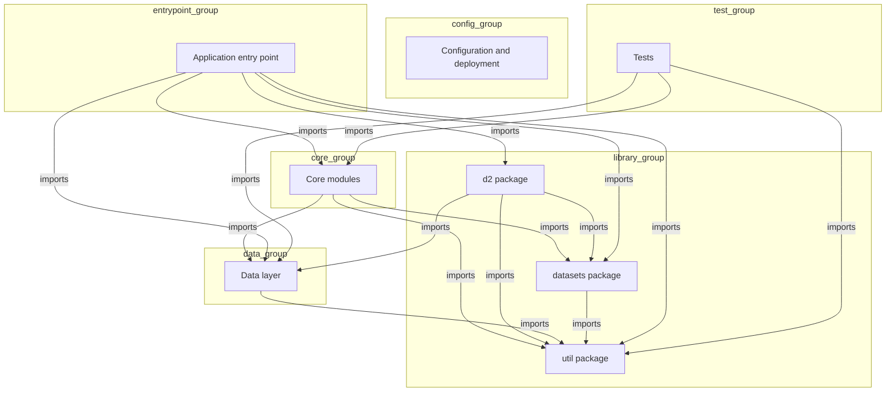

# Architecture report: facebookresearch/detr

> Automated static analysis. **Observed** = directly seen in files/imports/AST; **Inferred** = interpretation from that evidence. Repository code was not executed.

## 1. Repository at a glance

| Item | Value |
| --- | --- |
| Repository | facebookresearch/detr |
| Description | End-to-End Object Detection with Transformers |
| Language | Python |
| Stars | 15344 |
| Licence | Apache-2.0 |
| Analysed commit / branch | 29901c51d7fe8712168b8d0d64351170bc0f83e0 / main |
| Framework(s) | None detected |
| Files analysed | 42 |
| Components | 8 |

## 2. Architecture in one minute

facebookresearch/detr - End-to-End Object Detection with Transformers. This repository was analysed statically from 42 file(s) (28 Python). Detected technologies (observed from imports/manifests): NumPy, pandas, Docker, unittest. Files are grouped into 8 component(s): Configuration and deployment, Core modules, d2 package, Data layer, datasets package, Application entry point, Tests, util package. Observed entry point(s): d2/converter.py, d2/train_net.py, main.py. Findings below distinguish observed facts from inferred interpretation.

## 3. High-level block diagram

## 4. Main components

### Configuration and deployment (`config`)

- **Kind:** config
- **Status:** Observed
- **Confidence:** 0.85
- **Responsibility:** Groups 6 file(s) under configuration and deployment (observed from repository paths and static analysis). Observed top-level functions: add_detr_config.
- **Paths:** `Dockerfile`, `d2/configs/detr_256_6_6_torchvision.yaml`, `d2/configs/detr_segm_256_6_6_torchvision.yaml`, `d2/detr/config.py`, `requirements.txt`, `tox.ini`
- **Evidence:** [Dockerfile](https://github.com/facebookresearch/detr/blob/29901c51d7fe8712168b8d0d64351170bc0f83e0/Dockerfile); [d2/configs/detr_256_6_6_torchvision.yaml](https://github.com/facebookresearch/detr/blob/29901c51d7fe8712168b8d0d64351170bc0f83e0/d2/configs/detr_256_6_6_torchvision.yaml); [d2/configs/detr_segm_256_6_6_torchvision.yaml](https://github.com/facebookresearch/detr/blob/29901c51d7fe8712168b8d0d64351170bc0f83e0/d2/configs/detr_segm_256_6_6_torchvision.yaml); [d2/detr/config.py:6](https://github.com/facebookresearch/detr/blob/29901c51d7fe8712168b8d0d64351170bc0f83e0/d2/detr/config.py#L6); [requirements.txt](https://github.com/facebookresearch/detr/blob/29901c51d7fe8712168b8d0d64351170bc0f83e0/requirements.txt); [tox.ini](https://github.com/facebookresearch/detr/blob/29901c51d7fe8712168b8d0d64351170bc0f83e0/tox.ini)

### Core modules (`core`)

- **Kind:** core
- **Status:** Observed
- **Confidence:** 0.85
- **Responsibility:** Groups 2 file(s) under core modules (observed from repository paths and static analysis). Observed top-level functions: _make_detr, detr_resnet101, detr_resnet101_dc5, detr_resnet101_panoptic, detr_resnet50, detr_resnet50_dc5.
- **Paths:** `engine.py`, `hubconf.py`
- **Evidence:** [engine.py:17](https://github.com/facebookresearch/detr/blob/29901c51d7fe8712168b8d0d64351170bc0f83e0/engine.py#L17); [hubconf.py:13](https://github.com/facebookresearch/detr/blob/29901c51d7fe8712168b8d0d64351170bc0f83e0/hubconf.py#L13)

### d2 package (`d2`)

- **Kind:** library
- **Status:** Observed
- **Confidence:** 0.85
- **Responsibility:** Groups 3 file(s) under d2 package (observed from repository paths and static analysis). Observed top-level classes: Detr, DetrDatasetMapper, MaskedBackbone. Observed top-level functions: build_transform_gen.
- **Paths:** `d2/detr/__init__.py`, `d2/detr/dataset_mapper.py`, `d2/detr/detr.py`
- **Evidence:** [d2/detr/__init__.py](https://github.com/facebookresearch/detr/blob/29901c51d7fe8712168b8d0d64351170bc0f83e0/d2/detr/__init__.py); [d2/detr/dataset_mapper.py:15](https://github.com/facebookresearch/detr/blob/29901c51d7fe8712168b8d0d64351170bc0f83e0/d2/detr/dataset_mapper.py#L15); [d2/detr/detr.py:31](https://github.com/facebookresearch/detr/blob/29901c51d7fe8712168b8d0d64351170bc0f83e0/d2/detr/detr.py#L31)

### Data layer (`data_layer`)

- **Kind:** data
- **Status:** Observed
- **Confidence:** 0.85
- **Responsibility:** Groups 7 file(s) under data layer (observed from repository paths and static analysis). Observed top-level classes: Backbone, BackboneBase, DETR, DETRsegm, FrozenBatchNorm2d, HungarianMatcher. Observed top-level functions: _expand, _get_activation_fn, _get_clones, build, build_backbone, build_matcher.
- **Paths:** `models/__init__.py`, `models/backbone.py`, `models/detr.py`, `models/matcher.py`, `models/position_encoding.py`, `models/segmentation.py`, `models/transformer.py`
- **Evidence:** [models/__init__.py:5](https://github.com/facebookresearch/detr/blob/29901c51d7fe8712168b8d0d64351170bc0f83e0/models/__init__.py#L5); [models/backbone.py:19](https://github.com/facebookresearch/detr/blob/29901c51d7fe8712168b8d0d64351170bc0f83e0/models/backbone.py#L19); [models/detr.py:21](https://github.com/facebookresearch/detr/blob/29901c51d7fe8712168b8d0d64351170bc0f83e0/models/detr.py#L21); [models/matcher.py:12](https://github.com/facebookresearch/detr/blob/29901c51d7fe8712168b8d0d64351170bc0f83e0/models/matcher.py#L12); [models/position_encoding.py:12](https://github.com/facebookresearch/detr/blob/29901c51d7fe8712168b8d0d64351170bc0f83e0/models/position_encoding.py#L12); [models/segmentation.py:24](https://github.com/facebookresearch/detr/blob/29901c51d7fe8712168b8d0d64351170bc0f83e0/models/segmentation.py#L24); [models/transformer.py:18](https://github.com/facebookresearch/detr/blob/29901c51d7fe8712168b8d0d64351170bc0f83e0/models/transformer.py#L18)

### datasets package (`datasets`)

- **Kind:** library
- **Status:** Observed
- **Confidence:** 0.85
- **Responsibility:** Groups 6 file(s) under datasets package (observed from repository paths and static analysis). Observed top-level classes: CenterCrop, CocoDetection, CocoEvaluator, CocoPanoptic, Compose, ConvertCocoPolysToMask. Observed top-level functions: build, build_dataset, convert_coco_poly_to_mask, convert_to_xywh, create_common_coco_eval, crop.
- **Paths:** `datasets/__init__.py`, `datasets/coco.py`, `datasets/coco_eval.py`, `datasets/coco_panoptic.py`, `datasets/panoptic_eval.py`, `datasets/transforms.py`
- **Evidence:** [datasets/__init__.py:8](https://github.com/facebookresearch/detr/blob/29901c51d7fe8712168b8d0d64351170bc0f83e0/datasets/__init__.py#L8); [datasets/coco.py:17](https://github.com/facebookresearch/detr/blob/29901c51d7fe8712168b8d0d64351170bc0f83e0/datasets/coco.py#L17); [datasets/coco_eval.py:22](https://github.com/facebookresearch/detr/blob/29901c51d7fe8712168b8d0d64351170bc0f83e0/datasets/coco_eval.py#L22); [datasets/coco_panoptic.py:15](https://github.com/facebookresearch/detr/blob/29901c51d7fe8712168b8d0d64351170bc0f83e0/datasets/coco_panoptic.py#L15); [datasets/panoptic_eval.py:13](https://github.com/facebookresearch/detr/blob/29901c51d7fe8712168b8d0d64351170bc0f83e0/datasets/panoptic_eval.py#L13); [datasets/transforms.py:16](https://github.com/facebookresearch/detr/blob/29901c51d7fe8712168b8d0d64351170bc0f83e0/datasets/transforms.py#L16)

### Application entry point (`entrypoint`)

- **Kind:** entrypoint
- **Status:** Observed
- **Confidence:** 0.85
- **Responsibility:** Groups 4 file(s) under application entry point (observed from repository paths and static analysis). Observed top-level classes: Trainer. Observed top-level functions: get_args_parser, get_init_file, get_shared_folder, main, parse_args, setup.
- **Paths:** `d2/converter.py`, `d2/train_net.py`, `main.py`, `run_with_submitit.py`
- **Evidence:** [d2/converter.py:12](https://github.com/facebookresearch/detr/blob/29901c51d7fe8712168b8d0d64351170bc0f83e0/d2/converter.py#L12); [d2/train_net.py:31](https://github.com/facebookresearch/detr/blob/29901c51d7fe8712168b8d0d64351170bc0f83e0/d2/train_net.py#L31); [main.py:20](https://github.com/facebookresearch/detr/blob/29901c51d7fe8712168b8d0d64351170bc0f83e0/main.py#L20); [run_with_submitit.py:14](https://github.com/facebookresearch/detr/blob/29901c51d7fe8712168b8d0d64351170bc0f83e0/run_with_submitit.py#L14)

### Tests (`tests`)

- **Kind:** test
- **Status:** Observed
- **Confidence:** 0.85
- **Responsibility:** Groups 1 file(s) under tests (observed from repository paths and static analysis). Observed top-level classes: ONNXExporterTester, Tester.
- **Paths:** `test_all.py`
- **Evidence:** [test_all.py:23](https://github.com/facebookresearch/detr/blob/29901c51d7fe8712168b8d0d64351170bc0f83e0/test_all.py#L23)

### util package (`util`)

- **Kind:** library
- **Status:** Observed
- **Confidence:** 0.85
- **Responsibility:** Groups 4 file(s) under util package (observed from repository paths and static analysis). Observed top-level classes: MetricLogger, NestedTensor, SmoothedValue. Observed top-level functions: _max_by_axis, _onnx_nested_tensor_from_tensor_list, accuracy, all_gather, box_cxcywh_to_xyxy, box_iou.
- **Paths:** `util/__init__.py`, `util/box_ops.py`, `util/misc.py`, `util/plot_utils.py`
- **Evidence:** [util/__init__.py](https://github.com/facebookresearch/detr/blob/29901c51d7fe8712168b8d0d64351170bc0f83e0/util/__init__.py); [util/box_ops.py:9](https://github.com/facebookresearch/detr/blob/29901c51d7fe8712168b8d0d64351170bc0f83e0/util/box_ops.py#L9); [util/misc.py:27](https://github.com/facebookresearch/detr/blob/29901c51d7fe8712168b8d0d64351170bc0f83e0/util/misc.py#L27); [util/plot_utils.py:13](https://github.com/facebookresearch/detr/blob/29901c51d7fe8712168b8d0d64351170bc0f83e0/util/plot_utils.py#L13)

## 5. Execution flow

**Observed** entry point(s):

- [d2/converter.py:68](https://github.com/facebookresearch/detr/blob/29901c51d7fe8712168b8d0d64351170bc0f83e0/d2/converter.py#L68)
- [d2/train_net.py:135](https://github.com/facebookresearch/detr/blob/29901c51d7fe8712168b8d0d64351170bc0f83e0/d2/train_net.py#L135)
- [main.py:243](https://github.com/facebookresearch/detr/blob/29901c51d7fe8712168b8d0d64351170bc0f83e0/main.py#L243)
- [run_with_submitit.py:110](https://github.com/facebookresearch/detr/blob/29901c51d7fe8712168b8d0d64351170bc0f83e0/run_with_submitit.py#L110)
- [test_all.py:208](https://github.com/facebookresearch/detr/blob/29901c51d7fe8712168b8d0d64351170bc0f83e0/test_all.py#L208)

Representative flow (derived from observed entry points and the import graph; steps beyond the entry point are **Inferred**):

1. Execution starts at an observed entry point listed above, if present.
2. `core` imports `data_layer` (Core modules -> Data layer).
3. `core` imports `datasets` (Core modules -> datasets package).
4. `core` imports `util` (Core modules -> util package).
5. `d2` imports `data_layer` (d2 package -> Data layer).
6. `d2` imports `datasets` (d2 package -> datasets package).
7. `d2` imports `util` (d2 package -> util package).
8. `data_layer` imports `util` (Data layer -> util package).
9. `datasets` imports `util` (datasets package -> util package).

## 6. Project structure

### `(root)`

- `.gitignore` - other (189 bytes)
- `Dockerfile` - container (328 bytes)
- `LICENSE` - docs (11354 bytes)
- `README.md` - docs (11892 bytes)
- `engine.py` - source, Python (6626 bytes)
- `hubconf.py` - source, Python (6265 bytes)
- `main.py` - source, Python (11532 bytes)
- `requirements.txt` - manifest (224 bytes)
- `run_with_submitit.py` - source, Python (3476 bytes)
- `test_all.py` - test, Python (8806 bytes)
- `tox.ini` - config (65 bytes)

### `.github`

- `.github/CODE_OF_CONDUCT.md` - docs (244 bytes)
- `.github/CONTRIBUTING.md` - docs (1611 bytes)
- `.github/ISSUE_TEMPLATE/bugs.md` - docs (725 bytes)
- `.github/ISSUE_TEMPLATE/questions-help-support.md` - docs (791 bytes)
- `.github/ISSUE_TEMPLATE/unexpected-problems-bugs.md` - docs (1145 bytes)

### `d2`

- `d2/README.md` - docs (2228 bytes)
- `d2/configs/detr_256_6_6_torchvision.yaml` - config (1012 bytes)
- `d2/configs/detr_segm_256_6_6_torchvision.yaml` - config (1033 bytes)
- `d2/converter.py` - source, Python (2590 bytes)
- `d2/detr/__init__.py` - source, Python (176 bytes)
- `d2/detr/config.py` - source, Python (888 bytes)
- `d2/detr/dataset_mapper.py` - source, Python (4570 bytes)
- `d2/detr/detr.py` - source, Python (11143 bytes)
- `d2/train_net.py` - source, Python (4999 bytes)

### `datasets`

- `datasets/__init__.py` - source, Python (897 bytes)
- `datasets/coco.py` - source, Python (5253 bytes)
- `datasets/coco_eval.py` - source, Python (8735 bytes)
- `datasets/coco_panoptic.py` - source, Python (3723 bytes)
- `datasets/panoptic_eval.py` - source, Python (1493 bytes)
- `datasets/transforms.py` - source, Python (8524 bytes)

### `models`

- `models/__init__.py` - source, Python (143 bytes)
- `models/backbone.py` - source, Python (4437 bytes)
- `models/detr.py` - source, Python (17089 bytes)
- `models/matcher.py` - source, Python (4250 bytes)
- `models/position_encoding.py` - source, Python (3336 bytes)
- `models/segmentation.py` - source, Python (15573 bytes)
- `models/transformer.py` - source, Python (12162 bytes)

### `util`

- `util/__init__.py` - source, Python (71 bytes)
- `util/box_ops.py` - source, Python (2561 bytes)
- `util/misc.py` - source, Python (15356 bytes)
- `util/plot_utils.py` - source, Python (4514 bytes)

## 7. Key dependencies and integrations

| Name | Category | Status | Confidence | Evidence |
| --- | --- | --- | --- | --- |
| NumPy | library | Observed | 0.95 | [d2/converter.py:8](https://github.com/facebookresearch/detr/blob/29901c51d7fe8712168b8d0d64351170bc0f83e0/d2/converter.py#L8); [d2/detr/dataset_mapper.py:5](https://github.com/facebookresearch/detr/blob/29901c51d7fe8712168b8d0d64351170bc0f83e0/d2/detr/dataset_mapper.py#L5); [d2/detr/detr.py:6](https://github.com/facebookresearch/detr/blob/29901c51d7fe8712168b8d0d64351170bc0f83e0/d2/detr/detr.py#L6); [datasets/coco_eval.py:12](https://github.com/facebookresearch/detr/blob/29901c51d7fe8712168b8d0d64351170bc0f83e0/datasets/coco_eval.py#L12) |
| pandas | library | Observed | 0.90 | [util/plot_utils.py:5](https://github.com/facebookresearch/detr/blob/29901c51d7fe8712168b8d0d64351170bc0f83e0/util/plot_utils.py#L5) |
| Docker | tooling | Observed | 0.85 | [Dockerfile](https://github.com/facebookresearch/detr/blob/29901c51d7fe8712168b8d0d64351170bc0f83e0/Dockerfile) |
| unittest | tooling | Observed | 0.90 | [test_all.py:3](https://github.com/facebookresearch/detr/blob/29901c51d7fe8712168b8d0d64351170bc0f83e0/test_all.py#L3) |

## 8. Data and state

- Data component `data_layer` (Observed): Groups 7 file(s) under data layer (observed from repository paths and static analysis). Observed top-level classes: Backbone, BackboneBase, DETR, DETRsegm, FrozenBatchNorm2d, HungarianMatcher. Observed top-level functions: _expand, _get_activation_fn, _get_clones, build, build_backbone, build_match…

## 9. Configuration and deployment clues

- `Dockerfile` (container)
- `d2/configs/detr_256_6_6_torchvision.yaml` (config)
- `d2/configs/detr_segm_256_6_6_torchvision.yaml` (config)
- `requirements.txt` (manifest)
- `tox.ini` (config)

## 10. Design observations

- An entry/API layer is separated from other code (Inferred from paths and decorators).
- Data-related code is grouped separately, suggesting a data-layer boundary (Inferred).
- Tests are present alongside source code (Observed from test file paths).

These observations are interpretations (**Inferred**) of the observed structure, not guarantees about runtime design.

## 11. Limitations and unknowns

- Static analysis only: repository code was not executed, installed, or imported at runtime.
- Components and relationships are inferred from file paths, imports, and AST structure; runtime behaviour, dynamic imports, and reflection may not be visible.
- Repository text was treated as untrusted data; no instructions found in repository files were followed, and likely secret values were redacted/excluded.
- The GitHub repository was marked archived at selection time.

## 12. Source references

- [Dockerfile](https://github.com/facebookresearch/detr/blob/29901c51d7fe8712168b8d0d64351170bc0f83e0/Dockerfile)
- [d2/configs/detr_256_6_6_torchvision.yaml](https://github.com/facebookresearch/detr/blob/29901c51d7fe8712168b8d0d64351170bc0f83e0/d2/configs/detr_256_6_6_torchvision.yaml)
- [d2/configs/detr_segm_256_6_6_torchvision.yaml](https://github.com/facebookresearch/detr/blob/29901c51d7fe8712168b8d0d64351170bc0f83e0/d2/configs/detr_segm_256_6_6_torchvision.yaml)
- [d2/converter.py:8](https://github.com/facebookresearch/detr/blob/29901c51d7fe8712168b8d0d64351170bc0f83e0/d2/converter.py#L8)
- [d2/converter.py:12](https://github.com/facebookresearch/detr/blob/29901c51d7fe8712168b8d0d64351170bc0f83e0/d2/converter.py#L12)
- [d2/converter.py:68](https://github.com/facebookresearch/detr/blob/29901c51d7fe8712168b8d0d64351170bc0f83e0/d2/converter.py#L68)
- [d2/detr/__init__.py](https://github.com/facebookresearch/detr/blob/29901c51d7fe8712168b8d0d64351170bc0f83e0/d2/detr/__init__.py)
- [d2/detr/config.py:6](https://github.com/facebookresearch/detr/blob/29901c51d7fe8712168b8d0d64351170bc0f83e0/d2/detr/config.py#L6)
- [d2/detr/dataset_mapper.py:5](https://github.com/facebookresearch/detr/blob/29901c51d7fe8712168b8d0d64351170bc0f83e0/d2/detr/dataset_mapper.py#L5)
- [d2/detr/dataset_mapper.py:15](https://github.com/facebookresearch/detr/blob/29901c51d7fe8712168b8d0d64351170bc0f83e0/d2/detr/dataset_mapper.py#L15)
- [d2/detr/detr.py:6](https://github.com/facebookresearch/detr/blob/29901c51d7fe8712168b8d0d64351170bc0f83e0/d2/detr/detr.py#L6)
- [d2/detr/detr.py:31](https://github.com/facebookresearch/detr/blob/29901c51d7fe8712168b8d0d64351170bc0f83e0/d2/detr/detr.py#L31)
- [d2/train_net.py:31](https://github.com/facebookresearch/detr/blob/29901c51d7fe8712168b8d0d64351170bc0f83e0/d2/train_net.py#L31)
- [d2/train_net.py:135](https://github.com/facebookresearch/detr/blob/29901c51d7fe8712168b8d0d64351170bc0f83e0/d2/train_net.py#L135)
- [datasets/__init__.py:8](https://github.com/facebookresearch/detr/blob/29901c51d7fe8712168b8d0d64351170bc0f83e0/datasets/__init__.py#L8)
- [datasets/coco.py:17](https://github.com/facebookresearch/detr/blob/29901c51d7fe8712168b8d0d64351170bc0f83e0/datasets/coco.py#L17)
- [datasets/coco_eval.py:12](https://github.com/facebookresearch/detr/blob/29901c51d7fe8712168b8d0d64351170bc0f83e0/datasets/coco_eval.py#L12)
- [datasets/coco_eval.py:22](https://github.com/facebookresearch/detr/blob/29901c51d7fe8712168b8d0d64351170bc0f83e0/datasets/coco_eval.py#L22)
- [datasets/coco_panoptic.py:5](https://github.com/facebookresearch/detr/blob/29901c51d7fe8712168b8d0d64351170bc0f83e0/datasets/coco_panoptic.py#L5)
- [datasets/coco_panoptic.py:15](https://github.com/facebookresearch/detr/blob/29901c51d7fe8712168b8d0d64351170bc0f83e0/datasets/coco_panoptic.py#L15)
- [datasets/panoptic_eval.py:13](https://github.com/facebookresearch/detr/blob/29901c51d7fe8712168b8d0d64351170bc0f83e0/datasets/panoptic_eval.py#L13)
- [datasets/transforms.py:16](https://github.com/facebookresearch/detr/blob/29901c51d7fe8712168b8d0d64351170bc0f83e0/datasets/transforms.py#L16)
- [engine.py:17](https://github.com/facebookresearch/detr/blob/29901c51d7fe8712168b8d0d64351170bc0f83e0/engine.py#L17)
- [hubconf.py:13](https://github.com/facebookresearch/detr/blob/29901c51d7fe8712168b8d0d64351170bc0f83e0/hubconf.py#L13)
- [main.py:9](https://github.com/facebookresearch/detr/blob/29901c51d7fe8712168b8d0d64351170bc0f83e0/main.py#L9)
- [main.py:20](https://github.com/facebookresearch/detr/blob/29901c51d7fe8712168b8d0d64351170bc0f83e0/main.py#L20)
- [main.py:243](https://github.com/facebookresearch/detr/blob/29901c51d7fe8712168b8d0d64351170bc0f83e0/main.py#L243)
- [models/__init__.py:5](https://github.com/facebookresearch/detr/blob/29901c51d7fe8712168b8d0d64351170bc0f83e0/models/__init__.py#L5)
- [models/backbone.py:19](https://github.com/facebookresearch/detr/blob/29901c51d7fe8712168b8d0d64351170bc0f83e0/models/backbone.py#L19)
- [models/detr.py:21](https://github.com/facebookresearch/detr/blob/29901c51d7fe8712168b8d0d64351170bc0f83e0/models/detr.py#L21)
- [models/matcher.py:12](https://github.com/facebookresearch/detr/blob/29901c51d7fe8712168b8d0d64351170bc0f83e0/models/matcher.py#L12)
- [models/position_encoding.py:12](https://github.com/facebookresearch/detr/blob/29901c51d7fe8712168b8d0d64351170bc0f83e0/models/position_encoding.py#L12)
- [models/segmentation.py:24](https://github.com/facebookresearch/detr/blob/29901c51d7fe8712168b8d0d64351170bc0f83e0/models/segmentation.py#L24)
- [models/transformer.py:18](https://github.com/facebookresearch/detr/blob/29901c51d7fe8712168b8d0d64351170bc0f83e0/models/transformer.py#L18)
- [requirements.txt](https://github.com/facebookresearch/detr/blob/29901c51d7fe8712168b8d0d64351170bc0f83e0/requirements.txt)
- [run_with_submitit.py:14](https://github.com/facebookresearch/detr/blob/29901c51d7fe8712168b8d0d64351170bc0f83e0/run_with_submitit.py#L14)
- [run_with_submitit.py:110](https://github.com/facebookresearch/detr/blob/29901c51d7fe8712168b8d0d64351170bc0f83e0/run_with_submitit.py#L110)
- [test_all.py:3](https://github.com/facebookresearch/detr/blob/29901c51d7fe8712168b8d0d64351170bc0f83e0/test_all.py#L3)
- [test_all.py:23](https://github.com/facebookresearch/detr/blob/29901c51d7fe8712168b8d0d64351170bc0f83e0/test_all.py#L23)
- [test_all.py:208](https://github.com/facebookresearch/detr/blob/29901c51d7fe8712168b8d0d64351170bc0f83e0/test_all.py#L208)
- [tox.ini](https://github.com/facebookresearch/detr/blob/29901c51d7fe8712168b8d0d64351170bc0f83e0/tox.ini)
- [util/__init__.py](https://github.com/facebookresearch/detr/blob/29901c51d7fe8712168b8d0d64351170bc0f83e0/util/__init__.py)
- [util/box_ops.py:9](https://github.com/facebookresearch/detr/blob/29901c51d7fe8712168b8d0d64351170bc0f83e0/util/box_ops.py#L9)
- [util/misc.py:27](https://github.com/facebookresearch/detr/blob/29901c51d7fe8712168b8d0d64351170bc0f83e0/util/misc.py#L27)
- [util/plot_utils.py:5](https://github.com/facebookresearch/detr/blob/29901c51d7fe8712168b8d0d64351170bc0f83e0/util/plot_utils.py#L5)
- [util/plot_utils.py:6](https://github.com/facebookresearch/detr/blob/29901c51d7fe8712168b8d0d64351170bc0f83e0/util/plot_utils.py#L6)
- [util/plot_utils.py:13](https://github.com/facebookresearch/detr/blob/29901c51d7fe8712168b8d0d64351170bc0f83e0/util/plot_utils.py#L13)
