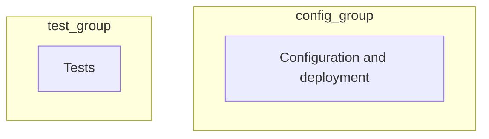

# Architecture report: facebookresearch/fairseq

> Automated static analysis. **Observed** = directly seen in files/imports/AST; **Inferred** = interpretation from that evidence. Repository code was not executed.

## 1. Repository at a glance

| Item | Value |
| --- | --- |
| Repository | facebookresearch/fairseq |
| Description | Facebook AI Research Sequence-to-Sequence Toolkit written in Python. |
| Language | Python |
| Stars | 32206 |
| Licence | MIT |
| Analysed commit / branch | 3d262bb25690e4eb2e7d3c1309b1e9c406ca4b99 / main |
| Framework(s) | None detected |
| Files analysed | 800 |
| Components | 2 |

## 2. Architecture in one minute

facebookresearch/fairseq - Facebook AI Research Sequence-to-Sequence Toolkit written in Python.. This repository was analysed statically from 800 file(s) (357 Python). Detected technologies (observed from imports/manifests): GitHub Actions, NumPy, pandas, requests, setuptools, pytest. Files are grouped into 2 component(s): Configuration and deployment, Tests. Findings below distinguish observed facts from inferred interpretation.

## 3. High-level block diagram

## 4. Main components

### Configuration and deployment (`config`)

- **Kind:** config
- **Status:** Observed
- **Confidence:** 0.85
- **Responsibility:** Groups 1 file(s) under configuration and deployment (observed from repository paths and static analysis).
- **Paths:** `MANIFEST.in`
- **Evidence:** [MANIFEST.in](https://github.com/facebookresearch/fairseq/blob/3d262bb25690e4eb2e7d3c1309b1e9c406ca4b99/MANIFEST.in)

### Tests (`tests`)

- **Kind:** test
- **Status:** Observed
- **Confidence:** 0.85
- **Responsibility:** Groups 46 file(s) under tests (observed from repository paths and static analysis). Observed top-level classes: AlignmentTrainTest, ChunkwiswTestCase, HardMonotonicAttentionTestCase, InfiniteLookbackTestCase, MonotonicAttentionTestAbstractClass, WaitkTestCase. Observed top-level functions: build_transformer_monotonic_attention, expected_alignment_formula, expected_soft_attention_formula, generate_config, make_sample_with_padding, mass_perservation_formula.
- **Paths:** `examples/MMPT/projects/mtm/vlm/test_coin.yaml`, `examples/MMPT/projects/mtm/vlm/test_crosstask.yaml`, `examples/MMPT/projects/mtm/vlm/test_crosstask_zs.yaml`, `examples/MMPT/projects/mtm/vlm/test_vtt.yaml`, `examples/MMPT/projects/mtm/vlm/test_vttqa.yaml`, `examples/MMPT/projects/mtm/vlm/test_youcook.yaml`, `examples/MMPT/projects/mtm/vlm/test_youcookcap.yaml`, `examples/MMPT/projects/retri/videoclip/test_coin_videoclip.yaml`, `examples/MMPT/projects/retri/videoclip/test_coin_zs.yaml`, `examples/MMPT/projects/retri/videoclip/test_crosstask_videoclip.yaml`, `examples/MMPT/projects/retri/videoclip/test_crosstask_zs_videoclip.yaml`, `examples/MMPT/projects/retri/videoclip/test_didemo_zs.yaml`, `examples/MMPT/projects/retri/videoclip/test_vtt_videoclip.yaml`, `examples/MMPT/projects/retri/videoclip/test_vtt_zs.yaml`, `examples/MMPT/projects/retri/videoclip/test_vttqa_videoclip.yaml`, `examples/MMPT/projects/retri/videoclip/test_vttqa_zs.yaml`, `examples/MMPT/projects/retri/videoclip/test_youcook_videoclip.yaml`, `examples/MMPT/projects/retri/videoclip/test_youcook_zs.yaml`, `examples/MMPT/projects/task/test_coin.yaml`, `examples/MMPT/projects/task/test_coin_videoclip.yaml`, `examples/MMPT/projects/task/test_coin_zs.yaml`, `examples/MMPT/projects/task/test_crosstask.yaml`, `examples/MMPT/projects/task/test_crosstask_videoclip.yaml`, `examples/MMPT/projects/task/test_crosstask_zs.yaml`, `examples/MMPT/projects/task/test_crosstask_zs_videoclip.yaml`, `examples/MMPT/projects/task/test_didemo_zs.yaml`, `examples/MMPT/projects/task/test_vtt.yaml`, `examples/MMPT/projects/task/test_vtt_videoclip.yaml`, `examples/MMPT/projects/task/test_vtt_zs.yaml`, `examples/MMPT/projects/task/test_vttqa.yaml`, `examples/MMPT/projects/task/test_vttqa_videoclip.yaml`, `examples/MMPT/projects/task/test_vttqa_zs.yaml`, `examples/MMPT/projects/task/test_youcook.yaml`, `examples/MMPT/projects/task/test_youcook_videoclip.yaml`, `examples/MMPT/projects/task/test_youcook_zs.yaml`, `examples/MMPT/projects/task/test_youcookcap.yaml`, `examples/hubert/tests/sample.base.L9.km500.km`, `examples/hubert/tests/sample.base.L9.len`, `examples/hubert/tests/sample.large.L20.len`, `examples/hubert/tests/sample.large.hypo.word`, `examples/hubert/tests/sample.xlarge.L30.len`, `examples/hubert/tests/sample.xlarge.hypo.word`, `examples/hubert/tests/test_feature_and_unit.sh`, `examples/hubert/tests/test_finetuned_asr.sh`, `examples/simultaneous_translation/tests/test_alignment_train.py`, `examples/simultaneous_translation/tests/test_text_models.py`
- **Evidence:** [examples/MMPT/projects/mtm/vlm/test_coin.yaml](https://github.com/facebookresearch/fairseq/blob/3d262bb25690e4eb2e7d3c1309b1e9c406ca4b99/examples/MMPT/projects/mtm/vlm/test_coin.yaml); [examples/MMPT/projects/mtm/vlm/test_crosstask.yaml](https://github.com/facebookresearch/fairseq/blob/3d262bb25690e4eb2e7d3c1309b1e9c406ca4b99/examples/MMPT/projects/mtm/vlm/test_crosstask.yaml); [examples/MMPT/projects/mtm/vlm/test_crosstask_zs.yaml](https://github.com/facebookresearch/fairseq/blob/3d262bb25690e4eb2e7d3c1309b1e9c406ca4b99/examples/MMPT/projects/mtm/vlm/test_crosstask_zs.yaml); [examples/MMPT/projects/mtm/vlm/test_vtt.yaml](https://github.com/facebookresearch/fairseq/blob/3d262bb25690e4eb2e7d3c1309b1e9c406ca4b99/examples/MMPT/projects/mtm/vlm/test_vtt.yaml); [examples/MMPT/projects/mtm/vlm/test_vttqa.yaml](https://github.com/facebookresearch/fairseq/blob/3d262bb25690e4eb2e7d3c1309b1e9c406ca4b99/examples/MMPT/projects/mtm/vlm/test_vttqa.yaml); [examples/MMPT/projects/mtm/vlm/test_youcook.yaml](https://github.com/facebookresearch/fairseq/blob/3d262bb25690e4eb2e7d3c1309b1e9c406ca4b99/examples/MMPT/projects/mtm/vlm/test_youcook.yaml); [examples/MMPT/projects/mtm/vlm/test_youcookcap.yaml](https://github.com/facebookresearch/fairseq/blob/3d262bb25690e4eb2e7d3c1309b1e9c406ca4b99/examples/MMPT/projects/mtm/vlm/test_youcookcap.yaml); [examples/MMPT/projects/retri/videoclip/test_coin_videoclip.yaml](https://github.com/facebookresearch/fairseq/blob/3d262bb25690e4eb2e7d3c1309b1e9c406ca4b99/examples/MMPT/projects/retri/videoclip/test_coin_videoclip.yaml)

## 5. Execution flow

No entry point was observed; the startup flow below is therefore limited.

Representative flow (derived from observed entry points and the import graph; steps beyond the entry point are **Inferred**):

1. Execution starts at an observed entry point listed above, if present.
2. No internal import relationships between components were observed.

## 6. Project structure

### `(root)`

- `.gitignore` - other (1742 bytes)
- `.gitmodules` - other (162 bytes)
- `.pre-commit-config.yaml` - config (935 bytes)
- `CODE_OF_CONDUCT.md` - docs (3350 bytes)
- `CONTRIBUTING.md` - docs (3329 bytes)
- `LICENSE` - docs (1086 bytes)
- `MANIFEST.in` - manifest (28 bytes)
- `README.md` - docs (17398 bytes)
- `RELEASE.md` - docs (654 bytes)

### `.github`

- `.github/CODEOWNERS` - other (932 bytes)
- `.github/ISSUE_TEMPLATE.md` - docs (250 bytes)
- `.github/ISSUE_TEMPLATE/bug_report.md` - docs (1065 bytes)
- `.github/ISSUE_TEMPLATE/documentation.md` - docs (268 bytes)
- `.github/ISSUE_TEMPLATE/feature_request.md` - docs (762 bytes)
- `.github/ISSUE_TEMPLATE/how-to-question.md` - docs (748 bytes)
- `.github/PULL_REQUEST_TEMPLATE.md` - docs (593 bytes)
- `.github/stale.yml` - config (1734 bytes)
- `.github/workflows/build.yml` - ci, YAML (2687 bytes)
- `.github/workflows/depreview.yml` - ci, YAML (290 bytes)
- `.github/workflows/release.yml` - ci, YAML (5020 bytes)

### `docs`

- `docs/Makefile` - docs (607 bytes)
- `docs/command_line_tools.rst` - docs (1893 bytes)
- `docs/conf.py` - docs (3133 bytes)
- `docs/criterions.rst` - docs (758 bytes)
- `docs/data.rst` - docs (1202 bytes)
- `docs/docutils.conf` - docs (25 bytes)
- `docs/getting_started.rst` - docs (9239 bytes)
- `docs/hydra_integration.md` - docs (10440 bytes)
- `docs/index.rst` - docs (1002 bytes)
- `docs/lr_scheduler.rst` - docs (1055 bytes)
- `docs/make.bat` - docs (805 bytes)
- `docs/models.rst` - docs (2830 bytes)
- `docs/modules.rst` - docs (241 bytes)
- `docs/optim.rst` - docs (846 bytes)
- `docs/overview.rst` - docs (2708 bytes)
- `docs/tasks.rst` - docs (1391 bytes)
- `docs/tutorial_classifying_names.rst` - docs (16996 bytes)
- `docs/tutorial_simple_lstm.rst` - docs (21220 bytes)

### `examples`

- `examples/.gitignore` - other (16 bytes)
- `examples/MMPT/.gitignore` - other (1920 bytes)
- `examples/MMPT/CONFIG.md` - docs (1746 bytes)
- `examples/MMPT/DATASET.md` - docs (2629 bytes)
- `examples/MMPT/README.md` - docs (9563 bytes)
- `examples/MMPT/endtask.md` - docs (2452 bytes)
- `examples/MMPT/locallaunch.py` - source, Python (5336 bytes)
- `examples/MMPT/mmpt/__init__.py` - source, Python (394 bytes)
- `examples/MMPT/mmpt/datasets/__init__.py` - source, Python (273 bytes)
- `examples/MMPT/mmpt/datasets/fairseqmmdataset.py` - source, Python (1785 bytes)
- `examples/MMPT/mmpt/datasets/mmdataset.py` - source, Python (3873 bytes)
- `examples/MMPT/mmpt/evaluators/__init__.py` - source, Python (305 bytes)
- `examples/MMPT/mmpt/evaluators/evaluator.py` - source, Python (2026 bytes)
- `examples/MMPT/mmpt/evaluators/metric.py` - source, Python (10898 bytes)
- `examples/MMPT/mmpt/evaluators/predictor.py` - source, Python (23125 bytes)
- `examples/MMPT/mmpt/losses/__init__.py` - source, Python (345 bytes)
- `examples/MMPT/mmpt/losses/fairseqmmloss.py` - source, Python (2241 bytes)
- `examples/MMPT/mmpt/losses/loss.py` - source, Python (2095 bytes)
- `examples/MMPT/mmpt/losses/nce.py` - source, Python (4586 bytes)
- `examples/MMPT/mmpt/models/__init__.py` - source, Python (395 bytes)
- `examples/MMPT/mmpt/models/fairseqmmmodel.py` - source, Python (1417 bytes)
- `examples/MMPT/mmpt/models/mmfusion.py` - source, Python (30634 bytes)
- `examples/MMPT/mmpt/models/mmfusionnlg.py` - source, Python (48394 bytes)
- `examples/MMPT/mmpt/models/transformermodel.py` - source, Python (26064 bytes)
- `examples/MMPT/mmpt/modules/__init__.py` - source, Python (255 bytes)
- `examples/MMPT/mmpt/modules/mm.py` - source, Python (5537 bytes)
- `examples/MMPT/mmpt/modules/retri.py` - source, Python (15471 bytes)
- `examples/MMPT/mmpt/modules/vectorpool.py` - source, Python (8278 bytes)
- `examples/MMPT/mmpt/processors/__init__.py` - source, Python (652 bytes)
- `examples/MMPT/mmpt/processors/dedupprocessor.py` - source, Python (8834 bytes)
- `examples/MMPT/mmpt/processors/dsprocessor.py` - source, Python (29891 bytes)
- `examples/MMPT/mmpt/processors/how2processor.py` - source, Python (32302 bytes)
- `examples/MMPT/mmpt/processors/how2retriprocessor.py` - source, Python (3742 bytes)
- `examples/MMPT/mmpt/processors/models/s3dg.py` - source, Python (12416 bytes)
- `examples/MMPT/mmpt/processors/processor.py` - source, Python (9358 bytes)
- `examples/MMPT/mmpt/tasks/__init__.py` - source, Python (445 bytes)
- `examples/MMPT/mmpt/tasks/fairseqmmtask.py` - source, Python (3045 bytes)
- `examples/MMPT/mmpt/tasks/milncetask.py` - source, Python (954 bytes)
- `examples/MMPT/mmpt/tasks/retritask.py` - source, Python (8413 bytes)
- `examples/MMPT/mmpt/tasks/task.py` - source, Python (6780 bytes)
- `examples/MMPT/mmpt/tasks/vlmtask.py` - source, Python (856 bytes)
- `examples/MMPT/mmpt/utils/__init__.py` - source, Python (1886 bytes)
- `examples/MMPT/mmpt/utils/load_config.py` - source, Python (3155 bytes)
- `examples/MMPT/mmpt/utils/shardedtensor.py` - source, Python (1410 bytes)
- `examples/MMPT/mmpt_cli/localjob.py` - source, Python (3794 bytes)
- `examples/MMPT/mmpt_cli/predict.py` - source, Python (3937 bytes)
- `examples/MMPT/pretraining.md` - docs (1884 bytes)
- `examples/MMPT/projects/mfmmlm.yaml` - config (1321 bytes)
- `examples/MMPT/projects/mtm/mmfusionmtm.yaml` - config (430 bytes)
- `examples/MMPT/projects/mtm/vlm.yaml` - config (153 bytes)
- `examples/MMPT/projects/mtm/vlm/coin.yaml` - config (1155 bytes)
- `examples/MMPT/projects/mtm/vlm/crosstask.yaml` - config (1502 bytes)
- `examples/MMPT/projects/mtm/vlm/how2.yaml` - config (1302 bytes)
- `examples/MMPT/projects/mtm/vlm/test_coin.yaml` - test (811 bytes)
- `examples/MMPT/projects/mtm/vlm/test_crosstask.yaml` - test (1200 bytes)
- `examples/MMPT/projects/mtm/vlm/test_crosstask_zs.yaml` - test (1193 bytes)
- `examples/MMPT/projects/mtm/vlm/test_vtt.yaml` - test (693 bytes)
- `examples/MMPT/projects/mtm/vlm/test_vttqa.yaml` - test (687 bytes)
- `examples/MMPT/projects/mtm/vlm/test_youcook.yaml` - test (799 bytes)
- `examples/MMPT/projects/mtm/vlm/test_youcookcap.yaml` - test (797 bytes)
- `examples/MMPT/projects/mtm/vlm/vtt.yaml` - config (1217 bytes)
- `examples/MMPT/projects/mtm/vlm/vttqa.yaml` - config (1113 bytes)
- `examples/MMPT/projects/mtm/vlm/youcook.yaml` - config (1164 bytes)
- `examples/MMPT/projects/mtm/vlm/youcookcap.yaml` - config (1112 bytes)
- `examples/MMPT/projects/retri/videoclip.yaml` - config (271 bytes)
- `examples/MMPT/projects/retri/videoclip/coin_videoclip.yaml` - config (1244 bytes)
- `examples/MMPT/projects/retri/videoclip/crosstask_videoclip.yaml` - config (1596 bytes)
- `examples/MMPT/projects/retri/videoclip/how2.yaml` - config (1640 bytes)
- `examples/MMPT/projects/retri/videoclip/test_coin_videoclip.yaml` - test (900 bytes)
- `examples/MMPT/projects/retri/videoclip/test_coin_zs.yaml` - test (870 bytes)
- `examples/MMPT/projects/retri/videoclip/test_crosstask_videoclip.yaml` - test (1291 bytes)
- `examples/MMPT/projects/retri/videoclip/test_crosstask_zs_videoclip.yaml` - test (1284 bytes)
- `examples/MMPT/projects/retri/videoclip/test_didemo_zs.yaml` - test (772 bytes)
- `examples/MMPT/projects/retri/videoclip/test_vtt_videoclip.yaml` - test (779 bytes)
- `examples/MMPT/projects/retri/videoclip/test_vtt_zs.yaml` - test (778 bytes)
- `examples/MMPT/projects/retri/videoclip/test_vttqa_videoclip.yaml` - test (773 bytes)
- `examples/MMPT/projects/retri/videoclip/test_vttqa_zs.yaml` - test (770 bytes)
- `examples/MMPT/projects/retri/videoclip/test_youcook_videoclip.yaml` - test (885 bytes)
- `examples/MMPT/projects/retri/videoclip/test_youcook_zs.yaml` - test (880 bytes)
- `examples/MMPT/projects/retri/videoclip/vtt_videoclip.yaml` - config (1303 bytes)
- `examples/MMPT/projects/retri/videoclip/vttqa_videoclip.yaml` - config (1199 bytes)
- `examples/MMPT/projects/retri/videoclip/youcook_videoclip.yaml` - config (1250 bytes)
- `examples/MMPT/projects/retri/videoretri.yaml` - config (1514 bytes)
- `examples/MMPT/projects/task/coin.yaml` - config (653 bytes)
- `examples/MMPT/projects/task/coin_videoclip.yaml` - config (237 bytes)
- `examples/MMPT/projects/task/crosstask.yaml` - config (1057 bytes)
- `examples/MMPT/projects/task/crosstask_videoclip.yaml` - config (333 bytes)
- `examples/MMPT/projects/task/default.yaml` - config (573 bytes)
- `examples/MMPT/projects/task/ft.yaml` - config (473 bytes)
- `examples/MMPT/projects/task/how2.yaml` - config (653 bytes)
- `examples/MMPT/projects/task/test.yaml` - config (300 bytes)
- `examples/MMPT/projects/task/test_coin.yaml` - test (669 bytes)
- `examples/MMPT/projects/task/test_coin_videoclip.yaml` - test (242 bytes)
- `examples/MMPT/projects/task/test_coin_zs.yaml` - test (324 bytes)
- `examples/MMPT/projects/task/test_crosstask.yaml` - test (1122 bytes)
- `examples/MMPT/projects/task/test_crosstask_videoclip.yaml` - test (235 bytes)
- `examples/MMPT/projects/task/test_crosstask_zs.yaml` - test (1188 bytes)
- `examples/MMPT/projects/task/test_crosstask_zs_videoclip.yaml` - test (238 bytes)
- `examples/MMPT/projects/task/test_didemo_zs.yaml` - test (636 bytes)
- `examples/MMPT/projects/task/test_vtt.yaml` - test (536 bytes)
- `examples/MMPT/projects/task/test_vtt_videoclip.yaml` - test (192 bytes)
- `examples/MMPT/projects/task/test_vtt_zs.yaml` - test (346 bytes)
- `examples/MMPT/projects/task/test_vttqa.yaml` - test (551 bytes)
- `examples/MMPT/projects/task/test_vttqa_videoclip.yaml` - test (194 bytes)
- `examples/MMPT/projects/task/test_vttqa_zs.yaml` - test (350 bytes)
- `examples/MMPT/projects/task/test_youcook.yaml` - test (750 bytes)
- `examples/MMPT/projects/task/test_youcook_videoclip.yaml` - test (196 bytes)
- `examples/MMPT/projects/task/test_youcook_zs.yaml` - test (354 bytes)
- `examples/MMPT/projects/task/test_youcookcap.yaml` - test (661 bytes)
- `examples/MMPT/projects/task/vtt.yaml` - config (658 bytes)
- `examples/MMPT/projects/task/vtt_videoclip.yaml` - config (292 bytes)
- `examples/MMPT/projects/task/vttqa.yaml` - config (554 bytes)
- `examples/MMPT/projects/task/vttqa_videoclip.yaml` - config (255 bytes)
- `examples/MMPT/projects/task/youcook.yaml` - config (728 bytes)
- `examples/MMPT/projects/task/youcook_videoclip.yaml` - config (256 bytes)
- `examples/MMPT/projects/task/youcookcap.yaml` - config (624 bytes)
- `examples/MMPT/scripts/text_token_extractor/configs/bert-base-uncased.yaml` - config (159 bytes)
- `examples/MMPT/scripts/text_token_extractor/pretokenization.py` - source, Python (3408 bytes)
- `examples/MMPT/scripts/video_feature_extractor/extract.py` - source, Python (5529 bytes)
- `examples/MMPT/scripts/video_feature_extractor/how2/s3d.sh` - source, Shell (219 bytes)
- `examples/MMPT/scripts/video_feature_extractor/model.py` - source, Python (1921 bytes)
- `examples/MMPT/scripts/video_feature_extractor/pathbuilder.py` - source, Python (3410 bytes)
- `examples/MMPT/scripts/video_feature_extractor/preprocessing.py` - source, Python (2071 bytes)
- `examples/MMPT/scripts/video_feature_extractor/random_sequence_shuffler.py` - source, Python (829 bytes)
- `examples/MMPT/scripts/video_feature_extractor/shard_feature.py` - source, Python (2166 bytes)
- `examples/MMPT/scripts/video_feature_extractor/videoreader.py` - source, Python (8322 bytes)
- `examples/MMPT/setup.py` - manifest, Python (668 bytes)
- `examples/__init__.py` - source, Python (264 bytes)
- `examples/adaptive_span/README.md` - docs (4375 bytes)
- `examples/adaptive_span/__init__.py` - source, Python (669 bytes)
- `examples/adaptive_span/adagrad_with_grad_clip.py` - source, Python (4374 bytes)
- `examples/adaptive_span/adaptive_span_attention.py` - source, Python (5881 bytes)
- `examples/adaptive_span/adaptive_span_loss.py` - source, Python (4260 bytes)
- `examples/adaptive_span/adaptive_span_model.py` - source, Python (8540 bytes)
- `examples/adaptive_span/adaptive_span_model_wrapper.py` - source, Python (4692 bytes)
- `examples/attention_head_selection/README.md` - docs (6814 bytes)
- `examples/attention_head_selection/src/__init__.py` - source, Python (0 bytes)
- `examples/attention_head_selection/src/data/__init__.py` - source, Python (0 bytes)
- `examples/attention_head_selection/src/data/speech_to_text_dataset_with_domain.py` - source, Python (8439 bytes)
- `examples/attention_head_selection/src/loss/__init__.py` - source, Python (0 bytes)
- `examples/attention_head_selection/src/loss/attention_head_selection.py` - source, Python (872 bytes)
- `examples/attention_head_selection/src/models/__init__.py` - source, Python (0 bytes)
- `examples/attention_head_selection/src/models/head_selection_s2t_transformer.py` - source, Python (6831 bytes)
- `examples/attention_head_selection/src/models/head_selection_transformer.py` - source, Python (7637 bytes)
- `examples/attention_head_selection/src/modules/__init__.py` - source, Python (0 bytes)
- `examples/attention_head_selection/src/modules/attn_head_selector.py` - source, Python (3074 bytes)
- `examples/attention_head_selection/src/modules/head_selection_transformer_layer.py` - source, Python (3509 bytes)
- `examples/attention_head_selection/src/modules/multihead_attention_selection.py` - source, Python (14046 bytes)
- `examples/attention_head_selection/src/modules/multihead_functional.py` - source, Python (11418 bytes)
- `examples/attention_head_selection/src/speech_to_text_head_selection.py` - source, Python (7727 bytes)
- `examples/audio_nlp/nlu/README.md` - docs (3778 bytes)
- `examples/audio_nlp/nlu/configs/nlu_finetuning.yaml` - config (1025 bytes)
- `examples/audio_nlp/nlu/create_dict_stop.sh` - source, Shell (907 bytes)
- `examples/audio_nlp/nlu/generate_manifests.py` - source, Python (2574 bytes)
- `examples/backtranslation/README.md` - docs (10775 bytes)
- `examples/backtranslation/deduplicate_lines.py` - source, Python (1221 bytes)
- `examples/backtranslation/extract_bt_data.py` - source, Python (2509 bytes)
- `examples/backtranslation/prepare-de-monolingual.sh` - source, Shell (3240 bytes)
- `examples/backtranslation/prepare-wmt18en2de.sh` - source, Shell (3699 bytes)
- `examples/backtranslation/sacrebleu.sh` - source, Shell (961 bytes)
- `examples/backtranslation/tokenized_bleu.sh` - source, Shell (1137 bytes)
- `examples/bart/README.glue.md` - docs (4060 bytes)
- `examples/bart/README.md` - docs (9228 bytes)
- `examples/bart/README.summarization.md` - docs (3728 bytes)
- `examples/bart/summarize.py` - source, Python (3174 bytes)
- `examples/byte_level_bpe/README.md` - docs (3416 bytes)
- `examples/byte_level_bpe/get_bitext.py` - source, Python (7993 bytes)
- `examples/byte_level_bpe/get_data.sh` - source, Shell (1890 bytes)
- `examples/byte_level_bpe/gru_transformer.py` - source, Python (5027 bytes)
- `examples/camembert/README.md` - docs (3982 bytes)
- `examples/constrained_decoding/README.md` - docs (5538 bytes)
- `examples/constrained_decoding/normalize.py` - source, Python (698 bytes)
- `examples/constrained_decoding/tok.py` - source, Python (844 bytes)
- `examples/conv_seq2seq/README.md` - docs (1926 bytes)
- `examples/criss/README.md` - docs (1731 bytes)
- `examples/criss/download_and_preprocess_flores_test.sh` - source, Shell (1740 bytes)
- `examples/criss/download_and_preprocess_tatoeba.sh` - source, Shell (1689 bytes)
- `examples/criss/mining/mine.py` - source, Python (8138 bytes)
- `examples/criss/mining/mine_example.sh` - source, Shell (3315 bytes)
- `examples/criss/save_encoder.py` - source, Python (7473 bytes)
- `examples/criss/sentence_retrieval/encoder_analysis.py` - source, Python (3278 bytes)
- `examples/criss/sentence_retrieval/sentence_retrieval_tatoeba.sh` - source, Shell (1816 bytes)
- `examples/criss/unsupervised_mt/eval.sh` - source, Shell (3961 bytes)
- `examples/cross_lingual_language_model/README.md` - docs (3051 bytes)
- `examples/data2vec/README.md` - docs (12704 bytes)
- `examples/data2vec/__init__.py` - source, Python (0 bytes)
- `examples/data2vec/config/audio/classification/base_classification.yaml` - config (1249 bytes)
- `examples/data2vec/config/audio/classification/run_config/slurm_1.yaml` - config (1031 bytes)
- `examples/data2vec/config/audio/classification/run_config/slurm_1g.yaml` - config (1027 bytes)
- `examples/data2vec/config/audio/classification/run_config/slurm_2.yaml` - config (1031 bytes)
- `examples/data2vec/config/audio/pretraining/audioset.yaml` - config (1647 bytes)
- `examples/data2vec/config/audio/pretraining/base_librispeech.yaml` - config (1411 bytes)
- `examples/data2vec/config/audio/pretraining/run_config/local.yaml` - config (233 bytes)
- `examples/data2vec/config/audio/pretraining/run_config/slurm_1.yaml` - config (1091 bytes)
- `examples/data2vec/config/audio/pretraining/run_config/slurm_1_aws.yaml` - config (1051 bytes)
- `examples/data2vec/config/audio/pretraining/run_config/slurm_2.yaml` - config (1091 bytes)
- `examples/data2vec/config/audio/pretraining/run_config/slurm_2_aws.yaml` - config (1086 bytes)
- `examples/data2vec/config/audio/pretraining/run_config/slurm_3.yaml` - config (1063 bytes)
- `examples/data2vec/config/audio/pretraining/run_config/slurm_4.yaml` - config (1063 bytes)
- `examples/data2vec/config/audio/pretraining/run_config/slurm_4_aws.yaml` - config (1086 bytes)
- `examples/data2vec/config/audio/pretraining/run_config/slurm_6_aws.yaml` - config (1052 bytes)
- `examples/data2vec/config/audio/pretraining/run_config/slurm_8_aws.yaml` - config (1052 bytes)
- `examples/data2vec/config/text/pretraining/base.yaml` - config (1457 bytes)
- `examples/data2vec/config/text/pretraining/run_config/local.yaml` - config (233 bytes)
- `examples/data2vec/config/text/pretraining/run_config/slurm_1_aws.yaml` - config (1079 bytes)
- `examples/data2vec/config/text/pretraining/run_config/slurm_2.yaml` - config (1091 bytes)
- `examples/data2vec/config/text/pretraining/run_config/slurm_2_aws.yaml` - config (1079 bytes)
- `examples/data2vec/config/text/pretraining/run_config/slurm_3.yaml` - config (1063 bytes)
- `examples/data2vec/config/text/pretraining/run_config/slurm_4.yaml` - config (1063 bytes)
- `examples/data2vec/config/text/pretraining/run_config/slurm_4_aws.yaml` - config (1157 bytes)
- `examples/data2vec/config/text/pretraining/run_config/slurm_8_aws.yaml` - config (1121 bytes)
- `examples/data2vec/config/v2/base_audio_only_task.yaml` - config (2240 bytes)
- `examples/data2vec/config/v2/base_images_only_task.yaml` - config (2212 bytes)
- `examples/data2vec/config/v2/base_text_only_task.yaml` - config (2125 bytes)
- `examples/data2vec/config/v2/huge_images14_only_task.yaml` - config (2317 bytes)
- `examples/data2vec/config/v2/huge_images_only_task.yaml` - config (2270 bytes)
- `examples/data2vec/config/v2/large_audio_only_task.yaml` - config (2417 bytes)
- `examples/data2vec/config/v2/large_images_only_task.yaml` - config (2270 bytes)
- `examples/data2vec/config/v2/large_text_only_task.yaml` - config (2122 bytes)
- `examples/data2vec/config/v2/large_text_only_task_pgrp_1M.yaml` - config (2359 bytes)
- `examples/data2vec/config/v2/run_config/local.yaml` - config (233 bytes)
- `examples/data2vec/config/v2/run_config/slurm_1.yaml` - config (1091 bytes)
- `examples/data2vec/config/v2/run_config/slurm_1_aws.yaml` - config (1085 bytes)
- `examples/data2vec/config/v2/run_config/slurm_2.yaml` - config (1091 bytes)
- `examples/data2vec/config/v2/run_config/slurm_2_aws.yaml` - config (1130 bytes)
- `examples/data2vec/config/v2/run_config/slurm_3.yaml` - config (1063 bytes)
- `examples/data2vec/config/v2/run_config/slurm_4.yaml` - config (1063 bytes)
- `examples/data2vec/config/v2/run_config/slurm_4_aws.yaml` - config (1067 bytes)
- `examples/data2vec/config/v2/run_config/slurm_6_aws.yaml` - config (1052 bytes)
- `examples/data2vec/config/v2/run_config/slurm_8.yaml` - config (1091 bytes)
- `examples/data2vec/config/v2/run_config/slurm_8_aws.yaml` - config (1052 bytes)
- `examples/data2vec/config/v2/text_finetuning/cola.yaml` - config (1027 bytes)
- `examples/data2vec/config/v2/text_finetuning/mnli.yaml` - config (1045 bytes)
- `examples/data2vec/config/v2/text_finetuning/mrpc.yaml` - config (1041 bytes)
- `examples/data2vec/config/v2/text_finetuning/qnli.yaml` - config (1015 bytes)
- `examples/data2vec/config/v2/text_finetuning/qqp.yaml` - config (1045 bytes)
- `examples/data2vec/config/v2/text_finetuning/rte.yaml` - config (1013 bytes)
- `examples/data2vec/config/v2/text_finetuning/run_config/local.yaml` - config (233 bytes)
- `examples/data2vec/config/v2/text_finetuning/sst_2.yaml` - config (1015 bytes)
- `examples/data2vec/config/v2/text_finetuning/sts_b.yaml` - config (1087 bytes)
- `examples/data2vec/config/vision/finetuning/imagenet.yaml` - config (869 bytes)
- `examples/data2vec/config/vision/finetuning/mae_imagenet_clean.yaml` - config (1141 bytes)
- `examples/data2vec/config/vision/finetuning/mae_imagenet_huge_clean.yaml` - config (1201 bytes)
- `examples/data2vec/config/vision/finetuning/mae_imagenet_large_clean.yaml` - config (1200 bytes)
- `examples/data2vec/config/vision/finetuning/run_config/local.yaml` - config (233 bytes)
- `examples/data2vec/config/vision/finetuning/run_config/slurm_1.yaml` - config (1091 bytes)
- `examples/data2vec/config/vision/finetuning/run_config/slurm_1_aws.yaml` - config (1051 bytes)
- `examples/data2vec/config/vision/finetuning/run_config/slurm_2.yaml` - config (1125 bytes)
- `examples/data2vec/config/vision/finetuning/run_config/slurm_2_aws.yaml` - config (1115 bytes)
- `examples/data2vec/config/vision/finetuning/run_config/slurm_3.yaml` - config (1063 bytes)
- `examples/data2vec/config/vision/finetuning/run_config/slurm_4.yaml` - config (1063 bytes)
- `examples/data2vec/config/vision/finetuning/run_config/slurm_4_aws.yaml` - config (1051 bytes)
- `examples/data2vec/config/vision/finetuning/run_config/slurm_6_aws.yaml` - config (1051 bytes)
- `examples/data2vec/config/vision/finetuning/run_config/slurm_8_aws.yaml` - config (1051 bytes)
- `examples/data2vec/config/vision/pretraining/base_imagenet.yaml` - config (842 bytes)
- `examples/data2vec/config/vision/pretraining/base_imagenet_d2v1.yaml` - config (1064 bytes)
- `examples/data2vec/config/vision/pretraining/base_mae_imagenet.yaml` - config (1155 bytes)
- `examples/data2vec/config/vision/pretraining/run_config/local.yaml` - config (233 bytes)
- `examples/data2vec/config/vision/pretraining/run_config/slurm_1.yaml` - config (1091 bytes)
- `examples/data2vec/config/vision/pretraining/run_config/slurm_1_aws.yaml` - config (1051 bytes)
- `examples/data2vec/config/vision/pretraining/run_config/slurm_2.yaml` - config (1125 bytes)
- `examples/data2vec/config/vision/pretraining/run_config/slurm_2_aws.yaml` - config (1086 bytes)
- `examples/data2vec/config/vision/pretraining/run_config/slurm_3.yaml` - config (1063 bytes)
- `examples/data2vec/config/vision/pretraining/run_config/slurm_4.yaml` - config (1063 bytes)
- `examples/data2vec/config/vision/pretraining/run_config/slurm_4_aws.yaml` - config (1051 bytes)
- `examples/data2vec/config/vision/pretraining/run_config/slurm_6_aws.yaml` - config (1051 bytes)
- `examples/data2vec/config/vision/pretraining/run_config/slurm_8_aws.yaml` - config (1051 bytes)
- `examples/data2vec/data/__init__.py` - source, Python (481 bytes)
- `examples/data2vec/data/add_class_target_dataset.py` - source, Python (1886 bytes)
- `examples/data2vec/data/image_dataset.py` - source, Python (3511 bytes)
- `examples/data2vec/data/mae_finetuning_image_dataset.py` - source, Python (3520 bytes)
- `examples/data2vec/data/mae_image_dataset.py` - source, Python (13669 bytes)
- `examples/data2vec/data/modality.py` - source, Python (394 bytes)
- `examples/data2vec/data/path_dataset.py` - source, Python (1788 bytes)
- `examples/data2vec/fb_convert_beit_cp.py` - source, Python (4966 bytes)
- `examples/data2vec/models/__init__.py` - source, Python (0 bytes)
- `examples/data2vec/models/audio_classification.py` - source, Python (22707 bytes)
- `examples/data2vec/models/data2vec2.py` - source, Python (26779 bytes)
- `examples/data2vec/models/data2vec_audio.py` - source, Python (17916 bytes)
- `examples/data2vec/models/data2vec_image_classification.py` - source, Python (4221 bytes)
- `examples/data2vec/models/data2vec_text.py` - source, Python (18697 bytes)
- `examples/data2vec/models/data2vec_text_classification.py` - source, Python (4744 bytes)
- `examples/data2vec/models/data2vec_vision.py` - source, Python (25697 bytes)
- `examples/data2vec/models/mae.py` - source, Python (29461 bytes)
- `examples/data2vec/models/mae_image_classification.py` - source, Python (13877 bytes)
- `examples/data2vec/models/modalities/__init__.py` - source, Python (0 bytes)
- `examples/data2vec/models/modalities/audio.py` - source, Python (6619 bytes)
- `examples/data2vec/models/modalities/base.py` - source, Python (22253 bytes)
- `examples/data2vec/models/modalities/images.py` - source, Python (7913 bytes)
- `examples/data2vec/models/modalities/modules.py` - source, Python (17247 bytes)
- `examples/data2vec/models/modalities/text.py` - source, Python (5514 bytes)
- `examples/data2vec/models/utils.py` - source, Python (1985 bytes)
- `examples/data2vec/scripts/convert_audioset_labels.py` - source, Python (1991 bytes)
- `examples/data2vec/scripts/multi/finetune_all_fair_aws_local_lr.sh` - source, Shell (499 bytes)
- `examples/data2vec/scripts/multi/finetune_all_fair_aws_local_lr_nodep.sh` - source, Shell (419 bytes)
- `examples/data2vec/scripts/multi/finetune_all_fair_local_lr.sh` - source, Shell (1096 bytes)
- `examples/data2vec/scripts/text/finetune_all_char_fair_aws_local_lr.sh` - source, Shell (482 bytes)
- `examples/data2vec/scripts/text/finetune_all_fair.sh` - source, Shell (899 bytes)
- `examples/data2vec/scripts/text/finetune_all_fair_aws.sh` - source, Shell (934 bytes)
- `examples/data2vec/scripts/text/finetune_all_fair_aws_local_lr.sh` - source, Shell (497 bytes)
- `examples/data2vec/scripts/text/finetune_all_fair_aws_lr.sh` - source, Shell (1040 bytes)
- `examples/data2vec/scripts/text/finetune_all_fair_local_lr.sh` - source, Shell (897 bytes)
- `examples/data2vec/scripts/text/finetune_all_fair_nodep.sh` - source, Shell (766 bytes)
- `examples/data2vec/scripts/text/finetune_all_fair_nodep_aws.sh` - source, Shell (810 bytes)
- `examples/data2vec/scripts/text/finetune_all_fair_nodep_aws_local_lr.sh` - source, Shell (417 bytes)
- `examples/data2vec/scripts/text/finetune_all_fair_nodep_aws_lr.sh` - source, Shell (916 bytes)
- `examples/data2vec/scripts/text/finetune_all_fair_nodep_aws_lr_nopos.sh` - source, Shell (949 bytes)
- `examples/data2vec/scripts/text/finetune_all_large_fair_aws_local_lr.sh` - source, Shell (503 bytes)
- `examples/data2vec/scripts/text/finetune_all_large_fair_local_lr.sh` - source, Shell (933 bytes)
- `examples/data2vec/scripts/text/finetune_all_large_fair_nodep_aws_local_lr.sh` - source, Shell (423 bytes)
- `examples/data2vec/scripts/text/finetune_sst2_qnli_sweep_fair_nodep.sh` - source, Shell (739 bytes)
- `examples/data2vec/scripts/text/glue.py` - source, Python (868 bytes)
- `examples/data2vec/scripts/text/glue_lr.py` - source, Python (5194 bytes)
- `examples/data2vec/scripts/text/unprocess_data.py` - source, Python (5745 bytes)
- `examples/data2vec/scripts/text/valids.py` - source, Python (12197 bytes)
- `examples/data2vec/tasks/__init__.py` - source, Python (626 bytes)
- `examples/data2vec/tasks/audio_classification.py` - source, Python (5678 bytes)
- `examples/data2vec/tasks/image_classification.py` - source, Python (4163 bytes)
- `examples/data2vec/tasks/image_pretraining.py` - source, Python (2929 bytes)
- `examples/data2vec/tasks/mae_image_classification.py` - source, Python (3064 bytes)
- `examples/data2vec/tasks/mae_image_pretraining.py` - source, Python (3617 bytes)
- `examples/data2vec/tasks/multimodal.py` - source, Python (5254 bytes)
- `examples/discriminative_reranking_nmt/README.md` - docs (7095 bytes)
- `examples/discriminative_reranking_nmt/__init__.py` - source, Python (48 bytes)
- `examples/discriminative_reranking_nmt/config/deen.yaml` - config (954 bytes)
- `examples/discriminative_reranking_nmt/criterions/__init__.py` - source, Python (133 bytes)
- `examples/discriminative_reranking_nmt/criterions/discriminative_reranking_criterion.py` - source, Python (5024 bytes)
- `examples/discriminative_reranking_nmt/drnmt_rerank.py` - source, Python (11312 bytes)
- `examples/discriminative_reranking_nmt/models/__init__.py` - source, Python (119 bytes)
- `examples/discriminative_reranking_nmt/models/discriminative_reranking_model.py` - source, Python (13714 bytes)
- `examples/discriminative_reranking_nmt/scripts/prep_data.py` - source, Python (4872 bytes)
- `examples/discriminative_reranking_nmt/tasks/__init__.py` - source, Python (128 bytes)
- `examples/discriminative_reranking_nmt/tasks/discriminative_reranking_task.py` - source, Python (17739 bytes)
- `examples/emotion_conversion/README.md` - docs (11791 bytes)
- `examples/emotion_conversion/emotion_models/__init__.py` - source, Python (0 bytes)
- `examples/emotion_conversion/emotion_models/duration_predictor.py` - source, Python (8553 bytes)
- `examples/emotion_conversion/emotion_models/duration_predictor.yaml` - config (1117 bytes)
- `examples/emotion_conversion/emotion_models/pitch_predictor.py` - source, Python (17849 bytes)
- `examples/emotion_conversion/emotion_models/pitch_predictor.yaml` - config (1289 bytes)
- `examples/emotion_conversion/emotion_models/utils.py` - source, Python (1701 bytes)
- `examples/emotion_conversion/fairseq_models/__init__.py` - source, Python (10256 bytes)
- `examples/emotion_conversion/preprocess/__init__.py` - source, Python (0 bytes)
- `examples/emotion_conversion/preprocess/build_hifigan_manifest.py` - source, Python (1970 bytes)
- `examples/emotion_conversion/preprocess/build_translation_manifests.py` - source, Python (12132 bytes)
- `examples/emotion_conversion/preprocess/create_core_manifest.py` - source, Python (4034 bytes)
- `examples/emotion_conversion/preprocess/extract_f0.py` - source, Python (1849 bytes)
- `examples/emotion_conversion/preprocess/process_km.py` - source, Python (1290 bytes)
- `examples/emotion_conversion/preprocess/split_emov_km_tsv_by_uttid.py` - source, Python (3173 bytes)
- `examples/emotion_conversion/preprocess/split_km.py` - source, Python (1643 bytes)
- `examples/emotion_conversion/preprocess/split_km_tsv.py` - source, Python (2367 bytes)
- `examples/emotion_conversion/requirements.txt` - manifest (88 bytes)
- `examples/emotion_conversion/synthesize.py` - source, Python (12908 bytes)
- `examples/fast_noisy_channel/README.md` - docs (20651 bytes)
- `examples/fast_noisy_channel/__init__.py` - source, Python (329 bytes)
- `examples/fast_noisy_channel/noisy_channel_beam_search.py` - source, Python (2895 bytes)
- `examples/fast_noisy_channel/noisy_channel_sequence_generator.py` - source, Python (41200 bytes)
- `examples/fast_noisy_channel/noisy_channel_translation.py` - source, Python (6709 bytes)
- `examples/flores101/README.md` - docs (4604 bytes)
- `examples/fully_sharded_data_parallel/README.md` - docs (15626 bytes)
- `examples/gottbert/README.md` - docs (2092 bytes)
- `examples/hubert/README.md` - docs (5079 bytes)
- `examples/hubert/config/decode/ax_sweep/ngram.yaml` - config (837 bytes)
- `examples/hubert/config/decode/ax_sweep/transformer.yaml` - config (836 bytes)
- `examples/hubert/config/decode/infer_fsqlm.yaml` - config (784 bytes)
- `examples/hubert/config/decode/infer_kenlm.yaml` - config (781 bytes)
- `examples/hubert/config/decode/infer_viterbi.yaml` - config (446 bytes)
- `examples/hubert/config/decode/run/submitit_slurm.yaml` - config (488 bytes)
- `examples/hubert/config/decode/run/submitit_slurm_8gpu.yaml` - config (488 bytes)
- `examples/hubert/config/finetune/base_10h.yaml` - config (1910 bytes)
- `examples/hubert/config/finetune/ckpt/it1.yaml` - config (236 bytes)
- `examples/hubert/config/finetune/lm/ls_4gram.yaml` - config (255 bytes)
- `examples/hubert/config/finetune/run/submitit_reg.yaml` - config (469 bytes)
- `examples/hubert/config/pretrain/data/iter1.yaml` - config (87 bytes)
- `examples/hubert/config/pretrain/data/iter2.yaml` - config (86 bytes)
- `examples/hubert/config/pretrain/hubert_base_librispeech.yaml` - config (1857 bytes)
- `examples/hubert/config/pretrain/hubert_large_librivox.yaml` - config (2042 bytes)
- `examples/hubert/config/pretrain/hubert_xlarge_librivox.yaml` - config (2042 bytes)
- `examples/hubert/config/pretrain/run/submitit_reg.yaml` - config (470 bytes)
- `examples/hubert/measure_teacher_quality.py` - source, Python (6826 bytes)
- `examples/hubert/simple_kmeans/README.md` - docs (2312 bytes)
- `examples/hubert/simple_kmeans/dump_hubert_feature.py` - source, Python (3120 bytes)
- `examples/hubert/simple_kmeans/dump_hubert_feature_s2t.py` - source, Python (2775 bytes)
- `examples/hubert/simple_kmeans/dump_km_label.py` - source, Python (3008 bytes)
- `examples/hubert/simple_kmeans/dump_mfcc_feature.py` - source, Python (2495 bytes)
- `examples/hubert/simple_kmeans/dump_w2v2_feature.py` - source, Python (3129 bytes)
- `examples/hubert/simple_kmeans/feature_utils.py` - source, Python (2008 bytes)
- `examples/hubert/simple_kmeans/learn_kmeans.py` - source, Python (4000 bytes)
- `examples/hubert/tests/sample.base.L9.km500.km` - test (2245 bytes)
- `examples/hubert/tests/sample.base.L9.len` - test (4 bytes)
- `examples/hubert/tests/sample.large.L20.len` - test (4 bytes)
- `examples/hubert/tests/sample.large.hypo.word` - test (226 bytes)
- `examples/hubert/tests/sample.xlarge.L30.len` - test (4 bytes)
- `examples/hubert/tests/sample.xlarge.hypo.word` - test (226 bytes)
- `examples/hubert/tests/test_feature_and_unit.sh` - test, Shell (2331 bytes)
- `examples/hubert/tests/test_finetuned_asr.sh` - test, Shell (1757 bytes)
- `examples/hubert/update_ckpt.py` - source, Python (873 bytes)
- `examples/joint_alignment_translation/README.md` - docs (3130 bytes)
- `examples/joint_alignment_translation/prepare-wmt18en2de_no_norm_no_escape_no_agressive.sh` - source, Shell (3339 bytes)
- `examples/language_model/README.adaptive_inputs.md` - docs (2000 bytes)
- `examples/language_model/README.conv.md` - docs (1265 bytes)
- `examples/language_model/README.md` - docs (5465 bytes)
- `examples/language_model/prepare-wikitext-103.sh` - source, Shell (827 bytes)
- `examples/laser/README.md` - docs (5305 bytes)
- `examples/laser/laser_src/__init__.py` - source, Python (287 bytes)
- `examples/laser/laser_src/laser_lstm.py` - source, Python (20672 bytes)
- `examples/laser/laser_src/laser_task.py` - source, Python (11108 bytes)
- `examples/laser/laser_src/laser_transformer.py` - source, Python (11947 bytes)
- `examples/laser/laser_src/multitask_data_utils.py` - source, Python (4332 bytes)
- `examples/latent_depth/README.md` - docs (2972 bytes)
- `examples/latent_depth/latent_depth_src/__init__.py` - source, Python (380 bytes)
- `examples/latent_depth/latent_depth_src/loss/__init__.py` - source, Python (0 bytes)
- `examples/latent_depth/latent_depth_src/loss/latent_depth.py` - source, Python (3802 bytes)
- `examples/latent_depth/latent_depth_src/models/__init__.py` - source, Python (0 bytes)
- `examples/latent_depth/latent_depth_src/models/latent_multilingual_transformer.py` - source, Python (3211 bytes)
- `examples/latent_depth/latent_depth_src/models/latent_transformer.py` - source, Python (5584 bytes)
- `examples/latent_depth/latent_depth_src/modules/__init__.py` - source, Python (0 bytes)
- `examples/latent_depth/latent_depth_src/modules/latent_layers.py` - source, Python (2605 bytes)
- `examples/latent_depth/latent_depth_src/multilingual_translation_latent_depth.py` - source, Python (8592 bytes)
- `examples/layerdrop/README.md` - docs (8432 bytes)
- `examples/linformer/README.md` - docs (789 bytes)
- `examples/linformer/linformer_src/__init__.py` - source, Python (224 bytes)
- `examples/linformer/linformer_src/models/__init__.py` - source, Python (0 bytes)
- `examples/linformer/linformer_src/models/linformer_roberta.py` - source, Python (4143 bytes)
- `examples/linformer/linformer_src/modules/__init__.py` - source, Python (0 bytes)
- `examples/linformer/linformer_src/modules/linformer_sentence_encoder.py` - source, Python (2151 bytes)
- `examples/linformer/linformer_src/modules/linformer_sentence_encoder_layer.py` - source, Python (2743 bytes)
- `examples/linformer/linformer_src/modules/multihead_linear_attention.py` - source, Python (19151 bytes)
- `examples/m2m_100/README.md` - docs (10860 bytes)
- `examples/m2m_100/install_dependecies.sh` - source, Shell (2380 bytes)
- `examples/m2m_100/process_data/clean_histogram.py` - source, Python (2010 bytes)
- `examples/m2m_100/process_data/dedup_data.py` - source, Python (3132 bytes)
- `examples/m2m_100/process_data/remove_too_much_punc.py` - source, Python (1545 bytes)
- `examples/m2m_100/tok.sh` - source, Shell (2391 bytes)
- `examples/m2m_100/tokenizers/README.md` - docs (733 bytes)
- `examples/m2m_100/tokenizers/seg_ja.sh` - source, Shell (399 bytes)
- `examples/m2m_100/tokenizers/seg_ko.sh` - source, Shell (397 bytes)
- `examples/m2m_100/tokenizers/thirdparty/.gitignore` - other (232 bytes)
- `examples/m2m_100/tokenizers/tokenize_indic.py` - source, Python (727 bytes)
- `examples/m2m_100/tokenizers/tokenize_thai.py` - source, Python (323 bytes)
- `examples/m2m_100/tokenizers/tokenize_zh.py` - source, Python (309 bytes)
- `examples/m2m_100/tokenizers/tokenizer_ar.sh` - source, Shell (758 bytes)
- `examples/mbart/README.md` - docs (4785 bytes)
- `examples/megatron_11b/README.md` - docs (5247 bytes)
- `examples/megatron_11b/detok.py` - source, Python (825 bytes)
- `examples/mms/MODEL_CARD.md` - docs (3252 bytes)
- `examples/mms/README.md` - docs (14179 bytes)
- `examples/mms/asr/config/infer_common.yaml` - config (697 bytes)
- `examples/mms/asr/infer/example_infer_adapter.sh` - source, Shell (671 bytes)
- `examples/mms/asr/infer/mms_infer.py` - source, Python (2835 bytes)
- `examples/mms/data_prep/README.md` - docs (3375 bytes)
- `examples/mms/data_prep/align_and_segment.py` - source, Python (6168 bytes)
- `examples/mms/data_prep/align_utils.py` - source, Python (5656 bytes)
- `examples/mms/data_prep/norm_config.py` - source, Python (6532 bytes)
- `examples/mms/data_prep/punctuations.lst` - other (6069 bytes)
- `examples/mms/data_prep/text_normalization.py` - source, Python (2779 bytes)
- `examples/mms/lid/infer.py` - source, Python (7071 bytes)
- `examples/mms/lid/tutorial/MMS_LID_Inference_Colab.ipynb` - other (21322 bytes)
- `examples/mms/lid_rerank/README.md` - docs (5887 bytes)
- `examples/mms/lid_rerank/cer_langs.txt` - docs (44 bytes)
- `examples/mms/lid_rerank/mala/infer.py` - source, Python (2055 bytes)
- `examples/mms/lid_rerank/mms-zs/falign.py` - source, Python (2515 bytes)
- `examples/mms/lid_rerank/mms-zs/lib.py` - source, Python (7559 bytes)
- `examples/mms/lid_rerank/mms-zs/uromanize.py` - source, Python (2106 bytes)
- `examples/mms/lid_rerank/mms/make_parallel_single_runs.py` - source, Python (794 bytes)
- `examples/mms/lid_rerank/mms/merge_by_lang.py` - source, Python (1294 bytes)
- `examples/mms/lid_rerank/mms/prep_wav_list.py` - source, Python (674 bytes)
- `examples/mms/lid_rerank/mms/run_single_lang.py` - source, Python (2922 bytes)
- `examples/mms/lid_rerank/mms/split_by_lang.py` - source, Python (3284 bytes)
- `examples/mms/lid_rerank/nllb/infer.py` - source, Python (1478 bytes)
- `examples/mms/lid_rerank/requirements.txt` - manifest (99 bytes)
- `examples/mms/lid_rerank/rerank/rerank.py` - source, Python (4709 bytes)
- `examples/mms/lid_rerank/rerank/tune_coefficients.py` - source, Python (5337 bytes)
- `examples/mms/lid_rerank/whisper/infer_asr.py` - source, Python (2260 bytes)
- `examples/mms/lid_rerank/whisper/infer_lid.py` - source, Python (2072 bytes)
- `examples/mms/lid_rerank/whisper/lid_mapping.txt` - docs (694 bytes)
- `examples/mms/misc/get_sample_size.py` - source, Python (808 bytes)
- `examples/mms/tts/infer.py` - source, Python (5802 bytes)
- `examples/mms/zero_shot/README.md` - docs (3810 bytes)
- `examples/moe_lm/README.md` - docs (5870 bytes)
- `examples/moe_lm/data_card.md` - docs (16979 bytes)
- `examples/moe_lm/model_card.md` - docs (11042 bytes)
- `examples/mr_hubert/README.md` - docs (10910 bytes)
- `examples/mr_hubert/config/decode/infer.yaml` - config (482 bytes)
- `examples/mr_hubert/config/decode/infer_lm.yaml` - config (817 bytes)
- `examples/mr_hubert/config/decode/run/submitit_slurm.yaml` - config (488 bytes)
- `examples/mr_hubert/config/decode/run/submitit_slurm_8gpu.yaml` - config (488 bytes)
- `examples/mr_hubert/config/finetune/base_100h.yaml` - config (1913 bytes)
- `examples/mr_hubert/config/finetune/base_100h_large.yaml` - config (1912 bytes)
- `examples/mr_hubert/config/finetune/base_10h.yaml` - config (1979 bytes)
- `examples/mr_hubert/config/finetune/base_10h_large.yaml` - config (1978 bytes)
- `examples/mr_hubert/config/finetune/base_1h.yaml` - config (1991 bytes)
- `examples/mr_hubert/config/finetune/base_1h_large.yaml` - config (1954 bytes)
- `examples/mr_hubert/config/pretrain/mrhubert_base_librispeech.yaml` - config (2083 bytes)
- `examples/mr_hubert/config/pretrain/mrhubert_large_librilight.yaml` - config (2244 bytes)
- `examples/mr_hubert/config/pretrain/run/submitit_reg.yaml` - config (470 bytes)
- `examples/mr_hubert/decode.sh` - source, Shell (1251 bytes)
- `examples/mr_hubert/finetune.sh` - source, Shell (1251 bytes)
- `examples/mr_hubert/train.sh` - source, Shell (1088 bytes)
- `examples/multilingual/ML50_langs.txt` - docs (311 bytes)
- `examples/multilingual/README.md` - docs (7753 bytes)
- `examples/multilingual/data_scripts/README.md` - docs (626 bytes)
- `examples/multilingual/data_scripts/binarize.py` - source, Python (6944 bytes)
- `examples/multilingual/data_scripts/check_iswlt_test_data.py` - source, Python (2761 bytes)
- `examples/multilingual/data_scripts/check_self_overlaps.py` - source, Python (3695 bytes)
- `examples/multilingual/data_scripts/check_valid_test_overlaps.py` - source, Python (4515 bytes)
- `examples/multilingual/data_scripts/dedup_all.py` - source, Python (1796 bytes)
- `examples/multilingual/data_scripts/download_ML50_v1.sh` - source, Shell (964 bytes)
- `examples/multilingual/data_scripts/download_af_xh.sh` - source, Shell (4370 bytes)
- `examples/multilingual/data_scripts/download_flores_data.sh` - source, Shell (9713 bytes)
- `examples/multilingual/data_scripts/download_iitb.sh` - source, Shell (1025 bytes)
- `examples/multilingual/data_scripts/download_iwslt_and_extract.sh` - source, Shell (6210 bytes)
- `examples/multilingual/data_scripts/download_lotus.sh` - source, Shell (1883 bytes)
- `examples/multilingual/data_scripts/download_ted_and_extract.py` - source, Python (12515 bytes)
- `examples/multilingual/data_scripts/download_wat19_my.sh` - source, Shell (1209 bytes)
- `examples/multilingual/data_scripts/download_wmt19_and_before.py` - source, Python (37648 bytes)
- `examples/multilingual/data_scripts/download_wmt20.sh` - source, Shell (23814 bytes)
- `examples/multilingual/data_scripts/preprocess_ML50_v1.sh` - source, Shell (846 bytes)
- `examples/multilingual/data_scripts/remove_valid_test_in_train.py` - source, Python (11158 bytes)
- `examples/multilingual/data_scripts/requirement.txt` - docs (11 bytes)
- `examples/multilingual/data_scripts/utils/dedup.py` - source, Python (1459 bytes)
- `examples/multilingual/data_scripts/utils/fasttext_multi_filter.py` - source, Python (2340 bytes)
- `examples/multilingual/data_scripts/utils/strip_sgm.sh` - source, Shell (67 bytes)
- `examples/multilingual/finetune_multilingual_model.sh` - source, Shell (1454 bytes)
- `examples/multilingual/multilingual_fairseq_gen.sh` - source, Shell (790 bytes)
- `examples/multilingual/train_multilingual_model.sh` - source, Shell (1301 bytes)
- `examples/noisychannel/README.md` - docs (3666 bytes)
- `examples/noisychannel/__init__.py` - source, Python (216 bytes)
- `examples/noisychannel/rerank.py` - source, Python (14097 bytes)
- `examples/noisychannel/rerank_generate.py` - source, Python (14157 bytes)
- `examples/noisychannel/rerank_options.py` - source, Python (7537 bytes)
- `examples/noisychannel/rerank_score_bw.py` - source, Python (4212 bytes)
- `examples/noisychannel/rerank_score_lm.py` - source, Python (2253 bytes)
- `examples/noisychannel/rerank_tune.py` - source, Python (3166 bytes)
- `examples/noisychannel/rerank_utils.py` - source, Python (28678 bytes)
- `examples/nonautoregressive_translation/README.md` - docs (7448 bytes)
- `examples/nonautoregressive_translation/scripts.md` - docs (6039 bytes)
- `examples/normformer/README.md` - docs (3270 bytes)
- `examples/normformer/train_lm.sh` - source, Shell (2036 bytes)
- `examples/operators/alignment_train_cpu.cpp` - source, C++ (4768 bytes)
- `examples/operators/alignment_train_cuda.cpp` - source, C++ (649 bytes)
- `examples/operators/alignment_train_cuda.h` - source, C/C++ (389 bytes)
- `examples/operators/alignment_train_kernel.cu` - other (10763 bytes)
- `examples/operators/utils.h` - source, C/C++ (528 bytes)
- `examples/paraphraser/README.md` - docs (2761 bytes)
- `examples/paraphraser/paraphrase.py` - source, Python (2408 bytes)
- `examples/pay_less_attention_paper/README.md` - docs (11056 bytes)
- `examples/pointer_generator/README.md` - docs (3919 bytes)
- `examples/pointer_generator/README.xsum.md` - docs (6656 bytes)
- `examples/pointer_generator/pointer_generator_src/__init__.py` - source, Python (215 bytes)
- `examples/pointer_generator/pointer_generator_src/transformer_pg.py` - source, Python (23439 bytes)
- `examples/pointer_generator/postprocess.py` - source, Python (3266 bytes)
- `examples/pointer_generator/preprocess.py` - source, Python (3337 bytes)
- `examples/quant_noise/README.md` - docs (15501 bytes)
- `examples/quant_noise/transformer_quantization_config.yaml` - config (1049 bytes)
- `examples/roberta/README.custom_classification.md` - docs (5382 bytes)
- `examples/roberta/README.glue.md` - docs (2591 bytes)
- `examples/roberta/README.md` - docs (13105 bytes)
- `examples/roberta/README.pretraining.md` - docs (3434 bytes)
- `examples/roberta/README.race.md` - docs (2758 bytes)
- `examples/roberta/commonsense_qa/README.md` - docs (4050 bytes)
- `examples/roberta/commonsense_qa/__init__.py` - source, Python (220 bytes)
- `examples/roberta/commonsense_qa/commonsense_qa_task.py` - source, Python (6147 bytes)
- `examples/roberta/commonsense_qa/download_cqa_data.sh` - source, Shell (594 bytes)
- `examples/roberta/config/finetuning/cola.yaml` - config (983 bytes)
- `examples/roberta/config/finetuning/mnli.yaml` - config (986 bytes)
- `examples/roberta/config/finetuning/mrpc.yaml` - config (983 bytes)
- `examples/roberta/config/finetuning/qnli.yaml` - config (985 bytes)
- `examples/roberta/config/finetuning/qqp.yaml` - config (987 bytes)
- `examples/roberta/config/finetuning/rte.yaml` - config (983 bytes)
- `examples/roberta/config/finetuning/run_config/local.yaml` - config (233 bytes)
- `examples/roberta/config/finetuning/run_config/slurm_1g.yaml` - config (723 bytes)
- `examples/roberta/config/finetuning/run_config/slurm_1g_aws.yaml` - config (624 bytes)
- `examples/roberta/config/finetuning/sst_2.yaml` - config (985 bytes)
- `examples/roberta/config/finetuning/sts_b.yaml` - config (934 bytes)
- `examples/roberta/config/pretraining/base.yaml` - config (626 bytes)
- `examples/roberta/config/pretraining/run_config/local.yaml` - config (233 bytes)
- `examples/roberta/config/pretraining/run_config/slurm_2.yaml` - config (1091 bytes)
- `examples/roberta/config/pretraining/run_config/slurm_2_aws.yaml` - config (1130 bytes)
- `examples/roberta/config/pretraining/run_config/slurm_3.yaml` - config (1063 bytes)
- `examples/roberta/config/pretraining/run_config/slurm_4.yaml` - config (1063 bytes)
- `examples/roberta/fb_multilingual/README.multilingual.pretraining.md` - docs (633 bytes)
- `examples/roberta/multiprocessing_bpe_encoder.py` - source, Python (3782 bytes)
- `examples/roberta/preprocess_GLUE_tasks.sh` - source, Shell (5738 bytes)
- `examples/roberta/preprocess_RACE.py` - source, Python (3429 bytes)
- `examples/roberta/preprocess_RACE.sh` - source, Shell (2070 bytes)
- `examples/roberta/wsc/README.md` - docs (5649 bytes)
- `examples/roberta/wsc/__init__.py` - source, Python (245 bytes)
- `examples/roberta/wsc/wsc_criterion.py` - source, Python (6037 bytes)
- `examples/roberta/wsc/wsc_task.py` - source, Python (13524 bytes)
- `examples/roberta/wsc/wsc_utils.py` - source, Python (8352 bytes)
- `examples/rxf/README.md` - docs (2471 bytes)
- `examples/rxf/__init__.py` - source, Python (208 bytes)
- `examples/rxf/rxf_src/__init__.py` - source, Python (258 bytes)
- `examples/rxf/rxf_src/label_smoothed_cross_entropy_r3f.py` - source, Python (6136 bytes)
- `examples/rxf/rxf_src/sentence_prediction_r3f.py` - source, Python (6587 bytes)
- `examples/scaling_nmt/README.md` - docs (5225 bytes)
- `examples/shuffled_word_order/README.finetuning.md` - docs (5957 bytes)
- `examples/shuffled_word_order/README.md` - docs (9695 bytes)
- `examples/simultaneous_translation/README.md` - docs (351 bytes)
- `examples/simultaneous_translation/__init__.py` - source, Python (207 bytes)
- `examples/simultaneous_translation/docs/ende-mma.md` - docs (2425 bytes)
- `examples/simultaneous_translation/docs/enja-waitk.md` - docs (4331 bytes)
- `examples/simultaneous_translation/eval/agents/simul_t2t_enja.py` - source, Python (7099 bytes)
- `examples/simultaneous_translation/models/__init__.py` - source, Python (482 bytes)
- `examples/simultaneous_translation/models/convtransformer_simul_trans.py` - source, Python (7162 bytes)
- `examples/simultaneous_translation/models/transformer_monotonic_attention.py` - source, Python (10185 bytes)
- `examples/simultaneous_translation/modules/__init__.py` - source, Python (665 bytes)
- `examples/simultaneous_translation/modules/fixed_pre_decision.py` - source, Python (7370 bytes)
- `examples/simultaneous_translation/modules/monotonic_multihead_attention.py` - source, Python (16898 bytes)
- `examples/simultaneous_translation/modules/monotonic_transformer_layer.py` - source, Python (7265 bytes)
- `examples/simultaneous_translation/tests/test_alignment_train.py` - test, Python (2989 bytes)
- `examples/simultaneous_translation/tests/test_text_models.py` - test, Python (13537 bytes)
- `examples/simultaneous_translation/utils/__init__.py` - source, Python (520 bytes)
- `examples/simultaneous_translation/utils/functions.py` - source, Python (3539 bytes)
- `examples/simultaneous_translation/utils/monotonic_attention.py` - source, Python (4987 bytes)
- `examples/simultaneous_translation/utils/p_choose_strategy.py` - source, Python (3445 bytes)
- `examples/speech_recognition/README.md` - docs (5706 bytes)
- `examples/speech_recognition/__init__.py` - source, Python (48 bytes)
- `examples/speech_recognition/criterions/ASG_loss.py` - source, Python (5870 bytes)
- `examples/speech_recognition/criterions/__init__.py` - source, Python (510 bytes)
- `examples/speech_recognition/criterions/cross_entropy_acc.py` - source, Python (5372 bytes)
- `examples/speech_recognition/data/__init__.py` - source, Python (248 bytes)
- `examples/speech_recognition/data/asr_dataset.py` - source, Python (3955 bytes)
- `examples/speech_recognition/data/collaters.py` - source, Python (4796 bytes)
- `examples/speech_recognition/data/data_utils.py` - source, Python (3429 bytes)
- `examples/speech_recognition/data/replabels.py` - source, Python (1970 bytes)
- `examples/speech_recognition/datasets/asr_prep_json.py` - source, Python (3775 bytes)
- `examples/speech_recognition/datasets/prepare-librispeech.sh` - source, Shell (3822 bytes)
- `examples/speech_recognition/infer.py` - source, Python (14677 bytes)
- `examples/speech_recognition/kaldi/__init__.py` - source, Python (0 bytes)
- `examples/speech_recognition/kaldi/add-self-loop-simple.cc` - other (2866 bytes)
- `examples/speech_recognition/kaldi/config/kaldi_initializer.yaml` - config (109 bytes)
- `examples/speech_recognition/kaldi/kaldi_decoder.py` - source, Python (8265 bytes)
- `examples/speech_recognition/kaldi/kaldi_initializer.py` - source, Python (23441 bytes)
- `examples/speech_recognition/models/__init__.py` - source, Python (276 bytes)
- `examples/speech_recognition/models/vggtransformer.py` - source, Python (37260 bytes)
- `examples/speech_recognition/models/w2l_conv_glu_enc.py` - source, Python (6078 bytes)
- `examples/speech_recognition/new/README.md` - docs (1107 bytes)
- `examples/speech_recognition/new/__init__.py` - source, Python (0 bytes)
- `examples/speech_recognition/new/conf/hydra/sweeper/ax.yaml` - config (673 bytes)
- `examples/speech_recognition/new/conf/hydra/sweeper/ax_sil.yaml` - config (676 bytes)
- `examples/speech_recognition/new/conf/infer.yaml` - config (551 bytes)
- `examples/speech_recognition/new/conf/run_config/fb_slurm_1.yaml` - config (765 bytes)
- `examples/speech_recognition/new/conf/run_config/fb_slurm_2g.yaml` - config (738 bytes)
- `examples/speech_recognition/new/decoders/__init__.py` - source, Python (0 bytes)
- `examples/speech_recognition/new/decoders/base_decoder.py` - source, Python (2093 bytes)
- `examples/speech_recognition/new/decoders/decoder.py` - source, Python (944 bytes)
- `examples/speech_recognition/new/decoders/decoder_config.py` - source, Python (2004 bytes)
- `examples/speech_recognition/new/decoders/flashlight_decoder.py` - source, Python (14870 bytes)
- `examples/speech_recognition/new/decoders/viterbi_decoder.py` - source, Python (705 bytes)
- `examples/speech_recognition/new/infer.py` - source, Python (18069 bytes)
- `examples/speech_recognition/tasks/__init__.py` - source, Python (273 bytes)
- `examples/speech_recognition/tasks/speech_recognition.py` - source, Python (5397 bytes)
- `examples/speech_recognition/utils/wer_utils.py` - source, Python (11842 bytes)
- `examples/speech_recognition/w2l_decoder.py` - source, Python (17396 bytes)
- `examples/speech_synthesis/README.md` - docs (1273 bytes)
- `examples/speech_synthesis/__init__.py` - source, Python (177 bytes)
- `examples/speech_synthesis/data_utils.py` - source, Python (11364 bytes)
- `examples/speech_synthesis/docs/common_voice_example.md` - docs (2689 bytes)
- `examples/speech_synthesis/docs/ljspeech_example.md` - docs (6144 bytes)
- `examples/speech_synthesis/docs/vctk_example.md` - docs (2410 bytes)
- `examples/speech_synthesis/evaluation/__init__.py` - source, Python (177 bytes)
- `examples/speech_synthesis/evaluation/eval_asr.py` - source, Python (4654 bytes)
- `examples/speech_synthesis/evaluation/eval_f0.py` - source, Python (8334 bytes)
- `examples/speech_synthesis/evaluation/eval_sp.py` - source, Python (4149 bytes)
- `examples/speech_synthesis/evaluation/get_eval_manifest.py` - source, Python (2268 bytes)
- `examples/speech_synthesis/generate_waveform.py` - source, Python (7339 bytes)
- `examples/speech_synthesis/preprocessing/__init__.py` - source, Python (177 bytes)
- `examples/speech_synthesis/preprocessing/denoise_and_vad_audio.py` - source, Python (7655 bytes)
- `examples/speech_synthesis/preprocessing/denoiser/__init__.py` - source, Python (177 bytes)
- `examples/speech_synthesis/preprocessing/denoiser/demucs.py` - source, Python (16989 bytes)
- `examples/speech_synthesis/preprocessing/denoiser/pretrained.py` - source, Python (2384 bytes)
- `examples/speech_synthesis/preprocessing/denoiser/resample.py` - source, Python (2226 bytes)
- `examples/speech_synthesis/preprocessing/denoiser/utils.py` - source, Python (4770 bytes)
- `examples/speech_synthesis/preprocessing/get_common_voice_audio_manifest.py` - source, Python (5277 bytes)
- `examples/speech_synthesis/preprocessing/get_feature_manifest.py` - source, Python (11171 bytes)
- `examples/speech_synthesis/preprocessing/get_ljspeech_audio_manifest.py` - source, Python (2288 bytes)
- `examples/speech_synthesis/preprocessing/get_speaker_embedding.py` - source, Python (3116 bytes)
- `examples/speech_synthesis/preprocessing/get_vctk_audio_manifest.py` - source, Python (2685 bytes)
- `examples/speech_synthesis/preprocessing/speaker_embedder/__init__.py` - source, Python (4103 bytes)
- `examples/speech_synthesis/preprocessing/vad/__init__.py` - source, Python (7372 bytes)
- `examples/speech_synthesis/utils.py` - source, Python (3357 bytes)
- `examples/speech_text_joint_to_text/README.md` - docs (2360 bytes)
- `examples/speech_text_joint_to_text/__init__.py` - source, Python (226 bytes)
- `examples/speech_text_joint_to_text/configs/mustc_noise.list` - other (776 bytes)
- `examples/speech_text_joint_to_text/criterions/__init__.py` - source, Python (487 bytes)
- `examples/speech_text_joint_to_text/criterions/multi_modality_compound.py` - source, Python (6513 bytes)
- `examples/speech_text_joint_to_text/criterions/multi_modality_cross_entropy.py` - source, Python (4105 bytes)
- `examples/speech_text_joint_to_text/criterions/text_guide_cross_entropy_acc.py` - source, Python (11031 bytes)
- `examples/speech_text_joint_to_text/data/pair_denoising_dataset.py` - source, Python (11448 bytes)
- `examples/speech_text_joint_to_text/docs/ende-mustc.md` - docs (7463 bytes)
- `examples/speech_text_joint_to_text/docs/iwslt2021.md` - docs (3745 bytes)
- `examples/speech_text_joint_to_text/docs/pre-training.md` - docs (16890 bytes)
- `examples/speech_text_joint_to_text/models/__init__.py` - source, Python (206 bytes)
- `examples/speech_text_joint_to_text/models/joint_speech_text_pretrain_transformer.py` - source, Python (28546 bytes)
- `examples/speech_text_joint_to_text/models/s2t_dualinputtransformer.py` - source, Python (45047 bytes)
- `examples/speech_text_joint_to_text/models/s2t_dualinputwavtransformer.py` - source, Python (21145 bytes)
- `examples/speech_text_joint_to_text/models/s2t_dualinputxmtransformer.py` - source, Python (21461 bytes)
- `examples/speech_text_joint_to_text/scripts/convert_model.py` - source, Python (1866 bytes)
- `examples/speech_text_joint_to_text/scripts/g2p_encode.py` - source, Python (5844 bytes)
- `examples/speech_text_joint_to_text/tasks/__init__.py` - source, Python (206 bytes)
- `examples/speech_text_joint_to_text/tasks/pair_denoising.py` - source, Python (15550 bytes)
- `examples/speech_text_joint_to_text/tasks/speech_text_denoise_pretrain.py` - source, Python (25554 bytes)
- `examples/speech_text_joint_to_text/tasks/speech_text_joint.py` - source, Python (13654 bytes)
- `examples/speech_to_speech/README.md` - docs (518 bytes)
- `examples/speech_to_speech/__init__.py` - source, Python (206 bytes)
- `examples/speech_to_speech/asr_bleu/README.md` - docs (1340 bytes)
- `examples/speech_to_speech/asr_bleu/__init__.py` - source, Python (0 bytes)
- `examples/speech_to_speech/asr_bleu/asr_model_cfgs.json` - config (5652 bytes)
- `examples/speech_to_speech/asr_bleu/compute_asr_bleu.py` - source, Python (8273 bytes)
- `examples/speech_to_speech/asr_bleu/requirements.txt` - manifest (114 bytes)
- `examples/speech_to_speech/asr_bleu/utils.py` - source, Python (10133 bytes)
- `examples/speech_to_speech/benchmarking/README.md` - docs (2288 bytes)
- `examples/speech_to_speech/benchmarking/configs/2StageS2ST.yaml` - config (347 bytes)
- `examples/speech_to_speech/benchmarking/configs/3StageS2ST.yaml` - config (488 bytes)
- `examples/speech_to_speech/benchmarking/configs/DirectS2U.yaml` - config (443 bytes)
- `examples/speech_to_speech/benchmarking/configs/S2T.yaml` - config (215 bytes)
- `examples/speech_to_speech/benchmarking/core.py` - source, Python (17782 bytes)
- `examples/speech_to_speech/benchmarking/data_utils.py` - source, Python (7893 bytes)
- `examples/speech_to_speech/benchmarking/get_metrics.py` - source, Python (5053 bytes)
- `examples/speech_to_speech/docs/data_augmentation.md` - docs (27058 bytes)
- `examples/speech_to_speech/docs/direct_s2st_discrete_units.md` - docs (10498 bytes)
- `examples/speech_to_speech/docs/enhanced_direct_s2st_discrete_units.md` - docs (8483 bytes)
- `examples/speech_to_speech/docs/textless_s2st_real_data.md` - docs (5289 bytes)
- `examples/speech_to_speech/generate_waveform_from_code.py` - source, Python (3285 bytes)
- `examples/speech_to_speech/preprocessing/__init__.py` - source, Python (177 bytes)
- `examples/speech_to_speech/preprocessing/data_utils.py` - source, Python (2592 bytes)
- `examples/speech_to_speech/preprocessing/prep_s2spect_data.py` - source, Python (5844 bytes)
- `examples/speech_to_speech/preprocessing/prep_s2ut_data.py` - source, Python (3554 bytes)
- `examples/speech_to_speech/preprocessing/prep_sn_data.py` - source, Python (2735 bytes)
- `examples/speech_to_speech/preprocessing/prep_sn_output_data.py` - source, Python (1455 bytes)
- `examples/speech_to_speech/unity/__init__.py` - source, Python (274 bytes)
- `examples/speech_to_speech/unity/sequence_generator.py` - source, Python (25480 bytes)
- `examples/speech_to_speech/unity/sequence_generator_multi_decoder.py` - source, Python (10097 bytes)
- `examples/speech_to_text/README.md` - docs (4479 bytes)
- `examples/speech_to_text/data_utils.py` - source, Python (12272 bytes)
- `examples/speech_to_text/docs/covost_example.md` - docs (13297 bytes)
- `examples/speech_to_text/docs/librispeech_example.md` - docs (3318 bytes)
- `examples/speech_to_text/docs/mtedx_example.md` - docs (10199 bytes)
- `examples/speech_to_text/docs/mustc_example.md` - docs (10856 bytes)
- `examples/speech_to_text/docs/simulst_mustc_example.md` - docs (7770 bytes)
- `examples/speech_to_text/prep_covost_data.py` - source, Python (8909 bytes)
- `examples/speech_to_text/prep_librispeech_data.py` - source, Python (3623 bytes)
- `examples/speech_to_text/prep_mtedx_data.py` - source, Python (10168 bytes)
- `examples/speech_to_text/prep_mustc_data.py` - source, Python (11080 bytes)
- `examples/speech_to_text/seg_mustc_data.py` - source, Python (1645 bytes)
- `examples/speech_to_text/simultaneous_translation/agents/fairseq_simul_st_agent.py` - source, Python (12193 bytes)
- `examples/stories/README.md` - docs (4145 bytes)
- `examples/textless_nlp/dgslm/README.md` - docs (8246 bytes)
- `examples/textless_nlp/dgslm/create_code_file.py` - source, Python (2487 bytes)
- `examples/textless_nlp/dgslm/dgslm_utils.py` - source, Python (2671 bytes)
- `examples/textless_nlp/dgslm/hubert_fisher/README.md` - docs (2314 bytes)
- `examples/textless_nlp/dgslm/sample_speech_dlm.py` - source, Python (7422 bytes)
- `examples/textless_nlp/dgslm/vocoder_hifigan/README.md` - docs (1814 bytes)
- `examples/textless_nlp/dgslm/vocoder_hifigan/generate_stereo_waveform.py` - source, Python (3949 bytes)
- `examples/textless_nlp/gslm/README.md` - docs (1425 bytes)
- `examples/textless_nlp/gslm/metrics/README.md` - docs (715 bytes)
- `examples/textless_nlp/gslm/metrics/abx_metrics/README.md` - docs (2813 bytes)
- `examples/textless_nlp/gslm/metrics/abx_metrics/dump_abx_feats.py` - source, Python (3329 bytes)
- `examples/textless_nlp/gslm/metrics/asr_metrics/README.md` - docs (5345 bytes)
- `examples/textless_nlp/gslm/metrics/asr_metrics/continuation_eval.py` - source, Python (2869 bytes)
- `examples/textless_nlp/gslm/metrics/asr_metrics/misc/bleu_utils.py` - source, Python (6679 bytes)

## 7. Key dependencies and integrations

| Name | Category | Status | Confidence | Evidence |
| --- | --- | --- | --- | --- |
| GitHub Actions | ci | Observed | 0.90 | [.github/workflows/build.yml](https://github.com/facebookresearch/fairseq/blob/3d262bb25690e4eb2e7d3c1309b1e9c406ca4b99/.github/workflows/build.yml); [.github/workflows/depreview.yml](https://github.com/facebookresearch/fairseq/blob/3d262bb25690e4eb2e7d3c1309b1e9c406ca4b99/.github/workflows/depreview.yml); [.github/workflows/release.yml](https://github.com/facebookresearch/fairseq/blob/3d262bb25690e4eb2e7d3c1309b1e9c406ca4b99/.github/workflows/release.yml) |
| NumPy | library | Observed | 0.95 | [examples/MMPT/mmpt/evaluators/evaluator.py:7](https://github.com/facebookresearch/fairseq/blob/3d262bb25690e4eb2e7d3c1309b1e9c406ca4b99/examples/MMPT/mmpt/evaluators/evaluator.py#L7); [examples/MMPT/mmpt/evaluators/metric.py:6](https://github.com/facebookresearch/fairseq/blob/3d262bb25690e4eb2e7d3c1309b1e9c406ca4b99/examples/MMPT/mmpt/evaluators/metric.py#L6); [examples/MMPT/mmpt/evaluators/predictor.py:8](https://github.com/facebookresearch/fairseq/blob/3d262bb25690e4eb2e7d3c1309b1e9c406ca4b99/examples/MMPT/mmpt/evaluators/predictor.py#L8); [examples/MMPT/mmpt/modules/retri.py:6](https://github.com/facebookresearch/fairseq/blob/3d262bb25690e4eb2e7d3c1309b1e9c406ca4b99/examples/MMPT/mmpt/modules/retri.py#L6) |
| pandas | library | Observed | 0.95 | [examples/MMPT/mmpt/processors/dsprocessor.py:127](https://github.com/facebookresearch/fairseq/blob/3d262bb25690e4eb2e7d3c1309b1e9c406ca4b99/examples/MMPT/mmpt/processors/dsprocessor.py#L127); [examples/MMPT/mmpt/processors/dsprocessor.py:206](https://github.com/facebookresearch/fairseq/blob/3d262bb25690e4eb2e7d3c1309b1e9c406ca4b99/examples/MMPT/mmpt/processors/dsprocessor.py#L206); [examples/MMPT/scripts/video_feature_extractor/pathbuilder.py:8](https://github.com/facebookresearch/fairseq/blob/3d262bb25690e4eb2e7d3c1309b1e9c406ca4b99/examples/MMPT/scripts/video_feature_extractor/pathbuilder.py#L8); [examples/MMPT/scripts/video_feature_extractor/videoreader.py:5](https://github.com/facebookresearch/fairseq/blob/3d262bb25690e4eb2e7d3c1309b1e9c406ca4b99/examples/MMPT/scripts/video_feature_extractor/videoreader.py#L5) |
| requests | library | Observed | 0.85 | [examples/emotion_conversion/requirements.txt:7](https://github.com/facebookresearch/fairseq/blob/3d262bb25690e4eb2e7d3c1309b1e9c406ca4b99/examples/emotion_conversion/requirements.txt#L7) |
| setuptools | packaging | Observed | 0.90 | [examples/MMPT/setup.py:1](https://github.com/facebookresearch/fairseq/blob/3d262bb25690e4eb2e7d3c1309b1e9c406ca4b99/examples/MMPT/setup.py#L1) |
| pytest | tooling | Observed | 0.75 | [.github/workflows/build.yml:77](https://github.com/facebookresearch/fairseq/blob/3d262bb25690e4eb2e7d3c1309b1e9c406ca4b99/.github/workflows/build.yml#L77) |
| unittest | tooling | Observed | 0.95 | [examples/simultaneous_translation/tests/test_alignment_train.py:1](https://github.com/facebookresearch/fairseq/blob/3d262bb25690e4eb2e7d3c1309b1e9c406ca4b99/examples/simultaneous_translation/tests/test_alignment_train.py#L1); [examples/simultaneous_translation/tests/test_text_models.py:2](https://github.com/facebookresearch/fairseq/blob/3d262bb25690e4eb2e7d3c1309b1e9c406ca4b99/examples/simultaneous_translation/tests/test_text_models.py#L2) |

## 8. Data and state

No database, cache, queue, or persistent-state usage was observed in the analysed files. State handling, if any, may be in-memory or in files that were not analysed.

## 9. Configuration and deployment clues

- `.github/stale.yml` (config)
- `.github/workflows/build.yml` (ci)
- `.github/workflows/depreview.yml` (ci)
- `.github/workflows/release.yml` (ci)
- `.pre-commit-config.yaml` (config)
- `MANIFEST.in` (manifest)
- `examples/MMPT/projects/mfmmlm.yaml` (config)
- `examples/MMPT/projects/mtm/mmfusionmtm.yaml` (config)
- `examples/MMPT/projects/mtm/vlm.yaml` (config)
- `examples/MMPT/projects/mtm/vlm/coin.yaml` (config)
- `examples/MMPT/projects/mtm/vlm/crosstask.yaml` (config)
- `examples/MMPT/projects/mtm/vlm/how2.yaml` (config)
- `examples/MMPT/projects/mtm/vlm/vtt.yaml` (config)
- `examples/MMPT/projects/mtm/vlm/vttqa.yaml` (config)
- `examples/MMPT/projects/mtm/vlm/youcook.yaml` (config)
- `examples/MMPT/projects/mtm/vlm/youcookcap.yaml` (config)
- `examples/MMPT/projects/retri/videoclip.yaml` (config)
- `examples/MMPT/projects/retri/videoclip/coin_videoclip.yaml` (config)
- `examples/MMPT/projects/retri/videoclip/crosstask_videoclip.yaml` (config)
- `examples/MMPT/projects/retri/videoclip/how2.yaml` (config)
- `examples/MMPT/projects/retri/videoclip/vtt_videoclip.yaml` (config)
- `examples/MMPT/projects/retri/videoclip/vttqa_videoclip.yaml` (config)
- `examples/MMPT/projects/retri/videoclip/youcook_videoclip.yaml` (config)
- `examples/MMPT/projects/retri/videoretri.yaml` (config)
- `examples/MMPT/projects/task/coin.yaml` (config)
- `examples/MMPT/projects/task/coin_videoclip.yaml` (config)
- `examples/MMPT/projects/task/crosstask.yaml` (config)
- `examples/MMPT/projects/task/crosstask_videoclip.yaml` (config)
- `examples/MMPT/projects/task/default.yaml` (config)
- `examples/MMPT/projects/task/ft.yaml` (config)
- `examples/MMPT/projects/task/how2.yaml` (config)
- `examples/MMPT/projects/task/test.yaml` (config)
- `examples/MMPT/projects/task/vtt.yaml` (config)
- `examples/MMPT/projects/task/vtt_videoclip.yaml` (config)
- `examples/MMPT/projects/task/vttqa.yaml` (config)
- `examples/MMPT/projects/task/vttqa_videoclip.yaml` (config)
- `examples/MMPT/projects/task/youcook.yaml` (config)
- `examples/MMPT/projects/task/youcook_videoclip.yaml` (config)
- `examples/MMPT/projects/task/youcookcap.yaml` (config)
- `examples/MMPT/scripts/text_token_extractor/configs/bert-base-uncased.yaml` (config)
- `examples/MMPT/setup.py` (manifest)
- `examples/audio_nlp/nlu/configs/nlu_finetuning.yaml` (config)
- `examples/data2vec/config/audio/classification/base_classification.yaml` (config)
- `examples/data2vec/config/audio/classification/run_config/slurm_1.yaml` (config)
- `examples/data2vec/config/audio/classification/run_config/slurm_1g.yaml` (config)
- `examples/data2vec/config/audio/classification/run_config/slurm_2.yaml` (config)
- `examples/data2vec/config/audio/pretraining/audioset.yaml` (config)
- `examples/data2vec/config/audio/pretraining/base_librispeech.yaml` (config)
- `examples/data2vec/config/audio/pretraining/run_config/local.yaml` (config)
- `examples/data2vec/config/audio/pretraining/run_config/slurm_1.yaml` (config)
- `examples/data2vec/config/audio/pretraining/run_config/slurm_1_aws.yaml` (config)
- `examples/data2vec/config/audio/pretraining/run_config/slurm_2.yaml` (config)
- `examples/data2vec/config/audio/pretraining/run_config/slurm_2_aws.yaml` (config)
- `examples/data2vec/config/audio/pretraining/run_config/slurm_3.yaml` (config)
- `examples/data2vec/config/audio/pretraining/run_config/slurm_4.yaml` (config)
- `examples/data2vec/config/audio/pretraining/run_config/slurm_4_aws.yaml` (config)
- `examples/data2vec/config/audio/pretraining/run_config/slurm_6_aws.yaml` (config)
- `examples/data2vec/config/audio/pretraining/run_config/slurm_8_aws.yaml` (config)
- `examples/data2vec/config/text/pretraining/base.yaml` (config)
- `examples/data2vec/config/text/pretraining/run_config/local.yaml` (config)
- `examples/data2vec/config/text/pretraining/run_config/slurm_1_aws.yaml` (config)
- `examples/data2vec/config/text/pretraining/run_config/slurm_2.yaml` (config)
- `examples/data2vec/config/text/pretraining/run_config/slurm_2_aws.yaml` (config)
- `examples/data2vec/config/text/pretraining/run_config/slurm_3.yaml` (config)
- `examples/data2vec/config/text/pretraining/run_config/slurm_4.yaml` (config)
- `examples/data2vec/config/text/pretraining/run_config/slurm_4_aws.yaml` (config)
- `examples/data2vec/config/text/pretraining/run_config/slurm_8_aws.yaml` (config)
- `examples/data2vec/config/v2/base_audio_only_task.yaml` (config)
- `examples/data2vec/config/v2/base_images_only_task.yaml` (config)
- `examples/data2vec/config/v2/base_text_only_task.yaml` (config)
- `examples/data2vec/config/v2/huge_images14_only_task.yaml` (config)
- `examples/data2vec/config/v2/huge_images_only_task.yaml` (config)
- `examples/data2vec/config/v2/large_audio_only_task.yaml` (config)
- `examples/data2vec/config/v2/large_images_only_task.yaml` (config)
- `examples/data2vec/config/v2/large_text_only_task.yaml` (config)
- `examples/data2vec/config/v2/large_text_only_task_pgrp_1M.yaml` (config)
- `examples/data2vec/config/v2/run_config/local.yaml` (config)
- `examples/data2vec/config/v2/run_config/slurm_1.yaml` (config)
- `examples/data2vec/config/v2/run_config/slurm_1_aws.yaml` (config)
- `examples/data2vec/config/v2/run_config/slurm_2.yaml` (config)
- `examples/data2vec/config/v2/run_config/slurm_2_aws.yaml` (config)
- `examples/data2vec/config/v2/run_config/slurm_3.yaml` (config)
- `examples/data2vec/config/v2/run_config/slurm_4.yaml` (config)
- `examples/data2vec/config/v2/run_config/slurm_4_aws.yaml` (config)
- `examples/data2vec/config/v2/run_config/slurm_6_aws.yaml` (config)
- `examples/data2vec/config/v2/run_config/slurm_8.yaml` (config)
- `examples/data2vec/config/v2/run_config/slurm_8_aws.yaml` (config)
- `examples/data2vec/config/v2/text_finetuning/cola.yaml` (config)
- `examples/data2vec/config/v2/text_finetuning/mnli.yaml` (config)
- `examples/data2vec/config/v2/text_finetuning/mrpc.yaml` (config)
- `examples/data2vec/config/v2/text_finetuning/qnli.yaml` (config)
- `examples/data2vec/config/v2/text_finetuning/qqp.yaml` (config)
- `examples/data2vec/config/v2/text_finetuning/rte.yaml` (config)
- `examples/data2vec/config/v2/text_finetuning/run_config/local.yaml` (config)
- `examples/data2vec/config/v2/text_finetuning/sst_2.yaml` (config)
- `examples/data2vec/config/v2/text_finetuning/sts_b.yaml` (config)
- `examples/data2vec/config/vision/finetuning/imagenet.yaml` (config)
- `examples/data2vec/config/vision/finetuning/mae_imagenet_clean.yaml` (config)
- `examples/data2vec/config/vision/finetuning/mae_imagenet_huge_clean.yaml` (config)
- `examples/data2vec/config/vision/finetuning/mae_imagenet_large_clean.yaml` (config)
- `examples/data2vec/config/vision/finetuning/run_config/local.yaml` (config)
- `examples/data2vec/config/vision/finetuning/run_config/slurm_1.yaml` (config)
- `examples/data2vec/config/vision/finetuning/run_config/slurm_1_aws.yaml` (config)
- `examples/data2vec/config/vision/finetuning/run_config/slurm_2.yaml` (config)
- `examples/data2vec/config/vision/finetuning/run_config/slurm_2_aws.yaml` (config)
- `examples/data2vec/config/vision/finetuning/run_config/slurm_3.yaml` (config)
- `examples/data2vec/config/vision/finetuning/run_config/slurm_4.yaml` (config)
- `examples/data2vec/config/vision/finetuning/run_config/slurm_4_aws.yaml` (config)
- `examples/data2vec/config/vision/finetuning/run_config/slurm_6_aws.yaml` (config)
- `examples/data2vec/config/vision/finetuning/run_config/slurm_8_aws.yaml` (config)
- `examples/data2vec/config/vision/pretraining/base_imagenet.yaml` (config)
- `examples/data2vec/config/vision/pretraining/base_imagenet_d2v1.yaml` (config)
- `examples/data2vec/config/vision/pretraining/base_mae_imagenet.yaml` (config)
- `examples/data2vec/config/vision/pretraining/run_config/local.yaml` (config)
- `examples/data2vec/config/vision/pretraining/run_config/slurm_1.yaml` (config)
- `examples/data2vec/config/vision/pretraining/run_config/slurm_1_aws.yaml` (config)
- `examples/data2vec/config/vision/pretraining/run_config/slurm_2.yaml` (config)
- `examples/data2vec/config/vision/pretraining/run_config/slurm_2_aws.yaml` (config)
- `examples/data2vec/config/vision/pretraining/run_config/slurm_3.yaml` (config)
- `examples/data2vec/config/vision/pretraining/run_config/slurm_4.yaml` (config)
- `examples/data2vec/config/vision/pretraining/run_config/slurm_4_aws.yaml` (config)
- `examples/data2vec/config/vision/pretraining/run_config/slurm_6_aws.yaml` (config)
- `examples/data2vec/config/vision/pretraining/run_config/slurm_8_aws.yaml` (config)
- `examples/discriminative_reranking_nmt/config/deen.yaml` (config)
- `examples/emotion_conversion/emotion_models/duration_predictor.yaml` (config)
- `examples/emotion_conversion/emotion_models/pitch_predictor.yaml` (config)
- `examples/emotion_conversion/requirements.txt` (manifest)
- `examples/hubert/config/decode/ax_sweep/ngram.yaml` (config)
- `examples/hubert/config/decode/ax_sweep/transformer.yaml` (config)
- `examples/hubert/config/decode/infer_fsqlm.yaml` (config)
- `examples/hubert/config/decode/infer_kenlm.yaml` (config)
- `examples/hubert/config/decode/infer_viterbi.yaml` (config)
- `examples/hubert/config/decode/run/submitit_slurm.yaml` (config)
- `examples/hubert/config/decode/run/submitit_slurm_8gpu.yaml` (config)
- `examples/hubert/config/finetune/base_10h.yaml` (config)
- `examples/hubert/config/finetune/ckpt/it1.yaml` (config)
- `examples/hubert/config/finetune/lm/ls_4gram.yaml` (config)
- `examples/hubert/config/finetune/run/submitit_reg.yaml` (config)
- `examples/hubert/config/pretrain/data/iter1.yaml` (config)
- `examples/hubert/config/pretrain/data/iter2.yaml` (config)
- `examples/hubert/config/pretrain/hubert_base_librispeech.yaml` (config)
- `examples/hubert/config/pretrain/hubert_large_librivox.yaml` (config)
- `examples/hubert/config/pretrain/hubert_xlarge_librivox.yaml` (config)
- `examples/hubert/config/pretrain/run/submitit_reg.yaml` (config)
- `examples/mms/asr/config/infer_common.yaml` (config)
- `examples/mms/lid_rerank/requirements.txt` (manifest)
- `examples/mr_hubert/config/decode/infer.yaml` (config)
- `examples/mr_hubert/config/decode/infer_lm.yaml` (config)
- `examples/mr_hubert/config/decode/run/submitit_slurm.yaml` (config)
- `examples/mr_hubert/config/decode/run/submitit_slurm_8gpu.yaml` (config)
- `examples/mr_hubert/config/finetune/base_100h.yaml` (config)
- `examples/mr_hubert/config/finetune/base_100h_large.yaml` (config)
- `examples/mr_hubert/config/finetune/base_10h.yaml` (config)
- `examples/mr_hubert/config/finetune/base_10h_large.yaml` (config)
- `examples/mr_hubert/config/finetune/base_1h.yaml` (config)
- `examples/mr_hubert/config/finetune/base_1h_large.yaml` (config)
- `examples/mr_hubert/config/pretrain/mrhubert_base_librispeech.yaml` (config)
- `examples/mr_hubert/config/pretrain/mrhubert_large_librilight.yaml` (config)
- `examples/mr_hubert/config/pretrain/run/submitit_reg.yaml` (config)
- `examples/quant_noise/transformer_quantization_config.yaml` (config)
- `examples/roberta/config/finetuning/cola.yaml` (config)
- `examples/roberta/config/finetuning/mnli.yaml` (config)
- `examples/roberta/config/finetuning/mrpc.yaml` (config)
- `examples/roberta/config/finetuning/qnli.yaml` (config)
- `examples/roberta/config/finetuning/qqp.yaml` (config)
- `examples/roberta/config/finetuning/rte.yaml` (config)
- `examples/roberta/config/finetuning/run_config/local.yaml` (config)
- `examples/roberta/config/finetuning/run_config/slurm_1g.yaml` (config)
- `examples/roberta/config/finetuning/run_config/slurm_1g_aws.yaml` (config)
- `examples/roberta/config/finetuning/sst_2.yaml` (config)
- `examples/roberta/config/finetuning/sts_b.yaml` (config)
- `examples/roberta/config/pretraining/base.yaml` (config)
- `examples/roberta/config/pretraining/run_config/local.yaml` (config)
- `examples/roberta/config/pretraining/run_config/slurm_2.yaml` (config)
- `examples/roberta/config/pretraining/run_config/slurm_2_aws.yaml` (config)
- `examples/roberta/config/pretraining/run_config/slurm_3.yaml` (config)
- `examples/roberta/config/pretraining/run_config/slurm_4.yaml` (config)
- `examples/speech_recognition/kaldi/config/kaldi_initializer.yaml` (config)
- `examples/speech_recognition/new/conf/hydra/sweeper/ax.yaml` (config)
- `examples/speech_recognition/new/conf/hydra/sweeper/ax_sil.yaml` (config)
- `examples/speech_recognition/new/conf/infer.yaml` (config)
- `examples/speech_recognition/new/conf/run_config/fb_slurm_1.yaml` (config)
- `examples/speech_recognition/new/conf/run_config/fb_slurm_2g.yaml` (config)
- `examples/speech_to_speech/asr_bleu/asr_model_cfgs.json` (config)
- `examples/speech_to_speech/asr_bleu/requirements.txt` (manifest)
- `examples/speech_to_speech/benchmarking/configs/2StageS2ST.yaml` (config)
- `examples/speech_to_speech/benchmarking/configs/3StageS2ST.yaml` (config)
- `examples/speech_to_speech/benchmarking/configs/DirectS2U.yaml` (config)
- `examples/speech_to_speech/benchmarking/configs/S2T.yaml` (config)

## 10. Design observations

- Tests are present alongside source code (Observed from test file paths).

These observations are interpretations (**Inferred**) of the observed structure, not guarantees about runtime design.

## 11. Limitations and unknowns

- Static analysis only: repository code was not executed, installed, or imported at runtime.
- Components and relationships are inferred from file paths, imports, and AST structure; runtime behaviour, dynamic imports, and reflection may not be visible.
- No clear application entry point was observed in the analysed files.
- Repository text was treated as untrusted data; no instructions found in repository files were followed, and likely secret values were redacted/excluded.
- The GitHub repository was marked archived at selection time.

## 12. Source references

- [.github/workflows/build.yml](https://github.com/facebookresearch/fairseq/blob/3d262bb25690e4eb2e7d3c1309b1e9c406ca4b99/.github/workflows/build.yml)
- [.github/workflows/build.yml:77](https://github.com/facebookresearch/fairseq/blob/3d262bb25690e4eb2e7d3c1309b1e9c406ca4b99/.github/workflows/build.yml#L77)
- [.github/workflows/depreview.yml](https://github.com/facebookresearch/fairseq/blob/3d262bb25690e4eb2e7d3c1309b1e9c406ca4b99/.github/workflows/depreview.yml)
- [.github/workflows/release.yml](https://github.com/facebookresearch/fairseq/blob/3d262bb25690e4eb2e7d3c1309b1e9c406ca4b99/.github/workflows/release.yml)
- [MANIFEST.in](https://github.com/facebookresearch/fairseq/blob/3d262bb25690e4eb2e7d3c1309b1e9c406ca4b99/MANIFEST.in)
- [examples/MMPT/mmpt/evaluators/evaluator.py:7](https://github.com/facebookresearch/fairseq/blob/3d262bb25690e4eb2e7d3c1309b1e9c406ca4b99/examples/MMPT/mmpt/evaluators/evaluator.py#L7)
- [examples/MMPT/mmpt/evaluators/metric.py:6](https://github.com/facebookresearch/fairseq/blob/3d262bb25690e4eb2e7d3c1309b1e9c406ca4b99/examples/MMPT/mmpt/evaluators/metric.py#L6)
- [examples/MMPT/mmpt/evaluators/predictor.py:8](https://github.com/facebookresearch/fairseq/blob/3d262bb25690e4eb2e7d3c1309b1e9c406ca4b99/examples/MMPT/mmpt/evaluators/predictor.py#L8)
- [examples/MMPT/mmpt/modules/retri.py:6](https://github.com/facebookresearch/fairseq/blob/3d262bb25690e4eb2e7d3c1309b1e9c406ca4b99/examples/MMPT/mmpt/modules/retri.py#L6)
- [examples/MMPT/mmpt/modules/vectorpool.py:5](https://github.com/facebookresearch/fairseq/blob/3d262bb25690e4eb2e7d3c1309b1e9c406ca4b99/examples/MMPT/mmpt/modules/vectorpool.py#L5)
- [examples/MMPT/mmpt/processors/dedupprocessor.py:11](https://github.com/facebookresearch/fairseq/blob/3d262bb25690e4eb2e7d3c1309b1e9c406ca4b99/examples/MMPT/mmpt/processors/dedupprocessor.py#L11)
- [examples/MMPT/mmpt/processors/dsprocessor.py:12](https://github.com/facebookresearch/fairseq/blob/3d262bb25690e4eb2e7d3c1309b1e9c406ca4b99/examples/MMPT/mmpt/processors/dsprocessor.py#L12)
- [examples/MMPT/mmpt/processors/dsprocessor.py:127](https://github.com/facebookresearch/fairseq/blob/3d262bb25690e4eb2e7d3c1309b1e9c406ca4b99/examples/MMPT/mmpt/processors/dsprocessor.py#L127)
- [examples/MMPT/mmpt/processors/dsprocessor.py:206](https://github.com/facebookresearch/fairseq/blob/3d262bb25690e4eb2e7d3c1309b1e9c406ca4b99/examples/MMPT/mmpt/processors/dsprocessor.py#L206)
- [examples/MMPT/mmpt/processors/how2processor.py:24](https://github.com/facebookresearch/fairseq/blob/3d262bb25690e4eb2e7d3c1309b1e9c406ca4b99/examples/MMPT/mmpt/processors/how2processor.py#L24)
- [examples/MMPT/projects/mtm/vlm/test_coin.yaml](https://github.com/facebookresearch/fairseq/blob/3d262bb25690e4eb2e7d3c1309b1e9c406ca4b99/examples/MMPT/projects/mtm/vlm/test_coin.yaml)
- [examples/MMPT/projects/mtm/vlm/test_crosstask.yaml](https://github.com/facebookresearch/fairseq/blob/3d262bb25690e4eb2e7d3c1309b1e9c406ca4b99/examples/MMPT/projects/mtm/vlm/test_crosstask.yaml)
- [examples/MMPT/projects/mtm/vlm/test_crosstask_zs.yaml](https://github.com/facebookresearch/fairseq/blob/3d262bb25690e4eb2e7d3c1309b1e9c406ca4b99/examples/MMPT/projects/mtm/vlm/test_crosstask_zs.yaml)
- [examples/MMPT/projects/mtm/vlm/test_vtt.yaml](https://github.com/facebookresearch/fairseq/blob/3d262bb25690e4eb2e7d3c1309b1e9c406ca4b99/examples/MMPT/projects/mtm/vlm/test_vtt.yaml)
- [examples/MMPT/projects/mtm/vlm/test_vttqa.yaml](https://github.com/facebookresearch/fairseq/blob/3d262bb25690e4eb2e7d3c1309b1e9c406ca4b99/examples/MMPT/projects/mtm/vlm/test_vttqa.yaml)
- [examples/MMPT/projects/mtm/vlm/test_youcook.yaml](https://github.com/facebookresearch/fairseq/blob/3d262bb25690e4eb2e7d3c1309b1e9c406ca4b99/examples/MMPT/projects/mtm/vlm/test_youcook.yaml)
- [examples/MMPT/projects/mtm/vlm/test_youcookcap.yaml](https://github.com/facebookresearch/fairseq/blob/3d262bb25690e4eb2e7d3c1309b1e9c406ca4b99/examples/MMPT/projects/mtm/vlm/test_youcookcap.yaml)
- [examples/MMPT/projects/retri/videoclip/test_coin_videoclip.yaml](https://github.com/facebookresearch/fairseq/blob/3d262bb25690e4eb2e7d3c1309b1e9c406ca4b99/examples/MMPT/projects/retri/videoclip/test_coin_videoclip.yaml)
- [examples/MMPT/scripts/video_feature_extractor/pathbuilder.py:8](https://github.com/facebookresearch/fairseq/blob/3d262bb25690e4eb2e7d3c1309b1e9c406ca4b99/examples/MMPT/scripts/video_feature_extractor/pathbuilder.py#L8)
- [examples/MMPT/scripts/video_feature_extractor/videoreader.py:5](https://github.com/facebookresearch/fairseq/blob/3d262bb25690e4eb2e7d3c1309b1e9c406ca4b99/examples/MMPT/scripts/video_feature_extractor/videoreader.py#L5)
- [examples/MMPT/setup.py:1](https://github.com/facebookresearch/fairseq/blob/3d262bb25690e4eb2e7d3c1309b1e9c406ca4b99/examples/MMPT/setup.py#L1)
- [examples/emotion_conversion/requirements.txt:7](https://github.com/facebookresearch/fairseq/blob/3d262bb25690e4eb2e7d3c1309b1e9c406ca4b99/examples/emotion_conversion/requirements.txt#L7)
- [examples/multilingual/data_scripts/check_valid_test_overlaps.py:9](https://github.com/facebookresearch/fairseq/blob/3d262bb25690e4eb2e7d3c1309b1e9c406ca4b99/examples/multilingual/data_scripts/check_valid_test_overlaps.py#L9)
- [examples/multilingual/data_scripts/remove_valid_test_in_train.py:3](https://github.com/facebookresearch/fairseq/blob/3d262bb25690e4eb2e7d3c1309b1e9c406ca4b99/examples/multilingual/data_scripts/remove_valid_test_in_train.py#L3)
- [examples/simultaneous_translation/tests/test_alignment_train.py:1](https://github.com/facebookresearch/fairseq/blob/3d262bb25690e4eb2e7d3c1309b1e9c406ca4b99/examples/simultaneous_translation/tests/test_alignment_train.py#L1)
- [examples/simultaneous_translation/tests/test_text_models.py:2](https://github.com/facebookresearch/fairseq/blob/3d262bb25690e4eb2e7d3c1309b1e9c406ca4b99/examples/simultaneous_translation/tests/test_text_models.py#L2)
- [examples/speech_synthesis/preprocessing/denoise_and_vad_audio.py:19](https://github.com/facebookresearch/fairseq/blob/3d262bb25690e4eb2e7d3c1309b1e9c406ca4b99/examples/speech_synthesis/preprocessing/denoise_and_vad_audio.py#L19)
- [examples/speech_synthesis/preprocessing/get_common_voice_audio_manifest.py:12](https://github.com/facebookresearch/fairseq/blob/3d262bb25690e4eb2e7d3c1309b1e9c406ca4b99/examples/speech_synthesis/preprocessing/get_common_voice_audio_manifest.py#L12)
