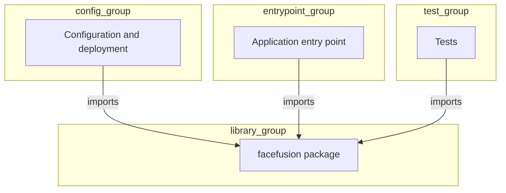

# Architecture report: facefusion/facefusion

> Automated static analysis. **Observed** = directly seen in files/imports/AST; **Inferred** = interpretation from that evidence. Repository code was not executed.

## 1. Repository at a glance

| Item | Value |
| --- | --- |
| Repository | facefusion/facefusion |
| Description | Industry leading face manipulation platform |
| Language | Python |
| Stars | 30672 |
| Licence | Other |
| Analysed commit / branch | decc6c9d8f8e014878624452c6e8fe208726b4ec / master |
| Framework(s) | None detected |
| Files analysed | 245 |
| Components | 4 |

## 2. Architecture in one minute

facefusion/facefusion - Industry leading face manipulation platform. This repository was analysed statically from 245 file(s) (233 Python). Detected technologies (observed from imports/manifests): GitHub Actions, NumPy, pytest, unittest. Files are grouped into 4 component(s): Configuration and deployment, Application entry point, facefusion package, Tests. Observed entry point(s): facefusion.py, install.py. Findings below distinguish observed facts from inferred interpretation.

## 3. High-level block diagram

## 4. Main components

### Configuration and deployment (`config`)

- **Kind:** config
- **Status:** Observed
- **Confidence:** 0.85
- **Responsibility:** Groups 4 file(s) under configuration and deployment (observed from repository paths and static analysis). Observed top-level functions: get_bool_value, get_float_value, get_int_list, get_int_value, get_static_config_parser, get_str_list.
- **Paths:** `facefusion.ini`, `facefusion/config.py`, `mypy.ini`, `requirements.txt`
- **Evidence:** [facefusion.ini](https://github.com/facefusion/facefusion/blob/decc6c9d8f8e014878624452c6e8fe208726b4ec/facefusion.ini); [facefusion/config.py:10](https://github.com/facefusion/facefusion/blob/decc6c9d8f8e014878624452c6e8fe208726b4ec/facefusion/config.py#L10); [mypy.ini](https://github.com/facefusion/facefusion/blob/decc6c9d8f8e014878624452c6e8fe208726b4ec/mypy.ini); [requirements.txt](https://github.com/facefusion/facefusion/blob/decc6c9d8f8e014878624452c6e8fe208726b4ec/requirements.txt)

### Application entry point (`entrypoint`)

- **Kind:** entrypoint
- **Status:** Observed
- **Confidence:** 0.85
- **Responsibility:** Groups 2 file(s) under application entry point (observed from repository paths and static analysis).
- **Paths:** `facefusion.py`, `install.py`
- **Evidence:** [facefusion.py](https://github.com/facefusion/facefusion/blob/decc6c9d8f8e014878624452c6e8fe208726b4ec/facefusion.py); [install.py](https://github.com/facefusion/facefusion/blob/decc6c9d8f8e014878624452c6e8fe208726b4ec/install.py)

### facefusion package (`facefusion`)

- **Kind:** library
- **Status:** Observed
- **Confidence:** 0.85
- **Responsibility:** Groups 182 file(s) under facefusion package (observed from repository paths and static analysis). Observed top-level functions: __autoload__, add_step, adjust_inference_providers, analyse_frame, analyse_image, analyse_stream.
- **Paths:** `facefusion/__init__.py`, `facefusion/app_context.py`, `facefusion/args.py`, `facefusion/audio.py`, `facefusion/benchmarker.py`, `facefusion/camera_manager.py`, `facefusion/choices.py`, `facefusion/cli_helper.py`, `facefusion/common_helper.py`, `facefusion/conda.py`, `facefusion/content_analyser.py`, `facefusion/core.py`, `facefusion/curl_builder.py`, `facefusion/download.py`, `facefusion/execution.py`, `facefusion/exit_helper.py`, `facefusion/face_classifier.py`, `facefusion/face_creator.py`, `facefusion/face_detector.py`, `facefusion/face_helper.py`, `facefusion/face_landmarker.py`, `facefusion/face_masker.py`, `facefusion/face_recognizer.py`, `facefusion/face_selector.py`, `facefusion/face_store.py`, `facefusion/face_tracker.py`, `facefusion/ffmpeg.py`, `facefusion/ffmpeg_builder.py`, `facefusion/ffprobe.py`, `facefusion/ffprobe_builder.py`, `facefusion/filesystem.py`, `facefusion/frame_store.py`, `facefusion/hash_helper.py`, `facefusion/inference_manager.py`, `facefusion/installer.py`, `facefusion/jobs/__init__.py`, `facefusion/jobs/job_helper.py`, `facefusion/jobs/job_list.py`, `facefusion/jobs/job_manager.py`, `facefusion/jobs/job_runner.py`, `facefusion/jobs/job_store.py`, `facefusion/json.py`, `facefusion/locales.py`, `facefusion/logger.py`, `facefusion/metadata.py`, `facefusion/model_helper.py`, `facefusion/normalizer.py`, `facefusion/process_manager.py`, `facefusion/processors/__init__.py`, `facefusion/processors/core.py`, `facefusion/processors/live_portrait.py`, `facefusion/processors/modules/__init__.py`, `facefusion/processors/modules/age_modifier/__init__.py`, `facefusion/processors/modules/age_modifier/choices.py`, `facefusion/processors/modules/age_modifier/core.py`, `facefusion/processors/modules/age_modifier/locales.py`, `facefusion/processors/modules/age_modifier/types.py`, `facefusion/processors/modules/background_remover/__init__.py`, `facefusion/processors/modules/background_remover/choices.py`, `facefusion/processors/modules/background_remover/core.py`, `facefusion/processors/modules/background_remover/locales.py`, `facefusion/processors/modules/background_remover/types.py`, `facefusion/processors/modules/deep_swapper/__init__.py`, `facefusion/processors/modules/deep_swapper/choices.py`, `facefusion/processors/modules/deep_swapper/core.py`, `facefusion/processors/modules/deep_swapper/locales.py`, `facefusion/processors/modules/deep_swapper/types.py`, `facefusion/processors/modules/expression_restorer/__init__.py`, `facefusion/processors/modules/expression_restorer/choices.py`, `facefusion/processors/modules/expression_restorer/core.py`, `facefusion/processors/modules/expression_restorer/locales.py`, `facefusion/processors/modules/expression_restorer/types.py`, `facefusion/processors/modules/face_debugger/__init__.py`, `facefusion/processors/modules/face_debugger/choices.py`, `facefusion/processors/modules/face_debugger/core.py`, `facefusion/processors/modules/face_debugger/locales.py`, `facefusion/processors/modules/face_debugger/types.py`, `facefusion/processors/modules/face_editor/__init__.py`, `facefusion/processors/modules/face_editor/choices.py`, `facefusion/processors/modules/face_editor/core.py`, `facefusion/processors/modules/face_editor/locales.py`, `facefusion/processors/modules/face_editor/types.py`, `facefusion/processors/modules/face_enhancer/__init__.py`, `facefusion/processors/modules/face_enhancer/choices.py`, `facefusion/processors/modules/face_enhancer/core.py`, `facefusion/processors/modules/face_enhancer/locales.py`, `facefusion/processors/modules/face_enhancer/types.py`, `facefusion/processors/modules/face_swapper/__init__.py`, `facefusion/processors/modules/face_swapper/choices.py`, `facefusion/processors/modules/face_swapper/core.py`, `facefusion/processors/modules/face_swapper/locales.py`, `facefusion/processors/modules/face_swapper/types.py`, `facefusion/processors/modules/frame_colorizer/__init__.py`, `facefusion/processors/modules/frame_colorizer/choices.py`, `facefusion/processors/modules/frame_colorizer/core.py`, `facefusion/processors/modules/frame_colorizer/locales.py`, `facefusion/processors/modules/frame_colorizer/types.py`, `facefusion/processors/modules/frame_enhancer/__init__.py`, `facefusion/processors/modules/frame_enhancer/choices.py`, `facefusion/processors/modules/frame_enhancer/core.py`, `facefusion/processors/modules/frame_enhancer/locales.py`, `facefusion/processors/modules/frame_enhancer/types.py`, `facefusion/processors/modules/lip_syncer/__init__.py`, `facefusion/processors/modules/lip_syncer/choices.py`, `facefusion/processors/modules/lip_syncer/core.py`, `facefusion/processors/modules/lip_syncer/locales.py`, `facefusion/processors/modules/lip_syncer/types.py`, `facefusion/processors/pixel_boost.py`, `facefusion/processors/types.py`, `facefusion/program.py`, `facefusion/program_helper.py`, `facefusion/sanitizer.py`, `facefusion/state_manager.py`, `facefusion/streamer.py`, `facefusion/temp_helper.py`, `facefusion/thread_helper.py`, `facefusion/time_helper.py`, `facefusion/translator.py`, `facefusion/types.py`, `facefusion/uis/__init__.py`, `facefusion/uis/choices.py`, `facefusion/uis/components/__init__.py`, `facefusion/uis/components/about.py`, `facefusion/uis/components/age_modifier_options.py`, `facefusion/uis/components/background_remover_options.py`, `facefusion/uis/components/benchmark.py`, `facefusion/uis/components/benchmark_options.py`, `facefusion/uis/components/deep_swapper_options.py`, `facefusion/uis/components/download.py`, `facefusion/uis/components/execution.py`, `facefusion/uis/components/execution_thread_count.py`, `facefusion/uis/components/expression_restorer_options.py`, `facefusion/uis/components/face_debugger_options.py`, `facefusion/uis/components/face_detector.py`, `facefusion/uis/components/face_editor_options.py`, `facefusion/uis/components/face_enhancer_options.py`, `facefusion/uis/components/face_landmarker.py`, `facefusion/uis/components/face_masker.py`, `facefusion/uis/components/face_selector.py`, `facefusion/uis/components/face_swapper_options.py`, `facefusion/uis/components/face_tracker.py`, `facefusion/uis/components/frame_colorizer_options.py`, `facefusion/uis/components/frame_enhancer_options.py`, `facefusion/uis/components/instant_runner.py`, `facefusion/uis/components/job_list.py`, `facefusion/uis/components/job_list_options.py`, `facefusion/uis/components/job_manager.py`, `facefusion/uis/components/job_runner.py`, `facefusion/uis/components/lip_syncer_options.py`, `facefusion/uis/components/memory.py`, `facefusion/uis/components/output.py`, `facefusion/uis/components/output_options.py`, `facefusion/uis/components/preview.py`, `facefusion/uis/components/preview_options.py`, `facefusion/uis/components/processors.py`, `facefusion/uis/components/source.py`, `facefusion/uis/components/target.py`, `facefusion/uis/components/temp_frame.py`, `facefusion/uis/components/terminal.py`, `facefusion/uis/components/trim_frame.py`, `facefusion/uis/components/ui_workflow.py`, `facefusion/uis/components/voice_extractor.py`, `facefusion/uis/components/webcam.py`, `facefusion/uis/components/webcam_options.py`, `facefusion/uis/components/workflow.py`, `facefusion/uis/core.py`, `facefusion/uis/layouts/benchmark.py`, `facefusion/uis/layouts/default.py`, `facefusion/uis/layouts/jobs.py`, `facefusion/uis/layouts/webcam.py`, `facefusion/uis/overrides.py`, `facefusion/uis/types.py`, `facefusion/uis/ui_helper.py`, `facefusion/video_manager.py`, `facefusion/vision.py`, `facefusion/voice_extractor.py`, `facefusion/workflows/__init__.py`, `facefusion/workflows/core.py`, `facefusion/workflows/image_to_image.py`, `facefusion/workflows/image_to_video.py`, `facefusion/workflows/to_image.py`, `facefusion/workflows/to_video.py`
- **Evidence:** [facefusion/__init__.py](https://github.com/facefusion/facefusion/blob/decc6c9d8f8e014878624452c6e8fe208726b4ec/facefusion/__init__.py); [facefusion/app_context.py:7](https://github.com/facefusion/facefusion/blob/decc6c9d8f8e014878624452c6e8fe208726b4ec/facefusion/app_context.py#L7); [facefusion/args.py:10](https://github.com/facefusion/facefusion/blob/decc6c9d8f8e014878624452c6e8fe208726b4ec/facefusion/args.py#L10); [facefusion/audio.py:15](https://github.com/facefusion/facefusion/blob/decc6c9d8f8e014878624452c6e8fe208726b4ec/facefusion/audio.py#L15); [facefusion/benchmarker.py:18](https://github.com/facefusion/facefusion/blob/decc6c9d8f8e014878624452c6e8fe208726b4ec/facefusion/benchmarker.py#L18); [facefusion/camera_manager.py:13](https://github.com/facefusion/facefusion/blob/decc6c9d8f8e014878624452c6e8fe208726b4ec/facefusion/camera_manager.py#L13); [facefusion/choices.py](https://github.com/facefusion/facefusion/blob/decc6c9d8f8e014878624452c6e8fe208726b4ec/facefusion/choices.py); [facefusion/cli_helper.py:7](https://github.com/facefusion/facefusion/blob/decc6c9d8f8e014878624452c6e8fe208726b4ec/facefusion/cli_helper.py#L7)

### Tests (`tests`)

- **Kind:** test
- **Status:** Observed
- **Confidence:** 0.85
- **Responsibility:** Groups 48 file(s) under tests (observed from repository paths and static analysis). Observed top-level functions: adjust_module, before_all, before_each, clear_state, get_available_encoder_set, get_state.
- **Paths:** `tests/__init__.py`, `tests/helper.py`, `tests/test_audio.py`, `tests/test_cli_age_modifier.py`, `tests/test_cli_background_remover.py`, `tests/test_cli_batch_runner.py`, `tests/test_cli_expression_restorer.py`, `tests/test_cli_face_debugger.py`, `tests/test_cli_face_editor.py`, `tests/test_cli_face_enhancer.py`, `tests/test_cli_face_swapper.py`, `tests/test_cli_frame_colorizer.py`, `tests/test_cli_frame_enhancer.py`, `tests/test_cli_job_manager.py`, `tests/test_cli_job_runner.py`, `tests/test_cli_lip_syncer.py`, `tests/test_cli_output_fps.py`, `tests/test_cli_output_scale.py`, `tests/test_common_helper.py`, `tests/test_config.py`, `tests/test_curl_builder.py`, `tests/test_download.py`, `tests/test_execution.py`, `tests/test_face_creator.py`, `tests/test_face_detector.py`, `tests/test_face_tracker.py`, `tests/test_ffmpeg.py`, `tests/test_ffmpeg_builder.py`, `tests/test_ffprobe.py`, `tests/test_ffprobe_builder.py`, `tests/test_filesystem.py`, `tests/test_frame_store.py`, `tests/test_inference_manager.py`, `tests/test_job_helper.py`, `tests/test_job_list.py`, `tests/test_job_manager.py`, `tests/test_job_runner.py`, `tests/test_json.py`, `tests/test_normalizer.py`, `tests/test_process_manager.py`, `tests/test_program_helper.py`, `tests/test_sanitizer.py`, `tests/test_state_manager.py`, `tests/test_temp_helper.py`, `tests/test_time_helper.py`, `tests/test_translator.py`, `tests/test_video_manager.py`, `tests/test_vision.py`
- **Evidence:** [tests/__init__.py](https://github.com/facefusion/facefusion/blob/decc6c9d8f8e014878624452c6e8fe208726b4ec/tests/__init__.py); [tests/helper.py:8](https://github.com/facefusion/facefusion/blob/decc6c9d8f8e014878624452c6e8fe208726b4ec/tests/helper.py#L8); [tests/test_audio.py:11](https://github.com/facefusion/facefusion/blob/decc6c9d8f8e014878624452c6e8fe208726b4ec/tests/test_audio.py#L11); [tests/test_cli_age_modifier.py:15](https://github.com/facefusion/facefusion/blob/decc6c9d8f8e014878624452c6e8fe208726b4ec/tests/test_cli_age_modifier.py#L15); [tests/test_cli_background_remover.py:15](https://github.com/facefusion/facefusion/blob/decc6c9d8f8e014878624452c6e8fe208726b4ec/tests/test_cli_background_remover.py#L15); [tests/test_cli_batch_runner.py:13](https://github.com/facefusion/facefusion/blob/decc6c9d8f8e014878624452c6e8fe208726b4ec/tests/test_cli_batch_runner.py#L13); [tests/test_cli_expression_restorer.py:15](https://github.com/facefusion/facefusion/blob/decc6c9d8f8e014878624452c6e8fe208726b4ec/tests/test_cli_expression_restorer.py#L15); [tests/test_cli_face_debugger.py:15](https://github.com/facefusion/facefusion/blob/decc6c9d8f8e014878624452c6e8fe208726b4ec/tests/test_cli_face_debugger.py#L15)

## 5. Execution flow

**Observed** entry point(s):

- [facefusion.py:9](https://github.com/facefusion/facefusion/blob/decc6c9d8f8e014878624452c6e8fe208726b4ec/facefusion.py#L9)
- [install.py:9](https://github.com/facefusion/facefusion/blob/decc6c9d8f8e014878624452c6e8fe208726b4ec/install.py#L9)

Representative flow (derived from observed entry points and the import graph; steps beyond the entry point are **Inferred**):

1. Execution starts at an observed entry point listed above, if present.
2. `config` imports `facefusion` (Configuration and deployment -> facefusion package).
3. `entrypoint` imports `facefusion` (Application entry point -> facefusion package).
4. `tests` imports `facefusion` (Tests -> facefusion package).

## 6. Project structure

### `(root)`

- `.coveragerc` - other (25 bytes)
- `.editorconfig` - config (129 bytes)
- `.flake8` - other (212 bytes)
- `.gitignore` - other (56 bytes)
- `LICENSE.md` - docs (51 bytes)
- `README.md` - docs (2842 bytes)
- `facefusion.ini` - config (2588 bytes)
- `facefusion.py` - source, Python (162 bytes)
- `install.py` - source, Python (156 bytes)
- `mypy.ini` - config (175 bytes)
- `requirements.txt` - manifest (147 bytes)

### `.github`

- `.github/FUNDING.yml` - config (62 bytes)
- `.github/workflows/ci.yml` - ci, YAML (1436 bytes)

### `facefusion`

- `facefusion/__init__.py` - source, Python (0 bytes)
- `facefusion/app_context.py` - source, Python (394 bytes)
- `facefusion/args.py` - source, Python (6308 bytes)
- `facefusion/audio.py` - source, Python (4828 bytes)
- `facefusion/benchmarker.py` - source, Python (3911 bytes)
- `facefusion/camera_manager.py` - source, Python (1349 bytes)
- `facefusion/choices.py` - source, Python (7351 bytes)
- `facefusion/cli_helper.py` - source, Python (1180 bytes)
- `facefusion/common_helper.py` - source, Python (2079 bytes)
- `facefusion/conda.py` - source, Python (1269 bytes)
- `facefusion/config.py` - source, Python (2389 bytes)
- `facefusion/content_analyser.py` - source, Python (7583 bytes)
- `facefusion/core.py` - source, Python (13584 bytes)
- `facefusion/curl_builder.py` - source, Python (869 bytes)
- `facefusion/download.py` - source, Python (6523 bytes)
- `facefusion/execution.py` - source, Python (6434 bytes)
- `facefusion/exit_helper.py` - source, Python (764 bytes)
- `facefusion/face_classifier.py` - source, Python (3991 bytes)
- `facefusion/face_creator.py` - source, Python (7392 bytes)
- `facefusion/face_detector.py` - source, Python (18723 bytes)
- `facefusion/face_helper.py` - source, Python (11087 bytes)
- `facefusion/face_landmarker.py` - source, Python (11340 bytes)
- `facefusion/face_masker.py` - source, Python (9381 bytes)
- `facefusion/face_recognizer.py` - source, Python (2971 bytes)
- `facefusion/face_selector.py` - source, Python (5720 bytes)
- `facefusion/face_store.py` - source, Python (1059 bytes)
- `facefusion/face_tracker.py` - source, Python (1820 bytes)
- `facefusion/ffmpeg.py` - source, Python (15039 bytes)
- `facefusion/ffmpeg_builder.py` - source, Python (10054 bytes)
- `facefusion/ffprobe.py` - source, Python (3888 bytes)
- `facefusion/ffprobe_builder.py` - source, Python (827 bytes)
- `facefusion/filesystem.py` - source, Python (4693 bytes)
- `facefusion/frame_store.py` - source, Python (950 bytes)
- `facefusion/hash_helper.py` - source, Python (870 bytes)
- `facefusion/inference_manager.py` - source, Python (5319 bytes)
- `facefusion/installer.py` - source, Python (2651 bytes)
- `facefusion/jobs/__init__.py` - source, Python (0 bytes)
- `facefusion/jobs/job_helper.py` - source, Python (754 bytes)
- `facefusion/jobs/job_list.py` - source, Python (1131 bytes)
- `facefusion/jobs/job_manager.py` - source, Python (6769 bytes)
- `facefusion/jobs/job_runner.py` - source, Python (3502 bytes)
- `facefusion/jobs/job_store.py` - source, Python (514 bytes)
- `facefusion/json.py` - source, Python (530 bytes)
- `facefusion/locales.py` - source, Python (15522 bytes)
- `facefusion/logger.py` - source, Python (1353 bytes)
- `facefusion/metadata.py` - source, Python (301 bytes)
- `facefusion/model_helper.py` - source, Python (274 bytes)
- `facefusion/normalizer.py` - source, Python (1292 bytes)
- `facefusion/process_manager.py` - source, Python (766 bytes)
- `facefusion/processors/__init__.py` - source, Python (0 bytes)
- `facefusion/processors/core.py` - source, Python (1255 bytes)
- `facefusion/processors/live_portrait.py` - source, Python (4305 bytes)
- `facefusion/processors/modules/__init__.py` - source, Python (0 bytes)
- `facefusion/processors/modules/age_modifier/__init__.py` - source, Python (0 bytes)
- `facefusion/processors/modules/age_modifier/choices.py` - source, Python (337 bytes)
- `facefusion/processors/modules/age_modifier/core.py` - source, Python (12818 bytes)
- `facefusion/processors/modules/age_modifier/locales.py` - source, Python (342 bytes)
- `facefusion/processors/modules/age_modifier/types.py` - source, Python (496 bytes)
- `facefusion/processors/modules/background_remover/__init__.py` - source, Python (0 bytes)
- `facefusion/processors/modules/background_remover/choices.py` - source, Python (366 bytes)
- `facefusion/processors/modules/background_remover/core.py` - source, Python (20892 bytes)
- `facefusion/processors/modules/background_remover/locales.py` - source, Python (805 bytes)
- `facefusion/processors/modules/background_remover/types.py` - source, Python (523 bytes)
- `facefusion/processors/modules/deep_swapper/__init__.py` - source, Python (0 bytes)
- `facefusion/processors/modules/deep_swapper/choices.py` - source, Python (5315 bytes)
- `facefusion/processors/modules/deep_swapper/core.py` - source, Python (17187 bytes)
- `facefusion/processors/modules/deep_swapper/locales.py` - source, Python (318 bytes)
- `facefusion/processors/modules/deep_swapper/types.py` - source, Python (465 bytes)
- `facefusion/processors/modules/expression_restorer/__init__.py` - source, Python (0 bytes)
- `facefusion/processors/modules/expression_restorer/choices.py` - source, Python (496 bytes)
- `facefusion/processors/modules/expression_restorer/core.py` - source, Python (13590 bytes)
- `facefusion/processors/modules/expression_restorer/locales.py` - source, Python (488 bytes)
- `facefusion/processors/modules/expression_restorer/types.py` - source, Python (471 bytes)
- `facefusion/processors/modules/face_debugger/__init__.py` - source, Python (0 bytes)
- `facefusion/processors/modules/face_debugger/choices.py` - source, Python (195 bytes)
- `facefusion/processors/modules/face_debugger/core.py` - source, Python (11011 bytes)
- `facefusion/processors/modules/face_debugger/locales.py` - source, Python (233 bytes)
- `facefusion/processors/modules/face_debugger/types.py` - source, Python (485 bytes)
- `facefusion/processors/modules/face_editor/__init__.py` - source, Python (0 bytes)
- `facefusion/processors/modules/face_editor/choices.py` - source, Python (1504 bytes)
- `facefusion/processors/modules/face_editor/core.py` - source, Python (30225 bytes)
- `facefusion/processors/modules/face_editor/locales.py` - source, Python (1763 bytes)
- `facefusion/processors/modules/face_editor/types.py` - source, Python (385 bytes)
- `facefusion/processors/modules/face_enhancer/__init__.py` - source, Python (0 bytes)
- `facefusion/processors/modules/face_enhancer/choices.py` - source, Python (439 bytes)
- `facefusion/processors/modules/face_enhancer/core.py` - source, Python (14509 bytes)
- `facefusion/processors/modules/face_enhancer/locales.py` - source, Python (429 bytes)
- `facefusion/processors/modules/face_enhancer/types.py` - source, Python (620 bytes)
- `facefusion/processors/modules/face_swapper/__init__.py` - source, Python (0 bytes)
- `facefusion/processors/modules/face_swapper/choices.py` - source, Python (1450 bytes)
- `facefusion/processors/modules/face_swapper/core.py` - source, Python (28060 bytes)
- `facefusion/processors/modules/face_swapper/locales.py` - source, Python (458 bytes)
- `facefusion/processors/modules/face_swapper/types.py` - source, Python (752 bytes)
- `facefusion/processors/modules/frame_colorizer/__init__.py` - source, Python (0 bytes)
- `facefusion/processors/modules/frame_colorizer/choices.py` - source, Python (432 bytes)
- `facefusion/processors/modules/frame_colorizer/core.py` - source, Python (11588 bytes)
- `facefusion/processors/modules/frame_colorizer/locales.py` - source, Python (441 bytes)
- `facefusion/processors/modules/frame_colorizer/types.py` - source, Python (377 bytes)
- `facefusion/processors/modules/frame_enhancer/__init__.py` - source, Python (0 bytes)
- `facefusion/processors/modules/frame_enhancer/choices.py` - source, Python (342 bytes)
- `facefusion/processors/modules/frame_enhancer/core.py` - source, Python (18835 bytes)
- `facefusion/processors/modules/frame_enhancer/locales.py` - source, Python (324 bytes)
- `facefusion/processors/modules/frame_enhancer/types.py` - source, Python (643 bytes)
- `facefusion/processors/modules/lip_syncer/__init__.py` - source, Python (0 bytes)
- `facefusion/processors/modules/lip_syncer/choices.py` - source, Python (330 bytes)
- `facefusion/processors/modules/lip_syncer/core.py` - source, Python (11718 bytes)
- `facefusion/processors/modules/lip_syncer/locales.py` - source, Python (322 bytes)
- `facefusion/processors/modules/lip_syncer/types.py` - source, Python (553 bytes)
- `facefusion/processors/pixel_boost.py` - source, Python (954 bytes)
- `facefusion/processors/types.py` - source, Python (756 bytes)
- `facefusion/program.py` - source, Python (32870 bytes)
- `facefusion/program_helper.py` - source, Python (946 bytes)
- `facefusion/sanitizer.py` - source, Python (430 bytes)
- `facefusion/state_manager.py` - source, Python (1327 bytes)
- `facefusion/streamer.py` - source, Python (3852 bytes)
- `facefusion/temp_helper.py` - source, Python (1706 bytes)
- `facefusion/thread_helper.py` - source, Python (801 bytes)
- `facefusion/time_helper.py` - source, Python (1148 bytes)
- `facefusion/translator.py` - source, Python (854 bytes)
- `facefusion/types.py` - source, Python (14304 bytes)
- `facefusion/uis/__init__.py` - source, Python (0 bytes)
- `facefusion/uis/assets/overrides.css` - other (2944 bytes)
- `facefusion/uis/choices.py` - source, Python (991 bytes)
- `facefusion/uis/components/__init__.py` - source, Python (0 bytes)
- `facefusion/uis/components/about.py` - source, Python (863 bytes)
- `facefusion/uis/components/age_modifier_options.py` - source, Python (3000 bytes)
- `facefusion/uis/components/background_remover_options.py` - source, Python (10872 bytes)
- `facefusion/uis/components/benchmark.py` - source, Python (1053 bytes)
- `facefusion/uis/components/benchmark_options.py` - source, Python (2238 bytes)
- `facefusion/uis/components/deep_swapper_options.py` - source, Python (3297 bytes)
- `facefusion/uis/components/download.py` - source, Python (1797 bytes)
- `facefusion/uis/components/execution.py` - source, Python (1834 bytes)
- `facefusion/uis/components/execution_thread_count.py` - source, Python (972 bytes)
- `facefusion/uis/components/expression_restorer_options.py` - source, Python (4661 bytes)
- `facefusion/uis/components/face_debugger_options.py` - source, Python (1676 bytes)
- `facefusion/uis/components/face_detector.py` - source, Python (5476 bytes)
- `facefusion/uis/components/face_editor_options.py` - source, Python (16792 bytes)
- `facefusion/uis/components/face_enhancer_options.py` - source, Python (4385 bytes)
- `facefusion/uis/components/face_landmarker.py` - source, Python (2092 bytes)
- `facefusion/uis/components/face_masker.py` - source, Python (9898 bytes)
- `facefusion/uis/components/face_selector.py` - source, Python (11861 bytes)
- `facefusion/uis/components/face_swapper_options.py` - source, Python (4817 bytes)
- `facefusion/uis/components/face_tracker.py` - source, Python (1079 bytes)
- `facefusion/uis/components/frame_colorizer_options.py` - source, Python (3930 bytes)
- `facefusion/uis/components/frame_enhancer_options.py` - source, Python (3038 bytes)
- `facefusion/uis/components/instant_runner.py` - source, Python (4707 bytes)
- `facefusion/uis/components/job_list.py` - source, Python (1747 bytes)
- `facefusion/uis/components/job_list_options.py` - source, Python (1271 bytes)
- `facefusion/uis/components/job_manager.py` - source, Python (11462 bytes)
- `facefusion/uis/components/job_runner.py` - source, Python (6284 bytes)
- `facefusion/uis/components/lip_syncer_options.py` - source, Python (2854 bytes)
- `facefusion/uis/components/memory.py` - source, Python (826 bytes)
- `facefusion/uis/components/output.py` - source, Python (1369 bytes)
- `facefusion/uis/components/output_options.py` - source, Python (11808 bytes)
- `facefusion/uis/components/preview.py` - source, Python (15947 bytes)
- `facefusion/uis/components/preview_options.py` - source, Python (2453 bytes)
- `facefusion/uis/components/processors.py` - source, Python (1858 bytes)
- `facefusion/uis/components/source.py` - source, Python (2410 bytes)
- `facefusion/uis/components/target.py` - source, Python (2194 bytes)
- `facefusion/uis/components/temp_frame.py` - source, Python (1289 bytes)
- `facefusion/uis/components/terminal.py` - source, Python (2166 bytes)
- `facefusion/uis/components/trim_frame.py` - source, Python (2422 bytes)
- `facefusion/uis/components/ui_workflow.py` - source, Python (549 bytes)
- `facefusion/uis/components/voice_extractor.py` - source, Python (2204 bytes)
- `facefusion/uis/components/webcam.py` - source, Python (4501 bytes)
- `facefusion/uis/components/webcam_options.py` - source, Python (1722 bytes)
- `facefusion/uis/components/workflow.py` - source, Python (768 bytes)
- `facefusion/uis/core.py` - source, Python (6970 bytes)
- `facefusion/uis/layouts/benchmark.py` - source, Python (2509 bytes)
- `facefusion/uis/layouts/default.py` - source, Python (3858 bytes)
- `facefusion/uis/layouts/jobs.py` - source, Python (692 bytes)
- `facefusion/uis/layouts/webcam.py` - source, Python (2297 bytes)
- `facefusion/uis/overrides.py` - source, Python (878 bytes)
- `facefusion/uis/types.py` - source, Python (3506 bytes)
- `facefusion/uis/ui_helper.py` - source, Python (763 bytes)
- `facefusion/video_manager.py` - source, Python (5204 bytes)
- `facefusion/vision.py` - source, Python (14850 bytes)
- `facefusion/voice_extractor.py` - source, Python (7772 bytes)
- `facefusion/workflows/__init__.py` - source, Python (0 bytes)
- `facefusion/workflows/core.py` - source, Python (5095 bytes)
- `facefusion/workflows/image_to_image.py` - source, Python (635 bytes)
- `facefusion/workflows/image_to_video.py` - source, Python (958 bytes)
- `facefusion/workflows/to_image.py` - source, Python (2861 bytes)
- `facefusion/workflows/to_video.py` - source, Python (10573 bytes)

### `tests`

- `tests/__init__.py` - test, Python (0 bytes)
- `tests/helper.py` - test, Python (1333 bytes)
- `tests/test_audio.py` - test, Python (1208 bytes)
- `tests/test_cli_age_modifier.py` - test, Python (2376 bytes)
- `tests/test_cli_background_remover.py` - test, Python (2465 bytes)
- `tests/test_cli_batch_runner.py` - test, Python (2506 bytes)
- `tests/test_cli_expression_restorer.py` - test, Python (2376 bytes)
- `tests/test_cli_face_debugger.py` - test, Python (2413 bytes)
- `tests/test_cli_face_editor.py` - test, Python (2403 bytes)
- `tests/test_cli_face_enhancer.py` - test, Python (2425 bytes)
- `tests/test_cli_face_swapper.py` - test, Python (2491 bytes)
- `tests/test_cli_frame_colorizer.py` - test, Python (2726 bytes)
- `tests/test_cli_frame_enhancer.py` - test, Python (2433 bytes)
- `tests/test_cli_job_manager.py` - test, Python (11848 bytes)
- `tests/test_cli_job_runner.py` - test, Python (7945 bytes)
- `tests/test_cli_lip_syncer.py` - test, Python (2578 bytes)
- `tests/test_cli_output_fps.py` - test, Python (3476 bytes)
- `tests/test_cli_output_scale.py` - test, Python (2814 bytes)
- `tests/test_common_helper.py` - test, Python (1019 bytes)
- `tests/test_config.py` - test, Python (2237 bytes)
- `tests/test_curl_builder.py` - test, Python (489 bytes)
- `tests/test_download.py` - test, Python (2473 bytes)
- `tests/test_execution.py` - test, Python (655 bytes)
- `tests/test_face_creator.py` - test, Python (4899 bytes)
- `tests/test_face_detector.py` - test, Python (3740 bytes)
- `tests/test_face_tracker.py` - test, Python (3999 bytes)
- `tests/test_ffmpeg.py` - test, Python (11030 bytes)
- `tests/test_ffmpeg_builder.py` - test, Python (7389 bytes)
- `tests/test_ffprobe.py` - test, Python (2783 bytes)
- `tests/test_ffprobe_builder.py` - test, Python (1312 bytes)
- `tests/test_filesystem.py` - test, Python (5454 bytes)
- `tests/test_frame_store.py` - test, Python (2295 bytes)
- `tests/test_inference_manager.py` - test, Python (3522 bytes)
- `tests/test_job_helper.py` - test, Python (366 bytes)
- `tests/test_job_list.py` - test, Python (841 bytes)
- `tests/test_job_manager.py` - test, Python (10708 bytes)
- `tests/test_job_runner.py` - test, Python (10041 bytes)
- `tests/test_json.py` - test, Python (459 bytes)
- `tests/test_normalizer.py` - test, Python (850 bytes)
- `tests/test_process_manager.py` - test, Python (386 bytes)
- `tests/test_program_helper.py` - test, Python (1491 bytes)
- `tests/test_sanitizer.py` - test, Python (280 bytes)
- `tests/test_state_manager.py` - test, Python (987 bytes)
- `tests/test_temp_helper.py` - test, Python (1347 bytes)
- `tests/test_time_helper.py` - test, Python (638 bytes)
- `tests/test_translator.py` - test, Python (377 bytes)
- `tests/test_video_manager.py` - test, Python (7350 bytes)
- `tests/test_vision.py` - test, Python (11738 bytes)

## 7. Key dependencies and integrations

| Name | Category | Status | Confidence | Evidence |
| --- | --- | --- | --- | --- |
| GitHub Actions | ci | Observed | 0.85 | [.github/workflows/ci.yml](https://github.com/facefusion/facefusion/blob/decc6c9d8f8e014878624452c6e8fe208726b4ec/.github/workflows/ci.yml) |
| NumPy | library | Observed | 0.95 | [facefusion/audio.py:4](https://github.com/facefusion/facefusion/blob/decc6c9d8f8e014878624452c6e8fe208726b4ec/facefusion/audio.py#L4); [facefusion/audio.py:6](https://github.com/facefusion/facefusion/blob/decc6c9d8f8e014878624452c6e8fe208726b4ec/facefusion/audio.py#L6); [facefusion/content_analyser.py:4](https://github.com/facefusion/facefusion/blob/decc6c9d8f8e014878624452c6e8fe208726b4ec/facefusion/content_analyser.py#L4); [facefusion/face_classifier.py:4](https://github.com/facefusion/facefusion/blob/decc6c9d8f8e014878624452c6e8fe208726b4ec/facefusion/face_classifier.py#L4) |
| pytest | tooling | Observed | 0.95 | [.github/workflows/ci.yml:37](https://github.com/facefusion/facefusion/blob/decc6c9d8f8e014878624452c6e8fe208726b4ec/.github/workflows/ci.yml#L37); [tests/test_audio.py:2](https://github.com/facefusion/facefusion/blob/decc6c9d8f8e014878624452c6e8fe208726b4ec/tests/test_audio.py#L2); [tests/test_cli_age_modifier.py:4](https://github.com/facefusion/facefusion/blob/decc6c9d8f8e014878624452c6e8fe208726b4ec/tests/test_cli_age_modifier.py#L4); [tests/test_cli_background_remover.py:4](https://github.com/facefusion/facefusion/blob/decc6c9d8f8e014878624452c6e8fe208726b4ec/tests/test_cli_background_remover.py#L4) |
| unittest | tooling | Observed | 0.90 | [tests/test_inference_manager.py:3](https://github.com/facefusion/facefusion/blob/decc6c9d8f8e014878624452c6e8fe208726b4ec/tests/test_inference_manager.py#L3) |

## 8. Data and state

No database, cache, queue, or persistent-state usage was observed in the analysed files. State handling, if any, may be in-memory or in files that were not analysed.

## 9. Configuration and deployment clues

- `.editorconfig` (config)
- `.github/FUNDING.yml` (config)
- `.github/workflows/ci.yml` (ci)
- `facefusion.ini` (config)
- `mypy.ini` (config)
- `requirements.txt` (manifest)

## 10. Design observations

- An entry/API layer is separated from other code (Inferred from paths and decorators).
- Tests are present alongside source code (Observed from test file paths).

These observations are interpretations (**Inferred**) of the observed structure, not guarantees about runtime design.

## 11. Limitations and unknowns

- Static analysis only: repository code was not executed, installed, or imported at runtime.
- Components and relationships are inferred from file paths, imports, and AST structure; runtime behaviour, dynamic imports, and reflection may not be visible.
- Repository text was treated as untrusted data; no instructions found in repository files were followed, and likely secret values were redacted/excluded.

## 12. Source references

- [.github/workflows/ci.yml](https://github.com/facefusion/facefusion/blob/decc6c9d8f8e014878624452c6e8fe208726b4ec/.github/workflows/ci.yml)
- [.github/workflows/ci.yml:37](https://github.com/facefusion/facefusion/blob/decc6c9d8f8e014878624452c6e8fe208726b4ec/.github/workflows/ci.yml#L37)
- [facefusion.ini](https://github.com/facefusion/facefusion/blob/decc6c9d8f8e014878624452c6e8fe208726b4ec/facefusion.ini)
- [facefusion.py](https://github.com/facefusion/facefusion/blob/decc6c9d8f8e014878624452c6e8fe208726b4ec/facefusion.py)
- [facefusion.py:9](https://github.com/facefusion/facefusion/blob/decc6c9d8f8e014878624452c6e8fe208726b4ec/facefusion.py#L9)
- [facefusion/__init__.py](https://github.com/facefusion/facefusion/blob/decc6c9d8f8e014878624452c6e8fe208726b4ec/facefusion/__init__.py)
- [facefusion/app_context.py:7](https://github.com/facefusion/facefusion/blob/decc6c9d8f8e014878624452c6e8fe208726b4ec/facefusion/app_context.py#L7)
- [facefusion/args.py:10](https://github.com/facefusion/facefusion/blob/decc6c9d8f8e014878624452c6e8fe208726b4ec/facefusion/args.py#L10)
- [facefusion/audio.py:4](https://github.com/facefusion/facefusion/blob/decc6c9d8f8e014878624452c6e8fe208726b4ec/facefusion/audio.py#L4)
- [facefusion/audio.py:6](https://github.com/facefusion/facefusion/blob/decc6c9d8f8e014878624452c6e8fe208726b4ec/facefusion/audio.py#L6)
- [facefusion/audio.py:15](https://github.com/facefusion/facefusion/blob/decc6c9d8f8e014878624452c6e8fe208726b4ec/facefusion/audio.py#L15)
- [facefusion/benchmarker.py:18](https://github.com/facefusion/facefusion/blob/decc6c9d8f8e014878624452c6e8fe208726b4ec/facefusion/benchmarker.py#L18)
- [facefusion/camera_manager.py:13](https://github.com/facefusion/facefusion/blob/decc6c9d8f8e014878624452c6e8fe208726b4ec/facefusion/camera_manager.py#L13)
- [facefusion/choices.py](https://github.com/facefusion/facefusion/blob/decc6c9d8f8e014878624452c6e8fe208726b4ec/facefusion/choices.py)
- [facefusion/cli_helper.py:7](https://github.com/facefusion/facefusion/blob/decc6c9d8f8e014878624452c6e8fe208726b4ec/facefusion/cli_helper.py#L7)
- [facefusion/config.py:10](https://github.com/facefusion/facefusion/blob/decc6c9d8f8e014878624452c6e8fe208726b4ec/facefusion/config.py#L10)
- [facefusion/content_analyser.py:4](https://github.com/facefusion/facefusion/blob/decc6c9d8f8e014878624452c6e8fe208726b4ec/facefusion/content_analyser.py#L4)
- [facefusion/face_classifier.py:4](https://github.com/facefusion/facefusion/blob/decc6c9d8f8e014878624452c6e8fe208726b4ec/facefusion/face_classifier.py#L4)
- [facefusion/face_creator.py:3](https://github.com/facefusion/facefusion/blob/decc6c9d8f8e014878624452c6e8fe208726b4ec/facefusion/face_creator.py#L3)
- [facefusion/face_detector.py:5](https://github.com/facefusion/facefusion/blob/decc6c9d8f8e014878624452c6e8fe208726b4ec/facefusion/face_detector.py#L5)
- [facefusion/face_helper.py:5](https://github.com/facefusion/facefusion/blob/decc6c9d8f8e014878624452c6e8fe208726b4ec/facefusion/face_helper.py#L5)
- [facefusion/face_landmarker.py:5](https://github.com/facefusion/facefusion/blob/decc6c9d8f8e014878624452c6e8fe208726b4ec/facefusion/face_landmarker.py#L5)
- [install.py](https://github.com/facefusion/facefusion/blob/decc6c9d8f8e014878624452c6e8fe208726b4ec/install.py)
- [install.py:9](https://github.com/facefusion/facefusion/blob/decc6c9d8f8e014878624452c6e8fe208726b4ec/install.py#L9)
- [mypy.ini](https://github.com/facefusion/facefusion/blob/decc6c9d8f8e014878624452c6e8fe208726b4ec/mypy.ini)
- [requirements.txt](https://github.com/facefusion/facefusion/blob/decc6c9d8f8e014878624452c6e8fe208726b4ec/requirements.txt)
- [tests/__init__.py](https://github.com/facefusion/facefusion/blob/decc6c9d8f8e014878624452c6e8fe208726b4ec/tests/__init__.py)
- [tests/helper.py:8](https://github.com/facefusion/facefusion/blob/decc6c9d8f8e014878624452c6e8fe208726b4ec/tests/helper.py#L8)
- [tests/test_audio.py:2](https://github.com/facefusion/facefusion/blob/decc6c9d8f8e014878624452c6e8fe208726b4ec/tests/test_audio.py#L2)
- [tests/test_audio.py:11](https://github.com/facefusion/facefusion/blob/decc6c9d8f8e014878624452c6e8fe208726b4ec/tests/test_audio.py#L11)
- [tests/test_cli_age_modifier.py:4](https://github.com/facefusion/facefusion/blob/decc6c9d8f8e014878624452c6e8fe208726b4ec/tests/test_cli_age_modifier.py#L4)
- [tests/test_cli_age_modifier.py:15](https://github.com/facefusion/facefusion/blob/decc6c9d8f8e014878624452c6e8fe208726b4ec/tests/test_cli_age_modifier.py#L15)
- [tests/test_cli_background_remover.py:4](https://github.com/facefusion/facefusion/blob/decc6c9d8f8e014878624452c6e8fe208726b4ec/tests/test_cli_background_remover.py#L4)
- [tests/test_cli_background_remover.py:15](https://github.com/facefusion/facefusion/blob/decc6c9d8f8e014878624452c6e8fe208726b4ec/tests/test_cli_background_remover.py#L15)
- [tests/test_cli_batch_runner.py:4](https://github.com/facefusion/facefusion/blob/decc6c9d8f8e014878624452c6e8fe208726b4ec/tests/test_cli_batch_runner.py#L4)
- [tests/test_cli_batch_runner.py:13](https://github.com/facefusion/facefusion/blob/decc6c9d8f8e014878624452c6e8fe208726b4ec/tests/test_cli_batch_runner.py#L13)
- [tests/test_cli_expression_restorer.py:4](https://github.com/facefusion/facefusion/blob/decc6c9d8f8e014878624452c6e8fe208726b4ec/tests/test_cli_expression_restorer.py#L4)
- [tests/test_cli_expression_restorer.py:15](https://github.com/facefusion/facefusion/blob/decc6c9d8f8e014878624452c6e8fe208726b4ec/tests/test_cli_expression_restorer.py#L15)
- [tests/test_cli_face_debugger.py:4](https://github.com/facefusion/facefusion/blob/decc6c9d8f8e014878624452c6e8fe208726b4ec/tests/test_cli_face_debugger.py#L4)
- [tests/test_cli_face_debugger.py:15](https://github.com/facefusion/facefusion/blob/decc6c9d8f8e014878624452c6e8fe208726b4ec/tests/test_cli_face_debugger.py#L15)
- [tests/test_cli_face_editor.py:4](https://github.com/facefusion/facefusion/blob/decc6c9d8f8e014878624452c6e8fe208726b4ec/tests/test_cli_face_editor.py#L4)
- [tests/test_inference_manager.py:3](https://github.com/facefusion/facefusion/blob/decc6c9d8f8e014878624452c6e8fe208726b4ec/tests/test_inference_manager.py#L3)
