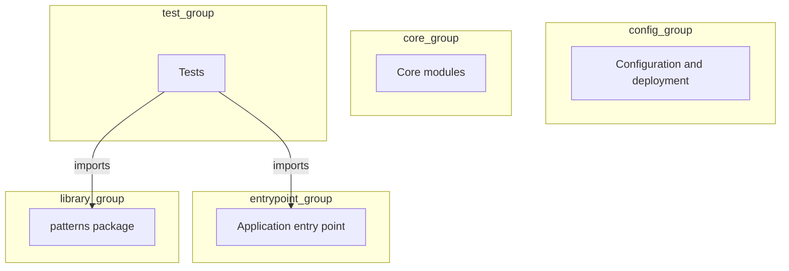

# Architecture report: faif/python-patterns

> Automated static analysis. **Observed** = directly seen in files/imports/AST; **Inferred** = interpretation from that evidence. Repository code was not executed.

## 1. Repository at a glance

| Item | Value |
| --- | --- |
| Repository | faif/python-patterns |
| Description | A collection of design patterns/idioms in Python |
| Language | Python |
| Stars | 43102 |
| Licence | Not detected |
| Analysed commit / branch | 0712925f8a4b3129e6e54f8ab3580c6f996aa359 / master |
| Framework(s) | None detected |
| Files analysed | 89 |
| Components | 5 |

## 2. Architecture in one minute

faif/python-patterns - A collection of design patterns/idioms in Python. This repository was analysed statically from 89 file(s) (75 Python). Detected technologies (observed from imports/manifests): GitHub Actions, Poetry, setuptools, pytest, unittest. Files are grouped into 5 component(s): Configuration and deployment, Core modules, Application entry point, patterns package, Tests. Observed entry point(s): patterns/behavioral/catalog.py, patterns/behavioral/chain_of_responsibility.py, patterns/behavioral/chaining_method.py. Findings below distinguish observed facts from inferred interpretation.

## 3. High-level block diagram

## 4. Main components

### Configuration and deployment (`config`)

- **Kind:** config
- **Status:** Observed
- **Confidence:** 0.85
- **Responsibility:** Groups 5 file(s) under configuration and deployment (observed from repository paths and static analysis).
- **Paths:** `Pipfile`, `config_backup/setup.cfg`, `config_backup/tox.ini`, `pyproject.toml`, `pytest_local.ini`
- **Evidence:** [Pipfile](https://github.com/faif/python-patterns/blob/0712925f8a4b3129e6e54f8ab3580c6f996aa359/Pipfile); [config_backup/setup.cfg](https://github.com/faif/python-patterns/blob/0712925f8a4b3129e6e54f8ab3580c6f996aa359/config_backup/setup.cfg); [config_backup/tox.ini](https://github.com/faif/python-patterns/blob/0712925f8a4b3129e6e54f8ab3580c6f996aa359/config_backup/tox.ini); [pyproject.toml](https://github.com/faif/python-patterns/blob/0712925f8a4b3129e6e54f8ab3580c6f996aa359/pyproject.toml); [pytest_local.ini](https://github.com/faif/python-patterns/blob/0712925f8a4b3129e6e54f8ab3580c6f996aa359/pytest_local.ini)

### Core modules (`core`)

- **Kind:** core
- **Status:** Observed
- **Confidence:** 0.85
- **Responsibility:** Groups 1 file(s) under core modules (observed from repository paths and static analysis).
- **Paths:** `lint.sh`
- **Evidence:** [lint.sh](https://github.com/faif/python-patterns/blob/0712925f8a4b3129e6e54f8ab3580c6f996aa359/lint.sh)

### Application entry point (`entrypoint`)

- **Kind:** entrypoint
- **Status:** Observed
- **Confidence:** 0.85
- **Responsibility:** Groups 39 file(s) under application entry point (observed from repository paths and static analysis). Observed top-level classes: A, AbstractExpert, Action, Adapter, AmState, AndSpecification. Observed top-level functions: client, construct_building, convert_to_text, count_to, count_to_five, count_to_two.
- **Paths:** `patterns/behavioral/catalog.py`, `patterns/behavioral/chain_of_responsibility.py`, `patterns/behavioral/chaining_method.py`, `patterns/behavioral/command.py`, `patterns/behavioral/iterator.py`, `patterns/behavioral/iterator_alt.py`, `patterns/behavioral/mediator.py`, `patterns/behavioral/memento.py`, `patterns/behavioral/observer.py`, `patterns/behavioral/publish_subscribe.py`, `patterns/behavioral/registry.py`, `patterns/behavioral/servant.py`, `patterns/behavioral/specification.py`, `patterns/behavioral/state.py`, `patterns/behavioral/strategy.py`, `patterns/behavioral/template.py`, `patterns/behavioral/visitor.py`, `patterns/creational/abstract_factory.py`, `patterns/creational/borg.py`, `patterns/creational/builder.py`, `patterns/creational/factory.py`, `patterns/creational/lazy_evaluation.py`, `patterns/creational/pool.py`, `patterns/creational/prototype.py`, `patterns/dependency_injection.py`, `patterns/fundamental/delegation_pattern.py`, `patterns/other/blackboard.py`, `patterns/other/graph_search.py`, `patterns/structural/3-tier.py`, `patterns/structural/adapter.py`, `patterns/structural/bridge.py`, `patterns/structural/composite.py`, `patterns/structural/decorator.py`, `patterns/structural/facade.py`, `patterns/structural/flyweight.py`, `patterns/structural/flyweight_with_metaclass.py`, `patterns/structural/front_controller.py`, `patterns/structural/mvc.py`, `patterns/structural/proxy.py`
- **Evidence:** [patterns/behavioral/catalog.py:9](https://github.com/faif/python-patterns/blob/0712925f8a4b3129e6e54f8ab3580c6f996aa359/patterns/behavioral/catalog.py#L9); [patterns/behavioral/chain_of_responsibility.py:29](https://github.com/faif/python-patterns/blob/0712925f8a4b3129e6e54f8ab3580c6f996aa359/patterns/behavioral/chain_of_responsibility.py#L29); [patterns/behavioral/chaining_method.py:4](https://github.com/faif/python-patterns/blob/0712925f8a4b3129e6e54f8ab3580c6f996aa359/patterns/behavioral/chaining_method.py#L4); [patterns/behavioral/command.py:24](https://github.com/faif/python-patterns/blob/0712925f8a4b3129e6e54f8ab3580c6f996aa359/patterns/behavioral/command.py#L24); [patterns/behavioral/iterator.py:10](https://github.com/faif/python-patterns/blob/0712925f8a4b3129e6e54f8ab3580c6f996aa359/patterns/behavioral/iterator.py#L10); [patterns/behavioral/iterator_alt.py:11](https://github.com/faif/python-patterns/blob/0712925f8a4b3129e6e54f8ab3580c6f996aa359/patterns/behavioral/iterator_alt.py#L11); [patterns/behavioral/mediator.py:14](https://github.com/faif/python-patterns/blob/0712925f8a4b3129e6e54f8ab3580c6f996aa359/patterns/behavioral/mediator.py#L14); [patterns/behavioral/memento.py:13](https://github.com/faif/python-patterns/blob/0712925f8a4b3129e6e54f8ab3580c6f996aa359/patterns/behavioral/memento.py#L13)

### patterns package (`patterns`)

- **Kind:** library
- **Status:** Observed
- **Confidence:** 0.85
- **Responsibility:** Groups 8 file(s) under patterns package (observed from repository paths and static analysis). Observed top-level classes: Active, Failed, HierachicalStateMachine, Inservice, OutOfService, Standby.
- **Paths:** `patterns/__init__.py`, `patterns/behavioral/__init__.py`, `patterns/creational/__init__.py`, `patterns/fundamental/__init__.py`, `patterns/other/__init__.py`, `patterns/other/hsm/__init__.py`, `patterns/other/hsm/hsm.py`, `patterns/structural/__init__.py`
- **Evidence:** [patterns/__init__.py](https://github.com/faif/python-patterns/blob/0712925f8a4b3129e6e54f8ab3580c6f996aa359/patterns/__init__.py); [patterns/behavioral/__init__.py](https://github.com/faif/python-patterns/blob/0712925f8a4b3129e6e54f8ab3580c6f996aa359/patterns/behavioral/__init__.py); [patterns/creational/__init__.py](https://github.com/faif/python-patterns/blob/0712925f8a4b3129e6e54f8ab3580c6f996aa359/patterns/creational/__init__.py); [patterns/fundamental/__init__.py](https://github.com/faif/python-patterns/blob/0712925f8a4b3129e6e54f8ab3580c6f996aa359/patterns/fundamental/__init__.py); [patterns/other/__init__.py](https://github.com/faif/python-patterns/blob/0712925f8a4b3129e6e54f8ab3580c6f996aa359/patterns/other/__init__.py); [patterns/other/hsm/__init__.py](https://github.com/faif/python-patterns/blob/0712925f8a4b3129e6e54f8ab3580c6f996aa359/patterns/other/hsm/__init__.py); [patterns/other/hsm/hsm.py:12](https://github.com/faif/python-patterns/blob/0712925f8a4b3129e6e54f8ab3580c6f996aa359/patterns/other/hsm/hsm.py#L12); [patterns/structural/__init__.py](https://github.com/faif/python-patterns/blob/0712925f8a4b3129e6e54f8ab3580c6f996aa359/patterns/structural/__init__.py)

### Tests (`tests`)

- **Kind:** test
- **Status:** Observed
- **Confidence:** 0.85
- **Responsibility:** Groups 28 file(s) under tests (observed from repository paths and static analysis). Observed top-level classes: TestAdapter, TestBorg, TestBridge, TestClass, TestComplex, TestDispatcherFeatures. Observed top-level functions: circle, observable, order, radio, rectangle, test_argument_boundaries_are_part_of_the_key.
- **Paths:** `tests/__init__.py`, `tests/behavioral/test_catalog.py`, `tests/behavioral/test_mediator.py`, `tests/behavioral/test_memento.py`, `tests/behavioral/test_observer.py`, `tests/behavioral/test_publish_subscribe.py`, `tests/behavioral/test_servant.py`, `tests/behavioral/test_state.py`, `tests/behavioral/test_strategy.py`, `tests/behavioral/test_visitor.py`, `tests/creational/test_abstract_factory.py`, `tests/creational/test_borg.py`, `tests/creational/test_builder.py`, `tests/creational/test_factory.py`, `tests/creational/test_lazy.py`, `tests/creational/test_pool.py`, `tests/creational/test_prototype.py`, `tests/fundamental/test_delegation.py`, `tests/structural/test_adapter.py`, `tests/structural/test_bridge.py`, `tests/structural/test_decorator.py`, `tests/structural/test_facade.py`, `tests/structural/test_flyweight.py`, `tests/structural/test_flyweight_with_metaclass.py`, `tests/structural/test_mvc.py`, `tests/structural/test_proxy.py`, `tests/test_graph_search.py`, `tests/test_hsm.py`
- **Evidence:** [tests/__init__.py](https://github.com/faif/python-patterns/blob/0712925f8a4b3129e6e54f8ab3580c6f996aa359/tests/__init__.py); [tests/behavioral/test_catalog.py:9](https://github.com/faif/python-patterns/blob/0712925f8a4b3129e6e54f8ab3580c6f996aa359/tests/behavioral/test_catalog.py#L9); [tests/behavioral/test_mediator.py:4](https://github.com/faif/python-patterns/blob/0712925f8a4b3129e6e54f8ab3580c6f996aa359/tests/behavioral/test_mediator.py#L4); [tests/behavioral/test_memento.py:6](https://github.com/faif/python-patterns/blob/0712925f8a4b3129e6e54f8ab3580c6f996aa359/tests/behavioral/test_memento.py#L6); [tests/behavioral/test_observer.py:9](https://github.com/faif/python-patterns/blob/0712925f8a4b3129e6e54f8ab3580c6f996aa359/tests/behavioral/test_observer.py#L9); [tests/behavioral/test_publish_subscribe.py:6](https://github.com/faif/python-patterns/blob/0712925f8a4b3129e6e54f8ab3580c6f996aa359/tests/behavioral/test_publish_subscribe.py#L6); [tests/behavioral/test_servant.py:9](https://github.com/faif/python-patterns/blob/0712925f8a4b3129e6e54f8ab3580c6f996aa359/tests/behavioral/test_servant.py#L9); [tests/behavioral/test_state.py:7](https://github.com/faif/python-patterns/blob/0712925f8a4b3129e6e54f8ab3580c6f996aa359/tests/behavioral/test_state.py#L7)

## 5. Execution flow

**Observed** entry point(s):

- [patterns/behavioral/catalog.py:170](https://github.com/faif/python-patterns/blob/0712925f8a4b3129e6e54f8ab3580c6f996aa359/patterns/behavioral/catalog.py#L170)
- [patterns/behavioral/chain_of_responsibility.py:120](https://github.com/faif/python-patterns/blob/0712925f8a4b3129e6e54f8ab3580c6f996aa359/patterns/behavioral/chain_of_responsibility.py#L120)
- [patterns/behavioral/chaining_method.py:34](https://github.com/faif/python-patterns/blob/0712925f8a4b3129e6e54f8ab3580c6f996aa359/patterns/behavioral/chaining_method.py#L34)
- [patterns/behavioral/command.py:102](https://github.com/faif/python-patterns/blob/0712925f8a4b3129e6e54f8ab3580c6f996aa359/patterns/behavioral/command.py#L102)
- [patterns/behavioral/iterator.py:44](https://github.com/faif/python-patterns/blob/0712925f8a4b3129e6e54f8ab3580c6f996aa359/patterns/behavioral/iterator.py#L44)
- [patterns/behavioral/iterator_alt.py:59](https://github.com/faif/python-patterns/blob/0712925f8a4b3129e6e54f8ab3580c6f996aa359/patterns/behavioral/iterator_alt.py#L59)
- [patterns/behavioral/mediator.py:50](https://github.com/faif/python-patterns/blob/0712925f8a4b3129e6e54f8ab3580c6f996aa359/patterns/behavioral/mediator.py#L50)
- [patterns/behavioral/memento.py:143](https://github.com/faif/python-patterns/blob/0712925f8a4b3129e6e54f8ab3580c6f996aa359/patterns/behavioral/memento.py#L143)
- [patterns/behavioral/observer.py:132](https://github.com/faif/python-patterns/blob/0712925f8a4b3129e6e54f8ab3580c6f996aa359/patterns/behavioral/observer.py#L132)
- [patterns/behavioral/publish_subscribe.py:92](https://github.com/faif/python-patterns/blob/0712925f8a4b3129e6e54f8ab3580c6f996aa359/patterns/behavioral/publish_subscribe.py#L92)
- [patterns/behavioral/registry.py:42](https://github.com/faif/python-patterns/blob/0712925f8a4b3129e6e54f8ab3580c6f996aa359/patterns/behavioral/registry.py#L42)
- [patterns/behavioral/servant.py:128](https://github.com/faif/python-patterns/blob/0712925f8a4b3129e6e54f8ab3580c6f996aa359/patterns/behavioral/servant.py#L128)

Representative flow (derived from observed entry points and the import graph; steps beyond the entry point are **Inferred**):

1. Execution starts at an observed entry point listed above, if present.
2. `tests` imports `entrypoint` (Tests -> Application entry point).
3. `tests` imports `patterns` (Tests -> patterns package).

## 6. Project structure

### `(root)`

- `.codespellignore` - other (111 bytes)
- `.gitignore` - other (158 bytes)
- `.travis.yml` - ci, YAML (280 bytes)
- `Makefile` - other (1612 bytes)
- `Pipfile` - manifest (339 bytes)
- `README.md` - docs (12258 bytes)
- `lint.sh` - source, Shell (1176 bytes)
- `pyproject.toml` - manifest (2566 bytes)
- `pytest_local.ini` - config (40 bytes)

### `.github`

- `.github/dependabot.yml` - config (241 bytes)
- `.github/workflows/lint_python.yml` - ci, YAML (1471 bytes)

### `config_backup`

- `config_backup/.coveragerc` - other (553 bytes)
- `config_backup/setup.cfg` - manifest (260 bytes)
- `config_backup/tox.ini` - config (687 bytes)

### `patterns`

- `patterns/__init__.py` - source, Python (0 bytes)
- `patterns/behavioral/__init__.py` - source, Python (0 bytes)
- `patterns/behavioral/catalog.py` - source, Python (4895 bytes)
- `patterns/behavioral/chain_of_responsibility.py` - source, Python (3517 bytes)
- `patterns/behavioral/chaining_method.py` - source, Python (712 bytes)
- `patterns/behavioral/command.py` - source, Python (2860 bytes)
- `patterns/behavioral/iterator.py` - source, Python (845 bytes)
- `patterns/behavioral/iterator_alt.py` - source, Python (1237 bytes)
- `patterns/behavioral/mediator.py` - source, Python (1245 bytes)
- `patterns/behavioral/memento.py` - source, Python (3449 bytes)
- `patterns/behavioral/observer.py` - source, Python (3227 bytes)
- `patterns/behavioral/publish_subscribe.py` - source, Python (2422 bytes)
- `patterns/behavioral/registry.py` - source, Python (1176 bytes)
- `patterns/behavioral/servant.py` - source, Python (3741 bytes)
- `patterns/behavioral/specification.py` - source, Python (3136 bytes)
- `patterns/behavioral/state.py` - source, Python (2364 bytes)
- `patterns/behavioral/strategy.py` - source, Python (2930 bytes)
- `patterns/behavioral/template.py` - source, Python (1322 bytes)
- `patterns/behavioral/visitor.py` - source, Python (1656 bytes)
- `patterns/creational/__init__.py` - source, Python (0 bytes)
- `patterns/creational/abstract_factory.py` - source, Python (2527 bytes)
- `patterns/creational/borg.py` - source, Python (3267 bytes)
- `patterns/creational/builder.py` - source, Python (3113 bytes)
- `patterns/creational/factory.py` - source, Python (2184 bytes)
- `patterns/creational/lazy_evaluation.py` - source, Python (3269 bytes)
- `patterns/creational/pool.py` - source, Python (2787 bytes)
- `patterns/creational/prototype.py` - source, Python (2487 bytes)
- `patterns/dependency_injection.py` - source, Python (3663 bytes)
- `patterns/fundamental/__init__.py` - source, Python (0 bytes)
- `patterns/fundamental/delegation_pattern.py` - source, Python (1330 bytes)
- `patterns/other/__init__.py` - source, Python (0 bytes)
- `patterns/other/blackboard.py` - source, Python (4418 bytes)
- `patterns/other/graph_search.py` - source, Python (4940 bytes)
- `patterns/other/hsm/__init__.py` - source, Python (0 bytes)
- `patterns/other/hsm/hsm.py` - source, Python (5190 bytes)
- `patterns/structural/3-tier.py` - source, Python (2400 bytes)
- `patterns/structural/__init__.py` - source, Python (0 bytes)
- `patterns/structural/adapter.py` - source, Python (3428 bytes)
- `patterns/structural/bridge.py` - source, Python (1382 bytes)
- `patterns/structural/composite.py` - source, Python (2510 bytes)
- `patterns/structural/decorator.py` - source, Python (1951 bytes)
- `patterns/structural/facade.py` - source, Python (2649 bytes)
- `patterns/structural/flyweight.py` - source, Python (2497 bytes)
- `patterns/structural/flyweight_with_metaclass.py` - source, Python (1793 bytes)
- `patterns/structural/front_controller.py` - source, Python (2485 bytes)
- `patterns/structural/mvc.py` - source, Python (6121 bytes)
- `patterns/structural/proxy.py` - source, Python (2471 bytes)

### `tests`

- `tests/__init__.py` - test, Python (0 bytes)
- `tests/behavioral/test_catalog.py` - test, Python (724 bytes)
- `tests/behavioral/test_mediator.py` - test, Python (509 bytes)
- `tests/behavioral/test_memento.py` - test, Python (835 bytes)
- `tests/behavioral/test_observer.py` - test, Python (876 bytes)
- `tests/behavioral/test_publish_subscribe.py` - test, Python (2625 bytes)
- `tests/behavioral/test_servant.py` - test, Python (1107 bytes)
- `tests/behavioral/test_state.py` - test, Python (494 bytes)
- `tests/behavioral/test_strategy.py` - test, Python (1052 bytes)
- `tests/behavioral/test_visitor.py` - test, Python (626 bytes)
- `tests/creational/test_abstract_factory.py` - test, Python (385 bytes)
- `tests/creational/test_borg.py` - test, Python (795 bytes)
- `tests/creational/test_builder.py` - test, Python (533 bytes)
- `tests/creational/test_factory.py` - test, Python (1267 bytes)
- `tests/creational/test_lazy.py` - test, Python (1034 bytes)
- `tests/creational/test_pool.py` - test, Python (1581 bytes)
- `tests/creational/test_prototype.py` - test, Python (1886 bytes)
- `tests/fundamental/test_delegation.py` - test, Python (464 bytes)
- `tests/structural/test_adapter.py` - test, Python (2256 bytes)
- `tests/structural/test_bridge.py` - test, Python (1612 bytes)
- `tests/structural/test_decorator.py` - test, Python (593 bytes)
- `tests/structural/test_facade.py` - test, Python (323 bytes)
- `tests/structural/test_flyweight.py` - test, Python (457 bytes)
- `tests/structural/test_flyweight_with_metaclass.py` - test, Python (690 bytes)
- `tests/structural/test_mvc.py` - test, Python (1837 bytes)
- `tests/structural/test_proxy.py` - test, Python (603 bytes)
- `tests/test_graph_search.py` - test, Python (626 bytes)
- `tests/test_hsm.py` - test, Python (3653 bytes)

## 7. Key dependencies and integrations

| Name | Category | Status | Confidence | Evidence |
| --- | --- | --- | --- | --- |
| GitHub Actions | ci | Observed | 0.85 | [.github/workflows/lint_python.yml](https://github.com/faif/python-patterns/blob/0712925f8a4b3129e6e54f8ab3580c6f996aa359/.github/workflows/lint_python.yml) |
| Poetry | packaging | Observed | 0.85 | [pyproject.toml](https://github.com/faif/python-patterns/blob/0712925f8a4b3129e6e54f8ab3580c6f996aa359/pyproject.toml) |
| setuptools | packaging | Observed | 0.85 | [pyproject.toml:2](https://github.com/faif/python-patterns/blob/0712925f8a4b3129e6e54f8ab3580c6f996aa359/pyproject.toml#L2) |
| pytest | tooling | Observed | 0.95 | [.github/workflows/lint_python.yml:62](https://github.com/faif/python-patterns/blob/0712925f8a4b3129e6e54f8ab3580c6f996aa359/.github/workflows/lint_python.yml#L62); [Pipfile:18](https://github.com/faif/python-patterns/blob/0712925f8a4b3129e6e54f8ab3580c6f996aa359/Pipfile#L18); [pyproject.toml:39](https://github.com/faif/python-patterns/blob/0712925f8a4b3129e6e54f8ab3580c6f996aa359/pyproject.toml#L39); [tests/behavioral/test_memento.py:1](https://github.com/faif/python-patterns/blob/0712925f8a4b3129e6e54f8ab3580c6f996aa359/tests/behavioral/test_memento.py#L1) |
| unittest | tooling | Observed | 0.95 | [tests/behavioral/test_observer.py:1](https://github.com/faif/python-patterns/blob/0712925f8a4b3129e6e54f8ab3580c6f996aa359/tests/behavioral/test_observer.py#L1); [tests/behavioral/test_publish_subscribe.py:1](https://github.com/faif/python-patterns/blob/0712925f8a4b3129e6e54f8ab3580c6f996aa359/tests/behavioral/test_publish_subscribe.py#L1); [tests/creational/test_abstract_factory.py:1](https://github.com/faif/python-patterns/blob/0712925f8a4b3129e6e54f8ab3580c6f996aa359/tests/creational/test_abstract_factory.py#L1); [tests/structural/test_bridge.py:1](https://github.com/faif/python-patterns/blob/0712925f8a4b3129e6e54f8ab3580c6f996aa359/tests/structural/test_bridge.py#L1) |

## 8. Data and state

No database, cache, queue, or persistent-state usage was observed in the analysed files. State handling, if any, may be in-memory or in files that were not analysed.

## 9. Configuration and deployment clues

- `.github/dependabot.yml` (config)
- `.github/workflows/lint_python.yml` (ci)
- `.travis.yml` (ci)
- `Pipfile` (manifest)
- `config_backup/setup.cfg` (manifest)
- `config_backup/tox.ini` (config)
- `pyproject.toml` (manifest)
- `pytest_local.ini` (config)

## 10. Design observations

- An entry/API layer is separated from other code (Inferred from paths and decorators).
- Tests are present alongside source code (Observed from test file paths).

These observations are interpretations (**Inferred**) of the observed structure, not guarantees about runtime design.

## 11. Limitations and unknowns

- Static analysis only: repository code was not executed, installed, or imported at runtime.
- Components and relationships are inferred from file paths, imports, and AST structure; runtime behaviour, dynamic imports, and reflection may not be visible.
- 1 file(s) were skipped during inventory (1 x lockfile excluded).
- Repository text was treated as untrusted data; no instructions found in repository files were followed, and likely secret values were redacted/excluded.

## 12. Source references

- [.github/workflows/lint_python.yml](https://github.com/faif/python-patterns/blob/0712925f8a4b3129e6e54f8ab3580c6f996aa359/.github/workflows/lint_python.yml)
- [.github/workflows/lint_python.yml:62](https://github.com/faif/python-patterns/blob/0712925f8a4b3129e6e54f8ab3580c6f996aa359/.github/workflows/lint_python.yml#L62)
- [Pipfile](https://github.com/faif/python-patterns/blob/0712925f8a4b3129e6e54f8ab3580c6f996aa359/Pipfile)
- [Pipfile:18](https://github.com/faif/python-patterns/blob/0712925f8a4b3129e6e54f8ab3580c6f996aa359/Pipfile#L18)
- [config_backup/setup.cfg](https://github.com/faif/python-patterns/blob/0712925f8a4b3129e6e54f8ab3580c6f996aa359/config_backup/setup.cfg)
- [config_backup/tox.ini](https://github.com/faif/python-patterns/blob/0712925f8a4b3129e6e54f8ab3580c6f996aa359/config_backup/tox.ini)
- [lint.sh](https://github.com/faif/python-patterns/blob/0712925f8a4b3129e6e54f8ab3580c6f996aa359/lint.sh)
- [patterns/__init__.py](https://github.com/faif/python-patterns/blob/0712925f8a4b3129e6e54f8ab3580c6f996aa359/patterns/__init__.py)
- [patterns/behavioral/__init__.py](https://github.com/faif/python-patterns/blob/0712925f8a4b3129e6e54f8ab3580c6f996aa359/patterns/behavioral/__init__.py)
- [patterns/behavioral/catalog.py:9](https://github.com/faif/python-patterns/blob/0712925f8a4b3129e6e54f8ab3580c6f996aa359/patterns/behavioral/catalog.py#L9)
- [patterns/behavioral/catalog.py:170](https://github.com/faif/python-patterns/blob/0712925f8a4b3129e6e54f8ab3580c6f996aa359/patterns/behavioral/catalog.py#L170)
- [patterns/behavioral/chain_of_responsibility.py:29](https://github.com/faif/python-patterns/blob/0712925f8a4b3129e6e54f8ab3580c6f996aa359/patterns/behavioral/chain_of_responsibility.py#L29)
- [patterns/behavioral/chain_of_responsibility.py:120](https://github.com/faif/python-patterns/blob/0712925f8a4b3129e6e54f8ab3580c6f996aa359/patterns/behavioral/chain_of_responsibility.py#L120)
- [patterns/behavioral/chaining_method.py:4](https://github.com/faif/python-patterns/blob/0712925f8a4b3129e6e54f8ab3580c6f996aa359/patterns/behavioral/chaining_method.py#L4)
- [patterns/behavioral/chaining_method.py:34](https://github.com/faif/python-patterns/blob/0712925f8a4b3129e6e54f8ab3580c6f996aa359/patterns/behavioral/chaining_method.py#L34)
- [patterns/behavioral/command.py:24](https://github.com/faif/python-patterns/blob/0712925f8a4b3129e6e54f8ab3580c6f996aa359/patterns/behavioral/command.py#L24)
- [patterns/behavioral/command.py:102](https://github.com/faif/python-patterns/blob/0712925f8a4b3129e6e54f8ab3580c6f996aa359/patterns/behavioral/command.py#L102)
- [patterns/behavioral/iterator.py:10](https://github.com/faif/python-patterns/blob/0712925f8a4b3129e6e54f8ab3580c6f996aa359/patterns/behavioral/iterator.py#L10)
- [patterns/behavioral/iterator.py:44](https://github.com/faif/python-patterns/blob/0712925f8a4b3129e6e54f8ab3580c6f996aa359/patterns/behavioral/iterator.py#L44)
- [patterns/behavioral/iterator_alt.py:11](https://github.com/faif/python-patterns/blob/0712925f8a4b3129e6e54f8ab3580c6f996aa359/patterns/behavioral/iterator_alt.py#L11)
- [patterns/behavioral/iterator_alt.py:59](https://github.com/faif/python-patterns/blob/0712925f8a4b3129e6e54f8ab3580c6f996aa359/patterns/behavioral/iterator_alt.py#L59)
- [patterns/behavioral/mediator.py:14](https://github.com/faif/python-patterns/blob/0712925f8a4b3129e6e54f8ab3580c6f996aa359/patterns/behavioral/mediator.py#L14)
- [patterns/behavioral/mediator.py:50](https://github.com/faif/python-patterns/blob/0712925f8a4b3129e6e54f8ab3580c6f996aa359/patterns/behavioral/mediator.py#L50)
- [patterns/behavioral/memento.py:13](https://github.com/faif/python-patterns/blob/0712925f8a4b3129e6e54f8ab3580c6f996aa359/patterns/behavioral/memento.py#L13)
- [patterns/behavioral/memento.py:143](https://github.com/faif/python-patterns/blob/0712925f8a4b3129e6e54f8ab3580c6f996aa359/patterns/behavioral/memento.py#L143)
- [patterns/behavioral/observer.py:132](https://github.com/faif/python-patterns/blob/0712925f8a4b3129e6e54f8ab3580c6f996aa359/patterns/behavioral/observer.py#L132)
- [patterns/behavioral/publish_subscribe.py:92](https://github.com/faif/python-patterns/blob/0712925f8a4b3129e6e54f8ab3580c6f996aa359/patterns/behavioral/publish_subscribe.py#L92)
- [patterns/behavioral/registry.py:42](https://github.com/faif/python-patterns/blob/0712925f8a4b3129e6e54f8ab3580c6f996aa359/patterns/behavioral/registry.py#L42)
- [patterns/behavioral/servant.py:128](https://github.com/faif/python-patterns/blob/0712925f8a4b3129e6e54f8ab3580c6f996aa359/patterns/behavioral/servant.py#L128)
- [patterns/creational/__init__.py](https://github.com/faif/python-patterns/blob/0712925f8a4b3129e6e54f8ab3580c6f996aa359/patterns/creational/__init__.py)
- [patterns/fundamental/__init__.py](https://github.com/faif/python-patterns/blob/0712925f8a4b3129e6e54f8ab3580c6f996aa359/patterns/fundamental/__init__.py)
- [patterns/other/__init__.py](https://github.com/faif/python-patterns/blob/0712925f8a4b3129e6e54f8ab3580c6f996aa359/patterns/other/__init__.py)
- [patterns/other/hsm/__init__.py](https://github.com/faif/python-patterns/blob/0712925f8a4b3129e6e54f8ab3580c6f996aa359/patterns/other/hsm/__init__.py)
- [patterns/other/hsm/hsm.py:12](https://github.com/faif/python-patterns/blob/0712925f8a4b3129e6e54f8ab3580c6f996aa359/patterns/other/hsm/hsm.py#L12)
- [patterns/structural/__init__.py](https://github.com/faif/python-patterns/blob/0712925f8a4b3129e6e54f8ab3580c6f996aa359/patterns/structural/__init__.py)
- [pyproject.toml](https://github.com/faif/python-patterns/blob/0712925f8a4b3129e6e54f8ab3580c6f996aa359/pyproject.toml)
- [pyproject.toml:2](https://github.com/faif/python-patterns/blob/0712925f8a4b3129e6e54f8ab3580c6f996aa359/pyproject.toml#L2)
- [pyproject.toml:39](https://github.com/faif/python-patterns/blob/0712925f8a4b3129e6e54f8ab3580c6f996aa359/pyproject.toml#L39)
- [pytest_local.ini](https://github.com/faif/python-patterns/blob/0712925f8a4b3129e6e54f8ab3580c6f996aa359/pytest_local.ini)
- [tests/__init__.py](https://github.com/faif/python-patterns/blob/0712925f8a4b3129e6e54f8ab3580c6f996aa359/tests/__init__.py)
- [tests/behavioral/test_catalog.py:9](https://github.com/faif/python-patterns/blob/0712925f8a4b3129e6e54f8ab3580c6f996aa359/tests/behavioral/test_catalog.py#L9)
- [tests/behavioral/test_mediator.py:4](https://github.com/faif/python-patterns/blob/0712925f8a4b3129e6e54f8ab3580c6f996aa359/tests/behavioral/test_mediator.py#L4)
- [tests/behavioral/test_memento.py:1](https://github.com/faif/python-patterns/blob/0712925f8a4b3129e6e54f8ab3580c6f996aa359/tests/behavioral/test_memento.py#L1)
- [tests/behavioral/test_memento.py:6](https://github.com/faif/python-patterns/blob/0712925f8a4b3129e6e54f8ab3580c6f996aa359/tests/behavioral/test_memento.py#L6)
- [tests/behavioral/test_observer.py:1](https://github.com/faif/python-patterns/blob/0712925f8a4b3129e6e54f8ab3580c6f996aa359/tests/behavioral/test_observer.py#L1)
- [tests/behavioral/test_observer.py:3](https://github.com/faif/python-patterns/blob/0712925f8a4b3129e6e54f8ab3580c6f996aa359/tests/behavioral/test_observer.py#L3)
- [tests/behavioral/test_observer.py:9](https://github.com/faif/python-patterns/blob/0712925f8a4b3129e6e54f8ab3580c6f996aa359/tests/behavioral/test_observer.py#L9)
- [tests/behavioral/test_publish_subscribe.py:1](https://github.com/faif/python-patterns/blob/0712925f8a4b3129e6e54f8ab3580c6f996aa359/tests/behavioral/test_publish_subscribe.py#L1)
- [tests/behavioral/test_publish_subscribe.py:6](https://github.com/faif/python-patterns/blob/0712925f8a4b3129e6e54f8ab3580c6f996aa359/tests/behavioral/test_publish_subscribe.py#L6)
- [tests/behavioral/test_servant.py:3](https://github.com/faif/python-patterns/blob/0712925f8a4b3129e6e54f8ab3580c6f996aa359/tests/behavioral/test_servant.py#L3)
- [tests/behavioral/test_servant.py:9](https://github.com/faif/python-patterns/blob/0712925f8a4b3129e6e54f8ab3580c6f996aa359/tests/behavioral/test_servant.py#L9)
- [tests/behavioral/test_state.py:1](https://github.com/faif/python-patterns/blob/0712925f8a4b3129e6e54f8ab3580c6f996aa359/tests/behavioral/test_state.py#L1)
- [tests/behavioral/test_state.py:7](https://github.com/faif/python-patterns/blob/0712925f8a4b3129e6e54f8ab3580c6f996aa359/tests/behavioral/test_state.py#L7)
- [tests/behavioral/test_strategy.py:1](https://github.com/faif/python-patterns/blob/0712925f8a4b3129e6e54f8ab3580c6f996aa359/tests/behavioral/test_strategy.py#L1)
- [tests/creational/test_abstract_factory.py:1](https://github.com/faif/python-patterns/blob/0712925f8a4b3129e6e54f8ab3580c6f996aa359/tests/creational/test_abstract_factory.py#L1)
- [tests/structural/test_bridge.py:1](https://github.com/faif/python-patterns/blob/0712925f8a4b3129e6e54f8ab3580c6f996aa359/tests/structural/test_bridge.py#L1)
- [tests/test_hsm.py:1](https://github.com/faif/python-patterns/blob/0712925f8a4b3129e6e54f8ab3580c6f996aa359/tests/test_hsm.py#L1)
