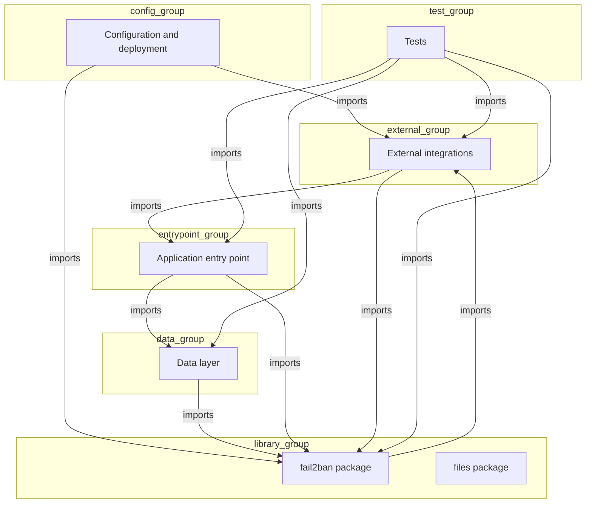

# Architecture report: fail2ban/fail2ban

> Automated static analysis. **Observed** = directly seen in files/imports/AST; **Inferred** = interpretation from that evidence. Repository code was not executed.

## 1. Repository at a glance

| Item | Value |
| --- | --- |
| Repository | fail2ban/fail2ban |
| Description | Daemon to ban hosts that cause multiple authentication errors |
| Language | Python |
| Stars | 19007 |
| Licence | Other |
| Analysed commit / branch | 66de71930412d3c2780d8c7f1dead70824344784 / master |
| Framework(s) | None detected |
| Files analysed | 526 |
| Components | 7 |

## 2. Architecture in one minute

fail2ban/fail2ban - Daemon to ban hosts that cause multiple authentication errors. This repository was analysed statically from 526 file(s) (81 Python). Detected technologies (observed from imports/manifests): GitHub Actions, SQLite, requests, setuptools, unittest. Files are grouped into 7 component(s): Configuration and deployment, Data layer, Application entry point, External integrations, fail2ban package, files package, Tests. Findings below distinguish observed facts from inferred interpretation.

## 3. High-level block diagram

## 4. Main components

### Configuration and deployment (`config`)

- **Kind:** config
- **Status:** Observed
- **Confidence:** 0.85
- **Responsibility:** Groups 5 file(s) under configuration and deployment (observed from repository paths and static analysis). Observed top-level classes: SMTPAction, install_command_f2b, install_scripts_f2b. Observed top-level functions: updatePyExec.
- **Paths:** `MANIFEST.in`, `config/action.d/smtp.py`, `fail2ban/setup.py`, `setup.cfg`, `setup.py`
- **Evidence:** [MANIFEST.in](https://github.com/fail2ban/fail2ban/blob/66de71930412d3c2780d8c7f1dead70824344784/MANIFEST.in); [config/action.d/smtp.py:73](https://github.com/fail2ban/fail2ban/blob/66de71930412d3c2780d8c7f1dead70824344784/config/action.d/smtp.py#L73); [fail2ban/setup.py:27](https://github.com/fail2ban/fail2ban/blob/66de71930412d3c2780d8c7f1dead70824344784/fail2ban/setup.py#L27); [setup.cfg](https://github.com/fail2ban/fail2ban/blob/66de71930412d3c2780d8c7f1dead70824344784/setup.cfg); [setup.py:50](https://github.com/fail2ban/fail2ban/blob/66de71930412d3c2780d8c7f1dead70824344784/setup.py#L50)

### Data layer (`data_layer`)

- **Kind:** data
- **Status:** Observed
- **Confidence:** 0.85
- **Responsibility:** Groups 1 file(s) under data layer (observed from repository paths and static analysis). Observed top-level classes: Fail2BanDb. Observed top-level functions: _json_default, _json_dumps_safe, _json_loads_safe, commitandrollback.
- **Paths:** `fail2ban/server/database.py`
- **Evidence:** [fail2ban/server/database.py:42](https://github.com/fail2ban/fail2ban/blob/66de71930412d3c2780d8c7f1dead70824344784/fail2ban/server/database.py#L42)

### Application entry point (`entrypoint`)

- **Kind:** entrypoint
- **Status:** Observed
- **Confidence:** 0.85
- **Responsibility:** Groups 1 file(s) under application entry point (observed from repository paths and static analysis). Observed top-level classes: Server, ServerInitializationError. Observed top-level functions: _make_file_path, _thread_name.
- **Paths:** `fail2ban/server/server.py`
- **Evidence:** [fail2ban/server/server.py:58](https://github.com/fail2ban/fail2ban/blob/66de71930412d3c2780d8c7f1dead70824344784/fail2ban/server/server.py#L58)

### External integrations (`external_integrations`)

- **Kind:** external
- **Status:** Observed
- **Confidence:** 0.85
- **Responsibility:** Groups 15 file(s) under external integrations (observed from repository paths and static analysis). Observed top-level classes: ActionReader, BasicInterpolationWithName, Beautifier, CSocket, ConfigReader, ConfigReaderUnshared. Observed top-level functions: VisualWait, _OptionsTemplateGen, _expandConfFilesWithLocal, _loc_except_hook, _thread_name, debuggexURL.
- **Paths:** `fail2ban/client/__init__.py`, `fail2ban/client/actionreader.py`, `fail2ban/client/beautifier.py`, `fail2ban/client/configparserinc.py`, `fail2ban/client/configreader.py`, `fail2ban/client/configurator.py`, `fail2ban/client/csocket.py`, `fail2ban/client/fail2banclient.py`, `fail2ban/client/fail2bancmdline.py`, `fail2ban/client/fail2banreader.py`, `fail2ban/client/fail2banregex.py`, `fail2ban/client/fail2banserver.py`, `fail2ban/client/filterreader.py`, `fail2ban/client/jailreader.py`, `fail2ban/client/jailsreader.py`
- **Evidence:** [fail2ban/client/__init__.py](https://github.com/fail2ban/fail2ban/blob/66de71930412d3c2780d8c7f1dead70824344784/fail2ban/client/__init__.py); [fail2ban/client/actionreader.py:37](https://github.com/fail2ban/fail2ban/blob/66de71930412d3c2780d8c7f1dead70824344784/fail2ban/client/actionreader.py#L37); [fail2ban/client/beautifier.py:39](https://github.com/fail2ban/fail2ban/blob/66de71930412d3c2780d8c7f1dead70824344784/fail2ban/client/beautifier.py#L39); [fail2ban/client/configparserinc.py:38](https://github.com/fail2ban/fail2ban/blob/66de71930412d3c2780d8c7f1dead70824344784/fail2ban/client/configparserinc.py#L38); [fail2ban/client/configreader.py:41](https://github.com/fail2ban/fail2ban/blob/66de71930412d3c2780d8c7f1dead70824344784/fail2ban/client/configreader.py#L41); [fail2ban/client/configurator.py:35](https://github.com/fail2ban/fail2ban/blob/66de71930412d3c2780d8c7f1dead70824344784/fail2ban/client/configurator.py#L35); [fail2ban/client/csocket.py:33](https://github.com/fail2ban/fail2ban/blob/66de71930412d3c2780d8c7f1dead70824344784/fail2ban/client/csocket.py#L33); [fail2ban/client/fail2banclient.py:44](https://github.com/fail2ban/fail2ban/blob/66de71930412d3c2780d8c7f1dead70824344784/fail2ban/client/fail2banclient.py#L44)

### fail2ban package (`fail2ban`)

- **Kind:** library
- **Status:** Observed
- **Confidence:** 0.85
- **Responsibility:** Groups 30 file(s) under fail2ban package (observed from repository paths and static analysis). Observed top-level classes: ActionBase, Actions, AsyncServer, AsyncServerException, BanManager, BanTicket. Observed top-level functions: _Logger_notice, _NetworkInterfacesAddrs, __extend_compat_path, __printWikiHeader, __safeLog, __safeLogFlush.
- **Paths:** `fail2ban/__init__.py`, `fail2ban/compat/asynchat.py`, `fail2ban/compat/asyncore.py`, `fail2ban/exceptions.py`, `fail2ban/helpers.py`, `fail2ban/protocol.py`, `fail2ban/server/__init__.py`, `fail2ban/server/action.py`, `fail2ban/server/actions.py`, `fail2ban/server/asyncserver.py`, `fail2ban/server/banmanager.py`, `fail2ban/server/datedetector.py`, `fail2ban/server/datetemplate.py`, `fail2ban/server/failmanager.py`, `fail2ban/server/failregex.py`, `fail2ban/server/filter.py`, `fail2ban/server/filterpoll.py`, `fail2ban/server/filterpyinotify.py`, `fail2ban/server/filtersystemd.py`, `fail2ban/server/ipdns.py`, `fail2ban/server/jail.py`, `fail2ban/server/jails.py`, `fail2ban/server/jailthread.py`, `fail2ban/server/mytime.py`, `fail2ban/server/observer.py`, `fail2ban/server/strptime.py`, `fail2ban/server/ticket.py`, `fail2ban/server/transmitter.py`, `fail2ban/server/utils.py`, `fail2ban/version.py`
- **Evidence:** [fail2ban/__init__.py:48](https://github.com/fail2ban/fail2ban/blob/66de71930412d3c2780d8c7f1dead70824344784/fail2ban/__init__.py#L48); [fail2ban/compat/asynchat.py:55](https://github.com/fail2ban/fail2ban/blob/66de71930412d3c2780d8c7f1dead70824344784/fail2ban/compat/asynchat.py#L55); [fail2ban/compat/asyncore.py:68](https://github.com/fail2ban/fail2ban/blob/66de71930412d3c2780d8c7f1dead70824344784/fail2ban/compat/asyncore.py#L68); [fail2ban/exceptions.py:30](https://github.com/fail2ban/fail2ban/blob/66de71930412d3c2780d8c7f1dead70824344784/fail2ban/exceptions.py#L30); [fail2ban/helpers.py:45](https://github.com/fail2ban/fail2ban/blob/66de71930412d3c2780d8c7f1dead70824344784/fail2ban/helpers.py#L45); [fail2ban/protocol.py:29](https://github.com/fail2ban/fail2ban/blob/66de71930412d3c2780d8c7f1dead70824344784/fail2ban/protocol.py#L29); [fail2ban/server/__init__.py](https://github.com/fail2ban/fail2ban/blob/66de71930412d3c2780d8c7f1dead70824344784/fail2ban/server/__init__.py); [fail2ban/server/action.py:74](https://github.com/fail2ban/fail2ban/blob/66de71930412d3c2780d8c7f1dead70824344784/fail2ban/server/action.py#L74)

### files package (`files`)

- **Kind:** library
- **Status:** Observed
- **Confidence:** 0.85
- **Responsibility:** Groups 1 file(s) under files package (observed from repository paths and static analysis).
- **Paths:** `files/cacti/fail2ban_stats.sh`
- **Evidence:** [files/cacti/fail2ban_stats.sh](https://github.com/fail2ban/fail2ban/blob/66de71930412d3c2780d8c7f1dead70824344784/files/cacti/fail2ban_stats.sh)

### Tests (`tests`)

- **Kind:** test
- **Status:** Observed
- **Confidence:** 0.85
- **Responsibility:** Groups 176 file(s) under tests (observed from repository paths and static analysis). Observed top-level classes: AddFailure, BanTimeIncr, BanTimeIncrDB, BasicFilter, BeautifierTest, ClientMisc. Observed top-level functions: TestMsgError, _Fail2banRegex, _assert_correct_last_attempt, _assert_equal_entries, _copy_lines_between_files, _copy_lines_to_journal.
- **Paths:** `fail2ban/tests/__init__.py`, `fail2ban/tests/action_d/__init__.py`, `fail2ban/tests/action_d/test_smtp.py`, `fail2ban/tests/actionstestcase.py`, `fail2ban/tests/actiontestcase.py`, `fail2ban/tests/banmanagertestcase.py`, `fail2ban/tests/clientbeautifiertestcase.py`, `fail2ban/tests/clientreadertestcase.py`, `fail2ban/tests/config/action.d/action.conf`, `fail2ban/tests/config/action.d/brokenaction.conf`, `fail2ban/tests/config/fail2ban.conf`, `fail2ban/tests/config/filter.d/checklogtype.conf`, `fail2ban/tests/config/filter.d/checklogtype_test.conf`, `fail2ban/tests/config/filter.d/simple.conf`, `fail2ban/tests/config/filter.d/test.conf`, `fail2ban/tests/config/filter.d/test.local`, `fail2ban/tests/config/filter.d/zzz-generic-example.conf`, `fail2ban/tests/config/filter.d/zzz-sshd-obsolete-multiline.conf`, `fail2ban/tests/config/jail.conf`, `fail2ban/tests/databasetestcase.py`, `fail2ban/tests/datedetectortestcase.py`, `fail2ban/tests/dummyjail.py`, `fail2ban/tests/fail2banclienttestcase.py`, `fail2ban/tests/fail2banregextestcase.py`, `fail2ban/tests/failmanagertestcase.py`, `fail2ban/tests/files/action.d/action.py`, `fail2ban/tests/files/action.d/action_checkainfo.py`, `fail2ban/tests/files/action.d/action_errors.py`, `fail2ban/tests/files/action.d/action_modifyainfo.py`, `fail2ban/tests/files/action.d/action_noAction.py`, `fail2ban/tests/files/action.d/action_nomethod.py`, `fail2ban/tests/files/config/apache-auth/README`, `fail2ban/tests/files/config/apache-auth/basic/authz_owner/.htaccess`, `fail2ban/tests/files/config/apache-auth/basic/authz_owner/.htpasswd`, `fail2ban/tests/files/config/apache-auth/basic/authz_owner/cant_get_me.html`, `fail2ban/tests/files/config/apache-auth/basic/file/.htaccess`, `fail2ban/tests/files/config/apache-auth/basic/file/.htpasswd`, `fail2ban/tests/files/config/apache-auth/digest.py`, `fail2ban/tests/files/config/apache-auth/digest/.htaccess`, `fail2ban/tests/files/config/apache-auth/digest/.htpasswd`, `fail2ban/tests/files/config/apache-auth/digest_anon/.htaccess`, `fail2ban/tests/files/config/apache-auth/digest_anon/.htpasswd`, `fail2ban/tests/files/config/apache-auth/digest_time/.htaccess`, `fail2ban/tests/files/config/apache-auth/digest_time/.htpasswd`, `fail2ban/tests/files/config/apache-auth/digest_wrongrelm/.htaccess`, `fail2ban/tests/files/config/apache-auth/digest_wrongrelm/.htpasswd`, `fail2ban/tests/files/config/apache-auth/noentry/.htaccess`, `fail2ban/tests/files/filter.d/substitution.conf`, `fail2ban/tests/files/filter.d/testcase-common.conf`, `fail2ban/tests/files/filter.d/testcase01.conf`, `fail2ban/tests/files/filter.d/testcase02.conf`, `fail2ban/tests/files/filter.d/testcase02.local`, `fail2ban/tests/files/ignorecommand.py`, `fail2ban/tests/files/logs/3proxy`, `fail2ban/tests/files/logs/apache-auth`, `fail2ban/tests/files/logs/apache-badbots`, `fail2ban/tests/files/logs/apache-botsearch`, `fail2ban/tests/files/logs/apache-fakegooglebot`, `fail2ban/tests/files/logs/apache-modsecurity`, `fail2ban/tests/files/logs/apache-nohome`, `fail2ban/tests/files/logs/apache-noscript`, `fail2ban/tests/files/logs/apache-overflows`, `fail2ban/tests/files/logs/apache-pass`, `fail2ban/tests/files/logs/apache-shellshock`, `fail2ban/tests/files/logs/assp`, `fail2ban/tests/files/logs/asterisk`, `fail2ban/tests/files/logs/authelia`, `fail2ban/tests/files/logs/bitwarden`, `fail2ban/tests/files/logs/bsd/syslog-plain.txt`, `fail2ban/tests/files/logs/bsd/syslog-v.txt`, `fail2ban/tests/files/logs/bsd/syslog-vv.txt`, `fail2ban/tests/files/logs/centreon`, `fail2ban/tests/files/logs/counter-strike`, `fail2ban/tests/files/logs/courier-auth`, `fail2ban/tests/files/logs/courier-smtp`, `fail2ban/tests/files/logs/cowrie`, `fail2ban/tests/files/logs/cyrus-imap`, `fail2ban/tests/files/logs/dante`, `fail2ban/tests/files/logs/directadmin`, `fail2ban/tests/files/logs/domino-smtp`, `fail2ban/tests/files/logs/dovecot`, `fail2ban/tests/files/logs/dropbear`, `fail2ban/tests/files/logs/drupal-auth`, `fail2ban/tests/files/logs/ejabberd-auth`, `fail2ban/tests/files/logs/exim`, `fail2ban/tests/files/logs/exim-spam`, `fail2ban/tests/files/logs/freeswitch`, `fail2ban/tests/files/logs/froxlor-auth`, `fail2ban/tests/files/logs/gitlab`, `fail2ban/tests/files/logs/grafana`, `fail2ban/tests/files/logs/groupoffice`, `fail2ban/tests/files/logs/gssftpd`, `fail2ban/tests/files/logs/guacamole`, `fail2ban/tests/files/logs/haproxy-http-auth`, `fail2ban/tests/files/logs/horde`, `fail2ban/tests/files/logs/kerio`, `fail2ban/tests/files/logs/lighttpd-auth`, `fail2ban/tests/files/logs/mongodb-auth`, `fail2ban/tests/files/logs/monit`, `fail2ban/tests/files/logs/monitorix`, `fail2ban/tests/files/logs/mssql-auth`, `fail2ban/tests/files/logs/murmur`, `fail2ban/tests/files/logs/mysqld-auth`, `fail2ban/tests/files/logs/nagios`, `fail2ban/tests/files/logs/named-refused`, `fail2ban/tests/files/logs/nginx-bad-request`, `fail2ban/tests/files/logs/nginx-botsearch`, `fail2ban/tests/files/logs/nginx-forbidden`, `fail2ban/tests/files/logs/nginx-http-auth`, `fail2ban/tests/files/logs/nginx-limit-req`, `fail2ban/tests/files/logs/nsd`, `fail2ban/tests/files/logs/openhab`, `fail2ban/tests/files/logs/openvpn`, `fail2ban/tests/files/logs/openwebmail`, `fail2ban/tests/files/logs/oracleims`, `fail2ban/tests/files/logs/pam-generic`, `fail2ban/tests/files/logs/perdition`, `fail2ban/tests/files/logs/php-url-fopen`, `fail2ban/tests/files/logs/phpmyadmin-syslog`, `fail2ban/tests/files/logs/portsentry`, `fail2ban/tests/files/logs/postfix`, `fail2ban/tests/files/logs/proftpd`, `fail2ban/tests/files/logs/proxmox`, `fail2ban/tests/files/logs/pure-ftpd`, `fail2ban/tests/files/logs/qmail`, `fail2ban/tests/files/logs/recidive`, `fail2ban/tests/files/logs/roundcube-auth`, `fail2ban/tests/files/logs/routeros-auth`, `fail2ban/tests/files/logs/scanlogd`, `fail2ban/tests/files/logs/screensharingd`, `fail2ban/tests/files/logs/selinux-ssh`, `fail2ban/tests/files/logs/sendmail-auth`, `fail2ban/tests/files/logs/sendmail-reject`, `fail2ban/tests/files/logs/sieve`, `fail2ban/tests/files/logs/slapd`, `fail2ban/tests/files/logs/softethervpn`, `fail2ban/tests/files/logs/sogo-auth`, `fail2ban/tests/files/logs/solid-pop3d`, `fail2ban/tests/files/logs/squid`, `fail2ban/tests/files/logs/squirrelmail`, `fail2ban/tests/files/logs/sshd`, `fail2ban/tests/files/logs/sshd-journal`, `fail2ban/tests/files/logs/stunnel`, `fail2ban/tests/files/logs/suhosin`, `fail2ban/tests/files/logs/tine20`, `fail2ban/tests/files/logs/traefik-auth`, `fail2ban/tests/files/logs/uwimap-auth`, `fail2ban/tests/files/logs/vaultwarden`, `fail2ban/tests/files/logs/vsftpd`, `fail2ban/tests/files/logs/webmin-auth`, `fail2ban/tests/files/logs/wuftpd`, `fail2ban/tests/files/logs/xinetd-fail`, `fail2ban/tests/files/logs/xrdp`, `fail2ban/tests/files/logs/znc-adminlog`, `fail2ban/tests/files/logs/zoneminder`, `fail2ban/tests/files/logs/zzz-generic-example`, `fail2ban/tests/files/logs/zzz-sshd-obsolete-multiline`, `fail2ban/tests/files/test-ign-ips-file`, `fail2ban/tests/files/testcase-journal.log`, `fail2ban/tests/files/testcase-multiline.log`, `fail2ban/tests/files/testcase-usedns.log`, `fail2ban/tests/files/testcase-wrong-char.log`, `fail2ban/tests/files/testcase01.log`, `fail2ban/tests/files/testcase01a.log`, `fail2ban/tests/files/testcase02.log`, `fail2ban/tests/files/testcase03.log`, `fail2ban/tests/files/testcase04.log`, `fail2ban/tests/files/zzz-sshd-obsolete-multiline.log`, `fail2ban/tests/filtertestcase.py`, `fail2ban/tests/misctestcase.py`, `fail2ban/tests/observertestcase.py`, `fail2ban/tests/samplestestcase.py`, `fail2ban/tests/servertestcase.py`, `fail2ban/tests/sockettestcase.py`, `fail2ban/tests/tickettestcase.py`, `fail2ban/tests/utils.py`
- **Evidence:** [fail2ban/tests/__init__.py](https://github.com/fail2ban/fail2ban/blob/66de71930412d3c2780d8c7f1dead70824344784/fail2ban/tests/__init__.py); [fail2ban/tests/action_d/__init__.py](https://github.com/fail2ban/fail2ban/blob/66de71930412d3c2780d8c7f1dead70824344784/fail2ban/tests/action_d/__init__.py); [fail2ban/tests/action_d/test_smtp.py:32](https://github.com/fail2ban/fail2ban/blob/66de71930412d3c2780d8c7f1dead70824344784/fail2ban/tests/action_d/test_smtp.py#L32); [fail2ban/tests/actionstestcase.py:39](https://github.com/fail2ban/fail2ban/blob/66de71930412d3c2780d8c7f1dead70824344784/fail2ban/tests/actionstestcase.py#L39); [fail2ban/tests/actiontestcase.py:40](https://github.com/fail2ban/fail2ban/blob/66de71930412d3c2780d8c7f1dead70824344784/fail2ban/tests/actiontestcase.py#L40); [fail2ban/tests/banmanagertestcase.py:35](https://github.com/fail2ban/fail2ban/blob/66de71930412d3c2780d8c7f1dead70824344784/fail2ban/tests/banmanagertestcase.py#L35); [fail2ban/tests/clientbeautifiertestcase.py:31](https://github.com/fail2ban/fail2ban/blob/66de71930412d3c2780d8c7f1dead70824344784/fail2ban/tests/clientbeautifiertestcase.py#L31); [fail2ban/tests/clientreadertestcase.py:53](https://github.com/fail2ban/fail2ban/blob/66de71930412d3c2780d8c7f1dead70824344784/fail2ban/tests/clientreadertestcase.py#L53)

## 5. Execution flow

No entry point was observed; the startup flow below is therefore limited.

Representative flow (derived from observed entry points and the import graph; steps beyond the entry point are **Inferred**):

1. Execution starts at an observed entry point listed above, if present.
2. `config` imports `external_integrations` (Configuration and deployment -> External integrations).
3. `config` imports `fail2ban` (Configuration and deployment -> fail2ban package).
4. `data_layer` imports `fail2ban` (Data layer -> fail2ban package).
5. `entrypoint` imports `data_layer` (Application entry point -> Data layer).
6. `entrypoint` imports `fail2ban` (Application entry point -> fail2ban package).
7. `external_integrations` imports `entrypoint` (External integrations -> Application entry point).
8. `external_integrations` imports `fail2ban` (External integrations -> fail2ban package).
9. `fail2ban` imports `external_integrations` (fail2ban package -> External integrations).

## 6. Project structure

### `(root)`

- `.codespellrc` - other (678 bytes)
- `.coveragerc` - other (169 bytes)
- `.gitattributes` - other (37 bytes)
- `.gitignore` - other (93 bytes)
- `.mailmap` - other (206 bytes)
- `.pylintrc` - other (1311 bytes)
- `.typos.toml` - config (675 bytes)
- `CONTRIBUTING.md` - docs (1107 bytes)
- `COPYING` - other (19296 bytes)
- `ChangeLog` - other (157776 bytes)
- `DEVELOP` - other (8619 bytes)
- `FILTERS` - other (19836 bytes)
- `MANIFEST` - other (15619 bytes)
- `MANIFEST.in` - manifest (199 bytes)
- `README.Solaris` - other (4189 bytes)
- `README.md` - docs (5377 bytes)
- `RELEASE` - other (6569 bytes)
- `THANKS` - other (2451 bytes)
- `TODO` - other (908 bytes)
- `Vagrantfile` - other (963 bytes)
- `fail2ban-testcases-all` - other (399 bytes)
- `fail2ban-testcases-all-python3` - other (399 bytes)
- `kill-server` - other (69 bytes)
- `setup.cfg` - manifest (244 bytes)
- `setup.py` - manifest, Python (9207 bytes)

### `.github`

- `.github/FUNDING.yml` - config (117 bytes)
- `.github/ISSUE_TEMPLATE/bug_report.md` - docs (2320 bytes)
- `.github/ISSUE_TEMPLATE/feature_request.md` - docs (944 bytes)
- `.github/ISSUE_TEMPLATE/filter_request.md` - docs (1706 bytes)
- `.github/PULL_REQUEST_TEMPLATE.md` - docs (598 bytes)
- `.github/workflows/codespell.yml` - ci, YAML (355 bytes)
- `.github/workflows/main.yml` - ci, YAML (4931 bytes)
- `.github/workflows/publish.yml` - ci, YAML (878 bytes)

### `bin`

- `bin/fail2ban-client` - other (1423 bytes)
- `bin/fail2ban-regex` - other (1284 bytes)
- `bin/fail2ban-server` - other (1421 bytes)
- `bin/fail2ban-testcases` - other (2289 bytes)

### `config`

- `config/action.d/abuseipdb.conf` - other (3724 bytes)
- `config/action.d/apf.conf` - other (587 bytes)
- `config/action.d/apprise.conf` - other (3467 bytes)
- `config/action.d/blocklist_de.conf` - other (2790 bytes)
- `config/action.d/bsd-ipfw.conf` - other (3226 bytes)
- `config/action.d/cloudflare-token.conf` - other (3075 bytes)
- `config/action.d/cloudflare.conf` - other (3037 bytes)
- `config/action.d/complain.conf` - other (4772 bytes)
- `config/action.d/csf.conf` - other (581 bytes)
- `config/action.d/dshield.conf` - other (7684 bytes)
- `config/action.d/dummy.conf` - other (1717 bytes)
- `config/action.d/firewallcmd-allports.conf` - other (1501 bytes)
- `config/action.d/firewallcmd-common.conf` - other (2649 bytes)
- `config/action.d/firewallcmd-ipset.conf` - other (4223 bytes)
- `config/action.d/firewallcmd-multiport.conf` - other (1270 bytes)
- `config/action.d/firewallcmd-new.conf` - other (1898 bytes)
- `config/action.d/firewallcmd-rich-logging.conf` - other (1021 bytes)
- `config/action.d/firewallcmd-rich-rules.conf` - other (1793 bytes)
- `config/action.d/helpers-common.conf` - other (592 bytes)
- `config/action.d/hostsdeny.conf` - other (1657 bytes)
- `config/action.d/ipfilter.conf` - other (1573 bytes)
- `config/action.d/ipfw.conf` - other (1505 bytes)
- `config/action.d/iptables-allports.conf` - other (291 bytes)
- `config/action.d/iptables-ipset-proto4.conf` - other (2221 bytes)
- `config/action.d/iptables-ipset-proto6-allports.conf` - other (814 bytes)
- `config/action.d/iptables-ipset-proto6.conf` - other (773 bytes)
- `config/action.d/iptables-ipset.conf` - other (3052 bytes)
- `config/action.d/iptables-multiport-log.conf` - other (2163 bytes)
- `config/action.d/iptables-multiport.conf` - other (232 bytes)
- `config/action.d/iptables-new.conf` - other (332 bytes)
- `config/action.d/iptables-xt_recent-echo.conf` - other (2876 bytes)
- `config/action.d/iptables.conf` - other (4861 bytes)
- `config/action.d/ipthreat.conf` - other (4290 bytes)
- `config/action.d/mail-buffered.conf` - other (2495 bytes)
- `config/action.d/mail-whois-common.conf` - other (1051 bytes)
- `config/action.d/mail-whois-lines.conf` - other (2459 bytes)
- `config/action.d/mail-whois.conf` - other (1890 bytes)
- `config/action.d/mail.conf` - other (1757 bytes)
- `config/action.d/mikrotik.conf` - other (2546 bytes)
- `config/action.d/mynetwatchman.conf` - other (5321 bytes)
- `config/action.d/netscaler.conf` - other (1493 bytes)
- `config/action.d/nftables-allports.conf` - other (383 bytes)
- `config/action.d/nftables-multiport.conf` - other (384 bytes)
- `config/action.d/nftables.conf` - other (7071 bytes)
- `config/action.d/nginx-block-map.conf` - other (4010 bytes)
- `config/action.d/npf.conf` - other (1524 bytes)
- `config/action.d/nsupdate.conf` - other (3234 bytes)
- `config/action.d/osx-afctl.conf` - other (497 bytes)
- `config/action.d/osx-ipfw.conf` - other (2302 bytes)
- `config/action.d/pf.conf` - other (4082 bytes)
- `config/action.d/route.conf` - other (1023 bytes)
- `config/action.d/sendmail-buffered.conf` - other (2806 bytes)
- `config/action.d/sendmail-common.conf` - other (1938 bytes)
- `config/action.d/sendmail-geoip-lines.conf` - other (1761 bytes)
- `config/action.d/sendmail-whois-ipjailmatches.conf` - other (1055 bytes)
- `config/action.d/sendmail-whois-ipmatches.conf` - other (1036 bytes)
- `config/action.d/sendmail-whois-lines.conf` - other (1299 bytes)
- `config/action.d/sendmail-whois-matches.conf` - other (1000 bytes)
- `config/action.d/sendmail-whois.conf` - other (950 bytes)
- `config/action.d/sendmail.conf` - other (829 bytes)
- `config/action.d/shorewall-ipset-proto6.conf` - other (3952 bytes)
- `config/action.d/shorewall.conf` - other (2156 bytes)
- `config/action.d/smtp.py` - source, Python (6725 bytes)
- `config/action.d/symbiosis-blacklist-allports.conf` - other (1503 bytes)
- `config/action.d/ufw.conf` - other (2382 bytes)
- `config/action.d/xarf-login-attack.conf` - other (6679 bytes)
- `config/fail2ban.conf` - other (3017 bytes)
- `config/filter.d/3proxy.conf` - other (467 bytes)
- `config/filter.d/apache-auth.conf` - other (3229 bytes)
- `config/filter.d/apache-badbots.conf` - other (2901 bytes)
- `config/filter.d/apache-botsearch.conf` - other (1265 bytes)
- `config/filter.d/apache-common.conf` - other (1630 bytes)
- `config/filter.d/apache-fakegooglebot.conf` - other (436 bytes)
- `config/filter.d/apache-modsecurity.conf` - other (511 bytes)
- `config/filter.d/apache-nohome.conf` - other (596 bytes)
- `config/filter.d/apache-noscript.conf` - other (1348 bytes)
- `config/filter.d/apache-overflows.conf` - other (2189 bytes)
- `config/filter.d/apache-pass.conf` - other (362 bytes)
- `config/filter.d/apache-shellshock.conf` - other (1020 bytes)
- `config/filter.d/assp.conf` - other (3492 bytes)
- `config/filter.d/asterisk.conf` - other (2395 bytes)
- `config/filter.d/authelia.conf` - other (1500 bytes)
- `config/filter.d/bitwarden.conf` - other (427 bytes)
- `config/filter.d/botsearch-common.conf` - other (522 bytes)
- `config/filter.d/centreon.conf` - other (307 bytes)
- `config/filter.d/common.conf` - other (2714 bytes)
- `config/filter.d/counter-strike.conf` - other (244 bytes)
- `config/filter.d/courier-auth.conf` - other (463 bytes)
- `config/filter.d/courier-smtp.conf` - other (512 bytes)
- `config/filter.d/cowrie.conf` - other (1102 bytes)
- `config/filter.d/cyrus-imap.conf` - other (444 bytes)
- `config/filter.d/dante.conf` - other (467 bytes)
- `config/filter.d/directadmin.conf` - other (338 bytes)
- `config/filter.d/domino-smtp.conf` - other (1939 bytes)
- `config/filter.d/dovecot.conf` - other (3030 bytes)
- `config/filter.d/dropbear.conf` - other (2011 bytes)
- `config/filter.d/drupal-auth.conf` - other (547 bytes)
- `config/filter.d/ejabberd-auth.conf` - other (1572 bytes)
- `config/filter.d/exim-common.conf` - other (1473 bytes)
- `config/filter.d/exim-spam.conf` - other (2114 bytes)
- `config/filter.d/exim.conf` - other (2249 bytes)
- `config/filter.d/freeswitch.conf` - other (1892 bytes)
- `config/filter.d/froxlor-auth.conf` - other (1305 bytes)
- `config/filter.d/gitlab.conf` - other (1337 bytes)
- `config/filter.d/grafana.conf` - other (388 bytes)
- `config/filter.d/groupoffice.conf` - other (236 bytes)
- `config/filter.d/gssftpd.conf` - other (322 bytes)
- `config/filter.d/guacamole.conf` - other (1447 bytes)
- `config/filter.d/haproxy-http-auth.conf` - other (1170 bytes)
- `config/filter.d/horde.conf` - other (404 bytes)
- `config/filter.d/ignorecommands/apache-fakegooglebot` - other (1418 bytes)
- `config/filter.d/kerio.conf` - other (938 bytes)
- `config/filter.d/lighttpd-auth.conf` - other (487 bytes)
- `config/filter.d/mongodb-auth.conf` - other (2279 bytes)
- `config/filter.d/monit.conf` - other (787 bytes)
- `config/filter.d/monitorix.conf` - other (640 bytes)
- `config/filter.d/mssql-auth.conf` - other (441 bytes)
- `config/filter.d/murmur.conf` - other (927 bytes)
- `config/filter.d/mysqld-auth.conf` - other (1181 bytes)
- `config/filter.d/nagios.conf` - other (400 bytes)
- `config/filter.d/named-refused.conf` - other (1616 bytes)
- `config/filter.d/nginx-bad-request.conf` - other (474 bytes)
- `config/filter.d/nginx-botsearch.conf` - other (764 bytes)
- `config/filter.d/nginx-error-common.conf` - other (768 bytes)
- `config/filter.d/nginx-forbidden.conf` - other (914 bytes)
- `config/filter.d/nginx-http-auth.conf` - other (1242 bytes)
- `config/filter.d/nginx-limit-req.conf` - other (1677 bytes)
- `config/filter.d/nsd.conf` - other (779 bytes)
- `config/filter.d/openhab.conf` - other (452 bytes)
- `config/filter.d/openvpn.conf` - other (480 bytes)
- `config/filter.d/openwebmail.conf` - other (495 bytes)
- `config/filter.d/oracleims.conf` - other (1937 bytes)
- `config/filter.d/pam-generic.conf` - other (957 bytes)
- `config/filter.d/perdition.conf` - other (568 bytes)
- `config/filter.d/php-url-fopen.conf` - other (891 bytes)
- `config/filter.d/phpmyadmin-syslog.conf` - other (278 bytes)
- `config/filter.d/portsentry.conf` - other (242 bytes)
- `config/filter.d/postfix.conf` - other (3854 bytes)
- `config/filter.d/proftpd.conf` - other (1163 bytes)
- `config/filter.d/proxmox.conf` - other (383 bytes)
- `config/filter.d/pure-ftpd.conf` - other (2409 bytes)
- `config/filter.d/qmail.conf` - other (795 bytes)
- `config/filter.d/recidive.conf` - other (1740 bytes)
- `config/filter.d/roundcube-auth.conf` - other (1507 bytes)
- `config/filter.d/routeros-auth.conf` - other (225 bytes)
- `config/filter.d/scanlogd.conf` - other (354 bytes)
- `config/filter.d/screensharingd.conf` - other (821 bytes)
- `config/filter.d/selinux-common.conf` - other (549 bytes)
- `config/filter.d/selinux-ssh.conf` - other (653 bytes)
- `config/filter.d/sendmail-auth.conf` - other (790 bytes)
- `config/filter.d/sendmail-reject.conf` - other (3961 bytes)
- `config/filter.d/sieve.conf` - other (371 bytes)
- `config/filter.d/slapd.conf` - other (657 bytes)
- `config/filter.d/softethervpn.conf` - other (451 bytes)
- `config/filter.d/sogo-auth.conf` - other (723 bytes)
- `config/filter.d/solid-pop3d.conf` - other (1094 bytes)
- `config/filter.d/squid.conf` - other (260 bytes)
- `config/filter.d/squirrelmail.conf` - other (191 bytes)
- `config/filter.d/sshd.conf` - other (8375 bytes)
- `config/filter.d/stunnel.conf` - other (363 bytes)
- `config/filter.d/suhosin.conf` - other (649 bytes)
- `config/filter.d/tine20.conf` - other (890 bytes)
- `config/filter.d/traefik-auth.conf` - other (2388 bytes)
- `config/filter.d/uwimap-auth.conf` - other (374 bytes)
- `config/filter.d/vaultwarden.conf` - other (419 bytes)
- `config/filter.d/vsftpd.conf` - other (787 bytes)
- `config/filter.d/webmin-auth.conf` - other (444 bytes)
- `config/filter.d/wuftpd.conf` - other (520 bytes)
- `config/filter.d/xinetd-fail.conf` - other (521 bytes)
- `config/filter.d/xrdp.conf` - other (669 bytes)
- `config/filter.d/znc-adminlog.conf` - other (912 bytes)
- `config/filter.d/zoneminder.conf` - other (1146 bytes)
- `config/jail.conf` - other (26197 bytes)
- `config/paths-arch.conf` - other (712 bytes)
- `config/paths-common.conf` - other (2897 bytes)
- `config/paths-debian.conf` - other (744 bytes)
- `config/paths-fedora.conf` - other (997 bytes)
- `config/paths-freebsd.conf` - other (1045 bytes)
- `config/paths-opensuse.conf` - other (1042 bytes)
- `config/paths-osx.conf` - other (349 bytes)

### `doc`

- `doc/Doxyfile` - other (51171 bytes)
- `doc/Makefile` - other (6773 bytes)
- `doc/conf.py` - source, Python (8078 bytes)
- `doc/develop.rst` - docs (24 bytes)
- `doc/fail2ban.client.actionreader.rst` - docs (175 bytes)
- `doc/fail2ban.client.beautifier.rst` - docs (169 bytes)
- `doc/fail2ban.client.configparserinc.rst` - docs (184 bytes)
- `doc/fail2ban.client.configreader.rst` - docs (175 bytes)
- `doc/fail2ban.client.configurator.rst` - docs (175 bytes)
- `doc/fail2ban.client.csocket.rst` - docs (160 bytes)
- `doc/fail2ban.client.fail2banreader.rst` - docs (181 bytes)
- `doc/fail2ban.client.filterreader.rst` - docs (175 bytes)
- `doc/fail2ban.client.jailreader.rst` - docs (169 bytes)
- `doc/fail2ban.client.jailsreader.rst` - docs (172 bytes)
- `doc/fail2ban.client.rst` - docs (378 bytes)
- `doc/fail2ban.exceptions.rst` - docs (148 bytes)
- `doc/fail2ban.helpers.rst` - docs (139 bytes)
- `doc/fail2ban.protocol.rst` - docs (142 bytes)
- `doc/fail2ban.rst` - docs (172 bytes)
- `doc/fail2ban.server.action.rst` - docs (157 bytes)
- `doc/fail2ban.server.actions.rst` - docs (160 bytes)
- `doc/fail2ban.server.asyncserver.rst` - docs (172 bytes)
- `doc/fail2ban.server.banmanager.rst` - docs (169 bytes)
- `doc/fail2ban.server.database.rst` - docs (163 bytes)
- `doc/fail2ban.server.datedetector.rst` - docs (175 bytes)
- `doc/fail2ban.server.datetemplate.rst` - docs (175 bytes)
- `doc/fail2ban.server.failmanager.rst` - docs (172 bytes)
- `doc/fail2ban.server.failregex.rst` - docs (166 bytes)
- `doc/fail2ban.server.filter.rst` - docs (157 bytes)
- `doc/fail2ban.server.filterpoll.rst` - docs (169 bytes)
- `doc/fail2ban.server.filterpyinotify.rst` - docs (184 bytes)
- `doc/fail2ban.server.filtersystemd.rst` - docs (178 bytes)
- `doc/fail2ban.server.jail.rst` - docs (151 bytes)
- `doc/fail2ban.server.jails.rst` - docs (154 bytes)
- `doc/fail2ban.server.jailthread.rst` - docs (169 bytes)
- `doc/fail2ban.server.mytime.rst` - docs (157 bytes)
- `doc/fail2ban.server.rst` - docs (694 bytes)
- `doc/fail2ban.server.server.rst` - docs (157 bytes)
- `doc/fail2ban.server.strptime.rst` - docs (163 bytes)
- `doc/fail2ban.server.ticket.rst` - docs (157 bytes)
- `doc/fail2ban.server.transmitter.rst` - docs (172 bytes)
- `doc/fail2ban.server.utils.rst` - docs (157 bytes)
- `doc/fail2ban.version.rst` - docs (139 bytes)
- `doc/filters.rst` - docs (24 bytes)
- `doc/index.rst` - docs (258 bytes)
- `doc/release.rst` - docs (24 bytes)
- `doc/requirements.txt` - manifest (9 bytes)
- `doc/run-rootless.txt` - docs (3927 bytes)

### `fail2ban`

- `fail2ban/__init__.py` - source, Python (2770 bytes)
- `fail2ban/client/__init__.py` - source, Python (974 bytes)
- `fail2ban/client/actionreader.py` - source, Python (3313 bytes)
- `fail2ban/client/beautifier.py` - source, Python (9948 bytes)
- `fail2ban/client/configparserinc.py` - source, Python (12129 bytes)
- `fail2ban/client/configreader.py` - source, Python (13623 bytes)
- `fail2ban/client/configurator.py` - source, Python (3002 bytes)
- `fail2ban/client/csocket.py` - source, Python (2995 bytes)
- `fail2ban/client/fail2banclient.py` - source, Python (15763 bytes)
- `fail2ban/client/fail2bancmdline.py` - source, Python (11354 bytes)
- `fail2ban/client/fail2banreader.py` - source, Python (2938 bytes)
- `fail2ban/client/fail2banregex.py` - source, Python (30928 bytes)
- `fail2ban/client/fail2banserver.py` - source, Python (7690 bytes)
- `fail2ban/client/filterreader.py` - source, Python (3228 bytes)
- `fail2ban/client/jailreader.py` - source, Python (10160 bytes)
- `fail2ban/client/jailsreader.py` - source, Python (3446 bytes)
- `fail2ban/compat/asynchat.py` - source, Python (11377 bytes)
- `fail2ban/compat/asyncore.py` - source, Python (20086 bytes)
- `fail2ban/exceptions.py` - source, Python (1164 bytes)
- `fail2ban/helpers.py` - source, Python (16940 bytes)
- `fail2ban/protocol.py` - source, Python (11864 bytes)
- `fail2ban/server/__init__.py` - source, Python (974 bytes)
- `fail2ban/server/action.py` - source, Python (30528 bytes)
- `fail2ban/server/actions.py` - source, Python (25444 bytes)
- `fail2ban/server/asyncserver.py` - source, Python (11373 bytes)
- `fail2ban/server/banmanager.py` - source, Python (10911 bytes)
- `fail2ban/server/database.py` - source, Python (28607 bytes)
- `fail2ban/server/datedetector.py` - source, Python (19742 bytes)
- `fail2ban/server/datetemplate.py` - source, Python (12839 bytes)
- `fail2ban/server/failmanager.py` - source, Python (5093 bytes)
- `fail2ban/server/failregex.py` - source, Python (13498 bytes)
- `fail2ban/server/filter.py` - source, Python (49568 bytes)
- `fail2ban/server/filterpoll.py` - source, Python (5384 bytes)
- `fail2ban/server/filterpyinotify.py` - source, Python (13486 bytes)
- `fail2ban/server/filtersystemd.py` - source, Python (19358 bytes)
- `fail2ban/server/ipdns.py` - source, Python (26861 bytes)
- `fail2ban/server/jail.py` - source, Python (11814 bytes)
- `fail2ban/server/jails.py` - source, Python (2815 bytes)
- `fail2ban/server/jailthread.py` - source, Python (4189 bytes)
- `fail2ban/server/mytime.py` - source, Python (7679 bytes)
- `fail2ban/server/observer.py` - source, Python (17584 bytes)
- `fail2ban/server/server.py` - source, Python (29927 bytes)
- `fail2ban/server/strptime.py` - source, Python (13415 bytes)
- `fail2ban/server/ticket.py` - source, Python (8456 bytes)
- `fail2ban/server/transmitter.py` - source, Python (16314 bytes)
- `fail2ban/server/utils.py` - source, Python (11890 bytes)
- `fail2ban/setup.py` - manifest, Python (1694 bytes)
- `fail2ban/tests/__init__.py` - test, Python (974 bytes)
- `fail2ban/tests/action_d/__init__.py` - test, Python (950 bytes)
- `fail2ban/tests/action_d/test_smtp.py` - test, Python (10510 bytes)
- `fail2ban/tests/actionstestcase.py` - test, Python (23133 bytes)
- `fail2ban/tests/actiontestcase.py` - test, Python (25738 bytes)
- `fail2ban/tests/banmanagertestcase.py` - test, Python (9857 bytes)
- `fail2ban/tests/clientbeautifiertestcase.py` - test, Python (12737 bytes)
- `fail2ban/tests/clientreadertestcase.py` - test, Python (44593 bytes)
- `fail2ban/tests/config/action.d/action.conf` - test (80 bytes)
- `fail2ban/tests/config/action.d/brokenaction.conf` - test (51 bytes)
- `fail2ban/tests/config/fail2ban.conf` - test (47 bytes)
- `fail2ban/tests/config/filter.d/checklogtype.conf` - test (681 bytes)
- `fail2ban/tests/config/filter.d/checklogtype_test.conf` - test (216 bytes)
- `fail2ban/tests/config/filter.d/simple.conf` - test (32 bytes)
- `fail2ban/tests/config/filter.d/test.conf` - test (252 bytes)
- `fail2ban/tests/config/filter.d/test.local` - test (637 bytes)
- `fail2ban/tests/config/filter.d/zzz-generic-example.conf` - test (1036 bytes)
- `fail2ban/tests/config/filter.d/zzz-sshd-obsolete-multiline.conf` - test (5871 bytes)
- `fail2ban/tests/config/jail.conf` - test (1913 bytes)
- `fail2ban/tests/databasetestcase.py` - test, Python (24422 bytes)
- `fail2ban/tests/datedetectortestcase.py` - test, Python (27960 bytes)
- `fail2ban/tests/dummyjail.py` - test, Python (2068 bytes)
- `fail2ban/tests/fail2banclienttestcase.py` - test, Python (64354 bytes)
- `fail2ban/tests/fail2banregextestcase.py` - test, Python (30470 bytes)
- `fail2ban/tests/failmanagertestcase.py` - test, Python (8973 bytes)
- `fail2ban/tests/files/action.d/action.py` - test, Python (832 bytes)
- `fail2ban/tests/files/action.d/action_checkainfo.py` - test, Python (523 bytes)
- `fail2ban/tests/files/action.d/action_errors.py` - test, Python (379 bytes)
- `fail2ban/tests/files/action.d/action_modifyainfo.py` - test, Python (545 bytes)
- `fail2ban/tests/files/action.d/action_noAction.py` - test, Python (88 bytes)
- `fail2ban/tests/files/action.d/action_nomethod.py` - test, Python (127 bytes)
- `fail2ban/tests/files/config/apache-auth/README` - test (369 bytes)
- `fail2ban/tests/files/config/apache-auth/basic/authz_owner/.htaccess` - test (136 bytes)
- `fail2ban/tests/files/config/apache-auth/basic/authz_owner/.htpasswd` - test (47 bytes)
- `fail2ban/tests/files/config/apache-auth/basic/authz_owner/cant_get_me.html` - test (0 bytes)
- `fail2ban/tests/files/config/apache-auth/basic/file/.htaccess` - test (129 bytes)
- `fail2ban/tests/files/config/apache-auth/basic/file/.htpasswd` - test (47 bytes)
- `fail2ban/tests/files/config/apache-auth/digest.py` - test, Python (4551 bytes)
- `fail2ban/tests/files/config/apache-auth/digest/.htaccess` - test (159 bytes)
- `fail2ban/tests/files/config/apache-auth/digest/.htpasswd` - test (62 bytes)
- `fail2ban/tests/files/config/apache-auth/digest_anon/.htaccess` - test (231 bytes)
- `fail2ban/tests/files/config/apache-auth/digest_anon/.htpasswd` - test (117 bytes)
- `fail2ban/tests/files/config/apache-auth/digest_time/.htaccess` - test (195 bytes)
- `fail2ban/tests/files/config/apache-auth/digest_time/.htpasswd` - test (62 bytes)
- `fail2ban/tests/files/config/apache-auth/digest_wrongrelm/.htaccess` - test (179 bytes)
- `fail2ban/tests/files/config/apache-auth/digest_wrongrelm/.htpasswd` - test (62 bytes)
- `fail2ban/tests/files/config/apache-auth/noentry/.htaccess` - test (14 bytes)
- `fail2ban/tests/files/filter.d/substitution.conf` - test (132 bytes)
- `fail2ban/tests/files/filter.d/testcase-common.conf` - test (1143 bytes)
- `fail2ban/tests/files/filter.d/testcase01.conf` - test (1709 bytes)
- `fail2ban/tests/files/filter.d/testcase02.conf` - test (252 bytes)
- `fail2ban/tests/files/filter.d/testcase02.local` - test (179 bytes)
- `fail2ban/tests/files/ignorecommand.py` - test, Python (188 bytes)
- `fail2ban/tests/files/logs/3proxy` - test (575 bytes)
- `fail2ban/tests/files/logs/apache-auth` - test (13051 bytes)
- `fail2ban/tests/files/logs/apache-badbots` - test (933 bytes)
- `fail2ban/tests/files/logs/apache-botsearch` - test (3750 bytes)
- `fail2ban/tests/files/logs/apache-fakegooglebot` - test (772 bytes)
- `fail2ban/tests/files/logs/apache-modsecurity` - test (2655 bytes)
- `fail2ban/tests/files/logs/apache-nohome` - test (406 bytes)
- `fail2ban/tests/files/logs/apache-noscript` - test (3379 bytes)
- `fail2ban/tests/files/logs/apache-overflows` - test (3778 bytes)
- `fail2ban/tests/files/logs/apache-pass` - test (273 bytes)
- `fail2ban/tests/files/logs/apache-shellshock` - test (499 bytes)
- `fail2ban/tests/files/logs/assp` - test (5209 bytes)
- `fail2ban/tests/files/logs/asterisk` - test (14618 bytes)
- `fail2ban/tests/files/logs/authelia` - test (3330 bytes)
- `fail2ban/tests/files/logs/bitwarden` - test (741 bytes)
- `fail2ban/tests/files/logs/bsd/syslog-plain.txt` - test (311 bytes)
- `fail2ban/tests/files/logs/bsd/syslog-v.txt` - test (1112 bytes)
- `fail2ban/tests/files/logs/bsd/syslog-vv.txt` - test (433 bytes)
- `fail2ban/tests/files/logs/centreon` - test (252 bytes)
- `fail2ban/tests/files/logs/counter-strike` - test (399 bytes)
- `fail2ban/tests/files/logs/courier-auth` - test (1070 bytes)
- `fail2ban/tests/files/logs/courier-smtp` - test (1735 bytes)
- `fail2ban/tests/files/logs/cowrie` - test (3484 bytes)
- `fail2ban/tests/files/logs/cyrus-imap` - test (2455 bytes)
- `fail2ban/tests/files/logs/dante` - test (1204 bytes)
- `fail2ban/tests/files/logs/directadmin` - test (835 bytes)
- `fail2ban/tests/files/logs/domino-smtp` - test (2152 bytes)
- `fail2ban/tests/files/logs/dovecot` - test (23535 bytes)
- `fail2ban/tests/files/logs/dropbear` - test (2174 bytes)
- `fail2ban/tests/files/logs/drupal-auth` - test (2368 bytes)
- `fail2ban/tests/files/logs/ejabberd-auth` - test (1490 bytes)
- `fail2ban/tests/files/logs/exim` - test (13184 bytes)
- `fail2ban/tests/files/logs/exim-spam` - test (3462 bytes)
- `fail2ban/tests/files/logs/freeswitch` - test (2921 bytes)
- `fail2ban/tests/files/logs/froxlor-auth` - test (916 bytes)
- `fail2ban/tests/files/logs/gitlab` - test (1732 bytes)
- `fail2ban/tests/files/logs/grafana` - test (564 bytes)
- `fail2ban/tests/files/logs/groupoffice` - test (309 bytes)
- `fail2ban/tests/files/logs/gssftpd` - test (176 bytes)
- `fail2ban/tests/files/logs/guacamole` - test (1016 bytes)
- `fail2ban/tests/files/logs/haproxy-http-auth` - test (943 bytes)
- `fail2ban/tests/files/logs/horde` - test (567 bytes)
- `fail2ban/tests/files/logs/kerio` - test (3304 bytes)
- `fail2ban/tests/files/logs/lighttpd-auth` - test (1688 bytes)
- `fail2ban/tests/files/logs/mongodb-auth` - test (2053 bytes)
- `fail2ban/tests/files/logs/monit` - test (2411 bytes)
- `fail2ban/tests/files/logs/monitorix` - test (863 bytes)
- `fail2ban/tests/files/logs/mssql-auth` - test (1294 bytes)
- `fail2ban/tests/files/logs/murmur` - test (702 bytes)
- `fail2ban/tests/files/logs/mysqld-auth` - test (3876 bytes)
- `fail2ban/tests/files/logs/nagios` - test (226 bytes)
- `fail2ban/tests/files/logs/named-refused` - test (3594 bytes)
- `fail2ban/tests/files/logs/nginx-bad-request` - test (1405 bytes)
- `fail2ban/tests/files/logs/nginx-botsearch` - test (3408 bytes)
- `fail2ban/tests/files/logs/nginx-forbidden` - test (638 bytes)
- `fail2ban/tests/files/logs/nginx-http-auth` - test (5836 bytes)
- `fail2ban/tests/files/logs/nginx-limit-req` - test (2696 bytes)
- `fail2ban/tests/files/logs/nsd` - test (648 bytes)
- `fail2ban/tests/files/logs/openhab` - test (692 bytes)
- `fail2ban/tests/files/logs/openvpn` - test (3724 bytes)
- `fail2ban/tests/files/logs/openwebmail` - test (615 bytes)
- `fail2ban/tests/files/logs/oracleims` - test (1843 bytes)
- `fail2ban/tests/files/logs/pam-generic` - test (3471 bytes)
- `fail2ban/tests/files/logs/perdition` - test (589 bytes)
- `fail2ban/tests/files/logs/php-url-fopen` - test (314 bytes)
- `fail2ban/tests/files/logs/phpmyadmin-syslog` - test (177 bytes)
- `fail2ban/tests/files/logs/portsentry` - test (341 bytes)
- `fail2ban/tests/files/logs/postfix` - test (18856 bytes)
- `fail2ban/tests/files/logs/proftpd` - test (2946 bytes)
- `fail2ban/tests/files/logs/proxmox` - test (419 bytes)
- `fail2ban/tests/files/logs/pure-ftpd` - test (195 bytes)
- `fail2ban/tests/files/logs/qmail` - test (830 bytes)
- `fail2ban/tests/files/logs/recidive` - test (1604 bytes)
- `fail2ban/tests/files/logs/roundcube-auth` - test (5964 bytes)
- `fail2ban/tests/files/logs/routeros-auth` - test (796 bytes)
- `fail2ban/tests/files/logs/scanlogd` - test (854 bytes)
- `fail2ban/tests/files/logs/screensharingd` - test (1118 bytes)
- `fail2ban/tests/files/logs/selinux-ssh` - test (3823 bytes)
- `fail2ban/tests/files/logs/sendmail-auth` - test (3928 bytes)
- `fail2ban/tests/files/logs/sendmail-reject` - test (12511 bytes)
- `fail2ban/tests/files/logs/sieve` - test (535 bytes)
- `fail2ban/tests/files/logs/slapd` - test (1146 bytes)
- `fail2ban/tests/files/logs/softethervpn` - test (648 bytes)
- `fail2ban/tests/files/logs/sogo-auth` - test (3552 bytes)
- `fail2ban/tests/files/logs/solid-pop3d` - test (1626 bytes)
- `fail2ban/tests/files/logs/squid` - test (895 bytes)
- `fail2ban/tests/files/logs/squirrelmail` - test (197 bytes)
- `fail2ban/tests/files/logs/sshd` - test (37643 bytes)
- `fail2ban/tests/files/logs/sshd-journal` - test (24376 bytes)
- `fail2ban/tests/files/logs/stunnel` - test (267 bytes)
- `fail2ban/tests/files/logs/suhosin` - test (1288 bytes)
- `fail2ban/tests/files/logs/tine20` - test (520 bytes)
- `fail2ban/tests/files/logs/traefik-auth` - test (1853 bytes)
- `fail2ban/tests/files/logs/uwimap-auth` - test (1545 bytes)
- `fail2ban/tests/files/logs/vaultwarden` - test (2166 bytes)
- `fail2ban/tests/files/logs/vsftpd` - test (2187 bytes)
- `fail2ban/tests/files/logs/webmin-auth` - test (640 bytes)
- `fail2ban/tests/files/logs/wuftpd` - test (631 bytes)
- `fail2ban/tests/files/logs/xinetd-fail` - test (331 bytes)
- `fail2ban/tests/files/logs/xrdp` - test (2511 bytes)
- `fail2ban/tests/files/logs/znc-adminlog` - test (708 bytes)
- `fail2ban/tests/files/logs/zoneminder` - test (715 bytes)
- `fail2ban/tests/files/logs/zzz-generic-example` - test (4245 bytes)
- `fail2ban/tests/files/logs/zzz-sshd-obsolete-multiline` - test (36 bytes)
- `fail2ban/tests/files/test-ign-ips-file` - test (223 bytes)
- `fail2ban/tests/files/testcase-journal.log` - test (1220 bytes)
- `fail2ban/tests/files/testcase-multiline.log` - test (3253 bytes)
- `fail2ban/tests/files/testcase-usedns.log` - test (204 bytes)
- `fail2ban/tests/files/testcase-wrong-char.log` - test (383 bytes)
- `fail2ban/tests/files/testcase01.log` - test (1659 bytes)
- `fail2ban/tests/files/testcase01a.log` - test (344 bytes)
- `fail2ban/tests/files/testcase02.log` - test (1431 bytes)
- `fail2ban/tests/files/testcase03.log` - test (1396 bytes)
- `fail2ban/tests/files/testcase04.log` - test (880 bytes)
- `fail2ban/tests/files/zzz-sshd-obsolete-multiline.log` - test (362 bytes)
- `fail2ban/tests/filtertestcase.py` - test, Python (100900 bytes)
- `fail2ban/tests/misctestcase.py` - test, Python (18770 bytes)
- `fail2ban/tests/observertestcase.py` - test, Python (23259 bytes)
- `fail2ban/tests/samplestestcase.py` - test, Python (12550 bytes)
- `fail2ban/tests/servertestcase.py` - test, Python (101753 bytes)
- `fail2ban/tests/sockettestcase.py` - test, Python (9328 bytes)
- `fail2ban/tests/tickettestcase.py` - test, Python (7842 bytes)
- `fail2ban/tests/utils.py` - test, Python (29430 bytes)
- `fail2ban/version.py` - source, Python (1273 bytes)

### `files`

- `files/bash-completion` - other (7068 bytes)
- `files/cacti/README` - other (1755 bytes)
- `files/cacti/cacti_host_template_fail2ban.xml` - other (12206 bytes)
- `files/cacti/fail2ban_stats.sh` - source, Shell (1554 bytes)
- `files/debian-initd` - other (7039 bytes)
- `files/fail2ban-logrotate` - other (234 bytes)
- `files/fail2ban-openrc.conf` - other (358 bytes)
- `files/fail2ban-openrc.init.in` - other (3353 bytes)
- `files/fail2ban.service.in` - other (848 bytes)
- `files/fail2ban.socket.in` - other (219 bytes)
- `files/fail2ban.upstart` - other (461 bytes)
- `files/gen_badbots` - other (2399 bytes)
- `files/ipmasq-ZZZzzz_fail2ban.rul` - other (1011 bytes)
- `files/logwatch/fail2ban` - other (8795 bytes)
- `files/logwatch/fail2ban-0.8.log` - other (182 bytes)
- `files/logwatch/fail2ban-0.9.log` - other (5153 bytes)
- `files/macosx-initd` - other (587 bytes)
- `files/monit/fail2ban` - other (403 bytes)
- `files/nagios/README` - other (3307 bytes)
- `files/nagios/check_fail2ban` - other (11527 bytes)
- `files/redhat-initd` - other (2141 bytes)
- `files/solaris-fail2ban.xml` - other (1615 bytes)
- `files/solaris-svc-fail2ban` - other (1681 bytes)
- `files/suse-initd` - other (2677 bytes)

### `man`

- `man/fail2ban-client.1` - other (11511 bytes)
- `man/fail2ban-client.h2m` - other (183 bytes)
- `man/fail2ban-python.1` - other (3111 bytes)
- `man/fail2ban-python.h2m` - other (167 bytes)
- `man/fail2ban-regex.1` - other (3880 bytes)
- `man/fail2ban-regex.h2m` - other (170 bytes)
- `man/fail2ban-server.1` - other (1921 bytes)
- `man/fail2ban-server.h2m` - other (123 bytes)
- `man/fail2ban-testcases.1` - other (1404 bytes)
- `man/fail2ban-testcases.h2m` - other (170 bytes)
- `man/fail2ban.1` - other (2091 bytes)
- `man/generate-man` - other (2145 bytes)
- `man/jail.conf.5` - other (33877 bytes)

## 7. Key dependencies and integrations

| Name | Category | Status | Confidence | Evidence |
| --- | --- | --- | --- | --- |
| GitHub Actions | ci | Observed | 0.90 | [.github/workflows/codespell.yml](https://github.com/fail2ban/fail2ban/blob/66de71930412d3c2780d8c7f1dead70824344784/.github/workflows/codespell.yml); [.github/workflows/main.yml](https://github.com/fail2ban/fail2ban/blob/66de71930412d3c2780d8c7f1dead70824344784/.github/workflows/main.yml); [.github/workflows/publish.yml](https://github.com/fail2ban/fail2ban/blob/66de71930412d3c2780d8c7f1dead70824344784/.github/workflows/publish.yml) |
| SQLite | database | Observed | 0.95 | [fail2ban/server/database.py:27](https://github.com/fail2ban/fail2ban/blob/66de71930412d3c2780d8c7f1dead70824344784/fail2ban/server/database.py#L27); [fail2ban/tests/databasetestcase.py:29](https://github.com/fail2ban/fail2ban/blob/66de71930412d3c2780d8c7f1dead70824344784/fail2ban/tests/databasetestcase.py#L29) |
| requests | library | Observed | 0.90 | [fail2ban/tests/files/config/apache-auth/digest.py:2](https://github.com/fail2ban/fail2ban/blob/66de71930412d3c2780d8c7f1dead70824344784/fail2ban/tests/files/config/apache-auth/digest.py#L2) |
| setuptools | packaging | Observed | 0.95 | [setup.py:27](https://github.com/fail2ban/fail2ban/blob/66de71930412d3c2780d8c7f1dead70824344784/setup.py#L27); [setup.py:28](https://github.com/fail2ban/fail2ban/blob/66de71930412d3c2780d8c7f1dead70824344784/setup.py#L28); [setup.py:29](https://github.com/fail2ban/fail2ban/blob/66de71930412d3c2780d8c7f1dead70824344784/setup.py#L29); [setup.py:30](https://github.com/fail2ban/fail2ban/blob/66de71930412d3c2780d8c7f1dead70824344784/setup.py#L30) |
| unittest | tooling | Observed | 0.95 | [fail2ban/tests/action_d/test_smtp.py:22](https://github.com/fail2ban/fail2ban/blob/66de71930412d3c2780d8c7f1dead70824344784/fail2ban/tests/action_d/test_smtp.py#L22); [fail2ban/tests/actiontestcase.py:30](https://github.com/fail2ban/fail2ban/blob/66de71930412d3c2780d8c7f1dead70824344784/fail2ban/tests/actiontestcase.py#L30); [fail2ban/tests/banmanagertestcase.py:27](https://github.com/fail2ban/fail2ban/blob/66de71930412d3c2780d8c7f1dead70824344784/fail2ban/tests/banmanagertestcase.py#L27); [fail2ban/tests/clientbeautifiertestcase.py:24](https://github.com/fail2ban/fail2ban/blob/66de71930412d3c2780d8c7f1dead70824344784/fail2ban/tests/clientbeautifiertestcase.py#L24) |

## 8. Data and state

- **SQLite** (Observed, confidence 0.95) - evidence: [fail2ban/server/database.py:27](https://github.com/fail2ban/fail2ban/blob/66de71930412d3c2780d8c7f1dead70824344784/fail2ban/server/database.py#L27); [fail2ban/tests/databasetestcase.py:29](https://github.com/fail2ban/fail2ban/blob/66de71930412d3c2780d8c7f1dead70824344784/fail2ban/tests/databasetestcase.py#L29)
- Data component `data_layer` (Observed): Groups 1 file(s) under data layer (observed from repository paths and static analysis). Observed top-level classes: Fail2BanDb. Observed top-level functions: _json_default, _json_dumps_safe, _json_loads_safe, commitandrollback.

## 9. Configuration and deployment clues

- `.github/FUNDING.yml` (config)
- `.github/workflows/codespell.yml` (ci)
- `.github/workflows/main.yml` (ci)
- `.github/workflows/publish.yml` (ci)
- `.typos.toml` (config)
- `MANIFEST.in` (manifest)
- `doc/requirements.txt` (manifest)
- `fail2ban/setup.py` (manifest)
- `setup.cfg` (manifest)
- `setup.py` (manifest)

## 10. Design observations

- An entry/API layer is separated from other code (Inferred from paths and decorators).
- Data-related code is grouped separately, suggesting a data-layer boundary (Inferred).
- Tests are present alongside source code (Observed from test file paths).
- External integrations appear isolated behind a boundary component (Inferred from imports/paths).

These observations are interpretations (**Inferred**) of the observed structure, not guarantees about runtime design.

## 11. Limitations and unknowns

- Static analysis only: repository code was not executed, installed, or imported at runtime.
- Components and relationships are inferred from file paths, imports, and AST structure; runtime behaviour, dynamic imports, and reflection may not be visible.
- No clear application entry point was observed in the analysed files.
- Repository text was treated as untrusted data; no instructions found in repository files were followed, and likely secret values were redacted/excluded.

## 12. Source references

- [.github/workflows/codespell.yml](https://github.com/fail2ban/fail2ban/blob/66de71930412d3c2780d8c7f1dead70824344784/.github/workflows/codespell.yml)
- [.github/workflows/main.yml](https://github.com/fail2ban/fail2ban/blob/66de71930412d3c2780d8c7f1dead70824344784/.github/workflows/main.yml)
- [.github/workflows/publish.yml](https://github.com/fail2ban/fail2ban/blob/66de71930412d3c2780d8c7f1dead70824344784/.github/workflows/publish.yml)
- [MANIFEST.in](https://github.com/fail2ban/fail2ban/blob/66de71930412d3c2780d8c7f1dead70824344784/MANIFEST.in)
- [config/action.d/smtp.py:73](https://github.com/fail2ban/fail2ban/blob/66de71930412d3c2780d8c7f1dead70824344784/config/action.d/smtp.py#L73)
- [fail2ban/__init__.py:48](https://github.com/fail2ban/fail2ban/blob/66de71930412d3c2780d8c7f1dead70824344784/fail2ban/__init__.py#L48)
- [fail2ban/client/__init__.py](https://github.com/fail2ban/fail2ban/blob/66de71930412d3c2780d8c7f1dead70824344784/fail2ban/client/__init__.py)
- [fail2ban/client/actionreader.py:37](https://github.com/fail2ban/fail2ban/blob/66de71930412d3c2780d8c7f1dead70824344784/fail2ban/client/actionreader.py#L37)
- [fail2ban/client/beautifier.py:39](https://github.com/fail2ban/fail2ban/blob/66de71930412d3c2780d8c7f1dead70824344784/fail2ban/client/beautifier.py#L39)
- [fail2ban/client/configparserinc.py:38](https://github.com/fail2ban/fail2ban/blob/66de71930412d3c2780d8c7f1dead70824344784/fail2ban/client/configparserinc.py#L38)
- [fail2ban/client/configreader.py:41](https://github.com/fail2ban/fail2ban/blob/66de71930412d3c2780d8c7f1dead70824344784/fail2ban/client/configreader.py#L41)
- [fail2ban/client/configurator.py:35](https://github.com/fail2ban/fail2ban/blob/66de71930412d3c2780d8c7f1dead70824344784/fail2ban/client/configurator.py#L35)
- [fail2ban/client/csocket.py:33](https://github.com/fail2ban/fail2ban/blob/66de71930412d3c2780d8c7f1dead70824344784/fail2ban/client/csocket.py#L33)
- [fail2ban/client/fail2banclient.py:44](https://github.com/fail2ban/fail2ban/blob/66de71930412d3c2780d8c7f1dead70824344784/fail2ban/client/fail2banclient.py#L44)
- [fail2ban/compat/asynchat.py:55](https://github.com/fail2ban/fail2ban/blob/66de71930412d3c2780d8c7f1dead70824344784/fail2ban/compat/asynchat.py#L55)
- [fail2ban/compat/asyncore.py:68](https://github.com/fail2ban/fail2ban/blob/66de71930412d3c2780d8c7f1dead70824344784/fail2ban/compat/asyncore.py#L68)
- [fail2ban/exceptions.py:30](https://github.com/fail2ban/fail2ban/blob/66de71930412d3c2780d8c7f1dead70824344784/fail2ban/exceptions.py#L30)
- [fail2ban/helpers.py:45](https://github.com/fail2ban/fail2ban/blob/66de71930412d3c2780d8c7f1dead70824344784/fail2ban/helpers.py#L45)
- [fail2ban/protocol.py:29](https://github.com/fail2ban/fail2ban/blob/66de71930412d3c2780d8c7f1dead70824344784/fail2ban/protocol.py#L29)
- [fail2ban/server/__init__.py](https://github.com/fail2ban/fail2ban/blob/66de71930412d3c2780d8c7f1dead70824344784/fail2ban/server/__init__.py)
- [fail2ban/server/action.py:74](https://github.com/fail2ban/fail2ban/blob/66de71930412d3c2780d8c7f1dead70824344784/fail2ban/server/action.py#L74)
- [fail2ban/server/database.py:27](https://github.com/fail2ban/fail2ban/blob/66de71930412d3c2780d8c7f1dead70824344784/fail2ban/server/database.py#L27)
- [fail2ban/server/database.py:42](https://github.com/fail2ban/fail2ban/blob/66de71930412d3c2780d8c7f1dead70824344784/fail2ban/server/database.py#L42)
- [fail2ban/server/server.py:58](https://github.com/fail2ban/fail2ban/blob/66de71930412d3c2780d8c7f1dead70824344784/fail2ban/server/server.py#L58)
- [fail2ban/setup.py:27](https://github.com/fail2ban/fail2ban/blob/66de71930412d3c2780d8c7f1dead70824344784/fail2ban/setup.py#L27)
- [fail2ban/tests/__init__.py](https://github.com/fail2ban/fail2ban/blob/66de71930412d3c2780d8c7f1dead70824344784/fail2ban/tests/__init__.py)
- [fail2ban/tests/action_d/__init__.py](https://github.com/fail2ban/fail2ban/blob/66de71930412d3c2780d8c7f1dead70824344784/fail2ban/tests/action_d/__init__.py)
- [fail2ban/tests/action_d/test_smtp.py:22](https://github.com/fail2ban/fail2ban/blob/66de71930412d3c2780d8c7f1dead70824344784/fail2ban/tests/action_d/test_smtp.py#L22)
- [fail2ban/tests/action_d/test_smtp.py:32](https://github.com/fail2ban/fail2ban/blob/66de71930412d3c2780d8c7f1dead70824344784/fail2ban/tests/action_d/test_smtp.py#L32)
- [fail2ban/tests/actionstestcase.py:39](https://github.com/fail2ban/fail2ban/blob/66de71930412d3c2780d8c7f1dead70824344784/fail2ban/tests/actionstestcase.py#L39)
- [fail2ban/tests/actiontestcase.py:30](https://github.com/fail2ban/fail2ban/blob/66de71930412d3c2780d8c7f1dead70824344784/fail2ban/tests/actiontestcase.py#L30)
- [fail2ban/tests/actiontestcase.py:40](https://github.com/fail2ban/fail2ban/blob/66de71930412d3c2780d8c7f1dead70824344784/fail2ban/tests/actiontestcase.py#L40)
- [fail2ban/tests/banmanagertestcase.py:27](https://github.com/fail2ban/fail2ban/blob/66de71930412d3c2780d8c7f1dead70824344784/fail2ban/tests/banmanagertestcase.py#L27)
- [fail2ban/tests/banmanagertestcase.py:35](https://github.com/fail2ban/fail2ban/blob/66de71930412d3c2780d8c7f1dead70824344784/fail2ban/tests/banmanagertestcase.py#L35)
- [fail2ban/tests/clientbeautifiertestcase.py:24](https://github.com/fail2ban/fail2ban/blob/66de71930412d3c2780d8c7f1dead70824344784/fail2ban/tests/clientbeautifiertestcase.py#L24)
- [fail2ban/tests/clientbeautifiertestcase.py:31](https://github.com/fail2ban/fail2ban/blob/66de71930412d3c2780d8c7f1dead70824344784/fail2ban/tests/clientbeautifiertestcase.py#L31)
- [fail2ban/tests/clientreadertestcase.py:30](https://github.com/fail2ban/fail2ban/blob/66de71930412d3c2780d8c7f1dead70824344784/fail2ban/tests/clientreadertestcase.py#L30)
- [fail2ban/tests/clientreadertestcase.py:53](https://github.com/fail2ban/fail2ban/blob/66de71930412d3c2780d8c7f1dead70824344784/fail2ban/tests/clientreadertestcase.py#L53)
- [fail2ban/tests/databasetestcase.py:27](https://github.com/fail2ban/fail2ban/blob/66de71930412d3c2780d8c7f1dead70824344784/fail2ban/tests/databasetestcase.py#L27)
- [fail2ban/tests/databasetestcase.py:29](https://github.com/fail2ban/fail2ban/blob/66de71930412d3c2780d8c7f1dead70824344784/fail2ban/tests/databasetestcase.py#L29)
- [fail2ban/tests/datedetectortestcase.py:27](https://github.com/fail2ban/fail2ban/blob/66de71930412d3c2780d8c7f1dead70824344784/fail2ban/tests/datedetectortestcase.py#L27)
- [fail2ban/tests/fail2banclienttestcase.py:32](https://github.com/fail2ban/fail2ban/blob/66de71930412d3c2780d8c7f1dead70824344784/fail2ban/tests/fail2banclienttestcase.py#L32)
- [fail2ban/tests/files/config/apache-auth/digest.py:2](https://github.com/fail2ban/fail2ban/blob/66de71930412d3c2780d8c7f1dead70824344784/fail2ban/tests/files/config/apache-auth/digest.py#L2)
- [files/cacti/fail2ban_stats.sh](https://github.com/fail2ban/fail2ban/blob/66de71930412d3c2780d8c7f1dead70824344784/files/cacti/fail2ban_stats.sh)
- [setup.cfg](https://github.com/fail2ban/fail2ban/blob/66de71930412d3c2780d8c7f1dead70824344784/setup.cfg)
- [setup.py:27](https://github.com/fail2ban/fail2ban/blob/66de71930412d3c2780d8c7f1dead70824344784/setup.py#L27)
- [setup.py:28](https://github.com/fail2ban/fail2ban/blob/66de71930412d3c2780d8c7f1dead70824344784/setup.py#L28)
- [setup.py:29](https://github.com/fail2ban/fail2ban/blob/66de71930412d3c2780d8c7f1dead70824344784/setup.py#L29)
- [setup.py:30](https://github.com/fail2ban/fail2ban/blob/66de71930412d3c2780d8c7f1dead70824344784/setup.py#L30)
- [setup.py:50](https://github.com/fail2ban/fail2ban/blob/66de71930412d3c2780d8c7f1dead70824344784/setup.py#L50)
