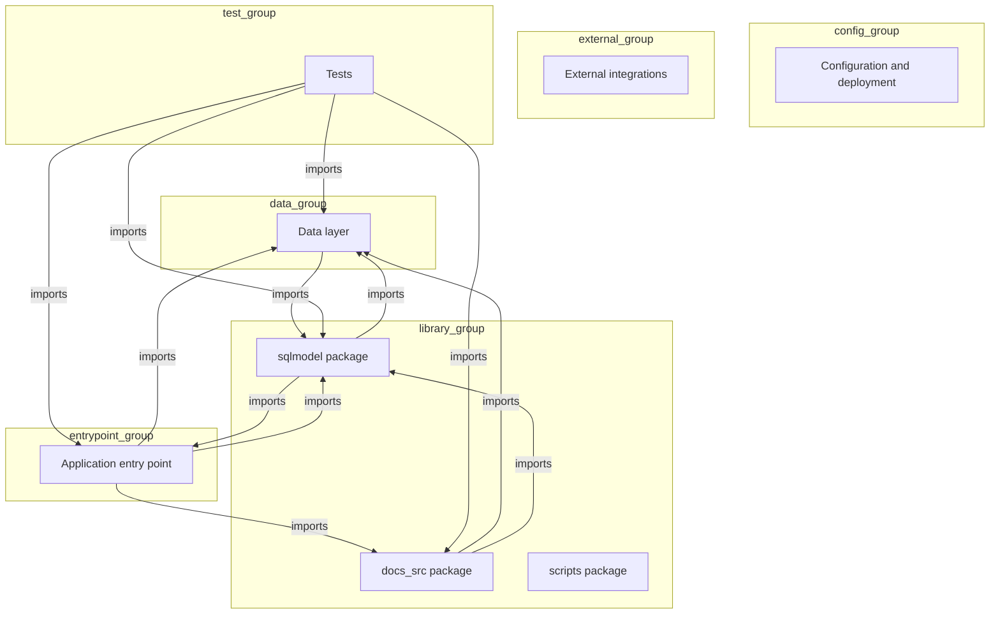

# Architecture report: fastapi/sqlmodel

> Automated static analysis. **Observed** = directly seen in files/imports/AST; **Inferred** = interpretation from that evidence. Repository code was not executed.

## 1. Repository at a glance

| Item | Value |
| --- | --- |
| Repository | fastapi/sqlmodel |
| Description | SQL databases in Python, designed for simplicity, compatibility, and robustness. |
| Language | Python |
| Stars | 18609 |
| Licence | MIT |
| Analysed commit / branch | 273cb2e40e15628ef3d576679ff7289176c16265 / main |
| Framework(s) | FastAPI, Typer |
| Files analysed | 474 |
| Components | 8 |

## 2. Architecture in one minute

fastapi/sqlmodel - SQL databases in Python, designed for simplicity, compatibility, and robustness.. This repository was analysed statically from 474 file(s) (335 Python). Detected technologies (observed from imports/manifests): GitHub Actions, MySQL, PostgreSQL, FastAPI, Typer, Pydantic. Files are grouped into 8 component(s): Configuration and deployment, Data layer, docs_src package, Application entry point, External integrations, scripts package, sqlmodel package, Tests. Observed entry point(s): docs_src/advanced/datetime/tutorial001.py, docs_src/advanced/datetime/tutorial002.py, docs_src/advanced/datetime/tutorial003.py. Findings below distinguish observed facts from inferred interpretation.

## 3. High-level block diagram

## 4. Main components

### Configuration and deployment (`config`)

- **Kind:** config
- **Status:** Observed
- **Confidence:** 0.85
- **Responsibility:** Groups 5 file(s) under configuration and deployment (observed from repository paths and static analysis).
- **Paths:** `compose.yml`, `data/sponsors.yml`, `mkdocs.env.yml`, `mkdocs.yml`, `pyproject.toml`
- **Evidence:** [compose.yml](https://github.com/fastapi/sqlmodel/blob/273cb2e40e15628ef3d576679ff7289176c16265/compose.yml); [data/sponsors.yml](https://github.com/fastapi/sqlmodel/blob/273cb2e40e15628ef3d576679ff7289176c16265/data/sponsors.yml); [mkdocs.env.yml](https://github.com/fastapi/sqlmodel/blob/273cb2e40e15628ef3d576679ff7289176c16265/mkdocs.env.yml); [mkdocs.yml](https://github.com/fastapi/sqlmodel/blob/273cb2e40e15628ef3d576679ff7289176c16265/mkdocs.yml); [pyproject.toml](https://github.com/fastapi/sqlmodel/blob/273cb2e40e15628ef3d576679ff7289176c16265/pyproject.toml)

### Data layer (`data_layer`)

- **Kind:** data
- **Status:** Observed
- **Confidence:** 0.85
- **Responsibility:** Groups 3 file(s) under data layer (observed from repository paths and static analysis). Observed top-level classes: Hero, Team. Observed top-level functions: create_db_and_tables.
- **Paths:** `docs_src/tutorial/code_structure/tutorial001/database.py`, `docs_src/tutorial/code_structure/tutorial001/models.py`, `docs_src/tutorial/code_structure/tutorial002/database.py`
- **Evidence:** [docs_src/tutorial/code_structure/tutorial001/database.py:9](https://github.com/fastapi/sqlmodel/blob/273cb2e40e15628ef3d576679ff7289176c16265/docs_src/tutorial/code_structure/tutorial001/database.py#L9); [docs_src/tutorial/code_structure/tutorial001/models.py:4](https://github.com/fastapi/sqlmodel/blob/273cb2e40e15628ef3d576679ff7289176c16265/docs_src/tutorial/code_structure/tutorial001/models.py#L4); [docs_src/tutorial/code_structure/tutorial002/database.py:9](https://github.com/fastapi/sqlmodel/blob/273cb2e40e15628ef3d576679ff7289176c16265/docs_src/tutorial/code_structure/tutorial002/database.py#L9)

### docs_src package (`docs_src`)

- **Kind:** library
- **Status:** Observed
- **Confidence:** 0.85
- **Responsibility:** Groups 49 file(s) under docs_src package (observed from repository paths and static analysis). Observed top-level classes: Hero, Team. Observed top-level functions: downgrade, upgrade.
- **Paths:** `docs_src/__init__.py`, `docs_src/advanced/__init__.py`, `docs_src/advanced/datetime/__init__.py`, `docs_src/advanced/datetime/tutorial004.py`, `docs_src/advanced/decimal/__init__.py`, `docs_src/advanced/uuid/__init__.py`, `docs_src/tutorial/__init__.py`, `docs_src/tutorial/automatic_id_none_refresh/__init__.py`, `docs_src/tutorial/code_structure/__init__.py`, `docs_src/tutorial/code_structure/tutorial001/__init__.py`, `docs_src/tutorial/code_structure/tutorial002/__init__.py`, `docs_src/tutorial/code_structure/tutorial002/hero_model.py`, `docs_src/tutorial/code_structure/tutorial002/team_model.py`, `docs_src/tutorial/connect/__init__.py`, `docs_src/tutorial/connect/create_tables/__init__.py`, `docs_src/tutorial/connect/delete/__init__.py`, `docs_src/tutorial/connect/insert/__init__.py`, `docs_src/tutorial/connect/select/__init__.py`, `docs_src/tutorial/connect/update/__init__.py`, `docs_src/tutorial/create_db_and_table/__init__.py`, `docs_src/tutorial/create_db_and_table/tutorial001.py`, `docs_src/tutorial/delete/__init__.py`, `docs_src/tutorial/fastapi/__init__.py`, `docs_src/tutorial/fastapi/app_testing/__init__.py`, `docs_src/tutorial/fastapi/app_testing/tutorial001/__init__.py`, `docs_src/tutorial/fastapi/delete/__init__.py`, `docs_src/tutorial/fastapi/limit_and_offset/__init__.py`, `docs_src/tutorial/fastapi/multiple_models/__init__.py`, `docs_src/tutorial/fastapi/read_one/__init__.py`, `docs_src/tutorial/fastapi/relationships/__init__.py`, `docs_src/tutorial/fastapi/response_model/__init__.py`, `docs_src/tutorial/fastapi/session_with_dependency/__init__.py`, `docs_src/tutorial/fastapi/simple_hero_api/__init__.py`, `docs_src/tutorial/fastapi/teams/__init__.py`, `docs_src/tutorial/fastapi/update/__init__.py`, `docs_src/tutorial/indexes/__init__.py`, `docs_src/tutorial/insert/__init__.py`, `docs_src/tutorial/many_to_many/__init__.py`, `docs_src/tutorial/offset_and_limit/__init__.py`, `docs_src/tutorial/one/__init__.py`, `docs_src/tutorial/relationship_attributes/__init__.py`, `docs_src/tutorial/relationship_attributes/back_populates/__init__.py`, `docs_src/tutorial/relationship_attributes/cascade_delete_relationships/__init__.py`, `docs_src/tutorial/relationship_attributes/create_and_update_relationships/__init__.py`, `docs_src/tutorial/relationship_attributes/define_relationship_attributes/__init__.py`, `docs_src/tutorial/relationship_attributes/read_relationships/__init__.py`, `docs_src/tutorial/select/__init__.py`, `docs_src/tutorial/update/__init__.py`, `docs_src/tutorial/where/__init__.py`
- **Evidence:** [docs_src/__init__.py](https://github.com/fastapi/sqlmodel/blob/273cb2e40e15628ef3d576679ff7289176c16265/docs_src/__init__.py); [docs_src/advanced/__init__.py](https://github.com/fastapi/sqlmodel/blob/273cb2e40e15628ef3d576679ff7289176c16265/docs_src/advanced/__init__.py); [docs_src/advanced/datetime/__init__.py](https://github.com/fastapi/sqlmodel/blob/273cb2e40e15628ef3d576679ff7289176c16265/docs_src/advanced/datetime/__init__.py); [docs_src/advanced/datetime/tutorial004.py:5](https://github.com/fastapi/sqlmodel/blob/273cb2e40e15628ef3d576679ff7289176c16265/docs_src/advanced/datetime/tutorial004.py#L5); [docs_src/advanced/decimal/__init__.py](https://github.com/fastapi/sqlmodel/blob/273cb2e40e15628ef3d576679ff7289176c16265/docs_src/advanced/decimal/__init__.py); [docs_src/advanced/uuid/__init__.py](https://github.com/fastapi/sqlmodel/blob/273cb2e40e15628ef3d576679ff7289176c16265/docs_src/advanced/uuid/__init__.py); [docs_src/tutorial/__init__.py](https://github.com/fastapi/sqlmodel/blob/273cb2e40e15628ef3d576679ff7289176c16265/docs_src/tutorial/__init__.py); [docs_src/tutorial/automatic_id_none_refresh/__init__.py](https://github.com/fastapi/sqlmodel/blob/273cb2e40e15628ef3d576679ff7289176c16265/docs_src/tutorial/automatic_id_none_refresh/__init__.py)

### Application entry point (`entrypoint`)

- **Kind:** entrypoint
- **Status:** Observed
- **Confidence:** 0.85
- **Responsibility:** Groups 94 file(s) under application entry point (observed from repository paths and static analysis). Observed application object created via FastAPI, Typer. Observed routes: POST /heroes/, GET /heroes/, GET /heroes/{hero_id}, PATCH /heroes/{hero_id}, DELETE /heroes/{hero_id}. Observed top-level classes: Event, FieldInfo, FieldInfoMetadata, Hero, HeroBase, HeroCreate. Observed top-level functions: Field, Relationship, _get_sqlmodel_field_metadata, _get_sqlmodel_field_value, build, bump_version.
- **Paths:** `docs_src/advanced/datetime/tutorial001.py`, `docs_src/advanced/datetime/tutorial002.py`, `docs_src/advanced/datetime/tutorial003.py`, `docs_src/advanced/datetime/tutorial005.py`, `docs_src/advanced/decimal/tutorial001.py`, `docs_src/advanced/uuid/tutorial001.py`, `docs_src/advanced/uuid/tutorial002.py`, `docs_src/tutorial/automatic_id_none_refresh/tutorial001.py`, `docs_src/tutorial/automatic_id_none_refresh/tutorial002.py`, `docs_src/tutorial/code_structure/tutorial001/app.py`, `docs_src/tutorial/code_structure/tutorial002/app.py`, `docs_src/tutorial/connect/create_tables/tutorial001.py`, `docs_src/tutorial/connect/delete/tutorial001.py`, `docs_src/tutorial/connect/insert/tutorial001.py`, `docs_src/tutorial/connect/select/tutorial001.py`, `docs_src/tutorial/connect/select/tutorial002.py`, `docs_src/tutorial/connect/select/tutorial003.py`, `docs_src/tutorial/connect/select/tutorial004.py`, `docs_src/tutorial/connect/select/tutorial005.py`, `docs_src/tutorial/connect/update/tutorial001.py`, `docs_src/tutorial/create_db_and_table/tutorial002.py`, `docs_src/tutorial/create_db_and_table/tutorial003.py`, `docs_src/tutorial/delete/tutorial001.py`, `docs_src/tutorial/delete/tutorial002.py`, `docs_src/tutorial/fastapi/app_testing/tutorial001/main.py`, `docs_src/tutorial/fastapi/delete/tutorial001.py`, `docs_src/tutorial/fastapi/limit_and_offset/tutorial001.py`, `docs_src/tutorial/fastapi/multiple_models/tutorial001.py`, `docs_src/tutorial/fastapi/multiple_models/tutorial002.py`, `docs_src/tutorial/fastapi/read_one/tutorial001.py`, `docs_src/tutorial/fastapi/relationships/tutorial001.py`, `docs_src/tutorial/fastapi/response_model/tutorial001.py`, `docs_src/tutorial/fastapi/session_with_dependency/tutorial001.py`, `docs_src/tutorial/fastapi/simple_hero_api/tutorial001.py`, `docs_src/tutorial/fastapi/teams/tutorial001.py`, `docs_src/tutorial/fastapi/update/tutorial001.py`, `docs_src/tutorial/fastapi/update/tutorial002.py`, `docs_src/tutorial/indexes/tutorial001.py`, `docs_src/tutorial/indexes/tutorial002.py`, `docs_src/tutorial/insert/tutorial001.py`, `docs_src/tutorial/insert/tutorial002.py`, `docs_src/tutorial/insert/tutorial003.py`, `docs_src/tutorial/many_to_many/tutorial001.py`, `docs_src/tutorial/many_to_many/tutorial002.py`, `docs_src/tutorial/many_to_many/tutorial003.py`, `docs_src/tutorial/offset_and_limit/tutorial001.py`, `docs_src/tutorial/offset_and_limit/tutorial002.py`, `docs_src/tutorial/offset_and_limit/tutorial003.py`, `docs_src/tutorial/offset_and_limit/tutorial004.py`, `docs_src/tutorial/one/tutorial001.py`, `docs_src/tutorial/one/tutorial002.py`, `docs_src/tutorial/one/tutorial003.py`, `docs_src/tutorial/one/tutorial004.py`, `docs_src/tutorial/one/tutorial005.py`, `docs_src/tutorial/one/tutorial006.py`, `docs_src/tutorial/one/tutorial007.py`, `docs_src/tutorial/one/tutorial008.py`, `docs_src/tutorial/one/tutorial009.py`, `docs_src/tutorial/relationship_attributes/back_populates/tutorial001.py`, `docs_src/tutorial/relationship_attributes/back_populates/tutorial002.py`, `docs_src/tutorial/relationship_attributes/back_populates/tutorial003.py`, `docs_src/tutorial/relationship_attributes/cascade_delete_relationships/tutorial001.py`, `docs_src/tutorial/relationship_attributes/cascade_delete_relationships/tutorial002.py`, `docs_src/tutorial/relationship_attributes/cascade_delete_relationships/tutorial003.py`, `docs_src/tutorial/relationship_attributes/cascade_delete_relationships/tutorial004.py`, `docs_src/tutorial/relationship_attributes/cascade_delete_relationships/tutorial005.py`, `docs_src/tutorial/relationship_attributes/create_and_update_relationships/tutorial001.py`, `docs_src/tutorial/relationship_attributes/define_relationship_attributes/tutorial001.py`, `docs_src/tutorial/relationship_attributes/read_relationships/tutorial001.py`, `docs_src/tutorial/relationship_attributes/read_relationships/tutorial002.py`, `docs_src/tutorial/select/tutorial001.py`, `docs_src/tutorial/select/tutorial002.py`, `docs_src/tutorial/select/tutorial003.py`, `docs_src/tutorial/select/tutorial004.py`, `docs_src/tutorial/update/tutorial001.py`, `docs_src/tutorial/update/tutorial002.py`, `docs_src/tutorial/update/tutorial003.py`, `docs_src/tutorial/update/tutorial004.py`, `docs_src/tutorial/where/tutorial001.py`, `docs_src/tutorial/where/tutorial002.py`, `docs_src/tutorial/where/tutorial003.py`, `docs_src/tutorial/where/tutorial004.py`, `docs_src/tutorial/where/tutorial005.py`, `docs_src/tutorial/where/tutorial006.py`, `docs_src/tutorial/where/tutorial006b.py`, `docs_src/tutorial/where/tutorial007.py`, `docs_src/tutorial/where/tutorial008.py`, `docs_src/tutorial/where/tutorial009.py`, `docs_src/tutorial/where/tutorial011.py`, `scripts/add_latest_release_date.py`, `scripts/deploy_docs_status.py`, `scripts/docs.py`, `scripts/prepare_release.py`, `sqlmodel/main.py`
- **Evidence:** [docs_src/advanced/datetime/tutorial001.py:6](https://github.com/fastapi/sqlmodel/blob/273cb2e40e15628ef3d576679ff7289176c16265/docs_src/advanced/datetime/tutorial001.py#L6); [docs_src/advanced/datetime/tutorial002.py:5](https://github.com/fastapi/sqlmodel/blob/273cb2e40e15628ef3d576679ff7289176c16265/docs_src/advanced/datetime/tutorial002.py#L5); [docs_src/advanced/datetime/tutorial003.py:7](https://github.com/fastapi/sqlmodel/blob/273cb2e40e15628ef3d576679ff7289176c16265/docs_src/advanced/datetime/tutorial003.py#L7); [docs_src/advanced/datetime/tutorial005.py:7](https://github.com/fastapi/sqlmodel/blob/273cb2e40e15628ef3d576679ff7289176c16265/docs_src/advanced/datetime/tutorial005.py#L7); [docs_src/advanced/decimal/tutorial001.py:6](https://github.com/fastapi/sqlmodel/blob/273cb2e40e15628ef3d576679ff7289176c16265/docs_src/advanced/decimal/tutorial001.py#L6); [docs_src/advanced/uuid/tutorial001.py:6](https://github.com/fastapi/sqlmodel/blob/273cb2e40e15628ef3d576679ff7289176c16265/docs_src/advanced/uuid/tutorial001.py#L6); [docs_src/advanced/uuid/tutorial002.py:6](https://github.com/fastapi/sqlmodel/blob/273cb2e40e15628ef3d576679ff7289176c16265/docs_src/advanced/uuid/tutorial002.py#L6); [docs_src/tutorial/automatic_id_none_refresh/tutorial001.py:4](https://github.com/fastapi/sqlmodel/blob/273cb2e40e15628ef3d576679ff7289176c16265/docs_src/tutorial/automatic_id_none_refresh/tutorial001.py#L4)

### External integrations (`external_integrations`)

- **Kind:** external
- **Status:** Inferred
- **Confidence:** 0.70
- **Responsibility:** Groups 0 file(s) under external integrations (observed from repository paths and static analysis).
- **Evidence:** [docs_src/advanced/datetime/tutorial003.py:3](https://github.com/fastapi/sqlmodel/blob/273cb2e40e15628ef3d576679ff7289176c16265/docs_src/advanced/datetime/tutorial003.py#L3); [docs_src/advanced/datetime/tutorial004.py:1](https://github.com/fastapi/sqlmodel/blob/273cb2e40e15628ef3d576679ff7289176c16265/docs_src/advanced/datetime/tutorial004.py#L1); [docs_src/tutorial/fastapi/app_testing/tutorial001/test_extra_coverage.py:2](https://github.com/fastapi/sqlmodel/blob/273cb2e40e15628ef3d576679ff7289176c16265/docs_src/tutorial/fastapi/app_testing/tutorial001/test_extra_coverage.py#L2); [sqlmodel/__init__.py:8](https://github.com/fastapi/sqlmodel/blob/273cb2e40e15628ef3d576679ff7289176c16265/sqlmodel/__init__.py#L8); [sqlmodel/__init__.py:9](https://github.com/fastapi/sqlmodel/blob/273cb2e40e15628ef3d576679ff7289176c16265/sqlmodel/__init__.py#L9); [sqlmodel/__init__.py:10](https://github.com/fastapi/sqlmodel/blob/273cb2e40e15628ef3d576679ff7289176c16265/sqlmodel/__init__.py#L10)

### scripts package (`scripts`)

- **Kind:** library
- **Status:** Observed
- **Confidence:** 0.85
- **Responsibility:** Groups 5 file(s) under scripts package (observed from repository paths and static analysis). Observed top-level classes: AgentBannerExtension, AgentBannerPreprocessor, Arg. Observed top-level functions: makeExtension.
- **Paths:** `scripts/agent_banner.py`, `scripts/format.sh`, `scripts/generate_select.py`, `scripts/lint.sh`, `scripts/test.sh`
- **Evidence:** [scripts/agent_banner.py:11](https://github.com/fastapi/sqlmodel/blob/273cb2e40e15628ef3d576679ff7289176c16265/scripts/agent_banner.py#L11); [scripts/format.sh](https://github.com/fastapi/sqlmodel/blob/273cb2e40e15628ef3d576679ff7289176c16265/scripts/format.sh); [scripts/generate_select.py:18](https://github.com/fastapi/sqlmodel/blob/273cb2e40e15628ef3d576679ff7289176c16265/scripts/generate_select.py#L18); [scripts/lint.sh](https://github.com/fastapi/sqlmodel/blob/273cb2e40e15628ef3d576679ff7289176c16265/scripts/lint.sh); [scripts/test.sh](https://github.com/fastapi/sqlmodel/blob/273cb2e40e15628ef3d576679ff7289176c16265/scripts/test.sh)

### sqlmodel package (`sqlmodel`)

- **Kind:** library
- **Status:** Observed
- **Confidence:** 0.85
- **Responsibility:** Groups 15 file(s) under sqlmodel package (observed from repository paths and static analysis). Observed top-level classes: AsyncSession, AutoString, Executable, FakeMetadata, ObjectWithUpdateWrapper, SQLModelConfig. Observed top-level functions: Default, _is_union_type, all_, and_, any_, asc.
- **Paths:** `sqlmodel/__init__.py`, `sqlmodel/_compat.py`, `sqlmodel/default.py`, `sqlmodel/ext/__init__.py`, `sqlmodel/ext/asyncio/__init__.py`, `sqlmodel/ext/asyncio/session.py`, `sqlmodel/orm/__init__.py`, `sqlmodel/orm/session.py`, `sqlmodel/pool/__init__.py`, `sqlmodel/sql/__init__.py`, `sqlmodel/sql/_expression_select_cls.py`, `sqlmodel/sql/_expression_select_gen.py`, `sqlmodel/sql/base.py`, `sqlmodel/sql/expression.py`, `sqlmodel/sql/sqltypes.py`
- **Evidence:** [sqlmodel/__init__.py](https://github.com/fastapi/sqlmodel/blob/273cb2e40e15628ef3d576679ff7289176c16265/sqlmodel/__init__.py); [sqlmodel/_compat.py:46](https://github.com/fastapi/sqlmodel/blob/273cb2e40e15628ef3d576679ff7289176c16265/sqlmodel/_compat.py#L46); [sqlmodel/default.py:4](https://github.com/fastapi/sqlmodel/blob/273cb2e40e15628ef3d576679ff7289176c16265/sqlmodel/default.py#L4); [sqlmodel/ext/__init__.py](https://github.com/fastapi/sqlmodel/blob/273cb2e40e15628ef3d576679ff7289176c16265/sqlmodel/ext/__init__.py); [sqlmodel/ext/asyncio/__init__.py](https://github.com/fastapi/sqlmodel/blob/273cb2e40e15628ef3d576679ff7289176c16265/sqlmodel/ext/asyncio/__init__.py); [sqlmodel/ext/asyncio/session.py:31](https://github.com/fastapi/sqlmodel/blob/273cb2e40e15628ef3d576679ff7289176c16265/sqlmodel/ext/asyncio/session.py#L31); [sqlmodel/orm/__init__.py](https://github.com/fastapi/sqlmodel/blob/273cb2e40e15628ef3d576679ff7289176c16265/sqlmodel/orm/__init__.py); [sqlmodel/orm/session.py:27](https://github.com/fastapi/sqlmodel/blob/273cb2e40e15628ef3d576679ff7289176c16265/sqlmodel/orm/session.py#L27)

### Tests (`tests`)

- **Kind:** test
- **Status:** Observed
- **Confidence:** 0.85
- **Responsibility:** Groups 178 file(s) under tests (observed from repository paths and static analysis). Observed top-level classes: BaseModel, FlatModel, InheritModel, Item, Modules, MyEnum1. Observed top-level functions: check_calls, clear_sqlmodel, client_fixture, cov_tmp_path, coverage_run, create_files.
- **Paths:** `docs_src/tutorial/fastapi/app_testing/tutorial001/annotations/en/test_main_001.md`, `docs_src/tutorial/fastapi/app_testing/tutorial001/annotations/en/test_main_002.md`, `docs_src/tutorial/fastapi/app_testing/tutorial001/annotations/en/test_main_003.md`, `docs_src/tutorial/fastapi/app_testing/tutorial001/annotations/en/test_main_004.md`, `docs_src/tutorial/fastapi/app_testing/tutorial001/annotations/en/test_main_005.md`, `docs_src/tutorial/fastapi/app_testing/tutorial001/annotations/en/test_main_006.md`, `docs_src/tutorial/fastapi/app_testing/tutorial001/test_extra_coverage.py`, `docs_src/tutorial/fastapi/app_testing/tutorial001/test_main.py`, `docs_src/tutorial/fastapi/app_testing/tutorial001/test_main_001.py`, `docs_src/tutorial/fastapi/app_testing/tutorial001/test_main_002.py`, `docs_src/tutorial/fastapi/app_testing/tutorial001/test_main_003.py`, `docs_src/tutorial/fastapi/app_testing/tutorial001/test_main_004.py`, `docs_src/tutorial/fastapi/app_testing/tutorial001/test_main_005.py`, `docs_src/tutorial/fastapi/app_testing/tutorial001/test_main_006.py`, `tests/__init__.py`, `tests/conftest.py`, `tests/test_advanced/__init__.py`, `tests/test_advanced/test_datetime/__init__.py`, `tests/test_advanced/test_datetime/test_tutorial001.py`, `tests/test_advanced/test_datetime/test_tutorial002.py`, `tests/test_advanced/test_datetime/test_tutorial003.py`, `tests/test_advanced/test_datetime/test_tutorial004.py`, `tests/test_advanced/test_datetime/test_tutorial005.py`, `tests/test_advanced/test_decimal/__init__.py`, `tests/test_advanced/test_decimal/test_tutorial001.py`, `tests/test_advanced/test_uuid/__init__.py`, `tests/test_advanced/test_uuid/test_tutorial001.py`, `tests/test_advanced/test_uuid/test_tutorial002.py`, `tests/test_aliases.py`, `tests/test_annotated_uuid.py`, `tests/test_asyncio.py`, `tests/test_dataclass_transform.py`, `tests/test_datetime.py`, `tests/test_default.py`, `tests/test_deprecations.py`, `tests/test_docs_cleanup.py`, `tests/test_enums.py`, `tests/test_enums_models.py`, `tests/test_field_sa_args_kwargs.py`, `tests/test_field_sa_column.py`, `tests/test_field_sa_relationship.py`, `tests/test_field_sa_type.py`, `tests/test_fields_set.py`, `tests/test_future_annotations.py`, `tests/test_instance_no_args.py`, `tests/test_main.py`, `tests/test_missing_type.py`, `tests/test_nullable.py`, `tests/test_ondelete_raises.py`, `tests/test_prepare_release.py`, `tests/test_pydantic/__init__.py`, `tests/test_pydantic/test_field.py`, `tests/test_pydantic/test_model_dump.py`, `tests/test_query.py`, `tests/test_select_gen.py`, `tests/test_select_typing.py`, `tests/test_sqlalchemy_type_errors.py`, `tests/test_tutorial/__init__.py`, `tests/test_tutorial/test_automatic_id_none_refresh/__init__.py`, `tests/test_tutorial/test_automatic_id_none_refresh/test_tutorial001_tutorial002.py`, `tests/test_tutorial/test_code_structure/__init__.py`, `tests/test_tutorial/test_code_structure/test_tutorial001.py`, `tests/test_tutorial/test_code_structure/test_tutorial002.py`, `tests/test_tutorial/test_connect/__init__.py`, `tests/test_tutorial/test_connect/test_create_connected_tables/__init__.py`, `tests/test_tutorial/test_connect/test_create_connected_tables/test_tutorial001.py`, `tests/test_tutorial/test_connect/test_delete/__init__.py`, `tests/test_tutorial/test_connect/test_delete/test_tutorial001.py`, `tests/test_tutorial/test_connect/test_insert/__init__.py`, `tests/test_tutorial/test_connect/test_insert/test_tutorial001.py`, `tests/test_tutorial/test_connect/test_select/__init__.py`, `tests/test_tutorial/test_connect/test_select/test_tutorial001_tutorial002.py`, `tests/test_tutorial/test_connect/test_select/test_tutorial003.py`, `tests/test_tutorial/test_connect/test_select/test_tutorial004.py`, `tests/test_tutorial/test_connect/test_select/test_tutorial005.py`, `tests/test_tutorial/test_connect/test_update/__init__.py`, `tests/test_tutorial/test_connect/test_update/test_tutorial001.py`, `tests/test_tutorial/test_create_db_and_table/__init__.py`, `tests/test_tutorial/test_create_db_and_table/test_tutorial001.py`, `tests/test_tutorial/test_create_db_and_table/test_tutorial002.py`, `tests/test_tutorial/test_create_db_and_table/test_tutorial003.py`, `tests/test_tutorial/test_delete/__init__.py`, `tests/test_tutorial/test_delete/test_tutorial001_tutorial002.py`, `tests/test_tutorial/test_fastapi/__init__.py`, `tests/test_tutorial/test_fastapi/test_app_testing/__init__.py`, `tests/test_tutorial/test_fastapi/test_app_testing/test_tutorial001_tests001.py`, `tests/test_tutorial/test_fastapi/test_app_testing/test_tutorial001_tests002.py`, `tests/test_tutorial/test_fastapi/test_app_testing/test_tutorial001_tests003.py`, `tests/test_tutorial/test_fastapi/test_app_testing/test_tutorial001_tests004.py`, `tests/test_tutorial/test_fastapi/test_app_testing/test_tutorial001_tests005.py`, `tests/test_tutorial/test_fastapi/test_app_testing/test_tutorial001_tests006.py`, `tests/test_tutorial/test_fastapi/test_app_testing/test_tutorial001_tests_main.py`, `tests/test_tutorial/test_fastapi/test_delete/__init__.py`, `tests/test_tutorial/test_fastapi/test_delete/test_tutorial001.py`, `tests/test_tutorial/test_fastapi/test_limit_and_offset/__init__.py`, `tests/test_tutorial/test_fastapi/test_limit_and_offset/test_tutorial001.py`, `tests/test_tutorial/test_fastapi/test_multiple_models/__init__.py`, `tests/test_tutorial/test_fastapi/test_multiple_models/test_tutorial001.py`, `tests/test_tutorial/test_fastapi/test_multiple_models/test_tutorial002.py`, `tests/test_tutorial/test_fastapi/test_read_one/__init__.py`, `tests/test_tutorial/test_fastapi/test_read_one/test_tutorial001.py`, `tests/test_tutorial/test_fastapi/test_relationships/__init__.py`, `tests/test_tutorial/test_fastapi/test_relationships/test_tutorial001.py`, `tests/test_tutorial/test_fastapi/test_response_model/__init__.py`, `tests/test_tutorial/test_fastapi/test_response_model/test_tutorial001.py`, `tests/test_tutorial/test_fastapi/test_session_with_dependency/__init__.py`, `tests/test_tutorial/test_fastapi/test_session_with_dependency/test_tutorial001.py`, `tests/test_tutorial/test_fastapi/test_simple_hero_api/__init__.py`, `tests/test_tutorial/test_fastapi/test_simple_hero_api/test_tutorial001.py`, `tests/test_tutorial/test_fastapi/test_teams/__init__.py`, `tests/test_tutorial/test_fastapi/test_teams/test_tutorial001.py`, `tests/test_tutorial/test_fastapi/test_update/__init__.py`, `tests/test_tutorial/test_fastapi/test_update/test_tutorial001.py`, `tests/test_tutorial/test_fastapi/test_update/test_tutorial002.py`, `tests/test_tutorial/test_indexes/__init__.py`, `tests/test_tutorial/test_indexes/test_tutorial001.py`, `tests/test_tutorial/test_indexes/test_tutorial002.py`, `tests/test_tutorial/test_insert/__init__.py`, `tests/test_tutorial/test_insert/test_tutorial001.py`, `tests/test_tutorial/test_insert/test_tutorial002.py`, `tests/test_tutorial/test_insert/test_tutorial003.py`, `tests/test_tutorial/test_limit_and_offset/__init__.py`, `tests/test_tutorial/test_limit_and_offset/test_tutorial001.py`, `tests/test_tutorial/test_limit_and_offset/test_tutorial002.py`, `tests/test_tutorial/test_limit_and_offset/test_tutorial003.py`, `tests/test_tutorial/test_limit_and_offset/test_tutorial004.py`, `tests/test_tutorial/test_many_to_many/__init__.py`, `tests/test_tutorial/test_many_to_many/test_tutorial001.py`, `tests/test_tutorial/test_many_to_many/test_tutorial002.py`, `tests/test_tutorial/test_many_to_many/test_tutorial003.py`, `tests/test_tutorial/test_one/__init__.py`, `tests/test_tutorial/test_one/test_tutorial001.py`, `tests/test_tutorial/test_one/test_tutorial002.py`, `tests/test_tutorial/test_one/test_tutorial003.py`, `tests/test_tutorial/test_one/test_tutorial004.py`, `tests/test_tutorial/test_one/test_tutorial005.py`, `tests/test_tutorial/test_one/test_tutorial006.py`, `tests/test_tutorial/test_one/test_tutorial007.py`, `tests/test_tutorial/test_one/test_tutorial008.py`, `tests/test_tutorial/test_one/test_tutorial009.py`, `tests/test_tutorial/test_relationship_attributes/__init__.py`, `tests/test_tutorial/test_relationship_attributes/test_back_populates/__init__.py`, `tests/test_tutorial/test_relationship_attributes/test_back_populates/test_tutorial001.py`, `tests/test_tutorial/test_relationship_attributes/test_back_populates/test_tutorial002.py`, `tests/test_tutorial/test_relationship_attributes/test_back_populates/test_tutorial003.py`, `tests/test_tutorial/test_relationship_attributes/test_create_and_update_relationships/__init__.py`, `tests/test_tutorial/test_relationship_attributes/test_create_and_update_relationships/test_tutorial001.py`, `tests/test_tutorial/test_relationship_attributes/test_define_relationship_attributes/__init__.py`, `tests/test_tutorial/test_relationship_attributes/test_define_relationship_attributes/test_tutorial001.py`, `tests/test_tutorial/test_relationship_attributes/test_delete_records_relationship/__init__.py`, `tests/test_tutorial/test_relationship_attributes/test_delete_records_relationship/test_tutorial001.py`, `tests/test_tutorial/test_relationship_attributes/test_delete_records_relationship/test_tutorial002.py`, `tests/test_tutorial/test_relationship_attributes/test_delete_records_relationship/test_tutorial003.py`, `tests/test_tutorial/test_relationship_attributes/test_delete_records_relationship/test_tutorial004.py`, `tests/test_tutorial/test_relationship_attributes/test_delete_records_relationship/test_tutorial005.py`, `tests/test_tutorial/test_relationship_attributes/test_read_relationships/__init__.py`, `tests/test_tutorial/test_relationship_attributes/test_read_relationships/test_tutorial001.py`, `tests/test_tutorial/test_relationship_attributes/test_read_relationships/test_tutorial002.py`, `tests/test_tutorial/test_select/__init__.py`, `tests/test_tutorial/test_select/test_tutorial001_tutorial002.py`, `tests/test_tutorial/test_select/test_tutorial003_tutorial004.py`, `tests/test_tutorial/test_update/__init__.py`, `tests/test_tutorial/test_update/test_tutorial001_tutorial002.py`, `tests/test_tutorial/test_update/test_tutorial003_tutorial004.py`, `tests/test_tutorial/test_where/__init__.py`, `tests/test_tutorial/test_where/test_tutorial001.py`, `tests/test_tutorial/test_where/test_tutorial002.py`, `tests/test_tutorial/test_where/test_tutorial003.py`, `tests/test_tutorial/test_where/test_tutorial004.py`, `tests/test_tutorial/test_where/test_tutorial005.py`, `tests/test_tutorial/test_where/test_tutorial006.py`, `tests/test_tutorial/test_where/test_tutorial006b.py`, `tests/test_tutorial/test_where/test_tutorial007.py`, `tests/test_tutorial/test_where/test_tutorial008.py`, `tests/test_tutorial/test_where/test_tutorial009.py`, `tests/test_tutorial/test_where/test_tutorial011.py`, `tests/test_update.py`, `tests/test_validation.py`
- **Evidence:** [docs_src/tutorial/fastapi/app_testing/tutorial001/annotations/en/test_main_001.md](https://github.com/fastapi/sqlmodel/blob/273cb2e40e15628ef3d576679ff7289176c16265/docs_src/tutorial/fastapi/app_testing/tutorial001/annotations/en/test_main_001.md); [docs_src/tutorial/fastapi/app_testing/tutorial001/annotations/en/test_main_002.md](https://github.com/fastapi/sqlmodel/blob/273cb2e40e15628ef3d576679ff7289176c16265/docs_src/tutorial/fastapi/app_testing/tutorial001/annotations/en/test_main_002.md); [docs_src/tutorial/fastapi/app_testing/tutorial001/annotations/en/test_main_003.md](https://github.com/fastapi/sqlmodel/blob/273cb2e40e15628ef3d576679ff7289176c16265/docs_src/tutorial/fastapi/app_testing/tutorial001/annotations/en/test_main_003.md); [docs_src/tutorial/fastapi/app_testing/tutorial001/annotations/en/test_main_004.md](https://github.com/fastapi/sqlmodel/blob/273cb2e40e15628ef3d576679ff7289176c16265/docs_src/tutorial/fastapi/app_testing/tutorial001/annotations/en/test_main_004.md); [docs_src/tutorial/fastapi/app_testing/tutorial001/annotations/en/test_main_005.md](https://github.com/fastapi/sqlmodel/blob/273cb2e40e15628ef3d576679ff7289176c16265/docs_src/tutorial/fastapi/app_testing/tutorial001/annotations/en/test_main_005.md); [docs_src/tutorial/fastapi/app_testing/tutorial001/annotations/en/test_main_006.md](https://github.com/fastapi/sqlmodel/blob/273cb2e40e15628ef3d576679ff7289176c16265/docs_src/tutorial/fastapi/app_testing/tutorial001/annotations/en/test_main_006.md); [docs_src/tutorial/fastapi/app_testing/tutorial001/test_extra_coverage.py:12](https://github.com/fastapi/sqlmodel/blob/273cb2e40e15628ef3d576679ff7289176c16265/docs_src/tutorial/fastapi/app_testing/tutorial001/test_extra_coverage.py#L12); [docs_src/tutorial/fastapi/app_testing/tutorial001/test_main.py:10](https://github.com/fastapi/sqlmodel/blob/273cb2e40e15628ef3d576679ff7289176c16265/docs_src/tutorial/fastapi/app_testing/tutorial001/test_main.py#L10)

## 5. Execution flow

**Observed** entry point(s):

- [docs_src/advanced/datetime/tutorial001.py:29](https://github.com/fastapi/sqlmodel/blob/273cb2e40e15628ef3d576679ff7289176c16265/docs_src/advanced/datetime/tutorial001.py#L29)
- [docs_src/advanced/datetime/tutorial002.py:20](https://github.com/fastapi/sqlmodel/blob/273cb2e40e15628ef3d576679ff7289176c16265/docs_src/advanced/datetime/tutorial002.py#L20)
- [docs_src/advanced/datetime/tutorial003.py:17](https://github.com/fastapi/sqlmodel/blob/273cb2e40e15628ef3d576679ff7289176c16265/docs_src/advanced/datetime/tutorial003.py#L17)
- [docs_src/advanced/datetime/tutorial005.py:17](https://github.com/fastapi/sqlmodel/blob/273cb2e40e15628ef3d576679ff7289176c16265/docs_src/advanced/datetime/tutorial005.py#L17)
- [docs_src/advanced/decimal/tutorial001.py:59](https://github.com/fastapi/sqlmodel/blob/273cb2e40e15628ef3d576679ff7289176c16265/docs_src/advanced/decimal/tutorial001.py#L59)
- [docs_src/advanced/uuid/tutorial001.py:63](https://github.com/fastapi/sqlmodel/blob/273cb2e40e15628ef3d576679ff7289176c16265/docs_src/advanced/uuid/tutorial001.py#L63)
- [docs_src/advanced/uuid/tutorial002.py:62](https://github.com/fastapi/sqlmodel/blob/273cb2e40e15628ef3d576679ff7289176c16265/docs_src/advanced/uuid/tutorial002.py#L62)
- [docs_src/tutorial/automatic_id_none_refresh/tutorial001.py:78](https://github.com/fastapi/sqlmodel/blob/273cb2e40e15628ef3d576679ff7289176c16265/docs_src/tutorial/automatic_id_none_refresh/tutorial001.py#L78)
- [docs_src/tutorial/automatic_id_none_refresh/tutorial002.py:79](https://github.com/fastapi/sqlmodel/blob/273cb2e40e15628ef3d576679ff7289176c16265/docs_src/tutorial/automatic_id_none_refresh/tutorial002.py#L79)
- [docs_src/tutorial/code_structure/tutorial001/app.py:28](https://github.com/fastapi/sqlmodel/blob/273cb2e40e15628ef3d576679ff7289176c16265/docs_src/tutorial/code_structure/tutorial001/app.py#L28)
- [docs_src/tutorial/code_structure/tutorial002/app.py:29](https://github.com/fastapi/sqlmodel/blob/273cb2e40e15628ef3d576679ff7289176c16265/docs_src/tutorial/code_structure/tutorial002/app.py#L29)
- [docs_src/tutorial/connect/create_tables/tutorial001.py:33](https://github.com/fastapi/sqlmodel/blob/273cb2e40e15628ef3d576679ff7289176c16265/docs_src/tutorial/connect/create_tables/tutorial001.py#L33)

**Observed** routes (from decorators):

- `POST /heroes/` -> `create_hero` in `docs_src/tutorial/fastapi/app_testing/tutorial001/main.py:56`
- `GET /heroes/` -> `read_heroes` in `docs_src/tutorial/fastapi/app_testing/tutorial001/main.py:65`
- `GET /heroes/{hero_id}` -> `read_hero` in `docs_src/tutorial/fastapi/app_testing/tutorial001/main.py:75`
- `PATCH /heroes/{hero_id}` -> `update_hero` in `docs_src/tutorial/fastapi/app_testing/tutorial001/main.py:83`
- `DELETE /heroes/{hero_id}` -> `delete_hero` in `docs_src/tutorial/fastapi/app_testing/tutorial001/main.py:98`
- `POST /heroes/` -> `create_hero` in `docs_src/tutorial/fastapi/delete/tutorial001.py:51`
- `GET /heroes/` -> `read_heroes` in `docs_src/tutorial/fastapi/delete/tutorial001.py:61`
- `GET /heroes/{hero_id}` -> `read_hero` in `docs_src/tutorial/fastapi/delete/tutorial001.py:68`
- `PATCH /heroes/{hero_id}` -> `update_hero` in `docs_src/tutorial/fastapi/delete/tutorial001.py:77`
- `DELETE /heroes/{hero_id}` -> `delete_hero` in `docs_src/tutorial/fastapi/delete/tutorial001.py:91`
- `POST /heroes/` -> `create_hero` in `docs_src/tutorial/fastapi/limit_and_offset/tutorial001.py:45`
- `GET /heroes/` -> `read_heroes` in `docs_src/tutorial/fastapi/limit_and_offset/tutorial001.py:55`
- `GET /heroes/{hero_id}` -> `read_hero` in `docs_src/tutorial/fastapi/limit_and_offset/tutorial001.py:62`
- `POST /heroes/` -> `create_hero` in `docs_src/tutorial/fastapi/multiple_models/tutorial001.py:45`
- `GET /heroes/` -> `read_heroes` in `docs_src/tutorial/fastapi/multiple_models/tutorial001.py:55`
- `POST /heroes/` -> `create_hero` in `docs_src/tutorial/fastapi/multiple_models/tutorial002.py:43`
- `GET /heroes/` -> `read_heroes` in `docs_src/tutorial/fastapi/multiple_models/tutorial002.py:53`
- `POST /heroes/` -> `create_hero` in `docs_src/tutorial/fastapi/read_one/tutorial001.py:43`
- `GET /heroes/` -> `read_heroes` in `docs_src/tutorial/fastapi/read_one/tutorial001.py:53`
- `GET /heroes/{hero_id}` -> `read_hero` in `docs_src/tutorial/fastapi/read_one/tutorial001.py:60`
- `POST /heroes/` -> `create_hero` in `docs_src/tutorial/fastapi/relationships/tutorial001.py:94`
- `GET /heroes/` -> `read_heroes` in `docs_src/tutorial/fastapi/relationships/tutorial001.py:103`
- `GET /heroes/{hero_id}` -> `read_hero` in `docs_src/tutorial/fastapi/relationships/tutorial001.py:113`
- `PATCH /heroes/{hero_id}` -> `update_hero` in `docs_src/tutorial/fastapi/relationships/tutorial001.py:121`
- `DELETE /heroes/{hero_id}` -> `delete_hero` in `docs_src/tutorial/fastapi/relationships/tutorial001.py:136`
- `POST /teams/` -> `create_team` in `docs_src/tutorial/fastapi/relationships/tutorial001.py:146`
- `GET /teams/` -> `read_teams` in `docs_src/tutorial/fastapi/relationships/tutorial001.py:155`
- `GET /teams/{team_id}` -> `read_team` in `docs_src/tutorial/fastapi/relationships/tutorial001.py:165`
- `PATCH /teams/{team_id}` -> `update_team` in `docs_src/tutorial/fastapi/relationships/tutorial001.py:173`
- `DELETE /teams/{team_id}` -> `delete_team` in `docs_src/tutorial/fastapi/relationships/tutorial001.py:190`
- `POST /heroes/` -> `create_hero` in `docs_src/tutorial/fastapi/response_model/tutorial001.py:32`
- `GET /heroes/` -> `read_heroes` in `docs_src/tutorial/fastapi/response_model/tutorial001.py:41`
- `POST /heroes/` -> `create_hero` in `docs_src/tutorial/fastapi/session_with_dependency/tutorial001.py:56`
- `GET /heroes/` -> `read_heroes` in `docs_src/tutorial/fastapi/session_with_dependency/tutorial001.py:65`
- `GET /heroes/{hero_id}` -> `read_hero` in `docs_src/tutorial/fastapi/session_with_dependency/tutorial001.py:75`
- `PATCH /heroes/{hero_id}` -> `update_hero` in `docs_src/tutorial/fastapi/session_with_dependency/tutorial001.py:83`
- `DELETE /heroes/{hero_id}` -> `delete_hero` in `docs_src/tutorial/fastapi/session_with_dependency/tutorial001.py:98`
- `POST /heroes/` -> `create_hero` in `docs_src/tutorial/fastapi/simple_hero_api/tutorial001.py:32`
- `GET /heroes/` -> `read_heroes` in `docs_src/tutorial/fastapi/simple_hero_api/tutorial001.py:41`
- `POST /heroes/` -> `create_hero` in `docs_src/tutorial/fastapi/teams/tutorial001.py:85`
- `GET /heroes/` -> `read_heroes` in `docs_src/tutorial/fastapi/teams/tutorial001.py:94`
- `GET /heroes/{hero_id}` -> `read_hero` in `docs_src/tutorial/fastapi/teams/tutorial001.py:104`
- `PATCH /heroes/{hero_id}` -> `update_hero` in `docs_src/tutorial/fastapi/teams/tutorial001.py:112`
- `DELETE /heroes/{hero_id}` -> `delete_hero` in `docs_src/tutorial/fastapi/teams/tutorial001.py:127`
- `POST /teams/` -> `create_team` in `docs_src/tutorial/fastapi/teams/tutorial001.py:137`
- `GET /teams/` -> `read_teams` in `docs_src/tutorial/fastapi/teams/tutorial001.py:146`
- `GET /teams/{team_id}` -> `read_team` in `docs_src/tutorial/fastapi/teams/tutorial001.py:156`
- `PATCH /teams/{team_id}` -> `update_team` in `docs_src/tutorial/fastapi/teams/tutorial001.py:164`
- `DELETE /teams/{team_id}` -> `delete_team` in `docs_src/tutorial/fastapi/teams/tutorial001.py:181`
- `POST /heroes/` -> `create_hero` in `docs_src/tutorial/fastapi/update/tutorial001.py:51`
- `GET /heroes/` -> `read_heroes` in `docs_src/tutorial/fastapi/update/tutorial001.py:61`
- `GET /heroes/{hero_id}` -> `read_hero` in `docs_src/tutorial/fastapi/update/tutorial001.py:68`
- `PATCH /heroes/{hero_id}` -> `update_hero` in `docs_src/tutorial/fastapi/update/tutorial001.py:77`
- `POST /heroes/` -> `create_hero` in `docs_src/tutorial/fastapi/update/tutorial002.py:58`
- `GET /heroes/` -> `read_heroes` in `docs_src/tutorial/fastapi/update/tutorial002.py:70`
- `GET /heroes/{hero_id}` -> `read_hero` in `docs_src/tutorial/fastapi/update/tutorial002.py:77`
- `PATCH /heroes/{hero_id}` -> `update_hero` in `docs_src/tutorial/fastapi/update/tutorial002.py:86`

Representative flow (derived from observed entry points and the import graph; steps beyond the entry point are **Inferred**):

1. Execution starts at an observed entry point listed above, if present.
2. `data_layer` imports `sqlmodel` (Data layer -> sqlmodel package).
3. `docs_src` imports `data_layer` (docs_src package -> Data layer).
4. `docs_src` imports `sqlmodel` (docs_src package -> sqlmodel package).
5. `entrypoint` imports `data_layer` (Application entry point -> Data layer).
6. `entrypoint` imports `docs_src` (Application entry point -> docs_src package).
7. `entrypoint` imports `sqlmodel` (Application entry point -> sqlmodel package).
8. `sqlmodel` imports `data_layer` (sqlmodel package -> Data layer).
9. `sqlmodel` imports `entrypoint` (sqlmodel package -> Application entry point).

## 6. Project structure

### `(root)`

- `.gitignore` - other (116 bytes)
- `.pre-commit-config.yaml` - config (2283 bytes)
- `.python-version` - other (5 bytes)
- `CITATION.cff` - other (622 bytes)
- `LICENSE` - docs (1086 bytes)
- `README.md` - docs (7924 bytes)
- `compose.yml` - container (1279 bytes)
- `mkdocs.env.yml` - config (229 bytes)
- `mkdocs.yml` - config (5449 bytes)
- `pyproject.toml` - manifest (4534 bytes)

### `.github`

- `.github/dependabot.yml` - config (639 bytes)
- `.github/latest-changes.yml` - config (184 bytes)
- `.github/pr-push.yml` - config (48 bytes)
- `.github/pr-submit.yml` - config (101 bytes)
- `.github/workflows/add-to-project.yml` - ci, YAML (526 bytes)
- `.github/workflows/build-docs.yml` - ci, YAML (2699 bytes)
- `.github/workflows/bump-pre-commit-hooks.yml` - ci, YAML (2484 bytes)
- `.github/workflows/create-draft-release.yml` - ci, YAML (1840 bytes)
- `.github/workflows/deploy-docs.yml` - ci, YAML (3212 bytes)
- `.github/workflows/detect-conflicts.yml` - ci, YAML (623 bytes)
- `.github/workflows/guard-dependencies.yml` - ci, YAML (2106 bytes)
- `.github/workflows/issue-manager.yml` - ci, YAML (739 bytes)
- `.github/workflows/pre-commit.yml` - ci, YAML (3900 bytes)
- `.github/workflows/prepare-release.yml` - ci, YAML (2714 bytes)
- `.github/workflows/publish.yml` - ci, YAML (1173 bytes)
- `.github/workflows/smokeshow.yml` - ci, YAML (1918 bytes)
- `.github/workflows/test-redistribute.yml` - ci, YAML (1732 bytes)
- `.github/workflows/test.yml` - ci, YAML (6565 bytes)
- `.github/workflows/zizmor.yml` - ci, YAML (607 bytes)

### `data`

- `data/sponsors.yml` - config (181 bytes)

### `docs`

- `docs/about/index.md` - docs (69 bytes)
- `docs/advanced/datetime.md` - docs (11763 bytes)
- `docs/advanced/decimal.md` - docs (4699 bytes)
- `docs/advanced/index.md` - docs (311 bytes)
- `docs/advanced/uuid.md` - docs (7501 bytes)
- `docs/ai-development.md` - docs (864 bytes)
- `docs/alternatives.md` - docs (60 bytes)
- `docs/contributing.md` - docs (432 bytes)
- `docs/css/custom.css` - docs (4602 bytes)
- `docs/css/termynal.css` - docs (2448 bytes)
- `docs/databases.md` - docs (14931 bytes)
- `docs/db-to-code.md` - docs (9929 bytes)
- `docs/environment-variables.md` - docs (605 bytes)
- `docs/features.md` - docs (4945 bytes)
- `docs/help.md` - docs (3042 bytes)
- `docs/img/databases/single-file.drawio.svg` - docs (9718 bytes)
- `docs/img/github-social-preview.svg` - docs (7230 bytes)
- `docs/img/icon-white.svg` - docs (3238 bytes)
- `docs/img/icon.svg` - docs (3996 bytes)
- `docs/img/logo-margin/logo-margin-vector.svg` - docs (11229 bytes)
- `docs/img/logo-margin/logo-margin-white-vector.svg` - docs (11014 bytes)
- `docs/img/logo-margin/logo-margin-white.svg` - docs (4705 bytes)
- `docs/img/logo-margin/logo-margin.svg` - docs (4943 bytes)
- `docs/img/tutorial/indexes/dictionary001.drawio.svg` - docs (48994 bytes)
- `docs/img/tutorial/indexes/dictionary002.drawio.svg` - docs (49022 bytes)
- `docs/img/tutorial/indexes/dictionary003.drawio.svg` - docs (47646 bytes)
- `docs/img/tutorial/indexes/dictionary004.drawio.svg` - docs (49326 bytes)
- `docs/img/tutorial/indexes/dictionary005.drawio.svg` - docs (47653 bytes)
- `docs/img/tutorial/indexes/dictionary006.drawio.svg` - docs (49339 bytes)
- `docs/img/tutorial/indexes/dictionary007.drawio.svg` - docs (47952 bytes)
- `docs/img/tutorial/indexes/dictionary008.drawio.svg` - docs (49651 bytes)
- `docs/img/tutorial/indexes/techbook001.drawio.svg` - docs (28305 bytes)
- `docs/img/tutorial/relationships/attributes/back-populates.drawio.svg` - docs (130051 bytes)
- `docs/img/tutorial/relationships/attributes/back-populates2.drawio.svg` - docs (133517 bytes)
- `docs/index.md` - docs (8431 bytes)
- `docs/install.md` - docs (4254 bytes)
- `docs/js/custom.js` - docs (5744 bytes)
- `docs/js/termynal.js` - docs (9499 bytes)
- `docs/learn/index.md` - docs (274 bytes)
- `docs/management.md` - docs (642 bytes)
- `docs/overrides/main.html` - docs (26 bytes)
- `docs/release-notes.md` - docs (116189 bytes)
- `docs/resources/index.md` - docs (105 bytes)
- `docs/tutorial/automatic-id-none-refresh.md` - docs (16061 bytes)
- `docs/tutorial/code-structure.md` - docs (9196 bytes)
- `docs/tutorial/connect/create-connected-rows.md` - docs (7273 bytes)
- `docs/tutorial/connect/create-connected-tables.md` - docs (6854 bytes)
- `docs/tutorial/connect/index.md` - docs (712 bytes)
- `docs/tutorial/connect/read-connected-data.md` - docs (16158 bytes)
- `docs/tutorial/connect/remove-data-connections.md` - docs (2342 bytes)
- `docs/tutorial/connect/update-data-connections.md` - docs (2318 bytes)
- `docs/tutorial/create-db-and-table-with-db-browser.md` - docs (6363 bytes)
- `docs/tutorial/create-db-and-table.md` - docs (19313 bytes)
- `docs/tutorial/delete.md` - docs (6592 bytes)
- `docs/tutorial/fastapi/delete.md` - docs (877 bytes)
- `docs/tutorial/fastapi/index.md` - docs (1228 bytes)
- `docs/tutorial/fastapi/limit-and-offset.md` - docs (2257 bytes)
- `docs/tutorial/fastapi/multiple-models.md` - docs (16806 bytes)
- `docs/tutorial/fastapi/read-one.md` - docs (1941 bytes)
- `docs/tutorial/fastapi/relationships.md` - docs (10261 bytes)
- `docs/tutorial/fastapi/response-model.md` - docs (3677 bytes)
- `docs/tutorial/fastapi/session-with-dependency.md` - docs (4273 bytes)
- `docs/tutorial/fastapi/simple-hero-api.md` - docs (8528 bytes)
- `docs/tutorial/fastapi/teams.md` - docs (2841 bytes)
- `docs/tutorial/fastapi/tests.md` - docs (15617 bytes)
- `docs/tutorial/fastapi/update-extra-data.md` - docs (5916 bytes)
- `docs/tutorial/fastapi/update.md` - docs (5780 bytes)
- `docs/tutorial/index.md` - docs (1533 bytes)
- `docs/tutorial/indexes.md` - docs (18925 bytes)
- `docs/tutorial/insert.md` - docs (12827 bytes)
- `docs/tutorial/limit-and-offset.md` - docs (7064 bytes)
- `docs/tutorial/many-to-many/create-data.md` - docs (5093 bytes)
- `docs/tutorial/many-to-many/create-models-with-link.md` - docs (3929 bytes)
- `docs/tutorial/many-to-many/index.md` - docs (5723 bytes)
- `docs/tutorial/many-to-many/link-with-extra-fields.md` - docs (11950 bytes)
- `docs/tutorial/many-to-many/update-remove-relationships.md` - docs (7605 bytes)
- `docs/tutorial/one.md` - docs (7747 bytes)
- `docs/tutorial/relationship-attributes/back-populates.md` - docs (9300 bytes)
- `docs/tutorial/relationship-attributes/cascade-delete-relationships.md` - docs (24748 bytes)
- `docs/tutorial/relationship-attributes/create-and-update-relationships.md` - docs (4726 bytes)
- `docs/tutorial/relationship-attributes/define-relationships-attributes.md` - docs (3643 bytes)
- `docs/tutorial/relationship-attributes/index.md` - docs (835 bytes)
- `docs/tutorial/relationship-attributes/read-relationships.md` - docs (2825 bytes)
- `docs/tutorial/relationship-attributes/remove-relationships.md` - docs (905 bytes)
- `docs/tutorial/relationship-attributes/type-annotation-strings.md` - docs (1155 bytes)
- `docs/tutorial/select.md` - docs (13787 bytes)
- `docs/tutorial/update.md` - docs (7339 bytes)
- `docs/tutorial/where.md` - docs (21690 bytes)
- `docs/virtual-environments.md` - docs (1106 bytes)

### `docs_src`

- `docs_src/__init__.py` - source, Python (0 bytes)
- `docs_src/advanced/__init__.py` - source, Python (0 bytes)
- `docs_src/advanced/datetime/__init__.py` - source, Python (0 bytes)
- `docs_src/advanced/datetime/tutorial001.py` - source, Python (704 bytes)
- `docs_src/advanced/datetime/tutorial002.py` - source, Python (471 bytes)
- `docs_src/advanced/datetime/tutorial003.py` - source, Python (399 bytes)
- `docs_src/advanced/datetime/tutorial004.py` - source, Python (517 bytes)
- `docs_src/advanced/datetime/tutorial005.py` - source, Python (385 bytes)
- `docs_src/advanced/decimal/__init__.py` - source, Python (0 bytes)
- `docs_src/advanced/decimal/tutorial001.py` - source, Python (1597 bytes)
- `docs_src/advanced/uuid/__init__.py` - source, Python (0 bytes)
- `docs_src/advanced/uuid/tutorial001.py` - source, Python (1619 bytes)
- `docs_src/advanced/uuid/tutorial002.py` - source, Python (1549 bytes)
- `docs_src/tutorial/__init__.py` - source, Python (0 bytes)
- `docs_src/tutorial/automatic_id_none_refresh/__init__.py` - source, Python (0 bytes)
- `docs_src/tutorial/automatic_id_none_refresh/annotations/en/tutorial002.md` - docs (10210 bytes)
- `docs_src/tutorial/automatic_id_none_refresh/tutorial001.py` - source, Python (2049 bytes)
- `docs_src/tutorial/automatic_id_none_refresh/tutorial002.py` - source, Python (2403 bytes)
- `docs_src/tutorial/code_structure/__init__.py` - source, Python (0 bytes)
- `docs_src/tutorial/code_structure/tutorial001/__init__.py` - source, Python (0 bytes)
- `docs_src/tutorial/code_structure/tutorial001/app.py` - source, Python (667 bytes)
- `docs_src/tutorial/code_structure/tutorial001/database.py` - source, Python (231 bytes)
- `docs_src/tutorial/code_structure/tutorial001/models.py` - source, Python (602 bytes)
- `docs_src/tutorial/code_structure/tutorial002/__init__.py` - source, Python (0 bytes)
- `docs_src/tutorial/code_structure/tutorial002/app.py` - source, Python (694 bytes)
- `docs_src/tutorial/code_structure/tutorial002/database.py` - source, Python (231 bytes)
- `docs_src/tutorial/code_structure/tutorial002/hero_model.py` - source, Python (488 bytes)
- `docs_src/tutorial/code_structure/tutorial002/team_model.py` - source, Python (352 bytes)
- `docs_src/tutorial/connect/__init__.py` - source, Python (0 bytes)
- `docs_src/tutorial/connect/create_tables/__init__.py` - source, Python (0 bytes)
- `docs_src/tutorial/connect/create_tables/tutorial001.py` - source, Python (756 bytes)
- `docs_src/tutorial/connect/delete/__init__.py` - source, Python (0 bytes)
- `docs_src/tutorial/connect/delete/tutorial001.py` - source, Python (2273 bytes)
- `docs_src/tutorial/connect/insert/__init__.py` - source, Python (0 bytes)
- `docs_src/tutorial/connect/insert/tutorial001.py` - source, Python (1870 bytes)
- `docs_src/tutorial/connect/select/__init__.py` - source, Python (0 bytes)
- `docs_src/tutorial/connect/select/tutorial001.py` - source, Python (2153 bytes)
- `docs_src/tutorial/connect/select/tutorial002.py` - source, Python (2133 bytes)
- `docs_src/tutorial/connect/select/tutorial003.py` - source, Python (2147 bytes)
- `docs_src/tutorial/connect/select/tutorial004.py` - source, Python (2149 bytes)
- `docs_src/tutorial/connect/select/tutorial005.py` - source, Python (2176 bytes)
- `docs_src/tutorial/connect/update/__init__.py` - source, Python (0 bytes)
- `docs_src/tutorial/connect/update/tutorial001.py` - source, Python (2075 bytes)
- `docs_src/tutorial/create_db_and_table/__init__.py` - source, Python (0 bytes)
- `docs_src/tutorial/create_db_and_table/annotations/en/tutorial003.md` - docs (2176 bytes)
- `docs_src/tutorial/create_db_and_table/tutorial001.py` - source, Python (374 bytes)
- `docs_src/tutorial/create_db_and_table/tutorial002.py` - source, Python (463 bytes)
- `docs_src/tutorial/create_db_and_table/tutorial003.py` - source, Python (571 bytes)
- `docs_src/tutorial/delete/__init__.py` - source, Python (0 bytes)
- `docs_src/tutorial/delete/annotations/en/tutorial002.md` - docs (2454 bytes)
- `docs_src/tutorial/delete/tutorial001.py` - source, Python (2761 bytes)
- `docs_src/tutorial/delete/tutorial002.py` - source, Python (2872 bytes)
- `docs_src/tutorial/fastapi/__init__.py` - source, Python (0 bytes)
- `docs_src/tutorial/fastapi/app_testing/__init__.py` - source, Python (0 bytes)
- `docs_src/tutorial/fastapi/app_testing/tutorial001/__init__.py` - source, Python (0 bytes)
- `docs_src/tutorial/fastapi/app_testing/tutorial001/annotations/en/test_main_001.md` - test (779 bytes)
- `docs_src/tutorial/fastapi/app_testing/tutorial001/annotations/en/test_main_002.md` - test (1649 bytes)
- `docs_src/tutorial/fastapi/app_testing/tutorial001/annotations/en/test_main_003.md` - test (1792 bytes)
- `docs_src/tutorial/fastapi/app_testing/tutorial001/annotations/en/test_main_004.md` - test (1089 bytes)
- `docs_src/tutorial/fastapi/app_testing/tutorial001/annotations/en/test_main_005.md` - test (2112 bytes)
- `docs_src/tutorial/fastapi/app_testing/tutorial001/annotations/en/test_main_006.md` - test (949 bytes)
- `docs_src/tutorial/fastapi/app_testing/tutorial001/main.py` - source, Python (2668 bytes)
- `docs_src/tutorial/fastapi/app_testing/tutorial001/test_extra_coverage.py` - test, Python (1208 bytes)
- `docs_src/tutorial/fastapi/app_testing/tutorial001/test_main.py` - test, Python (3626 bytes)
- `docs_src/tutorial/fastapi/app_testing/tutorial001/test_main_001.py` - test, Python (991 bytes)
- `docs_src/tutorial/fastapi/app_testing/tutorial001/test_main_002.py` - test, Python (959 bytes)
- `docs_src/tutorial/fastapi/app_testing/tutorial001/test_main_003.py` - test, Python (978 bytes)
- `docs_src/tutorial/fastapi/app_testing/tutorial001/test_main_004.py` - test, Python (1008 bytes)
- `docs_src/tutorial/fastapi/app_testing/tutorial001/test_main_005.py` - test, Python (1066 bytes)
- `docs_src/tutorial/fastapi/app_testing/tutorial001/test_main_006.py` - test, Python (1171 bytes)
- `docs_src/tutorial/fastapi/delete/__init__.py` - source, Python (0 bytes)
- `docs_src/tutorial/fastapi/delete/tutorial001.py` - source, Python (2592 bytes)
- `docs_src/tutorial/fastapi/limit_and_offset/__init__.py` - source, Python (0 bytes)
- `docs_src/tutorial/fastapi/limit_and_offset/tutorial001.py` - source, Python (1651 bytes)
- `docs_src/tutorial/fastapi/multiple_models/__init__.py` - source, Python (0 bytes)
- `docs_src/tutorial/fastapi/multiple_models/tutorial001.py` - source, Python (1317 bytes)
- `docs_src/tutorial/fastapi/multiple_models/tutorial002.py` - source, Python (1230 bytes)
- `docs_src/tutorial/fastapi/read_one/__init__.py` - source, Python (0 bytes)
- `docs_src/tutorial/fastapi/read_one/tutorial001.py` - source, Python (1527 bytes)
- `docs_src/tutorial/fastapi/relationships/__init__.py` - source, Python (0 bytes)
- `docs_src/tutorial/fastapi/relationships/tutorial001.py` - source, Python (5098 bytes)
- `docs_src/tutorial/fastapi/response_model/__init__.py` - source, Python (0 bytes)
- `docs_src/tutorial/fastapi/response_model/tutorial001.py` - source, Python (1050 bytes)
- `docs_src/tutorial/fastapi/session_with_dependency/__init__.py` - source, Python (0 bytes)
- `docs_src/tutorial/fastapi/session_with_dependency/tutorial001.py` - source, Python (2668 bytes)
- `docs_src/tutorial/fastapi/simple_hero_api/__init__.py` - source, Python (0 bytes)
- `docs_src/tutorial/fastapi/simple_hero_api/tutorial001.py` - source, Python (1002 bytes)
- `docs_src/tutorial/fastapi/teams/__init__.py` - source, Python (0 bytes)
- `docs_src/tutorial/fastapi/teams/tutorial001.py` - source, Python (4903 bytes)
- `docs_src/tutorial/fastapi/update/__init__.py` - source, Python (0 bytes)
- `docs_src/tutorial/fastapi/update/tutorial001.py` - source, Python (2270 bytes)
- `docs_src/tutorial/fastapi/update/tutorial002.py` - source, Python (2843 bytes)
- `docs_src/tutorial/indexes/__init__.py` - source, Python (0 bytes)
- `docs_src/tutorial/indexes/tutorial001.py` - source, Python (1184 bytes)
- `docs_src/tutorial/indexes/tutorial002.py` - source, Python (1596 bytes)
- `docs_src/tutorial/insert/__init__.py` - source, Python (0 bytes)
- `docs_src/tutorial/insert/annotations/en/tutorial003.md` - docs (1972 bytes)
- `docs_src/tutorial/insert/tutorial001.py` - source, Python (889 bytes)
- `docs_src/tutorial/insert/tutorial002.py` - source, Python (890 bytes)
- `docs_src/tutorial/insert/tutorial003.py` - source, Python (983 bytes)
- `docs_src/tutorial/many_to_many/__init__.py` - source, Python (0 bytes)
- `docs_src/tutorial/many_to_many/tutorial001.py` - source, Python (2356 bytes)
- `docs_src/tutorial/many_to_many/tutorial002.py` - source, Python (3125 bytes)
- `docs_src/tutorial/many_to_many/tutorial003.py` - source, Python (3756 bytes)
- `docs_src/tutorial/offset_and_limit/__init__.py` - source, Python (0 bytes)
- `docs_src/tutorial/offset_and_limit/tutorial001.py` - source, Python (1583 bytes)
- `docs_src/tutorial/offset_and_limit/tutorial002.py` - source, Python (1593 bytes)
- `docs_src/tutorial/offset_and_limit/tutorial003.py` - source, Python (1593 bytes)
- `docs_src/tutorial/offset_and_limit/tutorial004.py` - source, Python (1614 bytes)
- `docs_src/tutorial/one/__init__.py` - source, Python (0 bytes)
- `docs_src/tutorial/one/tutorial001.py` - source, Python (1603 bytes)
- `docs_src/tutorial/one/tutorial002.py` - source, Python (1602 bytes)
- `docs_src/tutorial/one/tutorial003.py` - source, Python (1610 bytes)
- `docs_src/tutorial/one/tutorial004.py` - source, Python (1601 bytes)
- `docs_src/tutorial/one/tutorial005.py` - source, Python (1600 bytes)
- `docs_src/tutorial/one/tutorial006.py` - source, Python (1554 bytes)
- `docs_src/tutorial/one/tutorial007.py` - source, Python (1601 bytes)
- `docs_src/tutorial/one/tutorial008.py` - source, Python (1503 bytes)
- `docs_src/tutorial/one/tutorial009.py` - source, Python (1506 bytes)
- `docs_src/tutorial/relationship_attributes/__init__.py` - source, Python (0 bytes)
- `docs_src/tutorial/relationship_attributes/back_populates/__init__.py` - source, Python (0 bytes)
- `docs_src/tutorial/relationship_attributes/back_populates/tutorial001.py` - source, Python (4488 bytes)
- `docs_src/tutorial/relationship_attributes/back_populates/tutorial002.py` - source, Python (4532 bytes)
- `docs_src/tutorial/relationship_attributes/back_populates/tutorial003.py` - source, Python (1522 bytes)
- `docs_src/tutorial/relationship_attributes/cascade_delete_relationships/__init__.py` - source, Python (0 bytes)
- `docs_src/tutorial/relationship_attributes/cascade_delete_relationships/tutorial001.py` - source, Python (3337 bytes)
- `docs_src/tutorial/relationship_attributes/cascade_delete_relationships/tutorial002.py` - source, Python (3335 bytes)
- `docs_src/tutorial/relationship_attributes/cascade_delete_relationships/tutorial003.py` - source, Python (3512 bytes)
- `docs_src/tutorial/relationship_attributes/cascade_delete_relationships/tutorial004.py` - source, Python (3484 bytes)
- `docs_src/tutorial/relationship_attributes/cascade_delete_relationships/tutorial005.py` - source, Python (3869 bytes)
- `docs_src/tutorial/relationship_attributes/create_and_update_relationships/__init__.py` - source, Python (0 bytes)
- `docs_src/tutorial/relationship_attributes/create_and_update_relationships/tutorial001.py` - source, Python (3314 bytes)
- `docs_src/tutorial/relationship_attributes/define_relationship_attributes/__init__.py` - source, Python (0 bytes)
- `docs_src/tutorial/relationship_attributes/define_relationship_attributes/tutorial001.py` - source, Python (1975 bytes)
- `docs_src/tutorial/relationship_attributes/read_relationships/__init__.py` - source, Python (0 bytes)
- `docs_src/tutorial/relationship_attributes/read_relationships/tutorial001.py` - source, Python (3802 bytes)
- `docs_src/tutorial/relationship_attributes/read_relationships/tutorial002.py` - source, Python (4035 bytes)
- `docs_src/tutorial/select/__init__.py` - source, Python (0 bytes)
- `docs_src/tutorial/select/annotations/en/tutorial002.md` - docs (2176 bytes)
- `docs_src/tutorial/select/tutorial001.py` - source, Python (1106 bytes)
- `docs_src/tutorial/select/tutorial002.py` - source, Python (1217 bytes)
- `docs_src/tutorial/select/tutorial003.py` - source, Python (1106 bytes)
- `docs_src/tutorial/select/tutorial004.py` - source, Python (1050 bytes)
- `docs_src/tutorial/update/__init__.py` - source, Python (0 bytes)
- `docs_src/tutorial/update/annotations/en/tutorial002.md` - docs (1714 bytes)
- `docs_src/tutorial/update/annotations/en/tutorial004.md` - docs (4282 bytes)
- `docs_src/tutorial/update/tutorial001.py` - source, Python (1753 bytes)
- `docs_src/tutorial/update/tutorial002.py` - source, Python (1825 bytes)
- `docs_src/tutorial/update/tutorial003.py` - source, Python (2183 bytes)
- `docs_src/tutorial/update/tutorial004.py` - source, Python (2357 bytes)
- `docs_src/tutorial/where/__init__.py` - source, Python (0 bytes)
- `docs_src/tutorial/where/tutorial001.py` - source, Python (1137 bytes)
- `docs_src/tutorial/where/tutorial002.py` - source, Python (1137 bytes)
- `docs_src/tutorial/where/tutorial003.py` - source, Python (1548 bytes)
- `docs_src/tutorial/where/tutorial004.py` - source, Python (1549 bytes)
- `docs_src/tutorial/where/tutorial005.py` - source, Python (1548 bytes)
- `docs_src/tutorial/where/tutorial006.py` - source, Python (1549 bytes)
- `docs_src/tutorial/where/tutorial006b.py` - source, Python (1582 bytes)
- `docs_src/tutorial/where/tutorial007.py` - source, Python (1570 bytes)
- `docs_src/tutorial/where/tutorial008.py` - source, Python (1564 bytes)
- `docs_src/tutorial/where/tutorial009.py` - source, Python (1574 bytes)
- `docs_src/tutorial/where/tutorial011.py` - source, Python (1559 bytes)

### `includes`

- `includes/agent-banner.md` - docs (212 bytes)

### `scripts`

- `scripts/add_latest_release_date.py` - source, Python (1015 bytes)
- `scripts/agent_banner.py` - source, Python (1910 bytes)
- `scripts/deploy_docs_status.py` - source, Python (3789 bytes)
- `scripts/docs.py` - source, Python (6790 bytes)
- `scripts/format.sh` - source, Shell (129 bytes)
- `scripts/generate_select.py` - source, Python (1823 bytes)
- `scripts/lint.sh` - source, Shell (261 bytes)
- `scripts/prepare_release.py` - source, Python (6930 bytes)
- `scripts/test.sh` - source, Shell (112 bytes)

### `sqlmodel`

- `sqlmodel/.agents/skills/sqlmodel/SKILL.md` - docs (8216 bytes)
- `sqlmodel/__init__.py` - source, Python (6931 bytes)
- `sqlmodel/_compat.py` - source, Python (12364 bytes)
- `sqlmodel/default.py` - source, Python (850 bytes)
- `sqlmodel/ext/__init__.py` - source, Python (0 bytes)
- `sqlmodel/ext/asyncio/__init__.py` - source, Python (0 bytes)
- `sqlmodel/ext/asyncio/session.py` - source, Python (5540 bytes)
- `sqlmodel/main.py` - source, Python (39569 bytes)
- `sqlmodel/orm/__init__.py` - source, Python (0 bytes)
- `sqlmodel/orm/session.py` - source, Python (5706 bytes)
- `sqlmodel/pool/__init__.py` - source, Python (67 bytes)
- `sqlmodel/py.typed` - other (0 bytes)
- `sqlmodel/sql/__init__.py` - source, Python (0 bytes)
- `sqlmodel/sql/_expression_select_cls.py` - source, Python (1550 bytes)
- `sqlmodel/sql/_expression_select_gen.py` - source, Python (6195 bytes)
- `sqlmodel/sql/_expression_select_gen.py.jinja2` - other (1414 bytes)
- `sqlmodel/sql/base.py` - source, Python (170 bytes)
- `sqlmodel/sql/expression.py` - source, Python (6166 bytes)
- `sqlmodel/sql/sqltypes.py` - source, Python (1988 bytes)

### `tests`

- `tests/__init__.py` - test, Python (0 bytes)
- `tests/conftest.py` - test, Python (3146 bytes)
- `tests/test_advanced/__init__.py` - test, Python (0 bytes)
- `tests/test_advanced/test_datetime/__init__.py` - test, Python (0 bytes)
- `tests/test_advanced/test_datetime/test_tutorial001.py` - test, Python (1315 bytes)
- `tests/test_advanced/test_datetime/test_tutorial002.py` - test, Python (1364 bytes)
- `tests/test_advanced/test_datetime/test_tutorial003.py` - test, Python (824 bytes)
- `tests/test_advanced/test_datetime/test_tutorial004.py` - test, Python (1017 bytes)
- `tests/test_advanced/test_datetime/test_tutorial005.py` - test, Python (1029 bytes)
- `tests/test_advanced/test_decimal/__init__.py` - test, Python (0 bytes)
- `tests/test_advanced/test_decimal/test_tutorial001.py` - test, Python (1059 bytes)
- `tests/test_advanced/test_uuid/__init__.py` - test, Python (0 bytes)
- `tests/test_advanced/test_uuid/test_tutorial001.py` - test, Python (1890 bytes)
- `tests/test_advanced/test_uuid/test_tutorial002.py` - test, Python (1890 bytes)
- `tests/test_aliases.py` - test, Python (5490 bytes)
- `tests/test_annotated_uuid.py` - test, Python (688 bytes)
- `tests/test_asyncio.py` - test, Python (2350 bytes)
- `tests/test_dataclass_transform.py` - test, Python (891 bytes)
- `tests/test_datetime.py` - test, Python (13061 bytes)
- `tests/test_default.py` - test, Python (842 bytes)
- `tests/test_deprecations.py` - test, Python (690 bytes)
- `tests/test_docs_cleanup.py` - test, Python (3635 bytes)
- `tests/test_enums.py` - test, Python (2695 bytes)
- `tests/test_enums_models.py` - test, Python (432 bytes)
- `tests/test_field_sa_args_kwargs.py` - test, Python (1728 bytes)
- `tests/test_field_sa_column.py` - test, Python (3810 bytes)
- `tests/test_field_sa_relationship.py` - test, Python (1929 bytes)
- `tests/test_field_sa_type.py` - test, Python (616 bytes)
- `tests/test_fields_set.py` - test, Python (660 bytes)
- `tests/test_future_annotations.py` - test, Python (1831 bytes)
- `tests/test_instance_no_args.py` - test, Python (972 bytes)
- `tests/test_main.py` - test, Python (7394 bytes)
- `tests/test_missing_type.py` - test, Python (504 bytes)
- `tests/test_nullable.py` - test, Python (4623 bytes)
- `tests/test_ondelete_raises.py` - test, Python (1247 bytes)
- `tests/test_prepare_release.py` - test, Python (7347 bytes)
- `tests/test_pydantic/__init__.py` - test, Python (0 bytes)
- `tests/test_pydantic/test_field.py` - test, Python (3546 bytes)
- `tests/test_pydantic/test_model_dump.py` - test, Python (1233 bytes)
- `tests/test_query.py` - test, Python (775 bytes)
- `tests/test_select_gen.py` - test, Python (411 bytes)
- `tests/test_select_typing.py` - test, Python (4303 bytes)
- `tests/test_sqlalchemy_type_errors.py` - test, Python (720 bytes)
- `tests/test_tutorial/__init__.py` - test, Python (0 bytes)
- `tests/test_tutorial/test_automatic_id_none_refresh/__init__.py` - test, Python (0 bytes)
- `tests/test_tutorial/test_automatic_id_none_refresh/test_tutorial001_tutorial002.py` - test, Python (3919 bytes)
- `tests/test_tutorial/test_code_structure/__init__.py` - test, Python (0 bytes)
- `tests/test_tutorial/test_code_structure/test_tutorial001.py` - test, Python (1281 bytes)
- `tests/test_tutorial/test_code_structure/test_tutorial002.py` - test, Python (1278 bytes)
- `tests/test_tutorial/test_connect/__init__.py` - test, Python (0 bytes)
- `tests/test_tutorial/test_connect/test_create_connected_tables/__init__.py` - test, Python (0 bytes)
- `tests/test_tutorial/test_connect/test_create_connected_tables/test_tutorial001.py` - test, Python (723 bytes)
- `tests/test_tutorial/test_connect/test_delete/__init__.py` - test, Python (0 bytes)
- `tests/test_tutorial/test_connect/test_delete/test_tutorial001.py` - test, Python (1677 bytes)
- `tests/test_tutorial/test_connect/test_insert/__init__.py` - test, Python (0 bytes)
- `tests/test_tutorial/test_connect/test_insert/test_tutorial001.py` - test, Python (1246 bytes)
- `tests/test_tutorial/test_connect/test_select/__init__.py` - test, Python (0 bytes)
- `tests/test_tutorial/test_connect/test_select/test_tutorial001_tutorial002.py` - test, Python (2325 bytes)
- `tests/test_tutorial/test_connect/test_select/test_tutorial003.py` - test, Python (2059 bytes)
- `tests/test_tutorial/test_connect/test_select/test_tutorial004.py` - test, Python (1449 bytes)
- `tests/test_tutorial/test_connect/test_select/test_tutorial005.py` - test, Python (1538 bytes)
- `tests/test_tutorial/test_connect/test_update/__init__.py` - test, Python (0 bytes)
- `tests/test_tutorial/test_connect/test_update/test_tutorial001.py` - test, Python (1455 bytes)
- `tests/test_tutorial/test_create_db_and_table/__init__.py` - test, Python (0 bytes)
- `tests/test_tutorial/test_create_db_and_table/test_tutorial001.py` - test, Python (842 bytes)
- `tests/test_tutorial/test_create_db_and_table/test_tutorial002.py` - test, Python (687 bytes)
- `tests/test_tutorial/test_create_db_and_table/test_tutorial003.py` - test, Python (687 bytes)
- `tests/test_tutorial/test_delete/__init__.py` - test, Python (0 bytes)
- `tests/test_tutorial/test_delete/test_tutorial001_tutorial002.py` - test, Python (2023 bytes)
- `tests/test_tutorial/test_fastapi/__init__.py` - test, Python (0 bytes)
- `tests/test_tutorial/test_fastapi/test_app_testing/__init__.py` - test, Python (0 bytes)
- `tests/test_tutorial/test_fastapi/test_app_testing/test_tutorial001_tests001.py` - test, Python (1037 bytes)
- `tests/test_tutorial/test_fastapi/test_app_testing/test_tutorial001_tests002.py` - test, Python (1057 bytes)
- `tests/test_tutorial/test_fastapi/test_app_testing/test_tutorial001_tests003.py` - test, Python (1057 bytes)
- `tests/test_tutorial/test_fastapi/test_app_testing/test_tutorial001_tests004.py` - test, Python (1057 bytes)
- `tests/test_tutorial/test_fastapi/test_app_testing/test_tutorial001_tests005.py` - test, Python (790 bytes)
- `tests/test_tutorial/test_fastapi/test_app_testing/test_tutorial001_tests006.py` - test, Python (937 bytes)
- `tests/test_tutorial/test_fastapi/test_app_testing/test_tutorial001_tests_main.py` - test, Python (893 bytes)
- `tests/test_tutorial/test_fastapi/test_delete/__init__.py` - test, Python (0 bytes)
- `tests/test_tutorial/test_fastapi/test_delete/test_tutorial001.py` - test, Python (16610 bytes)
- `tests/test_tutorial/test_fastapi/test_limit_and_offset/__init__.py` - test, Python (0 bytes)
- `tests/test_tutorial/test_fastapi/test_limit_and_offset/test_tutorial001.py` - test, Python (12571 bytes)
- `tests/test_tutorial/test_fastapi/test_multiple_models/__init__.py` - test, Python (0 bytes)
- `tests/test_tutorial/test_fastapi/test_multiple_models/test_tutorial001.py` - test, Python (9318 bytes)
- `tests/test_tutorial/test_fastapi/test_multiple_models/test_tutorial002.py` - test, Python (9318 bytes)
- `tests/test_tutorial/test_fastapi/test_read_one/__init__.py` - test, Python (0 bytes)
- `tests/test_tutorial/test_fastapi/test_read_one/test_tutorial001.py` - test, Python (10017 bytes)
- `tests/test_tutorial/test_fastapi/test_relationships/__init__.py` - test, Python (0 bytes)
- `tests/test_tutorial/test_fastapi/test_relationships/test_tutorial001.py` - test, Python (32584 bytes)
- `tests/test_tutorial/test_fastapi/test_response_model/__init__.py` - test, Python (0 bytes)
- `tests/test_tutorial/test_fastapi/test_response_model/test_tutorial001.py` - test, Python (7422 bytes)
- `tests/test_tutorial/test_fastapi/test_session_with_dependency/__init__.py` - test, Python (0 bytes)
- `tests/test_tutorial/test_fastapi/test_session_with_dependency/test_tutorial001.py` - test, Python (16641 bytes)
- `tests/test_tutorial/test_fastapi/test_simple_hero_api/__init__.py` - test, Python (0 bytes)
- `tests/test_tutorial/test_fastapi/test_simple_hero_api/test_tutorial001.py` - test, Python (7494 bytes)
- `tests/test_tutorial/test_fastapi/test_teams/__init__.py` - test, Python (0 bytes)
- `tests/test_tutorial/test_fastapi/test_teams/test_tutorial001.py` - test, Python (29875 bytes)
- `tests/test_tutorial/test_fastapi/test_update/__init__.py` - test, Python (0 bytes)
- `tests/test_tutorial/test_fastapi/test_update/test_tutorial001.py` - test, Python (15544 bytes)
- `tests/test_tutorial/test_fastapi/test_update/test_tutorial002.py` - test, Python (18658 bytes)
- `tests/test_tutorial/test_indexes/__init__.py` - test, Python (0 bytes)
- `tests/test_tutorial/test_indexes/test_tutorial001.py` - test, Python (995 bytes)
- `tests/test_tutorial/test_indexes/test_tutorial002.py` - test, Python (1086 bytes)
- `tests/test_tutorial/test_insert/__init__.py` - test, Python (0 bytes)
- `tests/test_tutorial/test_insert/test_tutorial001.py` - test, Python (1257 bytes)
- `tests/test_tutorial/test_insert/test_tutorial002.py` - test, Python (1257 bytes)
- `tests/test_tutorial/test_insert/test_tutorial003.py` - test, Python (1257 bytes)
- `tests/test_tutorial/test_limit_and_offset/__init__.py` - test, Python (0 bytes)
- `tests/test_tutorial/test_limit_and_offset/test_tutorial001.py` - test, Python (964 bytes)
- `tests/test_tutorial/test_limit_and_offset/test_tutorial002.py` - test, Python (963 bytes)
- `tests/test_tutorial/test_limit_and_offset/test_tutorial003.py` - test, Python (801 bytes)
- `tests/test_tutorial/test_limit_and_offset/test_tutorial004.py` - test, Python (1296 bytes)
- `tests/test_tutorial/test_many_to_many/__init__.py` - test, Python (0 bytes)
- `tests/test_tutorial/test_many_to_many/test_tutorial001.py` - test, Python (1462 bytes)
- `tests/test_tutorial/test_many_to_many/test_tutorial002.py` - test, Python (2349 bytes)
- `tests/test_tutorial/test_many_to_many/test_tutorial003.py` - test, Python (2267 bytes)
- `tests/test_tutorial/test_one/__init__.py` - test, Python (0 bytes)
- `tests/test_tutorial/test_one/test_tutorial001.py` - test, Python (756 bytes)
- `tests/test_tutorial/test_one/test_tutorial002.py` - test, Python (556 bytes)
- `tests/test_tutorial/test_one/test_tutorial003.py` - test, Python (673 bytes)
- `tests/test_tutorial/test_one/test_tutorial004.py` - test, Python (1328 bytes)
- `tests/test_tutorial/test_one/test_tutorial005.py` - test, Python (1314 bytes)
- `tests/test_tutorial/test_one/test_tutorial006.py` - test, Python (673 bytes)
- `tests/test_tutorial/test_one/test_tutorial007.py` - test, Python (673 bytes)
- `tests/test_tutorial/test_one/test_tutorial008.py` - test, Python (673 bytes)
- `tests/test_tutorial/test_one/test_tutorial009.py` - test, Python (556 bytes)
- `tests/test_tutorial/test_relationship_attributes/__init__.py` - test, Python (0 bytes)
- `tests/test_tutorial/test_relationship_attributes/test_back_populates/__init__.py` - test, Python (0 bytes)
- `tests/test_tutorial/test_relationship_attributes/test_back_populates/test_tutorial001.py` - test, Python (7202 bytes)
- `tests/test_tutorial/test_relationship_attributes/test_back_populates/test_tutorial002.py` - test, Python (6925 bytes)
- `tests/test_tutorial/test_relationship_attributes/test_back_populates/test_tutorial003.py` - test, Python (823 bytes)
- `tests/test_tutorial/test_relationship_attributes/test_create_and_update_relationships/__init__.py` - test, Python (0 bytes)
- `tests/test_tutorial/test_relationship_attributes/test_create_and_update_relationships/test_tutorial001.py` - test, Python (2253 bytes)
- `tests/test_tutorial/test_relationship_attributes/test_define_relationship_attributes/__init__.py` - test, Python (0 bytes)
- `tests/test_tutorial/test_relationship_attributes/test_define_relationship_attributes/test_tutorial001.py` - test, Python (1266 bytes)
- `tests/test_tutorial/test_relationship_attributes/test_delete_records_relationship/__init__.py` - test, Python (0 bytes)
- `tests/test_tutorial/test_relationship_attributes/test_delete_records_relationship/test_tutorial001.py` - test, Python (1962 bytes)
- `tests/test_tutorial/test_relationship_attributes/test_delete_records_relationship/test_tutorial002.py` - test, Python (2400 bytes)
- `tests/test_tutorial/test_relationship_attributes/test_delete_records_relationship/test_tutorial003.py` - test, Python (2400 bytes)
- `tests/test_tutorial/test_relationship_attributes/test_delete_records_relationship/test_tutorial004.py` - test, Python (2892 bytes)
- `tests/test_tutorial/test_relationship_attributes/test_delete_records_relationship/test_tutorial005.py` - test, Python (2546 bytes)
- `tests/test_tutorial/test_relationship_attributes/test_read_relationships/__init__.py` - test, Python (0 bytes)
- `tests/test_tutorial/test_relationship_attributes/test_read_relationships/test_tutorial001.py` - test, Python (2476 bytes)
- `tests/test_tutorial/test_relationship_attributes/test_read_relationships/test_tutorial002.py` - test, Python (3530 bytes)
- `tests/test_tutorial/test_select/__init__.py` - test, Python (0 bytes)
- `tests/test_tutorial/test_select/test_tutorial001_tutorial002.py` - test, Python (1347 bytes)
- `tests/test_tutorial/test_select/test_tutorial003_tutorial004.py` - test, Python (1390 bytes)
- `tests/test_tutorial/test_update/__init__.py` - test, Python (0 bytes)
- `tests/test_tutorial/test_update/test_tutorial001_tutorial002.py` - test, Python (1250 bytes)
- `tests/test_tutorial/test_update/test_tutorial003_tutorial004.py` - test, Python (1602 bytes)
- `tests/test_tutorial/test_where/__init__.py` - test, Python (0 bytes)
- `tests/test_tutorial/test_where/test_tutorial001.py` - test, Python (732 bytes)
- `tests/test_tutorial/test_where/test_tutorial002.py` - test, Python (823 bytes)
- `tests/test_tutorial/test_where/test_tutorial003.py` - test, Python (1218 bytes)
- `tests/test_tutorial/test_where/test_tutorial004.py` - test, Python (1303 bytes)
- `tests/test_tutorial/test_where/test_tutorial005.py` - test, Python (635 bytes)
- `tests/test_tutorial/test_where/test_tutorial006.py` - test, Python (722 bytes)
- `tests/test_tutorial/test_where/test_tutorial006b.py` - test, Python (733 bytes)
- `tests/test_tutorial/test_where/test_tutorial007.py` - test, Python (717 bytes)
- `tests/test_tutorial/test_where/test_tutorial008.py` - test, Python (717 bytes)
- `tests/test_tutorial/test_where/test_tutorial009.py` - test, Python (923 bytes)
- `tests/test_tutorial/test_where/test_tutorial011.py` - test, Python (1303 bytes)
- `tests/test_update.py` - test, Python (580 bytes)
- `tests/test_validation.py` - test, Python (898 bytes)

## 7. Key dependencies and integrations

| Name | Category | Status | Confidence | Evidence |
| --- | --- | --- | --- | --- |
| GitHub Actions | ci | Observed | 0.90 | [.github/workflows/add-to-project.yml](https://github.com/fastapi/sqlmodel/blob/273cb2e40e15628ef3d576679ff7289176c16265/.github/workflows/add-to-project.yml); [.github/workflows/build-docs.yml](https://github.com/fastapi/sqlmodel/blob/273cb2e40e15628ef3d576679ff7289176c16265/.github/workflows/build-docs.yml); [.github/workflows/bump-pre-commit-hooks.yml](https://github.com/fastapi/sqlmodel/blob/273cb2e40e15628ef3d576679ff7289176c16265/.github/workflows/bump-pre-commit-hooks.yml); [.github/workflows/create-draft-release.yml](https://github.com/fastapi/sqlmodel/blob/273cb2e40e15628ef3d576679ff7289176c16265/.github/workflows/create-draft-release.yml) |
| MySQL | database | Observed | 0.80 | [compose.yml:16](https://github.com/fastapi/sqlmodel/blob/273cb2e40e15628ef3d576679ff7289176c16265/compose.yml#L16) |
| PostgreSQL | database | Observed | 0.80 | [compose.yml:2](https://github.com/fastapi/sqlmodel/blob/273cb2e40e15628ef3d576679ff7289176c16265/compose.yml#L2) |
| FastAPI | framework | Observed | 0.95 | [docs_src/tutorial/fastapi/app_testing/tutorial001/main.py:3](https://github.com/fastapi/sqlmodel/blob/273cb2e40e15628ef3d576679ff7289176c16265/docs_src/tutorial/fastapi/app_testing/tutorial001/main.py#L3); [docs_src/tutorial/fastapi/app_testing/tutorial001/test_extra_coverage.py:1](https://github.com/fastapi/sqlmodel/blob/273cb2e40e15628ef3d576679ff7289176c16265/docs_src/tutorial/fastapi/app_testing/tutorial001/test_extra_coverage.py#L1); [docs_src/tutorial/fastapi/app_testing/tutorial001/test_main.py:2](https://github.com/fastapi/sqlmodel/blob/273cb2e40e15628ef3d576679ff7289176c16265/docs_src/tutorial/fastapi/app_testing/tutorial001/test_main.py#L2); [docs_src/tutorial/fastapi/app_testing/tutorial001/test_main_001.py:1](https://github.com/fastapi/sqlmodel/blob/273cb2e40e15628ef3d576679ff7289176c16265/docs_src/tutorial/fastapi/app_testing/tutorial001/test_main_001.py#L1) |
| Typer | framework | Observed | 0.95 | [scripts/docs.py:9](https://github.com/fastapi/sqlmodel/blob/273cb2e40e15628ef3d576679ff7289176c16265/scripts/docs.py#L9); [scripts/prepare_release.py:8](https://github.com/fastapi/sqlmodel/blob/273cb2e40e15628ef3d576679ff7289176c16265/scripts/prepare_release.py#L8); [tests/test_prepare_release.py:5](https://github.com/fastapi/sqlmodel/blob/273cb2e40e15628ef3d576679ff7289176c16265/tests/test_prepare_release.py#L5) |
| Pydantic | library | Observed | 0.95 | [docs_src/advanced/datetime/tutorial002.py:1](https://github.com/fastapi/sqlmodel/blob/273cb2e40e15628ef3d576679ff7289176c16265/docs_src/advanced/datetime/tutorial002.py#L1); [docs_src/advanced/datetime/tutorial005.py:3](https://github.com/fastapi/sqlmodel/blob/273cb2e40e15628ef3d576679ff7289176c16265/docs_src/advanced/datetime/tutorial005.py#L3); [pyproject.toml:39](https://github.com/fastapi/sqlmodel/blob/273cb2e40e15628ef3d576679ff7289176c16265/pyproject.toml#L39); [scripts/deploy_docs_status.py:6](https://github.com/fastapi/sqlmodel/blob/273cb2e40e15628ef3d576679ff7289176c16265/scripts/deploy_docs_status.py#L6) |
| SQLAlchemy | library | Observed | 0.95 | [docs_src/advanced/datetime/tutorial003.py:3](https://github.com/fastapi/sqlmodel/blob/273cb2e40e15628ef3d576679ff7289176c16265/docs_src/advanced/datetime/tutorial003.py#L3); [docs_src/advanced/datetime/tutorial004.py:1](https://github.com/fastapi/sqlmodel/blob/273cb2e40e15628ef3d576679ff7289176c16265/docs_src/advanced/datetime/tutorial004.py#L1); [docs_src/tutorial/fastapi/app_testing/tutorial001/test_extra_coverage.py:2](https://github.com/fastapi/sqlmodel/blob/273cb2e40e15628ef3d576679ff7289176c16265/docs_src/tutorial/fastapi/app_testing/tutorial001/test_extra_coverage.py#L2); [pyproject.toml:38](https://github.com/fastapi/sqlmodel/blob/273cb2e40e15628ef3d576679ff7289176c16265/pyproject.toml#L38) |
| Poetry | packaging | Observed | 0.85 | [pyproject.toml](https://github.com/fastapi/sqlmodel/blob/273cb2e40e15628ef3d576679ff7289176c16265/pyproject.toml) |
| Alembic | tooling | Observed | 0.95 | [docs_src/advanced/datetime/tutorial004.py:2](https://github.com/fastapi/sqlmodel/blob/273cb2e40e15628ef3d576679ff7289176c16265/docs_src/advanced/datetime/tutorial004.py#L2); [tests/test_advanced/test_datetime/test_tutorial004.py:6](https://github.com/fastapi/sqlmodel/blob/273cb2e40e15628ef3d576679ff7289176c16265/tests/test_advanced/test_datetime/test_tutorial004.py#L6); [tests/test_advanced/test_datetime/test_tutorial004.py:7](https://github.com/fastapi/sqlmodel/blob/273cb2e40e15628ef3d576679ff7289176c16265/tests/test_advanced/test_datetime/test_tutorial004.py#L7); [tests/test_datetime.py:8](https://github.com/fastapi/sqlmodel/blob/273cb2e40e15628ef3d576679ff7289176c16265/tests/test_datetime.py#L8) |
| Docker | tooling | Observed | 0.70 | [.github/workflows/test.yml:103](https://github.com/fastapi/sqlmodel/blob/273cb2e40e15628ef3d576679ff7289176c16265/.github/workflows/test.yml#L103) |
| Docker Compose | tooling | Observed | 0.85 | [compose.yml](https://github.com/fastapi/sqlmodel/blob/273cb2e40e15628ef3d576679ff7289176c16265/compose.yml) |
| pytest | tooling | Observed | 0.95 | [docs_src/tutorial/fastapi/app_testing/tutorial001/test_main.py:1](https://github.com/fastapi/sqlmodel/blob/273cb2e40e15628ef3d576679ff7289176c16265/docs_src/tutorial/fastapi/app_testing/tutorial001/test_main.py#L1); [docs_src/tutorial/fastapi/app_testing/tutorial001/test_main_005.py:1](https://github.com/fastapi/sqlmodel/blob/273cb2e40e15628ef3d576679ff7289176c16265/docs_src/tutorial/fastapi/app_testing/tutorial001/test_main_005.py#L1); [docs_src/tutorial/fastapi/app_testing/tutorial001/test_main_006.py:1](https://github.com/fastapi/sqlmodel/blob/273cb2e40e15628ef3d576679ff7289176c16265/docs_src/tutorial/fastapi/app_testing/tutorial001/test_main_006.py#L1); [tests/conftest.py:10](https://github.com/fastapi/sqlmodel/blob/273cb2e40e15628ef3d576679ff7289176c16265/tests/conftest.py#L10) |
| unittest | tooling | Observed | 0.90 | [tests/conftest.py:8](https://github.com/fastapi/sqlmodel/blob/273cb2e40e15628ef3d576679ff7289176c16265/tests/conftest.py#L8) |

## 8. Data and state

- **MySQL** (Observed, confidence 0.80) - evidence: [compose.yml:16](https://github.com/fastapi/sqlmodel/blob/273cb2e40e15628ef3d576679ff7289176c16265/compose.yml#L16)
- **PostgreSQL** (Observed, confidence 0.80) - evidence: [compose.yml:2](https://github.com/fastapi/sqlmodel/blob/273cb2e40e15628ef3d576679ff7289176c16265/compose.yml#L2)
- Data component `data_layer` (Observed): Groups 3 file(s) under data layer (observed from repository paths and static analysis). Observed top-level classes: Hero, Team. Observed top-level functions: create_db_and_tables.

## 9. Configuration and deployment clues

- `.github/dependabot.yml` (config)
- `.github/latest-changes.yml` (config)
- `.github/pr-push.yml` (config)
- `.github/pr-submit.yml` (config)
- `.github/workflows/add-to-project.yml` (ci)
- `.github/workflows/build-docs.yml` (ci)
- `.github/workflows/bump-pre-commit-hooks.yml` (ci)
- `.github/workflows/create-draft-release.yml` (ci)
- `.github/workflows/deploy-docs.yml` (ci)
- `.github/workflows/detect-conflicts.yml` (ci)
- `.github/workflows/guard-dependencies.yml` (ci)
- `.github/workflows/issue-manager.yml` (ci)
- `.github/workflows/pre-commit.yml` (ci)
- `.github/workflows/prepare-release.yml` (ci)
- `.github/workflows/publish.yml` (ci)
- `.github/workflows/smokeshow.yml` (ci)
- `.github/workflows/test-redistribute.yml` (ci)
- `.github/workflows/test.yml` (ci)
- `.github/workflows/zizmor.yml` (ci)
- `.pre-commit-config.yaml` (config)
- `compose.yml` (container)
- `data/sponsors.yml` (config)
- `mkdocs.env.yml` (config)
- `mkdocs.yml` (config)
- `pyproject.toml` (manifest)

## 10. Design observations

- An entry/API layer is separated from other code (Inferred from paths and decorators).
- Data-related code is grouped separately, suggesting a data-layer boundary (Inferred).
- Tests are present alongside source code (Observed from test file paths).
- External integrations appear isolated behind a boundary component (Inferred from imports/paths).

These observations are interpretations (**Inferred**) of the observed structure, not guarantees about runtime design.

## 11. Limitations and unknowns

- Static analysis only: repository code was not executed, installed, or imported at runtime.
- Components and relationships are inferred from file paths, imports, and AST structure; runtime behaviour, dynamic imports, and reflection may not be visible.
- Repository text was treated as untrusted data; no instructions found in repository files were followed, and likely secret values were redacted/excluded.

## 12. Source references

- [.github/workflows/add-to-project.yml](https://github.com/fastapi/sqlmodel/blob/273cb2e40e15628ef3d576679ff7289176c16265/.github/workflows/add-to-project.yml)
- [.github/workflows/build-docs.yml](https://github.com/fastapi/sqlmodel/blob/273cb2e40e15628ef3d576679ff7289176c16265/.github/workflows/build-docs.yml)
- [.github/workflows/bump-pre-commit-hooks.yml](https://github.com/fastapi/sqlmodel/blob/273cb2e40e15628ef3d576679ff7289176c16265/.github/workflows/bump-pre-commit-hooks.yml)
- [.github/workflows/create-draft-release.yml](https://github.com/fastapi/sqlmodel/blob/273cb2e40e15628ef3d576679ff7289176c16265/.github/workflows/create-draft-release.yml)
- [.github/workflows/deploy-docs.yml](https://github.com/fastapi/sqlmodel/blob/273cb2e40e15628ef3d576679ff7289176c16265/.github/workflows/deploy-docs.yml)
- [.github/workflows/detect-conflicts.yml](https://github.com/fastapi/sqlmodel/blob/273cb2e40e15628ef3d576679ff7289176c16265/.github/workflows/detect-conflicts.yml)
- [.github/workflows/guard-dependencies.yml](https://github.com/fastapi/sqlmodel/blob/273cb2e40e15628ef3d576679ff7289176c16265/.github/workflows/guard-dependencies.yml)
- [.github/workflows/issue-manager.yml](https://github.com/fastapi/sqlmodel/blob/273cb2e40e15628ef3d576679ff7289176c16265/.github/workflows/issue-manager.yml)
- [.github/workflows/test.yml:103](https://github.com/fastapi/sqlmodel/blob/273cb2e40e15628ef3d576679ff7289176c16265/.github/workflows/test.yml#L103)
- [compose.yml](https://github.com/fastapi/sqlmodel/blob/273cb2e40e15628ef3d576679ff7289176c16265/compose.yml)
- [compose.yml:2](https://github.com/fastapi/sqlmodel/blob/273cb2e40e15628ef3d576679ff7289176c16265/compose.yml#L2)
- [compose.yml:16](https://github.com/fastapi/sqlmodel/blob/273cb2e40e15628ef3d576679ff7289176c16265/compose.yml#L16)
- [data/sponsors.yml](https://github.com/fastapi/sqlmodel/blob/273cb2e40e15628ef3d576679ff7289176c16265/data/sponsors.yml)
- [docs_src/__init__.py](https://github.com/fastapi/sqlmodel/blob/273cb2e40e15628ef3d576679ff7289176c16265/docs_src/__init__.py)
- [docs_src/advanced/__init__.py](https://github.com/fastapi/sqlmodel/blob/273cb2e40e15628ef3d576679ff7289176c16265/docs_src/advanced/__init__.py)
- [docs_src/advanced/datetime/__init__.py](https://github.com/fastapi/sqlmodel/blob/273cb2e40e15628ef3d576679ff7289176c16265/docs_src/advanced/datetime/__init__.py)
- [docs_src/advanced/datetime/tutorial001.py:6](https://github.com/fastapi/sqlmodel/blob/273cb2e40e15628ef3d576679ff7289176c16265/docs_src/advanced/datetime/tutorial001.py#L6)
- [docs_src/advanced/datetime/tutorial001.py:29](https://github.com/fastapi/sqlmodel/blob/273cb2e40e15628ef3d576679ff7289176c16265/docs_src/advanced/datetime/tutorial001.py#L29)
- [docs_src/advanced/datetime/tutorial002.py:1](https://github.com/fastapi/sqlmodel/blob/273cb2e40e15628ef3d576679ff7289176c16265/docs_src/advanced/datetime/tutorial002.py#L1)
- [docs_src/advanced/datetime/tutorial002.py:5](https://github.com/fastapi/sqlmodel/blob/273cb2e40e15628ef3d576679ff7289176c16265/docs_src/advanced/datetime/tutorial002.py#L5)
- [docs_src/advanced/datetime/tutorial002.py:20](https://github.com/fastapi/sqlmodel/blob/273cb2e40e15628ef3d576679ff7289176c16265/docs_src/advanced/datetime/tutorial002.py#L20)
- [docs_src/advanced/datetime/tutorial003.py:3](https://github.com/fastapi/sqlmodel/blob/273cb2e40e15628ef3d576679ff7289176c16265/docs_src/advanced/datetime/tutorial003.py#L3)
- [docs_src/advanced/datetime/tutorial003.py:7](https://github.com/fastapi/sqlmodel/blob/273cb2e40e15628ef3d576679ff7289176c16265/docs_src/advanced/datetime/tutorial003.py#L7)
- [docs_src/advanced/datetime/tutorial003.py:17](https://github.com/fastapi/sqlmodel/blob/273cb2e40e15628ef3d576679ff7289176c16265/docs_src/advanced/datetime/tutorial003.py#L17)
- [docs_src/advanced/datetime/tutorial004.py:1](https://github.com/fastapi/sqlmodel/blob/273cb2e40e15628ef3d576679ff7289176c16265/docs_src/advanced/datetime/tutorial004.py#L1)
- [docs_src/advanced/datetime/tutorial004.py:2](https://github.com/fastapi/sqlmodel/blob/273cb2e40e15628ef3d576679ff7289176c16265/docs_src/advanced/datetime/tutorial004.py#L2)
- [docs_src/advanced/datetime/tutorial004.py:5](https://github.com/fastapi/sqlmodel/blob/273cb2e40e15628ef3d576679ff7289176c16265/docs_src/advanced/datetime/tutorial004.py#L5)
- [docs_src/advanced/datetime/tutorial005.py:3](https://github.com/fastapi/sqlmodel/blob/273cb2e40e15628ef3d576679ff7289176c16265/docs_src/advanced/datetime/tutorial005.py#L3)
- [docs_src/advanced/datetime/tutorial005.py:7](https://github.com/fastapi/sqlmodel/blob/273cb2e40e15628ef3d576679ff7289176c16265/docs_src/advanced/datetime/tutorial005.py#L7)
- [docs_src/advanced/datetime/tutorial005.py:17](https://github.com/fastapi/sqlmodel/blob/273cb2e40e15628ef3d576679ff7289176c16265/docs_src/advanced/datetime/tutorial005.py#L17)
- [docs_src/advanced/decimal/__init__.py](https://github.com/fastapi/sqlmodel/blob/273cb2e40e15628ef3d576679ff7289176c16265/docs_src/advanced/decimal/__init__.py)
- [docs_src/advanced/decimal/tutorial001.py:6](https://github.com/fastapi/sqlmodel/blob/273cb2e40e15628ef3d576679ff7289176c16265/docs_src/advanced/decimal/tutorial001.py#L6)
- [docs_src/advanced/decimal/tutorial001.py:59](https://github.com/fastapi/sqlmodel/blob/273cb2e40e15628ef3d576679ff7289176c16265/docs_src/advanced/decimal/tutorial001.py#L59)
- [docs_src/advanced/uuid/__init__.py](https://github.com/fastapi/sqlmodel/blob/273cb2e40e15628ef3d576679ff7289176c16265/docs_src/advanced/uuid/__init__.py)
- [docs_src/advanced/uuid/tutorial001.py:6](https://github.com/fastapi/sqlmodel/blob/273cb2e40e15628ef3d576679ff7289176c16265/docs_src/advanced/uuid/tutorial001.py#L6)
- [docs_src/advanced/uuid/tutorial001.py:63](https://github.com/fastapi/sqlmodel/blob/273cb2e40e15628ef3d576679ff7289176c16265/docs_src/advanced/uuid/tutorial001.py#L63)
- [docs_src/advanced/uuid/tutorial002.py:6](https://github.com/fastapi/sqlmodel/blob/273cb2e40e15628ef3d576679ff7289176c16265/docs_src/advanced/uuid/tutorial002.py#L6)
- [docs_src/advanced/uuid/tutorial002.py:62](https://github.com/fastapi/sqlmodel/blob/273cb2e40e15628ef3d576679ff7289176c16265/docs_src/advanced/uuid/tutorial002.py#L62)
- [docs_src/tutorial/__init__.py](https://github.com/fastapi/sqlmodel/blob/273cb2e40e15628ef3d576679ff7289176c16265/docs_src/tutorial/__init__.py)
- [docs_src/tutorial/automatic_id_none_refresh/__init__.py](https://github.com/fastapi/sqlmodel/blob/273cb2e40e15628ef3d576679ff7289176c16265/docs_src/tutorial/automatic_id_none_refresh/__init__.py)
- [docs_src/tutorial/automatic_id_none_refresh/tutorial001.py:4](https://github.com/fastapi/sqlmodel/blob/273cb2e40e15628ef3d576679ff7289176c16265/docs_src/tutorial/automatic_id_none_refresh/tutorial001.py#L4)
- [docs_src/tutorial/automatic_id_none_refresh/tutorial001.py:78](https://github.com/fastapi/sqlmodel/blob/273cb2e40e15628ef3d576679ff7289176c16265/docs_src/tutorial/automatic_id_none_refresh/tutorial001.py#L78)
- [docs_src/tutorial/automatic_id_none_refresh/tutorial002.py:79](https://github.com/fastapi/sqlmodel/blob/273cb2e40e15628ef3d576679ff7289176c16265/docs_src/tutorial/automatic_id_none_refresh/tutorial002.py#L79)
- [docs_src/tutorial/code_structure/tutorial001/app.py:28](https://github.com/fastapi/sqlmodel/blob/273cb2e40e15628ef3d576679ff7289176c16265/docs_src/tutorial/code_structure/tutorial001/app.py#L28)
- [docs_src/tutorial/code_structure/tutorial001/database.py:9](https://github.com/fastapi/sqlmodel/blob/273cb2e40e15628ef3d576679ff7289176c16265/docs_src/tutorial/code_structure/tutorial001/database.py#L9)
- [docs_src/tutorial/code_structure/tutorial001/models.py:4](https://github.com/fastapi/sqlmodel/blob/273cb2e40e15628ef3d576679ff7289176c16265/docs_src/tutorial/code_structure/tutorial001/models.py#L4)
- [docs_src/tutorial/code_structure/tutorial002/app.py:29](https://github.com/fastapi/sqlmodel/blob/273cb2e40e15628ef3d576679ff7289176c16265/docs_src/tutorial/code_structure/tutorial002/app.py#L29)
- [docs_src/tutorial/code_structure/tutorial002/database.py:9](https://github.com/fastapi/sqlmodel/blob/273cb2e40e15628ef3d576679ff7289176c16265/docs_src/tutorial/code_structure/tutorial002/database.py#L9)
- [docs_src/tutorial/connect/create_tables/tutorial001.py:33](https://github.com/fastapi/sqlmodel/blob/273cb2e40e15628ef3d576679ff7289176c16265/docs_src/tutorial/connect/create_tables/tutorial001.py#L33)
- [docs_src/tutorial/fastapi/app_testing/tutorial001/annotations/en/test_main_001.md](https://github.com/fastapi/sqlmodel/blob/273cb2e40e15628ef3d576679ff7289176c16265/docs_src/tutorial/fastapi/app_testing/tutorial001/annotations/en/test_main_001.md)
- [docs_src/tutorial/fastapi/app_testing/tutorial001/annotations/en/test_main_002.md](https://github.com/fastapi/sqlmodel/blob/273cb2e40e15628ef3d576679ff7289176c16265/docs_src/tutorial/fastapi/app_testing/tutorial001/annotations/en/test_main_002.md)
- [docs_src/tutorial/fastapi/app_testing/tutorial001/annotations/en/test_main_003.md](https://github.com/fastapi/sqlmodel/blob/273cb2e40e15628ef3d576679ff7289176c16265/docs_src/tutorial/fastapi/app_testing/tutorial001/annotations/en/test_main_003.md)
- [docs_src/tutorial/fastapi/app_testing/tutorial001/annotations/en/test_main_004.md](https://github.com/fastapi/sqlmodel/blob/273cb2e40e15628ef3d576679ff7289176c16265/docs_src/tutorial/fastapi/app_testing/tutorial001/annotations/en/test_main_004.md)
- [docs_src/tutorial/fastapi/app_testing/tutorial001/annotations/en/test_main_005.md](https://github.com/fastapi/sqlmodel/blob/273cb2e40e15628ef3d576679ff7289176c16265/docs_src/tutorial/fastapi/app_testing/tutorial001/annotations/en/test_main_005.md)
- [docs_src/tutorial/fastapi/app_testing/tutorial001/annotations/en/test_main_006.md](https://github.com/fastapi/sqlmodel/blob/273cb2e40e15628ef3d576679ff7289176c16265/docs_src/tutorial/fastapi/app_testing/tutorial001/annotations/en/test_main_006.md)
- [docs_src/tutorial/fastapi/app_testing/tutorial001/main.py:3](https://github.com/fastapi/sqlmodel/blob/273cb2e40e15628ef3d576679ff7289176c16265/docs_src/tutorial/fastapi/app_testing/tutorial001/main.py#L3)
- [docs_src/tutorial/fastapi/app_testing/tutorial001/test_extra_coverage.py:1](https://github.com/fastapi/sqlmodel/blob/273cb2e40e15628ef3d576679ff7289176c16265/docs_src/tutorial/fastapi/app_testing/tutorial001/test_extra_coverage.py#L1)
- [docs_src/tutorial/fastapi/app_testing/tutorial001/test_extra_coverage.py:2](https://github.com/fastapi/sqlmodel/blob/273cb2e40e15628ef3d576679ff7289176c16265/docs_src/tutorial/fastapi/app_testing/tutorial001/test_extra_coverage.py#L2)
- [docs_src/tutorial/fastapi/app_testing/tutorial001/test_extra_coverage.py:12](https://github.com/fastapi/sqlmodel/blob/273cb2e40e15628ef3d576679ff7289176c16265/docs_src/tutorial/fastapi/app_testing/tutorial001/test_extra_coverage.py#L12)
- [docs_src/tutorial/fastapi/app_testing/tutorial001/test_main.py:1](https://github.com/fastapi/sqlmodel/blob/273cb2e40e15628ef3d576679ff7289176c16265/docs_src/tutorial/fastapi/app_testing/tutorial001/test_main.py#L1)
- [docs_src/tutorial/fastapi/app_testing/tutorial001/test_main.py:2](https://github.com/fastapi/sqlmodel/blob/273cb2e40e15628ef3d576679ff7289176c16265/docs_src/tutorial/fastapi/app_testing/tutorial001/test_main.py#L2)
- [docs_src/tutorial/fastapi/app_testing/tutorial001/test_main.py:10](https://github.com/fastapi/sqlmodel/blob/273cb2e40e15628ef3d576679ff7289176c16265/docs_src/tutorial/fastapi/app_testing/tutorial001/test_main.py#L10)
- [docs_src/tutorial/fastapi/app_testing/tutorial001/test_main_001.py:1](https://github.com/fastapi/sqlmodel/blob/273cb2e40e15628ef3d576679ff7289176c16265/docs_src/tutorial/fastapi/app_testing/tutorial001/test_main_001.py#L1)
- [docs_src/tutorial/fastapi/app_testing/tutorial001/test_main_002.py:1](https://github.com/fastapi/sqlmodel/blob/273cb2e40e15628ef3d576679ff7289176c16265/docs_src/tutorial/fastapi/app_testing/tutorial001/test_main_002.py#L1)
- [docs_src/tutorial/fastapi/app_testing/tutorial001/test_main_003.py:1](https://github.com/fastapi/sqlmodel/blob/273cb2e40e15628ef3d576679ff7289176c16265/docs_src/tutorial/fastapi/app_testing/tutorial001/test_main_003.py#L1)
- [docs_src/tutorial/fastapi/app_testing/tutorial001/test_main_004.py:1](https://github.com/fastapi/sqlmodel/blob/273cb2e40e15628ef3d576679ff7289176c16265/docs_src/tutorial/fastapi/app_testing/tutorial001/test_main_004.py#L1)
- [docs_src/tutorial/fastapi/app_testing/tutorial001/test_main_005.py:1](https://github.com/fastapi/sqlmodel/blob/273cb2e40e15628ef3d576679ff7289176c16265/docs_src/tutorial/fastapi/app_testing/tutorial001/test_main_005.py#L1)
- [docs_src/tutorial/fastapi/app_testing/tutorial001/test_main_005.py:2](https://github.com/fastapi/sqlmodel/blob/273cb2e40e15628ef3d576679ff7289176c16265/docs_src/tutorial/fastapi/app_testing/tutorial001/test_main_005.py#L2)
- [docs_src/tutorial/fastapi/app_testing/tutorial001/test_main_006.py:1](https://github.com/fastapi/sqlmodel/blob/273cb2e40e15628ef3d576679ff7289176c16265/docs_src/tutorial/fastapi/app_testing/tutorial001/test_main_006.py#L1)
- [mkdocs.env.yml](https://github.com/fastapi/sqlmodel/blob/273cb2e40e15628ef3d576679ff7289176c16265/mkdocs.env.yml)
- [mkdocs.yml](https://github.com/fastapi/sqlmodel/blob/273cb2e40e15628ef3d576679ff7289176c16265/mkdocs.yml)
- [pyproject.toml](https://github.com/fastapi/sqlmodel/blob/273cb2e40e15628ef3d576679ff7289176c16265/pyproject.toml)
- [pyproject.toml:38](https://github.com/fastapi/sqlmodel/blob/273cb2e40e15628ef3d576679ff7289176c16265/pyproject.toml#L38)
- [pyproject.toml:39](https://github.com/fastapi/sqlmodel/blob/273cb2e40e15628ef3d576679ff7289176c16265/pyproject.toml#L39)
- [scripts/agent_banner.py:11](https://github.com/fastapi/sqlmodel/blob/273cb2e40e15628ef3d576679ff7289176c16265/scripts/agent_banner.py#L11)
- [scripts/deploy_docs_status.py:6](https://github.com/fastapi/sqlmodel/blob/273cb2e40e15628ef3d576679ff7289176c16265/scripts/deploy_docs_status.py#L6)
- [scripts/docs.py:9](https://github.com/fastapi/sqlmodel/blob/273cb2e40e15628ef3d576679ff7289176c16265/scripts/docs.py#L9)
- [scripts/format.sh](https://github.com/fastapi/sqlmodel/blob/273cb2e40e15628ef3d576679ff7289176c16265/scripts/format.sh)
- [scripts/generate_select.py:7](https://github.com/fastapi/sqlmodel/blob/273cb2e40e15628ef3d576679ff7289176c16265/scripts/generate_select.py#L7)
- [scripts/generate_select.py:18](https://github.com/fastapi/sqlmodel/blob/273cb2e40e15628ef3d576679ff7289176c16265/scripts/generate_select.py#L18)
- [scripts/lint.sh](https://github.com/fastapi/sqlmodel/blob/273cb2e40e15628ef3d576679ff7289176c16265/scripts/lint.sh)
- [scripts/prepare_release.py:8](https://github.com/fastapi/sqlmodel/blob/273cb2e40e15628ef3d576679ff7289176c16265/scripts/prepare_release.py#L8)
- [scripts/test.sh](https://github.com/fastapi/sqlmodel/blob/273cb2e40e15628ef3d576679ff7289176c16265/scripts/test.sh)
- [sqlmodel/__init__.py](https://github.com/fastapi/sqlmodel/blob/273cb2e40e15628ef3d576679ff7289176c16265/sqlmodel/__init__.py)
- [sqlmodel/__init__.py:4](https://github.com/fastapi/sqlmodel/blob/273cb2e40e15628ef3d576679ff7289176c16265/sqlmodel/__init__.py#L4)
- [sqlmodel/__init__.py:5](https://github.com/fastapi/sqlmodel/blob/273cb2e40e15628ef3d576679ff7289176c16265/sqlmodel/__init__.py#L5)
- [sqlmodel/__init__.py:8](https://github.com/fastapi/sqlmodel/blob/273cb2e40e15628ef3d576679ff7289176c16265/sqlmodel/__init__.py#L8)
- [sqlmodel/__init__.py:9](https://github.com/fastapi/sqlmodel/blob/273cb2e40e15628ef3d576679ff7289176c16265/sqlmodel/__init__.py#L9)
- [sqlmodel/__init__.py:10](https://github.com/fastapi/sqlmodel/blob/273cb2e40e15628ef3d576679ff7289176c16265/sqlmodel/__init__.py#L10)
- [sqlmodel/__init__.py:11](https://github.com/fastapi/sqlmodel/blob/273cb2e40e15628ef3d576679ff7289176c16265/sqlmodel/__init__.py#L11)
- [sqlmodel/_compat.py:21](https://github.com/fastapi/sqlmodel/blob/273cb2e40e15628ef3d576679ff7289176c16265/sqlmodel/_compat.py#L21)
- [sqlmodel/_compat.py:46](https://github.com/fastapi/sqlmodel/blob/273cb2e40e15628ef3d576679ff7289176c16265/sqlmodel/_compat.py#L46)
- [sqlmodel/default.py:4](https://github.com/fastapi/sqlmodel/blob/273cb2e40e15628ef3d576679ff7289176c16265/sqlmodel/default.py#L4)
- [sqlmodel/ext/__init__.py](https://github.com/fastapi/sqlmodel/blob/273cb2e40e15628ef3d576679ff7289176c16265/sqlmodel/ext/__init__.py)
- [sqlmodel/ext/asyncio/__init__.py](https://github.com/fastapi/sqlmodel/blob/273cb2e40e15628ef3d576679ff7289176c16265/sqlmodel/ext/asyncio/__init__.py)
- [sqlmodel/ext/asyncio/session.py:31](https://github.com/fastapi/sqlmodel/blob/273cb2e40e15628ef3d576679ff7289176c16265/sqlmodel/ext/asyncio/session.py#L31)
- [sqlmodel/orm/__init__.py](https://github.com/fastapi/sqlmodel/blob/273cb2e40e15628ef3d576679ff7289176c16265/sqlmodel/orm/__init__.py)
- [sqlmodel/orm/session.py:27](https://github.com/fastapi/sqlmodel/blob/273cb2e40e15628ef3d576679ff7289176c16265/sqlmodel/orm/session.py#L27)
- [tests/conftest.py:8](https://github.com/fastapi/sqlmodel/blob/273cb2e40e15628ef3d576679ff7289176c16265/tests/conftest.py#L8)
- [tests/conftest.py:10](https://github.com/fastapi/sqlmodel/blob/273cb2e40e15628ef3d576679ff7289176c16265/tests/conftest.py#L10)
- [tests/test_advanced/test_datetime/test_tutorial001.py:5](https://github.com/fastapi/sqlmodel/blob/273cb2e40e15628ef3d576679ff7289176c16265/tests/test_advanced/test_datetime/test_tutorial001.py#L5)
- [tests/test_advanced/test_datetime/test_tutorial002.py:5](https://github.com/fastapi/sqlmodel/blob/273cb2e40e15628ef3d576679ff7289176c16265/tests/test_advanced/test_datetime/test_tutorial002.py#L5)
- [tests/test_advanced/test_datetime/test_tutorial003.py:5](https://github.com/fastapi/sqlmodel/blob/273cb2e40e15628ef3d576679ff7289176c16265/tests/test_advanced/test_datetime/test_tutorial003.py#L5)
- [tests/test_advanced/test_datetime/test_tutorial004.py:5](https://github.com/fastapi/sqlmodel/blob/273cb2e40e15628ef3d576679ff7289176c16265/tests/test_advanced/test_datetime/test_tutorial004.py#L5)
- [tests/test_advanced/test_datetime/test_tutorial004.py:6](https://github.com/fastapi/sqlmodel/blob/273cb2e40e15628ef3d576679ff7289176c16265/tests/test_advanced/test_datetime/test_tutorial004.py#L6)
- [tests/test_advanced/test_datetime/test_tutorial004.py:7](https://github.com/fastapi/sqlmodel/blob/273cb2e40e15628ef3d576679ff7289176c16265/tests/test_advanced/test_datetime/test_tutorial004.py#L7)
- [tests/test_datetime.py:8](https://github.com/fastapi/sqlmodel/blob/273cb2e40e15628ef3d576679ff7289176c16265/tests/test_datetime.py#L8)
- [tests/test_datetime.py:9](https://github.com/fastapi/sqlmodel/blob/273cb2e40e15628ef3d576679ff7289176c16265/tests/test_datetime.py#L9)
- [tests/test_datetime.py:10](https://github.com/fastapi/sqlmodel/blob/273cb2e40e15628ef3d576679ff7289176c16265/tests/test_datetime.py#L10)
- [tests/test_prepare_release.py:5](https://github.com/fastapi/sqlmodel/blob/273cb2e40e15628ef3d576679ff7289176c16265/tests/test_prepare_release.py#L5)
