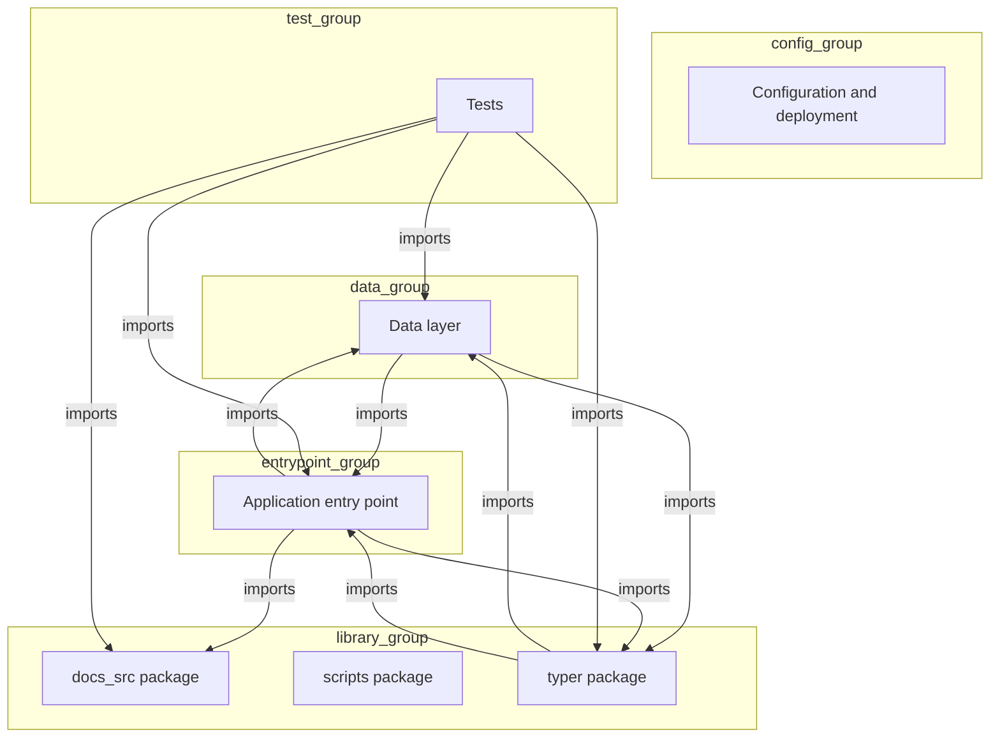

# Architecture report: fastapi/typer

> Automated static analysis. **Observed** = directly seen in files/imports/AST; **Inferred** = interpretation from that evidence. Repository code was not executed.

## 1. Repository at a glance

| Item | Value |
| --- | --- |
| Repository | fastapi/typer |
| Description | Typer, build great CLIs. Easy to code. Based on Python type hints. |
| Language | Python |
| Stars | 20353 |
| Licence | MIT |
| Analysed commit / branch | 73500169e87b4e31717d687818c5ed955b584c18 / master |
| Framework(s) | Typer |
| Files analysed | 777 |
| Components | 7 |

## 2. Architecture in one minute

fastapi/typer - Typer, build great CLIs. Easy to code. Based on Python type hints.. This repository was analysed statically from 777 file(s) (643 Python). Detected technologies (observed from imports/manifests): GitHub Actions, Typer, Pydantic, Poetry, Docker, Docker Compose. Files are grouped into 7 component(s): Configuration and deployment, Data layer, docs_src package, Application entry point, scripts package, Tests, typer package. Observed entry point(s): docs_src/app_dir/tutorial001.py, docs_src/arguments/default/tutorial001.py, docs_src/arguments/default/tutorial001_non_an.py. Findings below distinguish observed facts from inferred interpretation.

## 3. High-level block diagram

## 4. Main components

### Configuration and deployment (`config`)

- **Kind:** config
- **Status:** Observed
- **Confidence:** 0.85
- **Responsibility:** Groups 5 file(s) under configuration and deployment (observed from repository paths and static analysis).
- **Paths:** `mkdocs.env.yml`, `mkdocs.yml`, `pyproject.toml`, `scripts/docker/Dockerfile`, `scripts/docker/compose.yaml`
- **Evidence:** [mkdocs.env.yml](https://github.com/fastapi/typer/blob/73500169e87b4e31717d687818c5ed955b584c18/mkdocs.env.yml); [mkdocs.yml](https://github.com/fastapi/typer/blob/73500169e87b4e31717d687818c5ed955b584c18/mkdocs.yml); [pyproject.toml](https://github.com/fastapi/typer/blob/73500169e87b4e31717d687818c5ed955b584c18/pyproject.toml); [scripts/docker/Dockerfile](https://github.com/fastapi/typer/blob/73500169e87b4e31717d687818c5ed955b584c18/scripts/docker/Dockerfile); [scripts/docker/compose.yaml](https://github.com/fastapi/typer/blob/73500169e87b4e31717d687818c5ed955b584c18/scripts/docker/compose.yaml)

### Data layer (`data_layer`)

- **Kind:** data
- **Status:** Observed
- **Confidence:** 0.85
- **Responsibility:** Groups 1 file(s) under data layer (observed from repository paths and static analysis). Observed top-level classes: ArgumentInfo, CallbackParam, CommandInfo, Context, DefaultPlaceholder, DeveloperExceptionConfig. Observed top-level functions: Default.
- **Paths:** `typer/models.py`
- **Evidence:** [typer/models.py:21](https://github.com/fastapi/typer/blob/73500169e87b4e31717d687818c5ed955b584c18/typer/models.py#L21)

### docs_src package (`docs_src`)

- **Kind:** library
- **Status:** Observed
- **Confidence:** 0.85
- **Responsibility:** Groups 59 file(s) under docs_src package (observed from repository paths and static analysis).
- **Paths:** `docs_src/app_dir/__init__.py`, `docs_src/arguments/__init__.py`, `docs_src/arguments/default/__init__.py`, `docs_src/arguments/envvar/__init__.py`, `docs_src/arguments/help/__init__.py`, `docs_src/arguments/optional/__init__.py`, `docs_src/commands/__init__.py`, `docs_src/commands/arguments/__init__.py`, `docs_src/commands/callback/__init__.py`, `docs_src/commands/context/__init__.py`, `docs_src/commands/help/__init__.py`, `docs_src/commands/index/__init__.py`, `docs_src/commands/name/__init__.py`, `docs_src/commands/one_or_multiple/__init__.py`, `docs_src/commands/options/__init__.py`, `docs_src/exceptions/__init__.py`, `docs_src/first_steps/__init__.py`, `docs_src/launch/__init__.py`, `docs_src/multiple_values/__init__.py`, `docs_src/multiple_values/arguments_with_multiple_values/__init__.py`, `docs_src/multiple_values/multiple_options/__init__.py`, `docs_src/multiple_values/options_with_multiple_values/__init__.py`, `docs_src/one_file_per_command/__init__.py`, `docs_src/one_file_per_command/app/__init__.py`, `docs_src/options/__init__.py`, `docs_src/options/callback/__init__.py`, `docs_src/options/help/__init__.py`, `docs_src/options/name/__init__.py`, `docs_src/options/password/__init__.py`, `docs_src/options/prompt/__init__.py`, `docs_src/options/required/__init__.py`, `docs_src/options/version/__init__.py`, `docs_src/options_autocompletion/__init__.py`, `docs_src/parameter_types/__init__.py`, `docs_src/parameter_types/bool/__init__.py`, `docs_src/parameter_types/custom_types/__init__.py`, `docs_src/parameter_types/datetime/__init__.py`, `docs_src/parameter_types/enum/__init__.py`, `docs_src/parameter_types/file/__init__.py`, `docs_src/parameter_types/index/__init__.py`, `docs_src/parameter_types/number/__init__.py`, `docs_src/parameter_types/path/__init__.py`, `docs_src/parameter_types/uuid/__init__.py`, `docs_src/printing/__init__.py`, `docs_src/progressbar/__init__.py`, `docs_src/prompt/__init__.py`, `docs_src/subcommands/__init__.py`, `docs_src/subcommands/callback_override/__init__.py`, `docs_src/subcommands/name_help/__init__.py`, `docs_src/subcommands/tutorial001/__init__.py`, `docs_src/subcommands/tutorial002/__init__.py`, `docs_src/subcommands/tutorial003/__init__.py`, `docs_src/terminating/__init__.py`, `docs_src/testing/__init__.py`, `docs_src/testing/app01/__init__.py`, `docs_src/testing/app02/__init__.py`, `docs_src/testing/app02_non_an/__init__.py`, `docs_src/testing/app03/__init__.py`, `docs_src/typer_app/__init__.py`
- **Evidence:** [docs_src/app_dir/__init__.py](https://github.com/fastapi/typer/blob/73500169e87b4e31717d687818c5ed955b584c18/docs_src/app_dir/__init__.py); [docs_src/arguments/__init__.py](https://github.com/fastapi/typer/blob/73500169e87b4e31717d687818c5ed955b584c18/docs_src/arguments/__init__.py); [docs_src/arguments/default/__init__.py](https://github.com/fastapi/typer/blob/73500169e87b4e31717d687818c5ed955b584c18/docs_src/arguments/default/__init__.py); [docs_src/arguments/envvar/__init__.py](https://github.com/fastapi/typer/blob/73500169e87b4e31717d687818c5ed955b584c18/docs_src/arguments/envvar/__init__.py); [docs_src/arguments/help/__init__.py](https://github.com/fastapi/typer/blob/73500169e87b4e31717d687818c5ed955b584c18/docs_src/arguments/help/__init__.py); [docs_src/arguments/optional/__init__.py](https://github.com/fastapi/typer/blob/73500169e87b4e31717d687818c5ed955b584c18/docs_src/arguments/optional/__init__.py); [docs_src/commands/__init__.py](https://github.com/fastapi/typer/blob/73500169e87b4e31717d687818c5ed955b584c18/docs_src/commands/__init__.py); [docs_src/commands/arguments/__init__.py](https://github.com/fastapi/typer/blob/73500169e87b4e31717d687818c5ed955b584c18/docs_src/commands/arguments/__init__.py)

### Application entry point (`entrypoint`)

- **Kind:** entrypoint
- **Status:** Observed
- **Confidence:** 0.85
- **Responsibility:** Groups 248 file(s) under application entry point (observed from repository paths and static analysis). Observed application object created via Typer. Observed top-level classes: CustomClass, Food, LinkData, NeuralNetwork, Settings, State. Observed top-level functions: _get_param, _get_params_name_from_function, _is_linux_or_bsd, _is_macos, _normalize_collection_value, _parse_html.
- **Paths:** `docs_src/app_dir/tutorial001.py`, `docs_src/arguments/default/tutorial001.py`, `docs_src/arguments/default/tutorial001_non_an.py`, `docs_src/arguments/default/tutorial002.py`, `docs_src/arguments/default/tutorial002_non_an.py`, `docs_src/arguments/envvar/tutorial001.py`, `docs_src/arguments/envvar/tutorial001_non_an.py`, `docs_src/arguments/envvar/tutorial002.py`, `docs_src/arguments/envvar/tutorial002_non_an.py`, `docs_src/arguments/envvar/tutorial003.py`, `docs_src/arguments/envvar/tutorial003_non_an.py`, `docs_src/arguments/help/tutorial001.py`, `docs_src/arguments/help/tutorial001_non_an.py`, `docs_src/arguments/help/tutorial002.py`, `docs_src/arguments/help/tutorial002_non_an.py`, `docs_src/arguments/help/tutorial003.py`, `docs_src/arguments/help/tutorial003_non_an.py`, `docs_src/arguments/help/tutorial004.py`, `docs_src/arguments/help/tutorial004_non_an.py`, `docs_src/arguments/help/tutorial005.py`, `docs_src/arguments/help/tutorial005_non_an.py`, `docs_src/arguments/help/tutorial006.py`, `docs_src/arguments/help/tutorial006_non_an.py`, `docs_src/arguments/help/tutorial007.py`, `docs_src/arguments/help/tutorial007_non_an.py`, `docs_src/arguments/help/tutorial008.py`, `docs_src/arguments/help/tutorial008_non_an.py`, `docs_src/arguments/optional/tutorial000.py`, `docs_src/arguments/optional/tutorial000_non_an.py`, `docs_src/arguments/optional/tutorial001.py`, `docs_src/arguments/optional/tutorial001_non_an.py`, `docs_src/arguments/optional/tutorial002.py`, `docs_src/arguments/optional/tutorial002_non_an.py`, `docs_src/arguments/optional/tutorial003.py`, `docs_src/commands/arguments/tutorial001.py`, `docs_src/commands/callback/tutorial001.py`, `docs_src/commands/callback/tutorial002.py`, `docs_src/commands/callback/tutorial003.py`, `docs_src/commands/callback/tutorial004.py`, `docs_src/commands/context/tutorial001.py`, `docs_src/commands/context/tutorial002.py`, `docs_src/commands/context/tutorial003.py`, `docs_src/commands/context/tutorial004.py`, `docs_src/commands/help/tutorial001.py`, `docs_src/commands/help/tutorial001_non_an.py`, `docs_src/commands/help/tutorial002.py`, `docs_src/commands/help/tutorial003.py`, `docs_src/commands/help/tutorial004.py`, `docs_src/commands/help/tutorial004_non_an.py`, `docs_src/commands/help/tutorial005.py`, `docs_src/commands/help/tutorial005_non_an.py`, `docs_src/commands/help/tutorial006.py`, `docs_src/commands/help/tutorial007.py`, `docs_src/commands/help/tutorial007_non_an.py`, `docs_src/commands/help/tutorial008.py`, `docs_src/commands/index/tutorial002.py`, `docs_src/commands/index/tutorial003.py`, `docs_src/commands/index/tutorial004.py`, `docs_src/commands/index/tutorial005.py`, `docs_src/commands/name/tutorial001.py`, `docs_src/commands/one_or_multiple/tutorial001.py`, `docs_src/commands/one_or_multiple/tutorial002.py`, `docs_src/commands/options/tutorial001.py`, `docs_src/commands/options/tutorial001_non_an.py`, `docs_src/exceptions/tutorial001.py`, `docs_src/exceptions/tutorial002.py`, `docs_src/exceptions/tutorial003.py`, `docs_src/exceptions/tutorial004.py`, `docs_src/first_steps/tutorial001.py`, `docs_src/first_steps/tutorial002.py`, `docs_src/first_steps/tutorial003.py`, `docs_src/first_steps/tutorial004.py`, `docs_src/first_steps/tutorial005.py`, `docs_src/first_steps/tutorial006.py`, `docs_src/launch/tutorial001.py`, `docs_src/launch/tutorial002.py`, `docs_src/multiple_values/arguments_with_multiple_values/tutorial001.py`, `docs_src/multiple_values/arguments_with_multiple_values/tutorial002.py`, `docs_src/multiple_values/arguments_with_multiple_values/tutorial002_non_an.py`, `docs_src/multiple_values/multiple_options/tutorial001.py`, `docs_src/multiple_values/multiple_options/tutorial001_non_an.py`, `docs_src/multiple_values/multiple_options/tutorial002.py`, `docs_src/multiple_values/multiple_options/tutorial002_non_an.py`, `docs_src/multiple_values/options_with_multiple_values/tutorial001.py`, `docs_src/multiple_values/options_with_multiple_values/tutorial001_non_an.py`, `docs_src/one_file_per_command/app/main.py`, `docs_src/one_file_per_command/app/users/__init__.py`, `docs_src/one_file_per_command/app/users/add.py`, `docs_src/one_file_per_command/app/users/delete.py`, `docs_src/one_file_per_command/app/version.py`, `docs_src/options/callback/tutorial001.py`, `docs_src/options/callback/tutorial001_non_an.py`, `docs_src/options/callback/tutorial002.py`, `docs_src/options/callback/tutorial002_non_an.py`, `docs_src/options/callback/tutorial003.py`, `docs_src/options/callback/tutorial003_non_an.py`, `docs_src/options/callback/tutorial004.py`, `docs_src/options/callback/tutorial004_non_an.py`, `docs_src/options/help/tutorial001.py`, `docs_src/options/help/tutorial001_non_an.py`, `docs_src/options/help/tutorial002.py`, `docs_src/options/help/tutorial002_non_an.py`, `docs_src/options/help/tutorial003.py`, `docs_src/options/help/tutorial003_non_an.py`, `docs_src/options/help/tutorial004.py`, `docs_src/options/help/tutorial004_non_an.py`, `docs_src/options/name/tutorial001.py`, `docs_src/options/name/tutorial001_non_an.py`, `docs_src/options/name/tutorial002.py`, `docs_src/options/name/tutorial002_non_an.py`, `docs_src/options/name/tutorial003.py`, `docs_src/options/name/tutorial003_non_an.py`, `docs_src/options/name/tutorial004.py`, `docs_src/options/name/tutorial004_non_an.py`, `docs_src/options/name/tutorial005.py`, `docs_src/options/name/tutorial005_non_an.py`, `docs_src/options/password/tutorial001.py`, `docs_src/options/password/tutorial001_non_an.py`, `docs_src/options/password/tutorial002.py`, `docs_src/options/password/tutorial002_non_an.py`, `docs_src/options/prompt/tutorial001.py`, `docs_src/options/prompt/tutorial001_non_an.py`, `docs_src/options/prompt/tutorial002.py`, `docs_src/options/prompt/tutorial002_non_an.py`, `docs_src/options/prompt/tutorial003.py`, `docs_src/options/prompt/tutorial003_non_an.py`, `docs_src/options/required/tutorial001.py`, `docs_src/options/required/tutorial001_non_an.py`, `docs_src/options/required/tutorial002.py`, `docs_src/options/version/tutorial001.py`, `docs_src/options/version/tutorial001_non_an.py`, `docs_src/options/version/tutorial002.py`, `docs_src/options/version/tutorial002_non_an.py`, `docs_src/options/version/tutorial003.py`, `docs_src/options/version/tutorial003_non_an.py`, `docs_src/options_autocompletion/tutorial001.py`, `docs_src/options_autocompletion/tutorial001_non_an.py`, `docs_src/options_autocompletion/tutorial002.py`, `docs_src/options_autocompletion/tutorial002_non_an.py`, `docs_src/options_autocompletion/tutorial003.py`, `docs_src/options_autocompletion/tutorial003_non_an.py`, `docs_src/options_autocompletion/tutorial004.py`, `docs_src/options_autocompletion/tutorial004_non_an.py`, `docs_src/options_autocompletion/tutorial005.py`, `docs_src/options_autocompletion/tutorial005_non_an.py`, `docs_src/options_autocompletion/tutorial006.py`, `docs_src/options_autocompletion/tutorial006_non_an.py`, `docs_src/options_autocompletion/tutorial007.py`, `docs_src/options_autocompletion/tutorial007_non_an.py`, `docs_src/options_autocompletion/tutorial008.py`, `docs_src/options_autocompletion/tutorial008_non_an.py`, `docs_src/options_autocompletion/tutorial009.py`, `docs_src/options_autocompletion/tutorial009_non_an.py`, `docs_src/parameter_types/bool/tutorial001.py`, `docs_src/parameter_types/bool/tutorial001_non_an.py`, `docs_src/parameter_types/bool/tutorial002.py`, `docs_src/parameter_types/bool/tutorial002_non_an.py`, `docs_src/parameter_types/bool/tutorial003.py`, `docs_src/parameter_types/bool/tutorial003_non_an.py`, `docs_src/parameter_types/bool/tutorial004.py`, `docs_src/parameter_types/bool/tutorial004_non_an.py`, `docs_src/parameter_types/custom_types/tutorial001.py`, `docs_src/parameter_types/custom_types/tutorial001_non_an.py`, `docs_src/parameter_types/datetime/tutorial001.py`, `docs_src/parameter_types/datetime/tutorial002.py`, `docs_src/parameter_types/datetime/tutorial002_non_an.py`, `docs_src/parameter_types/enum/tutorial001.py`, `docs_src/parameter_types/enum/tutorial002.py`, `docs_src/parameter_types/enum/tutorial002_non_an.py`, `docs_src/parameter_types/enum/tutorial003.py`, `docs_src/parameter_types/enum/tutorial003_non_an.py`, `docs_src/parameter_types/enum/tutorial004.py`, `docs_src/parameter_types/enum/tutorial004_non_an.py`, `docs_src/parameter_types/file/tutorial001.py`, `docs_src/parameter_types/file/tutorial001_non_an.py`, `docs_src/parameter_types/file/tutorial002.py`, `docs_src/parameter_types/file/tutorial002_non_an.py`, `docs_src/parameter_types/file/tutorial003.py`, `docs_src/parameter_types/file/tutorial003_non_an.py`, `docs_src/parameter_types/file/tutorial004.py`, `docs_src/parameter_types/file/tutorial004_non_an.py`, `docs_src/parameter_types/file/tutorial005.py`, `docs_src/parameter_types/file/tutorial005_non_an.py`, `docs_src/parameter_types/index/tutorial001.py`, `docs_src/parameter_types/number/tutorial001.py`, `docs_src/parameter_types/number/tutorial001_non_an.py`, `docs_src/parameter_types/number/tutorial002.py`, `docs_src/parameter_types/number/tutorial002_non_an.py`, `docs_src/parameter_types/number/tutorial003.py`, `docs_src/parameter_types/number/tutorial003_non_an.py`, `docs_src/parameter_types/path/tutorial001.py`, `docs_src/parameter_types/path/tutorial001_non_an.py`, `docs_src/parameter_types/path/tutorial002.py`, `docs_src/parameter_types/path/tutorial002_non_an.py`, `docs_src/parameter_types/uuid/tutorial001.py`, `docs_src/printing/tutorial001.py`, `docs_src/printing/tutorial002.py`, `docs_src/printing/tutorial003.py`, `docs_src/printing/tutorial004.py`, `docs_src/printing/tutorial005.py`, `docs_src/printing/tutorial006.py`, `docs_src/progressbar/tutorial001.py`, `docs_src/progressbar/tutorial002.py`, `docs_src/progressbar/tutorial003.py`, `docs_src/progressbar/tutorial004.py`, `docs_src/progressbar/tutorial005.py`, `docs_src/progressbar/tutorial006.py`, `docs_src/prompt/tutorial001.py`, `docs_src/prompt/tutorial002.py`, `docs_src/prompt/tutorial003.py`, `docs_src/prompt/tutorial004.py`, `docs_src/subcommands/callback_override/tutorial001.py`, `docs_src/subcommands/callback_override/tutorial002.py`, `docs_src/subcommands/callback_override/tutorial003.py`, `docs_src/subcommands/callback_override/tutorial004.py`, `docs_src/subcommands/name_help/tutorial001.py`, `docs_src/subcommands/name_help/tutorial002.py`, `docs_src/subcommands/name_help/tutorial003.py`, `docs_src/subcommands/name_help/tutorial004.py`, `docs_src/subcommands/name_help/tutorial005.py`, `docs_src/subcommands/name_help/tutorial006.py`, `docs_src/subcommands/name_help/tutorial007.py`, `docs_src/subcommands/name_help/tutorial008.py`, `docs_src/subcommands/tutorial001/items.py`, `docs_src/subcommands/tutorial001/main.py`, `docs_src/subcommands/tutorial001/users.py`, `docs_src/subcommands/tutorial002/main.py`, `docs_src/subcommands/tutorial003/items.py`, `docs_src/subcommands/tutorial003/lands.py`, `docs_src/subcommands/tutorial003/main.py`, `docs_src/subcommands/tutorial003/reigns.py`, `docs_src/subcommands/tutorial003/towns.py`, `docs_src/subcommands/tutorial003/users.py`, `docs_src/terminating/tutorial001.py`, `docs_src/terminating/tutorial002.py`, `docs_src/terminating/tutorial003.py`, `docs_src/testing/app01/main.py`, `docs_src/testing/app02/main.py`, `docs_src/testing/app02_non_an/main.py`, `docs_src/testing/app03/main.py`, `docs_src/typer_app/tutorial001.py`, `scripts/add_latest_release_date.py`, `scripts/deploy_docs_status.py`, `scripts/docs.py`, `scripts/prepare_release.py`, `typer/__main__.py`, `typer/cli.py`, `typer/main.py`
- **Evidence:** [docs_src/app_dir/tutorial001.py:7](https://github.com/fastapi/typer/blob/73500169e87b4e31717d687818c5ed955b584c18/docs_src/app_dir/tutorial001.py#L7); [docs_src/arguments/default/tutorial001.py:5](https://github.com/fastapi/typer/blob/73500169e87b4e31717d687818c5ed955b584c18/docs_src/arguments/default/tutorial001.py#L5); [docs_src/arguments/default/tutorial001_non_an.py:3](https://github.com/fastapi/typer/blob/73500169e87b4e31717d687818c5ed955b584c18/docs_src/arguments/default/tutorial001_non_an.py#L3); [docs_src/arguments/default/tutorial002.py:6](https://github.com/fastapi/typer/blob/73500169e87b4e31717d687818c5ed955b584c18/docs_src/arguments/default/tutorial002.py#L6); [docs_src/arguments/default/tutorial002_non_an.py:5](https://github.com/fastapi/typer/blob/73500169e87b4e31717d687818c5ed955b584c18/docs_src/arguments/default/tutorial002_non_an.py#L5); [docs_src/arguments/envvar/tutorial001.py:5](https://github.com/fastapi/typer/blob/73500169e87b4e31717d687818c5ed955b584c18/docs_src/arguments/envvar/tutorial001.py#L5); [docs_src/arguments/envvar/tutorial001_non_an.py:3](https://github.com/fastapi/typer/blob/73500169e87b4e31717d687818c5ed955b584c18/docs_src/arguments/envvar/tutorial001_non_an.py#L3); [docs_src/arguments/envvar/tutorial002.py:5](https://github.com/fastapi/typer/blob/73500169e87b4e31717d687818c5ed955b584c18/docs_src/arguments/envvar/tutorial002.py#L5)

### scripts package (`scripts`)

- **Kind:** library
- **Status:** Observed
- **Confidence:** 0.85
- **Responsibility:** Groups 7 file(s) under scripts package (observed from repository paths and static analysis). Observed top-level classes: AgentBannerExtension, AgentBannerPreprocessor. Observed top-level functions: makeExtension.
- **Paths:** `scripts/agent_banner.py`, `scripts/format.sh`, `scripts/get-pwsh-activate.sh`, `scripts/lint.sh`, `scripts/test-cov-html.sh`, `scripts/test-files.sh`, `scripts/test.sh`
- **Evidence:** [scripts/agent_banner.py:11](https://github.com/fastapi/typer/blob/73500169e87b4e31717d687818c5ed955b584c18/scripts/agent_banner.py#L11); [scripts/format.sh](https://github.com/fastapi/typer/blob/73500169e87b4e31717d687818c5ed955b584c18/scripts/format.sh); [scripts/get-pwsh-activate.sh](https://github.com/fastapi/typer/blob/73500169e87b4e31717d687818c5ed955b584c18/scripts/get-pwsh-activate.sh); [scripts/lint.sh](https://github.com/fastapi/typer/blob/73500169e87b4e31717d687818c5ed955b584c18/scripts/lint.sh); [scripts/test-cov-html.sh](https://github.com/fastapi/typer/blob/73500169e87b4e31717d687818c5ed955b584c18/scripts/test-cov-html.sh); [scripts/test-files.sh](https://github.com/fastapi/typer/blob/73500169e87b4e31717d687818c5ed955b584c18/scripts/test-files.sh); [scripts/test.sh](https://github.com/fastapi/typer/blob/73500169e87b4e31717d687818c5ed955b584c18/scripts/test.sh)

### Tests (`tests`)

- **Kind:** test
- **Status:** Observed
- **Confidence:** 0.85
- **Responsibility:** Groups 308 file(s) under tests (observed from repository paths and static analysis). Observed application object created via Typer. Observed top-level classes: SomeEnum, User. Observed top-level functions: _capture_write_console, _complete, _fake_clock, _identity_buffer, _pbar, _route_console_stream.
- **Paths:** `docs_src/testing/app01/test_main.py`, `docs_src/testing/app02/test_main.py`, `docs_src/testing/app02_non_an/test_main.py`, `docs_src/testing/app03/test_main.py`, `tests/__init__.py`, `tests/assets/__init__.py`, `tests/assets/cli/__init__.py`, `tests/assets/cli/app_other_name.py`, `tests/assets/cli/empty_script.py`, `tests/assets/cli/extended_app_cli.py`, `tests/assets/cli/extended_empty_app_cli.py`, `tests/assets/cli/func_other_name.py`, `tests/assets/cli/minimum_main.py`, `tests/assets/cli/multi_app.py`, `tests/assets/cli/multi_app_cli.py`, `tests/assets/cli/multi_app_norich.py`, `tests/assets/cli/multi_func.py`, `tests/assets/cli/multiapp-docs-title.md`, `tests/assets/cli/multiapp-docs.md`, `tests/assets/cli/not_python.txt`, `tests/assets/cli/rich_formatted_app.py`, `tests/assets/cli/richformattedapp-docs.md`, `tests/assets/cli/sample.py`, `tests/assets/completion_argument.py`, `tests/assets/completion_no_types.py`, `tests/assets/completion_no_types_order.py`, `tests/assets/hidden_commands.py`, `tests/assets/hidden_option.py`, `tests/assets/print_modules.py`, `tests/assets/prog_name.py`, `tests/assets/type_error_no_rich.py`, `tests/assets/type_error_no_rich_short_disable.py`, `tests/assets/type_error_normal_traceback.py`, `tests/assets/type_error_rich.py`, `tests/atomic_write_example.py`, `tests/conftest.py`, `tests/test_ambiguous_params.py`, `tests/test_annotated.py`, `tests/test_atomic_file.py`, `tests/test_callback_warning.py`, `tests/test_cli/__init__.py`, `tests/test_cli/test_app_other_name.py`, `tests/test_cli/test_completion_run.py`, `tests/test_cli/test_doc.py`, `tests/test_cli/test_empty_script.py`, `tests/test_cli/test_extending_app.py`, `tests/test_cli/test_extending_empty_app.py`, `tests/test_cli/test_func_other_name.py`, `tests/test_cli/test_help.py`, `tests/test_cli/test_multi_app.py`, `tests/test_cli/test_multi_app_cli.py`, `tests/test_cli/test_multi_app_sub.py`, `tests/test_cli/test_multi_func.py`, `tests/test_cli/test_not_python.py`, `tests/test_cli/test_parser.py`, `tests/test_cli/test_program_name.py`, `tests/test_cli/test_sub.py`, `tests/test_cli/test_sub_completion.py`, `tests/test_cli/test_sub_help.py`, `tests/test_cli/test_version.py`, `tests/test_coercion.py`, `tests/test_completion/__init__.py`, `tests/test_completion/choice_case_insensitive_example.py`, `tests/test_completion/choice_example.py`, `tests/test_completion/colon_example.py`, `tests/test_completion/completion_option_then_argument.py`, `tests/test_completion/example_rich_tags.py`, `tests/test_completion/file_example.py`, `tests/test_completion/path_example.py`, `tests/test_completion/test_completion.py`, `tests/test_completion/test_completion_choice.py`, `tests/test_completion/test_completion_choice_no_case.py`, `tests/test_completion/test_completion_complete.py`, `tests/test_completion/test_completion_complete_no_help.py`, `tests/test_completion/test_completion_complete_rich.py`, `tests/test_completion/test_completion_file.py`, `tests/test_completion/test_completion_install.py`, `tests/test_completion/test_completion_option_colon.py`, `tests/test_completion/test_completion_path.py`, `tests/test_completion/test_completion_show.py`, `tests/test_completion/test_sanitization.py`, `tests/test_core.py`, `tests/test_deprecation.py`, `tests/test_docs_cleanup.py`, `tests/test_exit_errors.py`, `tests/test_future_annotations.py`, `tests/test_hidden.py`, `tests/test_launch.py`, `tests/test_others.py`, `tests/test_param_meta_empty.py`, `tests/test_prepare_release.py`, `tests/test_prog_name.py`, `tests/test_progress_bar.py`, `tests/test_rich_import.py`, `tests/test_rich_markup_mode.py`, `tests/test_rich_utils.py`, `tests/test_suggest_commands.py`, `tests/test_terminal_control_characters.py`, `tests/test_termui.py`, `tests/test_tracebacks.py`, `tests/test_tutorial/__init__.py`, `tests/test_tutorial/test_app_dir/__init__.py`, `tests/test_tutorial/test_app_dir/test_tutorial001.py`, `tests/test_tutorial/test_arguments/__init__.py`, `tests/test_tutorial/test_arguments/test_default/__init__.py`, `tests/test_tutorial/test_arguments/test_default/test_tutorial001.py`, `tests/test_tutorial/test_arguments/test_default/test_tutorial002.py`, `tests/test_tutorial/test_arguments/test_envvar/__init__.py`, `tests/test_tutorial/test_arguments/test_envvar/test_tutorial001.py`, `tests/test_tutorial/test_arguments/test_envvar/test_tutorial002.py`, `tests/test_tutorial/test_arguments/test_envvar/test_tutorial003.py`, `tests/test_tutorial/test_arguments/test_help/__init__.py`, `tests/test_tutorial/test_arguments/test_help/test_tutorial001.py`, `tests/test_tutorial/test_arguments/test_help/test_tutorial002.py`, `tests/test_tutorial/test_arguments/test_help/test_tutorial003.py`, `tests/test_tutorial/test_arguments/test_help/test_tutorial004.py`, `tests/test_tutorial/test_arguments/test_help/test_tutorial005.py`, `tests/test_tutorial/test_arguments/test_help/test_tutorial006.py`, `tests/test_tutorial/test_arguments/test_help/test_tutorial007.py`, `tests/test_tutorial/test_arguments/test_help/test_tutorial008.py`, `tests/test_tutorial/test_arguments/test_optional/__init__.py`, `tests/test_tutorial/test_arguments/test_optional/test_tutorial000.py`, `tests/test_tutorial/test_arguments/test_optional/test_tutorial001.py`, `tests/test_tutorial/test_arguments/test_optional/test_tutorial002.py`, `tests/test_tutorial/test_arguments/test_optional/test_tutorial003.py`, `tests/test_tutorial/test_commands/__init__.py`, `tests/test_tutorial/test_commands/test_arguments/__init__.py`, `tests/test_tutorial/test_commands/test_arguments/test_tutorial001.py`, `tests/test_tutorial/test_commands/test_callback/__init__.py`, `tests/test_tutorial/test_commands/test_callback/test_tutorial001.py`, `tests/test_tutorial/test_commands/test_callback/test_tutorial002.py`, `tests/test_tutorial/test_commands/test_callback/test_tutorial003.py`, `tests/test_tutorial/test_commands/test_callback/test_tutorial004.py`, `tests/test_tutorial/test_commands/test_context/__init__.py`, `tests/test_tutorial/test_commands/test_context/test_tutorial001.py`, `tests/test_tutorial/test_commands/test_context/test_tutorial002.py`, `tests/test_tutorial/test_commands/test_context/test_tutorial003.py`, `tests/test_tutorial/test_commands/test_context/test_tutorial004.py`, `tests/test_tutorial/test_commands/test_help/__init__.py`, `tests/test_tutorial/test_commands/test_help/test_tutorial001.py`, `tests/test_tutorial/test_commands/test_help/test_tutorial002.py`, `tests/test_tutorial/test_commands/test_help/test_tutorial003.py`, `tests/test_tutorial/test_commands/test_help/test_tutorial004.py`, `tests/test_tutorial/test_commands/test_help/test_tutorial005.py`, `tests/test_tutorial/test_commands/test_help/test_tutorial006.py`, `tests/test_tutorial/test_commands/test_help/test_tutorial007.py`, `tests/test_tutorial/test_commands/test_help/test_tutorial008.py`, `tests/test_tutorial/test_commands/test_index/__init__.py`, `tests/test_tutorial/test_commands/test_index/test_tutorial002.py`, `tests/test_tutorial/test_commands/test_index/test_tutorial003.py`, `tests/test_tutorial/test_commands/test_index/test_tutorial004.py`, `tests/test_tutorial/test_commands/test_index/test_tutorial005.py`, `tests/test_tutorial/test_commands/test_name/__init__.py`, `tests/test_tutorial/test_commands/test_name/test_tutorial001.py`, `tests/test_tutorial/test_commands/test_one_or_multiple/__init__.py`, `tests/test_tutorial/test_commands/test_one_or_multiple/test_tutorial001.py`, `tests/test_tutorial/test_commands/test_one_or_multiple/test_tutorial002.py`, `tests/test_tutorial/test_commands/test_options/__init__.py`, `tests/test_tutorial/test_commands/test_options/test_tutorial001.py`, `tests/test_tutorial/test_exceptions/__init__.py`, `tests/test_tutorial/test_exceptions/test_tutorial001.py`, `tests/test_tutorial/test_exceptions/test_tutorial002.py`, `tests/test_tutorial/test_exceptions/test_tutorial003.py`, `tests/test_tutorial/test_exceptions/test_tutorial004.py`, `tests/test_tutorial/test_first_steps/__init__.py`, `tests/test_tutorial/test_first_steps/test_tutorial001.py`, `tests/test_tutorial/test_first_steps/test_tutorial002.py`, `tests/test_tutorial/test_first_steps/test_tutorial003.py`, `tests/test_tutorial/test_first_steps/test_tutorial004.py`, `tests/test_tutorial/test_first_steps/test_tutorial005.py`, `tests/test_tutorial/test_first_steps/test_tutorial006.py`, `tests/test_tutorial/test_launch/test_tutorial001.py`, `tests/test_tutorial/test_launch/test_tutorial002.py`, `tests/test_tutorial/test_multiple_values/__init__.py`, `tests/test_tutorial/test_multiple_values/test_arguments_with_multiple_values/__init__.py`, `tests/test_tutorial/test_multiple_values/test_arguments_with_multiple_values/test_tutorial001.py`, `tests/test_tutorial/test_multiple_values/test_arguments_with_multiple_values/test_tutorial002.py`, `tests/test_tutorial/test_multiple_values/test_multiple_options/__init__.py`, `tests/test_tutorial/test_multiple_values/test_multiple_options/test_tutorial001.py`, `tests/test_tutorial/test_multiple_values/test_multiple_options/test_tutorial002.py`, `tests/test_tutorial/test_multiple_values/test_options_with_multiple_values/__init__.py`, `tests/test_tutorial/test_multiple_values/test_options_with_multiple_values/test_tutorial001.py`, `tests/test_tutorial/test_one_file_per_command/__init__.py`, `tests/test_tutorial/test_one_file_per_command/test_tutorial.py`, `tests/test_tutorial/test_options/__init__.py`, `tests/test_tutorial/test_options/test_callback/__init__.py`, `tests/test_tutorial/test_options/test_callback/test_tutorial001.py`, `tests/test_tutorial/test_options/test_callback/test_tutorial002.py`, `tests/test_tutorial/test_options/test_callback/test_tutorial003.py`, `tests/test_tutorial/test_options/test_callback/test_tutorial004.py`, `tests/test_tutorial/test_options/test_help/__init__.py`, `tests/test_tutorial/test_options/test_help/test_tutorial001.py`, `tests/test_tutorial/test_options/test_help/test_tutorial002.py`, `tests/test_tutorial/test_options/test_help/test_tutorial003.py`, `tests/test_tutorial/test_options/test_help/test_tutorial004.py`, `tests/test_tutorial/test_options/test_name/__init__.py`, `tests/test_tutorial/test_options/test_name/test_tutorial001.py`, `tests/test_tutorial/test_options/test_name/test_tutorial002.py`, `tests/test_tutorial/test_options/test_name/test_tutorial003.py`, `tests/test_tutorial/test_options/test_name/test_tutorial004.py`, `tests/test_tutorial/test_options/test_name/test_tutorial005.py`, `tests/test_tutorial/test_options/test_password/__init__.py`, `tests/test_tutorial/test_options/test_password/test_tutorial001.py`, `tests/test_tutorial/test_options/test_password/test_tutorial002.py`, `tests/test_tutorial/test_options/test_prompt/__init__.py`, `tests/test_tutorial/test_options/test_prompt/test_tutorial001.py`, `tests/test_tutorial/test_options/test_prompt/test_tutorial002.py`, `tests/test_tutorial/test_options/test_prompt/test_tutorial003.py`, `tests/test_tutorial/test_options/test_required/__init__.py`, `tests/test_tutorial/test_options/test_required/test_tutorial001_tutorial002.py`, `tests/test_tutorial/test_options/test_version/__init__.py`, `tests/test_tutorial/test_options/test_version/test_tutorial001.py`, `tests/test_tutorial/test_options/test_version/test_tutorial002.py`, `tests/test_tutorial/test_options/test_version/test_tutorial003.py`, `tests/test_tutorial/test_options_autocompletion/__init__.py`, `tests/test_tutorial/test_options_autocompletion/test_tutorial001.py`, `tests/test_tutorial/test_options_autocompletion/test_tutorial002.py`, `tests/test_tutorial/test_options_autocompletion/test_tutorial003.py`, `tests/test_tutorial/test_options_autocompletion/test_tutorial004_tutorial005.py`, `tests/test_tutorial/test_options_autocompletion/test_tutorial006.py`, `tests/test_tutorial/test_options_autocompletion/test_tutorial007.py`, `tests/test_tutorial/test_options_autocompletion/test_tutorial008.py`, `tests/test_tutorial/test_options_autocompletion/test_tutorial009.py`, `tests/test_tutorial/test_parameter_types/__init__.py`, `tests/test_tutorial/test_parameter_types/test_bool/__init__.py`, `tests/test_tutorial/test_parameter_types/test_bool/test_tutorial001.py`, `tests/test_tutorial/test_parameter_types/test_bool/test_tutorial002.py`, `tests/test_tutorial/test_parameter_types/test_bool/test_tutorial003.py`, `tests/test_tutorial/test_parameter_types/test_bool/test_tutorial004.py`, `tests/test_tutorial/test_parameter_types/test_custom_types/__init__.py`, `tests/test_tutorial/test_parameter_types/test_custom_types/test_tutorial001.py`, `tests/test_tutorial/test_parameter_types/test_datetime/__init__.py`, `tests/test_tutorial/test_parameter_types/test_datetime/test_tutorial001.py`, `tests/test_tutorial/test_parameter_types/test_datetime/test_tutorial002.py`, `tests/test_tutorial/test_parameter_types/test_enum/__init__.py`, `tests/test_tutorial/test_parameter_types/test_enum/test_tutorial001.py`, `tests/test_tutorial/test_parameter_types/test_enum/test_tutorial002.py`, `tests/test_tutorial/test_parameter_types/test_enum/test_tutorial003.py`, `tests/test_tutorial/test_parameter_types/test_enum/test_tutorial004.py`, `tests/test_tutorial/test_parameter_types/test_file/__init__.py`, `tests/test_tutorial/test_parameter_types/test_file/test_tutorial001.py`, `tests/test_tutorial/test_parameter_types/test_file/test_tutorial002.py`, `tests/test_tutorial/test_parameter_types/test_file/test_tutorial003.py`, `tests/test_tutorial/test_parameter_types/test_file/test_tutorial004.py`, `tests/test_tutorial/test_parameter_types/test_file/test_tutorial005.py`, `tests/test_tutorial/test_parameter_types/test_index/__init__.py`, `tests/test_tutorial/test_parameter_types/test_index/test_tutorial001.py`, `tests/test_tutorial/test_parameter_types/test_number/__init__.py`, `tests/test_tutorial/test_parameter_types/test_number/test_tutorial001.py`, `tests/test_tutorial/test_parameter_types/test_number/test_tutorial002.py`, `tests/test_tutorial/test_parameter_types/test_number/test_tutorial003.py`, `tests/test_tutorial/test_parameter_types/test_path/__init__.py`, `tests/test_tutorial/test_parameter_types/test_path/test_tutorial001.py`, `tests/test_tutorial/test_parameter_types/test_path/test_tutorial002.py`, `tests/test_tutorial/test_parameter_types/test_uuid/__init__.py`, `tests/test_tutorial/test_parameter_types/test_uuid/test_tutorial001.py`, `tests/test_tutorial/test_printing/__init__.py`, `tests/test_tutorial/test_printing/test_tutorial001.py`, `tests/test_tutorial/test_printing/test_tutorial002.py`, `tests/test_tutorial/test_printing/test_tutorial003.py`, `tests/test_tutorial/test_printing/test_tutorial004.py`, `tests/test_tutorial/test_printing/test_tutorial005.py`, `tests/test_tutorial/test_printing/test_tutorial006.py`, `tests/test_tutorial/test_progressbar/__init__.py`, `tests/test_tutorial/test_progressbar/test_tutorial001.py`, `tests/test_tutorial/test_progressbar/test_tutorial002.py`, `tests/test_tutorial/test_progressbar/test_tutorial003.py`, `tests/test_tutorial/test_progressbar/test_tutorial004.py`, `tests/test_tutorial/test_progressbar/test_tutorial005.py`, `tests/test_tutorial/test_progressbar/test_tutorial006.py`, `tests/test_tutorial/test_prompt/__init__.py`, `tests/test_tutorial/test_prompt/test_tutorial001.py`, `tests/test_tutorial/test_prompt/test_tutorial002.py`, `tests/test_tutorial/test_prompt/test_tutorial003.py`, `tests/test_tutorial/test_prompt/test_tutorial004.py`, `tests/test_tutorial/test_subcommands/__init__.py`, `tests/test_tutorial/test_subcommands/test_callback_override/__init__.py`, `tests/test_tutorial/test_subcommands/test_callback_override/test_tutorial001.py`, `tests/test_tutorial/test_subcommands/test_callback_override/test_tutorial002.py`, `tests/test_tutorial/test_subcommands/test_callback_override/test_tutorial003.py`, `tests/test_tutorial/test_subcommands/test_callback_override/test_tutorial004.py`, `tests/test_tutorial/test_subcommands/test_name_help/__init__.py`, `tests/test_tutorial/test_subcommands/test_name_help/test_tutorial001.py`, `tests/test_tutorial/test_subcommands/test_name_help/test_tutorial002.py`, `tests/test_tutorial/test_subcommands/test_name_help/test_tutorial003.py`, `tests/test_tutorial/test_subcommands/test_name_help/test_tutorial004.py`, `tests/test_tutorial/test_subcommands/test_name_help/test_tutorial005.py`, `tests/test_tutorial/test_subcommands/test_name_help/test_tutorial006.py`, `tests/test_tutorial/test_subcommands/test_name_help/test_tutorial007.py`, `tests/test_tutorial/test_subcommands/test_name_help/test_tutorial008.py`, `tests/test_tutorial/test_subcommands/test_tutorial001.py`, `tests/test_tutorial/test_subcommands/test_tutorial002.py`, `tests/test_tutorial/test_subcommands/test_tutorial003.py`, `tests/test_tutorial/test_terminating/__init__.py`, `tests/test_tutorial/test_terminating/test_tutorial001.py`, `tests/test_tutorial/test_terminating/test_tutorial002.py`, `tests/test_tutorial/test_terminating/test_tutorial003.py`, `tests/test_tutorial/test_testing/__init__.py`, `tests/test_tutorial/test_testing/test_app01.py`, `tests/test_tutorial/test_testing/test_app02.py`, `tests/test_tutorial/test_testing/test_app03.py`, `tests/test_tutorial/test_typer_app/__init__.py`, `tests/test_tutorial/test_typer_app/test_tutorial001.py`, `tests/test_type_conversion.py`, `tests/test_types.py`, `tests/test_types_file.py`, `tests/test_win_console.py`, `tests/utils.py`
- **Evidence:** [docs_src/testing/app01/test_main.py:8](https://github.com/fastapi/typer/blob/73500169e87b4e31717d687818c5ed955b584c18/docs_src/testing/app01/test_main.py#L8); [docs_src/testing/app02/test_main.py:8](https://github.com/fastapi/typer/blob/73500169e87b4e31717d687818c5ed955b584c18/docs_src/testing/app02/test_main.py#L8); [docs_src/testing/app02_non_an/test_main.py:8](https://github.com/fastapi/typer/blob/73500169e87b4e31717d687818c5ed955b584c18/docs_src/testing/app02_non_an/test_main.py#L8); [docs_src/testing/app03/test_main.py:6](https://github.com/fastapi/typer/blob/73500169e87b4e31717d687818c5ed955b584c18/docs_src/testing/app03/test_main.py#L6); [tests/__init__.py](https://github.com/fastapi/typer/blob/73500169e87b4e31717d687818c5ed955b584c18/tests/__init__.py); [tests/assets/__init__.py](https://github.com/fastapi/typer/blob/73500169e87b4e31717d687818c5ed955b584c18/tests/assets/__init__.py); [tests/assets/cli/__init__.py](https://github.com/fastapi/typer/blob/73500169e87b4e31717d687818c5ed955b584c18/tests/assets/cli/__init__.py); [tests/assets/cli/app_other_name.py:3](https://github.com/fastapi/typer/blob/73500169e87b4e31717d687818c5ed955b584c18/tests/assets/cli/app_other_name.py#L3)

### typer package (`typer`)

- **Kind:** library
- **Status:** Observed
- **Confidence:** 0.85
- **Responsibility:** Groups 30 file(s) under typer package (observed from repository paths and static analysis). Observed top-level classes: Abort, AdapterRuntimeParam, AnnotatedParamWithDefaultValueError, BadArgumentUsage, BadOptionUsage, BadParameter. Observed top-level functions: Argument, Option, _build_choice_adapter, _build_datetime_adapter, _build_number_adapter, _build_path_adapter.
- **Paths:** `typer/__init__.py`, `typer/_adapters.py`, `typer/_click/__init__.py`, `typer/_click/_compat.py`, `typer/_click/_termui_impl.py`, `typer/_click/_textwrap.py`, `typer/_click/_winconsole.py`, `typer/_click/core.py`, `typer/_click/decorators.py`, `typer/_click/exceptions.py`, `typer/_click/formatting.py`, `typer/_click/globals.py`, `typer/_click/parser.py`, `typer/_click/shell_completion.py`, `typer/_click/termui.py`, `typer/_click/utils.py`, `typer/_coercion.py`, `typer/_completion_classes.py`, `typer/_completion_shared.py`, `typer/_display.py`, `typer/_param_types.py`, `typer/_typing.py`, `typer/colors.py`, `typer/completion.py`, `typer/core.py`, `typer/exceptions.py`, `typer/params.py`, `typer/rich_utils.py`, `typer/testing.py`, `typer/utils.py`
- **Evidence:** [typer/__init__.py](https://github.com/fastapi/typer/blob/73500169e87b4e31717d687818c5ed955b584c18/typer/__init__.py); [typer/_adapters.py:32](https://github.com/fastapi/typer/blob/73500169e87b4e31717d687818c5ed955b584c18/typer/_adapters.py#L32); [typer/_click/__init__.py](https://github.com/fastapi/typer/blob/73500169e87b4e31717d687818c5ed955b584c18/typer/_click/__init__.py); [typer/_click/_compat.py:23](https://github.com/fastapi/typer/blob/73500169e87b4e31717d687818c5ed955b584c18/typer/_click/_compat.py#L23); [typer/_click/_termui_impl.py:36](https://github.com/fastapi/typer/blob/73500169e87b4e31717d687818c5ed955b584c18/typer/_click/_termui_impl.py#L36); [typer/_click/_textwrap.py:6](https://github.com/fastapi/typer/blob/73500169e87b4e31717d687818c5ed955b584c18/typer/_click/_textwrap.py#L6); [typer/_click/_winconsole.py:122](https://github.com/fastapi/typer/blob/73500169e87b4e31717d687818c5ed955b584c18/typer/_click/_winconsole.py#L122); [typer/_click/core.py:43](https://github.com/fastapi/typer/blob/73500169e87b4e31717d687818c5ed955b584c18/typer/_click/core.py#L43)

## 5. Execution flow

**Observed** entry point(s):

- [docs_src/app_dir/tutorial001.py:7](https://github.com/fastapi/typer/blob/73500169e87b4e31717d687818c5ed955b584c18/docs_src/app_dir/tutorial001.py#L7)
- [docs_src/arguments/default/tutorial001.py:5](https://github.com/fastapi/typer/blob/73500169e87b4e31717d687818c5ed955b584c18/docs_src/arguments/default/tutorial001.py#L5)
- [docs_src/arguments/default/tutorial001_non_an.py:3](https://github.com/fastapi/typer/blob/73500169e87b4e31717d687818c5ed955b584c18/docs_src/arguments/default/tutorial001_non_an.py#L3)
- [docs_src/arguments/default/tutorial002.py:6](https://github.com/fastapi/typer/blob/73500169e87b4e31717d687818c5ed955b584c18/docs_src/arguments/default/tutorial002.py#L6)
- [docs_src/arguments/default/tutorial002_non_an.py:5](https://github.com/fastapi/typer/blob/73500169e87b4e31717d687818c5ed955b584c18/docs_src/arguments/default/tutorial002_non_an.py#L5)
- [docs_src/arguments/envvar/tutorial001.py:5](https://github.com/fastapi/typer/blob/73500169e87b4e31717d687818c5ed955b584c18/docs_src/arguments/envvar/tutorial001.py#L5)
- [docs_src/arguments/envvar/tutorial001_non_an.py:3](https://github.com/fastapi/typer/blob/73500169e87b4e31717d687818c5ed955b584c18/docs_src/arguments/envvar/tutorial001_non_an.py#L3)
- [docs_src/arguments/envvar/tutorial002.py:5](https://github.com/fastapi/typer/blob/73500169e87b4e31717d687818c5ed955b584c18/docs_src/arguments/envvar/tutorial002.py#L5)
- [docs_src/arguments/envvar/tutorial002_non_an.py:3](https://github.com/fastapi/typer/blob/73500169e87b4e31717d687818c5ed955b584c18/docs_src/arguments/envvar/tutorial002_non_an.py#L3)
- [docs_src/arguments/envvar/tutorial003.py:5](https://github.com/fastapi/typer/blob/73500169e87b4e31717d687818c5ed955b584c18/docs_src/arguments/envvar/tutorial003.py#L5)
- [docs_src/arguments/envvar/tutorial003_non_an.py:3](https://github.com/fastapi/typer/blob/73500169e87b4e31717d687818c5ed955b584c18/docs_src/arguments/envvar/tutorial003_non_an.py#L3)
- [docs_src/arguments/help/tutorial001.py:5](https://github.com/fastapi/typer/blob/73500169e87b4e31717d687818c5ed955b584c18/docs_src/arguments/help/tutorial001.py#L5)

Representative flow (derived from observed entry points and the import graph; steps beyond the entry point are **Inferred**):

1. Execution starts at an observed entry point listed above, if present.
2. `data_layer` imports `entrypoint` (Data layer -> Application entry point).
3. `data_layer` imports `typer` (Data layer -> typer package).
4. `entrypoint` imports `data_layer` (Application entry point -> Data layer).
5. `entrypoint` imports `docs_src` (Application entry point -> docs_src package).
6. `entrypoint` imports `typer` (Application entry point -> typer package).
7. `tests` imports `data_layer` (Tests -> Data layer).
8. `tests` imports `docs_src` (Tests -> docs_src package).
9. `tests` imports `entrypoint` (Tests -> Application entry point).

## 6. Project structure

### `(root)`

- `.gitignore` - other (118 bytes)
- `.pre-commit-config.yaml` - config (2083 bytes)
- `.python-version` - other (5 bytes)
- `CITATION.cff` - other (576 bytes)
- `LICENSE` - docs (1086 bytes)
- `README.md` - docs (14816 bytes)
- `mkdocs.env.yml` - config (229 bytes)
- `mkdocs.yml` - config (6368 bytes)
- `pyproject.toml` - manifest (6287 bytes)

### `.github`

- `.github/dependabot.yml` - config (1140 bytes)
- `.github/latest-changes.yml` - config (160 bytes)
- `.github/pr-push.yml` - config (48 bytes)
- `.github/pr-submit.yml` - config (101 bytes)
- `.github/workflows/add-to-project.yml` - ci, YAML (526 bytes)
- `.github/workflows/build-docs.yml` - ci, YAML (2701 bytes)
- `.github/workflows/bump-pre-commit-hooks.yml` - ci, YAML (2484 bytes)
- `.github/workflows/conflict.yml` - ci, YAML (623 bytes)
- `.github/workflows/create-draft-release.yml` - ci, YAML (1837 bytes)
- `.github/workflows/deploy-docs.yml` - ci, YAML (3219 bytes)
- `.github/workflows/guard-dependencies.yml` - ci, YAML (2108 bytes)
- `.github/workflows/issue-manager.yml` - ci, YAML (739 bytes)
- `.github/workflows/pre-commit.yml` - ci, YAML (3900 bytes)
- `.github/workflows/prepare-release.yml` - ci, YAML (2714 bytes)
- `.github/workflows/publish.yml` - ci, YAML (942 bytes)
- `.github/workflows/smokeshow.yml` - ci, YAML (1720 bytes)
- `.github/workflows/test-cpython-nightly.yml` - ci, YAML (1837 bytes)
- `.github/workflows/test-redistribute.yml` - ci, YAML (1848 bytes)
- `.github/workflows/test.yml` - ci, YAML (4493 bytes)
- `.github/workflows/zizmor.yml` - ci, YAML (609 bytes)

### `docs`

- `docs/about/index.md` - docs (66 bytes)
- `docs/ai-development.md` - docs (852 bytes)
- `docs/alternatives.md` - docs (4644 bytes)
- `docs/contributing.md` - docs (3401 bytes)
- `docs/css/custom.css` - docs (4688 bytes)
- `docs/css/termynal.css` - docs (2448 bytes)
- `docs/environment-variables.md` - docs (669 bytes)
- `docs/features.md` - docs (3043 bytes)
- `docs/help-typer.md` - docs (3000 bytes)
- `docs/img/github-social-preview.svg` - docs (7483 bytes)
- `docs/img/icon-square.svg` - docs (2903 bytes)
- `docs/img/icon.svg` - docs (2942 bytes)
- `docs/img/logo-margin/logo-margin-vector.svg` - docs (6185 bytes)
- `docs/img/logo-margin/logo-margin-white-vector.svg` - docs (6198 bytes)
- `docs/img/logo-margin/logo-margin-white.svg` - docs (3524 bytes)
- `docs/img/logo-margin/logo-margin.svg` - docs (3511 bytes)
- `docs/index.md` - docs (15070 bytes)
- `docs/js/custom.js` - docs (6654 bytes)
- `docs/js/termynal.js` - docs (9499 bytes)
- `docs/management.md` - docs (636 bytes)
- `docs/overrides/main.html` - docs (26 bytes)
- `docs/reference/context.md` - docs (1005 bytes)
- `docs/reference/file_objects.md` - docs (506 bytes)
- `docs/reference/index.md` - docs (277 bytes)
- `docs/reference/parameters.md` - docs (705 bytes)
- `docs/reference/run_launch.md` - docs (159 bytes)
- `docs/reference/typer.md` - docs (334 bytes)
- `docs/release-notes.md` - docs (144947 bytes)
- `docs/resources/index.md` - docs (105 bytes)
- `docs/tutorial/app-dir.md` - docs (1362 bytes)
- `docs/tutorial/arguments/default.md` - docs (2278 bytes)
- `docs/tutorial/arguments/envvar.md` - docs (3029 bytes)
- `docs/tutorial/arguments/help.md` - docs (8726 bytes)
- `docs/tutorial/arguments/index.md` - docs (190 bytes)
- `docs/tutorial/arguments/optional.md` - docs (6627 bytes)
- `docs/tutorial/arguments/other-uses.md` - docs (177 bytes)
- `docs/tutorial/click.md` - docs (4357 bytes)
- `docs/tutorial/commands/arguments.md` - docs (1146 bytes)
- `docs/tutorial/commands/callback.md` - docs (4038 bytes)
- `docs/tutorial/commands/context.md` - docs (3128 bytes)
- `docs/tutorial/commands/help.md` - docs (33679 bytes)
- `docs/tutorial/commands/index.md` - docs (4809 bytes)
- `docs/tutorial/commands/name.md` - docs (1386 bytes)
- `docs/tutorial/commands/one-or-multiple.md` - docs (3475 bytes)
- `docs/tutorial/commands/options.md` - docs (2096 bytes)
- `docs/tutorial/exceptions.md` - docs (24507 bytes)
- `docs/tutorial/first-steps.md` - docs (22061 bytes)
- `docs/tutorial/index.md` - docs (2267 bytes)
- `docs/tutorial/install.md` - docs (3672 bytes)
- `docs/tutorial/launch.md` - docs (968 bytes)
- `docs/tutorial/multiple-values/arguments-with-multiple-values.md` - docs (1747 bytes)
- `docs/tutorial/multiple-values/index.md` - docs (152 bytes)
- `docs/tutorial/multiple-values/multiple-options.md` - docs (1291 bytes)
- `docs/tutorial/multiple-values/options-with-multiple-values.md` - docs (1868 bytes)
- `docs/tutorial/one-file-per-command.md` - docs (5146 bytes)
- `docs/tutorial/options-autocompletion.md` - docs (11966 bytes)
- `docs/tutorial/options/callback-and-context.md` - docs (6486 bytes)
- `docs/tutorial/options/help.md` - docs (6447 bytes)
- `docs/tutorial/options/index.md` - docs (217 bytes)
- `docs/tutorial/options/name.md` - docs (7792 bytes)
- `docs/tutorial/options/password.md` - docs (1309 bytes)
- `docs/tutorial/options/prompt.md` - docs (1881 bytes)
- `docs/tutorial/options/required.md` - docs (2044 bytes)
- `docs/tutorial/options/version.md` - docs (3255 bytes)
- `docs/tutorial/package.md` - docs (14937 bytes)
- `docs/tutorial/parameter-types/bool.md` - docs (3358 bytes)
- `docs/tutorial/parameter-types/custom-types.md` - docs (696 bytes)
- `docs/tutorial/parameter-types/datetime.md` - docs (2654 bytes)
- `docs/tutorial/parameter-types/enum.md` - docs (3359 bytes)
- `docs/tutorial/parameter-types/file.md` - docs (6080 bytes)
- `docs/tutorial/parameter-types/index.md` - docs (1849 bytes)
- `docs/tutorial/parameter-types/number.md` - docs (3163 bytes)
- `docs/tutorial/parameter-types/path.md` - docs (3153 bytes)
- `docs/tutorial/parameter-types/uuid.md` - docs (1632 bytes)
- `docs/tutorial/printing.md` - docs (9509 bytes)
- `docs/tutorial/progressbar.md` - docs (5651 bytes)
- `docs/tutorial/prompt.md` - docs (1717 bytes)
- `docs/tutorial/subcommands/add-typer.md` - docs (3784 bytes)
- `docs/tutorial/subcommands/callback-override.md` - docs (2921 bytes)
- `docs/tutorial/subcommands/index.md` - docs (1200 bytes)
- `docs/tutorial/subcommands/name-and-help.md` - docs (11905 bytes)
- `docs/tutorial/subcommands/nested-subcommands.md` - docs (6063 bytes)
- `docs/tutorial/subcommands/single-file.md` - docs (2728 bytes)
- `docs/tutorial/terminating.md` - docs (2985 bytes)
- `docs/tutorial/testing.md` - docs (5912 bytes)
- `docs/tutorial/typer-app.md` - docs (3169 bytes)
- `docs/tutorial/typer-command.md` - docs (8548 bytes)
- `docs/virtual-environments.md` - docs (1101 bytes)

### `docs_src`

- `docs_src/app_dir/__init__.py` - source, Python (0 bytes)
- `docs_src/app_dir/tutorial001.py` - source, Python (336 bytes)
- `docs_src/arguments/__init__.py` - source, Python (0 bytes)
- `docs_src/arguments/default/__init__.py` - source, Python (0 bytes)
- `docs_src/arguments/default/tutorial001.py` - source, Python (213 bytes)
- `docs_src/arguments/default/tutorial001_non_an.py` - source, Python (170 bytes)
- `docs_src/arguments/default/tutorial002.py` - source, Python (317 bytes)
- `docs_src/arguments/default/tutorial002_non_an.py` - source, Python (278 bytes)
- `docs_src/arguments/envvar/__init__.py` - source, Python (0 bytes)
- `docs_src/arguments/envvar/tutorial001.py` - source, Python (232 bytes)
- `docs_src/arguments/envvar/tutorial001_non_an.py` - source, Python (191 bytes)
- `docs_src/arguments/envvar/tutorial002.py` - source, Python (253 bytes)
- `docs_src/arguments/envvar/tutorial002_non_an.py` - source, Python (205 bytes)
- `docs_src/arguments/envvar/tutorial003.py` - source, Python (272 bytes)
- `docs_src/arguments/envvar/tutorial003_non_an.py` - source, Python (210 bytes)
- `docs_src/arguments/help/__init__.py` - source, Python (0 bytes)
- `docs_src/arguments/help/tutorial001.py` - source, Python (233 bytes)
- `docs_src/arguments/help/tutorial001_non_an.py` - source, Python (198 bytes)
- `docs_src/arguments/help/tutorial002.py` - source, Python (294 bytes)
- `docs_src/arguments/help/tutorial002_non_an.py` - source, Python (259 bytes)
- `docs_src/arguments/help/tutorial003.py` - source, Python (287 bytes)
- `docs_src/arguments/help/tutorial003_non_an.py` - source, Python (246 bytes)
- `docs_src/arguments/help/tutorial004.py` - source, Python (328 bytes)
- `docs_src/arguments/help/tutorial004_non_an.py` - source, Python (266 bytes)
- `docs_src/arguments/help/tutorial005.py` - source, Python (330 bytes)
- `docs_src/arguments/help/tutorial005_non_an.py` - source, Python (258 bytes)
- `docs_src/arguments/help/tutorial006.py` - source, Python (231 bytes)
- `docs_src/arguments/help/tutorial006_non_an.py` - source, Python (190 bytes)
- `docs_src/arguments/help/tutorial007.py` - source, Python (541 bytes)
- `docs_src/arguments/help/tutorial007_non_an.py` - source, Python (475 bytes)
- `docs_src/arguments/help/tutorial008.py` - source, Python (279 bytes)
- `docs_src/arguments/help/tutorial008_non_an.py` - source, Python (238 bytes)
- `docs_src/arguments/optional/__init__.py` - source, Python (0 bytes)
- `docs_src/arguments/optional/tutorial000.py` - source, Python (171 bytes)
- `docs_src/arguments/optional/tutorial000_non_an.py` - source, Python (131 bytes)
- `docs_src/arguments/optional/tutorial001.py` - source, Python (197 bytes)
- `docs_src/arguments/optional/tutorial001_non_an.py` - source, Python (157 bytes)
- `docs_src/arguments/optional/tutorial002.py` - source, Python (208 bytes)
- `docs_src/arguments/optional/tutorial002_non_an.py` - source, Python (173 bytes)
- `docs_src/arguments/optional/tutorial003.py` - source, Python (168 bytes)
- `docs_src/commands/__init__.py` - source, Python (0 bytes)
- `docs_src/commands/arguments/__init__.py` - source, Python (0 bytes)
- `docs_src/commands/arguments/tutorial001.py` - source, Python (241 bytes)
- `docs_src/commands/callback/__init__.py` - source, Python (0 bytes)
- `docs_src/commands/callback/tutorial001.py` - source, Python (721 bytes)
- `docs_src/commands/callback/tutorial002.py` - source, Python (216 bytes)
- `docs_src/commands/callback/tutorial003.py` - source, Python (304 bytes)
- `docs_src/commands/callback/tutorial004.py` - source, Python (315 bytes)
- `docs_src/commands/context/__init__.py` - source, Python (0 bytes)
- `docs_src/commands/context/tutorial001.py` - source, Python (411 bytes)
- `docs_src/commands/context/tutorial002.py` - source, Python (390 bytes)
- `docs_src/commands/context/tutorial003.py` - source, Python (451 bytes)
- `docs_src/commands/context/tutorial004.py` - source, Python (277 bytes)
- `docs_src/commands/help/__init__.py` - source, Python (0 bytes)
- `docs_src/commands/help/tutorial001.py` - source, Python (1291 bytes)
- `docs_src/commands/help/tutorial001_non_an.py` - source, Python (1197 bytes)
- `docs_src/commands/help/tutorial002.py` - source, Python (439 bytes)
- `docs_src/commands/help/tutorial003.py` - source, Python (386 bytes)
- `docs_src/commands/help/tutorial004.py` - source, Python (892 bytes)
- `docs_src/commands/help/tutorial004_non_an.py` - source, Python (827 bytes)
- `docs_src/commands/help/tutorial005.py` - source, Python (844 bytes)
- `docs_src/commands/help/tutorial005_non_an.py` - source, Python (786 bytes)
- `docs_src/commands/help/tutorial006.py` - source, Python (1146 bytes)
- `docs_src/commands/help/tutorial007.py` - source, Python (1150 bytes)
- `docs_src/commands/help/tutorial007_non_an.py` - source, Python (1004 bytes)
- `docs_src/commands/help/tutorial008.py` - source, Python (293 bytes)
- `docs_src/commands/index/__init__.py` - source, Python (0 bytes)
- `docs_src/commands/index/tutorial002.py` - source, Python (215 bytes)
- `docs_src/commands/index/tutorial003.py` - source, Python (235 bytes)
- `docs_src/commands/index/tutorial004.py` - source, Python (215 bytes)
- `docs_src/commands/index/tutorial005.py` - source, Python (216 bytes)
- `docs_src/commands/name/__init__.py` - source, Python (0 bytes)
- `docs_src/commands/name/tutorial001.py` - source, Python (275 bytes)
- `docs_src/commands/one_or_multiple/__init__.py` - source, Python (0 bytes)
- `docs_src/commands/one_or_multiple/tutorial001.py` - source, Python (187 bytes)
- `docs_src/commands/one_or_multiple/tutorial002.py` - source, Python (287 bytes)
- `docs_src/commands/options/__init__.py` - source, Python (0 bytes)
- `docs_src/commands/options/tutorial001.py` - source, Python (762 bytes)
- `docs_src/commands/options/tutorial001_non_an.py` - source, Python (708 bytes)
- `docs_src/exceptions/__init__.py` - source, Python (0 bytes)
- `docs_src/exceptions/tutorial001.py` - source, Python (141 bytes)
- `docs_src/exceptions/tutorial002.py` - source, Python (175 bytes)
- `docs_src/exceptions/tutorial003.py` - source, Python (170 bytes)
- `docs_src/exceptions/tutorial004.py` - source, Python (171 bytes)
- `docs_src/first_steps/__init__.py` - source, Python (0 bytes)
- `docs_src/first_steps/tutorial001.py` - source, Python (101 bytes)
- `docs_src/first_steps/tutorial002.py` - source, Python (112 bytes)
- `docs_src/first_steps/tutorial003.py` - source, Python (138 bytes)
- `docs_src/first_steps/tutorial004.py` - source, Python (239 bytes)
- `docs_src/first_steps/tutorial005.py` - source, Python (244 bytes)
- `docs_src/first_steps/tutorial006.py` - source, Python (360 bytes)
- `docs_src/launch/__init__.py` - source, Python (0 bytes)
- `docs_src/launch/tutorial001.py` - source, Python (183 bytes)
- `docs_src/launch/tutorial002.py` - source, Python (553 bytes)
- `docs_src/multiple_values/__init__.py` - source, Python (0 bytes)
- `docs_src/multiple_values/arguments_with_multiple_values/__init__.py` - source, Python (0 bytes)
- `docs_src/multiple_values/arguments_with_multiple_values/tutorial001.py` - source, Python (296 bytes)
- `docs_src/multiple_values/arguments_with_multiple_values/tutorial002.py` - source, Python (333 bytes)
- `docs_src/multiple_values/arguments_with_multiple_values/tutorial002_non_an.py` - source, Python (292 bytes)
- `docs_src/multiple_values/multiple_options/__init__.py` - source, Python (0 bytes)
- `docs_src/multiple_values/multiple_options/tutorial001.py` - source, Python (348 bytes)
- `docs_src/multiple_values/multiple_options/tutorial001_non_an.py` - source, Python (305 bytes)
- `docs_src/multiple_values/multiple_options/tutorial002.py` - source, Python (222 bytes)
- `docs_src/multiple_values/multiple_options/tutorial002_non_an.py` - source, Python (179 bytes)
- `docs_src/multiple_values/options_with_multiple_values/__init__.py` - source, Python (0 bytes)
- `docs_src/multiple_values/options_with_multiple_values/tutorial001.py` - source, Python (435 bytes)
- `docs_src/multiple_values/options_with_multiple_values/tutorial001_non_an.py` - source, Python (392 bytes)
- `docs_src/one_file_per_command/__init__.py` - source, Python (0 bytes)
- `docs_src/one_file_per_command/app/__init__.py` - source, Python (0 bytes)
- `docs_src/one_file_per_command/app/main.py` - source, Python (217 bytes)
- `docs_src/one_file_per_command/app/users/__init__.py` - source, Python (155 bytes)
- `docs_src/one_file_per_command/app/users/add.py` - source, Python (105 bytes)
- `docs_src/one_file_per_command/app/users/delete.py` - source, Python (110 bytes)
- `docs_src/one_file_per_command/app/version.py` - source, Python (98 bytes)
- `docs_src/options/__init__.py` - source, Python (0 bytes)
- `docs_src/options/callback/__init__.py` - source, Python (0 bytes)
- `docs_src/options/callback/tutorial001.py` - source, Python (366 bytes)
- `docs_src/options/callback/tutorial001_non_an.py` - source, Python (333 bytes)
- `docs_src/options/callback/tutorial002.py` - source, Python (395 bytes)
- `docs_src/options/callback/tutorial002_non_an.py` - source, Python (362 bytes)
- `docs_src/options/callback/tutorial003.py` - source, Python (460 bytes)
- `docs_src/options/callback/tutorial003_non_an.py` - source, Python (427 bytes)
- `docs_src/options/callback/tutorial004.py` - source, Python (504 bytes)
- `docs_src/options/callback/tutorial004_non_an.py` - source, Python (471 bytes)
- `docs_src/options/help/__init__.py` - source, Python (0 bytes)
- `docs_src/options/help/tutorial001.py` - source, Python (544 bytes)
- `docs_src/options/help/tutorial001_non_an.py` - source, Python (492 bytes)
- `docs_src/options/help/tutorial002.py` - source, Python (796 bytes)
- `docs_src/options/help/tutorial002_non_an.py` - source, Python (671 bytes)
- `docs_src/options/help/tutorial003.py` - source, Python (237 bytes)
- `docs_src/options/help/tutorial003_non_an.py` - source, Python (196 bytes)
- `docs_src/options/help/tutorial004.py` - source, Python (284 bytes)
- `docs_src/options/help/tutorial004_non_an.py` - source, Python (243 bytes)
- `docs_src/options/name/__init__.py` - source, Python (0 bytes)
- `docs_src/options/name/tutorial001.py` - source, Python (213 bytes)
- `docs_src/options/name/tutorial001_non_an.py` - source, Python (178 bytes)
- `docs_src/options/name/tutorial002.py` - source, Python (219 bytes)
- `docs_src/options/name/tutorial002_non_an.py` - source, Python (184 bytes)
- `docs_src/options/name/tutorial003.py` - source, Python (209 bytes)
- `docs_src/options/name/tutorial003_non_an.py` - source, Python (174 bytes)
- `docs_src/options/name/tutorial004.py` - source, Python (224 bytes)
- `docs_src/options/name/tutorial004_non_an.py` - source, Python (189 bytes)
- `docs_src/options/name/tutorial005.py` - source, Python (353 bytes)
- `docs_src/options/name/tutorial005_non_an.py` - source, Python (307 bytes)
- `docs_src/options/password/__init__.py` - source, Python (0 bytes)
- `docs_src/options/password/tutorial001.py` - source, Python (278 bytes)
- `docs_src/options/password/tutorial001_non_an.py` - source, Python (238 bytes)
- `docs_src/options/password/tutorial002.py` - source, Python (402 bytes)
- `docs_src/options/password/tutorial002_non_an.py` - source, Python (367 bytes)
- `docs_src/options/prompt/__init__.py` - source, Python (0 bytes)
- `docs_src/options/prompt/tutorial001.py` - source, Python (232 bytes)
- `docs_src/options/prompt/tutorial001_non_an.py` - source, Python (197 bytes)
- `docs_src/options/prompt/tutorial002.py` - source, Python (270 bytes)
- `docs_src/options/prompt/tutorial002_non_an.py` - source, Python (230 bytes)
- `docs_src/options/prompt/tutorial003.py` - source, Python (266 bytes)
- `docs_src/options/prompt/tutorial003_non_an.py` - source, Python (224 bytes)
- `docs_src/options/required/__init__.py` - source, Python (0 bytes)
- `docs_src/options/required/tutorial001.py` - source, Python (221 bytes)
- `docs_src/options/required/tutorial001_non_an.py` - source, Python (181 bytes)
- `docs_src/options/required/tutorial002.py` - source, Python (192 bytes)
- `docs_src/options/version/__init__.py` - source, Python (0 bytes)
- `docs_src/options/version/tutorial001.py` - source, Python (478 bytes)
- `docs_src/options/version/tutorial001_non_an.py` - source, Python (410 bytes)
- `docs_src/options/version/tutorial002.py` - source, Python (622 bytes)
- `docs_src/options/version/tutorial002_non_an.py` - source, Python (562 bytes)
- `docs_src/options/version/tutorial003.py` - source, Python (646 bytes)
- `docs_src/options/version/tutorial003_non_an.py` - source, Python (591 bytes)
- `docs_src/options_autocompletion/__init__.py` - source, Python (0 bytes)
- `docs_src/options_autocompletion/tutorial001.py` - source, Python (234 bytes)
- `docs_src/options_autocompletion/tutorial001_non_an.py` - source, Python (193 bytes)
- `docs_src/options_autocompletion/tutorial002.py` - source, Python (354 bytes)
- `docs_src/options_autocompletion/tutorial002_non_an.py` - source, Python (313 bytes)
- `docs_src/options_autocompletion/tutorial003.py` - source, Python (520 bytes)
- `docs_src/options_autocompletion/tutorial003_non_an.py` - source, Python (479 bytes)
- `docs_src/options_autocompletion/tutorial004.py` - source, Python (706 bytes)
- `docs_src/options_autocompletion/tutorial004_non_an.py` - source, Python (665 bytes)
- `docs_src/options_autocompletion/tutorial005.py` - source, Python (605 bytes)
- `docs_src/options_autocompletion/tutorial005_non_an.py` - source, Python (564 bytes)
- `docs_src/options_autocompletion/tutorial006.py` - source, Python (285 bytes)
- `docs_src/options_autocompletion/tutorial006_non_an.py` - source, Python (237 bytes)
- `docs_src/options_autocompletion/tutorial007.py` - source, Python (725 bytes)
- `docs_src/options_autocompletion/tutorial007_non_an.py` - source, Python (675 bytes)
- `docs_src/options_autocompletion/tutorial008.py` - source, Python (761 bytes)
- `docs_src/options_autocompletion/tutorial008_non_an.py` - source, Python (711 bytes)
- `docs_src/options_autocompletion/tutorial009.py` - source, Python (844 bytes)
- `docs_src/options_autocompletion/tutorial009_non_an.py` - source, Python (794 bytes)
- `docs_src/parameter_types/__init__.py` - source, Python (0 bytes)
- `docs_src/parameter_types/bool/__init__.py` - source, Python (0 bytes)
- `docs_src/parameter_types/bool/tutorial001.py` - source, Python (275 bytes)
- `docs_src/parameter_types/bool/tutorial001_non_an.py` - source, Python (234 bytes)
- `docs_src/parameter_types/bool/tutorial002.py` - source, Python (358 bytes)
- `docs_src/parameter_types/bool/tutorial002_non_an.py` - source, Python (317 bytes)
- `docs_src/parameter_types/bool/tutorial003.py` - source, Python (295 bytes)
- `docs_src/parameter_types/bool/tutorial003_non_an.py` - source, Python (254 bytes)
- `docs_src/parameter_types/bool/tutorial004.py` - source, Python (292 bytes)
- `docs_src/parameter_types/bool/tutorial004_non_an.py` - source, Python (251 bytes)
- `docs_src/parameter_types/custom_types/__init__.py` - source, Python (0 bytes)
- `docs_src/parameter_types/custom_types/tutorial001.py` - source, Python (622 bytes)
- `docs_src/parameter_types/custom_types/tutorial001_non_an.py` - source, Python (571 bytes)
- `docs_src/parameter_types/datetime/__init__.py` - source, Python (0 bytes)
- `docs_src/parameter_types/datetime/tutorial001.py` - source, Python (237 bytes)
- `docs_src/parameter_types/datetime/tutorial002.py` - source, Python (321 bytes)
- `docs_src/parameter_types/datetime/tutorial002_non_an.py` - source, Python (264 bytes)
- `docs_src/parameter_types/enum/__init__.py` - source, Python (0 bytes)
- `docs_src/parameter_types/enum/tutorial001.py` - source, Python (326 bytes)
- `docs_src/parameter_types/enum/tutorial002.py` - source, Python (423 bytes)
- `docs_src/parameter_types/enum/tutorial002_non_an.py` - source, Python (369 bytes)
- `docs_src/parameter_types/enum/tutorial003.py` - source, Python (394 bytes)
- `docs_src/parameter_types/enum/tutorial003_non_an.py` - source, Python (352 bytes)
- `docs_src/parameter_types/enum/tutorial004.py` - source, Python (285 bytes)
- `docs_src/parameter_types/enum/tutorial004_non_an.py` - source, Python (254 bytes)
- `docs_src/parameter_types/file/__init__.py` - source, Python (0 bytes)
- `docs_src/parameter_types/file/tutorial001.py` - source, Python (243 bytes)
- `docs_src/parameter_types/file/tutorial001_non_an.py` - source, Python (206 bytes)
- `docs_src/parameter_types/file/tutorial002.py` - source, Python (265 bytes)
- `docs_src/parameter_types/file/tutorial002_non_an.py` - source, Python (228 bytes)
- `docs_src/parameter_types/file/tutorial003.py` - source, Python (384 bytes)
- `docs_src/parameter_types/file/tutorial003_non_an.py` - source, Python (347 bytes)
- `docs_src/parameter_types/file/tutorial004.py` - source, Python (610 bytes)
- `docs_src/parameter_types/file/tutorial004_non_an.py` - source, Python (573 bytes)
- `docs_src/parameter_types/file/tutorial005.py` - source, Python (266 bytes)
- `docs_src/parameter_types/file/tutorial005_non_an.py` - source, Python (231 bytes)
- `docs_src/parameter_types/index/__init__.py` - source, Python (0 bytes)
- `docs_src/parameter_types/index/tutorial001.py` - source, Python (420 bytes)
- `docs_src/parameter_types/number/__init__.py` - source, Python (0 bytes)
- `docs_src/parameter_types/number/tutorial001.py` - source, Python (385 bytes)
- `docs_src/parameter_types/number/tutorial001_non_an.py` - source, Python (328 bytes)
- `docs_src/parameter_types/number/tutorial002.py` - source, Python (418 bytes)
- `docs_src/parameter_types/number/tutorial002_non_an.py` - source, Python (361 bytes)
- `docs_src/parameter_types/number/tutorial003.py` - source, Python (245 bytes)
- `docs_src/parameter_types/number/tutorial003_non_an.py` - source, Python (204 bytes)
- `docs_src/parameter_types/path/__init__.py` - source, Python (0 bytes)
- `docs_src/parameter_types/path/tutorial001.py` - source, Python (567 bytes)
- `docs_src/parameter_types/path/tutorial001_non_an.py` - source, Python (525 bytes)
- `docs_src/parameter_types/path/tutorial002.py` - source, Python (475 bytes)
- `docs_src/parameter_types/path/tutorial002_non_an.py` - source, Python (398 bytes)
- `docs_src/parameter_types/uuid/__init__.py` - source, Python (0 bytes)
- `docs_src/parameter_types/uuid/tutorial001.py` - source, Python (222 bytes)
- `docs_src/printing/__init__.py` - source, Python (0 bytes)
- `docs_src/printing/tutorial001.py` - source, Python (322 bytes)
- `docs_src/printing/tutorial002.py` - source, Python (209 bytes)
- `docs_src/printing/tutorial003.py` - source, Python (322 bytes)
- `docs_src/printing/tutorial004.py` - source, Python (240 bytes)
- `docs_src/printing/tutorial005.py` - source, Python (391 bytes)
- `docs_src/printing/tutorial006.py` - source, Python (176 bytes)
- `docs_src/progressbar/__init__.py` - source, Python (0 bytes)
- `docs_src/progressbar/tutorial001.py` - source, Python (341 bytes)
- `docs_src/progressbar/tutorial002.py` - source, Python (502 bytes)
- `docs_src/progressbar/tutorial003.py` - source, Python (339 bytes)
- `docs_src/progressbar/tutorial004.py` - source, Python (482 bytes)
- `docs_src/progressbar/tutorial005.py` - source, Python (359 bytes)
- `docs_src/progressbar/tutorial006.py` - source, Python (469 bytes)
- `docs_src/prompt/__init__.py` - source, Python (0 bytes)
- `docs_src/prompt/tutorial001.py` - source, Python (188 bytes)
- `docs_src/prompt/tutorial002.py` - source, Python (271 bytes)
- `docs_src/prompt/tutorial003.py` - source, Python (206 bytes)
- `docs_src/prompt/tutorial004.py` - source, Python (219 bytes)
- `docs_src/subcommands/__init__.py` - source, Python (0 bytes)
- `docs_src/subcommands/callback_override/__init__.py` - source, Python (0 bytes)
- `docs_src/subcommands/callback_override/tutorial001.py` - source, Python (304 bytes)
- `docs_src/subcommands/callback_override/tutorial002.py` - source, Python (306 bytes)
- `docs_src/subcommands/callback_override/tutorial003.py` - source, Python (409 bytes)
- `docs_src/subcommands/callback_override/tutorial004.py` - source, Python (533 bytes)
- `docs_src/subcommands/name_help/__init__.py` - source, Python (0 bytes)
- `docs_src/subcommands/name_help/tutorial001.py` - source, Python (254 bytes)
- `docs_src/subcommands/name_help/tutorial002.py` - source, Python (303 bytes)
- `docs_src/subcommands/name_help/tutorial003.py` - source, Python (296 bytes)
- `docs_src/subcommands/name_help/tutorial004.py` - source, Python (386 bytes)
- `docs_src/subcommands/name_help/tutorial005.py` - source, Python (505 bytes)
- `docs_src/subcommands/name_help/tutorial006.py` - source, Python (514 bytes)
- `docs_src/subcommands/name_help/tutorial007.py` - source, Python (546 bytes)
- `docs_src/subcommands/name_help/tutorial008.py` - source, Python (630 bytes)
- `docs_src/subcommands/tutorial001/__init__.py` - source, Python (0 bytes)
- `docs_src/subcommands/tutorial001/items.py` - source, Python (298 bytes)
- `docs_src/subcommands/tutorial001/main.py` - source, Python (177 bytes)
- `docs_src/subcommands/tutorial001/users.py` - source, Python (245 bytes)
- `docs_src/subcommands/tutorial002/__init__.py` - source, Python (0 bytes)
- `docs_src/subcommands/tutorial002/main.py` - source, Python (698 bytes)
- `docs_src/subcommands/tutorial003/__init__.py` - source, Python (0 bytes)
- `docs_src/subcommands/tutorial003/items.py` - source, Python (298 bytes)
- `docs_src/subcommands/tutorial003/lands.py` - source, Python (180 bytes)
- `docs_src/subcommands/tutorial003/main.py` - source, Python (229 bytes)
- `docs_src/subcommands/tutorial003/reigns.py` - source, Python (233 bytes)
- `docs_src/subcommands/tutorial003/towns.py` - source, Python (221 bytes)
- `docs_src/subcommands/tutorial003/users.py` - source, Python (245 bytes)
- `docs_src/terminating/__init__.py` - source, Python (0 bytes)
- `docs_src/terminating/tutorial001.py` - source, Python (625 bytes)
- `docs_src/terminating/tutorial002.py` - source, Python (261 bytes)
- `docs_src/terminating/tutorial003.py` - source, Python (256 bytes)
- `docs_src/testing/__init__.py` - source, Python (0 bytes)
- `docs_src/testing/app01/__init__.py` - source, Python (0 bytes)
- `docs_src/testing/app01/main.py` - source, Python (224 bytes)
- `docs_src/testing/app01/test_main.py` - test, Python (299 bytes)
- `docs_src/testing/app02/__init__.py` - source, Python (0 bytes)
- `docs_src/testing/app02/main.py` - source, Python (242 bytes)
- `docs_src/testing/app02/test_main.py` - test, Python (284 bytes)
- `docs_src/testing/app02_non_an/__init__.py` - source, Python (0 bytes)
- `docs_src/testing/app02_non_an/main.py` - source, Python (207 bytes)
- `docs_src/testing/app02_non_an/test_main.py` - test, Python (284 bytes)
- `docs_src/testing/app03/__init__.py` - source, Python (0 bytes)
- `docs_src/testing/app03/main.py` - source, Python (122 bytes)
- `docs_src/testing/app03/test_main.py` - test, Python (284 bytes)
- `docs_src/typer_app/__init__.py` - source, Python (0 bytes)
- `docs_src/typer_app/tutorial001.py` - source, Python (138 bytes)

### `includes`

- `includes/agent-banner.md` - docs (209 bytes)

### `scripts`

- `scripts/add_latest_release_date.py` - source, Python (1015 bytes)
- `scripts/agent_banner.py` - source, Python (1910 bytes)
- `scripts/deploy_docs_status.py` - source, Python (3786 bytes)
- `scripts/docker/Dockerfile` - container (895 bytes)
- `scripts/docker/compose.yaml` - container (158 bytes)
- `scripts/docs.py` - source, Python (5925 bytes)
- `scripts/format.sh` - source, Shell (115 bytes)
- `scripts/get-pwsh-activate.sh` - source, Shell (112 bytes)
- `scripts/lint.sh` - source, Shell (151 bytes)
- `scripts/prepare_release.py` - source, Python (6924 bytes)
- `scripts/test-cov-html.sh` - source, Shell (80 bytes)
- `scripts/test-files.sh` - source, Shell (281 bytes)
- `scripts/test.sh` - source, Shell (539 bytes)

### `tests`

- `tests/__init__.py` - test, Python (0 bytes)
- `tests/assets/__init__.py` - test, Python (0 bytes)
- `tests/assets/cli/__init__.py` - test, Python (0 bytes)
- `tests/assets/cli/app_other_name.py` - test, Python (134 bytes)
- `tests/assets/cli/empty_script.py` - test, Python (0 bytes)
- `tests/assets/cli/extended_app_cli.py` - test, Python (410 bytes)
- `tests/assets/cli/extended_empty_app_cli.py` - test, Python (203 bytes)
- `tests/assets/cli/func_other_name.py` - test, Python (67 bytes)
- `tests/assets/cli/minimum_main.py` - test, Python (110 bytes)
- `tests/assets/cli/multi_app.py` - test, Python (622 bytes)
- `tests/assets/cli/multi_app_cli.py` - test, Python (265 bytes)
- `tests/assets/cli/multi_app_norich.py` - test, Python (565 bytes)
- `tests/assets/cli/multi_func.py` - test, Python (180 bytes)
- `tests/assets/cli/multiapp-docs-title.md` - test (1338 bytes)
- `tests/assets/cli/multiapp-docs.md` - test (1337 bytes)
- `tests/assets/cli/not_python.txt` - test (19 bytes)
- `tests/assets/cli/rich_formatted_app.py` - test, Python (583 bytes)
- `tests/assets/cli/richformattedapp-docs.md` - test (787 bytes)
- `tests/assets/cli/sample.py` - test, Python (412 bytes)
- `tests/assets/completion_argument.py` - test, Python (562 bytes)
- `tests/assets/completion_no_types.py` - test, Python (542 bytes)
- `tests/assets/completion_no_types_order.py` - test, Python (542 bytes)
- `tests/assets/hidden_commands.py` - test, Python (499 bytes)
- `tests/assets/hidden_option.py` - test, Python (433 bytes)
- `tests/assets/print_modules.py` - test, Python (157 bytes)
- `tests/assets/prog_name.py` - test, Python (160 bytes)
- `tests/assets/type_error_no_rich.py` - test, Python (188 bytes)
- `tests/assets/type_error_no_rich_short_disable.py` - test, Python (218 bytes)
- `tests/assets/type_error_normal_traceback.py` - test, Python (306 bytes)
- `tests/assets/type_error_rich.py` - test, Python (252 bytes)
- `tests/atomic_write_example.py` - test, Python (1549 bytes)
- `tests/conftest.py` - test, Python (262 bytes)
- `tests/test_ambiguous_params.py` - test, Python (6946 bytes)
- `tests/test_annotated.py` - test, Python (2978 bytes)
- `tests/test_atomic_file.py` - test, Python (3469 bytes)
- `tests/test_callback_warning.py` - test, Python (966 bytes)
- `tests/test_cli/__init__.py` - test, Python (0 bytes)
- `tests/test_cli/test_app_other_name.py` - test, Python (838 bytes)
- `tests/test_cli/test_completion_run.py` - test, Python (521 bytes)
- `tests/test_cli/test_doc.py` - test, Python (4861 bytes)
- `tests/test_cli/test_empty_script.py` - test, Python (402 bytes)
- `tests/test_cli/test_extending_app.py` - test, Python (2545 bytes)
- `tests/test_cli/test_extending_empty_app.py` - test, Python (1229 bytes)
- `tests/test_cli/test_func_other_name.py` - test, Python (446 bytes)
- `tests/test_cli/test_help.py` - test, Python (5376 bytes)
- `tests/test_cli/test_multi_app.py` - test, Python (2554 bytes)
- `tests/test_cli/test_multi_app_cli.py` - test, Python (2110 bytes)
- `tests/test_cli/test_multi_app_sub.py` - test, Python (963 bytes)
- `tests/test_cli/test_multi_func.py` - test, Python (2274 bytes)
- `tests/test_cli/test_not_python.py` - test, Python (421 bytes)
- `tests/test_cli/test_parser.py` - test, Python (1499 bytes)
- `tests/test_cli/test_program_name.py` - test, Python (305 bytes)
- `tests/test_cli/test_sub.py` - test, Python (2903 bytes)
- `tests/test_cli/test_sub_completion.py` - test, Python (537 bytes)
- `tests/test_cli/test_sub_help.py` - test, Python (522 bytes)
- `tests/test_cli/test_version.py` - test, Python (269 bytes)
- `tests/test_coercion.py` - test, Python (6786 bytes)
- `tests/test_completion/__init__.py` - test, Python (0 bytes)
- `tests/test_completion/choice_case_insensitive_example.py` - test, Python (278 bytes)
- `tests/test_completion/choice_example.py` - test, Python (256 bytes)
- `tests/test_completion/colon_example.py` - test, Python (483 bytes)
- `tests/test_completion/completion_option_then_argument.py` - test, Python (455 bytes)
- `tests/test_completion/example_rich_tags.py` - test, Python (499 bytes)
- `tests/test_completion/file_example.py` - test, Python (169 bytes)
- `tests/test_completion/path_example.py` - test, Python (145 bytes)
- `tests/test_completion/test_completion.py` - test, Python (5621 bytes)
- `tests/test_completion/test_completion_choice.py` - test, Python (860 bytes)
- `tests/test_completion/test_completion_choice_no_case.py` - test, Python (928 bytes)
- `tests/test_completion/test_completion_complete.py` - test, Python (5920 bytes)
- `tests/test_completion/test_completion_complete_no_help.py` - test, Python (1881 bytes)
- `tests/test_completion/test_completion_complete_rich.py` - test, Python (3538 bytes)
- `tests/test_completion/test_completion_file.py` - test, Python (974 bytes)
- `tests/test_completion/test_completion_install.py` - test, Python (5575 bytes)
- `tests/test_completion/test_completion_option_colon.py` - test, Python (11442 bytes)
- `tests/test_completion/test_completion_path.py` - test, Python (758 bytes)
- `tests/test_completion/test_completion_show.py` - test, Python (3627 bytes)
- `tests/test_completion/test_sanitization.py` - test, Python (1069 bytes)
- `tests/test_core.py` - test, Python (12680 bytes)
- `tests/test_deprecation.py` - test, Python (564 bytes)
- `tests/test_docs_cleanup.py` - test, Python (3985 bytes)
- `tests/test_exit_errors.py` - test, Python (1061 bytes)
- `tests/test_future_annotations.py` - test, Python (644 bytes)
- `tests/test_hidden.py` - test, Python (1530 bytes)
- `tests/test_launch.py` - test, Python (5068 bytes)
- `tests/test_others.py` - test, Python (15602 bytes)
- `tests/test_param_meta_empty.py` - test, Python (871 bytes)
- `tests/test_prepare_release.py` - test, Python (7249 bytes)
- `tests/test_prog_name.py` - test, Python (377 bytes)
- `tests/test_progress_bar.py` - test, Python (11762 bytes)
- `tests/test_rich_import.py` - test, Python (572 bytes)
- `tests/test_rich_markup_mode.py` - test, Python (10025 bytes)
- `tests/test_rich_utils.py` - test, Python (8791 bytes)
- `tests/test_suggest_commands.py` - test, Python (2642 bytes)
- `tests/test_terminal_control_characters.py` - test, Python (4100 bytes)
- `tests/test_termui.py` - test, Python (14754 bytes)
- `tests/test_tracebacks.py` - test, Python (3721 bytes)
- `tests/test_tutorial/__init__.py` - test, Python (0 bytes)
- `tests/test_tutorial/test_app_dir/__init__.py` - test, Python (0 bytes)
- `tests/test_tutorial/test_app_dir/test_tutorial001.py` - test, Python (780 bytes)
- `tests/test_tutorial/test_arguments/__init__.py` - test, Python (0 bytes)
- `tests/test_tutorial/test_arguments/test_default/__init__.py` - test, Python (0 bytes)
- `tests/test_tutorial/test_arguments/test_default/test_tutorial001.py` - test, Python (1283 bytes)
- `tests/test_tutorial/test_arguments/test_default/test_tutorial002.py` - test, Python (1409 bytes)
- `tests/test_tutorial/test_arguments/test_envvar/__init__.py` - test, Python (0 bytes)
- `tests/test_tutorial/test_arguments/test_envvar/test_tutorial001.py` - test, Python (2015 bytes)
- `tests/test_tutorial/test_arguments/test_envvar/test_tutorial002.py` - test, Python (1572 bytes)
- `tests/test_tutorial/test_arguments/test_envvar/test_tutorial003.py` - test, Python (1593 bytes)
- `tests/test_tutorial/test_arguments/test_help/__init__.py` - test, Python (0 bytes)
- `tests/test_tutorial/test_arguments/test_help/test_tutorial001.py` - test, Python (1656 bytes)
- `tests/test_tutorial/test_arguments/test_help/test_tutorial002.py` - test, Python (1278 bytes)
- `tests/test_tutorial/test_arguments/test_help/test_tutorial003.py` - test, Python (1267 bytes)
- `tests/test_tutorial/test_arguments/test_help/test_tutorial004.py` - test, Python (1271 bytes)
- `tests/test_tutorial/test_arguments/test_help/test_tutorial005.py` - test, Python (1197 bytes)
- `tests/test_tutorial/test_arguments/test_help/test_tutorial006.py` - test, Python (1487 bytes)
- `tests/test_tutorial/test_arguments/test_help/test_tutorial007.py` - test, Python (1143 bytes)
- `tests/test_tutorial/test_arguments/test_help/test_tutorial008.py` - test, Python (1632 bytes)
- `tests/test_tutorial/test_arguments/test_optional/__init__.py` - test, Python (0 bytes)
- `tests/test_tutorial/test_arguments/test_optional/test_tutorial000.py` - test, Python (1186 bytes)
- `tests/test_tutorial/test_arguments/test_optional/test_tutorial001.py` - test, Python (1512 bytes)
- `tests/test_tutorial/test_arguments/test_optional/test_tutorial002.py` - test, Python (1186 bytes)
- `tests/test_tutorial/test_arguments/test_optional/test_tutorial003.py` - test, Python (1141 bytes)
- `tests/test_tutorial/test_commands/__init__.py` - test, Python (0 bytes)
- `tests/test_tutorial/test_commands/test_arguments/__init__.py` - test, Python (0 bytes)
- `tests/test_tutorial/test_commands/test_arguments/test_tutorial001.py` - test, Python (1047 bytes)
- `tests/test_tutorial/test_commands/test_callback/__init__.py` - test, Python (0 bytes)
- `tests/test_tutorial/test_commands/test_callback/test_tutorial001.py` - test, Python (2186 bytes)
- `tests/test_tutorial/test_commands/test_callback/test_tutorial002.py` - test, Python (589 bytes)
- `tests/test_tutorial/test_commands/test_callback/test_tutorial003.py` - test, Python (706 bytes)
- `tests/test_tutorial/test_commands/test_callback/test_tutorial004.py` - test, Python (829 bytes)
- `tests/test_tutorial/test_commands/test_context/__init__.py` - test, Python (0 bytes)
- `tests/test_tutorial/test_commands/test_context/test_tutorial001.py` - test, Python (829 bytes)
- `tests/test_tutorial/test_commands/test_context/test_tutorial002.py` - test, Python (947 bytes)
- `tests/test_tutorial/test_commands/test_context/test_tutorial003.py` - test, Python (955 bytes)
- `tests/test_tutorial/test_commands/test_context/test_tutorial004.py` - test, Python (714 bytes)
- `tests/test_tutorial/test_commands/test_help/__init__.py` - test, Python (0 bytes)
- `tests/test_tutorial/test_commands/test_help/test_tutorial001.py` - test, Python (4107 bytes)
- `tests/test_tutorial/test_commands/test_help/test_tutorial002.py` - test, Python (1644 bytes)
- `tests/test_tutorial/test_commands/test_help/test_tutorial003.py` - test, Python (1103 bytes)
- `tests/test_tutorial/test_commands/test_help/test_tutorial004.py` - test, Python (2290 bytes)
- `tests/test_tutorial/test_commands/test_help/test_tutorial005.py` - test, Python (2357 bytes)
- `tests/test_tutorial/test_commands/test_help/test_tutorial006.py` - test, Python (1639 bytes)
- `tests/test_tutorial/test_commands/test_help/test_tutorial007.py` - test, Python (2192 bytes)
- `tests/test_tutorial/test_commands/test_help/test_tutorial008.py` - test, Python (708 bytes)
- `tests/test_tutorial/test_commands/test_index/__init__.py` - test, Python (0 bytes)
- `tests/test_tutorial/test_commands/test_index/test_tutorial002.py` - test, Python (958 bytes)
- `tests/test_tutorial/test_commands/test_index/test_tutorial003.py` - test, Python (1139 bytes)
- `tests/test_tutorial/test_commands/test_index/test_tutorial004.py` - test, Python (1202 bytes)
- `tests/test_tutorial/test_commands/test_index/test_tutorial005.py` - test, Python (665 bytes)
- `tests/test_tutorial/test_commands/test_name/__init__.py` - test, Python (0 bytes)
- `tests/test_tutorial/test_commands/test_name/test_tutorial001.py` - test, Python (909 bytes)
- `tests/test_tutorial/test_commands/test_one_or_multiple/__init__.py` - test, Python (0 bytes)
- `tests/test_tutorial/test_commands/test_one_or_multiple/test_tutorial001.py` - test, Python (719 bytes)
- `tests/test_tutorial/test_commands/test_one_or_multiple/test_tutorial002.py` - test, Python (863 bytes)
- `tests/test_tutorial/test_commands/test_options/__init__.py` - test, Python (0 bytes)
- `tests/test_tutorial/test_commands/test_options/test_tutorial001.py` - test, Python (2716 bytes)
- `tests/test_tutorial/test_exceptions/__init__.py` - test, Python (0 bytes)
- `tests/test_tutorial/test_exceptions/test_tutorial001.py` - test, Python (1746 bytes)
- `tests/test_tutorial/test_exceptions/test_tutorial002.py` - test, Python (1742 bytes)
- `tests/test_tutorial/test_exceptions/test_tutorial003.py` - test, Python (1072 bytes)
- `tests/test_tutorial/test_exceptions/test_tutorial004.py` - test, Python (1014 bytes)
- `tests/test_tutorial/test_first_steps/__init__.py` - test, Python (0 bytes)
- `tests/test_tutorial/test_first_steps/test_tutorial001.py` - test, Python (526 bytes)
- `tests/test_tutorial/test_first_steps/test_tutorial002.py` - test, Python (696 bytes)
- `tests/test_tutorial/test_first_steps/test_tutorial003.py` - test, Python (733 bytes)
- `tests/test_tutorial/test_first_steps/test_tutorial004.py` - test, Python (1523 bytes)
- `tests/test_tutorial/test_first_steps/test_tutorial005.py` - test, Python (1511 bytes)
- `tests/test_tutorial/test_first_steps/test_tutorial006.py` - test, Python (1386 bytes)
- `tests/test_tutorial/test_launch/test_tutorial001.py` - test, Python (658 bytes)
- `tests/test_tutorial/test_launch/test_tutorial002.py` - test, Python (700 bytes)
- `tests/test_tutorial/test_multiple_values/__init__.py` - test, Python (0 bytes)
- `tests/test_tutorial/test_multiple_values/test_arguments_with_multiple_values/__init__.py` - test, Python (0 bytes)
- `tests/test_tutorial/test_multiple_values/test_arguments_with_multiple_values/test_tutorial001.py` - test, Python (688 bytes)
- `tests/test_tutorial/test_multiple_values/test_arguments_with_multiple_values/test_tutorial002.py` - test, Python (1715 bytes)
- `tests/test_tutorial/test_multiple_values/test_multiple_options/__init__.py` - test, Python (0 bytes)
- `tests/test_tutorial/test_multiple_values/test_multiple_options/test_tutorial001.py` - test, Python (1477 bytes)
- `tests/test_tutorial/test_multiple_values/test_multiple_options/test_tutorial002.py` - test, Python (1261 bytes)
- `tests/test_tutorial/test_multiple_values/test_options_with_multiple_values/__init__.py` - test, Python (0 bytes)
- `tests/test_tutorial/test_multiple_values/test_options_with_multiple_values/test_tutorial001.py` - test, Python (1827 bytes)
- `tests/test_tutorial/test_one_file_per_command/__init__.py` - test, Python (0 bytes)
- `tests/test_tutorial/test_one_file_per_command/test_tutorial.py` - test, Python (985 bytes)
- `tests/test_tutorial/test_options/__init__.py` - test, Python (0 bytes)
- `tests/test_tutorial/test_options/test_callback/__init__.py` - test, Python (0 bytes)
- `tests/test_tutorial/test_options/test_callback/test_tutorial001.py` - test, Python (1102 bytes)
- `tests/test_tutorial/test_options/test_callback/test_tutorial002.py` - test, Python (1194 bytes)
- `tests/test_tutorial/test_options/test_callback/test_tutorial003.py` - test, Python (1650 bytes)
- `tests/test_tutorial/test_options/test_callback/test_tutorial004.py` - test, Python (1657 bytes)
- `tests/test_tutorial/test_options/test_help/__init__.py` - test, Python (0 bytes)
- `tests/test_tutorial/test_options/test_help/test_tutorial001.py` - test, Python (1658 bytes)
- `tests/test_tutorial/test_options/test_help/test_tutorial002.py` - test, Python (1406 bytes)
- `tests/test_tutorial/test_options/test_help/test_tutorial003.py` - test, Python (1103 bytes)
- `tests/test_tutorial/test_options/test_help/test_tutorial004.py` - test, Python (1119 bytes)
- `tests/test_tutorial/test_options/test_name/__init__.py` - test, Python (0 bytes)
- `tests/test_tutorial/test_options/test_name/test_tutorial001.py` - test, Python (1302 bytes)
- `tests/test_tutorial/test_options/test_name/test_tutorial002.py` - test, Python (1314 bytes)
- `tests/test_tutorial/test_options/test_name/test_tutorial003.py` - test, Python (1145 bytes)
- `tests/test_tutorial/test_options/test_name/test_tutorial004.py` - test, Python (1319 bytes)
- `tests/test_tutorial/test_options/test_name/test_tutorial005.py` - test, Python (1686 bytes)
- `tests/test_tutorial/test_options/test_password/__init__.py` - test, Python (0 bytes)
- `tests/test_tutorial/test_options/test_password/test_tutorial001.py` - test, Python (1641 bytes)
- `tests/test_tutorial/test_options/test_password/test_tutorial002.py` - test, Python (1939 bytes)
- `tests/test_tutorial/test_options/test_prompt/__init__.py` - test, Python (0 bytes)
- `tests/test_tutorial/test_options/test_prompt/test_tutorial001.py` - test, Python (1394 bytes)
- `tests/test_tutorial/test_options/test_prompt/test_tutorial002.py` - test, Python (1415 bytes)
- `tests/test_tutorial/test_options/test_prompt/test_tutorial003.py` - test, Python (1711 bytes)
- `tests/test_tutorial/test_options/test_required/__init__.py` - test, Python (0 bytes)
- `tests/test_tutorial/test_options/test_required/test_tutorial001_tutorial002.py` - test, Python (1715 bytes)
- `tests/test_tutorial/test_options/test_version/__init__.py` - test, Python (0 bytes)
- `tests/test_tutorial/test_options/test_version/test_tutorial001.py` - test, Python (1822 bytes)
- `tests/test_tutorial/test_options/test_version/test_tutorial002.py` - test, Python (1878 bytes)
- `tests/test_tutorial/test_options/test_version/test_tutorial003.py` - test, Python (1809 bytes)
- `tests/test_tutorial/test_options_autocompletion/__init__.py` - test, Python (0 bytes)
- `tests/test_tutorial/test_options_autocompletion/test_tutorial001.py` - test, Python (878 bytes)
- `tests/test_tutorial/test_options_autocompletion/test_tutorial002.py` - test, Python (1440 bytes)
- `tests/test_tutorial/test_options_autocompletion/test_tutorial003.py` - test, Python (2066 bytes)
- `tests/test_tutorial/test_options_autocompletion/test_tutorial004_tutorial005.py` - test, Python (1597 bytes)
- `tests/test_tutorial/test_options_autocompletion/test_tutorial006.py` - test, Python (1112 bytes)
- `tests/test_tutorial/test_options_autocompletion/test_tutorial007.py` - test, Python (1606 bytes)
- `tests/test_tutorial/test_options_autocompletion/test_tutorial008.py` - test, Python (1618 bytes)
- `tests/test_tutorial/test_options_autocompletion/test_tutorial009.py` - test, Python (1639 bytes)
- `tests/test_tutorial/test_parameter_types/__init__.py` - test, Python (0 bytes)
- `tests/test_tutorial/test_parameter_types/test_bool/__init__.py` - test, Python (0 bytes)
- `tests/test_tutorial/test_parameter_types/test_bool/test_tutorial001.py` - test, Python (1411 bytes)
- `tests/test_tutorial/test_parameter_types/test_bool/test_tutorial002.py` - test, Python (1973 bytes)
- `tests/test_tutorial/test_parameter_types/test_bool/test_tutorial003.py` - test, Python (1288 bytes)
- `tests/test_tutorial/test_parameter_types/test_bool/test_tutorial004.py` - test, Python (1369 bytes)
- `tests/test_tutorial/test_parameter_types/test_custom_types/__init__.py` - test, Python (0 bytes)
- `tests/test_tutorial/test_parameter_types/test_custom_types/test_tutorial001.py` - test, Python (1324 bytes)
- `tests/test_tutorial/test_parameter_types/test_datetime/__init__.py` - test, Python (0 bytes)
- `tests/test_tutorial/test_parameter_types/test_datetime/test_tutorial001.py` - test, Python (1304 bytes)
- `tests/test_tutorial/test_parameter_types/test_datetime/test_tutorial002.py` - test, Python (1695 bytes)
- `tests/test_tutorial/test_parameter_types/test_enum/__init__.py` - test, Python (0 bytes)
- `tests/test_tutorial/test_parameter_types/test_enum/test_tutorial001.py` - test, Python (1627 bytes)
- `tests/test_tutorial/test_parameter_types/test_enum/test_tutorial002.py` - test, Python (1099 bytes)
- `tests/test_tutorial/test_parameter_types/test_enum/test_tutorial003.py` - test, Python (1566 bytes)
- `tests/test_tutorial/test_parameter_types/test_enum/test_tutorial004.py` - test, Python (1522 bytes)
- `tests/test_tutorial/test_parameter_types/test_file/__init__.py` - test, Python (0 bytes)
- `tests/test_tutorial/test_parameter_types/test_file/test_tutorial001.py` - test, Python (1133 bytes)
- `tests/test_tutorial/test_parameter_types/test_file/test_tutorial002.py` - test, Python (1160 bytes)
- `tests/test_tutorial/test_parameter_types/test_file/test_tutorial003.py` - test, Python (1078 bytes)
- `tests/test_tutorial/test_parameter_types/test_file/test_tutorial004.py` - test, Python (1210 bytes)
- `tests/test_tutorial/test_parameter_types/test_file/test_tutorial005.py` - test, Python (1356 bytes)
- `tests/test_tutorial/test_parameter_types/test_index/__init__.py` - test, Python (0 bytes)
- `tests/test_tutorial/test_parameter_types/test_index/test_tutorial001.py` - test, Python (1325 bytes)
- `tests/test_tutorial/test_parameter_types/test_number/__init__.py` - test, Python (0 bytes)
- `tests/test_tutorial/test_parameter_types/test_number/test_tutorial001.py` - test, Python (2791 bytes)
- `tests/test_tutorial/test_parameter_types/test_number/test_tutorial002.py` - test, Python (1506 bytes)
- `tests/test_tutorial/test_parameter_types/test_number/test_tutorial003.py` - test, Python (1772 bytes)
- `tests/test_tutorial/test_parameter_types/test_path/__init__.py` - test, Python (0 bytes)
- `tests/test_tutorial/test_parameter_types/test_path/test_tutorial001.py` - test, Python (1824 bytes)
- `tests/test_tutorial/test_parameter_types/test_path/test_tutorial002.py` - test, Python (1711 bytes)
- `tests/test_tutorial/test_parameter_types/test_uuid/__init__.py` - test, Python (0 bytes)
- `tests/test_tutorial/test_parameter_types/test_uuid/test_tutorial001.py` - test, Python (1211 bytes)
- `tests/test_tutorial/test_printing/__init__.py` - test, Python (0 bytes)
- `tests/test_tutorial/test_printing/test_tutorial001.py` - test, Python (1171 bytes)
- `tests/test_tutorial/test_printing/test_tutorial002.py` - test, Python (1047 bytes)
- `tests/test_tutorial/test_printing/test_tutorial003.py` - test, Python (737 bytes)
- `tests/test_tutorial/test_printing/test_tutorial004.py` - test, Python (558 bytes)
- `tests/test_tutorial/test_printing/test_tutorial005.py` - test, Python (1117 bytes)
- `tests/test_tutorial/test_printing/test_tutorial006.py` - test, Python (770 bytes)
- `tests/test_tutorial/test_progressbar/__init__.py` - test, Python (0 bytes)
- `tests/test_tutorial/test_progressbar/test_tutorial001.py` - test, Python (1286 bytes)
- `tests/test_tutorial/test_progressbar/test_tutorial002.py` - test, Python (834 bytes)
- `tests/test_tutorial/test_progressbar/test_tutorial003.py` - test, Python (840 bytes)
- `tests/test_tutorial/test_progressbar/test_tutorial004.py` - test, Python (1543 bytes)
- `tests/test_tutorial/test_progressbar/test_tutorial005.py` - test, Python (840 bytes)
- `tests/test_tutorial/test_progressbar/test_tutorial006.py` - test, Python (850 bytes)
- `tests/test_tutorial/test_prompt/__init__.py` - test, Python (0 bytes)
- `tests/test_tutorial/test_prompt/test_tutorial001.py` - test, Python (565 bytes)
- `tests/test_tutorial/test_prompt/test_tutorial002.py` - test, Python (841 bytes)
- `tests/test_tutorial/test_prompt/test_tutorial003.py` - test, Python (798 bytes)
- `tests/test_tutorial/test_prompt/test_tutorial004.py` - test, Python (565 bytes)
- `tests/test_tutorial/test_subcommands/__init__.py` - test, Python (0 bytes)
- `tests/test_tutorial/test_subcommands/test_callback_override/__init__.py` - test, Python (0 bytes)
- `tests/test_tutorial/test_subcommands/test_callback_override/test_tutorial001.py` - test, Python (616 bytes)
- `tests/test_tutorial/test_subcommands/test_callback_override/test_tutorial002.py` - test, Python (616 bytes)
- `tests/test_tutorial/test_subcommands/test_callback_override/test_tutorial003.py` - test, Python (745 bytes)
- `tests/test_tutorial/test_subcommands/test_callback_override/test_tutorial004.py` - test, Python (847 bytes)
- `tests/test_tutorial/test_subcommands/test_name_help/__init__.py` - test, Python (0 bytes)
- `tests/test_tutorial/test_subcommands/test_name_help/test_tutorial001.py` - test, Python (952 bytes)
- `tests/test_tutorial/test_subcommands/test_name_help/test_tutorial002.py` - test, Python (952 bytes)
- `tests/test_tutorial/test_subcommands/test_name_help/test_tutorial003.py` - test, Python (952 bytes)
- `tests/test_tutorial/test_subcommands/test_name_help/test_tutorial004.py` - test, Python (952 bytes)
- `tests/test_tutorial/test_subcommands/test_name_help/test_tutorial005.py` - test, Python (994 bytes)
- `tests/test_tutorial/test_subcommands/test_name_help/test_tutorial006.py` - test, Python (944 bytes)
- `tests/test_tutorial/test_subcommands/test_name_help/test_tutorial007.py` - test, Python (962 bytes)
- `tests/test_tutorial/test_subcommands/test_name_help/test_tutorial008.py` - test, Python (990 bytes)
- `tests/test_tutorial/test_subcommands/test_tutorial001.py` - test, Python (2682 bytes)
- `tests/test_tutorial/test_subcommands/test_tutorial002.py` - test, Python (2143 bytes)
- `tests/test_tutorial/test_subcommands/test_tutorial003.py` - test, Python (5673 bytes)
- `tests/test_tutorial/test_terminating/__init__.py` - test, Python (0 bytes)
- `tests/test_tutorial/test_terminating/test_tutorial001.py` - test, Python (1089 bytes)
- `tests/test_tutorial/test_terminating/test_tutorial002.py` - test, Python (677 bytes)
- `tests/test_tutorial/test_terminating/test_tutorial003.py` - test, Python (1226 bytes)
- `tests/test_tutorial/test_testing/__init__.py` - test, Python (0 bytes)
- `tests/test_tutorial/test_testing/test_app01.py` - test, Python (388 bytes)
- `tests/test_tutorial/test_testing/test_app02.py` - test, Python (939 bytes)
- `tests/test_tutorial/test_testing/test_app03.py` - test, Python (388 bytes)
- `tests/test_tutorial/test_typer_app/__init__.py` - test, Python (0 bytes)
- `tests/test_tutorial/test_typer_app/test_tutorial001.py` - test, Python (655 bytes)
- `tests/test_type_conversion.py` - test, Python (19678 bytes)
- `tests/test_types.py` - test, Python (4305 bytes)
- `tests/test_types_file.py` - test, Python (12894 bytes)
- `tests/test_win_console.py` - test, Python (10969 bytes)
- `tests/utils.py` - test, Python (1602 bytes)

### `typer`

- `typer/.agents/skills/typer/SKILL.md` - docs (6728 bytes)
- `typer/__init__.py` - source, Python (1399 bytes)
- `typer/__main__.py` - source, Python (30 bytes)
- `typer/_adapters.py` - source, Python (9018 bytes)
- `typer/_click/LICENSE.txt` - docs (1475 bytes)
- `typer/_click/__init__.py` - source, Python (392 bytes)
- `typer/_click/_compat.py` - source, Python (16901 bytes)
- `typer/_click/_termui_impl.py` - source, Python (16681 bytes)
- `typer/_click/_textwrap.py` - source, Python (1235 bytes)
- `typer/_click/_winconsole.py` - source, Python (8305 bytes)
- `typer/_click/core.py` - source, Python (35729 bytes)
- `typer/_click/decorators.py` - source, Python (1700 bytes)
- `typer/_click/exceptions.py` - source, Python (7376 bytes)
- `typer/_click/formatting.py` - source, Python (8485 bytes)
- `typer/_click/globals.py` - source, Python (1761 bytes)
- `typer/_click/parser.py` - source, Python (16645 bytes)
- `typer/_click/py.typed` - other (0 bytes)
- `typer/_click/shell_completion.py` - source, Python (9939 bytes)
- `typer/_click/termui.py` - source, Python (14075 bytes)
- `typer/_click/utils.py` - source, Python (14812 bytes)
- `typer/_coercion.py` - source, Python (9338 bytes)
- `typer/_completion_classes.py` - source, Python (7836 bytes)
- `typer/_completion_shared.py` - source, Python (9145 bytes)
- `typer/_display.py` - source, Python (654 bytes)
- `typer/_param_types.py` - source, Python (11682 bytes)
- `typer/_typing.py` - source, Python (1781 bytes)
- `typer/cli.py` - source, Python (10259 bytes)
- `typer/colors.py` - source, Python (430 bytes)
- `typer/completion.py` - source, Python (4799 bytes)
- `typer/core.py` - source, Python (46585 bytes)
- `typer/exceptions.py` - source, Python (693 bytes)
- `typer/main.py` - source, Python (60982 bytes)
- `typer/models.py` - source, Python (18842 bytes)
- `typer/params.py` - source, Python (50300 bytes)
- `typer/py.typed` - other (0 bytes)
- `typer/rich_utils.py` - source, Python (25521 bytes)
- `typer/testing.py` - source, Python (11086 bytes)
- `typer/utils.py` - source, Python (7599 bytes)

## 7. Key dependencies and integrations

| Name | Category | Status | Confidence | Evidence |
| --- | --- | --- | --- | --- |
| GitHub Actions | ci | Observed | 0.90 | [.github/workflows/add-to-project.yml](https://github.com/fastapi/typer/blob/73500169e87b4e31717d687818c5ed955b584c18/.github/workflows/add-to-project.yml); [.github/workflows/build-docs.yml](https://github.com/fastapi/typer/blob/73500169e87b4e31717d687818c5ed955b584c18/.github/workflows/build-docs.yml); [.github/workflows/bump-pre-commit-hooks.yml](https://github.com/fastapi/typer/blob/73500169e87b4e31717d687818c5ed955b584c18/.github/workflows/bump-pre-commit-hooks.yml); [.github/workflows/conflict.yml](https://github.com/fastapi/typer/blob/73500169e87b4e31717d687818c5ed955b584c18/.github/workflows/conflict.yml) |
| Typer | framework | Observed | 0.95 | [docs_src/app_dir/tutorial001.py:3](https://github.com/fastapi/typer/blob/73500169e87b4e31717d687818c5ed955b584c18/docs_src/app_dir/tutorial001.py#L3); [docs_src/arguments/default/tutorial001.py:3](https://github.com/fastapi/typer/blob/73500169e87b4e31717d687818c5ed955b584c18/docs_src/arguments/default/tutorial001.py#L3); [docs_src/arguments/default/tutorial001_non_an.py:1](https://github.com/fastapi/typer/blob/73500169e87b4e31717d687818c5ed955b584c18/docs_src/arguments/default/tutorial001_non_an.py#L1); [docs_src/arguments/default/tutorial002.py:4](https://github.com/fastapi/typer/blob/73500169e87b4e31717d687818c5ed955b584c18/docs_src/arguments/default/tutorial002.py#L4) |
| Pydantic | library | Observed | 0.95 | [pyproject.toml:37](https://github.com/fastapi/typer/blob/73500169e87b4e31717d687818c5ed955b584c18/pyproject.toml#L37); [scripts/deploy_docs_status.py:6](https://github.com/fastapi/typer/blob/73500169e87b4e31717d687818c5ed955b584c18/scripts/deploy_docs_status.py#L6); [typer/_adapters.py:10](https://github.com/fastapi/typer/blob/73500169e87b4e31717d687818c5ed955b584c18/typer/_adapters.py#L10); [typer/_adapters.py:11](https://github.com/fastapi/typer/blob/73500169e87b4e31717d687818c5ed955b584c18/typer/_adapters.py#L11) |
| Poetry | packaging | Observed | 0.85 | [pyproject.toml](https://github.com/fastapi/typer/blob/73500169e87b4e31717d687818c5ed955b584c18/pyproject.toml) |
| Docker | tooling | Observed | 0.85 | [scripts/docker/Dockerfile](https://github.com/fastapi/typer/blob/73500169e87b4e31717d687818c5ed955b584c18/scripts/docker/Dockerfile) |
| Docker Compose | tooling | Observed | 0.85 | [scripts/docker/compose.yaml](https://github.com/fastapi/typer/blob/73500169e87b4e31717d687818c5ed955b584c18/scripts/docker/compose.yaml) |
| pytest | tooling | Observed | 0.95 | [tests/conftest.py:3](https://github.com/fastapi/typer/blob/73500169e87b4e31717d687818c5ed955b584c18/tests/conftest.py#L3); [tests/test_ambiguous_params.py:3](https://github.com/fastapi/typer/blob/73500169e87b4e31717d687818c5ed955b584c18/tests/test_ambiguous_params.py#L3); [tests/test_annotated.py:5](https://github.com/fastapi/typer/blob/73500169e87b4e31717d687818c5ed955b584c18/tests/test_annotated.py#L5); [tests/test_atomic_file.py:5](https://github.com/fastapi/typer/blob/73500169e87b4e31717d687818c5ed955b584c18/tests/test_atomic_file.py#L5) |
| unittest | tooling | Observed | 0.95 | [tests/test_completion/test_completion_install.py:5](https://github.com/fastapi/typer/blob/73500169e87b4e31717d687818c5ed955b584c18/tests/test_completion/test_completion_install.py#L5); [tests/test_completion/test_completion_show.py:4](https://github.com/fastapi/typer/blob/73500169e87b4e31717d687818c5ed955b584c18/tests/test_completion/test_completion_show.py#L4); [tests/test_completion/test_sanitization.py:2](https://github.com/fastapi/typer/blob/73500169e87b4e31717d687818c5ed955b584c18/tests/test_completion/test_sanitization.py#L2); [tests/test_launch.py:3](https://github.com/fastapi/typer/blob/73500169e87b4e31717d687818c5ed955b584c18/tests/test_launch.py#L3) |

## 8. Data and state

- Data component `data_layer` (Observed): Groups 1 file(s) under data layer (observed from repository paths and static analysis). Observed top-level classes: ArgumentInfo, CallbackParam, CommandInfo, Context, DefaultPlaceholder, DeveloperExceptionConfig. Observed top-level functions: Default.

## 9. Configuration and deployment clues

- `.github/dependabot.yml` (config)
- `.github/latest-changes.yml` (config)
- `.github/pr-push.yml` (config)
- `.github/pr-submit.yml` (config)
- `.github/workflows/add-to-project.yml` (ci)
- `.github/workflows/build-docs.yml` (ci)
- `.github/workflows/bump-pre-commit-hooks.yml` (ci)
- `.github/workflows/conflict.yml` (ci)
- `.github/workflows/create-draft-release.yml` (ci)
- `.github/workflows/deploy-docs.yml` (ci)
- `.github/workflows/guard-dependencies.yml` (ci)
- `.github/workflows/issue-manager.yml` (ci)
- `.github/workflows/pre-commit.yml` (ci)
- `.github/workflows/prepare-release.yml` (ci)
- `.github/workflows/publish.yml` (ci)
- `.github/workflows/smokeshow.yml` (ci)
- `.github/workflows/test-cpython-nightly.yml` (ci)
- `.github/workflows/test-redistribute.yml` (ci)
- `.github/workflows/test.yml` (ci)
- `.github/workflows/zizmor.yml` (ci)
- `.pre-commit-config.yaml` (config)
- `mkdocs.env.yml` (config)
- `mkdocs.yml` (config)
- `pyproject.toml` (manifest)
- `scripts/docker/Dockerfile` (container)
- `scripts/docker/compose.yaml` (container)

Console scripts declared in packaging metadata (**Observed**):

- `typer` -> `typer.cli:main`

## 10. Design observations

- An entry/API layer is separated from other code (Inferred from paths and decorators).
- Data-related code is grouped separately, suggesting a data-layer boundary (Inferred).
- Tests are present alongside source code (Observed from test file paths).

These observations are interpretations (**Inferred**) of the observed structure, not guarantees about runtime design.

## 11. Limitations and unknowns

- Static analysis only: repository code was not executed, installed, or imported at runtime.
- Components and relationships are inferred from file paths, imports, and AST structure; runtime behaviour, dynamic imports, and reflection may not be visible.
- 1 file(s) were skipped during inventory (1 x likely secret file excluded).
- Repository text was treated as untrusted data; no instructions found in repository files were followed, and likely secret values were redacted/excluded.

## 12. Source references

- [.github/workflows/add-to-project.yml](https://github.com/fastapi/typer/blob/73500169e87b4e31717d687818c5ed955b584c18/.github/workflows/add-to-project.yml)
- [.github/workflows/build-docs.yml](https://github.com/fastapi/typer/blob/73500169e87b4e31717d687818c5ed955b584c18/.github/workflows/build-docs.yml)
- [.github/workflows/bump-pre-commit-hooks.yml](https://github.com/fastapi/typer/blob/73500169e87b4e31717d687818c5ed955b584c18/.github/workflows/bump-pre-commit-hooks.yml)
- [.github/workflows/conflict.yml](https://github.com/fastapi/typer/blob/73500169e87b4e31717d687818c5ed955b584c18/.github/workflows/conflict.yml)
- [.github/workflows/create-draft-release.yml](https://github.com/fastapi/typer/blob/73500169e87b4e31717d687818c5ed955b584c18/.github/workflows/create-draft-release.yml)
- [.github/workflows/deploy-docs.yml](https://github.com/fastapi/typer/blob/73500169e87b4e31717d687818c5ed955b584c18/.github/workflows/deploy-docs.yml)
- [.github/workflows/guard-dependencies.yml](https://github.com/fastapi/typer/blob/73500169e87b4e31717d687818c5ed955b584c18/.github/workflows/guard-dependencies.yml)
- [.github/workflows/issue-manager.yml](https://github.com/fastapi/typer/blob/73500169e87b4e31717d687818c5ed955b584c18/.github/workflows/issue-manager.yml)
- [docs_src/app_dir/__init__.py](https://github.com/fastapi/typer/blob/73500169e87b4e31717d687818c5ed955b584c18/docs_src/app_dir/__init__.py)
- [docs_src/app_dir/tutorial001.py:3](https://github.com/fastapi/typer/blob/73500169e87b4e31717d687818c5ed955b584c18/docs_src/app_dir/tutorial001.py#L3)
- [docs_src/app_dir/tutorial001.py:7](https://github.com/fastapi/typer/blob/73500169e87b4e31717d687818c5ed955b584c18/docs_src/app_dir/tutorial001.py#L7)
- [docs_src/arguments/__init__.py](https://github.com/fastapi/typer/blob/73500169e87b4e31717d687818c5ed955b584c18/docs_src/arguments/__init__.py)
- [docs_src/arguments/default/__init__.py](https://github.com/fastapi/typer/blob/73500169e87b4e31717d687818c5ed955b584c18/docs_src/arguments/default/__init__.py)
- [docs_src/arguments/default/tutorial001.py:3](https://github.com/fastapi/typer/blob/73500169e87b4e31717d687818c5ed955b584c18/docs_src/arguments/default/tutorial001.py#L3)
- [docs_src/arguments/default/tutorial001.py:5](https://github.com/fastapi/typer/blob/73500169e87b4e31717d687818c5ed955b584c18/docs_src/arguments/default/tutorial001.py#L5)
- [docs_src/arguments/default/tutorial001_non_an.py:1](https://github.com/fastapi/typer/blob/73500169e87b4e31717d687818c5ed955b584c18/docs_src/arguments/default/tutorial001_non_an.py#L1)
- [docs_src/arguments/default/tutorial001_non_an.py:3](https://github.com/fastapi/typer/blob/73500169e87b4e31717d687818c5ed955b584c18/docs_src/arguments/default/tutorial001_non_an.py#L3)
- [docs_src/arguments/default/tutorial002.py:4](https://github.com/fastapi/typer/blob/73500169e87b4e31717d687818c5ed955b584c18/docs_src/arguments/default/tutorial002.py#L4)
- [docs_src/arguments/default/tutorial002.py:6](https://github.com/fastapi/typer/blob/73500169e87b4e31717d687818c5ed955b584c18/docs_src/arguments/default/tutorial002.py#L6)
- [docs_src/arguments/default/tutorial002_non_an.py:3](https://github.com/fastapi/typer/blob/73500169e87b4e31717d687818c5ed955b584c18/docs_src/arguments/default/tutorial002_non_an.py#L3)
- [docs_src/arguments/default/tutorial002_non_an.py:5](https://github.com/fastapi/typer/blob/73500169e87b4e31717d687818c5ed955b584c18/docs_src/arguments/default/tutorial002_non_an.py#L5)
- [docs_src/arguments/envvar/__init__.py](https://github.com/fastapi/typer/blob/73500169e87b4e31717d687818c5ed955b584c18/docs_src/arguments/envvar/__init__.py)
- [docs_src/arguments/envvar/tutorial001.py:3](https://github.com/fastapi/typer/blob/73500169e87b4e31717d687818c5ed955b584c18/docs_src/arguments/envvar/tutorial001.py#L3)
- [docs_src/arguments/envvar/tutorial001.py:5](https://github.com/fastapi/typer/blob/73500169e87b4e31717d687818c5ed955b584c18/docs_src/arguments/envvar/tutorial001.py#L5)
- [docs_src/arguments/envvar/tutorial001_non_an.py:1](https://github.com/fastapi/typer/blob/73500169e87b4e31717d687818c5ed955b584c18/docs_src/arguments/envvar/tutorial001_non_an.py#L1)
- [docs_src/arguments/envvar/tutorial001_non_an.py:3](https://github.com/fastapi/typer/blob/73500169e87b4e31717d687818c5ed955b584c18/docs_src/arguments/envvar/tutorial001_non_an.py#L3)
- [docs_src/arguments/envvar/tutorial002.py:3](https://github.com/fastapi/typer/blob/73500169e87b4e31717d687818c5ed955b584c18/docs_src/arguments/envvar/tutorial002.py#L3)
- [docs_src/arguments/envvar/tutorial002.py:5](https://github.com/fastapi/typer/blob/73500169e87b4e31717d687818c5ed955b584c18/docs_src/arguments/envvar/tutorial002.py#L5)
- [docs_src/arguments/envvar/tutorial002_non_an.py:3](https://github.com/fastapi/typer/blob/73500169e87b4e31717d687818c5ed955b584c18/docs_src/arguments/envvar/tutorial002_non_an.py#L3)
- [docs_src/arguments/envvar/tutorial003.py:5](https://github.com/fastapi/typer/blob/73500169e87b4e31717d687818c5ed955b584c18/docs_src/arguments/envvar/tutorial003.py#L5)
- [docs_src/arguments/envvar/tutorial003_non_an.py:3](https://github.com/fastapi/typer/blob/73500169e87b4e31717d687818c5ed955b584c18/docs_src/arguments/envvar/tutorial003_non_an.py#L3)
- [docs_src/arguments/help/__init__.py](https://github.com/fastapi/typer/blob/73500169e87b4e31717d687818c5ed955b584c18/docs_src/arguments/help/__init__.py)
- [docs_src/arguments/help/tutorial001.py:5](https://github.com/fastapi/typer/blob/73500169e87b4e31717d687818c5ed955b584c18/docs_src/arguments/help/tutorial001.py#L5)
- [docs_src/arguments/optional/__init__.py](https://github.com/fastapi/typer/blob/73500169e87b4e31717d687818c5ed955b584c18/docs_src/arguments/optional/__init__.py)
- [docs_src/commands/__init__.py](https://github.com/fastapi/typer/blob/73500169e87b4e31717d687818c5ed955b584c18/docs_src/commands/__init__.py)
- [docs_src/commands/arguments/__init__.py](https://github.com/fastapi/typer/blob/73500169e87b4e31717d687818c5ed955b584c18/docs_src/commands/arguments/__init__.py)
- [docs_src/testing/app01/test_main.py:8](https://github.com/fastapi/typer/blob/73500169e87b4e31717d687818c5ed955b584c18/docs_src/testing/app01/test_main.py#L8)
- [docs_src/testing/app02/test_main.py:8](https://github.com/fastapi/typer/blob/73500169e87b4e31717d687818c5ed955b584c18/docs_src/testing/app02/test_main.py#L8)
- [docs_src/testing/app02_non_an/test_main.py:8](https://github.com/fastapi/typer/blob/73500169e87b4e31717d687818c5ed955b584c18/docs_src/testing/app02_non_an/test_main.py#L8)
- [docs_src/testing/app03/test_main.py:6](https://github.com/fastapi/typer/blob/73500169e87b4e31717d687818c5ed955b584c18/docs_src/testing/app03/test_main.py#L6)
- [mkdocs.env.yml](https://github.com/fastapi/typer/blob/73500169e87b4e31717d687818c5ed955b584c18/mkdocs.env.yml)
- [mkdocs.yml](https://github.com/fastapi/typer/blob/73500169e87b4e31717d687818c5ed955b584c18/mkdocs.yml)
- [pyproject.toml](https://github.com/fastapi/typer/blob/73500169e87b4e31717d687818c5ed955b584c18/pyproject.toml)
- [pyproject.toml:37](https://github.com/fastapi/typer/blob/73500169e87b4e31717d687818c5ed955b584c18/pyproject.toml#L37)
- [scripts/agent_banner.py:11](https://github.com/fastapi/typer/blob/73500169e87b4e31717d687818c5ed955b584c18/scripts/agent_banner.py#L11)
- [scripts/deploy_docs_status.py:6](https://github.com/fastapi/typer/blob/73500169e87b4e31717d687818c5ed955b584c18/scripts/deploy_docs_status.py#L6)
- [scripts/docker/Dockerfile](https://github.com/fastapi/typer/blob/73500169e87b4e31717d687818c5ed955b584c18/scripts/docker/Dockerfile)
- [scripts/docker/compose.yaml](https://github.com/fastapi/typer/blob/73500169e87b4e31717d687818c5ed955b584c18/scripts/docker/compose.yaml)
- [scripts/format.sh](https://github.com/fastapi/typer/blob/73500169e87b4e31717d687818c5ed955b584c18/scripts/format.sh)
- [scripts/get-pwsh-activate.sh](https://github.com/fastapi/typer/blob/73500169e87b4e31717d687818c5ed955b584c18/scripts/get-pwsh-activate.sh)
- [scripts/lint.sh](https://github.com/fastapi/typer/blob/73500169e87b4e31717d687818c5ed955b584c18/scripts/lint.sh)
- [scripts/test-cov-html.sh](https://github.com/fastapi/typer/blob/73500169e87b4e31717d687818c5ed955b584c18/scripts/test-cov-html.sh)
- [scripts/test-files.sh](https://github.com/fastapi/typer/blob/73500169e87b4e31717d687818c5ed955b584c18/scripts/test-files.sh)
- [scripts/test.sh](https://github.com/fastapi/typer/blob/73500169e87b4e31717d687818c5ed955b584c18/scripts/test.sh)
- [tests/__init__.py](https://github.com/fastapi/typer/blob/73500169e87b4e31717d687818c5ed955b584c18/tests/__init__.py)
- [tests/assets/__init__.py](https://github.com/fastapi/typer/blob/73500169e87b4e31717d687818c5ed955b584c18/tests/assets/__init__.py)
- [tests/assets/cli/__init__.py](https://github.com/fastapi/typer/blob/73500169e87b4e31717d687818c5ed955b584c18/tests/assets/cli/__init__.py)
- [tests/assets/cli/app_other_name.py:3](https://github.com/fastapi/typer/blob/73500169e87b4e31717d687818c5ed955b584c18/tests/assets/cli/app_other_name.py#L3)
- [tests/conftest.py:3](https://github.com/fastapi/typer/blob/73500169e87b4e31717d687818c5ed955b584c18/tests/conftest.py#L3)
- [tests/test_ambiguous_params.py:3](https://github.com/fastapi/typer/blob/73500169e87b4e31717d687818c5ed955b584c18/tests/test_ambiguous_params.py#L3)
- [tests/test_annotated.py:5](https://github.com/fastapi/typer/blob/73500169e87b4e31717d687818c5ed955b584c18/tests/test_annotated.py#L5)
- [tests/test_atomic_file.py:5](https://github.com/fastapi/typer/blob/73500169e87b4e31717d687818c5ed955b584c18/tests/test_atomic_file.py#L5)
- [tests/test_callback_warning.py:1](https://github.com/fastapi/typer/blob/73500169e87b4e31717d687818c5ed955b584c18/tests/test_callback_warning.py#L1)
- [tests/test_coercion.py:4](https://github.com/fastapi/typer/blob/73500169e87b4e31717d687818c5ed955b584c18/tests/test_coercion.py#L4)
- [tests/test_completion/test_completion_complete.py:8](https://github.com/fastapi/typer/blob/73500169e87b4e31717d687818c5ed955b584c18/tests/test_completion/test_completion_complete.py#L8)
- [tests/test_completion/test_completion_install.py:5](https://github.com/fastapi/typer/blob/73500169e87b4e31717d687818c5ed955b584c18/tests/test_completion/test_completion_install.py#L5)
- [tests/test_completion/test_completion_show.py:4](https://github.com/fastapi/typer/blob/73500169e87b4e31717d687818c5ed955b584c18/tests/test_completion/test_completion_show.py#L4)
- [tests/test_completion/test_sanitization.py:2](https://github.com/fastapi/typer/blob/73500169e87b4e31717d687818c5ed955b584c18/tests/test_completion/test_sanitization.py#L2)
- [tests/test_completion/test_sanitization.py:4](https://github.com/fastapi/typer/blob/73500169e87b4e31717d687818c5ed955b584c18/tests/test_completion/test_sanitization.py#L4)
- [tests/test_launch.py:3](https://github.com/fastapi/typer/blob/73500169e87b4e31717d687818c5ed955b584c18/tests/test_launch.py#L3)
- [tests/test_others.py:7](https://github.com/fastapi/typer/blob/73500169e87b4e31717d687818c5ed955b584c18/tests/test_others.py#L7)
- [tests/test_tutorial/test_launch/test_tutorial001.py:3](https://github.com/fastapi/typer/blob/73500169e87b4e31717d687818c5ed955b584c18/tests/test_tutorial/test_launch/test_tutorial001.py#L3)
- [tests/test_tutorial/test_launch/test_tutorial002.py:4](https://github.com/fastapi/typer/blob/73500169e87b4e31717d687818c5ed955b584c18/tests/test_tutorial/test_launch/test_tutorial002.py#L4)
- [tests/test_tutorial/test_printing/test_tutorial001.py:3](https://github.com/fastapi/typer/blob/73500169e87b4e31717d687818c5ed955b584c18/tests/test_tutorial/test_printing/test_tutorial001.py#L3)
- [typer/__init__.py](https://github.com/fastapi/typer/blob/73500169e87b4e31717d687818c5ed955b584c18/typer/__init__.py)
- [typer/_adapters.py:10](https://github.com/fastapi/typer/blob/73500169e87b4e31717d687818c5ed955b584c18/typer/_adapters.py#L10)
- [typer/_adapters.py:11](https://github.com/fastapi/typer/blob/73500169e87b4e31717d687818c5ed955b584c18/typer/_adapters.py#L11)
- [typer/_adapters.py:32](https://github.com/fastapi/typer/blob/73500169e87b4e31717d687818c5ed955b584c18/typer/_adapters.py#L32)
- [typer/_click/__init__.py](https://github.com/fastapi/typer/blob/73500169e87b4e31717d687818c5ed955b584c18/typer/_click/__init__.py)
- [typer/_click/_compat.py:23](https://github.com/fastapi/typer/blob/73500169e87b4e31717d687818c5ed955b584c18/typer/_click/_compat.py#L23)
- [typer/_click/_termui_impl.py:36](https://github.com/fastapi/typer/blob/73500169e87b4e31717d687818c5ed955b584c18/typer/_click/_termui_impl.py#L36)
- [typer/_click/_textwrap.py:6](https://github.com/fastapi/typer/blob/73500169e87b4e31717d687818c5ed955b584c18/typer/_click/_textwrap.py#L6)
- [typer/_click/_winconsole.py:122](https://github.com/fastapi/typer/blob/73500169e87b4e31717d687818c5ed955b584c18/typer/_click/_winconsole.py#L122)
- [typer/_click/core.py:43](https://github.com/fastapi/typer/blob/73500169e87b4e31717d687818c5ed955b584c18/typer/_click/core.py#L43)
- [typer/_coercion.py:28](https://github.com/fastapi/typer/blob/73500169e87b4e31717d687818c5ed955b584c18/typer/_coercion.py#L28)
- [typer/_coercion.py:159](https://github.com/fastapi/typer/blob/73500169e87b4e31717d687818c5ed955b584c18/typer/_coercion.py#L159)
- [typer/_coercion.py:263](https://github.com/fastapi/typer/blob/73500169e87b4e31717d687818c5ed955b584c18/typer/_coercion.py#L263)
- [typer/_param_types.py:232](https://github.com/fastapi/typer/blob/73500169e87b4e31717d687818c5ed955b584c18/typer/_param_types.py#L232)
- [typer/models.py:21](https://github.com/fastapi/typer/blob/73500169e87b4e31717d687818c5ed955b584c18/typer/models.py#L21)
