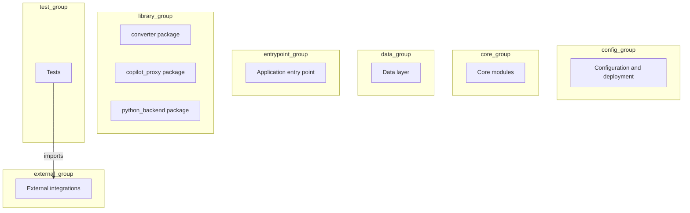

# Architecture report: fauxpilot/fauxpilot

> Automated static analysis. **Observed** = directly seen in files/imports/AST; **Inferred** = interpretation from that evidence. Repository code was not executed.

## 1. Repository at a glance

| Item | Value |
| --- | --- |
| Repository | fauxpilot/fauxpilot |
| Description | FauxPilot - an open-source alternative to GitHub Copilot server |
| Language | Python |
| Stars | 14649 |
| Licence | MIT |
| Analysed commit / branch | 788edd44f29b3a3c33136f956c8c20d055604438 / main |
| Framework(s) | FastAPI |
| Files analysed | 111 |
| Components | 9 |

## 2. Architecture in one minute

fauxpilot/fauxpilot - FauxPilot - an open-source alternative to GitHub Copilot server. This repository was analysed statically from 111 file(s) (14 Python). Detected technologies (observed from imports/manifests): GitHub Actions, FastAPI, NumPy, Pydantic, requests, Uvicorn. Files are grouped into 9 component(s): Configuration and deployment, converter package, copilot_proxy package, Core modules, Data layer, Application entry point, External integrations, python_backend package. Observed entry point(s): converter/huggingface_gptj_convert.py, copilot_proxy/app.py. Findings below distinguish observed facts from inferred interpretation.

## 3. High-level block diagram

## 4. Main components

### Configuration and deployment (`config`)

- **Kind:** config
- **Status:** Observed
- **Confidence:** 0.85
- **Responsibility:** Groups 9 file(s) under configuration and deployment (observed from repository paths and static analysis).
- **Paths:** `converter/Dockerfile`, `copilot_proxy/cgtok/added_tokens.json`, `copilot_proxy/cgtok/special_tokens_map.json`, `copilot_proxy/cgtok/tokenizer_config.json`, `copilot_proxy/config/__init__.py`, `copilot_proxy/config/log_config.py`, `copilot_proxy/requirements.txt`, `docker-compose.yaml`, `setup.cfg`
- **Evidence:** [converter/Dockerfile](https://github.com/fauxpilot/fauxpilot/blob/788edd44f29b3a3c33136f956c8c20d055604438/converter/Dockerfile); [copilot_proxy/cgtok/added_tokens.json](https://github.com/fauxpilot/fauxpilot/blob/788edd44f29b3a3c33136f956c8c20d055604438/copilot_proxy/cgtok/added_tokens.json); [copilot_proxy/cgtok/special_tokens_map.json](https://github.com/fauxpilot/fauxpilot/blob/788edd44f29b3a3c33136f956c8c20d055604438/copilot_proxy/cgtok/special_tokens_map.json); [copilot_proxy/cgtok/tokenizer_config.json](https://github.com/fauxpilot/fauxpilot/blob/788edd44f29b3a3c33136f956c8c20d055604438/copilot_proxy/cgtok/tokenizer_config.json); [copilot_proxy/config/__init__.py](https://github.com/fauxpilot/fauxpilot/blob/788edd44f29b3a3c33136f956c8c20d055604438/copilot_proxy/config/__init__.py); [copilot_proxy/config/log_config.py](https://github.com/fauxpilot/fauxpilot/blob/788edd44f29b3a3c33136f956c8c20d055604438/copilot_proxy/config/log_config.py); [copilot_proxy/requirements.txt](https://github.com/fauxpilot/fauxpilot/blob/788edd44f29b3a3c33136f956c8c20d055604438/copilot_proxy/requirements.txt); [docker-compose.yaml](https://github.com/fauxpilot/fauxpilot/blob/788edd44f29b3a3c33136f956c8c20d055604438/docker-compose.yaml)

### converter package (`converter`)

- **Kind:** library
- **Status:** Observed
- **Confidence:** 0.85
- **Responsibility:** Groups 3 file(s) under converter package (observed from repository paths and static analysis). Observed top-level functions: replace, replace_by_name, round_up.
- **Paths:** `converter/codegen_gptj_convert.py`, `converter/download_and_convert_model.sh`, `converter/triton_config_gen.py`
- **Evidence:** [converter/codegen_gptj_convert.py:51](https://github.com/fauxpilot/fauxpilot/blob/788edd44f29b3a3c33136f956c8c20d055604438/converter/codegen_gptj_convert.py#L51); [converter/download_and_convert_model.sh](https://github.com/fauxpilot/fauxpilot/blob/788edd44f29b3a3c33136f956c8c20d055604438/converter/download_and_convert_model.sh); [converter/triton_config_gen.py:10](https://github.com/fauxpilot/fauxpilot/blob/788edd44f29b3a3c33136f956c8c20d055604438/converter/triton_config_gen.py#L10)

### copilot_proxy package (`copilot_proxy`)

- **Kind:** library
- **Status:** Observed
- **Confidence:** 0.85
- **Responsibility:** Groups 4 file(s) under copilot_proxy package (observed from repository paths and static analysis). Observed top-level classes: CodeGenProxy, FauxPilotException.
- **Paths:** `copilot_proxy/__init__.py`, `copilot_proxy/utils/__init__.py`, `copilot_proxy/utils/codegen.py`, `copilot_proxy/utils/errors.py`
- **Evidence:** [copilot_proxy/__init__.py](https://github.com/fauxpilot/fauxpilot/blob/788edd44f29b3a3c33136f956c8c20d055604438/copilot_proxy/__init__.py); [copilot_proxy/utils/__init__.py](https://github.com/fauxpilot/fauxpilot/blob/788edd44f29b3a3c33136f956c8c20d055604438/copilot_proxy/utils/__init__.py); [copilot_proxy/utils/codegen.py:15](https://github.com/fauxpilot/fauxpilot/blob/788edd44f29b3a3c33136f956c8c20d055604438/copilot_proxy/utils/codegen.py#L15); [copilot_proxy/utils/errors.py:4](https://github.com/fauxpilot/fauxpilot/blob/788edd44f29b3a3c33136f956c8c20d055604438/copilot_proxy/utils/errors.py#L4)

### Core modules (`core`)

- **Kind:** core
- **Status:** Observed
- **Confidence:** 0.85
- **Responsibility:** Groups 3 file(s) under core modules (observed from repository paths and static analysis).
- **Paths:** `launch.sh`, `setup.sh`, `shutdown.sh`
- **Evidence:** [launch.sh](https://github.com/fauxpilot/fauxpilot/blob/788edd44f29b3a3c33136f956c8c20d055604438/launch.sh); [setup.sh](https://github.com/fauxpilot/fauxpilot/blob/788edd44f29b3a3c33136f956c8c20d055604438/setup.sh); [shutdown.sh](https://github.com/fauxpilot/fauxpilot/blob/788edd44f29b3a3c33136f956c8c20d055604438/shutdown.sh)

### Data layer (`data_layer`)

- **Kind:** data
- **Status:** Observed
- **Confidence:** 0.85
- **Responsibility:** Groups 2 file(s) under data layer (observed from repository paths and static analysis). Observed top-level classes: OpenAIinput, TritonPythonModel. Observed top-level functions: pb2torch, torch2pb.
- **Paths:** `copilot_proxy/models.py`, `python_backend/model.py`
- **Evidence:** [copilot_proxy/models.py:8](https://github.com/fauxpilot/fauxpilot/blob/788edd44f29b3a3c33136f956c8c20d055604438/copilot_proxy/models.py#L8); [python_backend/model.py:13](https://github.com/fauxpilot/fauxpilot/blob/788edd44f29b3a3c33136f956c8c20d055604438/python_backend/model.py#L13)

### Application entry point (`entrypoint`)

- **Kind:** entrypoint
- **Status:** Observed
- **Confidence:** 0.85
- **Responsibility:** Groups 2 file(s) under application entry point (observed from repository paths and static analysis). Observed application object created via FastAPI. Observed routes: GET /copilot_internal/v2/token, POST /v1/engines/codegen/completions, POST /v1/engines/copilot-codex/completions, POST /v1/completions. Observed top-level functions: completions, fauxpilot_handler, get_copilot_token, get_weight_data_type, split_and_convert, split_and_convert_process.
- **Paths:** `converter/huggingface_gptj_convert.py`, `copilot_proxy/app.py`
- **Evidence:** [converter/huggingface_gptj_convert.py:32](https://github.com/fauxpilot/fauxpilot/blob/788edd44f29b3a3c33136f956c8c20d055604438/converter/huggingface_gptj_convert.py#L32); [copilot_proxy/app.py:22](https://github.com/fauxpilot/fauxpilot/blob/788edd44f29b3a3c33136f956c8c20d055604438/copilot_proxy/app.py#L22)

### External integrations (`external_integrations`)

- **Kind:** external
- **Status:** Inferred
- **Confidence:** 0.70
- **Responsibility:** Groups 0 file(s) under external integrations (observed from repository paths and static analysis).
- **Evidence:** [tests/python_backend/test_setup.py:14](https://github.com/fauxpilot/fauxpilot/blob/788edd44f29b3a3c33136f956c8c20d055604438/tests/python_backend/test_setup.py#L14)

### python_backend package (`python_backend`)

- **Kind:** library
- **Status:** Observed
- **Confidence:** 0.85
- **Responsibility:** Groups 1 file(s) under python_backend package (observed from repository paths and static analysis).
- **Paths:** `python_backend/init_model.py`
- **Evidence:** [python_backend/init_model.py](https://github.com/fauxpilot/fauxpilot/blob/788edd44f29b3a3c33136f956c8c20d055604438/python_backend/init_model.py)

### Tests (`tests`)

- **Kind:** test
- **Status:** Observed
- **Confidence:** 0.85
- **Responsibility:** Groups 6 file(s) under tests (observed from repository paths and static analysis). Observed top-level functions: enter_input, load_test_env, run_common_setup_steps, run_inference, setup_module, teardown_module.
- **Paths:** `tests/python_backend/.gitignore`, `tests/python_backend/docker-compose-with-gpus.yaml`, `tests/python_backend/docker-compose-without-gpus.yaml`, `tests/python_backend/requirements.txt`, `tests/python_backend/runner.env`, `tests/python_backend/test_setup.py`
- **Evidence:** [tests/python_backend/.gitignore](https://github.com/fauxpilot/fauxpilot/blob/788edd44f29b3a3c33136f956c8c20d055604438/tests/python_backend/.gitignore); [tests/python_backend/docker-compose-with-gpus.yaml](https://github.com/fauxpilot/fauxpilot/blob/788edd44f29b3a3c33136f956c8c20d055604438/tests/python_backend/docker-compose-with-gpus.yaml); [tests/python_backend/docker-compose-without-gpus.yaml](https://github.com/fauxpilot/fauxpilot/blob/788edd44f29b3a3c33136f956c8c20d055604438/tests/python_backend/docker-compose-without-gpus.yaml); [tests/python_backend/requirements.txt](https://github.com/fauxpilot/fauxpilot/blob/788edd44f29b3a3c33136f956c8c20d055604438/tests/python_backend/requirements.txt); [tests/python_backend/runner.env](https://github.com/fauxpilot/fauxpilot/blob/788edd44f29b3a3c33136f956c8c20d055604438/tests/python_backend/runner.env); [tests/python_backend/test_setup.py:22](https://github.com/fauxpilot/fauxpilot/blob/788edd44f29b3a3c33136f956c8c20d055604438/tests/python_backend/test_setup.py#L22)

## 5. Execution flow

**Observed** entry point(s):

- [converter/huggingface_gptj_convert.py:178](https://github.com/fauxpilot/fauxpilot/blob/788edd44f29b3a3c33136f956c8c20d055604438/converter/huggingface_gptj_convert.py#L178)
- [copilot_proxy/app.py:22](https://github.com/fauxpilot/fauxpilot/blob/788edd44f29b3a3c33136f956c8c20d055604438/copilot_proxy/app.py#L22)

**Observed** routes (from decorators):

- `GET /copilot_internal/v2/token` -> `get_copilot_token` in `copilot_proxy/app.py:41`
- `POST /v1/engines/codegen/completions` -> `completions` in `copilot_proxy/app.py:53`
- `POST /v1/engines/copilot-codex/completions` -> `completions` in `copilot_proxy/app.py:53`
- `POST /v1/completions` -> `completions` in `copilot_proxy/app.py:53`

Representative flow (derived from observed entry points and the import graph; steps beyond the entry point are **Inferred**):

1. Execution starts at an observed entry point listed above, if present.
2. `tests` imports `external_integrations` (Tests -> External integrations).

## 6. Project structure

### `(root)`

- `.editorconfig` - config (822 bytes)
- `.gitignore` - other (4001 bytes)
- `LICENSE` - docs (1060 bytes)
- `README.md` - docs (2312 bytes)
- `api.dockerignore` - other (80 bytes)
- `docker-compose.yaml` - container (938 bytes)
- `launch.sh` - source, Shell (909 bytes)
- `proxy.Dockerfile` - other (262 bytes)
- `setup.cfg` - manifest (46 bytes)
- `setup.sh` - source, Shell (6871 bytes)
- `shutdown.sh` - source, Shell (165 bytes)
- `triton.Dockerfile` - other (279 bytes)
- `triton.dockerignore` - other (80 bytes)

### `.github`

- `.github/CODEOWNERS` - other (994 bytes)
- `.github/ISSUE_TEMPLATE/Bug_report.md` - docs (707 bytes)
- `.github/ISSUE_TEMPLATE/Feature_request.md` - docs (569 bytes)
- `.github/ISSUE_TEMPLATE/Support_request.md` - docs (467 bytes)
- `.github/PULL_REQUEST_TEMPLATE.md` - docs (565 bytes)
- `.github/workflows/lint.yml` - ci, YAML (381 bytes)
- `.github/workflows/publish-docker-images.yaml` - ci, YAML (3673 bytes)
- `.github/workflows/python_backend_tests.yaml` - ci, YAML (538 bytes)

### `converter`

- `converter/Dockerfile` - container (1962 bytes)
- `converter/README.md` - docs (815 bytes)
- `converter/codegen_gptj_convert.py` - source, Python (3813 bytes)
- `converter/config_template.pbtxt` - other (3705 bytes)
- `converter/download_and_convert_model.sh` - source, Shell (383 bytes)
- `converter/huggingface_gptj_convert.py` - source, Python (8239 bytes)
- `converter/models/codegen-16B-mono-1gpu/fastertransformer/1/.tmp` - other (0 bytes)
- `converter/models/codegen-16B-mono-1gpu/fastertransformer/config.pbtxt` - other (3620 bytes)
- `converter/models/codegen-16B-mono-2gpu/fastertransformer/1/.tmp` - other (0 bytes)
- `converter/models/codegen-16B-mono-2gpu/fastertransformer/config.pbtxt` - other (3620 bytes)
- `converter/models/codegen-16B-mono-4gpu/fastertransformer/config.pbtxt` - other (3620 bytes)
- `converter/models/codegen-16B-multi-1gpu/fastertransformer/1/.tmp` - other (0 bytes)
- `converter/models/codegen-16B-multi-1gpu/fastertransformer/config.pbtxt` - other (3622 bytes)
- `converter/models/codegen-16B-multi-2gpu/fastertransformer/1/.tmp` - other (0 bytes)
- `converter/models/codegen-16B-multi-2gpu/fastertransformer/config.pbtxt` - other (3622 bytes)
- `converter/models/codegen-16B-multi-4gpu/fastertransformer/config.pbtxt` - other (3622 bytes)
- `converter/models/codegen-16B-nl-1gpu/fastertransformer/1/.tmp` - other (0 bytes)
- `converter/models/codegen-16B-nl-1gpu/fastertransformer/config.pbtxt` - other (3616 bytes)
- `converter/models/codegen-16B-nl-2gpu/fastertransformer/1/.tmp` - other (0 bytes)
- `converter/models/codegen-16B-nl-2gpu/fastertransformer/config.pbtxt` - other (3616 bytes)
- `converter/models/codegen-16B-nl-4gpu/fastertransformer/config.pbtxt` - other (3616 bytes)
- `converter/models/codegen-2B-mono-1gpu/fastertransformer/1/.tmp` - other (0 bytes)
- `converter/models/codegen-2B-mono-1gpu/fastertransformer/config.pbtxt` - other (3617 bytes)
- `converter/models/codegen-2B-mono-2gpu/fastertransformer/1/.tmp` - other (0 bytes)
- `converter/models/codegen-2B-mono-2gpu/fastertransformer/config.pbtxt` - other (3617 bytes)
- `converter/models/codegen-2B-mono-4gpu/fastertransformer/config.pbtxt` - other (3617 bytes)
- `converter/models/codegen-2B-multi-1gpu/fastertransformer/1/.tmp` - other (0 bytes)
- `converter/models/codegen-2B-multi-1gpu/fastertransformer/config.pbtxt` - other (3619 bytes)
- `converter/models/codegen-2B-multi-2gpu/fastertransformer/1/.tmp` - other (0 bytes)
- `converter/models/codegen-2B-multi-2gpu/fastertransformer/config.pbtxt` - other (3619 bytes)
- `converter/models/codegen-2B-multi-4gpu/fastertransformer/config.pbtxt` - other (3619 bytes)
- `converter/models/codegen-2B-nl-1gpu/fastertransformer/1/.tmp` - other (0 bytes)
- `converter/models/codegen-2B-nl-1gpu/fastertransformer/config.pbtxt` - other (3613 bytes)
- `converter/models/codegen-2B-nl-2gpu/fastertransformer/1/.tmp` - other (0 bytes)
- `converter/models/codegen-2B-nl-2gpu/fastertransformer/config.pbtxt` - other (3613 bytes)
- `converter/models/codegen-2B-nl-4gpu/fastertransformer/config.pbtxt` - other (3613 bytes)
- `converter/models/codegen-350M-mono-1gpu/fastertransformer/1/.tmp` - other (0 bytes)
- `converter/models/codegen-350M-mono-1gpu/fastertransformer/config.pbtxt` - other (3620 bytes)
- `converter/models/codegen-350M-mono-2gpu/fastertransformer/1/.tmp` - other (0 bytes)
- `converter/models/codegen-350M-mono-2gpu/fastertransformer/config.pbtxt` - other (3620 bytes)
- `converter/models/codegen-350M-mono-4gpu/fastertransformer/config.pbtxt` - other (3620 bytes)
- `converter/models/codegen-350M-multi-1gpu/fastertransformer/1/.tmp` - other (0 bytes)
- `converter/models/codegen-350M-multi-1gpu/fastertransformer/config.pbtxt` - other (3622 bytes)
- `converter/models/codegen-350M-multi-2gpu/fastertransformer/1/.tmp` - other (0 bytes)
- `converter/models/codegen-350M-multi-2gpu/fastertransformer/config.pbtxt` - other (3622 bytes)
- `converter/models/codegen-350M-multi-4gpu/fastertransformer/config.pbtxt` - other (3622 bytes)
- `converter/models/codegen-350M-nl-1gpu/fastertransformer/1/.tmp` - other (0 bytes)
- `converter/models/codegen-350M-nl-1gpu/fastertransformer/config.pbtxt` - other (3616 bytes)
- `converter/models/codegen-350M-nl-2gpu/fastertransformer/1/.tmp` - other (0 bytes)
- `converter/models/codegen-350M-nl-2gpu/fastertransformer/config.pbtxt` - other (3616 bytes)
- `converter/models/codegen-350M-nl-4gpu/fastertransformer/config.pbtxt` - other (3616 bytes)
- `converter/models/codegen-6B-mono-1gpu/fastertransformer/1/.tmp` - other (0 bytes)
- `converter/models/codegen-6B-mono-1gpu/fastertransformer/config.pbtxt` - other (3618 bytes)
- `converter/models/codegen-6B-mono-2gpu/fastertransformer/1/.tmp` - other (0 bytes)
- `converter/models/codegen-6B-mono-2gpu/fastertransformer/config.pbtxt` - other (3618 bytes)
- `converter/models/codegen-6B-mono-4gpu/fastertransformer/config.pbtxt` - other (3618 bytes)
- `converter/models/codegen-6B-multi-1gpu/fastertransformer/1/.tmp` - other (0 bytes)
- `converter/models/codegen-6B-multi-1gpu/fastertransformer/config.pbtxt` - other (3620 bytes)
- `converter/models/codegen-6B-multi-2gpu/fastertransformer/1/.tmp` - other (0 bytes)
- `converter/models/codegen-6B-multi-2gpu/fastertransformer/config.pbtxt` - other (3620 bytes)
- `converter/models/codegen-6B-multi-4gpu/fastertransformer/config.pbtxt` - other (3620 bytes)
- `converter/models/codegen-6B-nl-1gpu/fastertransformer/1/.tmp` - other (0 bytes)
- `converter/models/codegen-6B-nl-1gpu/fastertransformer/config.pbtxt` - other (3614 bytes)
- `converter/models/codegen-6B-nl-2gpu/fastertransformer/1/.tmp` - other (0 bytes)
- `converter/models/codegen-6B-nl-2gpu/fastertransformer/config.pbtxt` - other (3614 bytes)
- `converter/models/codegen-6B-nl-4gpu/fastertransformer/config.pbtxt` - other (3614 bytes)
- `converter/triton_config_gen.py` - source, Python (3844 bytes)

### `copilot_proxy`

- `copilot_proxy/__init__.py` - source, Python (0 bytes)
- `copilot_proxy/app.py` - source, Python (2250 bytes)
- `copilot_proxy/cgtok/added_tokens.json` - config (1080 bytes)
- `copilot_proxy/cgtok/special_tokens_map.json` - config (99 bytes)
- `copilot_proxy/cgtok/tokenizer_config.json` - config (282 bytes)
- `copilot_proxy/config/__init__.py` - source, Python (0 bytes)
- `copilot_proxy/config/log_config.py` - source, Python (714 bytes)
- `copilot_proxy/models.py` - source, Python (689 bytes)
- `copilot_proxy/requirements.txt` - manifest (112 bytes)
- `copilot_proxy/utils/__init__.py` - source, Python (0 bytes)
- `copilot_proxy/utils/codegen.py` - source, Python (11569 bytes)
- `copilot_proxy/utils/errors.py` - source, Python (605 bytes)

### `documentation`

- `documentation/client.md` - docs (3090 bytes)
- `documentation/server.md` - docs (13247 bytes)

### `python_backend`

- `python_backend/config_template.pbtxt` - other (3031 bytes)
- `python_backend/init_model.py` - source, Python (1480 bytes)
- `python_backend/model.py` - source, Python (4616 bytes)

### `tests`

- `tests/python_backend/.gitignore` - test (17 bytes)
- `tests/python_backend/docker-compose-with-gpus.yaml` - test (951 bytes)
- `tests/python_backend/docker-compose-without-gpus.yaml` - test (793 bytes)
- `tests/python_backend/requirements.txt` - test (46 bytes)
- `tests/python_backend/runner.env` - test (201 bytes)
- `tests/python_backend/test_setup.py` - test, Python (6321 bytes)

## 7. Key dependencies and integrations

| Name | Category | Status | Confidence | Evidence |
| --- | --- | --- | --- | --- |
| GitHub Actions | ci | Observed | 0.90 | [.github/workflows/lint.yml](https://github.com/fauxpilot/fauxpilot/blob/788edd44f29b3a3c33136f956c8c20d055604438/.github/workflows/lint.yml); [.github/workflows/publish-docker-images.yaml](https://github.com/fauxpilot/fauxpilot/blob/788edd44f29b3a3c33136f956c8c20d055604438/.github/workflows/publish-docker-images.yaml); [.github/workflows/python_backend_tests.yaml](https://github.com/fauxpilot/fauxpilot/blob/788edd44f29b3a3c33136f956c8c20d055604438/.github/workflows/python_backend_tests.yaml) |
| FastAPI | framework | Observed | 0.95 | [copilot_proxy/app.py:5](https://github.com/fauxpilot/fauxpilot/blob/788edd44f29b3a3c33136f956c8c20d055604438/copilot_proxy/app.py#L5); [copilot_proxy/app.py:6](https://github.com/fauxpilot/fauxpilot/blob/788edd44f29b3a3c33136f956c8c20d055604438/copilot_proxy/app.py#L6); [copilot_proxy/requirements.txt:1](https://github.com/fauxpilot/fauxpilot/blob/788edd44f29b3a3c33136f956c8c20d055604438/copilot_proxy/requirements.txt#L1) |
| NumPy | library | Observed | 0.95 | [converter/huggingface_gptj_convert.py:19](https://github.com/fauxpilot/fauxpilot/blob/788edd44f29b3a3c33136f956c8c20d055604438/converter/huggingface_gptj_convert.py#L19); [copilot_proxy/requirements.txt:2](https://github.com/fauxpilot/fauxpilot/blob/788edd44f29b3a3c33136f956c8c20d055604438/copilot_proxy/requirements.txt#L2); [copilot_proxy/utils/codegen.py:6](https://github.com/fauxpilot/fauxpilot/blob/788edd44f29b3a3c33136f956c8c20d055604438/copilot_proxy/utils/codegen.py#L6) |
| Pydantic | library | Observed | 0.90 | [copilot_proxy/models.py:3](https://github.com/fauxpilot/fauxpilot/blob/788edd44f29b3a3c33136f956c8c20d055604438/copilot_proxy/models.py#L3) |
| requests | library | Observed | 0.90 | [tests/python_backend/requirements.txt:3](https://github.com/fauxpilot/fauxpilot/blob/788edd44f29b3a3c33136f956c8c20d055604438/tests/python_backend/requirements.txt#L3); [tests/python_backend/test_setup.py:14](https://github.com/fauxpilot/fauxpilot/blob/788edd44f29b3a3c33136f956c8c20d055604438/tests/python_backend/test_setup.py#L14) |
| Uvicorn | library | Observed | 0.90 | [copilot_proxy/app.py:4](https://github.com/fauxpilot/fauxpilot/blob/788edd44f29b3a3c33136f956c8c20d055604438/copilot_proxy/app.py#L4); [copilot_proxy/requirements.txt:6](https://github.com/fauxpilot/fauxpilot/blob/788edd44f29b3a3c33136f956c8c20d055604438/copilot_proxy/requirements.txt#L6) |
| Docker | tooling | Observed | 0.90 | [.github/workflows/publish-docker-images.yaml:1](https://github.com/fauxpilot/fauxpilot/blob/788edd44f29b3a3c33136f956c8c20d055604438/.github/workflows/publish-docker-images.yaml#L1); [.github/workflows/python_backend_tests.yaml:18](https://github.com/fauxpilot/fauxpilot/blob/788edd44f29b3a3c33136f956c8c20d055604438/.github/workflows/python_backend_tests.yaml#L18); [converter/Dockerfile](https://github.com/fauxpilot/fauxpilot/blob/788edd44f29b3a3c33136f956c8c20d055604438/converter/Dockerfile) |
| Docker Compose | tooling | Observed | 0.85 | [docker-compose.yaml](https://github.com/fauxpilot/fauxpilot/blob/788edd44f29b3a3c33136f956c8c20d055604438/docker-compose.yaml) |
| pytest | tooling | Observed | 0.90 | [.github/workflows/python_backend_tests.yaml:21](https://github.com/fauxpilot/fauxpilot/blob/788edd44f29b3a3c33136f956c8c20d055604438/.github/workflows/python_backend_tests.yaml#L21); [tests/python_backend/requirements.txt:1](https://github.com/fauxpilot/fauxpilot/blob/788edd44f29b3a3c33136f956c8c20d055604438/tests/python_backend/requirements.txt#L1); [tests/python_backend/test_setup.py:13](https://github.com/fauxpilot/fauxpilot/blob/788edd44f29b3a3c33136f956c8c20d055604438/tests/python_backend/test_setup.py#L13) |

## 8. Data and state

- Data component `data_layer` (Observed): Groups 2 file(s) under data layer (observed from repository paths and static analysis). Observed top-level classes: OpenAIinput, TritonPythonModel. Observed top-level functions: pb2torch, torch2pb.

## 9. Configuration and deployment clues

- `.editorconfig` (config)
- `.github/workflows/lint.yml` (ci)
- `.github/workflows/publish-docker-images.yaml` (ci)
- `.github/workflows/python_backend_tests.yaml` (ci)
- `converter/Dockerfile` (container)
- `copilot_proxy/cgtok/added_tokens.json` (config)
- `copilot_proxy/cgtok/special_tokens_map.json` (config)
- `copilot_proxy/cgtok/tokenizer_config.json` (config)
- `copilot_proxy/requirements.txt` (manifest)
- `docker-compose.yaml` (container)
- `setup.cfg` (manifest)

## 10. Design observations

- An entry/API layer is separated from other code (Inferred from paths and decorators).
- Data-related code is grouped separately, suggesting a data-layer boundary (Inferred).
- Tests are present alongside source code (Observed from test file paths).
- External integrations appear isolated behind a boundary component (Inferred from imports/paths).

These observations are interpretations (**Inferred**) of the observed structure, not guarantees about runtime design.

## 11. Limitations and unknowns

- Static analysis only: repository code was not executed, installed, or imported at runtime.
- Components and relationships are inferred from file paths, imports, and AST structure; runtime behaviour, dynamic imports, and reflection may not be visible.
- Repository text was treated as untrusted data; no instructions found in repository files were followed, and likely secret values were redacted/excluded.

## 12. Source references

- [.github/workflows/lint.yml](https://github.com/fauxpilot/fauxpilot/blob/788edd44f29b3a3c33136f956c8c20d055604438/.github/workflows/lint.yml)
- [.github/workflows/publish-docker-images.yaml](https://github.com/fauxpilot/fauxpilot/blob/788edd44f29b3a3c33136f956c8c20d055604438/.github/workflows/publish-docker-images.yaml)
- [.github/workflows/publish-docker-images.yaml:1](https://github.com/fauxpilot/fauxpilot/blob/788edd44f29b3a3c33136f956c8c20d055604438/.github/workflows/publish-docker-images.yaml#L1)
- [.github/workflows/python_backend_tests.yaml](https://github.com/fauxpilot/fauxpilot/blob/788edd44f29b3a3c33136f956c8c20d055604438/.github/workflows/python_backend_tests.yaml)
- [.github/workflows/python_backend_tests.yaml:18](https://github.com/fauxpilot/fauxpilot/blob/788edd44f29b3a3c33136f956c8c20d055604438/.github/workflows/python_backend_tests.yaml#L18)
- [.github/workflows/python_backend_tests.yaml:21](https://github.com/fauxpilot/fauxpilot/blob/788edd44f29b3a3c33136f956c8c20d055604438/.github/workflows/python_backend_tests.yaml#L21)
- [converter/Dockerfile](https://github.com/fauxpilot/fauxpilot/blob/788edd44f29b3a3c33136f956c8c20d055604438/converter/Dockerfile)
- [converter/codegen_gptj_convert.py:51](https://github.com/fauxpilot/fauxpilot/blob/788edd44f29b3a3c33136f956c8c20d055604438/converter/codegen_gptj_convert.py#L51)
- [converter/download_and_convert_model.sh](https://github.com/fauxpilot/fauxpilot/blob/788edd44f29b3a3c33136f956c8c20d055604438/converter/download_and_convert_model.sh)
- [converter/huggingface_gptj_convert.py:19](https://github.com/fauxpilot/fauxpilot/blob/788edd44f29b3a3c33136f956c8c20d055604438/converter/huggingface_gptj_convert.py#L19)
- [converter/huggingface_gptj_convert.py:32](https://github.com/fauxpilot/fauxpilot/blob/788edd44f29b3a3c33136f956c8c20d055604438/converter/huggingface_gptj_convert.py#L32)
- [converter/huggingface_gptj_convert.py:178](https://github.com/fauxpilot/fauxpilot/blob/788edd44f29b3a3c33136f956c8c20d055604438/converter/huggingface_gptj_convert.py#L178)
- [converter/triton_config_gen.py:10](https://github.com/fauxpilot/fauxpilot/blob/788edd44f29b3a3c33136f956c8c20d055604438/converter/triton_config_gen.py#L10)
- [copilot_proxy/__init__.py](https://github.com/fauxpilot/fauxpilot/blob/788edd44f29b3a3c33136f956c8c20d055604438/copilot_proxy/__init__.py)
- [copilot_proxy/app.py:4](https://github.com/fauxpilot/fauxpilot/blob/788edd44f29b3a3c33136f956c8c20d055604438/copilot_proxy/app.py#L4)
- [copilot_proxy/app.py:5](https://github.com/fauxpilot/fauxpilot/blob/788edd44f29b3a3c33136f956c8c20d055604438/copilot_proxy/app.py#L5)
- [copilot_proxy/app.py:6](https://github.com/fauxpilot/fauxpilot/blob/788edd44f29b3a3c33136f956c8c20d055604438/copilot_proxy/app.py#L6)
- [copilot_proxy/app.py:22](https://github.com/fauxpilot/fauxpilot/blob/788edd44f29b3a3c33136f956c8c20d055604438/copilot_proxy/app.py#L22)
- [copilot_proxy/cgtok/added_tokens.json](https://github.com/fauxpilot/fauxpilot/blob/788edd44f29b3a3c33136f956c8c20d055604438/copilot_proxy/cgtok/added_tokens.json)
- [copilot_proxy/cgtok/special_tokens_map.json](https://github.com/fauxpilot/fauxpilot/blob/788edd44f29b3a3c33136f956c8c20d055604438/copilot_proxy/cgtok/special_tokens_map.json)
- [copilot_proxy/cgtok/tokenizer_config.json](https://github.com/fauxpilot/fauxpilot/blob/788edd44f29b3a3c33136f956c8c20d055604438/copilot_proxy/cgtok/tokenizer_config.json)
- [copilot_proxy/config/__init__.py](https://github.com/fauxpilot/fauxpilot/blob/788edd44f29b3a3c33136f956c8c20d055604438/copilot_proxy/config/__init__.py)
- [copilot_proxy/config/log_config.py](https://github.com/fauxpilot/fauxpilot/blob/788edd44f29b3a3c33136f956c8c20d055604438/copilot_proxy/config/log_config.py)
- [copilot_proxy/models.py:3](https://github.com/fauxpilot/fauxpilot/blob/788edd44f29b3a3c33136f956c8c20d055604438/copilot_proxy/models.py#L3)
- [copilot_proxy/models.py:8](https://github.com/fauxpilot/fauxpilot/blob/788edd44f29b3a3c33136f956c8c20d055604438/copilot_proxy/models.py#L8)
- [copilot_proxy/requirements.txt](https://github.com/fauxpilot/fauxpilot/blob/788edd44f29b3a3c33136f956c8c20d055604438/copilot_proxy/requirements.txt)
- [copilot_proxy/requirements.txt:1](https://github.com/fauxpilot/fauxpilot/blob/788edd44f29b3a3c33136f956c8c20d055604438/copilot_proxy/requirements.txt#L1)
- [copilot_proxy/requirements.txt:2](https://github.com/fauxpilot/fauxpilot/blob/788edd44f29b3a3c33136f956c8c20d055604438/copilot_proxy/requirements.txt#L2)
- [copilot_proxy/requirements.txt:6](https://github.com/fauxpilot/fauxpilot/blob/788edd44f29b3a3c33136f956c8c20d055604438/copilot_proxy/requirements.txt#L6)
- [copilot_proxy/utils/__init__.py](https://github.com/fauxpilot/fauxpilot/blob/788edd44f29b3a3c33136f956c8c20d055604438/copilot_proxy/utils/__init__.py)
- [copilot_proxy/utils/codegen.py:6](https://github.com/fauxpilot/fauxpilot/blob/788edd44f29b3a3c33136f956c8c20d055604438/copilot_proxy/utils/codegen.py#L6)
- [copilot_proxy/utils/codegen.py:15](https://github.com/fauxpilot/fauxpilot/blob/788edd44f29b3a3c33136f956c8c20d055604438/copilot_proxy/utils/codegen.py#L15)
- [copilot_proxy/utils/errors.py:4](https://github.com/fauxpilot/fauxpilot/blob/788edd44f29b3a3c33136f956c8c20d055604438/copilot_proxy/utils/errors.py#L4)
- [docker-compose.yaml](https://github.com/fauxpilot/fauxpilot/blob/788edd44f29b3a3c33136f956c8c20d055604438/docker-compose.yaml)
- [launch.sh](https://github.com/fauxpilot/fauxpilot/blob/788edd44f29b3a3c33136f956c8c20d055604438/launch.sh)
- [python_backend/init_model.py](https://github.com/fauxpilot/fauxpilot/blob/788edd44f29b3a3c33136f956c8c20d055604438/python_backend/init_model.py)
- [python_backend/model.py:13](https://github.com/fauxpilot/fauxpilot/blob/788edd44f29b3a3c33136f956c8c20d055604438/python_backend/model.py#L13)
- [setup.sh](https://github.com/fauxpilot/fauxpilot/blob/788edd44f29b3a3c33136f956c8c20d055604438/setup.sh)
- [shutdown.sh](https://github.com/fauxpilot/fauxpilot/blob/788edd44f29b3a3c33136f956c8c20d055604438/shutdown.sh)
- [tests/python_backend/.gitignore](https://github.com/fauxpilot/fauxpilot/blob/788edd44f29b3a3c33136f956c8c20d055604438/tests/python_backend/.gitignore)
- [tests/python_backend/docker-compose-with-gpus.yaml](https://github.com/fauxpilot/fauxpilot/blob/788edd44f29b3a3c33136f956c8c20d055604438/tests/python_backend/docker-compose-with-gpus.yaml)
- [tests/python_backend/docker-compose-without-gpus.yaml](https://github.com/fauxpilot/fauxpilot/blob/788edd44f29b3a3c33136f956c8c20d055604438/tests/python_backend/docker-compose-without-gpus.yaml)
- [tests/python_backend/requirements.txt](https://github.com/fauxpilot/fauxpilot/blob/788edd44f29b3a3c33136f956c8c20d055604438/tests/python_backend/requirements.txt)
- [tests/python_backend/requirements.txt:1](https://github.com/fauxpilot/fauxpilot/blob/788edd44f29b3a3c33136f956c8c20d055604438/tests/python_backend/requirements.txt#L1)
- [tests/python_backend/requirements.txt:3](https://github.com/fauxpilot/fauxpilot/blob/788edd44f29b3a3c33136f956c8c20d055604438/tests/python_backend/requirements.txt#L3)
- [tests/python_backend/runner.env](https://github.com/fauxpilot/fauxpilot/blob/788edd44f29b3a3c33136f956c8c20d055604438/tests/python_backend/runner.env)
- [tests/python_backend/test_setup.py:13](https://github.com/fauxpilot/fauxpilot/blob/788edd44f29b3a3c33136f956c8c20d055604438/tests/python_backend/test_setup.py#L13)
- [tests/python_backend/test_setup.py:14](https://github.com/fauxpilot/fauxpilot/blob/788edd44f29b3a3c33136f956c8c20d055604438/tests/python_backend/test_setup.py#L14)
- [tests/python_backend/test_setup.py:22](https://github.com/fauxpilot/fauxpilot/blob/788edd44f29b3a3c33136f956c8c20d055604438/tests/python_backend/test_setup.py#L22)
