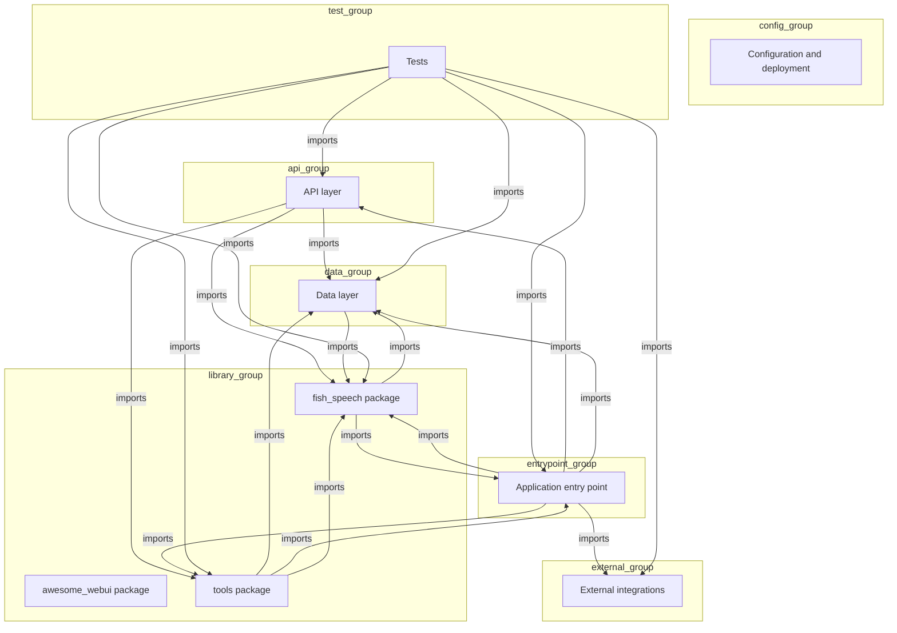

# Architecture report: fishaudio/fish-speech

> Automated static analysis. **Observed** = directly seen in files/imports/AST; **Inferred** = interpretation from that evidence. Repository code was not executed.

## 1. Repository at a glance

| Item | Value |
| --- | --- |
| Repository | fishaudio/fish-speech |
| Description | SOTA Open Source TTS |
| Language | Python |
| Stars | 33721 |
| Licence | Other |
| Analysed commit / branch | 0f8a12e8a651062fdee9c33a894bdccd3a8513f1 / main |
| Framework(s) | React |
| Files analysed | 132 |
| Components | 9 |

## 2. Architecture in one minute

fishaudio/fish-speech - SOTA Open Source TTS. This repository was analysed statically from 132 file(s) (47 Python). Detected technologies (observed from imports/manifests): GitHub Actions, React, Click, httpx, NumPy, Pydantic. Files are grouped into 9 component(s): API layer, awesome_webui package, Configuration and deployment, Data layer, Application entry point, External integrations, fish_speech package, Tests. Observed entry point(s): fish_speech/conversation.py, fish_speech/models/dac/inference.py, fish_speech/models/dac/modded_dac.py. Findings below distinguish observed facts from inferred interpretation.

## 3. High-level block diagram

## 4. Main components

### API layer (`api_layer`)

- **Kind:** api
- **Status:** Observed
- **Confidence:** 0.85
- **Responsibility:** Groups 1 file(s) under api layer (observed from repository paths and static analysis). Observed routes: GET /v1/tts/defaults, POST /v1/vqgan/encode, POST /v1/vqgan/decode, POST /v1/tts, POST /v1/references/add. Observed top-level classes: Health, WebUI. Observed top-level functions: add_reference, delete_reference, list_references, tts, tts_defaults, update_reference.
- **Paths:** `tools/server/views.py`
- **Evidence:** [tools/server/views.py:62](https://github.com/fishaudio/fish-speech/blob/0f8a12e8a651062fdee9c33a894bdccd3a8513f1/tools/server/views.py#L62)

### awesome_webui package (`awesome_webui`)

- **Kind:** library
- **Status:** Observed
- **Confidence:** 0.85
- **Responsibility:** Groups 18 file(s) under awesome_webui package (observed from repository paths and static analysis).
- **Paths:** `awesome_webui/eslint.config.js`, `awesome_webui/src/App.tsx`, `awesome_webui/src/components/ui/alert.tsx`, `awesome_webui/src/components/ui/badge.tsx`, `awesome_webui/src/components/ui/button.tsx`, `awesome_webui/src/components/ui/card.tsx`, `awesome_webui/src/components/ui/collapsible.tsx`, `awesome_webui/src/components/ui/dialog.tsx`, `awesome_webui/src/components/ui/label.tsx`, `awesome_webui/src/components/ui/scroll-area.tsx`, `awesome_webui/src/components/ui/separator.tsx`, `awesome_webui/src/components/ui/slider.tsx`, `awesome_webui/src/components/ui/switch.tsx`, `awesome_webui/src/components/ui/textarea.tsx`, `awesome_webui/src/components/ui/toggle-group.tsx`, `awesome_webui/src/lib/utils.ts`, `awesome_webui/src/main.tsx`, `awesome_webui/vite.config.ts`
- **Evidence:** [awesome_webui/eslint.config.js](https://github.com/fishaudio/fish-speech/blob/0f8a12e8a651062fdee9c33a894bdccd3a8513f1/awesome_webui/eslint.config.js); [awesome_webui/src/App.tsx](https://github.com/fishaudio/fish-speech/blob/0f8a12e8a651062fdee9c33a894bdccd3a8513f1/awesome_webui/src/App.tsx); [awesome_webui/src/components/ui/alert.tsx](https://github.com/fishaudio/fish-speech/blob/0f8a12e8a651062fdee9c33a894bdccd3a8513f1/awesome_webui/src/components/ui/alert.tsx); [awesome_webui/src/components/ui/badge.tsx](https://github.com/fishaudio/fish-speech/blob/0f8a12e8a651062fdee9c33a894bdccd3a8513f1/awesome_webui/src/components/ui/badge.tsx); [awesome_webui/src/components/ui/button.tsx](https://github.com/fishaudio/fish-speech/blob/0f8a12e8a651062fdee9c33a894bdccd3a8513f1/awesome_webui/src/components/ui/button.tsx); [awesome_webui/src/components/ui/card.tsx](https://github.com/fishaudio/fish-speech/blob/0f8a12e8a651062fdee9c33a894bdccd3a8513f1/awesome_webui/src/components/ui/card.tsx); [awesome_webui/src/components/ui/collapsible.tsx](https://github.com/fishaudio/fish-speech/blob/0f8a12e8a651062fdee9c33a894bdccd3a8513f1/awesome_webui/src/components/ui/collapsible.tsx); [awesome_webui/src/components/ui/dialog.tsx](https://github.com/fishaudio/fish-speech/blob/0f8a12e8a651062fdee9c33a894bdccd3a8513f1/awesome_webui/src/components/ui/dialog.tsx)

### Configuration and deployment (`config`)

- **Kind:** config
- **Status:** Observed
- **Confidence:** 0.85
- **Responsibility:** Groups 14 file(s) under configuration and deployment (observed from repository paths and static analysis).
- **Paths:** `awesome_webui/package.json`, `awesome_webui/tsconfig.app.json`, `awesome_webui/tsconfig.json`, `awesome_webui/tsconfig.node.json`, `compose.base.yml`, `compose.rocm.yml`, `compose.yml`, `docker/Dockerfile`, `docker/Dockerfile.rocm`, `dockerfile.dev`, `fish_speech/configs/modded_dac_vq.yaml`, `mkdocs.yml`, `pyproject.toml`, `pyrightconfig.json`
- **Evidence:** [awesome_webui/package.json](https://github.com/fishaudio/fish-speech/blob/0f8a12e8a651062fdee9c33a894bdccd3a8513f1/awesome_webui/package.json); [awesome_webui/tsconfig.app.json](https://github.com/fishaudio/fish-speech/blob/0f8a12e8a651062fdee9c33a894bdccd3a8513f1/awesome_webui/tsconfig.app.json); [awesome_webui/tsconfig.json](https://github.com/fishaudio/fish-speech/blob/0f8a12e8a651062fdee9c33a894bdccd3a8513f1/awesome_webui/tsconfig.json); [awesome_webui/tsconfig.node.json](https://github.com/fishaudio/fish-speech/blob/0f8a12e8a651062fdee9c33a894bdccd3a8513f1/awesome_webui/tsconfig.node.json); [compose.base.yml](https://github.com/fishaudio/fish-speech/blob/0f8a12e8a651062fdee9c33a894bdccd3a8513f1/compose.base.yml); [compose.rocm.yml](https://github.com/fishaudio/fish-speech/blob/0f8a12e8a651062fdee9c33a894bdccd3a8513f1/compose.rocm.yml); [compose.yml](https://github.com/fishaudio/fish-speech/blob/0f8a12e8a651062fdee9c33a894bdccd3a8513f1/compose.yml); [docker/Dockerfile](https://github.com/fishaudio/fish-speech/blob/0f8a12e8a651062fdee9c33a894bdccd3a8513f1/docker/Dockerfile)

### Data layer (`data_layer`)

- **Kind:** data
- **Status:** Observed
- **Confidence:** 0.85
- **Responsibility:** Groups 15 file(s) under data layer (observed from repository paths and static analysis). Observed top-level classes: Attention, AudioDecoderConfig, BaseModelArgs, BaseTransformer, BaseTransformerForwardResult, DecoderLayer. Observed top-level functions: _break_at_marks, _break_by_length, _breaks_at, _protected_pieces, _remap_fish_qwen3_omni_keys, apply_neox_rope.
- **Paths:** `fish_speech/models/dac/__init__.py`, `fish_speech/models/text2semantic/__init__.py`, `fish_speech/models/text2semantic/errors.py`, `fish_speech/models/text2semantic/fish_omni/__init__.py`, `fish_speech/models/text2semantic/fish_omni/backbone.py`, `fish_speech/models/text2semantic/fish_omni/chunking.py`, `fish_speech/models/text2semantic/fish_omni/config.py`, `fish_speech/models/text2semantic/fish_omni/fp8_moe.py`, `fish_speech/models/text2semantic/fish_omni/generate.py`, `fish_speech/models/text2semantic/fish_omni/layers.py`, `fish_speech/models/text2semantic/fish_omni/model.py`, `fish_speech/models/text2semantic/fish_omni/moe.py`, `fish_speech/models/text2semantic/fish_omni/tower.py`, `fish_speech/models/text2semantic/llama.py`, `fish_speech/models/text2semantic/sampling.py`
- **Evidence:** [fish_speech/models/dac/__init__.py](https://github.com/fishaudio/fish-speech/blob/0f8a12e8a651062fdee9c33a894bdccd3a8513f1/fish_speech/models/dac/__init__.py); [fish_speech/models/text2semantic/__init__.py](https://github.com/fishaudio/fish-speech/blob/0f8a12e8a651062fdee9c33a894bdccd3a8513f1/fish_speech/models/text2semantic/__init__.py); [fish_speech/models/text2semantic/errors.py:1](https://github.com/fishaudio/fish-speech/blob/0f8a12e8a651062fdee9c33a894bdccd3a8513f1/fish_speech/models/text2semantic/errors.py#L1); [fish_speech/models/text2semantic/fish_omni/__init__.py](https://github.com/fishaudio/fish-speech/blob/0f8a12e8a651062fdee9c33a894bdccd3a8513f1/fish_speech/models/text2semantic/fish_omni/__init__.py); [fish_speech/models/text2semantic/fish_omni/backbone.py:41](https://github.com/fishaudio/fish-speech/blob/0f8a12e8a651062fdee9c33a894bdccd3a8513f1/fish_speech/models/text2semantic/fish_omni/backbone.py#L41); [fish_speech/models/text2semantic/fish_omni/chunking.py:43](https://github.com/fishaudio/fish-speech/blob/0f8a12e8a651062fdee9c33a894bdccd3a8513f1/fish_speech/models/text2semantic/fish_omni/chunking.py#L43); [fish_speech/models/text2semantic/fish_omni/config.py:33](https://github.com/fishaudio/fish-speech/blob/0f8a12e8a651062fdee9c33a894bdccd3a8513f1/fish_speech/models/text2semantic/fish_omni/config.py#L33); [fish_speech/models/text2semantic/fish_omni/fp8_moe.py:22](https://github.com/fishaudio/fish-speech/blob/0f8a12e8a651062fdee9c33a894bdccd3a8513f1/fish_speech/models/text2semantic/fish_omni/fp8_moe.py#L22)

### Application entry point (`entrypoint`)

- **Kind:** entrypoint
- **Status:** Observed
- **Confidence:** 0.85
- **Responsibility:** Groups 8 file(s) under application entry point (observed from repository paths and static analysis). Observed top-level classes: API, Attention, CausalConvNet, CausalTransConvNet, ConvNeXtBlock, Conversation. Observed top-level functions: CausalWNConv1d, CausalWNConvTranspose1d, apply_rotary_emb, build_drama3_chunk_prompt, create_app, decode_n_tokens.
- **Paths:** `fish_speech/conversation.py`, `fish_speech/models/dac/inference.py`, `fish_speech/models/dac/modded_dac.py`, `fish_speech/models/dac/rvq.py`, `fish_speech/models/text2semantic/inference.py`, `tools/api_client.py`, `tools/api_server.py`, `tools/tts_sample.py`
- **Evidence:** [fish_speech/conversation.py:20](https://github.com/fishaudio/fish-speech/blob/0f8a12e8a651062fdee9c33a894bdccd3a8513f1/fish_speech/conversation.py#L20); [fish_speech/models/dac/inference.py:23](https://github.com/fishaudio/fish-speech/blob/0f8a12e8a651062fdee9c33a894bdccd3a8513f1/fish_speech/models/dac/inference.py#L23); [fish_speech/models/dac/modded_dac.py:19](https://github.com/fishaudio/fish-speech/blob/0f8a12e8a651062fdee9c33a894bdccd3a8513f1/fish_speech/models/dac/modded_dac.py#L19); [fish_speech/models/dac/rvq.py:13](https://github.com/fishaudio/fish-speech/blob/0f8a12e8a651062fdee9c33a894bdccd3a8513f1/fish_speech/models/dac/rvq.py#L13); [fish_speech/models/text2semantic/inference.py:79](https://github.com/fishaudio/fish-speech/blob/0f8a12e8a651062fdee9c33a894bdccd3a8513f1/fish_speech/models/text2semantic/inference.py#L79); [tools/api_client.py:16](https://github.com/fishaudio/fish-speech/blob/0f8a12e8a651062fdee9c33a894bdccd3a8513f1/tools/api_client.py#L16); [tools/api_server.py:35](https://github.com/fishaudio/fish-speech/blob/0f8a12e8a651062fdee9c33a894bdccd3a8513f1/tools/api_server.py#L35); [tools/tts_sample.py:16](https://github.com/fishaudio/fish-speech/blob/0f8a12e8a651062fdee9c33a894bdccd3a8513f1/tools/tts_sample.py#L16)

### External integrations (`external_integrations`)

- **Kind:** external
- **Status:** Inferred
- **Confidence:** 0.70
- **Responsibility:** Groups 0 file(s) under external integrations (observed from repository paths and static analysis).
- **Evidence:** [tests/test_server_drama3.py:7](https://github.com/fishaudio/fish-speech/blob/0f8a12e8a651062fdee9c33a894bdccd3a8513f1/tests/test_server_drama3.py#L7); [tools/api_client.py:8](https://github.com/fishaudio/fish-speech/blob/0f8a12e8a651062fdee9c33a894bdccd3a8513f1/tools/api_client.py#L8); [tools/drama3_ref_test.py:8](https://github.com/fishaudio/fish-speech/blob/0f8a12e8a651062fdee9c33a894bdccd3a8513f1/tools/drama3_ref_test.py#L8); [tools/tts_sample.py:13](https://github.com/fishaudio/fish-speech/blob/0f8a12e8a651062fdee9c33a894bdccd3a8513f1/tools/tts_sample.py#L13)

### fish_speech package (`fish_speech`)

- **Kind:** library
- **Status:** Observed
- **Confidence:** 0.85
- **Responsibility:** Groups 11 file(s) under fish_speech package (observed from repository paths and static analysis). Observed top-level classes: AddReferenceRequest, AddReferenceResponse, AudioPart, BasePart, ContentSequence, DeleteReferenceResponse. Observed top-level functions: audio_to_bytes, autocast_exclude_mps, list_files, read_ref_text, restore_ndarray, set_seed.
- **Paths:** `fish_speech/content_sequence.py`, `fish_speech/inference_engine/__init__.py`, `fish_speech/inference_engine/reference_loader.py`, `fish_speech/inference_engine/utils.py`, `fish_speech/inference_engine/vq_manager.py`, `fish_speech/tokenizer.py`, `fish_speech/utils/__init__.py`, `fish_speech/utils/context.py`, `fish_speech/utils/file.py`, `fish_speech/utils/schema.py`, `fish_speech/utils/utils.py`
- **Evidence:** [fish_speech/content_sequence.py:15](https://github.com/fishaudio/fish-speech/blob/0f8a12e8a651062fdee9c33a894bdccd3a8513f1/fish_speech/content_sequence.py#L15); [fish_speech/inference_engine/__init__.py:50](https://github.com/fishaudio/fish-speech/blob/0f8a12e8a651062fdee9c33a894bdccd3a8513f1/fish_speech/inference_engine/__init__.py#L50); [fish_speech/inference_engine/reference_loader.py:23](https://github.com/fishaudio/fish-speech/blob/0f8a12e8a651062fdee9c33a894bdccd3a8513f1/fish_speech/inference_engine/reference_loader.py#L23); [fish_speech/inference_engine/utils.py:11](https://github.com/fishaudio/fish-speech/blob/0f8a12e8a651062fdee9c33a894bdccd3a8513f1/fish_speech/inference_engine/utils.py#L11); [fish_speech/inference_engine/vq_manager.py:9](https://github.com/fishaudio/fish-speech/blob/0f8a12e8a651062fdee9c33a894bdccd3a8513f1/fish_speech/inference_engine/vq_manager.py#L9); [fish_speech/tokenizer.py:55](https://github.com/fishaudio/fish-speech/blob/0f8a12e8a651062fdee9c33a894bdccd3a8513f1/fish_speech/tokenizer.py#L55); [fish_speech/utils/__init__.py](https://github.com/fishaudio/fish-speech/blob/0f8a12e8a651062fdee9c33a894bdccd3a8513f1/fish_speech/utils/__init__.py); [fish_speech/utils/context.py:6](https://github.com/fishaudio/fish-speech/blob/0f8a12e8a651062fdee9c33a894bdccd3a8513f1/fish_speech/utils/context.py#L6)

### Tests (`tests`)

- **Kind:** test
- **Status:** Observed
- **Confidence:** 0.85
- **Responsibility:** Groups 7 file(s) under tests (observed from repository paths and static analysis). Observed top-level classes: ActiveKVAttentionTest, ActiveKVAutoregressiveDecodeTest, ActiveKVProgressionTest, BackboneMatchesHuggingFaceTest, Drama3DispatchTest, Drama3GenerationTest. Observed top-level functions: _base_args, encoded, fp8_checkpoint, greedy, kept_columns, main.
- **Paths:** `tests/test_active_kv_attention.py`, `tests/test_drama3_chunking.py`, `tests/test_fish_omni_backbone.py`, `tests/test_fish_omni_generate.py`, `tests/test_server_drama3.py`, `tests/test_visualization.py`, `tools/drama3_ref_test.py`
- **Evidence:** [tests/test_active_kv_attention.py:29](https://github.com/fishaudio/fish-speech/blob/0f8a12e8a651062fdee9c33a894bdccd3a8513f1/tests/test_active_kv_attention.py#L29); [tests/test_drama3_chunking.py:14](https://github.com/fishaudio/fish-speech/blob/0f8a12e8a651062fdee9c33a894bdccd3a8513f1/tests/test_drama3_chunking.py#L14); [tests/test_fish_omni_backbone.py:38](https://github.com/fishaudio/fish-speech/blob/0f8a12e8a651062fdee9c33a894bdccd3a8513f1/tests/test_fish_omni_backbone.py#L38); [tests/test_fish_omni_generate.py:60](https://github.com/fishaudio/fish-speech/blob/0f8a12e8a651062fdee9c33a894bdccd3a8513f1/tests/test_fish_omni_generate.py#L60); [tests/test_server_drama3.py:28](https://github.com/fishaudio/fish-speech/blob/0f8a12e8a651062fdee9c33a894bdccd3a8513f1/tests/test_server_drama3.py#L28); [tests/test_visualization.py:8](https://github.com/fishaudio/fish-speech/blob/0f8a12e8a651062fdee9c33a894bdccd3a8513f1/tests/test_visualization.py#L8); [tools/drama3_ref_test.py:20](https://github.com/fishaudio/fish-speech/blob/0f8a12e8a651062fdee9c33a894bdccd3a8513f1/tools/drama3_ref_test.py#L20)

### tools package (`tools`)

- **Kind:** library
- **Status:** Observed
- **Confidence:** 0.85
- **Responsibility:** Groups 5 file(s) under tools package (observed from repository paths and static analysis). Observed top-level classes: ExceptionHandler, ModelManager, MsgPackRequest. Observed top-level functions: batch_encode, batch_vqgan_decode, buffer_to_async_generator, cached_vqgan_batch_encode, encode_audio, format_response.
- **Paths:** `tools/server/api_utils.py`, `tools/server/exception_handler.py`, `tools/server/inference.py`, `tools/server/model_manager.py`, `tools/server/model_utils.py`
- **Evidence:** [tools/server/api_utils.py:26](https://github.com/fishaudio/fish-speech/blob/0f8a12e8a651062fdee9c33a894bdccd3a8513f1/tools/server/api_utils.py#L26); [tools/server/exception_handler.py:7](https://github.com/fishaudio/fish-speech/blob/0f8a12e8a651062fdee9c33a894bdccd3a8513f1/tools/server/exception_handler.py#L7); [tools/server/inference.py:13](https://github.com/fishaudio/fish-speech/blob/0f8a12e8a651062fdee9c33a894bdccd3a8513f1/tools/server/inference.py#L13); [tools/server/model_manager.py:23](https://github.com/fishaudio/fish-speech/blob/0f8a12e8a651062fdee9c33a894bdccd3a8513f1/tools/server/model_manager.py#L23); [tools/server/model_utils.py:17](https://github.com/fishaudio/fish-speech/blob/0f8a12e8a651062fdee9c33a894bdccd3a8513f1/tools/server/model_utils.py#L17)

## 5. Execution flow

**Observed** entry point(s):

- [awesome_webui/src/App.tsx](https://github.com/fishaudio/fish-speech/blob/0f8a12e8a651062fdee9c33a894bdccd3a8513f1/awesome_webui/src/App.tsx)
- [awesome_webui/src/main.tsx](https://github.com/fishaudio/fish-speech/blob/0f8a12e8a651062fdee9c33a894bdccd3a8513f1/awesome_webui/src/main.tsx)
- [fish_speech/conversation.py:149](https://github.com/fishaudio/fish-speech/blob/0f8a12e8a651062fdee9c33a894bdccd3a8513f1/fish_speech/conversation.py#L149)
- [fish_speech/models/dac/inference.py:71](https://github.com/fishaudio/fish-speech/blob/0f8a12e8a651062fdee9c33a894bdccd3a8513f1/fish_speech/models/dac/inference.py#L71)
- [fish_speech/models/dac/modded_dac.py:999](https://github.com/fishaudio/fish-speech/blob/0f8a12e8a651062fdee9c33a894bdccd3a8513f1/fish_speech/models/dac/modded_dac.py#L999)
- [fish_speech/models/dac/rvq.py:374](https://github.com/fishaudio/fish-speech/blob/0f8a12e8a651062fdee9c33a894bdccd3a8513f1/fish_speech/models/dac/rvq.py#L374)
- [fish_speech/models/text2semantic/inference.py:1216](https://github.com/fishaudio/fish-speech/blob/0f8a12e8a651062fdee9c33a894bdccd3a8513f1/fish_speech/models/text2semantic/inference.py#L1216)
- [tools/api_client.py:161](https://github.com/fishaudio/fish-speech/blob/0f8a12e8a651062fdee9c33a894bdccd3a8513f1/tools/api_client.py#L161)
- [tools/api_server.py:129](https://github.com/fishaudio/fish-speech/blob/0f8a12e8a651062fdee9c33a894bdccd3a8513f1/tools/api_server.py#L129)
- [tools/drama3_ref_test.py:135](https://github.com/fishaudio/fish-speech/blob/0f8a12e8a651062fdee9c33a894bdccd3a8513f1/tools/drama3_ref_test.py#L135)
- [tools/tts_sample.py:95](https://github.com/fishaudio/fish-speech/blob/0f8a12e8a651062fdee9c33a894bdccd3a8513f1/tools/tts_sample.py#L95)

**Observed** routes (from decorators):

- `GET /v1/tts/defaults` -> `tts_defaults` in `tools/server/views.py:87`
- `POST /v1/vqgan/encode` -> `vqgan_encode` in `tools/server/views.py:94`
- `POST /v1/vqgan/decode` -> `vqgan_decode` in `tools/server/views.py:123`
- `POST /v1/tts` -> `tts` in `tools/server/views.py:154`
- `POST /v1/references/add` -> `add_reference` in `tools/server/views.py:214`
- `GET /v1/references/list` -> `list_references` in `tools/server/views.py:295`
- `DELETE /v1/references/delete` -> `delete_reference` in `tools/server/views.py:324`
- `POST /v1/references/update` -> `update_reference` in `tools/server/views.py:390`

Representative flow (derived from observed entry points and the import graph; steps beyond the entry point are **Inferred**):

1. Execution starts at an observed entry point listed above, if present.
2. `api_layer` imports `data_layer` (API layer -> Data layer).
3. `api_layer` imports `fish_speech` (API layer -> fish_speech package).
4. `api_layer` imports `tools` (API layer -> tools package).
5. `data_layer` imports `fish_speech` (Data layer -> fish_speech package).
6. `entrypoint` imports `api_layer` (Application entry point -> API layer).
7. `entrypoint` imports `data_layer` (Application entry point -> Data layer).
8. `entrypoint` imports `external_integrations` (Application entry point -> External integrations).
9. `entrypoint` imports `fish_speech` (Application entry point -> fish_speech package).

## 6. Project structure

### `(root)`

- `.dockerignore` - container (1651 bytes)
- `.gitignore` - other (1353 bytes)
- `.pre-commit-config.yaml` - config (550 bytes)
- `.project-root` - other (0 bytes)
- `.readthedocs.yaml` - config (438 bytes)
- `API_FLAGS.txt` - docs (720 bytes)
- `LICENSE` - docs (19685 bytes)
- `README.md` - docs (10998 bytes)
- `compose.base.yml` - config (633 bytes)
- `compose.rocm.yml` - config (734 bytes)
- `compose.yml` - container (482 bytes)
- `dockerfile.dev` - container (1074 bytes)
- `inference.ipynb` - other (5024 bytes)
- `mkdocs.yml` - config (3815 bytes)
- `pyproject.toml` - manifest (2596 bytes)
- `pyrightconfig.json` - config (63 bytes)

### `.github`

- `.github/ISSUE_TEMPLATE/bug_report.yml` - config (2818 bytes)
- `.github/ISSUE_TEMPLATE/config.yml` - config (207 bytes)
- `.github/ISSUE_TEMPLATE/feature_request.yml` - config (3013 bytes)
- `.github/pull_request_template.md` - docs (157 bytes)
- `.github/workflows/build-docker-image.yml` - ci, YAML (2738 bytes)
- `.github/workflows/docs.yml` - ci, YAML (822 bytes)
- `.github/workflows/stale.yml` - ci, YAML (959 bytes)

### `awesome_webui`

- `awesome_webui/.gitignore` - other (253 bytes)
- `awesome_webui/README.md` - docs (2520 bytes)
- `awesome_webui/eslint.config.js` - source, JavaScript (616 bytes)
- `awesome_webui/index.html` - other (285 bytes)
- `awesome_webui/package.json` - manifest (1290 bytes)
- `awesome_webui/public/vite.svg` - other (1498 bytes)
- `awesome_webui/src/App.tsx` - source, TypeScript (46622 bytes)
- `awesome_webui/src/assets/react.svg` - other (4127 bytes)
- `awesome_webui/src/components/ui/alert.tsx` - source, TypeScript (1116 bytes)
- `awesome_webui/src/components/ui/badge.tsx` - source, TypeScript (862 bytes)
- `awesome_webui/src/components/ui/button.tsx` - source, TypeScript (1625 bytes)
- `awesome_webui/src/components/ui/card.tsx` - source, TypeScript (1041 bytes)
- `awesome_webui/src/components/ui/collapsible.tsx` - source, TypeScript (313 bytes)
- `awesome_webui/src/components/ui/dialog.tsx` - source, TypeScript (2369 bytes)
- `awesome_webui/src/components/ui/label.tsx` - source, TypeScript (366 bytes)
- `awesome_webui/src/components/ui/scroll-area.tsx` - source, TypeScript (1318 bytes)
- `awesome_webui/src/components/ui/separator.tsx` - source, TypeScript (588 bytes)
- `awesome_webui/src/components/ui/slider.tsx` - source, TypeScript (937 bytes)
- `awesome_webui/src/components/ui/switch.tsx` - source, TypeScript (1041 bytes)
- `awesome_webui/src/components/ui/textarea.tsx` - source, TypeScript (548 bytes)
- `awesome_webui/src/components/ui/toggle-group.tsx` - source, TypeScript (1423 bytes)
- `awesome_webui/src/index.css` - other (2003 bytes)
- `awesome_webui/src/lib/utils.ts` - source, TypeScript (168 bytes)
- `awesome_webui/src/main.tsx` - source, TypeScript (230 bytes)
- `awesome_webui/tsconfig.app.json` - config (816 bytes)
- `awesome_webui/tsconfig.json` - config (119 bytes)
- `awesome_webui/tsconfig.node.json` - config (725 bytes)
- `awesome_webui/vite.config.ts` - source, TypeScript (3278 bytes)

### `docker`

- `docker/Dockerfile` - container (11662 bytes)
- `docker/Dockerfile.rocm` - container (3471 bytes)

### `docs`

- `docs/CNAME` - docs (18 bytes)
- `docs/README.ar.md` - docs (13068 bytes)
- `docs/README.es.md` - docs (11252 bytes)
- `docs/README.ja.md` - docs (11854 bytes)
- `docs/README.ko.md` - docs (11051 bytes)
- `docs/README.pt-BR.md` - docs (11004 bytes)
- `docs/README.zh.md` - docs (10077 bytes)
- `docs/ar/index.md` - docs (13090 bytes)
- `docs/ar/inference.md` - docs (11747 bytes)
- `docs/ar/install.md` - docs (9328 bytes)
- `docs/assets/logo.svg` - docs (1787 bytes)
- `docs/en/index.md` - docs (10696 bytes)
- `docs/en/inference.md` - docs (8965 bytes)
- `docs/en/install.md` - docs (9022 bytes)
- `docs/es/index.md` - docs (11300 bytes)
- `docs/es/inference.md` - docs (9793 bytes)
- `docs/es/install.md` - docs (8032 bytes)
- `docs/ja/index.md` - docs (11913 bytes)
- `docs/ja/inference.md` - docs (10788 bytes)
- `docs/ja/install.md` - docs (9179 bytes)
- `docs/ko/index.md` - docs (11118 bytes)
- `docs/ko/inference.md` - docs (9617 bytes)
- `docs/ko/install.md` - docs (8017 bytes)
- `docs/pt/index.md` - docs (11081 bytes)
- `docs/pt/inference.md` - docs (9607 bytes)
- `docs/pt/install.md` - docs (8085 bytes)
- `docs/requirements.txt` - manifest (58 bytes)
- `docs/stylesheets/extra.css` - docs (35 bytes)
- `docs/zh/index.md` - docs (9903 bytes)
- `docs/zh/inference.md` - docs (8609 bytes)
- `docs/zh/install.md` - docs (7115 bytes)

### `fish_speech`

- `fish_speech/configs/modded_dac_vq.yaml` - config (1376 bytes)
- `fish_speech/content_sequence.py` - source, Python (15234 bytes)
- `fish_speech/conversation.py` - source, Python (5686 bytes)
- `fish_speech/inference_engine/__init__.py` - source, Python (9485 bytes)
- `fish_speech/inference_engine/reference_loader.py` - source, Python (9585 bytes)
- `fish_speech/inference_engine/utils.py` - source, Python (993 bytes)
- `fish_speech/inference_engine/vq_manager.py` - source, Python (2138 bytes)
- `fish_speech/models/dac/__init__.py` - source, Python (0 bytes)
- `fish_speech/models/dac/inference.py` - source, Python (3901 bytes)
- `fish_speech/models/dac/modded_dac.py` - source, Python (35062 bytes)
- `fish_speech/models/dac/rvq.py` - source, Python (13143 bytes)
- `fish_speech/models/text2semantic/__init__.py` - source, Python (0 bytes)
- `fish_speech/models/text2semantic/errors.py` - source, Python (197 bytes)
- `fish_speech/models/text2semantic/fish_omni/__init__.py` - source, Python (0 bytes)
- `fish_speech/models/text2semantic/fish_omni/backbone.py` - source, Python (16659 bytes)
- `fish_speech/models/text2semantic/fish_omni/chunking.py` - source, Python (7336 bytes)
- `fish_speech/models/text2semantic/fish_omni/config.py` - source, Python (10429 bytes)
- `fish_speech/models/text2semantic/fish_omni/fp8_moe.py` - source, Python (12081 bytes)
- `fish_speech/models/text2semantic/fish_omni/generate.py` - source, Python (22046 bytes)
- `fish_speech/models/text2semantic/fish_omni/layers.py` - source, Python (15896 bytes)
- `fish_speech/models/text2semantic/fish_omni/model.py` - source, Python (5183 bytes)
- `fish_speech/models/text2semantic/fish_omni/moe.py` - source, Python (8751 bytes)
- `fish_speech/models/text2semantic/fish_omni/tower.py` - source, Python (23314 bytes)
- `fish_speech/models/text2semantic/inference.py` - source, Python (46714 bytes)
- `fish_speech/models/text2semantic/llama.py` - source, Python (30681 bytes)
- `fish_speech/models/text2semantic/sampling.py` - source, Python (329 bytes)
- `fish_speech/tokenizer.py` - source, Python (3948 bytes)
- `fish_speech/utils/__init__.py` - source, Python (129 bytes)
- `fish_speech/utils/context.py` - source, Python (287 bytes)
- `fish_speech/utils/file.py` - source, Python (1547 bytes)
- `fish_speech/utils/schema.py` - source, Python (4916 bytes)
- `fish_speech/utils/utils.py` - source, Python (491 bytes)

### `tests`

- `tests/test_active_kv_attention.py` - test, Python (16795 bytes)
- `tests/test_drama3_chunking.py` - test, Python (4273 bytes)
- `tests/test_fish_omni_backbone.py` - test, Python (17805 bytes)
- `tests/test_fish_omni_generate.py` - test, Python (41568 bytes)
- `tests/test_server_drama3.py` - test, Python (16607 bytes)
- `tests/test_visualization.py` - test, Python (2448 bytes)

### `tools`

- `tools/api_client.py` - source, Python (10339 bytes)
- `tools/api_server.py` - source, Python (4584 bytes)
- `tools/drama3_ref_test.py` - test, Python (5095 bytes)
- `tools/server/api_utils.py` - source, Python (6501 bytes)
- `tools/server/exception_handler.py` - source, Python (729 bytes)
- `tools/server/inference.py` - source, Python (1999 bytes)
- `tools/server/model_manager.py` - source, Python (5522 bytes)
- `tools/server/model_utils.py` - source, Python (2569 bytes)
- `tools/server/views.py` - source, Python (17378 bytes)
- `tools/tts_sample.py` - source, Python (3291 bytes)

## 7. Key dependencies and integrations

| Name | Category | Status | Confidence | Evidence |
| --- | --- | --- | --- | --- |
| GitHub Actions | ci | Observed | 0.90 | [.github/workflows/build-docker-image.yml](https://github.com/fishaudio/fish-speech/blob/0f8a12e8a651062fdee9c33a894bdccd3a8513f1/.github/workflows/build-docker-image.yml); [.github/workflows/docs.yml](https://github.com/fishaudio/fish-speech/blob/0f8a12e8a651062fdee9c33a894bdccd3a8513f1/.github/workflows/docs.yml); [.github/workflows/stale.yml](https://github.com/fishaudio/fish-speech/blob/0f8a12e8a651062fdee9c33a894bdccd3a8513f1/.github/workflows/stale.yml) |
| React | framework | Observed | 0.90 | [awesome_webui/package.json:13](https://github.com/fishaudio/fish-speech/blob/0f8a12e8a651062fdee9c33a894bdccd3a8513f1/awesome_webui/package.json#L13); [awesome_webui/package.json:27](https://github.com/fishaudio/fish-speech/blob/0f8a12e8a651062fdee9c33a894bdccd3a8513f1/awesome_webui/package.json#L27) |
| Click | library | Observed | 0.95 | [fish_speech/models/dac/inference.py:3](https://github.com/fishaudio/fish-speech/blob/0f8a12e8a651062fdee9c33a894bdccd3a8513f1/fish_speech/models/dac/inference.py#L3); [fish_speech/models/text2semantic/inference.py:14](https://github.com/fishaudio/fish-speech/blob/0f8a12e8a651062fdee9c33a894bdccd3a8513f1/fish_speech/models/text2semantic/inference.py#L14) |
| httpx | library | Observed | 0.90 | [tests/test_server_drama3.py:7](https://github.com/fishaudio/fish-speech/blob/0f8a12e8a651062fdee9c33a894bdccd3a8513f1/tests/test_server_drama3.py#L7) |
| NumPy | library | Observed | 0.95 | [fish_speech/content_sequence.py:4](https://github.com/fishaudio/fish-speech/blob/0f8a12e8a651062fdee9c33a894bdccd3a8513f1/fish_speech/content_sequence.py#L4); [fish_speech/inference_engine/__init__.py:5](https://github.com/fishaudio/fish-speech/blob/0f8a12e8a651062fdee9c33a894bdccd3a8513f1/fish_speech/inference_engine/__init__.py#L5); [fish_speech/inference_engine/utils.py:7](https://github.com/fishaudio/fish-speech/blob/0f8a12e8a651062fdee9c33a894bdccd3a8513f1/fish_speech/inference_engine/utils.py#L7); [fish_speech/models/dac/inference.py:5](https://github.com/fishaudio/fish-speech/blob/0f8a12e8a651062fdee9c33a894bdccd3a8513f1/fish_speech/models/dac/inference.py#L5) |
| Pydantic | library | Observed | 0.95 | [fish_speech/utils/schema.py:8](https://github.com/fishaudio/fish-speech/blob/0f8a12e8a651062fdee9c33a894bdccd3a8513f1/fish_speech/utils/schema.py#L8); [fish_speech/utils/schema.py:9](https://github.com/fishaudio/fish-speech/blob/0f8a12e8a651062fdee9c33a894bdccd3a8513f1/fish_speech/utils/schema.py#L9); [pyproject.toml:37](https://github.com/fishaudio/fish-speech/blob/0f8a12e8a651062fdee9c33a894bdccd3a8513f1/pyproject.toml#L37); [tests/test_server_drama3.py:12](https://github.com/fishaudio/fish-speech/blob/0f8a12e8a651062fdee9c33a894bdccd3a8513f1/tests/test_server_drama3.py#L12) |
| requests | library | Observed | 0.95 | [tools/api_client.py:8](https://github.com/fishaudio/fish-speech/blob/0f8a12e8a651062fdee9c33a894bdccd3a8513f1/tools/api_client.py#L8); [tools/drama3_ref_test.py:8](https://github.com/fishaudio/fish-speech/blob/0f8a12e8a651062fdee9c33a894bdccd3a8513f1/tools/drama3_ref_test.py#L8); [tools/tts_sample.py:13](https://github.com/fishaudio/fish-speech/blob/0f8a12e8a651062fdee9c33a894bdccd3a8513f1/tools/tts_sample.py#L13) |
| Tailwind CSS | library | Observed | 0.85 | [awesome_webui/package.json:22](https://github.com/fishaudio/fish-speech/blob/0f8a12e8a651062fdee9c33a894bdccd3a8513f1/awesome_webui/package.json#L22) |
| Uvicorn | library | Observed | 0.90 | [pyproject.toml:25](https://github.com/fishaudio/fish-speech/blob/0f8a12e8a651062fdee9c33a894bdccd3a8513f1/pyproject.toml#L25); [tools/api_server.py:9](https://github.com/fishaudio/fish-speech/blob/0f8a12e8a651062fdee9c33a894bdccd3a8513f1/tools/api_server.py#L9) |
| Poetry | packaging | Observed | 0.85 | [pyproject.toml](https://github.com/fishaudio/fish-speech/blob/0f8a12e8a651062fdee9c33a894bdccd3a8513f1/pyproject.toml) |
| setuptools | packaging | Observed | 0.85 | [pyproject.toml:117](https://github.com/fishaudio/fish-speech/blob/0f8a12e8a651062fdee9c33a894bdccd3a8513f1/pyproject.toml#L117) |
| Docker | tooling | Observed | 0.90 | [.github/workflows/build-docker-image.yml:1](https://github.com/fishaudio/fish-speech/blob/0f8a12e8a651062fdee9c33a894bdccd3a8513f1/.github/workflows/build-docker-image.yml#L1); [docker/Dockerfile](https://github.com/fishaudio/fish-speech/blob/0f8a12e8a651062fdee9c33a894bdccd3a8513f1/docker/Dockerfile); [docker/Dockerfile.rocm](https://github.com/fishaudio/fish-speech/blob/0f8a12e8a651062fdee9c33a894bdccd3a8513f1/docker/Dockerfile.rocm); [dockerfile.dev](https://github.com/fishaudio/fish-speech/blob/0f8a12e8a651062fdee9c33a894bdccd3a8513f1/dockerfile.dev) |
| Docker Compose | tooling | Observed | 0.85 | [compose.yml](https://github.com/fishaudio/fish-speech/blob/0f8a12e8a651062fdee9c33a894bdccd3a8513f1/compose.yml) |
| TypeScript | tooling | Observed | 0.85 | [awesome_webui/package.json:41](https://github.com/fishaudio/fish-speech/blob/0f8a12e8a651062fdee9c33a894bdccd3a8513f1/awesome_webui/package.json#L41) |
| unittest | tooling | Observed | 0.95 | [tests/test_active_kv_attention.py:2](https://github.com/fishaudio/fish-speech/blob/0f8a12e8a651062fdee9c33a894bdccd3a8513f1/tests/test_active_kv_attention.py#L2); [tests/test_active_kv_attention.py:3](https://github.com/fishaudio/fish-speech/blob/0f8a12e8a651062fdee9c33a894bdccd3a8513f1/tests/test_active_kv_attention.py#L3); [tests/test_drama3_chunking.py:1](https://github.com/fishaudio/fish-speech/blob/0f8a12e8a651062fdee9c33a894bdccd3a8513f1/tests/test_drama3_chunking.py#L1); [tests/test_fish_omni_backbone.py:2](https://github.com/fishaudio/fish-speech/blob/0f8a12e8a651062fdee9c33a894bdccd3a8513f1/tests/test_fish_omni_backbone.py#L2) |
| Vite | tooling | Observed | 0.85 | [awesome_webui/package.json:7](https://github.com/fishaudio/fish-speech/blob/0f8a12e8a651062fdee9c33a894bdccd3a8513f1/awesome_webui/package.json#L7) |

## 8. Data and state

- Data component `data_layer` (Observed): Groups 15 file(s) under data layer (observed from repository paths and static analysis). Observed top-level classes: Attention, AudioDecoderConfig, BaseModelArgs, BaseTransformer, BaseTransformerForwardResult, DecoderLayer. Observed top-level functions: _break_at_marks, _break_by_length, _breaks_at…

## 9. Configuration and deployment clues

- `.dockerignore` (container)
- `.github/ISSUE_TEMPLATE/bug_report.yml` (config)
- `.github/ISSUE_TEMPLATE/config.yml` (config)
- `.github/ISSUE_TEMPLATE/feature_request.yml` (config)
- `.github/workflows/build-docker-image.yml` (ci)
- `.github/workflows/docs.yml` (ci)
- `.github/workflows/stale.yml` (ci)
- `.pre-commit-config.yaml` (config)
- `.readthedocs.yaml` (config)
- `awesome_webui/package.json` (manifest)
- `awesome_webui/tsconfig.app.json` (config)
- `awesome_webui/tsconfig.json` (config)
- `awesome_webui/tsconfig.node.json` (config)
- `compose.base.yml` (config)
- `compose.rocm.yml` (config)
- `compose.yml` (container)
- `docker/Dockerfile` (container)
- `docker/Dockerfile.rocm` (container)
- `dockerfile.dev` (container)
- `docs/requirements.txt` (manifest)
- `fish_speech/configs/modded_dac_vq.yaml` (config)
- `mkdocs.yml` (config)
- `pyproject.toml` (manifest)
- `pyrightconfig.json` (config)

## 10. Design observations

- An entry/API layer is separated from other code (Inferred from paths and decorators).
- Data-related code is grouped separately, suggesting a data-layer boundary (Inferred).
- Tests are present alongside source code (Observed from test file paths).
- External integrations appear isolated behind a boundary component (Inferred from imports/paths).

These observations are interpretations (**Inferred**) of the observed structure, not guarantees about runtime design.

## 11. Limitations and unknowns

- Static analysis only: repository code was not executed, installed, or imported at runtime.
- Components and relationships are inferred from file paths, imports, and AST structure; runtime behaviour, dynamic imports, and reflection may not be visible.
- 1 file(s) were skipped during inventory (1 x lockfile excluded).
- Repository text was treated as untrusted data; no instructions found in repository files were followed, and likely secret values were redacted/excluded.

## 12. Source references

- [.github/workflows/build-docker-image.yml](https://github.com/fishaudio/fish-speech/blob/0f8a12e8a651062fdee9c33a894bdccd3a8513f1/.github/workflows/build-docker-image.yml)
- [.github/workflows/build-docker-image.yml:1](https://github.com/fishaudio/fish-speech/blob/0f8a12e8a651062fdee9c33a894bdccd3a8513f1/.github/workflows/build-docker-image.yml#L1)
- [.github/workflows/docs.yml](https://github.com/fishaudio/fish-speech/blob/0f8a12e8a651062fdee9c33a894bdccd3a8513f1/.github/workflows/docs.yml)
- [.github/workflows/stale.yml](https://github.com/fishaudio/fish-speech/blob/0f8a12e8a651062fdee9c33a894bdccd3a8513f1/.github/workflows/stale.yml)
- [awesome_webui/eslint.config.js](https://github.com/fishaudio/fish-speech/blob/0f8a12e8a651062fdee9c33a894bdccd3a8513f1/awesome_webui/eslint.config.js)
- [awesome_webui/package.json](https://github.com/fishaudio/fish-speech/blob/0f8a12e8a651062fdee9c33a894bdccd3a8513f1/awesome_webui/package.json)
- [awesome_webui/package.json:7](https://github.com/fishaudio/fish-speech/blob/0f8a12e8a651062fdee9c33a894bdccd3a8513f1/awesome_webui/package.json#L7)
- [awesome_webui/package.json:13](https://github.com/fishaudio/fish-speech/blob/0f8a12e8a651062fdee9c33a894bdccd3a8513f1/awesome_webui/package.json#L13)
- [awesome_webui/package.json:22](https://github.com/fishaudio/fish-speech/blob/0f8a12e8a651062fdee9c33a894bdccd3a8513f1/awesome_webui/package.json#L22)
- [awesome_webui/package.json:27](https://github.com/fishaudio/fish-speech/blob/0f8a12e8a651062fdee9c33a894bdccd3a8513f1/awesome_webui/package.json#L27)
- [awesome_webui/package.json:41](https://github.com/fishaudio/fish-speech/blob/0f8a12e8a651062fdee9c33a894bdccd3a8513f1/awesome_webui/package.json#L41)
- [awesome_webui/src/App.tsx](https://github.com/fishaudio/fish-speech/blob/0f8a12e8a651062fdee9c33a894bdccd3a8513f1/awesome_webui/src/App.tsx)
- [awesome_webui/src/components/ui/alert.tsx](https://github.com/fishaudio/fish-speech/blob/0f8a12e8a651062fdee9c33a894bdccd3a8513f1/awesome_webui/src/components/ui/alert.tsx)
- [awesome_webui/src/components/ui/badge.tsx](https://github.com/fishaudio/fish-speech/blob/0f8a12e8a651062fdee9c33a894bdccd3a8513f1/awesome_webui/src/components/ui/badge.tsx)
- [awesome_webui/src/components/ui/button.tsx](https://github.com/fishaudio/fish-speech/blob/0f8a12e8a651062fdee9c33a894bdccd3a8513f1/awesome_webui/src/components/ui/button.tsx)
- [awesome_webui/src/components/ui/card.tsx](https://github.com/fishaudio/fish-speech/blob/0f8a12e8a651062fdee9c33a894bdccd3a8513f1/awesome_webui/src/components/ui/card.tsx)
- [awesome_webui/src/components/ui/collapsible.tsx](https://github.com/fishaudio/fish-speech/blob/0f8a12e8a651062fdee9c33a894bdccd3a8513f1/awesome_webui/src/components/ui/collapsible.tsx)
- [awesome_webui/src/components/ui/dialog.tsx](https://github.com/fishaudio/fish-speech/blob/0f8a12e8a651062fdee9c33a894bdccd3a8513f1/awesome_webui/src/components/ui/dialog.tsx)
- [awesome_webui/src/main.tsx](https://github.com/fishaudio/fish-speech/blob/0f8a12e8a651062fdee9c33a894bdccd3a8513f1/awesome_webui/src/main.tsx)
- [awesome_webui/tsconfig.app.json](https://github.com/fishaudio/fish-speech/blob/0f8a12e8a651062fdee9c33a894bdccd3a8513f1/awesome_webui/tsconfig.app.json)
- [awesome_webui/tsconfig.json](https://github.com/fishaudio/fish-speech/blob/0f8a12e8a651062fdee9c33a894bdccd3a8513f1/awesome_webui/tsconfig.json)
- [awesome_webui/tsconfig.node.json](https://github.com/fishaudio/fish-speech/blob/0f8a12e8a651062fdee9c33a894bdccd3a8513f1/awesome_webui/tsconfig.node.json)
- [compose.base.yml](https://github.com/fishaudio/fish-speech/blob/0f8a12e8a651062fdee9c33a894bdccd3a8513f1/compose.base.yml)
- [compose.rocm.yml](https://github.com/fishaudio/fish-speech/blob/0f8a12e8a651062fdee9c33a894bdccd3a8513f1/compose.rocm.yml)
- [compose.yml](https://github.com/fishaudio/fish-speech/blob/0f8a12e8a651062fdee9c33a894bdccd3a8513f1/compose.yml)
- [docker/Dockerfile](https://github.com/fishaudio/fish-speech/blob/0f8a12e8a651062fdee9c33a894bdccd3a8513f1/docker/Dockerfile)
- [docker/Dockerfile.rocm](https://github.com/fishaudio/fish-speech/blob/0f8a12e8a651062fdee9c33a894bdccd3a8513f1/docker/Dockerfile.rocm)
- [dockerfile.dev](https://github.com/fishaudio/fish-speech/blob/0f8a12e8a651062fdee9c33a894bdccd3a8513f1/dockerfile.dev)
- [fish_speech/content_sequence.py:4](https://github.com/fishaudio/fish-speech/blob/0f8a12e8a651062fdee9c33a894bdccd3a8513f1/fish_speech/content_sequence.py#L4)
- [fish_speech/content_sequence.py:15](https://github.com/fishaudio/fish-speech/blob/0f8a12e8a651062fdee9c33a894bdccd3a8513f1/fish_speech/content_sequence.py#L15)
- [fish_speech/conversation.py:20](https://github.com/fishaudio/fish-speech/blob/0f8a12e8a651062fdee9c33a894bdccd3a8513f1/fish_speech/conversation.py#L20)
- [fish_speech/conversation.py:149](https://github.com/fishaudio/fish-speech/blob/0f8a12e8a651062fdee9c33a894bdccd3a8513f1/fish_speech/conversation.py#L149)
- [fish_speech/inference_engine/__init__.py:5](https://github.com/fishaudio/fish-speech/blob/0f8a12e8a651062fdee9c33a894bdccd3a8513f1/fish_speech/inference_engine/__init__.py#L5)
- [fish_speech/inference_engine/__init__.py:50](https://github.com/fishaudio/fish-speech/blob/0f8a12e8a651062fdee9c33a894bdccd3a8513f1/fish_speech/inference_engine/__init__.py#L50)
- [fish_speech/inference_engine/reference_loader.py:23](https://github.com/fishaudio/fish-speech/blob/0f8a12e8a651062fdee9c33a894bdccd3a8513f1/fish_speech/inference_engine/reference_loader.py#L23)
- [fish_speech/inference_engine/utils.py:7](https://github.com/fishaudio/fish-speech/blob/0f8a12e8a651062fdee9c33a894bdccd3a8513f1/fish_speech/inference_engine/utils.py#L7)
- [fish_speech/inference_engine/utils.py:11](https://github.com/fishaudio/fish-speech/blob/0f8a12e8a651062fdee9c33a894bdccd3a8513f1/fish_speech/inference_engine/utils.py#L11)
- [fish_speech/inference_engine/vq_manager.py:9](https://github.com/fishaudio/fish-speech/blob/0f8a12e8a651062fdee9c33a894bdccd3a8513f1/fish_speech/inference_engine/vq_manager.py#L9)
- [fish_speech/models/dac/__init__.py](https://github.com/fishaudio/fish-speech/blob/0f8a12e8a651062fdee9c33a894bdccd3a8513f1/fish_speech/models/dac/__init__.py)
- [fish_speech/models/dac/inference.py:3](https://github.com/fishaudio/fish-speech/blob/0f8a12e8a651062fdee9c33a894bdccd3a8513f1/fish_speech/models/dac/inference.py#L3)
- [fish_speech/models/dac/inference.py:5](https://github.com/fishaudio/fish-speech/blob/0f8a12e8a651062fdee9c33a894bdccd3a8513f1/fish_speech/models/dac/inference.py#L5)
- [fish_speech/models/dac/inference.py:23](https://github.com/fishaudio/fish-speech/blob/0f8a12e8a651062fdee9c33a894bdccd3a8513f1/fish_speech/models/dac/inference.py#L23)
- [fish_speech/models/dac/inference.py:71](https://github.com/fishaudio/fish-speech/blob/0f8a12e8a651062fdee9c33a894bdccd3a8513f1/fish_speech/models/dac/inference.py#L71)
- [fish_speech/models/dac/modded_dac.py:6](https://github.com/fishaudio/fish-speech/blob/0f8a12e8a651062fdee9c33a894bdccd3a8513f1/fish_speech/models/dac/modded_dac.py#L6)
- [fish_speech/models/dac/modded_dac.py:19](https://github.com/fishaudio/fish-speech/blob/0f8a12e8a651062fdee9c33a894bdccd3a8513f1/fish_speech/models/dac/modded_dac.py#L19)
- [fish_speech/models/dac/modded_dac.py:999](https://github.com/fishaudio/fish-speech/blob/0f8a12e8a651062fdee9c33a894bdccd3a8513f1/fish_speech/models/dac/modded_dac.py#L999)
- [fish_speech/models/dac/modded_dac.py:1001](https://github.com/fishaudio/fish-speech/blob/0f8a12e8a651062fdee9c33a894bdccd3a8513f1/fish_speech/models/dac/modded_dac.py#L1001)
- [fish_speech/models/dac/rvq.py:13](https://github.com/fishaudio/fish-speech/blob/0f8a12e8a651062fdee9c33a894bdccd3a8513f1/fish_speech/models/dac/rvq.py#L13)
- [fish_speech/models/dac/rvq.py:374](https://github.com/fishaudio/fish-speech/blob/0f8a12e8a651062fdee9c33a894bdccd3a8513f1/fish_speech/models/dac/rvq.py#L374)
- [fish_speech/models/text2semantic/__init__.py](https://github.com/fishaudio/fish-speech/blob/0f8a12e8a651062fdee9c33a894bdccd3a8513f1/fish_speech/models/text2semantic/__init__.py)
- [fish_speech/models/text2semantic/errors.py:1](https://github.com/fishaudio/fish-speech/blob/0f8a12e8a651062fdee9c33a894bdccd3a8513f1/fish_speech/models/text2semantic/errors.py#L1)
- [fish_speech/models/text2semantic/fish_omni/__init__.py](https://github.com/fishaudio/fish-speech/blob/0f8a12e8a651062fdee9c33a894bdccd3a8513f1/fish_speech/models/text2semantic/fish_omni/__init__.py)
- [fish_speech/models/text2semantic/fish_omni/backbone.py:41](https://github.com/fishaudio/fish-speech/blob/0f8a12e8a651062fdee9c33a894bdccd3a8513f1/fish_speech/models/text2semantic/fish_omni/backbone.py#L41)
- [fish_speech/models/text2semantic/fish_omni/chunking.py:43](https://github.com/fishaudio/fish-speech/blob/0f8a12e8a651062fdee9c33a894bdccd3a8513f1/fish_speech/models/text2semantic/fish_omni/chunking.py#L43)
- [fish_speech/models/text2semantic/fish_omni/config.py:33](https://github.com/fishaudio/fish-speech/blob/0f8a12e8a651062fdee9c33a894bdccd3a8513f1/fish_speech/models/text2semantic/fish_omni/config.py#L33)
- [fish_speech/models/text2semantic/fish_omni/fp8_moe.py:22](https://github.com/fishaudio/fish-speech/blob/0f8a12e8a651062fdee9c33a894bdccd3a8513f1/fish_speech/models/text2semantic/fish_omni/fp8_moe.py#L22)
- [fish_speech/models/text2semantic/inference.py:14](https://github.com/fishaudio/fish-speech/blob/0f8a12e8a651062fdee9c33a894bdccd3a8513f1/fish_speech/models/text2semantic/inference.py#L14)
- [fish_speech/models/text2semantic/inference.py:15](https://github.com/fishaudio/fish-speech/blob/0f8a12e8a651062fdee9c33a894bdccd3a8513f1/fish_speech/models/text2semantic/inference.py#L15)
- [fish_speech/models/text2semantic/inference.py:79](https://github.com/fishaudio/fish-speech/blob/0f8a12e8a651062fdee9c33a894bdccd3a8513f1/fish_speech/models/text2semantic/inference.py#L79)
- [fish_speech/models/text2semantic/inference.py:1216](https://github.com/fishaudio/fish-speech/blob/0f8a12e8a651062fdee9c33a894bdccd3a8513f1/fish_speech/models/text2semantic/inference.py#L1216)
- [fish_speech/tokenizer.py:55](https://github.com/fishaudio/fish-speech/blob/0f8a12e8a651062fdee9c33a894bdccd3a8513f1/fish_speech/tokenizer.py#L55)
- [fish_speech/utils/__init__.py](https://github.com/fishaudio/fish-speech/blob/0f8a12e8a651062fdee9c33a894bdccd3a8513f1/fish_speech/utils/__init__.py)
- [fish_speech/utils/context.py:6](https://github.com/fishaudio/fish-speech/blob/0f8a12e8a651062fdee9c33a894bdccd3a8513f1/fish_speech/utils/context.py#L6)
- [fish_speech/utils/schema.py:8](https://github.com/fishaudio/fish-speech/blob/0f8a12e8a651062fdee9c33a894bdccd3a8513f1/fish_speech/utils/schema.py#L8)
- [fish_speech/utils/schema.py:9](https://github.com/fishaudio/fish-speech/blob/0f8a12e8a651062fdee9c33a894bdccd3a8513f1/fish_speech/utils/schema.py#L9)
- [fish_speech/utils/utils.py:3](https://github.com/fishaudio/fish-speech/blob/0f8a12e8a651062fdee9c33a894bdccd3a8513f1/fish_speech/utils/utils.py#L3)
- [pyproject.toml](https://github.com/fishaudio/fish-speech/blob/0f8a12e8a651062fdee9c33a894bdccd3a8513f1/pyproject.toml)
- [pyproject.toml:25](https://github.com/fishaudio/fish-speech/blob/0f8a12e8a651062fdee9c33a894bdccd3a8513f1/pyproject.toml#L25)
- [pyproject.toml:37](https://github.com/fishaudio/fish-speech/blob/0f8a12e8a651062fdee9c33a894bdccd3a8513f1/pyproject.toml#L37)
- [pyproject.toml:117](https://github.com/fishaudio/fish-speech/blob/0f8a12e8a651062fdee9c33a894bdccd3a8513f1/pyproject.toml#L117)
- [tests/test_active_kv_attention.py:2](https://github.com/fishaudio/fish-speech/blob/0f8a12e8a651062fdee9c33a894bdccd3a8513f1/tests/test_active_kv_attention.py#L2)
- [tests/test_active_kv_attention.py:3](https://github.com/fishaudio/fish-speech/blob/0f8a12e8a651062fdee9c33a894bdccd3a8513f1/tests/test_active_kv_attention.py#L3)
- [tests/test_active_kv_attention.py:29](https://github.com/fishaudio/fish-speech/blob/0f8a12e8a651062fdee9c33a894bdccd3a8513f1/tests/test_active_kv_attention.py#L29)
- [tests/test_drama3_chunking.py:1](https://github.com/fishaudio/fish-speech/blob/0f8a12e8a651062fdee9c33a894bdccd3a8513f1/tests/test_drama3_chunking.py#L1)
- [tests/test_drama3_chunking.py:14](https://github.com/fishaudio/fish-speech/blob/0f8a12e8a651062fdee9c33a894bdccd3a8513f1/tests/test_drama3_chunking.py#L14)
- [tests/test_fish_omni_backbone.py:2](https://github.com/fishaudio/fish-speech/blob/0f8a12e8a651062fdee9c33a894bdccd3a8513f1/tests/test_fish_omni_backbone.py#L2)
- [tests/test_fish_omni_backbone.py:3](https://github.com/fishaudio/fish-speech/blob/0f8a12e8a651062fdee9c33a894bdccd3a8513f1/tests/test_fish_omni_backbone.py#L3)
- [tests/test_fish_omni_backbone.py:38](https://github.com/fishaudio/fish-speech/blob/0f8a12e8a651062fdee9c33a894bdccd3a8513f1/tests/test_fish_omni_backbone.py#L38)
- [tests/test_fish_omni_generate.py:4](https://github.com/fishaudio/fish-speech/blob/0f8a12e8a651062fdee9c33a894bdccd3a8513f1/tests/test_fish_omni_generate.py#L4)
- [tests/test_fish_omni_generate.py:7](https://github.com/fishaudio/fish-speech/blob/0f8a12e8a651062fdee9c33a894bdccd3a8513f1/tests/test_fish_omni_generate.py#L7)
- [tests/test_fish_omni_generate.py:60](https://github.com/fishaudio/fish-speech/blob/0f8a12e8a651062fdee9c33a894bdccd3a8513f1/tests/test_fish_omni_generate.py#L60)
- [tests/test_server_drama3.py:4](https://github.com/fishaudio/fish-speech/blob/0f8a12e8a651062fdee9c33a894bdccd3a8513f1/tests/test_server_drama3.py#L4)
- [tests/test_server_drama3.py:7](https://github.com/fishaudio/fish-speech/blob/0f8a12e8a651062fdee9c33a894bdccd3a8513f1/tests/test_server_drama3.py#L7)
- [tests/test_server_drama3.py:12](https://github.com/fishaudio/fish-speech/blob/0f8a12e8a651062fdee9c33a894bdccd3a8513f1/tests/test_server_drama3.py#L12)
- [tests/test_server_drama3.py:28](https://github.com/fishaudio/fish-speech/blob/0f8a12e8a651062fdee9c33a894bdccd3a8513f1/tests/test_server_drama3.py#L28)
- [tests/test_visualization.py:8](https://github.com/fishaudio/fish-speech/blob/0f8a12e8a651062fdee9c33a894bdccd3a8513f1/tests/test_visualization.py#L8)
- [tools/api_client.py:8](https://github.com/fishaudio/fish-speech/blob/0f8a12e8a651062fdee9c33a894bdccd3a8513f1/tools/api_client.py#L8)
- [tools/api_client.py:16](https://github.com/fishaudio/fish-speech/blob/0f8a12e8a651062fdee9c33a894bdccd3a8513f1/tools/api_client.py#L16)
- [tools/api_client.py:161](https://github.com/fishaudio/fish-speech/blob/0f8a12e8a651062fdee9c33a894bdccd3a8513f1/tools/api_client.py#L161)
- [tools/api_server.py:9](https://github.com/fishaudio/fish-speech/blob/0f8a12e8a651062fdee9c33a894bdccd3a8513f1/tools/api_server.py#L9)
- [tools/api_server.py:35](https://github.com/fishaudio/fish-speech/blob/0f8a12e8a651062fdee9c33a894bdccd3a8513f1/tools/api_server.py#L35)
- [tools/api_server.py:129](https://github.com/fishaudio/fish-speech/blob/0f8a12e8a651062fdee9c33a894bdccd3a8513f1/tools/api_server.py#L129)
- [tools/drama3_ref_test.py:8](https://github.com/fishaudio/fish-speech/blob/0f8a12e8a651062fdee9c33a894bdccd3a8513f1/tools/drama3_ref_test.py#L8)
- [tools/drama3_ref_test.py:20](https://github.com/fishaudio/fish-speech/blob/0f8a12e8a651062fdee9c33a894bdccd3a8513f1/tools/drama3_ref_test.py#L20)
- [tools/drama3_ref_test.py:135](https://github.com/fishaudio/fish-speech/blob/0f8a12e8a651062fdee9c33a894bdccd3a8513f1/tools/drama3_ref_test.py#L135)
- [tools/server/api_utils.py:19](https://github.com/fishaudio/fish-speech/blob/0f8a12e8a651062fdee9c33a894bdccd3a8513f1/tools/server/api_utils.py#L19)
- [tools/server/api_utils.py:26](https://github.com/fishaudio/fish-speech/blob/0f8a12e8a651062fdee9c33a894bdccd3a8513f1/tools/server/api_utils.py#L26)
- [tools/server/exception_handler.py:7](https://github.com/fishaudio/fish-speech/blob/0f8a12e8a651062fdee9c33a894bdccd3a8513f1/tools/server/exception_handler.py#L7)
- [tools/server/inference.py:13](https://github.com/fishaudio/fish-speech/blob/0f8a12e8a651062fdee9c33a894bdccd3a8513f1/tools/server/inference.py#L13)
- [tools/server/model_manager.py:23](https://github.com/fishaudio/fish-speech/blob/0f8a12e8a651062fdee9c33a894bdccd3a8513f1/tools/server/model_manager.py#L23)
- [tools/server/model_utils.py:17](https://github.com/fishaudio/fish-speech/blob/0f8a12e8a651062fdee9c33a894bdccd3a8513f1/tools/server/model_utils.py#L17)
- [tools/server/views.py:62](https://github.com/fishaudio/fish-speech/blob/0f8a12e8a651062fdee9c33a894bdccd3a8513f1/tools/server/views.py#L62)
- [tools/tts_sample.py:13](https://github.com/fishaudio/fish-speech/blob/0f8a12e8a651062fdee9c33a894bdccd3a8513f1/tools/tts_sample.py#L13)
- [tools/tts_sample.py:16](https://github.com/fishaudio/fish-speech/blob/0f8a12e8a651062fdee9c33a894bdccd3a8513f1/tools/tts_sample.py#L16)
- [tools/tts_sample.py:95](https://github.com/fishaudio/fish-speech/blob/0f8a12e8a651062fdee9c33a894bdccd3a8513f1/tools/tts_sample.py#L95)
