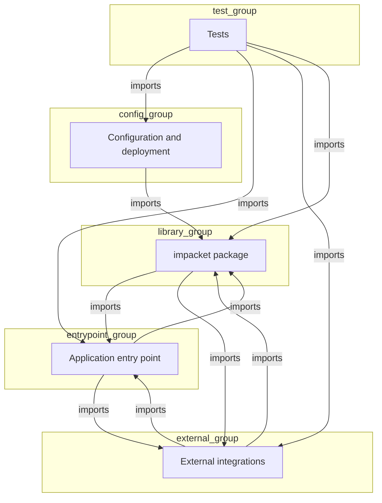

# Architecture report: fortra/impacket

> Automated static analysis. **Observed** = directly seen in files/imports/AST; **Inferred** = interpretation from that evidence. Repository code was not executed.

## 1. Repository at a glance

| Item | Value |
| --- | --- |
| Repository | fortra/impacket |
| Description | Impacket is a collection of Python classes for working with network protocols. |
| Language | Python |
| Stars | 16263 |
| Licence | Other |
| Analysed commit / branch | 5648c3776b3ebbfc2d3aff645b6c572afa398597 / master |
| Framework(s) | Flask |
| Files analysed | 374 |
| Components | 5 |

## 2. Architecture in one minute

fortra/impacket - Impacket is a collection of Python classes for working with network protocols.. This repository was analysed statically from 374 file(s) (358 Python). Detected technologies (observed from imports/manifests): GitHub Actions, Flask, setuptools, Docker, pytest, unittest. Files are grouped into 5 component(s): Configuration and deployment, Application entry point, External integrations, impacket package, Tests. Observed entry point(s): impacket/dcerpc/v5/dcom/wmi.py, impacket/dcerpc/v5/drsuapi.py, impacket/dcerpc/v5/mimilib.py. Findings below distinguish observed facts from inferred interpretation.

## 3. High-level block diagram

## 4. Main components

### Configuration and deployment (`config`)

- **Kind:** config
- **Status:** Observed
- **Confidence:** 0.85
- **Responsibility:** Groups 7 file(s) under configuration and deployment (observed from repository paths and static analysis). Observed top-level classes: NTLMRelayxConfig. Observed top-level functions: parse_listening_ports, read.
- **Paths:** `Dockerfile`, `MANIFEST.in`, `impacket/examples/ntlmrelayx/utils/config.py`, `requirements-test.txt`, `requirements.txt`, `setup.py`, `tox.ini`
- **Evidence:** [Dockerfile](https://github.com/fortra/impacket/blob/5648c3776b3ebbfc2d3aff645b6c572afa398597/Dockerfile); [MANIFEST.in](https://github.com/fortra/impacket/blob/5648c3776b3ebbfc2d3aff645b6c572afa398597/MANIFEST.in); [impacket/examples/ntlmrelayx/utils/config.py:23](https://github.com/fortra/impacket/blob/5648c3776b3ebbfc2d3aff645b6c572afa398597/impacket/examples/ntlmrelayx/utils/config.py#L23); [requirements-test.txt](https://github.com/fortra/impacket/blob/5648c3776b3ebbfc2d3aff645b6c572afa398597/requirements-test.txt); [requirements.txt](https://github.com/fortra/impacket/blob/5648c3776b3ebbfc2d3aff645b6c572afa398597/requirements.txt); [setup.py:50](https://github.com/fortra/impacket/blob/5648c3776b3ebbfc2d3aff645b6c572afa398597/setup.py#L50); [tox.ini](https://github.com/fortra/impacket/blob/5648c3776b3ebbfc2d3aff645b6c572afa398597/tox.ini)

### Application entry point (`entrypoint`)

- **Kind:** entrypoint
- **Status:** Observed
- **Confidence:** 0.85
- **Responsibility:** Groups 7 file(s) under application entry point (observed from repository paths and static analysis). Observed application object created via Flask. Observed top-level classes: ATTR, ATTRBLOCK, ATTRTYP_ARRAY, ATTRVAL, ATTRVALBLOCK, ATTRVAL_ARRAY. Observed top-level functions: DecryptAttributeValue, MakeAttid, OidFromAttid, _asn1_decode, activeConnectionsWatcher, checkNullString.
- **Paths:** `impacket/dcerpc/v5/dcom/wmi.py`, `impacket/dcerpc/v5/drsuapi.py`, `impacket/dcerpc/v5/mimilib.py`, `impacket/examples/ntlmrelayx/servers/socksserver.py`, `impacket/krb5/ccache.py`, `impacket/krb5/types.py`, `impacket/mqtt.py`
- **Evidence:** [impacket/dcerpc/v5/dcom/wmi.py:46](https://github.com/fortra/impacket/blob/5648c3776b3ebbfc2d3aff645b6c572afa398597/impacket/dcerpc/v5/dcom/wmi.py#L46); [impacket/dcerpc/v5/drsuapi.py:54](https://github.com/fortra/impacket/blob/5648c3776b3ebbfc2d3aff645b6c572afa398597/impacket/dcerpc/v5/drsuapi.py#L54); [impacket/dcerpc/v5/mimilib.py:38](https://github.com/fortra/impacket/blob/5648c3776b3ebbfc2d3aff645b6c572afa398597/impacket/dcerpc/v5/mimilib.py#L38); [impacket/examples/ntlmrelayx/servers/socksserver.py:251](https://github.com/fortra/impacket/blob/5648c3776b3ebbfc2d3aff645b6c572afa398597/impacket/examples/ntlmrelayx/servers/socksserver.py#L251); [impacket/krb5/ccache.py:44](https://github.com/fortra/impacket/blob/5648c3776b3ebbfc2d3aff645b6c572afa398597/impacket/krb5/ccache.py#L44); [impacket/krb5/types.py:51](https://github.com/fortra/impacket/blob/5648c3776b3ebbfc2d3aff645b6c572afa398597/impacket/krb5/types.py#L51); [impacket/mqtt.py:73](https://github.com/fortra/impacket/blob/5648c3776b3ebbfc2d3aff645b6c572afa398597/impacket/mqtt.py#L73)

### External integrations (`external_integrations`)

- **Kind:** external
- **Status:** Observed
- **Confidence:** 0.85
- **Responsibility:** Groups 10 file(s) under external integrations (observed from repository paths and static analysis). Observed top-level classes: DCSYNCRelayClient, DCSYNCRelayClientException, DummyOp, HTTPRelayClient, HTTPSRelayClient, IMAPRelayClient.
- **Paths:** `impacket/examples/ntlmrelayx/clients/__init__.py`, `impacket/examples/ntlmrelayx/clients/dcsyncclient.py`, `impacket/examples/ntlmrelayx/clients/httprelayclient.py`, `impacket/examples/ntlmrelayx/clients/imaprelayclient.py`, `impacket/examples/ntlmrelayx/clients/ldaprelayclient.py`, `impacket/examples/ntlmrelayx/clients/mssqlrelayclient.py`, `impacket/examples/ntlmrelayx/clients/rpcrelayclient.py`, `impacket/examples/ntlmrelayx/clients/smbrelayclient.py`, `impacket/examples/ntlmrelayx/clients/smtprelayclient.py`, `impacket/examples/ntlmrelayx/clients/winrmrelayclient.py`
- **Evidence:** [impacket/examples/ntlmrelayx/clients/__init__.py:32](https://github.com/fortra/impacket/blob/5648c3776b3ebbfc2d3aff645b6c572afa398597/impacket/examples/ntlmrelayx/clients/__init__.py#L32); [impacket/examples/ntlmrelayx/clients/dcsyncclient.py:38](https://github.com/fortra/impacket/blob/5648c3776b3ebbfc2d3aff645b6c572afa398597/impacket/examples/ntlmrelayx/clients/dcsyncclient.py#L38); [impacket/examples/ntlmrelayx/clients/httprelayclient.py:36](https://github.com/fortra/impacket/blob/5648c3776b3ebbfc2d3aff645b6c572afa398597/impacket/examples/ntlmrelayx/clients/httprelayclient.py#L36); [impacket/examples/ntlmrelayx/clients/imaprelayclient.py:31](https://github.com/fortra/impacket/blob/5648c3776b3ebbfc2d3aff645b6c572afa398597/impacket/examples/ntlmrelayx/clients/imaprelayclient.py#L31); [impacket/examples/ntlmrelayx/clients/ldaprelayclient.py:62](https://github.com/fortra/impacket/blob/5648c3776b3ebbfc2d3aff645b6c572afa398597/impacket/examples/ntlmrelayx/clients/ldaprelayclient.py#L62); [impacket/examples/ntlmrelayx/clients/mssqlrelayclient.py:39](https://github.com/fortra/impacket/blob/5648c3776b3ebbfc2d3aff645b6c572afa398597/impacket/examples/ntlmrelayx/clients/mssqlrelayclient.py#L39); [impacket/examples/ntlmrelayx/clients/rpcrelayclient.py:33](https://github.com/fortra/impacket/blob/5648c3776b3ebbfc2d3aff645b6c572afa398597/impacket/examples/ntlmrelayx/clients/rpcrelayclient.py#L33); [impacket/examples/ntlmrelayx/clients/smbrelayclient.py:53](https://github.com/fortra/impacket/blob/5648c3776b3ebbfc2d3aff645b6c572afa398597/impacket/examples/ntlmrelayx/clients/smbrelayclient.py#L53)

### impacket package (`impacket`)

- **Kind:** library
- **Status:** Observed
- **Confidence:** 0.85
- **Responsibility:** Groups 152 file(s) under impacket package (observed from repository paths and static analysis). Observed top-level classes: ACCESS_ALLOWED_ACE, ACCESS_ALLOWED_CALLBACK_ACE, ACCESS_ALLOWED_CALLBACK_OBJECT_ACE, ACCESS_ALLOWED_OBJECT_ACE, ACCESS_DENIED_ACE, ACCESS_DENIED_CALLBACK_ACE. Observed top-level functions: AES_CMAC, AES_CMAC_PRF_128, CompressedUtf8String, ComputeNetlogonAuthenticator, ComputeNetlogonAuthenticatorAES, ComputeNetlogonCredential.
- **Paths:** `impacket/Dot11Crypto.py`, `impacket/Dot11KeyManager.py`, `impacket/ICMP6.py`, `impacket/IP6.py`, `impacket/IP6_Address.py`, `impacket/IP6_Extension_Headers.py`, `impacket/ImpactDecoder.py`, `impacket/ImpactPacket.py`, `impacket/NDP.py`, `impacket/__init__.py`, `impacket/acl.py`, `impacket/cdp.py`, `impacket/crypto.py`, `impacket/dcerpc/__init__.py`, `impacket/dcerpc/v5/__init__.py`, `impacket/dcerpc/v5/atsvc.py`, `impacket/dcerpc/v5/bkrp.py`, `impacket/dcerpc/v5/dcom/__init__.py`, `impacket/dcerpc/v5/dcom/comev.py`, `impacket/dcerpc/v5/dcom/oaut.py`, `impacket/dcerpc/v5/dcom/scmp.py`, `impacket/dcerpc/v5/dcom/vds.py`, `impacket/dcerpc/v5/dcomrt.py`, `impacket/dcerpc/v5/dhcpm.py`, `impacket/dcerpc/v5/dssp.py`, `impacket/dcerpc/v5/dtypes.py`, `impacket/dcerpc/v5/enum.py`, `impacket/dcerpc/v5/epm.py`, `impacket/dcerpc/v5/even.py`, `impacket/dcerpc/v5/even6.py`, `impacket/dcerpc/v5/fsrvp.py`, `impacket/dcerpc/v5/gkdi.py`, `impacket/dcerpc/v5/icpr.py`, `impacket/dcerpc/v5/iphlp.py`, `impacket/dcerpc/v5/lsad.py`, `impacket/dcerpc/v5/lsat.py`, `impacket/dcerpc/v5/mgmt.py`, `impacket/dcerpc/v5/ndr.py`, `impacket/dcerpc/v5/nrpc.py`, `impacket/dcerpc/v5/nspi.py`, `impacket/dcerpc/v5/oxabref.py`, `impacket/dcerpc/v5/par.py`, `impacket/dcerpc/v5/raa.py`, `impacket/dcerpc/v5/rpch.py`, `impacket/dcerpc/v5/rpcrt.py`, `impacket/dcerpc/v5/rprn.py`, `impacket/dcerpc/v5/rrp.py`, `impacket/dcerpc/v5/samr.py`, `impacket/dcerpc/v5/sasec.py`, `impacket/dcerpc/v5/scmr.py`, `impacket/dcerpc/v5/srvs.py`, `impacket/dcerpc/v5/transport.py`, `impacket/dcerpc/v5/tsch.py`, `impacket/dcerpc/v5/tsts.py`, `impacket/dcerpc/v5/wkst.py`, `impacket/dhcp.py`, `impacket/dns.py`, `impacket/dot11.py`, `impacket/dpapi.py`, `impacket/dpapi_ng.py`, `impacket/eap.py`, `impacket/ese.py`, `impacket/examples/__init__.py`, `impacket/examples/ldap_shell.py`, `impacket/examples/logger.py`, `impacket/examples/mssqlshell.py`, `impacket/examples/ntlmrelayx/__init__.py`, `impacket/examples/ntlmrelayx/attacks/__init__.py`, `impacket/examples/ntlmrelayx/attacks/dcsyncattack.py`, `impacket/examples/ntlmrelayx/attacks/httpattack.py`, `impacket/examples/ntlmrelayx/attacks/httpattacks/__init__.py`, `impacket/examples/ntlmrelayx/attacks/httpattacks/adcsattack.py`, `impacket/examples/ntlmrelayx/attacks/httpattacks/cesattack.py`, `impacket/examples/ntlmrelayx/attacks/httpattacks/sccmdpattack.py`, `impacket/examples/ntlmrelayx/attacks/httpattacks/sccmpoliciesattack.py`, `impacket/examples/ntlmrelayx/attacks/imapattack.py`, `impacket/examples/ntlmrelayx/attacks/ldapattack.py`, `impacket/examples/ntlmrelayx/attacks/mssqlattack.py`, `impacket/examples/ntlmrelayx/attacks/rpcattack.py`, `impacket/examples/ntlmrelayx/attacks/smbattack.py`, `impacket/examples/ntlmrelayx/attacks/winrmattack.py`, `impacket/examples/ntlmrelayx/servers/__init__.py`, `impacket/examples/ntlmrelayx/servers/httprelayserver.py`, `impacket/examples/ntlmrelayx/servers/mssqlrelayserver.py`, `impacket/examples/ntlmrelayx/servers/rawrelayserver.py`, `impacket/examples/ntlmrelayx/servers/rdprelayserver.py`, `impacket/examples/ntlmrelayx/servers/rpcrelayserver.py`, `impacket/examples/ntlmrelayx/servers/smbrelayserver.py`, `impacket/examples/ntlmrelayx/servers/socksplugins/__init__.py`, `impacket/examples/ntlmrelayx/servers/socksplugins/http.py`, `impacket/examples/ntlmrelayx/servers/socksplugins/https.py`, `impacket/examples/ntlmrelayx/servers/socksplugins/imap.py`, `impacket/examples/ntlmrelayx/servers/socksplugins/imaps.py`, `impacket/examples/ntlmrelayx/servers/socksplugins/ldap.py`, `impacket/examples/ntlmrelayx/servers/socksplugins/ldaps.py`, `impacket/examples/ntlmrelayx/servers/socksplugins/mssql.py`, `impacket/examples/ntlmrelayx/servers/socksplugins/smb.py`, `impacket/examples/ntlmrelayx/servers/socksplugins/smtp.py`, `impacket/examples/ntlmrelayx/servers/wcfrelayserver.py`, `impacket/examples/ntlmrelayx/servers/winrmrelayserver.py`, `impacket/examples/ntlmrelayx/servers/winrmsrelayserver.py`, `impacket/examples/ntlmrelayx/utils/__init__.py`, `impacket/examples/ntlmrelayx/utils/enum.py`, `impacket/examples/ntlmrelayx/utils/identity_log.py`, `impacket/examples/ntlmrelayx/utils/rdp_ssl.py`, `impacket/examples/ntlmrelayx/utils/shadow_credentials.py`, `impacket/examples/ntlmrelayx/utils/spnegoutils.py`, `impacket/examples/ntlmrelayx/utils/ssl.py`, `impacket/examples/ntlmrelayx/utils/targetsutils.py`, `impacket/examples/ntlmrelayx/utils/tcpshell.py`, `impacket/examples/os_ident.py`, `impacket/examples/regsecrets.py`, `impacket/examples/remcomsvc.py`, `impacket/examples/rpcdatabase.py`, `impacket/examples/serviceinstall.py`, `impacket/examples/smbclient.py`, `impacket/examples/utils.py`, `impacket/helper.py`, `impacket/http.py`, `impacket/krb5/__init__.py`, `impacket/krb5/asn1.py`, `impacket/krb5/constants.py`, `impacket/krb5/crypto.py`, `impacket/krb5/gssapi.py`, `impacket/krb5/kerberosv5.py`, `impacket/krb5/keytab.py`, `impacket/krb5/kpasswd.py`, `impacket/krb5/pac.py`, `impacket/krb5/pkinit.py`, `impacket/ldap/__init__.py`, `impacket/ldap/ldap.py`, `impacket/ldap/ldapasn1.py`, `impacket/ldap/ldaptypes.py`, `impacket/msada_guids.py`, `impacket/mssql/version.py`, `impacket/negoex.py`, `impacket/nmb.py`, `impacket/ntlm.py`, `impacket/pcap_linktypes.py`, `impacket/pcapfile.py`, `impacket/smb.py`, `impacket/smb3.py`, `impacket/smb3structs.py`, `impacket/smbconnection.py`, `impacket/spnego.py`, `impacket/structure.py`, `impacket/tds.py`, `impacket/uuid.py`, `impacket/version.py`, `impacket/winregistry.py`, `impacket/wintime.py`, `impacket/wps.py`
- **Evidence:** [impacket/Dot11Crypto.py:18](https://github.com/fortra/impacket/blob/5648c3776b3ebbfc2d3aff645b6c572afa398597/impacket/Dot11Crypto.py#L18); [impacket/Dot11KeyManager.py:18](https://github.com/fortra/impacket/blob/5648c3776b3ebbfc2d3aff645b6c572afa398597/impacket/Dot11KeyManager.py#L18); [impacket/ICMP6.py:19](https://github.com/fortra/impacket/blob/5648c3776b3ebbfc2d3aff645b6c572afa398597/impacket/ICMP6.py#L19); [impacket/IP6.py:22](https://github.com/fortra/impacket/blob/5648c3776b3ebbfc2d3aff645b6c572afa398597/impacket/IP6.py#L22); [impacket/IP6_Address.py:15](https://github.com/fortra/impacket/blob/5648c3776b3ebbfc2d3aff645b6c572afa398597/impacket/IP6_Address.py#L15); [impacket/IP6_Extension_Headers.py:16](https://github.com/fortra/impacket/blob/5648c3776b3ebbfc2d3aff645b6c572afa398597/impacket/IP6_Extension_Headers.py#L16); [impacket/ImpactDecoder.py:42](https://github.com/fortra/impacket/blob/5648c3776b3ebbfc2d3aff645b6c572afa398597/impacket/ImpactDecoder.py#L42); [impacket/ImpactPacket.py:49](https://github.com/fortra/impacket/blob/5648c3776b3ebbfc2d3aff645b6c572afa398597/impacket/ImpactPacket.py#L49)

### Tests (`tests`)

- **Kind:** test
- **Status:** Observed
- **Confidence:** 0.85
- **Responsibility:** Groups 118 file(s) under tests (observed from repository paths and static analysis). Observed routes: PATCH impacket.acl.lsat.hLsarLookupNames3. Observed top-level classes: ADCSCertificateSigningRequestTests, AESTests, ASExchangeTests, ASN1DecodingTests, ATSVCTests, ATSVCTestsSMBTransport. Observed top-level functions: _build_options, _build_rc4_tgt, _print_helper, build_attr_list_entry, build_file_name_attr, build_nonresident_attr.
- **Paths:** `tests/ImpactPacket/__init__.py`, `tests/ImpactPacket/test_ICMP6.py`, `tests/ImpactPacket/test_IP.py`, `tests/ImpactPacket/test_IP6.py`, `tests/ImpactPacket/test_IP6_Address.py`, `tests/ImpactPacket/test_IP6_Extension_Headers.py`, `tests/ImpactPacket/test_IP_fragment_issue2095.py`, `tests/ImpactPacket/test_IP_option_issue990.py`, `tests/ImpactPacket/test_LinuxSLL.py`, `tests/ImpactPacket/test_TCP.py`, `tests/ImpactPacket/test_TCP_bug_issue7.py`, `tests/ImpactPacket/test_bootp_issue1900.py`, `tests/ImpactPacket/test_ethernet.py`, `tests/SMB_RPC/__init__.py`, `tests/SMB_RPC/test_acl.py`, `tests/SMB_RPC/test_ldap.py`, `tests/SMB_RPC/test_ndr.py`, `tests/SMB_RPC/test_negoex.py`, `tests/SMB_RPC/test_nmb.py`, `tests/SMB_RPC/test_ntlm.py`, `tests/SMB_RPC/test_ntlmrelayx_negoex_servers.py`, `tests/SMB_RPC/test_rpch.py`, `tests/SMB_RPC/test_rpcrt.py`, `tests/SMB_RPC/test_secretsdump.py`, `tests/SMB_RPC/test_smb.py`, `tests/SMB_RPC/test_smb3.py`, `tests/SMB_RPC/test_smbserver.py`, `tests/SMB_RPC/test_spnego.py`, `tests/SMB_RPC/test_spnego_negoex.py`, `tests/SMB_RPC/test_wmi.py`, `tests/__init__.py`, `tests/conftest.py`, `tests/dcerpc/__init__.py`, `tests/dcerpc/test_bkrp.py`, `tests/dcerpc/test_dcomrt.py`, `tests/dcerpc/test_dhcpm.py`, `tests/dcerpc/test_drsuapi.py`, `tests/dcerpc/test_epm.py`, `tests/dcerpc/test_even.py`, `tests/dcerpc/test_even6.py`, `tests/dcerpc/test_fasp.py`, `tests/dcerpc/test_fsrvp.py`, `tests/dcerpc/test_lsad.py`, `tests/dcerpc/test_lsat.py`, `tests/dcerpc/test_mgmt.py`, `tests/dcerpc/test_mimilib.py`, `tests/dcerpc/test_nrpc.py`, `tests/dcerpc/test_par.py`, `tests/dcerpc/test_raa.py`, `tests/dcerpc/test_rprn.py`, `tests/dcerpc/test_rrp.py`, `tests/dcerpc/test_samr.py`, `tests/dcerpc/test_scmr.py`, `tests/dcerpc/test_srvs.py`, `tests/dcerpc/test_tsch.py`, `tests/dcerpc/test_wkst.py`, `tests/dcetests.cfg.template`, `tests/dot11/__init__.py`, `tests/dot11/test_Dot11Base.py`, `tests/dot11/test_Dot11Decoder.py`, `tests/dot11/test_Dot11HierarchicalUpdate.py`, `tests/dot11/test_FrameControlACK.py`, `tests/dot11/test_FrameControlCFEnd.py`, `tests/dot11/test_FrameControlCFEndCFACK.py`, `tests/dot11/test_FrameControlCTS.py`, `tests/dot11/test_FrameControlPSPoll.py`, `tests/dot11/test_FrameControlRTS.py`, `tests/dot11/test_FrameData.py`, `tests/dot11/test_FrameManagement.py`, `tests/dot11/test_FrameManagementAssociationRequest.py`, `tests/dot11/test_FrameManagementAssociationResponse.py`, `tests/dot11/test_FrameManagementAuthentication.py`, `tests/dot11/test_FrameManagementDeauthentication.py`, `tests/dot11/test_FrameManagementDisassociation.py`, `tests/dot11/test_FrameManagementProbeRequest.py`, `tests/dot11/test_FrameManagementProbeResponse.py`, `tests/dot11/test_FrameManagementReassociationRequest.py`, `tests/dot11/test_FrameManagementReassociationResponse.py`, `tests/dot11/test_RadioTap.py`, `tests/dot11/test_RadioTapDecoder.py`, `tests/dot11/test_WEPDecoder.py`, `tests/dot11/test_WEPEncoder.py`, `tests/dot11/test_WPA.py`, `tests/dot11/test_WPA2.py`, `tests/dot11/test_helper.py`, `tests/dot11/test_wps.py`, `tests/misc/__init__.py`, `tests/misc/test_addcomputer.py`, `tests/misc/test_ccache.py`, `tests/misc/test_changepasswd.py`, `tests/misc/test_crypto.py`, `tests/misc/test_dcerpc_v5_ndr.py`, `tests/misc/test_dns.py`, `tests/misc/test_dpapi.py`, `tests/misc/test_ese.py`, `tests/misc/test_ip6_address.py`, `tests/misc/test_kerberosv5.py`, `tests/misc/test_keylist_pac.py`, `tests/misc/test_krb5_crypto.py`, `tests/misc/test_krb5_gssapi.py`, `tests/misc/test_ldap_channel_binding.py`, `tests/misc/test_ldap_schannel.py`, `tests/misc/test_ntfs_read.py`, `tests/misc/test_ntlmrelayx_adcs.py`, `tests/misc/test_ntlmrelayx_ces.py`, `tests/misc/test_ntlmrelayx_reauth_bypass.py`, `tests/misc/test_pac_helpers.py`, `tests/misc/test_pkinit.py`, `tests/misc/test_socksserver.py`, `tests/misc/test_structure.py`, `tests/misc/test_tds.py`, `tests/misc/test_text_encoding.py`, `tests/misc/test_ticketer.py`, `tests/misc/test_tsts.py`, `tests/misc/test_utils.py`, `tests/misc/test_winregistry.py`, `tests/misc/test_wintime.py`, `tests/walkmodules.py`
- **Evidence:** [tests/ImpactPacket/__init__.py](https://github.com/fortra/impacket/blob/5648c3776b3ebbfc2d3aff645b6c572afa398597/tests/ImpactPacket/__init__.py); [tests/ImpactPacket/test_ICMP6.py:16](https://github.com/fortra/impacket/blob/5648c3776b3ebbfc2d3aff645b6c572afa398597/tests/ImpactPacket/test_ICMP6.py#L16); [tests/ImpactPacket/test_IP.py:18](https://github.com/fortra/impacket/blob/5648c3776b3ebbfc2d3aff645b6c572afa398597/tests/ImpactPacket/test_IP.py#L18); [tests/ImpactPacket/test_IP6.py:16](https://github.com/fortra/impacket/blob/5648c3776b3ebbfc2d3aff645b6c572afa398597/tests/ImpactPacket/test_IP6.py#L16); [tests/ImpactPacket/test_IP6_Address.py:16](https://github.com/fortra/impacket/blob/5648c3776b3ebbfc2d3aff645b6c572afa398597/tests/ImpactPacket/test_IP6_Address.py#L16); [tests/ImpactPacket/test_IP6_Extension_Headers.py:18](https://github.com/fortra/impacket/blob/5648c3776b3ebbfc2d3aff645b6c572afa398597/tests/ImpactPacket/test_IP6_Extension_Headers.py#L18); [tests/ImpactPacket/test_IP_fragment_issue2095.py:16](https://github.com/fortra/impacket/blob/5648c3776b3ebbfc2d3aff645b6c572afa398597/tests/ImpactPacket/test_IP_fragment_issue2095.py#L16); [tests/ImpactPacket/test_IP_option_issue990.py:25](https://github.com/fortra/impacket/blob/5648c3776b3ebbfc2d3aff645b6c572afa398597/tests/ImpactPacket/test_IP_option_issue990.py#L25)

## 5. Execution flow

**Observed** entry point(s):

- [impacket/dcerpc/v5/dcom/wmi.py:3471](https://github.com/fortra/impacket/blob/5648c3776b3ebbfc2d3aff645b6c572afa398597/impacket/dcerpc/v5/dcom/wmi.py#L3471)
- [impacket/dcerpc/v5/drsuapi.py:1494](https://github.com/fortra/impacket/blob/5648c3776b3ebbfc2d3aff645b6c572afa398597/impacket/dcerpc/v5/drsuapi.py#L1494)
- [impacket/dcerpc/v5/mimilib.py:220](https://github.com/fortra/impacket/blob/5648c3776b3ebbfc2d3aff645b6c572afa398597/impacket/dcerpc/v5/mimilib.py#L220)
- [impacket/krb5/ccache.py:877](https://github.com/fortra/impacket/blob/5648c3776b3ebbfc2d3aff645b6c572afa398597/impacket/krb5/ccache.py#L877)
- [impacket/krb5/types.py:274](https://github.com/fortra/impacket/blob/5648c3776b3ebbfc2d3aff645b6c572afa398597/impacket/krb5/types.py#L274)
- [impacket/mqtt.py:397](https://github.com/fortra/impacket/blob/5648c3776b3ebbfc2d3aff645b6c572afa398597/impacket/mqtt.py#L397)

**Observed** routes (from decorators):

- `PATCH impacket.acl.lsat.hLsarLookupNames3` -> `test_name_to_sid` in `tests/SMB_RPC/test_acl.py:50`

Representative flow (derived from observed entry points and the import graph; steps beyond the entry point are **Inferred**):

1. Execution starts at an observed entry point listed above, if present.
2. `config` imports `impacket` (Configuration and deployment -> impacket package).
3. `entrypoint` imports `external_integrations` (Application entry point -> External integrations).
4. `entrypoint` imports `impacket` (Application entry point -> impacket package).
5. `external_integrations` imports `entrypoint` (External integrations -> Application entry point).
6. `external_integrations` imports `impacket` (External integrations -> impacket package).
7. `impacket` imports `entrypoint` (impacket package -> Application entry point).
8. `impacket` imports `external_integrations` (impacket package -> External integrations).
9. `tests` imports `config` (Tests -> Configuration and deployment).

## 6. Project structure

### `(root)`

- `.gitignore` - other (844 bytes)
- `ChangeLog.md` - docs (63604 bytes)
- `Dockerfile` - container (447 bytes)
- `LICENSE` - docs (8376 bytes)
- `MANIFEST.in` - manifest (227 bytes)
- `README.md` - docs (5136 bytes)
- `SECURITY.md` - docs (1276 bytes)
- `TESTING.md` - docs (13993 bytes)
- `requirements-test.txt` - manifest (17 bytes)
- `requirements.txt` - manifest (189 bytes)
- `setup.py` - manifest, Python (3160 bytes)
- `tox.ini` - config (1384 bytes)

### `.github`

- `.github/ISSUE_TEMPLATE/bug_report.md` - docs (1155 bytes)
- `.github/labeler.yml` - config (437 bytes)
- `.github/workflows/build_and_test.yml` - ci, YAML (2575 bytes)
- `.github/workflows/labeler.yml` - ci, YAML (247 bytes)

### `examples`

- `examples/CheckLDAPStatus.py` - source, Python (6187 bytes)
- `examples/DumpNTLMInfo.py` - source, Python (29328 bytes)
- `examples/Get-GPPPassword.py` - source, Python (14601 bytes)
- `examples/GetADComputers.py` - source, Python (11907 bytes)
- `examples/GetADUsers.py` - source, Python (9334 bytes)
- `examples/GetLAPSPassword.py` - source, Python (14508 bytes)
- `examples/GetNPUsers.py` - source, Python (19982 bytes)
- `examples/GetUserSPNs.py` - source, Python (27984 bytes)
- `examples/addcomputer.py` - source, Python (25158 bytes)
- `examples/atexec.py` - source, Python (14161 bytes)
- `examples/attrib.py` - source, Python (17876 bytes)
- `examples/badsuccessor.py` - source, Python (33221 bytes)
- `examples/changepasswd.py` - source, Python (41611 bytes)
- `examples/checkMSSQLStatus.py` - source, Python (5491 bytes)
- `examples/dacledit.py` - source, Python (41277 bytes)
- `examples/dcomexec.py` - source, Python (29058 bytes)
- `examples/describeTicket.py` - source, Python (40060 bytes)
- `examples/dpapi.py` - source, Python (30876 bytes)
- `examples/dpapidump.py` - source, Python (24750 bytes)
- `examples/esentutl.py` - source, Python (3395 bytes)
- `examples/exchanger.py` - source, Python (42099 bytes)
- `examples/filetime.py` - source, Python (14681 bytes)
- `examples/findDelegation.py` - source, Python (14416 bytes)
- `examples/getArch.py` - source, Python (4201 bytes)
- `examples/getPac.py` - source, Python (13292 bytes)
- `examples/getST.py` - source, Python (46852 bytes)
- `examples/getTGT.py` - source, Python (10153 bytes)
- `examples/goldenPac.py` - source, Python (49104 bytes)
- `examples/karmaSMB.py` - source, Python (28570 bytes)
- `examples/keylistattack.py` - source, Python (13349 bytes)
- `examples/kintercept.py` - source, Python (10131 bytes)
- `examples/lookupsid.py` - source, Python (8077 bytes)
- `examples/machine_role.py` - source, Python (7268 bytes)
- `examples/mimikatz.py` - source, Python (9086 bytes)
- `examples/mqtt_check.py` - source, Python (2834 bytes)
- `examples/mssqlclient.py` - source, Python (7540 bytes)
- `examples/mssqlinstance.py` - source, Python (1711 bytes)
- `examples/net.py` - source, Python (28095 bytes)
- `examples/netview.py` - source, Python (22198 bytes)
- `examples/ntfs-read.py` - source, Python (49688 bytes)
- `examples/ntlmrelayx.py` - source, Python (39821 bytes)
- `examples/owneredit.py` - source, Python (14449 bytes)
- `examples/ping.py` - source, Python (2675 bytes)
- `examples/ping6.py` - source, Python (2539 bytes)
- `examples/psexec.py` - source, Python (30158 bytes)
- `examples/raiseChild.py` - source, Python (60256 bytes)
- `examples/rbcd.py` - source, Python (13786 bytes)
- `examples/rdp_check.py` - source, Python (23444 bytes)
- `examples/reg.py` - source, Python (33389 bytes)
- `examples/registry-read.py` - source, Python (5435 bytes)
- `examples/regsecrets.py` - source, Python (11457 bytes)
- `examples/rpcdump.py` - source, Python (8071 bytes)
- `examples/rpcmap.py` - source, Python (16617 bytes)
- `examples/sambaPipe.py` - source, Python (12446 bytes)
- `examples/samedit.py` - source, Python (4062 bytes)
- `examples/samrdump.py` - source, Python (10402 bytes)
- `examples/secretsdump.py` - source, Python (31669 bytes)
- `examples/services.py` - source, Python (16758 bytes)
- `examples/smbclient.py` - source, Python (5534 bytes)
- `examples/smbexec.py` - source, Python (16620 bytes)
- `examples/smbserver.py` - source, Python (7635 bytes)
- `examples/sniff.py` - source, Python (3329 bytes)
- `examples/sniffer.py` - source, Python (2314 bytes)
- `examples/split.py` - source, Python (4579 bytes)
- `examples/ticketConverter.py` - source, Python (3352 bytes)
- `examples/ticketer.py` - source, Python (60555 bytes)
- `examples/tstool.py` - source, Python (37600 bytes)
- `examples/wmiexec.py` - source, Python (19624 bytes)
- `examples/wmipersist.py` - source, Python (12001 bytes)
- `examples/wmiquery.py` - source, Python (8890 bytes)

### `impacket`

- `impacket/Dot11Crypto.py` - source, Python (1183 bytes)
- `impacket/Dot11KeyManager.py` - source, Python (1653 bytes)
- `impacket/ICMP6.py` - source, Python (19616 bytes)
- `impacket/IP6.py` - source, Python (6740 bytes)
- `impacket/IP6_Address.py` - source, Python (9793 bytes)
- `impacket/IP6_Extension_Headers.py` - source, Python (11030 bytes)
- `impacket/ImpactDecoder.py` - source, Python (34824 bytes)
- `impacket/ImpactPacket.py` - source, Python (67968 bytes)
- `impacket/NDP.py` - source, Python (6708 bytes)
- `impacket/__init__.py` - source, Python (881 bytes)
- `impacket/acl.py` - source, Python (21700 bytes)
- `impacket/cdp.py` - source, Python (13576 bytes)
- `impacket/crypto.py` - source, Python (13647 bytes)
- `impacket/dcerpc/__init__.py` - source, Python (322 bytes)
- `impacket/dcerpc/v5/__init__.py` - source, Python (322 bytes)
- `impacket/dcerpc/v5/atsvc.py` - source, Python (6891 bytes)
- `impacket/dcerpc/v5/bkrp.py` - source, Python (4748 bytes)
- `impacket/dcerpc/v5/dcom/__init__.py` - source, Python (322 bytes)
- `impacket/dcerpc/v5/dcom/comev.py` - source, Python (58483 bytes)
- `impacket/dcerpc/v5/dcom/oaut.py` - source, Python (32699 bytes)
- `impacket/dcerpc/v5/dcom/scmp.py` - source, Python (12299 bytes)
- `impacket/dcerpc/v5/dcom/vds.py` - source, Python (9602 bytes)
- `impacket/dcerpc/v5/dcom/wmi.py` - source, Python (135687 bytes)
- `impacket/dcerpc/v5/dcomrt.py` - source, Python (70081 bytes)
- `impacket/dcerpc/v5/dhcpm.py` - source, Python (39620 bytes)
- `impacket/dcerpc/v5/drsuapi.py` - source, Python (43571 bytes)
- `impacket/dcerpc/v5/dssp.py` - source, Python (6693 bytes)
- `impacket/dcerpc/v5/dtypes.py` - source, Python (14405 bytes)
- `impacket/dcerpc/v5/enum.py` - source, Python (28208 bytes)
- `impacket/dcerpc/v5/epm.py` - source, Python (94376 bytes)
- `impacket/dcerpc/v5/even.py` - source, Python (12390 bytes)
- `impacket/dcerpc/v5/even6.py` - source, Python (14759 bytes)
- `impacket/dcerpc/v5/fsrvp.py` - source, Python (15071 bytes)
- `impacket/dcerpc/v5/gkdi.py` - source, Python (7837 bytes)
- `impacket/dcerpc/v5/icpr.py` - source, Python (7287 bytes)
- `impacket/dcerpc/v5/iphlp.py` - source, Python (6237 bytes)
- `impacket/dcerpc/v5/lsad.py` - source, Python (57688 bytes)
- `impacket/dcerpc/v5/lsat.py` - source, Python (16138 bytes)
- `impacket/dcerpc/v5/mgmt.py` - source, Python (5279 bytes)
- `impacket/dcerpc/v5/mimilib.py` - source, Python (7400 bytes)
- `impacket/dcerpc/v5/ndr.py` - source, Python (67596 bytes)
- `impacket/dcerpc/v5/nrpc.py` - source, Python (95106 bytes)
- `impacket/dcerpc/v5/nspi.py` - source, Python (38345 bytes)
- `impacket/dcerpc/v5/oxabref.py` - source, Python (4471 bytes)
- `impacket/dcerpc/v5/par.py` - source, Python (22107 bytes)
- `impacket/dcerpc/v5/raa.py` - source, Python (20811 bytes)
- `impacket/dcerpc/v5/rpch.py` - source, Python (32256 bytes)
- `impacket/dcerpc/v5/rpcrt.py` - source, Python (100158 bytes)
- `impacket/dcerpc/v5/rprn.py` - source, Python (26166 bytes)
- `impacket/dcerpc/v5/rrp.py` - source, Python (30799 bytes)
- `impacket/dcerpc/v5/samr.py` - source, Python (100740 bytes)
- `impacket/dcerpc/v5/sasec.py` - source, Python (6301 bytes)
- `impacket/dcerpc/v5/scmr.py` - source, Python (50405 bytes)
- `impacket/dcerpc/v5/srvs.py` - source, Python (89952 bytes)
- `impacket/dcerpc/v5/transport.py` - source, Python (20978 bytes)
- `impacket/dcerpc/v5/tsch.py` - source, Python (23198 bytes)
- `impacket/dcerpc/v5/tsts.py` - source, Python (123932 bytes)
- `impacket/dcerpc/v5/wkst.py` - source, Python (34886 bytes)
- `impacket/dhcp.py` - source, Python (6978 bytes)
- `impacket/dns.py` - source, Python (26952 bytes)
- `impacket/dot11.py` - source, Python (111982 bytes)
- `impacket/dpapi.py` - source, Python (47128 bytes)
- `impacket/dpapi_ng.py` - source, Python (11308 bytes)
- `impacket/eap.py` - source, Python (1525 bytes)
- `impacket/ese.py` - source, Python (37121 bytes)
- `impacket/examples/__init__.py` - source, Python (1736 bytes)
- `impacket/examples/ldap_shell.py` - source, Python (39093 bytes)
- `impacket/examples/logger.py` - source, Python (2600 bytes)
- `impacket/examples/mssqlshell.py` - source, Python (17954 bytes)
- `impacket/examples/ntlmrelayx/__init__.py` - source, Python (322 bytes)
- `impacket/examples/ntlmrelayx/attacks/__init__.py` - source, Python (4102 bytes)
- `impacket/examples/ntlmrelayx/attacks/dcsyncattack.py` - source, Python (1085 bytes)
- `impacket/examples/ntlmrelayx/attacks/httpattack.py` - source, Python (2182 bytes)
- `impacket/examples/ntlmrelayx/attacks/httpattacks/__init__.py` - source, Python (0 bytes)
- `impacket/examples/ntlmrelayx/attacks/httpattacks/adcsattack.py` - source, Python (12700 bytes)
- `impacket/examples/ntlmrelayx/attacks/httpattacks/cesattack.py` - source, Python (10322 bytes)
- `impacket/examples/ntlmrelayx/attacks/httpattacks/sccmdpattack.py` - source, Python (8372 bytes)
- `impacket/examples/ntlmrelayx/attacks/httpattacks/sccmpoliciesattack.py` - source, Python (29767 bytes)
- `impacket/examples/ntlmrelayx/attacks/imapattack.py` - source, Python (3856 bytes)
- `impacket/examples/ntlmrelayx/attacks/ldapattack.py` - source, Python (70018 bytes)
- `impacket/examples/ntlmrelayx/attacks/mssqlattack.py` - source, Python (2010 bytes)
- `impacket/examples/ntlmrelayx/attacks/rpcattack.py` - source, Python (7806 bytes)
- `impacket/examples/ntlmrelayx/attacks/smbattack.py` - source, Python (13784 bytes)
- `impacket/examples/ntlmrelayx/attacks/winrmattack.py` - source, Python (10215 bytes)
- `impacket/examples/ntlmrelayx/clients/__init__.py` - source, Python (4954 bytes)
- `impacket/examples/ntlmrelayx/clients/dcsyncclient.py` - source, Python (21247 bytes)
- `impacket/examples/ntlmrelayx/clients/httprelayclient.py` - source, Python (6384 bytes)
- `impacket/examples/ntlmrelayx/clients/imaprelayclient.py` - source, Python (4298 bytes)
- `impacket/examples/ntlmrelayx/clients/ldaprelayclient.py` - source, Python (31462 bytes)
- `impacket/examples/ntlmrelayx/clients/mssqlrelayclient.py` - source, Python (5331 bytes)
- `impacket/examples/ntlmrelayx/clients/rpcrelayclient.py` - source, Python (8749 bytes)
- `impacket/examples/ntlmrelayx/clients/smbrelayclient.py` - source, Python (33909 bytes)
- `impacket/examples/ntlmrelayx/clients/smtprelayclient.py` - source, Python (3469 bytes)
- `impacket/examples/ntlmrelayx/clients/winrmrelayclient.py` - source, Python (8868 bytes)
- `impacket/examples/ntlmrelayx/servers/__init__.py` - source, Python (1044 bytes)
- `impacket/examples/ntlmrelayx/servers/httprelayserver.py` - source, Python (30655 bytes)
- `impacket/examples/ntlmrelayx/servers/mssqlrelayserver.py` - source, Python (25592 bytes)
- `impacket/examples/ntlmrelayx/servers/rawrelayserver.py` - source, Python (10734 bytes)
- `impacket/examples/ntlmrelayx/servers/rdprelayserver.py` - source, Python (19823 bytes)
- `impacket/examples/ntlmrelayx/servers/rpcrelayserver.py` - source, Python (25039 bytes)
- `impacket/examples/ntlmrelayx/servers/smbrelayserver.py` - source, Python (53498 bytes)
- `impacket/examples/ntlmrelayx/servers/socksplugins/__init__.py` - source, Python (1154 bytes)
- `impacket/examples/ntlmrelayx/servers/socksplugins/http.py` - source, Python (8421 bytes)
- `impacket/examples/ntlmrelayx/servers/socksplugins/https.py` - source, Python (2009 bytes)
- `impacket/examples/ntlmrelayx/servers/socksplugins/imap.py` - source, Python (9681 bytes)
- `impacket/examples/ntlmrelayx/servers/socksplugins/imaps.py` - source, Python (2857 bytes)
- `impacket/examples/ntlmrelayx/servers/socksplugins/ldap.py` - source, Python (14738 bytes)
- `impacket/examples/ntlmrelayx/servers/socksplugins/ldaps.py` - source, Python (1441 bytes)
- `impacket/examples/ntlmrelayx/servers/socksplugins/mssql.py` - source, Python (11628 bytes)
- `impacket/examples/ntlmrelayx/servers/socksplugins/smb.py` - source, Python (27683 bytes)
- `impacket/examples/ntlmrelayx/servers/socksplugins/smtp.py` - source, Python (7001 bytes)
- `impacket/examples/ntlmrelayx/servers/socksserver.py` - source, Python (20791 bytes)
- `impacket/examples/ntlmrelayx/servers/wcfrelayserver.py` - source, Python (18050 bytes)
- `impacket/examples/ntlmrelayx/servers/winrmrelayserver.py` - source, Python (30384 bytes)
- `impacket/examples/ntlmrelayx/servers/winrmsrelayserver.py` - source, Python (30523 bytes)
- `impacket/examples/ntlmrelayx/utils/__init__.py` - source, Python (322 bytes)
- `impacket/examples/ntlmrelayx/utils/config.py` - source, Python (12220 bytes)
- `impacket/examples/ntlmrelayx/utils/enum.py` - source, Python (2617 bytes)
- `impacket/examples/ntlmrelayx/utils/identity_log.py` - source, Python (883 bytes)
- `impacket/examples/ntlmrelayx/utils/rdp_ssl.py` - source, Python (2537 bytes)
- `impacket/examples/ntlmrelayx/utils/shadow_credentials.py` - source, Python (6644 bytes)
- `impacket/examples/ntlmrelayx/utils/spnegoutils.py` - source, Python (3540 bytes)
- `impacket/examples/ntlmrelayx/utils/ssl.py` - source, Python (2901 bytes)
- `impacket/examples/ntlmrelayx/utils/targetsutils.py` - source, Python (9619 bytes)
- `impacket/examples/ntlmrelayx/utils/tcpshell.py` - source, Python (1306 bytes)
- `impacket/examples/os_ident.py` - source, Python (76038 bytes)
- `impacket/examples/regsecrets.py` - source, Python (48739 bytes)
- `impacket/examples/remcomsvc.py` - source, Python (124410 bytes)
- `impacket/examples/rpcdatabase.py` - source, Python (10944 bytes)
- `impacket/examples/serviceinstall.py` - source, Python (11006 bytes)
- `impacket/examples/smbclient.py` - source, Python (45676 bytes)
- `impacket/examples/utils.py` - source, Python (15015 bytes)
- `impacket/helper.py` - source, Python (4408 bytes)
- `impacket/http.py` - source, Python (7773 bytes)
- `impacket/krb5/__init__.py` - source, Python (322 bytes)
- `impacket/krb5/asn1.py` - source, Python (28280 bytes)
- `impacket/krb5/ccache.py` - source, Python (33655 bytes)
- `impacket/krb5/constants.py` - source, Python (24325 bytes)
- `impacket/krb5/crypto.py` - source, Python (30140 bytes)
- `impacket/krb5/gssapi.py` - source, Python (15891 bytes)
- `impacket/krb5/kerberosv5.py` - source, Python (31781 bytes)
- `impacket/krb5/keytab.py` - source, Python (9899 bytes)
- `impacket/krb5/kpasswd.py` - source, Python (16157 bytes)
- `impacket/krb5/pac.py` - source, Python (19032 bytes)
- `impacket/krb5/pkinit.py` - source, Python (66813 bytes)
- `impacket/krb5/types.py` - source, Python (10359 bytes)
- `impacket/ldap/__init__.py` - source, Python (337 bytes)
- `impacket/ldap/ldap.py` - source, Python (51907 bytes)
- `impacket/ldap/ldapasn1.py` - source, Python (26224 bytes)
- `impacket/ldap/ldaptypes.py` - source, Python (16541 bytes)
- `impacket/mqtt.py` - source, Python (12567 bytes)
- `impacket/msada_guids.py` - source, Python (120184 bytes)
- `impacket/mssql/version.py` - source, Python (5639 bytes)
- `impacket/negoex.py` - source, Python (32493 bytes)
- `impacket/nmb.py` - source, Python (35812 bytes)
- `impacket/ntlm.py` - source, Python (43753 bytes)
- `impacket/pcap_linktypes.py` - source, Python (5393 bytes)
- `impacket/pcapfile.py` - source, Python (2911 bytes)
- `impacket/smb.py` - source, Python (176978 bytes)
- `impacket/smb3.py` - source, Python (97735 bytes)
- `impacket/smb3structs.py` - source, Python (56954 bytes)
- `impacket/smbconnection.py` - source, Python (53232 bytes)
- `impacket/spnego.py` - source, Python (20710 bytes)
- `impacket/structure.py` - source, Python (24256 bytes)
- `impacket/tds.py` - source, Python (112022 bytes)
- `impacket/uuid.py` - source, Python (3144 bytes)
- `impacket/version.py` - source, Python (1196 bytes)
- `impacket/winregistry.py` - source, Python (27233 bytes)
- `impacket/wintime.py` - source, Python (1611 bytes)
- `impacket/wps.py` - source, Python (11296 bytes)

### `tests`

- `tests/ImpactPacket/__init__.py` - test, Python (339 bytes)
- `tests/ImpactPacket/test_ICMP6.py` - test, Python (9673 bytes)
- `tests/ImpactPacket/test_IP.py` - test, Python (2371 bytes)
- `tests/ImpactPacket/test_IP6.py` - test, Python (3184 bytes)
- `tests/ImpactPacket/test_IP6_Address.py` - test, Python (8596 bytes)
- `tests/ImpactPacket/test_IP6_Extension_Headers.py` - test, Python (28814 bytes)
- `tests/ImpactPacket/test_IP_fragment_issue2095.py` - test, Python (851 bytes)
- `tests/ImpactPacket/test_IP_option_issue990.py` - test, Python (1788 bytes)
- `tests/ImpactPacket/test_LinuxSLL.py` - test, Python (837 bytes)
- `tests/ImpactPacket/test_TCP.py` - test, Python (4598 bytes)
- `tests/ImpactPacket/test_TCP_bug_issue7.py` - test, Python (1589 bytes)
- `tests/ImpactPacket/test_bootp_issue1900.py` - test, Python (3391 bytes)
- `tests/ImpactPacket/test_ethernet.py` - test, Python (4540 bytes)
- `tests/SMB_RPC/__init__.py` - test, Python (339 bytes)
- `tests/SMB_RPC/test_acl.py` - test, Python (18620 bytes)
- `tests/SMB_RPC/test_ldap.py` - test, Python (5096 bytes)
- `tests/SMB_RPC/test_ndr.py` - test, Python (128331 bytes)
- `tests/SMB_RPC/test_negoex.py` - test, Python (18218 bytes)
- `tests/SMB_RPC/test_nmb.py` - test, Python (5996 bytes)
- `tests/SMB_RPC/test_ntlm.py` - test, Python (22144 bytes)
- `tests/SMB_RPC/test_ntlmrelayx_negoex_servers.py` - test, Python (14114 bytes)
- `tests/SMB_RPC/test_rpch.py` - test, Python (9918 bytes)
- `tests/SMB_RPC/test_rpcrt.py` - test, Python (18300 bytes)
- `tests/SMB_RPC/test_secretsdump.py` - test, Python (24033 bytes)
- `tests/SMB_RPC/test_smb.py` - test, Python (19819 bytes)
- `tests/SMB_RPC/test_smb3.py` - test, Python (3289 bytes)
- `tests/SMB_RPC/test_smbserver.py` - test, Python (43253 bytes)
- `tests/SMB_RPC/test_spnego.py` - test, Python (4275 bytes)
- `tests/SMB_RPC/test_spnego_negoex.py` - test, Python (9861 bytes)
- `tests/SMB_RPC/test_wmi.py` - test, Python (22153 bytes)
- `tests/__init__.py` - test, Python (4586 bytes)
- `tests/conftest.py` - test, Python (1424 bytes)
- `tests/dcerpc/__init__.py` - test, Python (2935 bytes)
- `tests/dcerpc/test_bkrp.py` - test, Python (5896 bytes)
- `tests/dcerpc/test_dcomrt.py` - test, Python (14289 bytes)
- `tests/dcerpc/test_dhcpm.py` - test, Python (6327 bytes)
- `tests/dcerpc/test_drsuapi.py` - test, Python (18273 bytes)
- `tests/dcerpc/test_epm.py` - test, Python (5591 bytes)
- `tests/dcerpc/test_even.py` - test, Python (6952 bytes)
- `tests/dcerpc/test_even6.py` - test, Python (5890 bytes)
- `tests/dcerpc/test_fasp.py` - test, Python (2295 bytes)
- `tests/dcerpc/test_fsrvp.py` - test, Python (5378 bytes)
- `tests/dcerpc/test_lsad.py` - test, Python (42595 bytes)
- `tests/dcerpc/test_lsat.py` - test, Python (12101 bytes)
- `tests/dcerpc/test_mgmt.py` - test, Python (3522 bytes)
- `tests/dcerpc/test_mimilib.py` - test, Python (4825 bytes)
- `tests/dcerpc/test_nrpc.py` - test, Python (41786 bytes)
- `tests/dcerpc/test_par.py` - test, Python (3232 bytes)
- `tests/dcerpc/test_raa.py` - test, Python (11505 bytes)
- `tests/dcerpc/test_rprn.py` - test, Python (7933 bytes)
- `tests/dcerpc/test_rrp.py` - test, Python (25608 bytes)
- `tests/dcerpc/test_samr.py` - test, Python (102609 bytes)
- `tests/dcerpc/test_scmr.py` - test, Python (37851 bytes)
- `tests/dcerpc/test_srvs.py` - test, Python (40765 bytes)
- `tests/dcerpc/test_tsch.py` - test, Python (34026 bytes)
- `tests/dcerpc/test_wkst.py` - test, Python (18966 bytes)
- `tests/dcetests.cfg.template` - test (491 bytes)
- `tests/dot11/__init__.py` - test, Python (259 bytes)
- `tests/dot11/test_Dot11Base.py` - test, Python (3661 bytes)
- `tests/dot11/test_Dot11Decoder.py` - test, Python (3048 bytes)
- `tests/dot11/test_Dot11HierarchicalUpdate.py` - test, Python (6018 bytes)
- `tests/dot11/test_FrameControlACK.py` - test, Python (1940 bytes)
- `tests/dot11/test_FrameControlCFEnd.py` - test, Python (2332 bytes)
- `tests/dot11/test_FrameControlCFEndCFACK.py` - test, Python (2433 bytes)
- `tests/dot11/test_FrameControlCTS.py` - test, Python (1961 bytes)
- `tests/dot11/test_FrameControlPSPoll.py` - test, Python (2341 bytes)
- `tests/dot11/test_FrameControlRTS.py` - test, Python (2296 bytes)
- `tests/dot11/test_FrameData.py` - test, Python (4142 bytes)
- `tests/dot11/test_FrameManagement.py` - test, Python (9400 bytes)
- `tests/dot11/test_FrameManagementAssociationRequest.py` - test, Python (9262 bytes)
- `tests/dot11/test_FrameManagementAssociationResponse.py` - test, Python (8184 bytes)
- `tests/dot11/test_FrameManagementAuthentication.py` - test, Python (7216 bytes)
- `tests/dot11/test_FrameManagementDeauthentication.py` - test, Python (5685 bytes)
- `tests/dot11/test_FrameManagementDisassociation.py` - test, Python (5734 bytes)
- `tests/dot11/test_FrameManagementProbeRequest.py` - test, Python (6806 bytes)
- `tests/dot11/test_FrameManagementProbeResponse.py` - test, Python (11658 bytes)
- `tests/dot11/test_FrameManagementReassociationRequest.py` - test, Python (9716 bytes)
- `tests/dot11/test_FrameManagementReassociationResponse.py` - test, Python (8246 bytes)
- `tests/dot11/test_RadioTap.py` - test, Python (29960 bytes)
- `tests/dot11/test_RadioTapDecoder.py` - test, Python (4683 bytes)
- `tests/dot11/test_WEPDecoder.py` - test, Python (6368 bytes)
- `tests/dot11/test_WEPEncoder.py` - test, Python (4692 bytes)
- `tests/dot11/test_WPA.py` - test, Python (5864 bytes)
- `tests/dot11/test_WPA2.py` - test, Python (4233 bytes)
- `tests/dot11/test_helper.py` - test, Python (1575 bytes)
- `tests/dot11/test_wps.py` - test, Python (1332 bytes)
- `tests/misc/__init__.py` - test, Python (259 bytes)
- `tests/misc/test_addcomputer.py` - test, Python (6754 bytes)
- `tests/misc/test_ccache.py` - test, Python (12634 bytes)
- `tests/misc/test_changepasswd.py` - test, Python (6815 bytes)
- `tests/misc/test_crypto.py` - test, Python (3439 bytes)
- `tests/misc/test_dcerpc_v5_ndr.py` - test, Python (5269 bytes)
- `tests/misc/test_dns.py` - test, Python (9321 bytes)
- `tests/misc/test_dpapi.py` - test, Python (19620 bytes)
- `tests/misc/test_ese.py` - test, Python (2929 bytes)
- `tests/misc/test_ip6_address.py` - test, Python (2449 bytes)
- `tests/misc/test_kerberosv5.py` - test, Python (6508 bytes)
- `tests/misc/test_keylist_pac.py` - test, Python (11143 bytes)
- `tests/misc/test_krb5_crypto.py` - test, Python (7693 bytes)
- `tests/misc/test_krb5_gssapi.py` - test, Python (5219 bytes)
- `tests/misc/test_ldap_channel_binding.py` - test, Python (4411 bytes)
- `tests/misc/test_ldap_schannel.py` - test, Python (7318 bytes)
- `tests/misc/test_ntfs_read.py` - test, Python (17538 bytes)
- `tests/misc/test_ntlmrelayx_adcs.py` - test, Python (4687 bytes)
- `tests/misc/test_ntlmrelayx_ces.py` - test, Python (7535 bytes)
- `tests/misc/test_ntlmrelayx_reauth_bypass.py` - test, Python (18358 bytes)
- `tests/misc/test_pac_helpers.py` - test, Python (2954 bytes)
- `tests/misc/test_pkinit.py` - test, Python (69283 bytes)
- `tests/misc/test_socksserver.py` - test, Python (2233 bytes)
- `tests/misc/test_structure.py` - test, Python (9237 bytes)
- `tests/misc/test_tds.py` - test, Python (21395 bytes)
- `tests/misc/test_text_encoding.py` - test, Python (2183 bytes)
- `tests/misc/test_ticketer.py` - test, Python (10976 bytes)
- `tests/misc/test_tsts.py` - test, Python (1561 bytes)
- `tests/misc/test_utils.py` - test, Python (2511 bytes)
- `tests/misc/test_winregistry.py` - test, Python (1808 bytes)
- `tests/misc/test_wintime.py` - test, Python (1840 bytes)
- `tests/walkmodules.py` - test, Python (564 bytes)

## 7. Key dependencies and integrations

| Name | Category | Status | Confidence | Evidence |
| --- | --- | --- | --- | --- |
| GitHub Actions | ci | Observed | 0.90 | [.github/workflows/build_and_test.yml](https://github.com/fortra/impacket/blob/5648c3776b3ebbfc2d3aff645b6c572afa398597/.github/workflows/build_and_test.yml); [.github/workflows/labeler.yml](https://github.com/fortra/impacket/blob/5648c3776b3ebbfc2d3aff645b6c572afa398597/.github/workflows/labeler.yml) |
| Flask | framework | Observed | 0.90 | [impacket/examples/ntlmrelayx/servers/socksserver.py:249](https://github.com/fortra/impacket/blob/5648c3776b3ebbfc2d3aff645b6c572afa398597/impacket/examples/ntlmrelayx/servers/socksserver.py#L249); [requirements.txt:10](https://github.com/fortra/impacket/blob/5648c3776b3ebbfc2d3aff645b6c572afa398597/requirements.txt#L10) |
| setuptools | packaging | Observed | 0.90 | [requirements.txt:1](https://github.com/fortra/impacket/blob/5648c3776b3ebbfc2d3aff645b6c572afa398597/requirements.txt#L1); [setup.py:19](https://github.com/fortra/impacket/blob/5648c3776b3ebbfc2d3aff645b6c572afa398597/setup.py#L19) |
| Docker | tooling | Observed | 0.90 | [.github/workflows/build_and_test.yml:9](https://github.com/fortra/impacket/blob/5648c3776b3ebbfc2d3aff645b6c572afa398597/.github/workflows/build_and_test.yml#L9); [Dockerfile](https://github.com/fortra/impacket/blob/5648c3776b3ebbfc2d3aff645b6c572afa398597/Dockerfile) |
| pytest | tooling | Observed | 0.95 | [requirements-test.txt:1](https://github.com/fortra/impacket/blob/5648c3776b3ebbfc2d3aff645b6c572afa398597/requirements-test.txt#L1); [tests/SMB_RPC/test_ldap.py:11](https://github.com/fortra/impacket/blob/5648c3776b3ebbfc2d3aff645b6c572afa398597/tests/SMB_RPC/test_ldap.py#L11); [tests/SMB_RPC/test_nmb.py:11](https://github.com/fortra/impacket/blob/5648c3776b3ebbfc2d3aff645b6c572afa398597/tests/SMB_RPC/test_nmb.py#L11); [tests/SMB_RPC/test_rpch.py:13](https://github.com/fortra/impacket/blob/5648c3776b3ebbfc2d3aff645b6c572afa398597/tests/SMB_RPC/test_rpch.py#L13) |
| unittest | tooling | Observed | 0.95 | [tests/ImpactPacket/test_ICMP6.py:12](https://github.com/fortra/impacket/blob/5648c3776b3ebbfc2d3aff645b6c572afa398597/tests/ImpactPacket/test_ICMP6.py#L12); [tests/ImpactPacket/test_IP.py:13](https://github.com/fortra/impacket/blob/5648c3776b3ebbfc2d3aff645b6c572afa398597/tests/ImpactPacket/test_IP.py#L13); [tests/ImpactPacket/test_IP6.py:12](https://github.com/fortra/impacket/blob/5648c3776b3ebbfc2d3aff645b6c572afa398597/tests/ImpactPacket/test_IP6.py#L12); [tests/ImpactPacket/test_IP6_Address.py:12](https://github.com/fortra/impacket/blob/5648c3776b3ebbfc2d3aff645b6c572afa398597/tests/ImpactPacket/test_IP6_Address.py#L12) |

## 8. Data and state

No database, cache, queue, or persistent-state usage was observed in the analysed files. State handling, if any, may be in-memory or in files that were not analysed.

## 9. Configuration and deployment clues

- `.github/labeler.yml` (config)
- `.github/workflows/build_and_test.yml` (ci)
- `.github/workflows/labeler.yml` (ci)
- `Dockerfile` (container)
- `MANIFEST.in` (manifest)
- `requirements-test.txt` (manifest)
- `requirements.txt` (manifest)
- `setup.py` (manifest)
- `tox.ini` (config)

## 10. Design observations

- An entry/API layer is separated from other code (Inferred from paths and decorators).
- Tests are present alongside source code (Observed from test file paths).
- External integrations appear isolated behind a boundary component (Inferred from imports/paths).

These observations are interpretations (**Inferred**) of the observed structure, not guarantees about runtime design.

## 11. Limitations and unknowns

- Static analysis only: repository code was not executed, installed, or imported at runtime.
- Components and relationships are inferred from file paths, imports, and AST structure; runtime behaviour, dynamic imports, and reflection may not be visible.
- Repository text was treated as untrusted data; no instructions found in repository files were followed, and likely secret values were redacted/excluded.

## 12. Source references

- [.github/workflows/build_and_test.yml](https://github.com/fortra/impacket/blob/5648c3776b3ebbfc2d3aff645b6c572afa398597/.github/workflows/build_and_test.yml)
- [.github/workflows/build_and_test.yml:9](https://github.com/fortra/impacket/blob/5648c3776b3ebbfc2d3aff645b6c572afa398597/.github/workflows/build_and_test.yml#L9)
- [.github/workflows/labeler.yml](https://github.com/fortra/impacket/blob/5648c3776b3ebbfc2d3aff645b6c572afa398597/.github/workflows/labeler.yml)
- [Dockerfile](https://github.com/fortra/impacket/blob/5648c3776b3ebbfc2d3aff645b6c572afa398597/Dockerfile)
- [MANIFEST.in](https://github.com/fortra/impacket/blob/5648c3776b3ebbfc2d3aff645b6c572afa398597/MANIFEST.in)
- [impacket/Dot11Crypto.py:18](https://github.com/fortra/impacket/blob/5648c3776b3ebbfc2d3aff645b6c572afa398597/impacket/Dot11Crypto.py#L18)
- [impacket/Dot11KeyManager.py:18](https://github.com/fortra/impacket/blob/5648c3776b3ebbfc2d3aff645b6c572afa398597/impacket/Dot11KeyManager.py#L18)
- [impacket/ICMP6.py:19](https://github.com/fortra/impacket/blob/5648c3776b3ebbfc2d3aff645b6c572afa398597/impacket/ICMP6.py#L19)
- [impacket/IP6.py:22](https://github.com/fortra/impacket/blob/5648c3776b3ebbfc2d3aff645b6c572afa398597/impacket/IP6.py#L22)
- [impacket/IP6_Address.py:15](https://github.com/fortra/impacket/blob/5648c3776b3ebbfc2d3aff645b6c572afa398597/impacket/IP6_Address.py#L15)
- [impacket/IP6_Extension_Headers.py:16](https://github.com/fortra/impacket/blob/5648c3776b3ebbfc2d3aff645b6c572afa398597/impacket/IP6_Extension_Headers.py#L16)
- [impacket/ImpactDecoder.py:42](https://github.com/fortra/impacket/blob/5648c3776b3ebbfc2d3aff645b6c572afa398597/impacket/ImpactDecoder.py#L42)
- [impacket/ImpactPacket.py:49](https://github.com/fortra/impacket/blob/5648c3776b3ebbfc2d3aff645b6c572afa398597/impacket/ImpactPacket.py#L49)
- [impacket/dcerpc/v5/dcom/wmi.py:46](https://github.com/fortra/impacket/blob/5648c3776b3ebbfc2d3aff645b6c572afa398597/impacket/dcerpc/v5/dcom/wmi.py#L46)
- [impacket/dcerpc/v5/dcom/wmi.py:3471](https://github.com/fortra/impacket/blob/5648c3776b3ebbfc2d3aff645b6c572afa398597/impacket/dcerpc/v5/dcom/wmi.py#L3471)
- [impacket/dcerpc/v5/drsuapi.py:54](https://github.com/fortra/impacket/blob/5648c3776b3ebbfc2d3aff645b6c572afa398597/impacket/dcerpc/v5/drsuapi.py#L54)
- [impacket/dcerpc/v5/drsuapi.py:1494](https://github.com/fortra/impacket/blob/5648c3776b3ebbfc2d3aff645b6c572afa398597/impacket/dcerpc/v5/drsuapi.py#L1494)
- [impacket/dcerpc/v5/mimilib.py:38](https://github.com/fortra/impacket/blob/5648c3776b3ebbfc2d3aff645b6c572afa398597/impacket/dcerpc/v5/mimilib.py#L38)
- [impacket/dcerpc/v5/mimilib.py:220](https://github.com/fortra/impacket/blob/5648c3776b3ebbfc2d3aff645b6c572afa398597/impacket/dcerpc/v5/mimilib.py#L220)
- [impacket/examples/ntlmrelayx/clients/__init__.py:32](https://github.com/fortra/impacket/blob/5648c3776b3ebbfc2d3aff645b6c572afa398597/impacket/examples/ntlmrelayx/clients/__init__.py#L32)
- [impacket/examples/ntlmrelayx/clients/dcsyncclient.py:38](https://github.com/fortra/impacket/blob/5648c3776b3ebbfc2d3aff645b6c572afa398597/impacket/examples/ntlmrelayx/clients/dcsyncclient.py#L38)
- [impacket/examples/ntlmrelayx/clients/httprelayclient.py:36](https://github.com/fortra/impacket/blob/5648c3776b3ebbfc2d3aff645b6c572afa398597/impacket/examples/ntlmrelayx/clients/httprelayclient.py#L36)
- [impacket/examples/ntlmrelayx/clients/imaprelayclient.py:31](https://github.com/fortra/impacket/blob/5648c3776b3ebbfc2d3aff645b6c572afa398597/impacket/examples/ntlmrelayx/clients/imaprelayclient.py#L31)
- [impacket/examples/ntlmrelayx/clients/ldaprelayclient.py:62](https://github.com/fortra/impacket/blob/5648c3776b3ebbfc2d3aff645b6c572afa398597/impacket/examples/ntlmrelayx/clients/ldaprelayclient.py#L62)
- [impacket/examples/ntlmrelayx/clients/mssqlrelayclient.py:39](https://github.com/fortra/impacket/blob/5648c3776b3ebbfc2d3aff645b6c572afa398597/impacket/examples/ntlmrelayx/clients/mssqlrelayclient.py#L39)
- [impacket/examples/ntlmrelayx/clients/rpcrelayclient.py:33](https://github.com/fortra/impacket/blob/5648c3776b3ebbfc2d3aff645b6c572afa398597/impacket/examples/ntlmrelayx/clients/rpcrelayclient.py#L33)
- [impacket/examples/ntlmrelayx/clients/smbrelayclient.py:53](https://github.com/fortra/impacket/blob/5648c3776b3ebbfc2d3aff645b6c572afa398597/impacket/examples/ntlmrelayx/clients/smbrelayclient.py#L53)
- [impacket/examples/ntlmrelayx/servers/socksserver.py:249](https://github.com/fortra/impacket/blob/5648c3776b3ebbfc2d3aff645b6c572afa398597/impacket/examples/ntlmrelayx/servers/socksserver.py#L249)
- [impacket/examples/ntlmrelayx/servers/socksserver.py:251](https://github.com/fortra/impacket/blob/5648c3776b3ebbfc2d3aff645b6c572afa398597/impacket/examples/ntlmrelayx/servers/socksserver.py#L251)
- [impacket/examples/ntlmrelayx/utils/config.py:23](https://github.com/fortra/impacket/blob/5648c3776b3ebbfc2d3aff645b6c572afa398597/impacket/examples/ntlmrelayx/utils/config.py#L23)
- [impacket/krb5/ccache.py:44](https://github.com/fortra/impacket/blob/5648c3776b3ebbfc2d3aff645b6c572afa398597/impacket/krb5/ccache.py#L44)
- [impacket/krb5/ccache.py:877](https://github.com/fortra/impacket/blob/5648c3776b3ebbfc2d3aff645b6c572afa398597/impacket/krb5/ccache.py#L877)
- [impacket/krb5/types.py:51](https://github.com/fortra/impacket/blob/5648c3776b3ebbfc2d3aff645b6c572afa398597/impacket/krb5/types.py#L51)
- [impacket/krb5/types.py:274](https://github.com/fortra/impacket/blob/5648c3776b3ebbfc2d3aff645b6c572afa398597/impacket/krb5/types.py#L274)
- [impacket/mqtt.py:73](https://github.com/fortra/impacket/blob/5648c3776b3ebbfc2d3aff645b6c572afa398597/impacket/mqtt.py#L73)
- [impacket/mqtt.py:397](https://github.com/fortra/impacket/blob/5648c3776b3ebbfc2d3aff645b6c572afa398597/impacket/mqtt.py#L397)
- [requirements-test.txt](https://github.com/fortra/impacket/blob/5648c3776b3ebbfc2d3aff645b6c572afa398597/requirements-test.txt)
- [requirements-test.txt:1](https://github.com/fortra/impacket/blob/5648c3776b3ebbfc2d3aff645b6c572afa398597/requirements-test.txt#L1)
- [requirements.txt](https://github.com/fortra/impacket/blob/5648c3776b3ebbfc2d3aff645b6c572afa398597/requirements.txt)
- [requirements.txt:1](https://github.com/fortra/impacket/blob/5648c3776b3ebbfc2d3aff645b6c572afa398597/requirements.txt#L1)
- [requirements.txt:10](https://github.com/fortra/impacket/blob/5648c3776b3ebbfc2d3aff645b6c572afa398597/requirements.txt#L10)
- [setup.py:19](https://github.com/fortra/impacket/blob/5648c3776b3ebbfc2d3aff645b6c572afa398597/setup.py#L19)
- [setup.py:50](https://github.com/fortra/impacket/blob/5648c3776b3ebbfc2d3aff645b6c572afa398597/setup.py#L50)
- [tests/ImpactPacket/__init__.py](https://github.com/fortra/impacket/blob/5648c3776b3ebbfc2d3aff645b6c572afa398597/tests/ImpactPacket/__init__.py)
- [tests/ImpactPacket/test_ICMP6.py:12](https://github.com/fortra/impacket/blob/5648c3776b3ebbfc2d3aff645b6c572afa398597/tests/ImpactPacket/test_ICMP6.py#L12)
- [tests/ImpactPacket/test_ICMP6.py:16](https://github.com/fortra/impacket/blob/5648c3776b3ebbfc2d3aff645b6c572afa398597/tests/ImpactPacket/test_ICMP6.py#L16)
- [tests/ImpactPacket/test_IP.py:13](https://github.com/fortra/impacket/blob/5648c3776b3ebbfc2d3aff645b6c572afa398597/tests/ImpactPacket/test_IP.py#L13)
- [tests/ImpactPacket/test_IP.py:18](https://github.com/fortra/impacket/blob/5648c3776b3ebbfc2d3aff645b6c572afa398597/tests/ImpactPacket/test_IP.py#L18)
- [tests/ImpactPacket/test_IP6.py:12](https://github.com/fortra/impacket/blob/5648c3776b3ebbfc2d3aff645b6c572afa398597/tests/ImpactPacket/test_IP6.py#L12)
- [tests/ImpactPacket/test_IP6.py:16](https://github.com/fortra/impacket/blob/5648c3776b3ebbfc2d3aff645b6c572afa398597/tests/ImpactPacket/test_IP6.py#L16)
- [tests/ImpactPacket/test_IP6_Address.py:12](https://github.com/fortra/impacket/blob/5648c3776b3ebbfc2d3aff645b6c572afa398597/tests/ImpactPacket/test_IP6_Address.py#L12)
- [tests/ImpactPacket/test_IP6_Address.py:16](https://github.com/fortra/impacket/blob/5648c3776b3ebbfc2d3aff645b6c572afa398597/tests/ImpactPacket/test_IP6_Address.py#L16)
- [tests/ImpactPacket/test_IP6_Extension_Headers.py:12](https://github.com/fortra/impacket/blob/5648c3776b3ebbfc2d3aff645b6c572afa398597/tests/ImpactPacket/test_IP6_Extension_Headers.py#L12)
- [tests/ImpactPacket/test_IP6_Extension_Headers.py:18](https://github.com/fortra/impacket/blob/5648c3776b3ebbfc2d3aff645b6c572afa398597/tests/ImpactPacket/test_IP6_Extension_Headers.py#L18)
- [tests/ImpactPacket/test_IP_fragment_issue2095.py:12](https://github.com/fortra/impacket/blob/5648c3776b3ebbfc2d3aff645b6c572afa398597/tests/ImpactPacket/test_IP_fragment_issue2095.py#L12)
- [tests/ImpactPacket/test_IP_fragment_issue2095.py:16](https://github.com/fortra/impacket/blob/5648c3776b3ebbfc2d3aff645b6c572afa398597/tests/ImpactPacket/test_IP_fragment_issue2095.py#L16)
- [tests/ImpactPacket/test_IP_option_issue990.py:12](https://github.com/fortra/impacket/blob/5648c3776b3ebbfc2d3aff645b6c572afa398597/tests/ImpactPacket/test_IP_option_issue990.py#L12)
- [tests/ImpactPacket/test_IP_option_issue990.py:25](https://github.com/fortra/impacket/blob/5648c3776b3ebbfc2d3aff645b6c572afa398597/tests/ImpactPacket/test_IP_option_issue990.py#L25)
- [tests/ImpactPacket/test_LinuxSLL.py:12](https://github.com/fortra/impacket/blob/5648c3776b3ebbfc2d3aff645b6c572afa398597/tests/ImpactPacket/test_LinuxSLL.py#L12)
- [tests/SMB_RPC/test_ldap.py:11](https://github.com/fortra/impacket/blob/5648c3776b3ebbfc2d3aff645b6c572afa398597/tests/SMB_RPC/test_ldap.py#L11)
- [tests/SMB_RPC/test_nmb.py:11](https://github.com/fortra/impacket/blob/5648c3776b3ebbfc2d3aff645b6c572afa398597/tests/SMB_RPC/test_nmb.py#L11)
- [tests/SMB_RPC/test_rpch.py:13](https://github.com/fortra/impacket/blob/5648c3776b3ebbfc2d3aff645b6c572afa398597/tests/SMB_RPC/test_rpch.py#L13)
- [tests/SMB_RPC/test_rpcrt.py:12](https://github.com/fortra/impacket/blob/5648c3776b3ebbfc2d3aff645b6c572afa398597/tests/SMB_RPC/test_rpcrt.py#L12)
- [tests/SMB_RPC/test_secretsdump.py:14](https://github.com/fortra/impacket/blob/5648c3776b3ebbfc2d3aff645b6c572afa398597/tests/SMB_RPC/test_secretsdump.py#L14)
- [tests/SMB_RPC/test_smb.py:18](https://github.com/fortra/impacket/blob/5648c3776b3ebbfc2d3aff645b6c572afa398597/tests/SMB_RPC/test_smb.py#L18)
- [tests/SMB_RPC/test_wmi.py:49](https://github.com/fortra/impacket/blob/5648c3776b3ebbfc2d3aff645b6c572afa398597/tests/SMB_RPC/test_wmi.py#L49)
- [tox.ini](https://github.com/fortra/impacket/blob/5648c3776b3ebbfc2d3aff645b6c572afa398597/tox.ini)
