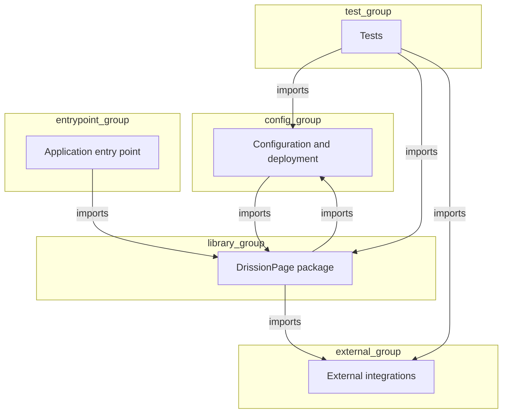

# Architecture report: g1879/DrissionPage

> Automated static analysis. **Observed** = directly seen in files/imports/AST; **Inferred** = interpretation from that evidence. Repository code was not executed.

## 1. Repository at a glance

| Item | Value |
| --- | --- |
| Repository | g1879/DrissionPage |
| Description | Python based web automation tool. Powerful and elegant. |
| Language | Python |
| Stars | 12576 |
| Licence | Other |
| Analysed commit / branch | 7761b855300a2dc4efc32c000be8150b60d21b97 / master |
| Framework(s) | None detected |
| Files analysed | 167 |
| Components | 5 |

## 2. Architecture in one minute

g1879/DrissionPage - Python based web automation tool. Powerful and elegant.. This repository was analysed statically from 167 file(s) (119 Python). Detected technologies (observed from imports/manifests): GitHub Actions, Click, NumPy, requests. Files are grouped into 5 component(s): Configuration and deployment, DrissionPage package, Application entry point, External integrations, Tests. Observed entry point(s): DrissionPage/_functions/cli.py. Findings below distinguish observed facts from inferred interpretation.

## 3. High-level block diagram

## 4. Main components

### Configuration and deployment (`config`)

- **Kind:** config
- **Status:** Observed
- **Confidence:** 0.85
- **Responsibility:** Groups 4 file(s) under configuration and deployment (observed from repository paths and static analysis). Observed top-level classes: Settings.
- **Paths:** `DrissionPage/_configs/configs.ini`, `DrissionPage/_functions/settings.py`, `MANIFEST.in`, `requirements.txt`
- **Evidence:** [DrissionPage/_configs/configs.ini](https://github.com/g1879/DrissionPage/blob/7761b855300a2dc4efc32c000be8150b60d21b97/DrissionPage/_configs/configs.ini); [DrissionPage/_functions/settings.py:13](https://github.com/g1879/DrissionPage/blob/7761b855300a2dc4efc32c000be8150b60d21b97/DrissionPage/_functions/settings.py#L13); [MANIFEST.in](https://github.com/g1879/DrissionPage/blob/7761b855300a2dc4efc32c000be8150b60d21b97/MANIFEST.in); [requirements.txt](https://github.com/g1879/DrissionPage/blob/7761b855300a2dc4efc32c000be8150b60d21b97/requirements.txt)

### DrissionPage package (`drissionpage`)

- **Kind:** library
- **Status:** Observed
- **Confidence:** 0.85
- **Responsibility:** Groups 42 file(s) under drissionpage package (observed from repository paths and static analysis). Observed top-level classes: Actions, Alert, AlertExistsError, BaseElement, BaseError, BaseListener. Observed top-level functions: _attr_all, _check_ele, _dict_cookies_to_tuple, _get_arg, _get_args, _get_browser_id.
- **Paths:** `DrissionPage/__init__.py`, `DrissionPage/_base/base.py`, `DrissionPage/_base/driver.py`, `DrissionPage/_browsers/chromium.py`, `DrissionPage/_browsers/chromium_context.py`, `DrissionPage/_configs/chromium_options.py`, `DrissionPage/_configs/options_manage.py`, `DrissionPage/_configs/session_options.py`, `DrissionPage/_elements/chromium_element.py`, `DrissionPage/_elements/none_element.py`, `DrissionPage/_elements/session_element.py`, `DrissionPage/_functions/browser.py`, `DrissionPage/_functions/by.py`, `DrissionPage/_functions/cookies.py`, `DrissionPage/_functions/elements.py`, `DrissionPage/_functions/keys.py`, `DrissionPage/_functions/locator.py`, `DrissionPage/_functions/texts.py`, `DrissionPage/_functions/tools.py`, `DrissionPage/_functions/web.py`, `DrissionPage/_pages/chromium_base.py`, `DrissionPage/_pages/chromium_frame.py`, `DrissionPage/_pages/chromium_tab.py`, `DrissionPage/_pages/session_page.py`, `DrissionPage/_units/actions.py`, `DrissionPage/_units/clicker.py`, `DrissionPage/_units/console.py`, `DrissionPage/_units/cookies_setter.py`, `DrissionPage/_units/downloader.py`, `DrissionPage/_units/listener.py`, `DrissionPage/_units/perm_setter.py`, `DrissionPage/_units/rect.py`, `DrissionPage/_units/screencast.py`, `DrissionPage/_units/scroller.py`, `DrissionPage/_units/selector.py`, `DrissionPage/_units/setter.py`, `DrissionPage/_units/states.py`, `DrissionPage/_units/waiter.py`, `DrissionPage/common.py`, `DrissionPage/errors.py`, `DrissionPage/items.py`, `DrissionPage/version.py`
- **Evidence:** [DrissionPage/__init__.py](https://github.com/g1879/DrissionPage/blob/7761b855300a2dc4efc32c000be8150b60d21b97/DrissionPage/__init__.py); [DrissionPage/_base/base.py:29](https://github.com/g1879/DrissionPage/blob/7761b855300a2dc4efc32c000be8150b60d21b97/DrissionPage/_base/base.py#L29); [DrissionPage/_base/driver.py:24](https://github.com/g1879/DrissionPage/blob/7761b855300a2dc4efc32c000be8150b60d21b97/DrissionPage/_base/driver.py#L24); [DrissionPage/_browsers/chromium.py:34](https://github.com/g1879/DrissionPage/blob/7761b855300a2dc4efc32c000be8150b60d21b97/DrissionPage/_browsers/chromium.py#L34); [DrissionPage/_browsers/chromium_context.py:7](https://github.com/g1879/DrissionPage/blob/7761b855300a2dc4efc32c000be8150b60d21b97/DrissionPage/_browsers/chromium_context.py#L7); [DrissionPage/_configs/chromium_options.py:16](https://github.com/g1879/DrissionPage/blob/7761b855300a2dc4efc32c000be8150b60d21b97/DrissionPage/_configs/chromium_options.py#L16); [DrissionPage/_configs/options_manage.py:15](https://github.com/g1879/DrissionPage/blob/7761b855300a2dc4efc32c000be8150b60d21b97/DrissionPage/_configs/options_manage.py#L15); [DrissionPage/_configs/session_options.py:20](https://github.com/g1879/DrissionPage/blob/7761b855300a2dc4efc32c000be8150b60d21b97/DrissionPage/_configs/session_options.py#L20)

### Application entry point (`entrypoint`)

- **Kind:** entrypoint
- **Status:** Observed
- **Confidence:** 0.85
- **Responsibility:** Groups 1 file(s) under application entry point (observed from repository paths and static analysis). Observed top-level functions: main, set_paths.
- **Paths:** `DrissionPage/_functions/cli.py`
- **Evidence:** [DrissionPage/_functions/cli.py:20](https://github.com/g1879/DrissionPage/blob/7761b855300a2dc4efc32c000be8150b60d21b97/DrissionPage/_functions/cli.py#L20)

### External integrations (`external_integrations`)

- **Kind:** external
- **Status:** Inferred
- **Confidence:** 0.70
- **Responsibility:** Groups 0 file(s) under external integrations (observed from repository paths and static analysis).
- **Evidence:** [DrissionPage/_base/base.py:17](https://github.com/g1879/DrissionPage/blob/7761b855300a2dc4efc32c000be8150b60d21b97/DrissionPage/_base/base.py#L17); [DrissionPage/_base/driver.py:13](https://github.com/g1879/DrissionPage/blob/7761b855300a2dc4efc32c000be8150b60d21b97/DrissionPage/_base/driver.py#L13); [DrissionPage/_base/driver.py:14](https://github.com/g1879/DrissionPage/blob/7761b855300a2dc4efc32c000be8150b60d21b97/DrissionPage/_base/driver.py#L14); [DrissionPage/_browsers/chromium.py:13](https://github.com/g1879/DrissionPage/blob/7761b855300a2dc4efc32c000be8150b60d21b97/DrissionPage/_browsers/chromium.py#L13); [DrissionPage/_configs/session_options.py:11](https://github.com/g1879/DrissionPage/blob/7761b855300a2dc4efc32c000be8150b60d21b97/DrissionPage/_configs/session_options.py#L11); [DrissionPage/_configs/session_options.py:12](https://github.com/g1879/DrissionPage/blob/7761b855300a2dc4efc32c000be8150b60d21b97/DrissionPage/_configs/session_options.py#L12)

### Tests (`tests`)

- **Kind:** test
- **Status:** Observed
- **Confidence:** 0.85
- **Responsibility:** Groups 78 file(s) under tests (observed from repository paths and static analysis). Observed application object created via Click. Observed top-level classes: ActionLog, Case, ElementScroll, FakeActionElement, FakeActionOwner, FakeActions. Observed top-level functions: _assert_raises, _base_page, _case_from_feature_module, _cdp_value, _check_accessor_and_setter_wiring, _check_action_ref.
- **Paths:** `tests/README.md`, `tests/check_ci_retry.py`, `tests/check_runner_quality.py`, `tests/check_workflow_quality.py`, `tests/ci.sh`, `tests/feature_cases/__init__.py`, `tests/feature_cases/browser_interaction_server.py`, `tests/feature_cases/core_feature_server.py`, `tests/feature_cases/ssr_test_site.py`, `tests/feature_cases/test_api_behavior_changes.py`, `tests/feature_cases/test_base_page_contracts.py`, `tests/feature_cases/test_browser_contexts.py`, `tests/feature_cases/test_browser_download.py`, `tests/feature_cases/test_browser_helper_contracts.py`, `tests/feature_cases/test_browser_lifecycle_extra_contracts.py`, `tests/feature_cases/test_chromium_base_extra_contracts.py`, `tests/feature_cases/test_chromium_browser_contracts.py`, `tests/feature_cases/test_chromium_element_contracts.py`, `tests/feature_cases/test_chromium_element_extra_contracts.py`, `tests/feature_cases/test_chromium_options_environment.py`, `tests/feature_cases/test_chromium_tab_management.py`, `tests/feature_cases/test_collection_action_contracts.py`, `tests/feature_cases/test_config_session_contracts.py`, `tests/feature_cases/test_console_and_cookie_formats.py`, `tests/feature_cases/test_cookie_setters.py`, `tests/feature_cases/test_cross_origin_iframe_elements.py`, `tests/feature_cases/test_cross_origin_iframe_listener.py`, `tests/feature_cases/test_download_management.py`, `tests/feature_cases/test_element_core_behaviors.py`, `tests/feature_cases/test_element_locators.py`, `tests/feature_cases/test_element_multi_click.py`, `tests/feature_cases/test_find_api.py`, `tests/feature_cases/test_frame_shadow_setters.py`, `tests/feature_cases/test_listener_basics.py`, `tests/feature_cases/test_listener_data_contracts.py`, `tests/feature_cases/test_listener_upgrade.py`, `tests/feature_cases/test_locator_edge_contracts.py`, `tests/feature_cases/test_mouse_trail.py`, `tests/feature_cases/test_navigation_basics.py`, `tests/feature_cases/test_navigation_result.py`, `tests/feature_cases/test_optional_online_smoke.py`, `tests/feature_cases/test_options_settings.py`, `tests/feature_cases/test_page_object_basics.py`, `tests/feature_cases/test_permissions.py`, `tests/feature_cases/test_proxy_credentials.py`, `tests/feature_cases/test_pure_function_contracts.py`, `tests/feature_cases/test_recommended_chromium_entry.py`, `tests/feature_cases/test_regression_basics.py`, `tests/feature_cases/test_runtime_unit_contracts.py`, `tests/feature_cases/test_scroll_and_waits.py`, `tests/feature_cases/test_small_unit_edge_contracts.py`, `tests/feature_cases/test_ssr_marketplace_flow.py`, `tests/feature_cases/test_ssr_site_smoke.py`, `tests/feature_cases/test_ssr_social_notes_mobile.py`, `tests/feature_cases/test_startup_settings.py`, `tests/feature_cases/test_tab_management.py`, `tests/feature_cases/test_tab_post_response.py`, `tests/feature_cases/test_unit_wrapper_contracts.py`, `tests/feature_cases/test_waiter_setter_extra_contracts.py`, `tests/feature_manifest.py`, `tests/regression_cases/__init__.py`, `tests/regression_cases/test_alert_on_open.py`, `tests/regression_cases/test_api_surface.py`, `tests/regression_cases/test_console_and_tabs.py`, `tests/regression_cases/test_context_get_tabs_as_id.py`, `tests/regression_cases/test_context_isolation.py`, `tests/regression_cases/test_download_browser.py`, `tests/regression_cases/test_iframe_non_screenshot.py`, `tests/regression_cases/test_listener_ws_sse.py`, `tests/regression_cases/test_locator_behavior.py`, `tests/regression_cases/test_locator_explicit_syntax.py`, `tests/regression_cases/test_navigation_result.py`, `tests/regression_cases/test_no_browser_contract_gaps.py`, `tests/regression_cases/test_session_timeout.py`, `tests/run.py`, `tests/run.sh`, `tests/runner.py`, `tests/support.py`
- **Evidence:** [tests/README.md](https://github.com/g1879/DrissionPage/blob/7761b855300a2dc4efc32c000be8150b60d21b97/tests/README.md); [tests/check_ci_retry.py:65](https://github.com/g1879/DrissionPage/blob/7761b855300a2dc4efc32c000be8150b60d21b97/tests/check_ci_retry.py#L65); [tests/check_runner_quality.py:15](https://github.com/g1879/DrissionPage/blob/7761b855300a2dc4efc32c000be8150b60d21b97/tests/check_runner_quality.py#L15); [tests/check_workflow_quality.py:39](https://github.com/g1879/DrissionPage/blob/7761b855300a2dc4efc32c000be8150b60d21b97/tests/check_workflow_quality.py#L39); [tests/ci.sh](https://github.com/g1879/DrissionPage/blob/7761b855300a2dc4efc32c000be8150b60d21b97/tests/ci.sh); [tests/feature_cases/__init__.py](https://github.com/g1879/DrissionPage/blob/7761b855300a2dc4efc32c000be8150b60d21b97/tests/feature_cases/__init__.py); [tests/feature_cases/browser_interaction_server.py:8](https://github.com/g1879/DrissionPage/blob/7761b855300a2dc4efc32c000be8150b60d21b97/tests/feature_cases/browser_interaction_server.py#L8); [tests/feature_cases/core_feature_server.py:10](https://github.com/g1879/DrissionPage/blob/7761b855300a2dc4efc32c000be8150b60d21b97/tests/feature_cases/core_feature_server.py#L10)

## 5. Execution flow

**Observed** entry point(s):

- [DrissionPage/_functions/cli.py:52](https://github.com/g1879/DrissionPage/blob/7761b855300a2dc4efc32c000be8150b60d21b97/DrissionPage/_functions/cli.py#L52)

Representative flow (derived from observed entry points and the import graph; steps beyond the entry point are **Inferred**):

1. Execution starts at an observed entry point listed above, if present.
2. `config` imports `drissionpage` (Configuration and deployment -> DrissionPage package).
3. `drissionpage` imports `config` (DrissionPage package -> Configuration and deployment).
4. `drissionpage` imports `external_integrations` (DrissionPage package -> External integrations).
5. `entrypoint` imports `drissionpage` (Application entry point -> DrissionPage package).
6. `tests` imports `config` (Tests -> Configuration and deployment).
7. `tests` imports `drissionpage` (Tests -> DrissionPage package).
8. `tests` imports `external_integrations` (Tests -> External integrations).

## 6. Project structure

### `(root)`

- `.coveragerc` - other (263 bytes)
- `.gitignore` - other (1469 bytes)
- `LICENSE` - docs (2531 bytes)
- `MANIFEST.in` - manifest (174 bytes)
- `README.md` - docs (7570 bytes)
- `requirements.txt` - manifest (119 bytes)

### `.github`

- `.github/workflows/drissionpage-tests.yml` - ci, YAML (6333 bytes)

### `DrissionPage`

- `DrissionPage/__init__.py` - source, Python (1443 bytes)
- `DrissionPage/__init__.pyi` - other (485 bytes)
- `DrissionPage/_base/base.py` - source, Python (17368 bytes)
- `DrissionPage/_base/base.pyi` - other (20014 bytes)
- `DrissionPage/_base/driver.py` - source, Python (9060 bytes)
- `DrissionPage/_base/driver.pyi` - other (3186 bytes)
- `DrissionPage/_browsers/chromium.py` - source, Python (29589 bytes)
- `DrissionPage/_browsers/chromium.pyi` - other (20085 bytes)
- `DrissionPage/_browsers/chromium_context.py` - source, Python (2354 bytes)
- `DrissionPage/_browsers/chromium_context.pyi` - other (3971 bytes)
- `DrissionPage/_configs/chromium_options.py` - source, Python (13399 bytes)
- `DrissionPage/_configs/chromium_options.pyi` - other (12994 bytes)
- `DrissionPage/_configs/configs.ini` - config (1101 bytes)
- `DrissionPage/_configs/options_manage.py` - source, Python (6250 bytes)
- `DrissionPage/_configs/options_manage.pyi` - other (2189 bytes)
- `DrissionPage/_configs/session_options.py` - source, Python (10961 bytes)
- `DrissionPage/_configs/session_options.pyi` - other (8883 bytes)
- `DrissionPage/_elements/chromium_element.py` - source, Python (58711 bytes)
- `DrissionPage/_elements/chromium_element.pyi` - other (48454 bytes)
- `DrissionPage/_elements/none_element.py` - source, Python (2094 bytes)
- `DrissionPage/_elements/none_element.pyi` - other (929 bytes)
- `DrissionPage/_elements/session_element.py` - source, Python (11428 bytes)
- `DrissionPage/_elements/session_element.pyi` - other (13729 bytes)
- `DrissionPage/_functions/browser.py` - source, Python (16306 bytes)
- `DrissionPage/_functions/browser.pyi` - other (1729 bytes)
- `DrissionPage/_functions/by.py` - source, Python (411 bytes)
- `DrissionPage/_functions/cli.py` - source, Python (1614 bytes)
- `DrissionPage/_functions/cookies.py` - source, Python (8724 bytes)
- `DrissionPage/_functions/cookies.pyi` - other (2500 bytes)
- `DrissionPage/_functions/elements.py` - source, Python (25062 bytes)
- `DrissionPage/_functions/elements.pyi` - other (27520 bytes)
- `DrissionPage/_functions/keys.py` - source, Python (22830 bytes)
- `DrissionPage/_functions/keys.pyi` - other (2480 bytes)
- `DrissionPage/_functions/locator.py` - source, Python (18994 bytes)
- `DrissionPage/_functions/locator.pyi` - other (2219 bytes)
- `DrissionPage/_functions/settings.py` - source, Python (2113 bytes)
- `DrissionPage/_functions/settings.pyi` - other (3005 bytes)
- `DrissionPage/_functions/texts.py` - source, Python (22238 bytes)
- `DrissionPage/_functions/tools.py` - source, Python (8039 bytes)
- `DrissionPage/_functions/tools.pyi` - other (3320 bytes)
- `DrissionPage/_functions/web.py` - source, Python (12335 bytes)
- `DrissionPage/_functions/web.pyi` - other (5341 bytes)
- `DrissionPage/_pages/chromium_base.py` - source, Python (40092 bytes)
- `DrissionPage/_pages/chromium_base.pyi` - other (28557 bytes)
- `DrissionPage/_pages/chromium_frame.py` - source, Python (18563 bytes)
- `DrissionPage/_pages/chromium_frame.pyi` - other (17136 bytes)
- `DrissionPage/_pages/chromium_tab.py` - source, Python (7930 bytes)
- `DrissionPage/_pages/chromium_tab.pyi` - other (16183 bytes)
- `DrissionPage/_pages/session_page.py` - source, Python (10109 bytes)
- `DrissionPage/_pages/session_page.pyi` - other (12360 bytes)
- `DrissionPage/_units/actions.py` - source, Python (10544 bytes)
- `DrissionPage/_units/actions.pyi` - other (10990 bytes)
- `DrissionPage/_units/clicker.py` - source, Python (9152 bytes)
- `DrissionPage/_units/clicker.pyi` - other (6531 bytes)
- `DrissionPage/_units/console.py` - source, Python (2921 bytes)
- `DrissionPage/_units/console.pyi` - other (3102 bytes)
- `DrissionPage/_units/cookies_setter.py` - source, Python (2813 bytes)
- `DrissionPage/_units/cookies_setter.pyi` - other (3688 bytes)
- `DrissionPage/_units/downloader.py` - source, Python (11957 bytes)
- `DrissionPage/_units/downloader.pyi` - other (6094 bytes)
- `DrissionPage/_units/listener.py` - source, Python (40279 bytes)
- `DrissionPage/_units/listener.pyi` - other (26999 bytes)
- `DrissionPage/_units/perm_setter.py` - source, Python (4764 bytes)
- `DrissionPage/_units/perm_setter.pyi` - other (6956 bytes)
- `DrissionPage/_units/rect.py` - source, Python (7107 bytes)
- `DrissionPage/_units/rect.pyi` - other (6250 bytes)
- `DrissionPage/_units/screencast.py` - source, Python (7125 bytes)
- `DrissionPage/_units/screencast.pyi` - other (2582 bytes)
- `DrissionPage/_units/scroller.py` - source, Python (4506 bytes)
- `DrissionPage/_units/scroller.pyi` - other (9523 bytes)
- `DrissionPage/_units/selector.py` - source, Python (5782 bytes)
- `DrissionPage/_units/selector.pyi` - other (8321 bytes)
- `DrissionPage/_units/setter.py` - source, Python (21018 bytes)
- `DrissionPage/_units/setter.pyi` - other (18384 bytes)
- `DrissionPage/_units/states.py` - source, Python (5221 bytes)
- `DrissionPage/_units/states.pyi` - other (5122 bytes)
- `DrissionPage/_units/waiter.py` - source, Python (15314 bytes)
- `DrissionPage/_units/waiter.pyi` - other (25928 bytes)
- `DrissionPage/common.py` - source, Python (2212 bytes)
- `DrissionPage/errors.py` - source, Python (1453 bytes)
- `DrissionPage/items.py` - source, Python (820 bytes)
- `DrissionPage/version.py` - source, Python (191 bytes)

### `tests`

- `tests/README.md` - test (1610 bytes)
- `tests/check_ci_retry.py` - test, Python (5264 bytes)
- `tests/check_runner_quality.py` - test, Python (3431 bytes)
- `tests/check_workflow_quality.py` - test, Python (5974 bytes)
- `tests/ci.sh` - test, Shell (10825 bytes)
- `tests/feature_cases/__init__.py` - test, Python (76 bytes)
- `tests/feature_cases/browser_interaction_server.py` - test, Python (3112 bytes)
- `tests/feature_cases/core_feature_server.py` - test, Python (4110 bytes)
- `tests/feature_cases/ssr_test_site.py` - test, Python (986 bytes)
- `tests/feature_cases/test_api_behavior_changes.py` - test, Python (9658 bytes)
- `tests/feature_cases/test_base_page_contracts.py` - test, Python (38381 bytes)
- `tests/feature_cases/test_browser_contexts.py` - test, Python (1899 bytes)
- `tests/feature_cases/test_browser_download.py` - test, Python (1898 bytes)
- `tests/feature_cases/test_browser_helper_contracts.py` - test, Python (28257 bytes)
- `tests/feature_cases/test_browser_lifecycle_extra_contracts.py` - test, Python (43581 bytes)
- `tests/feature_cases/test_chromium_base_extra_contracts.py` - test, Python (22724 bytes)
- `tests/feature_cases/test_chromium_browser_contracts.py` - test, Python (38460 bytes)
- `tests/feature_cases/test_chromium_element_contracts.py` - test, Python (24517 bytes)
- `tests/feature_cases/test_chromium_element_extra_contracts.py` - test, Python (32095 bytes)
- `tests/feature_cases/test_chromium_options_environment.py` - test, Python (976 bytes)
- `tests/feature_cases/test_chromium_tab_management.py` - test, Python (2551 bytes)
- `tests/feature_cases/test_collection_action_contracts.py` - test, Python (15755 bytes)
- `tests/feature_cases/test_config_session_contracts.py` - test, Python (19863 bytes)
- `tests/feature_cases/test_console_and_cookie_formats.py` - test, Python (1755 bytes)
- `tests/feature_cases/test_cookie_setters.py` - test, Python (2067 bytes)
- `tests/feature_cases/test_cross_origin_iframe_elements.py` - test, Python (1867 bytes)
- `tests/feature_cases/test_cross_origin_iframe_listener.py` - test, Python (1786 bytes)
- `tests/feature_cases/test_download_management.py` - test, Python (1516 bytes)
- `tests/feature_cases/test_element_core_behaviors.py` - test, Python (4052 bytes)
- `tests/feature_cases/test_element_locators.py` - test, Python (3739 bytes)
- `tests/feature_cases/test_element_multi_click.py` - test, Python (2198 bytes)
- `tests/feature_cases/test_find_api.py` - test, Python (2920 bytes)
- `tests/feature_cases/test_frame_shadow_setters.py` - test, Python (2195 bytes)
- `tests/feature_cases/test_listener_basics.py` - test, Python (1867 bytes)
- `tests/feature_cases/test_listener_data_contracts.py` - test, Python (31345 bytes)
- `tests/feature_cases/test_listener_upgrade.py` - test, Python (7190 bytes)
- `tests/feature_cases/test_locator_edge_contracts.py` - test, Python (7329 bytes)
- `tests/feature_cases/test_mouse_trail.py` - test, Python (957 bytes)
- `tests/feature_cases/test_navigation_basics.py` - test, Python (2199 bytes)
- `tests/feature_cases/test_navigation_result.py` - test, Python (4388 bytes)
- `tests/feature_cases/test_optional_online_smoke.py` - test, Python (3693 bytes)
- `tests/feature_cases/test_options_settings.py` - test, Python (3292 bytes)
- `tests/feature_cases/test_page_object_basics.py` - test, Python (2779 bytes)
- `tests/feature_cases/test_permissions.py` - test, Python (918 bytes)
- `tests/feature_cases/test_proxy_credentials.py` - test, Python (1146 bytes)
- `tests/feature_cases/test_pure_function_contracts.py` - test, Python (29451 bytes)
- `tests/feature_cases/test_recommended_chromium_entry.py` - test, Python (844 bytes)
- `tests/feature_cases/test_regression_basics.py` - test, Python (3569 bytes)
- `tests/feature_cases/test_runtime_unit_contracts.py` - test, Python (20716 bytes)
- `tests/feature_cases/test_scroll_and_waits.py` - test, Python (1654 bytes)
- `tests/feature_cases/test_small_unit_edge_contracts.py` - test, Python (18107 bytes)
- `tests/feature_cases/test_ssr_marketplace_flow.py` - test, Python (10706 bytes)
- `tests/feature_cases/test_ssr_site_smoke.py` - test, Python (27487 bytes)
- `tests/feature_cases/test_ssr_social_notes_mobile.py` - test, Python (11750 bytes)
- `tests/feature_cases/test_startup_settings.py` - test, Python (2391 bytes)
- `tests/feature_cases/test_tab_management.py` - test, Python (1998 bytes)
- `tests/feature_cases/test_tab_post_response.py` - test, Python (1205 bytes)
- `tests/feature_cases/test_unit_wrapper_contracts.py` - test, Python (33762 bytes)
- `tests/feature_cases/test_waiter_setter_extra_contracts.py` - test, Python (27599 bytes)
- `tests/feature_manifest.py` - test, Python (9422 bytes)
- `tests/regression_cases/__init__.py` - test, Python (0 bytes)
- `tests/regression_cases/test_alert_on_open.py` - test, Python (4291 bytes)
- `tests/regression_cases/test_api_surface.py` - test, Python (4561 bytes)
- `tests/regression_cases/test_console_and_tabs.py` - test, Python (1787 bytes)
- `tests/regression_cases/test_context_get_tabs_as_id.py` - test, Python (1157 bytes)
- `tests/regression_cases/test_context_isolation.py` - test, Python (2468 bytes)
- `tests/regression_cases/test_download_browser.py` - test, Python (1361 bytes)
- `tests/regression_cases/test_iframe_non_screenshot.py` - test, Python (2642 bytes)
- `tests/regression_cases/test_listener_ws_sse.py` - test, Python (5091 bytes)
- `tests/regression_cases/test_locator_behavior.py` - test, Python (3127 bytes)
- `tests/regression_cases/test_locator_explicit_syntax.py` - test, Python (2361 bytes)
- `tests/regression_cases/test_navigation_result.py` - test, Python (3311 bytes)
- `tests/regression_cases/test_no_browser_contract_gaps.py` - test, Python (4564 bytes)
- `tests/regression_cases/test_session_timeout.py` - test, Python (1531 bytes)
- `tests/run.py` - test, Python (5467 bytes)
- `tests/run.sh` - test, Shell (3136 bytes)
- `tests/runner.py` - test, Python (23004 bytes)
- `tests/support.py` - test, Python (21066 bytes)

## 7. Key dependencies and integrations

| Name | Category | Status | Confidence | Evidence |
| --- | --- | --- | --- | --- |
| GitHub Actions | ci | Observed | 0.85 | [.github/workflows/drissionpage-tests.yml](https://github.com/g1879/DrissionPage/blob/7761b855300a2dc4efc32c000be8150b60d21b97/.github/workflows/drissionpage-tests.yml) |
| Click | library | Observed | 0.90 | [DrissionPage/_functions/cli.py:8](https://github.com/g1879/DrissionPage/blob/7761b855300a2dc4efc32c000be8150b60d21b97/DrissionPage/_functions/cli.py#L8); [requirements.txt:7](https://github.com/g1879/DrissionPage/blob/7761b855300a2dc4efc32c000be8150b60d21b97/requirements.txt#L7) |
| NumPy | library | Observed | 0.90 | [DrissionPage/_units/screencast.py:118](https://github.com/g1879/DrissionPage/blob/7761b855300a2dc4efc32c000be8150b60d21b97/DrissionPage/_units/screencast.py#L118) |
| requests | library | Observed | 0.95 | [DrissionPage/_base/base.py:17](https://github.com/g1879/DrissionPage/blob/7761b855300a2dc4efc32c000be8150b60d21b97/DrissionPage/_base/base.py#L17); [DrissionPage/_base/driver.py:13](https://github.com/g1879/DrissionPage/blob/7761b855300a2dc4efc32c000be8150b60d21b97/DrissionPage/_base/driver.py#L13); [DrissionPage/_base/driver.py:14](https://github.com/g1879/DrissionPage/blob/7761b855300a2dc4efc32c000be8150b60d21b97/DrissionPage/_base/driver.py#L14); [DrissionPage/_browsers/chromium.py:13](https://github.com/g1879/DrissionPage/blob/7761b855300a2dc4efc32c000be8150b60d21b97/DrissionPage/_browsers/chromium.py#L13) |

## 8. Data and state

No database, cache, queue, or persistent-state usage was observed in the analysed files. State handling, if any, may be in-memory or in files that were not analysed.

## 9. Configuration and deployment clues

- `.github/workflows/drissionpage-tests.yml` (ci)
- `DrissionPage/_configs/configs.ini` (config)
- `MANIFEST.in` (manifest)
- `requirements.txt` (manifest)

## 10. Design observations

- An entry/API layer is separated from other code (Inferred from paths and decorators).
- Tests are present alongside source code (Observed from test file paths).
- External integrations appear isolated behind a boundary component (Inferred from imports/paths).

These observations are interpretations (**Inferred**) of the observed structure, not guarantees about runtime design.

## 11. Limitations and unknowns

- Static analysis only: repository code was not executed, installed, or imported at runtime.
- Components and relationships are inferred from file paths, imports, and AST structure; runtime behaviour, dynamic imports, and reflection may not be visible.
- Repository text was treated as untrusted data; no instructions found in repository files were followed, and likely secret values were redacted/excluded.

## 12. Source references

- [.github/workflows/drissionpage-tests.yml](https://github.com/g1879/DrissionPage/blob/7761b855300a2dc4efc32c000be8150b60d21b97/.github/workflows/drissionpage-tests.yml)
- [DrissionPage/__init__.py](https://github.com/g1879/DrissionPage/blob/7761b855300a2dc4efc32c000be8150b60d21b97/DrissionPage/__init__.py)
- [DrissionPage/_base/base.py:17](https://github.com/g1879/DrissionPage/blob/7761b855300a2dc4efc32c000be8150b60d21b97/DrissionPage/_base/base.py#L17)
- [DrissionPage/_base/base.py:29](https://github.com/g1879/DrissionPage/blob/7761b855300a2dc4efc32c000be8150b60d21b97/DrissionPage/_base/base.py#L29)
- [DrissionPage/_base/driver.py:13](https://github.com/g1879/DrissionPage/blob/7761b855300a2dc4efc32c000be8150b60d21b97/DrissionPage/_base/driver.py#L13)
- [DrissionPage/_base/driver.py:14](https://github.com/g1879/DrissionPage/blob/7761b855300a2dc4efc32c000be8150b60d21b97/DrissionPage/_base/driver.py#L14)
- [DrissionPage/_base/driver.py:24](https://github.com/g1879/DrissionPage/blob/7761b855300a2dc4efc32c000be8150b60d21b97/DrissionPage/_base/driver.py#L24)
- [DrissionPage/_browsers/chromium.py:13](https://github.com/g1879/DrissionPage/blob/7761b855300a2dc4efc32c000be8150b60d21b97/DrissionPage/_browsers/chromium.py#L13)
- [DrissionPage/_browsers/chromium.py:34](https://github.com/g1879/DrissionPage/blob/7761b855300a2dc4efc32c000be8150b60d21b97/DrissionPage/_browsers/chromium.py#L34)
- [DrissionPage/_browsers/chromium_context.py:7](https://github.com/g1879/DrissionPage/blob/7761b855300a2dc4efc32c000be8150b60d21b97/DrissionPage/_browsers/chromium_context.py#L7)
- [DrissionPage/_configs/chromium_options.py:16](https://github.com/g1879/DrissionPage/blob/7761b855300a2dc4efc32c000be8150b60d21b97/DrissionPage/_configs/chromium_options.py#L16)
- [DrissionPage/_configs/configs.ini](https://github.com/g1879/DrissionPage/blob/7761b855300a2dc4efc32c000be8150b60d21b97/DrissionPage/_configs/configs.ini)
- [DrissionPage/_configs/options_manage.py:15](https://github.com/g1879/DrissionPage/blob/7761b855300a2dc4efc32c000be8150b60d21b97/DrissionPage/_configs/options_manage.py#L15)
- [DrissionPage/_configs/session_options.py:11](https://github.com/g1879/DrissionPage/blob/7761b855300a2dc4efc32c000be8150b60d21b97/DrissionPage/_configs/session_options.py#L11)
- [DrissionPage/_configs/session_options.py:12](https://github.com/g1879/DrissionPage/blob/7761b855300a2dc4efc32c000be8150b60d21b97/DrissionPage/_configs/session_options.py#L12)
- [DrissionPage/_configs/session_options.py:20](https://github.com/g1879/DrissionPage/blob/7761b855300a2dc4efc32c000be8150b60d21b97/DrissionPage/_configs/session_options.py#L20)
- [DrissionPage/_functions/browser.py:16](https://github.com/g1879/DrissionPage/blob/7761b855300a2dc4efc32c000be8150b60d21b97/DrissionPage/_functions/browser.py#L16)
- [DrissionPage/_functions/cli.py:8](https://github.com/g1879/DrissionPage/blob/7761b855300a2dc4efc32c000be8150b60d21b97/DrissionPage/_functions/cli.py#L8)
- [DrissionPage/_functions/cli.py:20](https://github.com/g1879/DrissionPage/blob/7761b855300a2dc4efc32c000be8150b60d21b97/DrissionPage/_functions/cli.py#L20)
- [DrissionPage/_functions/cli.py:52](https://github.com/g1879/DrissionPage/blob/7761b855300a2dc4efc32c000be8150b60d21b97/DrissionPage/_functions/cli.py#L52)
- [DrissionPage/_functions/settings.py:13](https://github.com/g1879/DrissionPage/blob/7761b855300a2dc4efc32c000be8150b60d21b97/DrissionPage/_functions/settings.py#L13)
- [DrissionPage/_functions/web.py:15](https://github.com/g1879/DrissionPage/blob/7761b855300a2dc4efc32c000be8150b60d21b97/DrissionPage/_functions/web.py#L15)
- [DrissionPage/_units/screencast.py:118](https://github.com/g1879/DrissionPage/blob/7761b855300a2dc4efc32c000be8150b60d21b97/DrissionPage/_units/screencast.py#L118)
- [MANIFEST.in](https://github.com/g1879/DrissionPage/blob/7761b855300a2dc4efc32c000be8150b60d21b97/MANIFEST.in)
- [requirements.txt](https://github.com/g1879/DrissionPage/blob/7761b855300a2dc4efc32c000be8150b60d21b97/requirements.txt)
- [requirements.txt:7](https://github.com/g1879/DrissionPage/blob/7761b855300a2dc4efc32c000be8150b60d21b97/requirements.txt#L7)
- [tests/README.md](https://github.com/g1879/DrissionPage/blob/7761b855300a2dc4efc32c000be8150b60d21b97/tests/README.md)
- [tests/check_ci_retry.py:65](https://github.com/g1879/DrissionPage/blob/7761b855300a2dc4efc32c000be8150b60d21b97/tests/check_ci_retry.py#L65)
- [tests/check_runner_quality.py:15](https://github.com/g1879/DrissionPage/blob/7761b855300a2dc4efc32c000be8150b60d21b97/tests/check_runner_quality.py#L15)
- [tests/check_workflow_quality.py:39](https://github.com/g1879/DrissionPage/blob/7761b855300a2dc4efc32c000be8150b60d21b97/tests/check_workflow_quality.py#L39)
- [tests/ci.sh](https://github.com/g1879/DrissionPage/blob/7761b855300a2dc4efc32c000be8150b60d21b97/tests/ci.sh)
- [tests/feature_cases/__init__.py](https://github.com/g1879/DrissionPage/blob/7761b855300a2dc4efc32c000be8150b60d21b97/tests/feature_cases/__init__.py)
- [tests/feature_cases/browser_interaction_server.py:8](https://github.com/g1879/DrissionPage/blob/7761b855300a2dc4efc32c000be8150b60d21b97/tests/feature_cases/browser_interaction_server.py#L8)
- [tests/feature_cases/core_feature_server.py:10](https://github.com/g1879/DrissionPage/blob/7761b855300a2dc4efc32c000be8150b60d21b97/tests/feature_cases/core_feature_server.py#L10)
