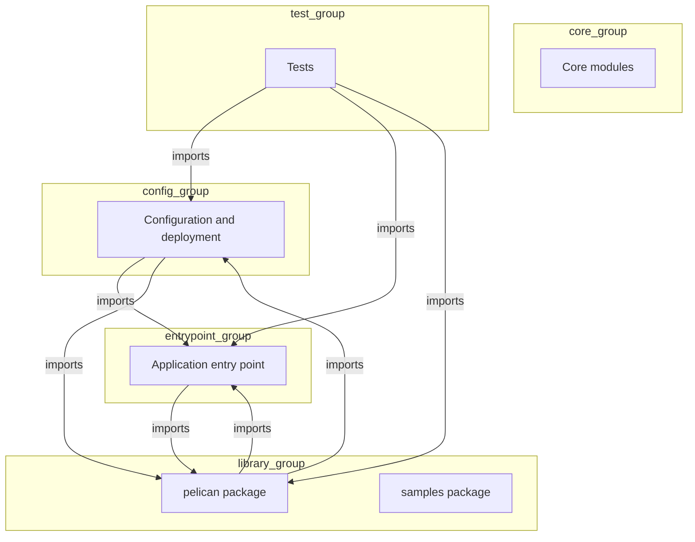

# Architecture report: getpelican/pelican

> Automated static analysis. **Observed** = directly seen in files/imports/AST; **Inferred** = interpretation from that evidence. Repository code was not executed.

## 1. Repository at a glance

| Item | Value |
| --- | --- |
| Repository | getpelican/pelican |
| Description | Static site generator that supports Markdown and reST syntax. Powered by Python. |
| Language | Python |
| Stars | 13374 |
| Licence | AGPL-3.0 |
| Analysed commit / branch | e8748aba9ad0907a8801646e957b37a02709240d / main |
| Framework(s) | None detected |
| Files analysed | 448 |
| Components | 6 |

## 2. Architecture in one minute

getpelican/pelican - Static site generator that supports Markdown and reST syntax. Powered by Python.. This repository was analysed statically from 448 file(s) (54 Python). Detected technologies (observed from imports/manifests): GitHub Actions, Poetry, pytest, unittest. Files are grouped into 6 component(s): Configuration and deployment, Core modules, Application entry point, pelican package, samples package, Tests. Observed entry point(s): pelican/__main__.py, pelican/log.py, pelican/plugins/_utils.py. Findings below distinguish observed facts from inferred interpretation.

## 3. High-level block diagram

## 4. Main components

### Configuration and deployment (`config`)

- **Kind:** config
- **Status:** Observed
- **Confidence:** 0.85
- **Responsibility:** Groups 3 file(s) under configuration and deployment (observed from repository paths and static analysis). Observed top-level functions: _printf_s_to_format_field, configure_settings, get_jinja_environment, get_settings_from_file, get_settings_from_module, handle_deprecated_settings.
- **Paths:** `pelican/settings.py`, `pyproject.toml`, `tox.ini`
- **Evidence:** [pelican/settings.py:18](https://github.com/getpelican/pelican/blob/e8748aba9ad0907a8801646e957b37a02709240d/pelican/settings.py#L18); [pyproject.toml](https://github.com/getpelican/pelican/blob/e8748aba9ad0907a8801646e957b37a02709240d/pyproject.toml); [tox.ini](https://github.com/getpelican/pelican/blob/e8748aba9ad0907a8801646e957b37a02709240d/tox.ini)

### Core modules (`core`)

- **Kind:** core
- **Status:** Observed
- **Confidence:** 0.85
- **Responsibility:** Groups 1 file(s) under core modules (observed from repository paths and static analysis). Observed top-level functions: coverage, docbuild, docserve, formatcode, lint, precommit.
- **Paths:** `tasks.py`
- **Evidence:** [tasks.py:24](https://github.com/getpelican/pelican/blob/e8748aba9ad0907a8801646e957b37a02709240d/tasks.py#L24)

### Application entry point (`entrypoint`)

- **Kind:** entrypoint
- **Status:** Observed
- **Confidence:** 0.85
- **Responsibility:** Groups 4 file(s) under application entry point (observed from repository paths and static analysis). Observed top-level classes: ComplexHTTPRequestHandler, FatalLogger, FilteredMessage, LimitFilter, LimitLogger, RootedHTTPServer. Observed top-level functions: ask, ask_timezone, init, log_warnings, main, parse_arguments.
- **Paths:** `pelican/__main__.py`, `pelican/log.py`, `pelican/server.py`, `pelican/tools/pelican_quickstart.py`
- **Evidence:** [pelican/__main__.py](https://github.com/getpelican/pelican/blob/e8748aba9ad0907a8801646e957b37a02709240d/pelican/__main__.py); [pelican/log.py:13](https://github.com/getpelican/pelican/blob/e8748aba9ad0907a8801646e957b37a02709240d/pelican/log.py#L13); [pelican/server.py:21](https://github.com/getpelican/pelican/blob/e8748aba9ad0907a8801646e957b37a02709240d/pelican/server.py#L21); [pelican/tools/pelican_quickstart.py:85](https://github.com/getpelican/pelican/blob/e8748aba9ad0907a8801646e957b37a02709240d/pelican/tools/pelican_quickstart.py#L85)

### pelican package (`pelican`)

- **Kind:** library
- **Status:** Observed
- **Confidence:** 0.85
- **Responsibility:** Groups 16 file(s) under pelican package (observed from repository paths and static analysis). Observed top-level classes: Article, ArticlesGenerator, Author, BaseReader, CachingGenerator, Category. Observed top-level functions: _filter_discardable_metadata, _get_tumblr_posts, _import_bs4, _process_if_nonempty, abbr_role, autoreload.
- **Paths:** `pelican/__init__.py`, `pelican/cache.py`, `pelican/contents.py`, `pelican/generators.py`, `pelican/paginator.py`, `pelican/plugins/_utils.py`, `pelican/plugins/signals.py`, `pelican/readers.py`, `pelican/rstdirectives.py`, `pelican/signals.py`, `pelican/tools/__init__.py`, `pelican/tools/pelican_import.py`, `pelican/tools/pelican_themes.py`, `pelican/urlwrappers.py`, `pelican/utils.py`, `pelican/writers.py`
- **Evidence:** [pelican/__init__.py:47](https://github.com/getpelican/pelican/blob/e8748aba9ad0907a8801646e957b37a02709240d/pelican/__init__.py#L47); [pelican/cache.py:12](https://github.com/getpelican/pelican/blob/e8748aba9ad0907a8801646e957b37a02709240d/pelican/cache.py#L12); [pelican/contents.py:38](https://github.com/getpelican/pelican/blob/e8748aba9ad0907a8801646e957b37a02709240d/pelican/contents.py#L38); [pelican/generators.py:38](https://github.com/getpelican/pelican/blob/e8748aba9ad0907a8801646e957b37a02709240d/pelican/generators.py#L38); [pelican/paginator.py:14](https://github.com/getpelican/pelican/blob/e8748aba9ad0907a8801646e957b37a02709240d/pelican/paginator.py#L14); [pelican/plugins/_utils.py:12](https://github.com/getpelican/pelican/blob/e8748aba9ad0907a8801646e957b37a02709240d/pelican/plugins/_utils.py#L12); [pelican/plugins/signals.py](https://github.com/getpelican/pelican/blob/e8748aba9ad0907a8801646e957b37a02709240d/pelican/plugins/signals.py); [pelican/readers.py:62](https://github.com/getpelican/pelican/blob/e8748aba9ad0907a8801646e957b37a02709240d/pelican/readers.py#L62)

### samples package (`samples`)

- **Kind:** library
- **Status:** Observed
- **Confidence:** 0.85
- **Responsibility:** Groups 2 file(s) under samples package (observed from repository paths and static analysis).
- **Paths:** `samples/pelican.conf.py`, `samples/pelican.conf_FR.py`
- **Evidence:** [samples/pelican.conf.py](https://github.com/getpelican/pelican/blob/e8748aba9ad0907a8801646e957b37a02709240d/samples/pelican.conf.py); [samples/pelican.conf_FR.py](https://github.com/getpelican/pelican/blob/e8748aba9ad0907a8801646e957b37a02709240d/samples/pelican.conf_FR.py)

### Tests (`tests`)

- **Kind:** test
- **Status:** Observed
- **Confidence:** 0.85
- **Responsibility:** Groups 281 file(s) under tests (observed from repository paths and static analysis). Observed routes: PATCH pelican.tools.pelican_import._get_tumblr_posts, PATCH pelican.tools.pelican_import._get_tumblr_posts, PATCH pelican.tools.pelican_import._get_tumblr_posts. Observed top-level classes: ClassDeprAttr, DefaultReaderTest, HTMLReaderTest, LogCountHandler, LoggedTestCase, MdReaderTest. Observed top-level functions: _path, can_symlink, diff_subproc, get_article, get_context, get_settings.
- **Paths:** `pelican/tests/TestPages/bad_page.rst`, `pelican/tests/TestPages/draft_page.rst`, `pelican/tests/TestPages/draft_page_markdown.md`, `pelican/tests/TestPages/draft_page_with_template.rst`, `pelican/tests/TestPages/hidden_page.rst`, `pelican/tests/TestPages/hidden_page_markdown.md`, `pelican/tests/TestPages/hidden_page_with_template.rst`, `pelican/tests/TestPages/page.rst`, `pelican/tests/TestPages/page_markdown.md`, `pelican/tests/TestPages/page_used_for_sorting_test.rst`, `pelican/tests/TestPages/page_with_category_and_tag_links.md`, `pelican/tests/TestPages/page_with_static_links.md`, `pelican/tests/TestPages/page_with_template.rst`, `pelican/tests/__init__.py`, `pelican/tests/build_test/conftest.py`, `pelican/tests/build_test/test_build_files.py`, `pelican/tests/content/2012-11-29_rst_w_filename_meta#foo-bar.rst`, `pelican/tests/content/2012-11-30_md_w_filename_meta#foo-bar.md`, `pelican/tests/content/TestCategory/article_with_category.rst`, `pelican/tests/content/TestCategory/article_without_category.rst`, `pelican/tests/content/article.rst`, `pelican/tests/content/article_draft.md`, `pelican/tests/content/article_hidden.md`, `pelican/tests/content/article_skip.md`, `pelican/tests/content/article_with_attributes_containing_double_quotes.html`, `pelican/tests/content/article_with_capitalized_metadata.rst`, `pelican/tests/content/article_with_code_block.rst`, `pelican/tests/content/article_with_comments.html`, `pelican/tests/content/article_with_duplicate_tags_authors.md`, `pelican/tests/content/article_with_inline_svg.html`, `pelican/tests/content/article_with_keywords.html`, `pelican/tests/content/article_with_markdown_and_empty_tags.md`, `pelican/tests/content/article_with_markdown_and_footnote.md`, `pelican/tests/content/article_with_markdown_and_nested_metadata.md`, `pelican/tests/content/article_with_markdown_and_nonascii_summary.md`, `pelican/tests/content/article_with_markdown_and_summary_metadata_multi.md`, `pelican/tests/content/article_with_markdown_and_summary_metadata_single.md`, `pelican/tests/content/article_with_markdown_extension.markdown`, `pelican/tests/content/article_with_markdown_markup_extensions.md`, `pelican/tests/content/article_with_md_extension.md`, `pelican/tests/content/article_with_mdown_extension.mdown`, `pelican/tests/content/article_with_metadata.html`, `pelican/tests/content/article_with_metadata.rst`, `pelican/tests/content/article_with_metadata.unknownextension`, `pelican/tests/content/article_with_metadata_and_contents.html`, `pelican/tests/content/article_with_metadata_explicit_date_implicit_modified.html`, `pelican/tests/content/article_with_metadata_explicit_dates.html`, `pelican/tests/content/article_with_metadata_implicit_date_explicit_modified.html`, `pelican/tests/content/article_with_metadata_implicit_dates.html`, `pelican/tests/content/article_with_mkd_extension.mkd`, `pelican/tests/content/article_with_multiple_authors.html`, `pelican/tests/content/article_with_multiple_authors.rst`, `pelican/tests/content/article_with_multiple_authors_list.rst`, `pelican/tests/content/article_with_multiple_authors_semicolon.rst`, `pelican/tests/content/article_with_multiple_metadata_tags.html`, `pelican/tests/content/article_with_nonconformant_meta_tags.html`, `pelican/tests/content/article_with_null_attributes.html`, `pelican/tests/content/article_with_template.rst`, `pelican/tests/content/article_with_typogrify_dashes.md`, `pelican/tests/content/article_with_typogrify_dashes.rst`, `pelican/tests/content/article_with_uppercase_metadata.html`, `pelican/tests/content/article_with_uppercase_metadata.rst`, `pelican/tests/content/article_without_category.rst`, `pelican/tests/content/bad_extension.mmd`, `pelican/tests/content/bloggerexport.xml`, `pelican/tests/content/empty.md`, `pelican/tests/content/empty_with_bom.md`, `pelican/tests/content/medium_post_content.txt`, `pelican/tests/content/medium_posts/2017-04-21_-medium-post--d1bf01d62ba3.html`, `pelican/tests/content/wordpress_content_decoded`, `pelican/tests/content/wordpress_content_encoded`, `pelican/tests/content/wordpressexport.xml`, `pelican/tests/cyclic_intersite_links/first-article.rst`, `pelican/tests/cyclic_intersite_links/second-article.rst`, `pelican/tests/cyclic_intersite_links/third-article.rst`, `pelican/tests/default_conf.py`, `pelican/tests/dummy_plugins/namespace_plugin/pelican/plugins/ns_plugin/__init__.py`, `pelican/tests/dummy_plugins/normal_plugin/normal_plugin/__init__.py`, `pelican/tests/dummy_plugins/normal_plugin/normal_plugin/submodule.py`, `pelican/tests/dummy_plugins/normal_plugin/normal_submodule_plugin/__init__.py`, `pelican/tests/dummy_plugins/normal_plugin/normal_submodule_plugin/subpackage/__init__.py`, `pelican/tests/dummy_plugins/normal_plugin/normal_submodule_plugin/subpackage/subpackage.py`, `pelican/tests/dummy_plugins/normal_plugin/normal_submodule_plugin/subplugin.py`, `pelican/tests/mixed_content/short_page.md`, `pelican/tests/nested_content/maindir/maindir.md`, `pelican/tests/nested_content/maindir/subdir/subdir.md`, `pelican/tests/output/basic/a-markdown-powered-article.html`, `pelican/tests/output/basic/archives.html`, `pelican/tests/output/basic/article-1.html`, `pelican/tests/output/basic/article-2.html`, `pelican/tests/output/basic/article-3.html`, `pelican/tests/output/basic/author/alexis-metaireau.html`, `pelican/tests/output/basic/authors.html`, `pelican/tests/output/basic/categories.html`, `pelican/tests/output/basic/category/bar.html`, `pelican/tests/output/basic/category/cat1.html`, `pelican/tests/output/basic/category/misc.html`, `pelican/tests/output/basic/category/yeah.html`, `pelican/tests/output/basic/drafts/a-draft-article-without-date.html`, `pelican/tests/output/basic/drafts/a-draft-article.html`, `pelican/tests/output/basic/feeds/alexis-metaireau.atom.xml`, `pelican/tests/output/basic/feeds/alexis-metaireau.rss.xml`, `pelican/tests/output/basic/feeds/all-en.atom.xml`, `pelican/tests/output/basic/feeds/all-fr.atom.xml`, `pelican/tests/output/basic/feeds/all.atom.xml`, `pelican/tests/output/basic/feeds/bar.atom.xml`, `pelican/tests/output/basic/feeds/cat1.atom.xml`, `pelican/tests/output/basic/feeds/misc.atom.xml`, `pelican/tests/output/basic/feeds/yeah.atom.xml`, `pelican/tests/output/basic/filename_metadata-example.html`, `pelican/tests/output/basic/index.html`, `pelican/tests/output/basic/oh-yeah-fr.html`, `pelican/tests/output/basic/oh-yeah.html`, `pelican/tests/output/basic/override/index.html`, `pelican/tests/output/basic/pages/this-is-a-test-hidden-page.html`, `pelican/tests/output/basic/pages/this-is-a-test-page.html`, `pelican/tests/output/basic/second-article-fr.html`, `pelican/tests/output/basic/second-article.html`, `pelican/tests/output/basic/tag/bar.html`, `pelican/tests/output/basic/tag/baz.html`, `pelican/tests/output/basic/tag/foo.html`, `pelican/tests/output/basic/tag/foobar.html`, `pelican/tests/output/basic/tag/oh.html`, `pelican/tests/output/basic/tag/yeah.html`, `pelican/tests/output/basic/tags.html`, `pelican/tests/output/basic/theme/css/fonts.css`, `pelican/tests/output/basic/theme/css/main.css`, `pelican/tests/output/basic/theme/css/pygment.css`, `pelican/tests/output/basic/theme/css/reset.css`, `pelican/tests/output/basic/theme/css/typogrify.css`, `pelican/tests/output/basic/theme/css/wide.css`, `pelican/tests/output/basic/theme/fonts/Yanone_Kaffeesatz_400.svg`, `pelican/tests/output/basic/theme/fonts/Yanone_Kaffeesatz_LICENSE.txt`, `pelican/tests/output/basic/theme/fonts/font.css`, `pelican/tests/output/basic/this-is-a-super-article.html`, `pelican/tests/output/basic/unbelievable.html`, `pelican/tests/output/custom/a-markdown-powered-article.html`, `pelican/tests/output/custom/archives.html`, `pelican/tests/output/custom/article-1.html`, `pelican/tests/output/custom/article-2.html`, `pelican/tests/output/custom/article-3.html`, `pelican/tests/output/custom/author/alexis-metaireau.html`, `pelican/tests/output/custom/author/alexis-metaireau2.html`, `pelican/tests/output/custom/author/alexis-metaireau3.html`, `pelican/tests/output/custom/authors.html`, `pelican/tests/output/custom/categories.html`, `pelican/tests/output/custom/category/bar.html`, `pelican/tests/output/custom/category/cat1.html`, `pelican/tests/output/custom/category/misc.html`, `pelican/tests/output/custom/category/yeah.html`, `pelican/tests/output/custom/drafts/a-draft-article-without-date.html`, `pelican/tests/output/custom/drafts/a-draft-article.html`, `pelican/tests/output/custom/feeds/alexis-metaireau.atom.xml`, `pelican/tests/output/custom/feeds/alexis-metaireau.rss.xml`, `pelican/tests/output/custom/feeds/all-en.atom.xml`, `pelican/tests/output/custom/feeds/all-fr.atom.xml`, `pelican/tests/output/custom/feeds/all.atom.xml`, `pelican/tests/output/custom/feeds/all.rss.xml`, `pelican/tests/output/custom/feeds/bar.atom.xml`, `pelican/tests/output/custom/feeds/bar.rss.xml`, `pelican/tests/output/custom/feeds/cat1.atom.xml`, `pelican/tests/output/custom/feeds/cat1.rss.xml`, `pelican/tests/output/custom/feeds/misc.atom.xml`, `pelican/tests/output/custom/feeds/misc.rss.xml`, `pelican/tests/output/custom/feeds/yeah.atom.xml`, `pelican/tests/output/custom/feeds/yeah.rss.xml`, `pelican/tests/output/custom/filename_metadata-example.html`, `pelican/tests/output/custom/index.html`, `pelican/tests/output/custom/index2.html`, `pelican/tests/output/custom/index3.html`, `pelican/tests/output/custom/jinja2_template.html`, `pelican/tests/output/custom/oh-yeah-fr.html`, `pelican/tests/output/custom/oh-yeah.html`, `pelican/tests/output/custom/override/index.html`, `pelican/tests/output/custom/pages/this-is-a-test-hidden-page.html`, `pelican/tests/output/custom/pages/this-is-a-test-page.html`, `pelican/tests/output/custom/robots.txt`, `pelican/tests/output/custom/second-article-fr.html`, `pelican/tests/output/custom/second-article.html`, `pelican/tests/output/custom/tag/bar.html`, `pelican/tests/output/custom/tag/baz.html`, `pelican/tests/output/custom/tag/foo.html`, `pelican/tests/output/custom/tag/foobar.html`, `pelican/tests/output/custom/tag/oh.html`, `pelican/tests/output/custom/tag/yeah.html`, `pelican/tests/output/custom/tags.html`, `pelican/tests/output/custom/theme/css/fonts.css`, `pelican/tests/output/custom/theme/css/main.css`, `pelican/tests/output/custom/theme/css/pygment.css`, `pelican/tests/output/custom/theme/css/reset.css`, `pelican/tests/output/custom/theme/css/typogrify.css`, `pelican/tests/output/custom/theme/css/wide.css`, `pelican/tests/output/custom/theme/fonts/Yanone_Kaffeesatz_400.svg`, `pelican/tests/output/custom/theme/fonts/Yanone_Kaffeesatz_LICENSE.txt`, `pelican/tests/output/custom/theme/fonts/font.css`, `pelican/tests/output/custom/this-is-a-super-article.html`, `pelican/tests/output/custom/unbelievable.html`, `pelican/tests/output/custom_locale/archives.html`, `pelican/tests/output/custom_locale/author/alexis-metaireau.html`, `pelican/tests/output/custom_locale/author/alexis-metaireau2.html`, `pelican/tests/output/custom_locale/author/alexis-metaireau3.html`, `pelican/tests/output/custom_locale/authors.html`, `pelican/tests/output/custom_locale/categories.html`, `pelican/tests/output/custom_locale/category/bar.html`, `pelican/tests/output/custom_locale/category/cat1.html`, `pelican/tests/output/custom_locale/category/misc.html`, `pelican/tests/output/custom_locale/category/yeah.html`, `pelican/tests/output/custom_locale/drafts/a-draft-article-without-date.html`, `pelican/tests/output/custom_locale/drafts/a-draft-article.html`, `pelican/tests/output/custom_locale/feeds/alexis-metaireau.atom.xml`, `pelican/tests/output/custom_locale/feeds/alexis-metaireau.rss.xml`, `pelican/tests/output/custom_locale/feeds/all-en.atom.xml`, `pelican/tests/output/custom_locale/feeds/all-fr.atom.xml`, `pelican/tests/output/custom_locale/feeds/all.atom.xml`, `pelican/tests/output/custom_locale/feeds/all.rss.xml`, `pelican/tests/output/custom_locale/feeds/bar.atom.xml`, `pelican/tests/output/custom_locale/feeds/bar.rss.xml`, `pelican/tests/output/custom_locale/feeds/cat1.atom.xml`, `pelican/tests/output/custom_locale/feeds/cat1.rss.xml`, `pelican/tests/output/custom_locale/feeds/misc.atom.xml`, `pelican/tests/output/custom_locale/feeds/misc.rss.xml`, `pelican/tests/output/custom_locale/feeds/yeah.atom.xml`, `pelican/tests/output/custom_locale/feeds/yeah.rss.xml`, `pelican/tests/output/custom_locale/index.html`, `pelican/tests/output/custom_locale/index2.html`, `pelican/tests/output/custom_locale/index3.html`, `pelican/tests/output/custom_locale/jinja2_template.html`, `pelican/tests/output/custom_locale/oh-yeah-fr.html`, `pelican/tests/output/custom_locale/override/index.html`, `pelican/tests/output/custom_locale/pages/this-is-a-test-hidden-page.html`, `pelican/tests/output/custom_locale/pages/this-is-a-test-page.html`, `pelican/tests/output/custom_locale/posts/2010/décembre/02/this-is-a-super-article/index.html`, `pelican/tests/output/custom_locale/posts/2010/octobre/15/unbelievable/index.html`, `pelican/tests/output/custom_locale/posts/2010/octobre/20/oh-yeah/index.html`, `pelican/tests/output/custom_locale/posts/2011/avril/20/a-markdown-powered-article/index.html`, `pelican/tests/output/custom_locale/posts/2011/février/17/article-1/index.html`, `pelican/tests/output/custom_locale/posts/2011/février/17/article-2/index.html`, `pelican/tests/output/custom_locale/posts/2011/février/17/article-3/index.html`, `pelican/tests/output/custom_locale/posts/2012/février/29/second-article/index.html`, `pelican/tests/output/custom_locale/posts/2012/novembre/30/filename_metadata-example/index.html`, `pelican/tests/output/custom_locale/robots.txt`, `pelican/tests/output/custom_locale/second-article-fr.html`, `pelican/tests/output/custom_locale/tag/bar.html`, `pelican/tests/output/custom_locale/tag/baz.html`, `pelican/tests/output/custom_locale/tag/foo.html`, `pelican/tests/output/custom_locale/tag/foobar.html`, `pelican/tests/output/custom_locale/tag/oh.html`, `pelican/tests/output/custom_locale/tag/yeah.html`, `pelican/tests/output/custom_locale/tags.html`, `pelican/tests/output/custom_locale/theme/css/fonts.css`, `pelican/tests/output/custom_locale/theme/css/main.css`, `pelican/tests/output/custom_locale/theme/css/pygment.css`, `pelican/tests/output/custom_locale/theme/css/reset.css`, `pelican/tests/output/custom_locale/theme/css/typogrify.css`, `pelican/tests/output/custom_locale/theme/css/wide.css`, `pelican/tests/output/custom_locale/theme/fonts/Yanone_Kaffeesatz_400.svg`, `pelican/tests/output/custom_locale/theme/fonts/Yanone_Kaffeesatz_LICENSE.txt`, `pelican/tests/output/custom_locale/theme/fonts/font.css`, `pelican/tests/parse_error/parse_error.rst`, `pelican/tests/support.py`, `pelican/tests/test_cache.py`, `pelican/tests/test_cli.py`, `pelican/tests/test_contents.py`, `pelican/tests/test_generators.py`, `pelican/tests/test_importer.py`, `pelican/tests/test_log.py`, `pelican/tests/test_paginator.py`, `pelican/tests/test_pelican.py`, `pelican/tests/test_plugins.py`, `pelican/tests/test_readers.py`, `pelican/tests/test_rstdirectives.py`, `pelican/tests/test_server.py`, `pelican/tests/test_settings.py`, `pelican/tests/test_testsuite.py`, `pelican/tests/test_theme.py`, `pelican/tests/test_urlwrappers.py`, `pelican/tests/test_utils.py`, `pelican/tests/theme_overrides/level1/article.html`, `pelican/tests/theme_overrides/level2/article.html`, `pelican/tests/theme_overrides/level2/authors.html`, `samples/content/pages/test_page.rst`
- **Evidence:** [pelican/tests/TestPages/bad_page.rst](https://github.com/getpelican/pelican/blob/e8748aba9ad0907a8801646e957b37a02709240d/pelican/tests/TestPages/bad_page.rst); [pelican/tests/TestPages/draft_page.rst](https://github.com/getpelican/pelican/blob/e8748aba9ad0907a8801646e957b37a02709240d/pelican/tests/TestPages/draft_page.rst); [pelican/tests/TestPages/draft_page_markdown.md](https://github.com/getpelican/pelican/blob/e8748aba9ad0907a8801646e957b37a02709240d/pelican/tests/TestPages/draft_page_markdown.md); [pelican/tests/TestPages/draft_page_with_template.rst](https://github.com/getpelican/pelican/blob/e8748aba9ad0907a8801646e957b37a02709240d/pelican/tests/TestPages/draft_page_with_template.rst); [pelican/tests/TestPages/hidden_page.rst](https://github.com/getpelican/pelican/blob/e8748aba9ad0907a8801646e957b37a02709240d/pelican/tests/TestPages/hidden_page.rst); [pelican/tests/TestPages/hidden_page_markdown.md](https://github.com/getpelican/pelican/blob/e8748aba9ad0907a8801646e957b37a02709240d/pelican/tests/TestPages/hidden_page_markdown.md); [pelican/tests/TestPages/hidden_page_with_template.rst](https://github.com/getpelican/pelican/blob/e8748aba9ad0907a8801646e957b37a02709240d/pelican/tests/TestPages/hidden_page_with_template.rst); [pelican/tests/TestPages/page.rst](https://github.com/getpelican/pelican/blob/e8748aba9ad0907a8801646e957b37a02709240d/pelican/tests/TestPages/page.rst)

## 5. Execution flow

**Observed** entry point(s):

- [pelican/__main__.py](https://github.com/getpelican/pelican/blob/e8748aba9ad0907a8801646e957b37a02709240d/pelican/__main__.py)
- [pelican/log.py:162](https://github.com/getpelican/pelican/blob/e8748aba9ad0907a8801646e957b37a02709240d/pelican/log.py#L162)
- [pelican/plugins/_utils.py](https://github.com/getpelican/pelican/blob/e8748aba9ad0907a8801646e957b37a02709240d/pelican/plugins/_utils.py)
- [pelican/server.py:140](https://github.com/getpelican/pelican/blob/e8748aba9ad0907a8801646e957b37a02709240d/pelican/server.py#L140)
- [pelican/tools/pelican_import.py](https://github.com/getpelican/pelican/blob/e8748aba9ad0907a8801646e957b37a02709240d/pelican/tools/pelican_import.py)
- [pelican/tools/pelican_quickstart.py](https://github.com/getpelican/pelican/blob/e8748aba9ad0907a8801646e957b37a02709240d/pelican/tools/pelican_quickstart.py)
- [pelican/tools/pelican_themes.py](https://github.com/getpelican/pelican/blob/e8748aba9ad0907a8801646e957b37a02709240d/pelican/tools/pelican_themes.py)

**Observed** routes (from decorators):

- `PATCH pelican.tools.pelican_import._get_tumblr_posts` -> `test_posts` in `pelican/tests/test_importer.py:554`
- `PATCH pelican.tools.pelican_import._get_tumblr_posts` -> `test_video_embed` in `pelican/tests/test_importer.py:605`
- `PATCH pelican.tools.pelican_import._get_tumblr_posts` -> `test_broken_video_embed` in `pelican/tests/test_importer.py:659`

Representative flow (derived from observed entry points and the import graph; steps beyond the entry point are **Inferred**):

1. Execution starts at an observed entry point listed above, if present.
2. `config` imports `entrypoint` (Configuration and deployment -> Application entry point).
3. `config` imports `pelican` (Configuration and deployment -> pelican package).
4. `entrypoint` imports `pelican` (Application entry point -> pelican package).
5. `pelican` imports `config` (pelican package -> Configuration and deployment).
6. `pelican` imports `entrypoint` (pelican package -> Application entry point).
7. `tests` imports `config` (Tests -> Configuration and deployment).
8. `tests` imports `entrypoint` (Tests -> Application entry point).
9. `tests` imports `pelican` (Tests -> pelican package).

## 6. Project structure

### `(root)`

- `.coveragerc` - other (65 bytes)
- `.editorconfig` - config (208 bytes)
- `.git-blame-ignore-revs` - other (914 bytes)
- `.gitattributes` - other (450 bytes)
- `.gitignore` - other (234 bytes)
- `.mailmap` - other (1208 bytes)
- `.pre-commit-config.yaml` - config (772 bytes)
- `.readthedocs.yaml` - config (566 bytes)
- `.vale.ini` - config (142 bytes)
- `CONTRIBUTING.rst` - docs (11048 bytes)
- `LICENSE` - docs (34527 bytes)
- `README.rst` - docs (3157 bytes)
- `THANKS` - other (2954 bytes)
- `pyproject.toml` - manifest (7664 bytes)
- `tasks.py` - source, Python (3476 bytes)
- `tox.ini` - config (626 bytes)

### `.github`

- `.github/CODEOWNERS` - other (42 bytes)
- `.github/FUNDING.yml` - config (82 bytes)
- `.github/ISSUE_TEMPLATE/---bug-report.md` - docs (2295 bytes)
- `.github/ISSUE_TEMPLATE/---documentation.md` - docs (775 bytes)
- `.github/ISSUE_TEMPLATE/---enhancement-request.md` - docs (969 bytes)
- `.github/ISSUE_TEMPLATE/config.yml` - config (548 bytes)
- `.github/copilot-instructions.md` - docs (395 bytes)
- `.github/dependabot.yml` - config (286 bytes)
- `.github/pull_request_template.md` - docs (1322 bytes)
- `.github/stale.yml` - config (1013 bytes)
- `.github/workflows/github_pages.yml` - ci, YAML (5243 bytes)
- `.github/workflows/main.yml` - ci, YAML (3868 bytes)

### `docs`

- `docs/Makefile` - docs (4598 bytes)
- `docs/_static/pelican-logo.svg` - docs (4387 bytes)
- `docs/_static/theme_overrides.css` - docs (335 bytes)
- `docs/_templates/page.html` - docs (12619 bytes)
- `docs/changelog.rst` - docs (27503 bytes)
- `docs/conf.py` - docs (2660 bytes)
- `docs/content.rst` - docs (26507 bytes)
- `docs/contribute.rst` - docs (11113 bytes)
- `docs/faq.rst` - docs (13117 bytes)
- `docs/importer.rst` - docs (5847 bytes)
- `docs/index.rst` - docs (2067 bytes)
- `docs/install.rst` - docs (5629 bytes)
- `docs/internals.rst` - docs (4295 bytes)
- `docs/locale/zh_CN/LC_MESSAGES/changelog.po` - docs (58803 bytes)
- `docs/locale/zh_CN/LC_MESSAGES/content.po` - docs (53292 bytes)
- `docs/locale/zh_CN/LC_MESSAGES/contribute.po` - docs (35093 bytes)
- `docs/locale/zh_CN/LC_MESSAGES/faq.po` - docs (26154 bytes)
- `docs/locale/zh_CN/LC_MESSAGES/importer.po` - docs (12596 bytes)
- `docs/locale/zh_CN/LC_MESSAGES/index.po` - docs (5116 bytes)
- `docs/locale/zh_CN/LC_MESSAGES/install.po` - docs (13873 bytes)
- `docs/locale/zh_CN/LC_MESSAGES/internals.po` - docs (8523 bytes)
- `docs/locale/zh_CN/LC_MESSAGES/pelican-themes.po` - docs (8307 bytes)
- `docs/locale/zh_CN/LC_MESSAGES/plugins.po` - docs (29303 bytes)
- `docs/locale/zh_CN/LC_MESSAGES/publish.po` - docs (16011 bytes)
- `docs/locale/zh_CN/LC_MESSAGES/quickstart.po` - docs (6268 bytes)
- `docs/locale/zh_CN/LC_MESSAGES/report.po` - docs (12709 bytes)
- `docs/locale/zh_CN/LC_MESSAGES/settings.po` - docs (108854 bytes)
- `docs/locale/zh_CN/LC_MESSAGES/sphinx.po` - docs (1964 bytes)
- `docs/locale/zh_CN/LC_MESSAGES/themes.po` - docs (48037 bytes)
- `docs/locale/zh_CN/LC_MESSAGES/tips.po` - docs (33901 bytes)
- `docs/pelican-themes.rst` - docs (5111 bytes)
- `docs/plugins.rst` - docs (16806 bytes)
- `docs/publish.rst` - docs (7411 bytes)
- `docs/quickstart.rst` - docs (2508 bytes)
- `docs/report.rst` - docs (5254 bytes)
- `docs/settings.rst` - docs (54471 bytes)
- `docs/themes.rst` - docs (27603 bytes)
- `docs/tips.rst` - docs (19365 bytes)

### `pelican`

- `pelican/__init__.py` - source, Python (22394 bytes)
- `pelican/__main__.py` - source, Python (125 bytes)
- `pelican/cache.py` - source, Python (5228 bytes)
- `pelican/contents.py` - source, Python (26559 bytes)
- `pelican/generators.py` - source, Python (44671 bytes)
- `pelican/log.py` - source, Python (4806 bytes)
- `pelican/paginator.py` - source, Python (5551 bytes)
- `pelican/plugins/_utils.py` - source, Python (4466 bytes)
- `pelican/plugins/signals.py` - source, Python (1839 bytes)
- `pelican/readers.py` - source, Python (29801 bytes)
- `pelican/rstdirectives.py` - source, Python (3018 bytes)
- `pelican/server.py` - source, Python (6066 bytes)
- `pelican/settings.py` - source, Python (26797 bytes)
- `pelican/signals.py` - source, Python (161 bytes)
- `pelican/tests/TestPages/bad_page.rst` - test (177 bytes)
- `pelican/tests/TestPages/draft_page.rst` - test (115 bytes)
- `pelican/tests/TestPages/draft_page_markdown.md` - test (199 bytes)
- `pelican/tests/TestPages/draft_page_with_template.rst` - test (238 bytes)
- `pelican/tests/TestPages/hidden_page.rst` - test (146 bytes)
- `pelican/tests/TestPages/hidden_page_markdown.md` - test (231 bytes)
- `pelican/tests/TestPages/hidden_page_with_template.rst` - test (270 bytes)
- `pelican/tests/TestPages/page.rst` - test (94 bytes)
- `pelican/tests/TestPages/page_markdown.md` - test (188 bytes)
- `pelican/tests/TestPages/page_used_for_sorting_test.rst` - test (134 bytes)
- `pelican/tests/TestPages/page_with_category_and_tag_links.md` - test (97 bytes)
- `pelican/tests/TestPages/page_with_static_links.md` - test (101 bytes)
- `pelican/tests/TestPages/page_with_template.rst` - test (222 bytes)
- `pelican/tests/__init__.py` - test, Python (461 bytes)
- `pelican/tests/build_test/conftest.py` - test, Python (168 bytes)
- `pelican/tests/build_test/test_build_files.py` - test, Python (2201 bytes)
- `pelican/tests/content/2012-11-29_rst_w_filename_meta#foo-bar.rst` - test (99 bytes)
- `pelican/tests/content/2012-11-30_md_w_filename_meta#foo-bar.md` - test (106 bytes)
- `pelican/tests/content/TestCategory/article_with_category.rst` - test (149 bytes)
- `pelican/tests/content/TestCategory/article_without_category.rst` - test (128 bytes)
- `pelican/tests/content/article.rst` - test (149 bytes)
- `pelican/tests/content/article_draft.md` - test (75 bytes)
- `pelican/tests/content/article_hidden.md` - test (86 bytes)
- `pelican/tests/content/article_skip.md` - test (89 bytes)
- `pelican/tests/content/article_with_attributes_containing_double_quotes.html` - test (409 bytes)
- `pelican/tests/content/article_with_capitalized_metadata.rst` - test (457 bytes)
- `pelican/tests/content/article_with_code_block.rst` - test (206 bytes)
- `pelican/tests/content/article_with_comments.html` - test (156 bytes)
- `pelican/tests/content/article_with_duplicate_tags_authors.md` - test (366 bytes)
- `pelican/tests/content/article_with_inline_svg.html` - test (1054 bytes)
- `pelican/tests/content/article_with_keywords.html` - test (147 bytes)
- `pelican/tests/content/article_with_markdown_and_empty_tags.md` - test (73 bytes)
- `pelican/tests/content/article_with_markdown_and_footnote.md` - test (568 bytes)
- `pelican/tests/content/article_with_markdown_and_nested_metadata.md` - test (152 bytes)
- `pelican/tests/content/article_with_markdown_and_nonascii_summary.md` - test (585 bytes)
- `pelican/tests/content/article_with_markdown_and_summary_metadata_multi.md` - test (316 bytes)
- `pelican/tests/content/article_with_markdown_and_summary_metadata_single.md` - test (178 bytes)
- `pelican/tests/content/article_with_markdown_extension.markdown` - test (206 bytes)
- `pelican/tests/content/article_with_markdown_markup_extensions.md` - test (62 bytes)
- `pelican/tests/content/article_with_md_extension.md` - test (290 bytes)
- `pelican/tests/content/article_with_mdown_extension.mdown` - test (200 bytes)
- `pelican/tests/content/article_with_metadata.html` - test (556 bytes)
- `pelican/tests/content/article_with_metadata.rst` - test (457 bytes)
- `pelican/tests/content/article_with_metadata.unknownextension` - test (269 bytes)
- `pelican/tests/content/article_with_metadata_and_contents.html` - test (562 bytes)
- `pelican/tests/content/article_with_metadata_explicit_date_implicit_modified.html` - test (556 bytes)
- `pelican/tests/content/article_with_metadata_explicit_dates.html` - test (616 bytes)
- `pelican/tests/content/article_with_metadata_implicit_date_explicit_modified.html` - test (560 bytes)
- `pelican/tests/content/article_with_metadata_implicit_dates.html` - test (500 bytes)
- `pelican/tests/content/article_with_mkd_extension.mkd` - test (196 bytes)
- `pelican/tests/content/article_with_multiple_authors.html` - test (173 bytes)
- `pelican/tests/content/article_with_multiple_authors.rst` - test (175 bytes)
- `pelican/tests/content/article_with_multiple_authors_list.rst` - test (319 bytes)
- `pelican/tests/content/article_with_multiple_authors_semicolon.rst` - test (237 bytes)
- `pelican/tests/content/article_with_multiple_metadata_tags.html` - test (347 bytes)
- `pelican/tests/content/article_with_nonconformant_meta_tags.html` - test (463 bytes)
- `pelican/tests/content/article_with_null_attributes.html` - test (167 bytes)
- `pelican/tests/content/article_with_template.rst` - test (181 bytes)
- `pelican/tests/content/article_with_typogrify_dashes.md` - test (69 bytes)
- `pelican/tests/content/article_with_typogrify_dashes.rst` - test (95 bytes)
- `pelican/tests/content/article_with_uppercase_metadata.html` - test (135 bytes)
- `pelican/tests/content/article_with_uppercase_metadata.rst` - test (70 bytes)
- `pelican/tests/content/article_without_category.rst` - test (126 bytes)
- `pelican/tests/content/bad_extension.mmd` - test (92 bytes)
- `pelican/tests/content/bloggerexport.xml` - test (72886 bytes)
- `pelican/tests/content/empty.md` - test (0 bytes)
- `pelican/tests/content/empty_with_bom.md` - test (4 bytes)
- `pelican/tests/content/medium_post_content.txt` - test (1275 bytes)
- `pelican/tests/content/medium_posts/2017-04-21_-medium-post--d1bf01d62ba3.html` - test (4471 bytes)
- `pelican/tests/content/wordpress_content_decoded` - test (3168 bytes)
- `pelican/tests/content/wordpress_content_encoded` - test (3141 bytes)
- `pelican/tests/content/wordpressexport.xml` - test (64148 bytes)
- `pelican/tests/cyclic_intersite_links/first-article.rst` - test (218 bytes)
- `pelican/tests/cyclic_intersite_links/second-article.rst` - test (218 bytes)
- `pelican/tests/cyclic_intersite_links/third-article.rst` - test (218 bytes)
- `pelican/tests/default_conf.py` - test, Python (1263 bytes)
- `pelican/tests/dummy_plugins/namespace_plugin/pelican/plugins/ns_plugin/__init__.py` - test, Python (53 bytes)
- `pelican/tests/dummy_plugins/normal_plugin/normal_plugin/__init__.py` - test, Python (69 bytes)
- `pelican/tests/dummy_plugins/normal_plugin/normal_plugin/submodule.py` - test, Python (21 bytes)
- `pelican/tests/dummy_plugins/normal_plugin/normal_submodule_plugin/__init__.py` - test, Python (0 bytes)
- `pelican/tests/dummy_plugins/normal_plugin/normal_submodule_plugin/subpackage/__init__.py` - test, Python (0 bytes)
- `pelican/tests/dummy_plugins/normal_plugin/normal_submodule_plugin/subpackage/subpackage.py` - test, Python (25 bytes)
- `pelican/tests/dummy_plugins/normal_plugin/normal_submodule_plugin/subplugin.py` - test, Python (25 bytes)
- `pelican/tests/mixed_content/short_page.md` - test (52 bytes)
- `pelican/tests/nested_content/maindir/maindir.md` - test (50 bytes)
- `pelican/tests/nested_content/maindir/subdir/subdir.md` - test (55 bytes)
- `pelican/tests/output/basic/a-markdown-powered-article.html` - test (4040 bytes)
- `pelican/tests/output/basic/archives.html` - test (4171 bytes)
- `pelican/tests/output/basic/article-1.html` - test (3633 bytes)
- `pelican/tests/output/basic/article-2.html` - test (3633 bytes)
- `pelican/tests/output/basic/article-3.html` - test (3633 bytes)
- `pelican/tests/output/basic/author/alexis-metaireau.html` - test (7383 bytes)
- `pelican/tests/output/basic/authors.html` - test (2753 bytes)
- `pelican/tests/output/basic/categories.html` - test (2987 bytes)
- `pelican/tests/output/basic/category/bar.html` - test (4152 bytes)
- `pelican/tests/output/basic/category/cat1.html` - test (7388 bytes)
- `pelican/tests/output/basic/category/misc.html` - test (9340 bytes)
- `pelican/tests/output/basic/category/yeah.html` - test (4748 bytes)
- `pelican/tests/output/basic/drafts/a-draft-article-without-date.html` - test (3928 bytes)
- `pelican/tests/output/basic/drafts/a-draft-article.html` - test (3885 bytes)
- `pelican/tests/output/basic/feeds/alexis-metaireau.atom.xml` - test (2285 bytes)
- `pelican/tests/output/basic/feeds/alexis-metaireau.rss.xml` - test (1598 bytes)
- `pelican/tests/output/basic/feeds/all-en.atom.xml` - test (21374 bytes)
- `pelican/tests/output/basic/feeds/all-fr.atom.xml` - test (1050 bytes)
- `pelican/tests/output/basic/feeds/all.atom.xml` - test (22169 bytes)
- `pelican/tests/output/basic/feeds/bar.atom.xml` - test (949 bytes)
- `pelican/tests/output/basic/feeds/cat1.atom.xml` - test (1819 bytes)
- `pelican/tests/output/basic/feeds/misc.atom.xml` - test (17814 bytes)
- `pelican/tests/output/basic/feeds/yeah.atom.xml` - test (1566 bytes)
- `pelican/tests/output/basic/filename_metadata-example.html` - test (3711 bytes)
- `pelican/tests/output/basic/index.html` - test (19142 bytes)
- `pelican/tests/output/basic/oh-yeah-fr.html` - test (3915 bytes)
- `pelican/tests/output/basic/oh-yeah.html` - test (4872 bytes)
- `pelican/tests/output/basic/override/index.html` - test (2776 bytes)
- `pelican/tests/output/basic/pages/this-is-a-test-hidden-page.html` - test (2778 bytes)
- `pelican/tests/output/basic/pages/this-is-a-test-page.html` - test (2934 bytes)
- `pelican/tests/output/basic/second-article-fr.html` - test (4068 bytes)
- `pelican/tests/output/basic/second-article.html` - test (4058 bytes)
- `pelican/tests/output/basic/tag/bar.html` - test (8350 bytes)
- `pelican/tests/output/basic/tag/baz.html` - test (3767 bytes)
- `pelican/tests/output/basic/tag/foo.html` - test (5999 bytes)
- `pelican/tests/output/basic/tag/foobar.html` - test (4735 bytes)
- `pelican/tests/output/basic/tag/oh.html` - test (2697 bytes)
- `pelican/tests/output/basic/tag/yeah.html` - test (4138 bytes)
- `pelican/tests/output/basic/tags.html` - test (3109 bytes)
- `pelican/tests/output/basic/theme/css/fonts.css` - test (536 bytes)
- `pelican/tests/output/basic/theme/css/main.css` - test (10282 bytes)
- `pelican/tests/output/basic/theme/css/pygment.css` - test (2166 bytes)
- `pelican/tests/output/basic/theme/css/reset.css` - test (1141 bytes)
- `pelican/tests/output/basic/theme/css/typogrify.css` - test (186 bytes)
- `pelican/tests/output/basic/theme/css/wide.css` - test (616 bytes)
- `pelican/tests/output/basic/theme/fonts/Yanone_Kaffeesatz_400.svg` - test (72626 bytes)
- `pelican/tests/output/basic/theme/fonts/Yanone_Kaffeesatz_LICENSE.txt` - test (4403 bytes)
- `pelican/tests/output/basic/theme/fonts/font.css` - test (518 bytes)
- `pelican/tests/output/basic/this-is-a-super-article.html` - test (5408 bytes)
- `pelican/tests/output/basic/unbelievable.html` - test (15421 bytes)
- `pelican/tests/output/custom/a-markdown-powered-article.html` - test (8289 bytes)
- `pelican/tests/output/custom/archives.html` - test (6837 bytes)
- `pelican/tests/output/custom/article-1.html` - test (7846 bytes)
- `pelican/tests/output/custom/article-2.html` - test (7846 bytes)
- `pelican/tests/output/custom/article-3.html` - test (7846 bytes)
- `pelican/tests/output/custom/author/alexis-metaireau.html` - test (12606 bytes)
- `pelican/tests/output/custom/author/alexis-metaireau2.html` - test (14086 bytes)
- `pelican/tests/output/custom/author/alexis-metaireau3.html` - test (10880 bytes)
- `pelican/tests/output/custom/authors.html` - test (5411 bytes)
- `pelican/tests/output/custom/categories.html` - test (5647 bytes)
- `pelican/tests/output/custom/category/bar.html` - test (6930 bytes)
- `pelican/tests/output/custom/category/cat1.html` - test (11707 bytes)
- `pelican/tests/output/custom/category/misc.html` - test (13696 bytes)
- `pelican/tests/output/custom/category/yeah.html` - test (7542 bytes)
- `pelican/tests/output/custom/drafts/a-draft-article-without-date.html` - test (6914 bytes)
- `pelican/tests/output/custom/drafts/a-draft-article.html` - test (6860 bytes)
- `pelican/tests/output/custom/feeds/alexis-metaireau.atom.xml` - test (22582 bytes)
- `pelican/tests/output/custom/feeds/alexis-metaireau.rss.xml` - test (7135 bytes)
- `pelican/tests/output/custom/feeds/all-en.atom.xml` - test (22552 bytes)
- `pelican/tests/output/custom/feeds/all-fr.atom.xml` - test (1283 bytes)
- `pelican/tests/output/custom/feeds/all.atom.xml` - test (23471 bytes)
- `pelican/tests/output/custom/feeds/all.rss.xml` - test (8028 bytes)
- `pelican/tests/output/custom/feeds/bar.atom.xml` - test (1122 bytes)
- `pelican/tests/output/custom/feeds/bar.rss.xml` - test (1138 bytes)
- `pelican/tests/output/custom/feeds/cat1.atom.xml` - test (2226 bytes)
- `pelican/tests/output/custom/feeds/cat1.rss.xml` - test (2233 bytes)
- `pelican/tests/output/custom/feeds/misc.atom.xml` - test (18541 bytes)
- `pelican/tests/output/custom/feeds/misc.rss.xml` - test (3879 bytes)
- `pelican/tests/output/custom/feeds/yeah.atom.xml` - test (1764 bytes)
- `pelican/tests/output/custom/feeds/yeah.rss.xml` - test (989 bytes)
- `pelican/tests/output/custom/filename_metadata-example.html` - test (7956 bytes)
- `pelican/tests/output/custom/index.html` - test (12514 bytes)
- `pelican/tests/output/custom/index2.html` - test (13953 bytes)
- `pelican/tests/output/custom/index3.html` - test (10801 bytes)
- `pelican/tests/output/custom/jinja2_template.html` - test (5124 bytes)
- `pelican/tests/output/custom/oh-yeah-fr.html` - test (8132 bytes)
- `pelican/tests/output/custom/oh-yeah.html` - test (8789 bytes)
- `pelican/tests/output/custom/override/index.html` - test (5447 bytes)
- `pelican/tests/output/custom/pages/this-is-a-test-hidden-page.html` - test (5449 bytes)
- `pelican/tests/output/custom/pages/this-is-a-test-page.html` - test (5607 bytes)
- `pelican/tests/output/custom/robots.txt` - test (34 bytes)
- `pelican/tests/output/custom/second-article-fr.html` - test (8302 bytes)
- `pelican/tests/output/custom/second-article.html` - test (8286 bytes)
- `pelican/tests/output/custom/tag/bar.html` - test (11643 bytes)
- `pelican/tests/output/custom/tag/baz.html` - test (7989 bytes)
- `pelican/tests/output/custom/tag/foo.html` - test (9180 bytes)
- `pelican/tests/output/custom/tag/foobar.html` - test (7529 bytes)
- `pelican/tests/output/custom/tag/oh.html` - test (5368 bytes)
- `pelican/tests/output/custom/tag/yeah.html` - test (6916 bytes)
- `pelican/tests/output/custom/tags.html` - test (5771 bytes)
- `pelican/tests/output/custom/theme/css/fonts.css` - test (536 bytes)
- `pelican/tests/output/custom/theme/css/main.css` - test (10282 bytes)
- `pelican/tests/output/custom/theme/css/pygment.css` - test (2166 bytes)
- `pelican/tests/output/custom/theme/css/reset.css` - test (1141 bytes)
- `pelican/tests/output/custom/theme/css/typogrify.css` - test (186 bytes)
- `pelican/tests/output/custom/theme/css/wide.css` - test (616 bytes)
- `pelican/tests/output/custom/theme/fonts/Yanone_Kaffeesatz_400.svg` - test (72626 bytes)
- `pelican/tests/output/custom/theme/fonts/Yanone_Kaffeesatz_LICENSE.txt` - test (4403 bytes)
- `pelican/tests/output/custom/theme/fonts/font.css` - test (518 bytes)
- `pelican/tests/output/custom/this-is-a-super-article.html` - test (9356 bytes)
- `pelican/tests/output/custom/unbelievable.html` - test (19816 bytes)
- `pelican/tests/output/custom_locale/archives.html` - test (6930 bytes)
- `pelican/tests/output/custom_locale/author/alexis-metaireau.html` - test (12792 bytes)
- `pelican/tests/output/custom_locale/author/alexis-metaireau2.html` - test (14261 bytes)
- `pelican/tests/output/custom_locale/author/alexis-metaireau3.html` - test (10923 bytes)
- `pelican/tests/output/custom_locale/authors.html` - test (5377 bytes)
- `pelican/tests/output/custom_locale/categories.html` - test (5613 bytes)
- `pelican/tests/output/custom_locale/category/bar.html` - test (6928 bytes)
- `pelican/tests/output/custom_locale/category/cat1.html` - test (11896 bytes)
- `pelican/tests/output/custom_locale/category/misc.html` - test (13826 bytes)
- `pelican/tests/output/custom_locale/category/yeah.html` - test (7541 bytes)
- `pelican/tests/output/custom_locale/drafts/a-draft-article-without-date.html` - test (6875 bytes)
- `pelican/tests/output/custom_locale/drafts/a-draft-article.html` - test (6822 bytes)
- `pelican/tests/output/custom_locale/feeds/alexis-metaireau.atom.xml` - test (22999 bytes)
- `pelican/tests/output/custom_locale/feeds/alexis-metaireau.rss.xml` - test (7528 bytes)
- `pelican/tests/output/custom_locale/feeds/all-en.atom.xml` - test (22969 bytes)
- `pelican/tests/output/custom_locale/feeds/all-fr.atom.xml` - test (1246 bytes)
- `pelican/tests/output/custom_locale/feeds/all.atom.xml` - test (23888 bytes)
- `pelican/tests/output/custom_locale/feeds/all.rss.xml` - test (8421 bytes)
- `pelican/tests/output/custom_locale/feeds/bar.atom.xml` - test (1121 bytes)
- `pelican/tests/output/custom_locale/feeds/bar.rss.xml` - test (1145 bytes)
- `pelican/tests/output/custom_locale/feeds/cat1.atom.xml` - test (2383 bytes)
- `pelican/tests/output/custom_locale/feeds/cat1.rss.xml` - test (2398 bytes)
- `pelican/tests/output/custom_locale/feeds/misc.atom.xml` - test (18684 bytes)
- `pelican/tests/output/custom_locale/feeds/misc.rss.xml` - test (3998 bytes)
- `pelican/tests/output/custom_locale/feeds/yeah.atom.xml` - test (1771 bytes)
- `pelican/tests/output/custom_locale/feeds/yeah.rss.xml` - test (1004 bytes)
- `pelican/tests/output/custom_locale/index.html` - test (12700 bytes)
- `pelican/tests/output/custom_locale/index2.html` - test (14128 bytes)
- `pelican/tests/output/custom_locale/index3.html` - test (10844 bytes)
- `pelican/tests/output/custom_locale/jinja2_template.html` - test (5090 bytes)
- `pelican/tests/output/custom_locale/oh-yeah-fr.html` - test (8130 bytes)
- `pelican/tests/output/custom_locale/override/index.html` - test (5413 bytes)
- `pelican/tests/output/custom_locale/pages/this-is-a-test-hidden-page.html` - test (5415 bytes)
- `pelican/tests/output/custom_locale/pages/this-is-a-test-page.html` - test (5573 bytes)
- `pelican/tests/output/custom_locale/posts/2010/décembre/02/this-is-a-super-article/index.html` - test (9609 bytes)
- `pelican/tests/output/custom_locale/posts/2010/octobre/15/unbelievable/index.html` - test (20059 bytes)
- `pelican/tests/output/custom_locale/posts/2010/octobre/20/oh-yeah/index.html` - test (9052 bytes)
- `pelican/tests/output/custom_locale/posts/2011/avril/20/a-markdown-powered-article/index.html` - test (8530 bytes)
- `pelican/tests/output/custom_locale/posts/2011/février/17/article-1/index.html` - test (8034 bytes)
- `pelican/tests/output/custom_locale/posts/2011/février/17/article-2/index.html` - test (8034 bytes)
- `pelican/tests/output/custom_locale/posts/2011/février/17/article-3/index.html` - test (8034 bytes)
- `pelican/tests/output/custom_locale/posts/2012/février/29/second-article/index.html` - test (8539 bytes)
- `pelican/tests/output/custom_locale/posts/2012/novembre/30/filename_metadata-example/index.html` - test (8144 bytes)
- `pelican/tests/output/custom_locale/robots.txt` - test (34 bytes)
- `pelican/tests/output/custom_locale/second-article-fr.html` - test (8302 bytes)
- `pelican/tests/output/custom_locale/tag/bar.html` - test (11746 bytes)
- `pelican/tests/output/custom_locale/tag/baz.html` - test (7950 bytes)
- `pelican/tests/output/custom_locale/tag/foo.html` - test (9233 bytes)
- `pelican/tests/output/custom_locale/tag/foobar.html` - test (7528 bytes)
- `pelican/tests/output/custom_locale/tag/oh.html` - test (5334 bytes)
- `pelican/tests/output/custom_locale/tag/yeah.html` - test (6914 bytes)
- `pelican/tests/output/custom_locale/tags.html` - test (5737 bytes)
- `pelican/tests/output/custom_locale/theme/css/fonts.css` - test (536 bytes)
- `pelican/tests/output/custom_locale/theme/css/main.css` - test (10282 bytes)
- `pelican/tests/output/custom_locale/theme/css/pygment.css` - test (2166 bytes)
- `pelican/tests/output/custom_locale/theme/css/reset.css` - test (1141 bytes)
- `pelican/tests/output/custom_locale/theme/css/typogrify.css` - test (186 bytes)
- `pelican/tests/output/custom_locale/theme/css/wide.css` - test (616 bytes)
- `pelican/tests/output/custom_locale/theme/fonts/Yanone_Kaffeesatz_400.svg` - test (72626 bytes)
- `pelican/tests/output/custom_locale/theme/fonts/Yanone_Kaffeesatz_LICENSE.txt` - test (4403 bytes)
- `pelican/tests/output/custom_locale/theme/fonts/font.css` - test (518 bytes)
- `pelican/tests/parse_error/parse_error.rst` - test (67 bytes)
- `pelican/tests/support.py` - test, Python (7270 bytes)
- `pelican/tests/test_cache.py` - test, Python (12381 bytes)
- `pelican/tests/test_cli.py` - test, Python (2804 bytes)
- `pelican/tests/test_contents.py` - test, Python (46027 bytes)
- `pelican/tests/test_generators.py` - test, Python (65072 bytes)
- `pelican/tests/test_importer.py` - test, Python (28072 bytes)
- `pelican/tests/test_log.py` - test, Python (4525 bytes)
- `pelican/tests/test_paginator.py` - test, Python (4048 bytes)
- `pelican/tests/test_pelican.py` - test, Python (12649 bytes)
- `pelican/tests/test_plugins.py` - test, Python (11455 bytes)
- `pelican/tests/test_readers.py` - test, Python (45518 bytes)
- `pelican/tests/test_rstdirectives.py` - test, Python (1048 bytes)
- `pelican/tests/test_server.py` - test, Python (2466 bytes)
- `pelican/tests/test_settings.py` - test, Python (15788 bytes)
- `pelican/tests/test_testsuite.py` - test, Python (240 bytes)
- `pelican/tests/test_theme.py` - test, Python (12240 bytes)
- `pelican/tests/test_urlwrappers.py` - test, Python (3409 bytes)
- `pelican/tests/test_utils.py` - test, Python (41530 bytes)
- `pelican/tests/theme_overrides/level1/article.html` - test (99 bytes)
- `pelican/tests/theme_overrides/level2/article.html` - test (99 bytes)
- `pelican/tests/theme_overrides/level2/authors.html` - test (99 bytes)
- `pelican/themes/notmyidea/static/css/fonts.css` - other (536 bytes)
- `pelican/themes/notmyidea/static/css/main.css` - other (10282 bytes)
- `pelican/themes/notmyidea/static/css/pygment.css` - other (2166 bytes)
- `pelican/themes/notmyidea/static/css/reset.css` - other (1141 bytes)
- `pelican/themes/notmyidea/static/css/typogrify.css` - other (186 bytes)
- `pelican/themes/notmyidea/static/css/wide.css` - other (616 bytes)
- `pelican/themes/notmyidea/static/fonts/Yanone_Kaffeesatz_400.svg` - other (72626 bytes)
- `pelican/themes/notmyidea/static/fonts/Yanone_Kaffeesatz_LICENSE.txt` - docs (4403 bytes)
- `pelican/themes/notmyidea/static/fonts/font.css` - other (518 bytes)
- `pelican/themes/notmyidea/templates/analytics.html` - other (51 bytes)
- `pelican/themes/notmyidea/templates/archives.html` - other (395 bytes)
- `pelican/themes/notmyidea/templates/article.html` - other (1936 bytes)
- `pelican/themes/notmyidea/templates/article_infos.html` - other (1165 bytes)
- `pelican/themes/notmyidea/templates/author.html` - other (98 bytes)
- `pelican/themes/notmyidea/templates/authors.html` - other (442 bytes)
- `pelican/themes/notmyidea/templates/base.html` - other (5611 bytes)
- `pelican/themes/notmyidea/templates/categories.html` - other (518 bytes)
- `pelican/themes/notmyidea/templates/category.html` - other (100 bytes)
- `pelican/themes/notmyidea/templates/comments.html` - other (122 bytes)
- `pelican/themes/notmyidea/templates/disqus_script.html` - other (481 bytes)
- `pelican/themes/notmyidea/templates/github.html` - other (596 bytes)
- `pelican/themes/notmyidea/templates/index.html` - other (2809 bytes)
- `pelican/themes/notmyidea/templates/page.html` - other (613 bytes)
- `pelican/themes/notmyidea/templates/period_archives.html` - other (415 bytes)
- `pelican/themes/notmyidea/templates/tag.html` - other (95 bytes)
- `pelican/themes/notmyidea/templates/taglist.html` - other (148 bytes)
- `pelican/themes/notmyidea/templates/tags.html` - other (425 bytes)
- `pelican/themes/notmyidea/templates/translations.html` - other (562 bytes)
- `pelican/themes/notmyidea/templates/twitter.html` - other (274 bytes)
- `pelican/themes/simple/templates/archives.html` - other (381 bytes)
- `pelican/themes/simple/templates/article.html` - other (2074 bytes)
- `pelican/themes/simple/templates/author.html` - other (191 bytes)
- `pelican/themes/simple/templates/authors.html` - other (361 bytes)
- `pelican/themes/simple/templates/base.html` - other (4653 bytes)
- `pelican/themes/simple/templates/categories.html` - other (436 bytes)
- `pelican/themes/simple/templates/category.html` - other (205 bytes)
- `pelican/themes/simple/templates/index.html` - other (1060 bytes)
- `pelican/themes/simple/templates/page.html` - other (836 bytes)
- `pelican/themes/simple/templates/pagination.html` - other (721 bytes)
- `pelican/themes/simple/templates/period_archives.html` - other (436 bytes)
- `pelican/themes/simple/templates/tag.html` - other (186 bytes)
- `pelican/themes/simple/templates/tags.html` - other (344 bytes)
- `pelican/themes/simple/templates/translations.html` - other (562 bytes)
- `pelican/tools/__init__.py` - source, Python (0 bytes)
- `pelican/tools/pelican_import.py` - source, Python (44868 bytes)
- `pelican/tools/pelican_quickstart.py` - source, Python (12082 bytes)
- `pelican/tools/pelican_themes.py` - source, Python (8383 bytes)
- `pelican/tools/templates/Makefile.jinja2` - other (5525 bytes)
- `pelican/tools/templates/pelicanconf.py.jinja2` - other (801 bytes)
- `pelican/tools/templates/publishconf.py.jinja2` - other (515 bytes)
- `pelican/tools/templates/tasks.py.jinja2` - other (5216 bytes)
- `pelican/urlwrappers.py` - source, Python (4554 bytes)
- `pelican/utils.py` - source, Python (33661 bytes)
- `pelican/writers.py` - source, Python (11711 bytes)

### `requirements`

- `requirements/developer.pip` - other (24 bytes)
- `requirements/docs.pip` - other (66 bytes)
- `requirements/owner.pip` - other (47 bytes)
- `requirements/test.pip` - other (131 bytes)

### `samples`

- `samples/content/2012-11-30_filename-metadata.rst` - docs (70 bytes)
- `samples/content/another_super_article-fr.rst` - docs (108 bytes)
- `samples/content/another_super_article.rst` - docs (381 bytes)
- `samples/content/article2-fr.rst` - docs (143 bytes)
- `samples/content/article2.rst` - docs (136 bytes)
- `samples/content/article_tag_baz.rst` - docs (160 bytes)
- `samples/content/cat1/article1.rst` - docs (67 bytes)
- `samples/content/cat1/article2.rst` - docs (50 bytes)
- `samples/content/cat1/article3.rst` - docs (50 bytes)
- `samples/content/cat1/markdown-article.md` - docs (218 bytes)
- `samples/content/draft_article without_date.rst` - docs (174 bytes)
- `samples/content/draft_article.rst` - docs (172 bytes)
- `samples/content/extra/robots.txt` - docs (34 bytes)
- `samples/content/pages/hidden_page.rst` - docs (193 bytes)
- `samples/content/pages/jinja2_template.html` - other (77 bytes)
- `samples/content/pages/override_tag_oh.rst` - docs (148 bytes)
- `samples/content/pages/override_url_saveas.rst` - docs (208 bytes)
- `samples/content/pages/test_page.rst` - test (312 bytes)
- `samples/content/super_article.rst` - docs (738 bytes)
- `samples/content/unbelievable.rst` - docs (2326 bytes)
- `samples/content/unwanted_file` - other (17 bytes)
- `samples/kinda/exciting/new/files/zap!` - other (0 bytes)
- `samples/kinda/exciting/old` - other (0 bytes)
- `samples/pelican.conf.py` - source, Python (1635 bytes)
- `samples/pelican.conf_FR.py` - source, Python (1715 bytes)
- `samples/theme_standard/a_stylesheet` - other (0 bytes)
- `samples/theme_standard/a_template` - other (0 bytes)
- `samples/very/exciting/new/files/bap!` - other (0 bytes)
- `samples/very/exciting/new/files/boom!` - other (0 bytes)
- `samples/very/exciting/new/files/wow!` - other (0 bytes)

## 7. Key dependencies and integrations

| Name | Category | Status | Confidence | Evidence |
| --- | --- | --- | --- | --- |
| GitHub Actions | ci | Observed | 0.90 | [.github/workflows/github_pages.yml](https://github.com/getpelican/pelican/blob/e8748aba9ad0907a8801646e957b37a02709240d/.github/workflows/github_pages.yml); [.github/workflows/main.yml](https://github.com/getpelican/pelican/blob/e8748aba9ad0907a8801646e957b37a02709240d/.github/workflows/main.yml) |
| Poetry | packaging | Observed | 0.85 | [pyproject.toml](https://github.com/getpelican/pelican/blob/e8748aba9ad0907a8801646e957b37a02709240d/pyproject.toml) |
| pytest | tooling | Observed | 0.90 | [.github/workflows/main.yml:6](https://github.com/getpelican/pelican/blob/e8748aba9ad0907a8801646e957b37a02709240d/.github/workflows/main.yml#L6); [pelican/tests/build_test/test_build_files.py:7](https://github.com/getpelican/pelican/blob/e8748aba9ad0907a8801646e957b37a02709240d/pelican/tests/build_test/test_build_files.py#L7) |
| unittest | tooling | Observed | 0.95 | [pelican/tests/support.py:7](https://github.com/getpelican/pelican/blob/e8748aba9ad0907a8801646e957b37a02709240d/pelican/tests/support.py#L7); [pelican/tests/test_cache.py:4](https://github.com/getpelican/pelican/blob/e8748aba9ad0907a8801646e957b37a02709240d/pelican/tests/test_cache.py#L4); [pelican/tests/test_cli.py:1](https://github.com/getpelican/pelican/blob/e8748aba9ad0907a8801646e957b37a02709240d/pelican/tests/test_cli.py#L1); [pelican/tests/test_generators.py:4](https://github.com/getpelican/pelican/blob/e8748aba9ad0907a8801646e957b37a02709240d/pelican/tests/test_generators.py#L4) |

## 8. Data and state

No database, cache, queue, or persistent-state usage was observed in the analysed files. State handling, if any, may be in-memory or in files that were not analysed.

## 9. Configuration and deployment clues

- `.editorconfig` (config)
- `.github/FUNDING.yml` (config)
- `.github/ISSUE_TEMPLATE/config.yml` (config)
- `.github/dependabot.yml` (config)
- `.github/stale.yml` (config)
- `.github/workflows/github_pages.yml` (ci)
- `.github/workflows/main.yml` (ci)
- `.pre-commit-config.yaml` (config)
- `.readthedocs.yaml` (config)
- `.vale.ini` (config)
- `pyproject.toml` (manifest)
- `tox.ini` (config)

Console scripts declared in packaging metadata (**Observed**):

- `pelican` -> `pelican.__main__:main`
- `pelican-import` -> `pelican.tools.pelican_import:main`
- `pelican-plugins` -> `pelican.plugins._utils:list_plugins`
- `pelican-quickstart` -> `pelican.tools.pelican_quickstart:main`
- `pelican-themes` -> `pelican.tools.pelican_themes:main`

## 10. Design observations

- An entry/API layer is separated from other code (Inferred from paths and decorators).
- Tests are present alongside source code (Observed from test file paths).

These observations are interpretations (**Inferred**) of the observed structure, not guarantees about runtime design.

## 11. Limitations and unknowns

- Static analysis only: repository code was not executed, installed, or imported at runtime.
- Components and relationships are inferred from file paths, imports, and AST structure; runtime behaviour, dynamic imports, and reflection may not be visible.
- Repository text was treated as untrusted data; no instructions found in repository files were followed, and likely secret values were redacted/excluded.

## 12. Source references

- [.github/workflows/github_pages.yml](https://github.com/getpelican/pelican/blob/e8748aba9ad0907a8801646e957b37a02709240d/.github/workflows/github_pages.yml)
- [.github/workflows/main.yml](https://github.com/getpelican/pelican/blob/e8748aba9ad0907a8801646e957b37a02709240d/.github/workflows/main.yml)
- [.github/workflows/main.yml:6](https://github.com/getpelican/pelican/blob/e8748aba9ad0907a8801646e957b37a02709240d/.github/workflows/main.yml#L6)
- [pelican/__init__.py:47](https://github.com/getpelican/pelican/blob/e8748aba9ad0907a8801646e957b37a02709240d/pelican/__init__.py#L47)
- [pelican/__main__.py](https://github.com/getpelican/pelican/blob/e8748aba9ad0907a8801646e957b37a02709240d/pelican/__main__.py)
- [pelican/cache.py:12](https://github.com/getpelican/pelican/blob/e8748aba9ad0907a8801646e957b37a02709240d/pelican/cache.py#L12)
- [pelican/contents.py:38](https://github.com/getpelican/pelican/blob/e8748aba9ad0907a8801646e957b37a02709240d/pelican/contents.py#L38)
- [pelican/generators.py:38](https://github.com/getpelican/pelican/blob/e8748aba9ad0907a8801646e957b37a02709240d/pelican/generators.py#L38)
- [pelican/log.py:13](https://github.com/getpelican/pelican/blob/e8748aba9ad0907a8801646e957b37a02709240d/pelican/log.py#L13)
- [pelican/log.py:162](https://github.com/getpelican/pelican/blob/e8748aba9ad0907a8801646e957b37a02709240d/pelican/log.py#L162)
- [pelican/paginator.py:14](https://github.com/getpelican/pelican/blob/e8748aba9ad0907a8801646e957b37a02709240d/pelican/paginator.py#L14)
- [pelican/plugins/_utils.py](https://github.com/getpelican/pelican/blob/e8748aba9ad0907a8801646e957b37a02709240d/pelican/plugins/_utils.py)
- [pelican/plugins/_utils.py:12](https://github.com/getpelican/pelican/blob/e8748aba9ad0907a8801646e957b37a02709240d/pelican/plugins/_utils.py#L12)
- [pelican/plugins/signals.py](https://github.com/getpelican/pelican/blob/e8748aba9ad0907a8801646e957b37a02709240d/pelican/plugins/signals.py)
- [pelican/readers.py:62](https://github.com/getpelican/pelican/blob/e8748aba9ad0907a8801646e957b37a02709240d/pelican/readers.py#L62)
- [pelican/server.py:21](https://github.com/getpelican/pelican/blob/e8748aba9ad0907a8801646e957b37a02709240d/pelican/server.py#L21)
- [pelican/server.py:140](https://github.com/getpelican/pelican/blob/e8748aba9ad0907a8801646e957b37a02709240d/pelican/server.py#L140)
- [pelican/settings.py:18](https://github.com/getpelican/pelican/blob/e8748aba9ad0907a8801646e957b37a02709240d/pelican/settings.py#L18)
- [pelican/tests/TestPages/bad_page.rst](https://github.com/getpelican/pelican/blob/e8748aba9ad0907a8801646e957b37a02709240d/pelican/tests/TestPages/bad_page.rst)
- [pelican/tests/TestPages/draft_page.rst](https://github.com/getpelican/pelican/blob/e8748aba9ad0907a8801646e957b37a02709240d/pelican/tests/TestPages/draft_page.rst)
- [pelican/tests/TestPages/draft_page_markdown.md](https://github.com/getpelican/pelican/blob/e8748aba9ad0907a8801646e957b37a02709240d/pelican/tests/TestPages/draft_page_markdown.md)
- [pelican/tests/TestPages/draft_page_with_template.rst](https://github.com/getpelican/pelican/blob/e8748aba9ad0907a8801646e957b37a02709240d/pelican/tests/TestPages/draft_page_with_template.rst)
- [pelican/tests/TestPages/hidden_page.rst](https://github.com/getpelican/pelican/blob/e8748aba9ad0907a8801646e957b37a02709240d/pelican/tests/TestPages/hidden_page.rst)
- [pelican/tests/TestPages/hidden_page_markdown.md](https://github.com/getpelican/pelican/blob/e8748aba9ad0907a8801646e957b37a02709240d/pelican/tests/TestPages/hidden_page_markdown.md)
- [pelican/tests/TestPages/hidden_page_with_template.rst](https://github.com/getpelican/pelican/blob/e8748aba9ad0907a8801646e957b37a02709240d/pelican/tests/TestPages/hidden_page_with_template.rst)
- [pelican/tests/TestPages/page.rst](https://github.com/getpelican/pelican/blob/e8748aba9ad0907a8801646e957b37a02709240d/pelican/tests/TestPages/page.rst)
- [pelican/tests/build_test/test_build_files.py:7](https://github.com/getpelican/pelican/blob/e8748aba9ad0907a8801646e957b37a02709240d/pelican/tests/build_test/test_build_files.py#L7)
- [pelican/tests/support.py:7](https://github.com/getpelican/pelican/blob/e8748aba9ad0907a8801646e957b37a02709240d/pelican/tests/support.py#L7)
- [pelican/tests/test_cache.py:4](https://github.com/getpelican/pelican/blob/e8748aba9ad0907a8801646e957b37a02709240d/pelican/tests/test_cache.py#L4)
- [pelican/tests/test_cli.py:1](https://github.com/getpelican/pelican/blob/e8748aba9ad0907a8801646e957b37a02709240d/pelican/tests/test_cli.py#L1)
- [pelican/tests/test_generators.py:4](https://github.com/getpelican/pelican/blob/e8748aba9ad0907a8801646e957b37a02709240d/pelican/tests/test_generators.py#L4)
- [pelican/tests/test_importer.py:4](https://github.com/getpelican/pelican/blob/e8748aba9ad0907a8801646e957b37a02709240d/pelican/tests/test_importer.py#L4)
- [pelican/tests/test_log.py:2](https://github.com/getpelican/pelican/blob/e8748aba9ad0907a8801646e957b37a02709240d/pelican/tests/test_log.py#L2)
- [pelican/tests/test_pelican.py:8](https://github.com/getpelican/pelican/blob/e8748aba9ad0907a8801646e957b37a02709240d/pelican/tests/test_pelican.py#L8)
- [pelican/tests/test_pelican.py:12](https://github.com/getpelican/pelican/blob/e8748aba9ad0907a8801646e957b37a02709240d/pelican/tests/test_pelican.py#L12)
- [pelican/tools/pelican_import.py](https://github.com/getpelican/pelican/blob/e8748aba9ad0907a8801646e957b37a02709240d/pelican/tools/pelican_import.py)
- [pelican/tools/pelican_quickstart.py](https://github.com/getpelican/pelican/blob/e8748aba9ad0907a8801646e957b37a02709240d/pelican/tools/pelican_quickstart.py)
- [pelican/tools/pelican_quickstart.py:85](https://github.com/getpelican/pelican/blob/e8748aba9ad0907a8801646e957b37a02709240d/pelican/tools/pelican_quickstart.py#L85)
- [pelican/tools/pelican_themes.py](https://github.com/getpelican/pelican/blob/e8748aba9ad0907a8801646e957b37a02709240d/pelican/tools/pelican_themes.py)
- [pyproject.toml](https://github.com/getpelican/pelican/blob/e8748aba9ad0907a8801646e957b37a02709240d/pyproject.toml)
- [samples/pelican.conf.py](https://github.com/getpelican/pelican/blob/e8748aba9ad0907a8801646e957b37a02709240d/samples/pelican.conf.py)
- [samples/pelican.conf_FR.py](https://github.com/getpelican/pelican/blob/e8748aba9ad0907a8801646e957b37a02709240d/samples/pelican.conf_FR.py)
- [tasks.py:24](https://github.com/getpelican/pelican/blob/e8748aba9ad0907a8801646e957b37a02709240d/tasks.py#L24)
- [tox.ini](https://github.com/getpelican/pelican/blob/e8748aba9ad0907a8801646e957b37a02709240d/tox.ini)
