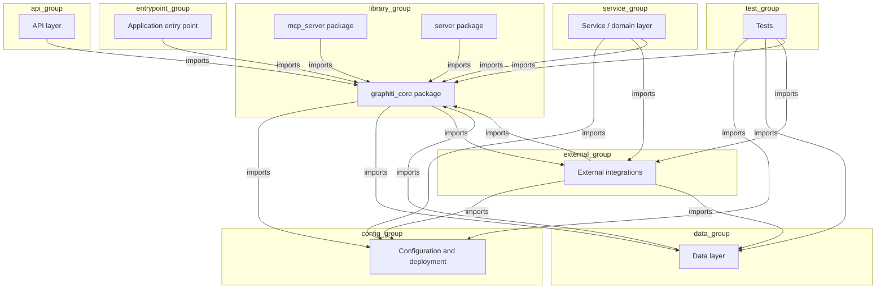

# Architecture report: getzep/graphiti

> Automated static analysis. **Observed** = directly seen in files/imports/AST; **Inferred** = interpretation from that evidence. Repository code was not executed.

## 1. Repository at a glance

| Item | Value |
| --- | --- |
| Repository | getzep/graphiti |
| Description | Build Real-Time Knowledge Graphs for AI Agents |
| Language | Python |
| Stars | 32808 |
| Licence | Apache-2.0 |
| Analysed commit / branch | ed23196506eba8806fae6da831d73fcd2ad714d8 / main |
| Framework(s) | FastAPI, Starlette |
| Files analysed | 412 |
| Components | 10 |

## 2. Architecture in one minute

getzep/graphiti - Build Real-Time Knowledge Graphs for AI Agents. This repository was analysed statically from 412 file(s) (302 Python). Detected technologies (observed from imports/manifests): GitHub Actions, Redis, SQLite, FastAPI, Starlette, AWS (boto3). Files are grouped into 10 component(s): API layer, Configuration and deployment, Data layer, Application entry point, External integrations, graphiti_core package, mcp_server package, server package. Observed entry point(s): .github/intake/apply.py, .github/intake/decide.py, mcp_server/main.py. Findings below distinguish observed facts from inferred interpretation.

## 3. High-level block diagram

## 4. Main components

### API layer (`api_layer`)

- **Kind:** api
- **Status:** Observed
- **Confidence:** 0.85
- **Responsibility:** Groups 3 file(s) under api layer (observed from repository paths and static analysis). Observed routes: POST /messages, POST /entity-node, DELETE /entity-edge/{uuid}, DELETE /group/{group_id}, DELETE /episode/{uuid}. Observed top-level classes: AsyncWorker. Observed top-level functions: add_entity_node, add_messages, clear, compose_query_from_messages, delete_entity_edge, delete_episode.
- **Paths:** `server/graph_service/routers/__init__.py`, `server/graph_service/routers/ingest.py`, `server/graph_service/routers/retrieve.py`
- **Evidence:** [server/graph_service/routers/__init__.py](https://github.com/getzep/graphiti/blob/ed23196506eba8806fae6da831d73fcd2ad714d8/server/graph_service/routers/__init__.py); [server/graph_service/routers/ingest.py:13](https://github.com/getzep/graphiti/blob/ed23196506eba8806fae6da831d73fcd2ad714d8/server/graph_service/routers/ingest.py#L13); [server/graph_service/routers/retrieve.py:18](https://github.com/getzep/graphiti/blob/ed23196506eba8806fae6da831d73fcd2ad714d8/server/graph_service/routers/retrieve.py#L18)

### Configuration and deployment (`config`)

- **Kind:** config
- **Status:** Observed
- **Confidence:** 0.85
- **Responsibility:** Groups 28 file(s) under configuration and deployment (observed from repository paths and static analysis). Observed top-level classes: AnthropicProviderConfig, AzureOpenAIProviderConfig, DatabaseConfig, DatabaseProvidersConfig, EdgeTypeConfig, EdgeTypeMapEntry. Observed top-level functions: get_settings.
- **Paths:** `Dockerfile`, `depot.json`, `docker-compose.test.yml`, `docker-compose.yml`, `graphiti_core/llm_client/config.py`, `mcp_server/.env.example`, `mcp_server/config/config-docker-falkordb-combined.yaml`, `mcp_server/config/config-docker-falkordb.yaml`, `mcp_server/config/config-docker-neo4j.yaml`, `mcp_server/config/config.yaml`, `mcp_server/config/mcp_config_stdio_example.json`, `mcp_server/docker/Dockerfile`, `mcp_server/docker/Dockerfile.standalone`, `mcp_server/docker/docker-compose-falkordb.yml`, `mcp_server/docker/docker-compose-neo4j.yml`, `mcp_server/docker/docker-compose.yml`, `mcp_server/docker/github-actions-example.yml`, `mcp_server/pyproject.toml`, `mcp_server/pytest.ini`, `mcp_server/src/config/__init__.py`, `mcp_server/src/config/schema.py`, `pyproject.toml`, `pytest.ini`, `server/.env.example`, `server/graph_service/config.py`, `server/pyproject.toml`, `signatures/version1/cla.json`, `spec/configurable-prompts-tests.yaml`
- **Evidence:** [Dockerfile](https://github.com/getzep/graphiti/blob/ed23196506eba8806fae6da831d73fcd2ad714d8/Dockerfile); [depot.json](https://github.com/getzep/graphiti/blob/ed23196506eba8806fae6da831d73fcd2ad714d8/depot.json); [docker-compose.test.yml](https://github.com/getzep/graphiti/blob/ed23196506eba8806fae6da831d73fcd2ad714d8/docker-compose.test.yml); [docker-compose.yml](https://github.com/getzep/graphiti/blob/ed23196506eba8806fae6da831d73fcd2ad714d8/docker-compose.yml); [graphiti_core/llm_client/config.py:23](https://github.com/getzep/graphiti/blob/ed23196506eba8806fae6da831d73fcd2ad714d8/graphiti_core/llm_client/config.py#L23); [mcp_server/.env.example](https://github.com/getzep/graphiti/blob/ed23196506eba8806fae6da831d73fcd2ad714d8/mcp_server/.env.example); [mcp_server/config/config-docker-falkordb-combined.yaml](https://github.com/getzep/graphiti/blob/ed23196506eba8806fae6da831d73fcd2ad714d8/mcp_server/config/config-docker-falkordb-combined.yaml); [mcp_server/config/config-docker-falkordb.yaml](https://github.com/getzep/graphiti/blob/ed23196506eba8806fae6da831d73fcd2ad714d8/mcp_server/config/config-docker-falkordb.yaml)

### Data layer (`data_layer`)

- **Kind:** data
- **Status:** Observed
- **Confidence:** 0.85
- **Responsibility:** Groups 10 file(s) under data layer (observed from repository paths and static analysis). Observed top-level classes: BuildCommunitiesResponse, ChatPrompt, CommunityResult, Document, EdgeResult, EpisodeEntitiesResponse. Observed top-level functions: _validate_entity_labels, get_community_edge_save_query, get_community_node_save_query, get_entity_edge_return_query, get_entity_edge_save_bulk_query, get_entity_edge_save_query.
- **Paths:** `graphiti_core/models/__init__.py`, `graphiti_core/models/edges/__init__.py`, `graphiti_core/models/edges/edge_db_queries.py`, `graphiti_core/models/nodes/__init__.py`, `graphiti_core/models/nodes/node_db_queries.py`, `graphiti_core/prompts/models.py`, `mcp_server/src/models/__init__.py`, `mcp_server/src/models/edge_types.py`, `mcp_server/src/models/entity_types.py`, `mcp_server/src/models/response_types.py`
- **Evidence:** [graphiti_core/models/__init__.py](https://github.com/getzep/graphiti/blob/ed23196506eba8806fae6da831d73fcd2ad714d8/graphiti_core/models/__init__.py); [graphiti_core/models/edges/__init__.py](https://github.com/getzep/graphiti/blob/ed23196506eba8806fae6da831d73fcd2ad714d8/graphiti_core/models/edges/__init__.py); [graphiti_core/models/edges/edge_db_queries.py:30](https://github.com/getzep/graphiti/blob/ed23196506eba8806fae6da831d73fcd2ad714d8/graphiti_core/models/edges/edge_db_queries.py#L30); [graphiti_core/models/nodes/__init__.py](https://github.com/getzep/graphiti/blob/ed23196506eba8806fae6da831d73fcd2ad714d8/graphiti_core/models/nodes/__init__.py); [graphiti_core/models/nodes/node_db_queries.py:23](https://github.com/getzep/graphiti/blob/ed23196506eba8806fae6da831d73fcd2ad714d8/graphiti_core/models/nodes/node_db_queries.py#L23); [graphiti_core/prompts/models.py:25](https://github.com/getzep/graphiti/blob/ed23196506eba8806fae6da831d73fcd2ad714d8/graphiti_core/prompts/models.py#L25); [mcp_server/src/models/__init__.py](https://github.com/getzep/graphiti/blob/ed23196506eba8806fae6da831d73fcd2ad714d8/mcp_server/src/models/__init__.py); [mcp_server/src/models/edge_types.py:15](https://github.com/getzep/graphiti/blob/ed23196506eba8806fae6da831d73fcd2ad714d8/mcp_server/src/models/edge_types.py#L15)

### Application entry point (`entrypoint`)

- **Kind:** entrypoint
- **Status:** Observed
- **Confidence:** 0.85
- **Responsibility:** Groups 3 file(s) under application entry point (observed from repository paths and static analysis). Observed application object created via FastAPI. Observed routes: GET /healthcheck. Observed top-level classes: GraphitiService. Observed top-level functions: _client_for_group, _driver_for_group, add_memory, add_triplet, build_communities, clear_graph.
- **Paths:** `mcp_server/main.py`, `mcp_server/src/graphiti_mcp_server.py`, `server/graph_service/main.py`
- **Evidence:** [mcp_server/main.py](https://github.com/getzep/graphiti/blob/ed23196506eba8806fae6da831d73fcd2ad714d8/mcp_server/main.py); [mcp_server/src/graphiti_mcp_server.py:119](https://github.com/getzep/graphiti/blob/ed23196506eba8806fae6da831d73fcd2ad714d8/mcp_server/src/graphiti_mcp_server.py#L119); [server/graph_service/main.py:20](https://github.com/getzep/graphiti/blob/ed23196506eba8806fae6da831d73fcd2ad714d8/server/graph_service/main.py#L20)

### External integrations (`external_integrations`)

- **Kind:** external
- **Status:** Observed
- **Confidence:** 0.85
- **Responsibility:** Groups 16 file(s) under external integrations (observed from repository paths and static analysis). Observed top-level classes: AnthropicClient, AzureOpenAILLMClient, BGERerankerClient, BaseOpenAIClient, CrossEncoderClient, EmbedderClient. Observed top-level functions: get_extraction_language_instruction, is_server_or_retry_error, openai_decisions_prompt_overrides.
- **Paths:** `graphiti_core/cross_encoder/bge_reranker_client.py`, `graphiti_core/cross_encoder/client.py`, `graphiti_core/cross_encoder/gemini_reranker_client.py`, `graphiti_core/cross_encoder/openai_reranker_client.py`, `graphiti_core/embedder/client.py`, `graphiti_core/llm_client/anthropic_client.py`, `graphiti_core/llm_client/azure_openai_client.py`, `graphiti_core/llm_client/client.py`, `graphiti_core/llm_client/gemini_client.py`, `graphiti_core/llm_client/gliner2_client.py`, `graphiti_core/llm_client/groq_client.py`, `graphiti_core/llm_client/jev_client.py`, `graphiti_core/llm_client/openai_base_client.py`, `graphiti_core/llm_client/openai_client.py`, `graphiti_core/llm_client/openai_decisions_client.py`, `graphiti_core/llm_client/openai_generic_client.py`
- **Evidence:** [graphiti_core/cross_encoder/bge_reranker_client.py:34](https://github.com/getzep/graphiti/blob/ed23196506eba8806fae6da831d73fcd2ad714d8/graphiti_core/cross_encoder/bge_reranker_client.py#L34); [graphiti_core/cross_encoder/client.py:20](https://github.com/getzep/graphiti/blob/ed23196506eba8806fae6da831d73fcd2ad714d8/graphiti_core/cross_encoder/client.py#L20); [graphiti_core/cross_encoder/gemini_reranker_client.py:43](https://github.com/getzep/graphiti/blob/ed23196506eba8806fae6da831d73fcd2ad714d8/graphiti_core/cross_encoder/gemini_reranker_client.py#L43); [graphiti_core/cross_encoder/openai_reranker_client.py:35](https://github.com/getzep/graphiti/blob/ed23196506eba8806fae6da831d73fcd2ad714d8/graphiti_core/cross_encoder/openai_reranker_client.py#L35); [graphiti_core/embedder/client.py:26](https://github.com/getzep/graphiti/blob/ed23196506eba8806fae6da831d73fcd2ad714d8/graphiti_core/embedder/client.py#L26); [graphiti_core/llm_client/anthropic_client.py:70](https://github.com/getzep/graphiti/blob/ed23196506eba8806fae6da831d73fcd2ad714d8/graphiti_core/llm_client/anthropic_client.py#L70); [graphiti_core/llm_client/azure_openai_client.py:31](https://github.com/getzep/graphiti/blob/ed23196506eba8806fae6da831d73fcd2ad714d8/graphiti_core/llm_client/azure_openai_client.py#L31); [graphiti_core/llm_client/client.py:37](https://github.com/getzep/graphiti/blob/ed23196506eba8806fae6da831d73fcd2ad714d8/graphiti_core/llm_client/client.py#L37)

### graphiti_core package (`graphiti_core`)

- **Kind:** library
- **Status:** Observed
- **Confidence:** 0.85
- **Responsibility:** Groups 143 file(s) under graphiti_core package (observed from repository paths and static analysis). Observed top-level classes: AddBulkEpisodeResults, AddEpisodeResults, AddTripletResults, AzureOpenAIEmbedderClient, BatchEdgeTimestamps, ChatPromptLibrary. Observed top-level functions: _apply_temporal_invalidation, _build_candidate_indexes, _build_custom_instructions_section, _build_directed_uuid_map, _build_edge_types_section, _build_edges_by_node.
- **Paths:** `graphiti_core/__init__.py`, `graphiti_core/cross_encoder/__init__.py`, `graphiti_core/decorators.py`, `graphiti_core/driver/__init__.py`, `graphiti_core/driver/driver.py`, `graphiti_core/driver/falkordb/__init__.py`, `graphiti_core/driver/falkordb/fulltext.py`, `graphiti_core/driver/falkordb/operations/__init__.py`, `graphiti_core/driver/falkordb/operations/community_edge_ops.py`, `graphiti_core/driver/falkordb/operations/community_node_ops.py`, `graphiti_core/driver/falkordb/operations/entity_edge_ops.py`, `graphiti_core/driver/falkordb/operations/entity_node_ops.py`, `graphiti_core/driver/falkordb/operations/episode_node_ops.py`, `graphiti_core/driver/falkordb/operations/episodic_edge_ops.py`, `graphiti_core/driver/falkordb/operations/graph_ops.py`, `graphiti_core/driver/falkordb/operations/has_episode_edge_ops.py`, `graphiti_core/driver/falkordb/operations/next_episode_edge_ops.py`, `graphiti_core/driver/falkordb/operations/saga_node_ops.py`, `graphiti_core/driver/falkordb/operations/search_ops.py`, `graphiti_core/driver/falkordb_driver.py`, `graphiti_core/driver/graph_operations/graph_operations.py`, `graphiti_core/driver/kuzu/__init__.py`, `graphiti_core/driver/kuzu/operations/__init__.py`, `graphiti_core/driver/kuzu/operations/community_edge_ops.py`, `graphiti_core/driver/kuzu/operations/community_node_ops.py`, `graphiti_core/driver/kuzu/operations/entity_edge_ops.py`, `graphiti_core/driver/kuzu/operations/entity_node_ops.py`, `graphiti_core/driver/kuzu/operations/episode_node_ops.py`, `graphiti_core/driver/kuzu/operations/episodic_edge_ops.py`, `graphiti_core/driver/kuzu/operations/graph_ops.py`, `graphiti_core/driver/kuzu/operations/has_episode_edge_ops.py`, `graphiti_core/driver/kuzu/operations/next_episode_edge_ops.py`, `graphiti_core/driver/kuzu/operations/record_parsers.py`, `graphiti_core/driver/kuzu/operations/saga_node_ops.py`, `graphiti_core/driver/kuzu/operations/search_ops.py`, `graphiti_core/driver/kuzu_driver.py`, `graphiti_core/driver/neo4j/__init__.py`, `graphiti_core/driver/neo4j/operations/__init__.py`, `graphiti_core/driver/neo4j/operations/community_edge_ops.py`, `graphiti_core/driver/neo4j/operations/community_node_ops.py`, `graphiti_core/driver/neo4j/operations/entity_edge_ops.py`, `graphiti_core/driver/neo4j/operations/entity_node_ops.py`, `graphiti_core/driver/neo4j/operations/episode_node_ops.py`, `graphiti_core/driver/neo4j/operations/episodic_edge_ops.py`, `graphiti_core/driver/neo4j/operations/graph_ops.py`, `graphiti_core/driver/neo4j/operations/has_episode_edge_ops.py`, `graphiti_core/driver/neo4j/operations/next_episode_edge_ops.py`, `graphiti_core/driver/neo4j/operations/saga_node_ops.py`, `graphiti_core/driver/neo4j/operations/search_ops.py`, `graphiti_core/driver/neo4j_driver.py`, `graphiti_core/driver/neptune/__init__.py`, `graphiti_core/driver/neptune/operations/__init__.py`, `graphiti_core/driver/neptune/operations/community_edge_ops.py`, `graphiti_core/driver/neptune/operations/community_node_ops.py`, `graphiti_core/driver/neptune/operations/entity_edge_ops.py`, `graphiti_core/driver/neptune/operations/entity_node_ops.py`, `graphiti_core/driver/neptune/operations/episode_node_ops.py`, `graphiti_core/driver/neptune/operations/episodic_edge_ops.py`, `graphiti_core/driver/neptune/operations/graph_ops.py`, `graphiti_core/driver/neptune/operations/has_episode_edge_ops.py`, `graphiti_core/driver/neptune/operations/next_episode_edge_ops.py`, `graphiti_core/driver/neptune/operations/saga_node_ops.py`, `graphiti_core/driver/neptune/operations/search_ops.py`, `graphiti_core/driver/neptune_driver.py`, `graphiti_core/driver/operations/__init__.py`, `graphiti_core/driver/operations/community_edge_ops.py`, `graphiti_core/driver/operations/community_node_ops.py`, `graphiti_core/driver/operations/entity_edge_ops.py`, `graphiti_core/driver/operations/entity_node_ops.py`, `graphiti_core/driver/operations/episode_node_ops.py`, `graphiti_core/driver/operations/episodic_edge_ops.py`, `graphiti_core/driver/operations/graph_ops.py`, `graphiti_core/driver/operations/graph_utils.py`, `graphiti_core/driver/operations/has_episode_edge_ops.py`, `graphiti_core/driver/operations/next_episode_edge_ops.py`, `graphiti_core/driver/operations/saga_node_ops.py`, `graphiti_core/driver/operations/search_ops.py`, `graphiti_core/driver/query_executor.py`, `graphiti_core/driver/record_parsers.py`, `graphiti_core/driver/search_interface/search_interface.py`, `graphiti_core/edges.py`, `graphiti_core/embedder/__init__.py`, `graphiti_core/embedder/azure_openai.py`, `graphiti_core/embedder/gemini.py`, `graphiti_core/embedder/openai.py`, `graphiti_core/embedder/voyage.py`, `graphiti_core/errors.py`, `graphiti_core/graph_queries.py`, `graphiti_core/graphiti.py`, `graphiti_core/graphiti_types.py`, `graphiti_core/helpers.py`, `graphiti_core/llm_client/__init__.py`, `graphiti_core/llm_client/cache.py`, `graphiti_core/llm_client/decision_prompts.py`, `graphiti_core/llm_client/errors.py`, `graphiti_core/llm_client/llm_runtime.py`, `graphiti_core/llm_client/prompt_config.py`, `graphiti_core/llm_client/token_tracker.py`, `graphiti_core/llm_client/utils.py`, `graphiti_core/migrations/__init__.py`, `graphiti_core/namespaces/__init__.py`, `graphiti_core/namespaces/edges.py`, `graphiti_core/namespaces/nodes.py`, `graphiti_core/nodes.py`, `graphiti_core/prompts/__init__.py`, `graphiti_core/prompts/dedupe_edges.py`, `graphiti_core/prompts/dedupe_nodes.py`, `graphiti_core/prompts/eval.py`, `graphiti_core/prompts/extract_edges.py`, `graphiti_core/prompts/extract_nodes.py`, `graphiti_core/prompts/extract_nodes_and_edges.py`, `graphiti_core/prompts/lib.py`, `graphiti_core/prompts/names.py`, `graphiti_core/prompts/prompt_helpers.py`, `graphiti_core/prompts/snippets.py`, `graphiti_core/prompts/summarize_nodes.py`, `graphiti_core/prompts/summarize_sagas.py`, `graphiti_core/search/__init__.py`, `graphiti_core/search/search.py`, `graphiti_core/search/search_config.py`, `graphiti_core/search/search_config_recipes.py`, `graphiti_core/search/search_filters.py`, `graphiti_core/search/search_helpers.py`, `graphiti_core/search/search_utils.py`, `graphiti_core/telemetry/__init__.py`, `graphiti_core/telemetry/telemetry.py`, `graphiti_core/tracer.py`, `graphiti_core/utils/__init__.py`, `graphiti_core/utils/bulk_utils.py`, `graphiti_core/utils/content_chunking.py`, `graphiti_core/utils/datetime_utils.py`, `graphiti_core/utils/maintenance/__init__.py`, `graphiti_core/utils/maintenance/attribute_utils.py`, `graphiti_core/utils/maintenance/combined_extraction.py`, `graphiti_core/utils/maintenance/community_operations.py`, `graphiti_core/utils/maintenance/dangling_endpoints.py`, `graphiti_core/utils/maintenance/dedup_helpers.py`, `graphiti_core/utils/maintenance/edge_operations.py`, `graphiti_core/utils/maintenance/graph_data_operations.py`, `graphiti_core/utils/maintenance/node_operations.py`, `graphiti_core/utils/maintenance/temporal_edge_utils.py`, `graphiti_core/utils/ontology_utils/entity_types_utils.py`, `graphiti_core/utils/text_utils.py`
- **Evidence:** [graphiti_core/__init__.py](https://github.com/getzep/graphiti/blob/ed23196506eba8806fae6da831d73fcd2ad714d8/graphiti_core/__init__.py); [graphiti_core/cross_encoder/__init__.py](https://github.com/getzep/graphiti/blob/ed23196506eba8806fae6da831d73fcd2ad714d8/graphiti_core/cross_encoder/__init__.py); [graphiti_core/decorators.py:29](https://github.com/getzep/graphiti/blob/ed23196506eba8806fae6da831d73fcd2ad714d8/graphiti_core/decorators.py#L29); [graphiti_core/driver/__init__.py](https://github.com/getzep/graphiti/blob/ed23196506eba8806fae6da831d73fcd2ad714d8/graphiti_core/driver/__init__.py); [graphiti_core/driver/driver.py:59](https://github.com/getzep/graphiti/blob/ed23196506eba8806fae6da831d73fcd2ad714d8/graphiti_core/driver/driver.py#L59); [graphiti_core/driver/falkordb/__init__.py](https://github.com/getzep/graphiti/blob/ed23196506eba8806fae6da831d73fcd2ad714d8/graphiti_core/driver/falkordb/__init__.py); [graphiti_core/driver/falkordb/fulltext.py:48](https://github.com/getzep/graphiti/blob/ed23196506eba8806fae6da831d73fcd2ad714d8/graphiti_core/driver/falkordb/fulltext.py#L48); [graphiti_core/driver/falkordb/operations/__init__.py](https://github.com/getzep/graphiti/blob/ed23196506eba8806fae6da831d73fcd2ad714d8/graphiti_core/driver/falkordb/operations/__init__.py)

### mcp_server package (`mcp_server`)

- **Kind:** library
- **Status:** Observed
- **Confidence:** 0.85
- **Responsibility:** Groups 7 file(s) under mcp_server package (observed from repository paths and static analysis). Observed top-level functions: _date_range_or_group, _doc_only_model, build_edge_type_map, build_edge_types, build_entity_types, build_fact_search_filters.
- **Paths:** `mcp_server/docker/build-standalone.sh`, `mcp_server/docker/build-with-version.sh`, `mcp_server/src/__init__.py`, `mcp_server/src/utils/__init__.py`, `mcp_server/src/utils/formatting.py`, `mcp_server/src/utils/type_config.py`, `mcp_server/src/utils/utils.py`
- **Evidence:** [mcp_server/docker/build-standalone.sh](https://github.com/getzep/graphiti/blob/ed23196506eba8806fae6da831d73fcd2ad714d8/mcp_server/docker/build-standalone.sh); [mcp_server/docker/build-with-version.sh](https://github.com/getzep/graphiti/blob/ed23196506eba8806fae6da831d73fcd2ad714d8/mcp_server/docker/build-with-version.sh); [mcp_server/src/__init__.py](https://github.com/getzep/graphiti/blob/ed23196506eba8806fae6da831d73fcd2ad714d8/mcp_server/src/__init__.py); [mcp_server/src/utils/__init__.py](https://github.com/getzep/graphiti/blob/ed23196506eba8806fae6da831d73fcd2ad714d8/mcp_server/src/utils/__init__.py); [mcp_server/src/utils/formatting.py:11](https://github.com/getzep/graphiti/blob/ed23196506eba8806fae6da831d73fcd2ad714d8/mcp_server/src/utils/formatting.py#L11); [mcp_server/src/utils/type_config.py:29](https://github.com/getzep/graphiti/blob/ed23196506eba8806fae6da831d73fcd2ad714d8/mcp_server/src/utils/type_config.py#L29); [mcp_server/src/utils/utils.py:6](https://github.com/getzep/graphiti/blob/ed23196506eba8806fae6da831d73fcd2ad714d8/mcp_server/src/utils/utils.py#L6)

### server package (`server`)

- **Kind:** library
- **Status:** Observed
- **Confidence:** 0.85
- **Responsibility:** Groups 6 file(s) under server package (observed from repository paths and static analysis). Observed top-level classes: AddEntityNodeRequest, AddMessagesRequest, FactResult, GetMemoryRequest, GetMemoryResponse, Message. Observed top-level functions: _create_graphiti_client, get_fact_result_from_edge, get_graphiti, initialize_graphiti.
- **Paths:** `server/graph_service/__init__.py`, `server/graph_service/dto/__init__.py`, `server/graph_service/dto/common.py`, `server/graph_service/dto/ingest.py`, `server/graph_service/dto/retrieve.py`, `server/graph_service/zep_graphiti.py`
- **Evidence:** [server/graph_service/__init__.py](https://github.com/getzep/graphiti/blob/ed23196506eba8806fae6da831d73fcd2ad714d8/server/graph_service/__init__.py); [server/graph_service/dto/__init__.py](https://github.com/getzep/graphiti/blob/ed23196506eba8806fae6da831d73fcd2ad714d8/server/graph_service/dto/__init__.py); [server/graph_service/dto/common.py:8](https://github.com/getzep/graphiti/blob/ed23196506eba8806fae6da831d73fcd2ad714d8/server/graph_service/dto/common.py#L8); [server/graph_service/dto/ingest.py:6](https://github.com/getzep/graphiti/blob/ed23196506eba8806fae6da831d73fcd2ad714d8/server/graph_service/dto/ingest.py#L6); [server/graph_service/dto/retrieve.py:8](https://github.com/getzep/graphiti/blob/ed23196506eba8806fae6da831d73fcd2ad714d8/server/graph_service/dto/retrieve.py#L8); [server/graph_service/zep_graphiti.py:17](https://github.com/getzep/graphiti/blob/ed23196506eba8806fae6da831d73fcd2ad714d8/server/graph_service/zep_graphiti.py#L17)

### Service / domain layer (`service_layer`)

- **Kind:** service
- **Status:** Observed
- **Confidence:** 0.85
- **Responsibility:** Groups 3 file(s) under service / domain layer (observed from repository paths and static analysis). Observed top-level classes: CrossEncoderFactory, DatabaseDriverFactory, EmbedderFactory, LLMClientFactory, QueueService. Observed top-level functions: _validate_api_key, is_non_openai_provider, reasoning_effort_for_model.
- **Paths:** `mcp_server/src/services/__init__.py`, `mcp_server/src/services/factories.py`, `mcp_server/src/services/queue_service.py`
- **Evidence:** [mcp_server/src/services/__init__.py](https://github.com/getzep/graphiti/blob/ed23196506eba8806fae6da831d73fcd2ad714d8/mcp_server/src/services/__init__.py); [mcp_server/src/services/factories.py:72](https://github.com/getzep/graphiti/blob/ed23196506eba8806fae6da831d73fcd2ad714d8/mcp_server/src/services/factories.py#L72); [mcp_server/src/services/queue_service.py:12](https://github.com/getzep/graphiti/blob/ed23196506eba8806fae6da831d73fcd2ad714d8/mcp_server/src/services/queue_service.py#L12)

### Tests (`tests`)

- **Kind:** test
- **Status:** Observed
- **Confidence:** 0.85
- **Responsibility:** Groups 98 file(s) under tests (observed from repository paths and static analysis). Observed routes: PATCH google.genai.Client, PATCH google.genai.Client, PATCH google.genai.Client, PATCH google.genai.Client, PATCH google.genai.Client. Observed top-level classes: DummyAzureClient, DummyBeta, DummyChat, DummyChatCompletions, DummyClient, DummyOpenAIClient. Observed top-level functions: _answer_set, _async_return, _call, _candidate_edge, _chat, _cleanup_test_nodes.
- **Paths:** `conftest.py`, `mcp_server/tests/README.md`, `mcp_server/tests/__init__.py`, `mcp_server/tests/conftest.py`, `mcp_server/tests/pytest.ini`, `mcp_server/tests/run_tests.py`, `mcp_server/tests/test_async_operations.py`, `mcp_server/tests/test_comprehensive_integration.py`, `mcp_server/tests/test_configuration.py`, `mcp_server/tests/test_core_parity.py`, `mcp_server/tests/test_cross_encoder_factory.py`, `mcp_server/tests/test_factories.py`, `mcp_server/tests/test_falkordb_config.py`, `mcp_server/tests/test_falkordb_integration.py`, `mcp_server/tests/test_fixtures.py`, `mcp_server/tests/test_group_routing.py`, `mcp_server/tests/test_http_integration.py`, `mcp_server/tests/test_integration.py`, `mcp_server/tests/test_live_falkordb_int.py`, `mcp_server/tests/test_mcp_integration.py`, `mcp_server/tests/test_mcp_transports.py`, `mcp_server/tests/test_stdio_simple.py`, `mcp_server/tests/test_stress_load.py`, `server/tests/test_live_falkordb_int.py`, `tests/cross_encoder/test_bge_reranker_client_int.py`, `tests/cross_encoder/test_gemini_reranker_client.py`, `tests/driver/__init__.py`, `tests/driver/test_falkordb_driver.py`, `tests/driver/test_falkordb_ops_routing.py`, `tests/driver/test_neo4j_driver_routing.py`, `tests/e2e_prompt_library_ingest.py`, `tests/embedder/embedder_fixtures.py`, `tests/embedder/test_gemini.py`, `tests/embedder/test_openai.py`, `tests/embedder/test_voyage.py`, `tests/evals/data/longmemeval_data/README.md`, `tests/evals/eval_cli.py`, `tests/evals/eval_e2e_graph_building.py`, `tests/evals/pytest.ini`, `tests/evals/utils.py`, `tests/helpers_test.py`, `tests/intake/test_apply.py`, `tests/intake/test_decide.py`, `tests/intake/test_workflows.py`, `tests/llm_client/decision_prompt_fixture.json`, `tests/llm_client/test_anthropic_client.py`, `tests/llm_client/test_anthropic_client_int.py`, `tests/llm_client/test_azure_openai_client.py`, `tests/llm_client/test_cache.py`, `tests/llm_client/test_client.py`, `tests/llm_client/test_errors.py`, `tests/llm_client/test_gemini_client.py`, `tests/llm_client/test_gliner2_delegation.py`, `tests/llm_client/test_jev_client.py`, `tests/llm_client/test_llm_runtime.py`, `tests/llm_client/test_openai_client.py`, `tests/llm_client/test_openai_decisions_client.py`, `tests/llm_client/test_openai_generic_client.py`, `tests/llm_client/test_token_tracker.py`, `tests/prompts/test_complete_prompt.py`, `tests/prompts/test_configurable_prompt_library.py`, `tests/prompts/test_legacy_prompt_compatibility.py`, `tests/prompts/test_prompt_exports.py`, `tests/prompts/test_prompt_names.py`, `tests/test_add_triplet.py`, `tests/test_edge_db_queries.py`, `tests/test_edge_int.py`, `tests/test_entity_exclusion_int.py`, `tests/test_graphiti_configurable_prompts.py`, `tests/test_graphiti_int.py`, `tests/test_graphiti_mock.py`, `tests/test_handle_multiple_group_ids.py`, `tests/test_neptune_search_isolation.py`, `tests/test_node_int.py`, `tests/test_node_label_security.py`, `tests/test_request_scope_concurrency.py`, `tests/test_saga_refetch_episode_uuids.py`, `tests/test_saga_summary_budget.py`, `tests/test_text_utils.py`, `tests/utils/maintenance/test_attribute_utils.py`, `tests/utils/maintenance/test_bulk_utils.py`, `tests/utils/maintenance/test_combined_extraction.py`, `tests/utils/maintenance/test_configurable_prompts.py`, `tests/utils/maintenance/test_dangling_endpoint_merge.py`, `tests/utils/maintenance/test_edge_dedup_scenarios.py`, `tests/utils/maintenance/test_edge_operations.py`, `tests/utils/maintenance/test_entity_extraction.py`, `tests/utils/maintenance/test_node_operations.py`, `tests/utils/maintenance/test_remove_communities.py`, `tests/utils/maintenance/test_temporal_edge_utils.py`, `tests/utils/search/search_utils_test.py`, `tests/utils/search/test_edge_bfs_query_shape.py`, `tests/utils/search/test_edge_cross_encoder_rrf_shortlist.py`, `tests/utils/search/test_episode_mentions_reranker.py`, `tests/utils/search/test_search_security.py`, `tests/utils/search/test_search_tracing.py`, `tests/utils/test_concatenate_episodes.py`, `tests/utils/test_content_chunking.py`
- **Evidence:** [conftest.py](https://github.com/getzep/graphiti/blob/ed23196506eba8806fae6da831d73fcd2ad714d8/conftest.py); [mcp_server/tests/README.md](https://github.com/getzep/graphiti/blob/ed23196506eba8806fae6da831d73fcd2ad714d8/mcp_server/tests/README.md); [mcp_server/tests/__init__.py](https://github.com/getzep/graphiti/blob/ed23196506eba8806fae6da831d73fcd2ad714d8/mcp_server/tests/__init__.py); [mcp_server/tests/conftest.py:19](https://github.com/getzep/graphiti/blob/ed23196506eba8806fae6da831d73fcd2ad714d8/mcp_server/tests/conftest.py#L19); [mcp_server/tests/pytest.ini](https://github.com/getzep/graphiti/blob/ed23196506eba8806fae6da831d73fcd2ad714d8/mcp_server/tests/pytest.ini); [mcp_server/tests/run_tests.py:25](https://github.com/getzep/graphiti/blob/ed23196506eba8806fae6da831d73fcd2ad714d8/mcp_server/tests/run_tests.py#L25); [mcp_server/tests/test_async_operations.py:19](https://github.com/getzep/graphiti/blob/ed23196506eba8806fae6da831d73fcd2ad714d8/mcp_server/tests/test_async_operations.py#L19); [mcp_server/tests/test_comprehensive_integration.py:20](https://github.com/getzep/graphiti/blob/ed23196506eba8806fae6da831d73fcd2ad714d8/mcp_server/tests/test_comprehensive_integration.py#L20)

## 5. Execution flow

**Observed** entry point(s):

- [.github/intake/apply.py:546](https://github.com/getzep/graphiti/blob/ed23196506eba8806fae6da831d73fcd2ad714d8/.github/intake/apply.py#L546)
- [.github/intake/decide.py:461](https://github.com/getzep/graphiti/blob/ed23196506eba8806fae6da831d73fcd2ad714d8/.github/intake/decide.py#L461)
- [mcp_server/main.py:22](https://github.com/getzep/graphiti/blob/ed23196506eba8806fae6da831d73fcd2ad714d8/mcp_server/main.py#L22)
- [mcp_server/src/graphiti_mcp_server.py:1378](https://github.com/getzep/graphiti/blob/ed23196506eba8806fae6da831d73fcd2ad714d8/mcp_server/src/graphiti_mcp_server.py#L1378)
- [server/graph_service/main.py:20](https://github.com/getzep/graphiti/blob/ed23196506eba8806fae6da831d73fcd2ad714d8/server/graph_service/main.py#L20)

**Observed** routes (from decorators):

- `GET /healthcheck` -> `healthcheck` in `server/graph_service/main.py:28`
- `POST /messages` -> `add_messages` in `server/graph_service/routers/ingest.py:52`
- `POST /entity-node` -> `add_entity_node` in `server/graph_service/routers/ingest.py:74`
- `DELETE /entity-edge/{uuid}` -> `delete_entity_edge` in `server/graph_service/routers/ingest.py:88`
- `DELETE /group/{group_id}` -> `delete_group` in `server/graph_service/routers/ingest.py:94`
- `DELETE /episode/{uuid}` -> `delete_episode` in `server/graph_service/routers/ingest.py:100`
- `POST /clear` -> `clear` in `server/graph_service/routers/ingest.py:106`
- `POST /search` -> `search` in `server/graph_service/routers/retrieve.py:18`
- `GET /entity-edge/{uuid}` -> `get_entity_edge` in `server/graph_service/routers/retrieve.py:31`
- `GET /episodes/{group_id}` -> `get_episodes` in `server/graph_service/routers/retrieve.py:37`
- `POST /get-memory` -> `get_memory` in `server/graph_service/routers/retrieve.py:45`
- `PATCH google.genai.Client` -> `test_init_without_config` in `tests/cross_encoder/test_gemini_reranker_client.py:67`
- `PATCH google.genai.Client` -> `test_init_with_config` in `tests/embedder/test_gemini.py:84`
- `PATCH google.genai.Client` -> `test_init_without_config` in `tests/embedder/test_gemini.py:97`
- `PATCH google.genai.Client` -> `test_init_with_partial_config` in `tests/embedder/test_gemini.py:105`
- `PATCH google.genai.Client` -> `test_create_with_custom_model` in `tests/embedder/test_gemini.py:142`
- `PATCH google.genai.Client` -> `test_create_with_custom_dimension` in `tests/embedder/test_gemini.py:161`
- `PATCH google.genai.Client` -> `test_create_batch_with_custom_model_and_dimension` in `tests/embedder/test_gemini.py:362`
- `PATCH google.genai.Client` -> `test_init_with_config` in `tests/llm_client/test_gemini_client.py:64`
- `PATCH google.genai.Client` -> `test_init_with_default_model` in `tests/llm_client/test_gemini_client.py:77`
- `PATCH google.genai.Client` -> `test_init_without_config` in `tests/llm_client/test_gemini_client.py:85`
- `PATCH google.genai.Client` -> `test_init_with_thinking_config` in `tests/llm_client/test_gemini_client.py:94`

Representative flow (derived from observed entry points and the import graph; steps beyond the entry point are **Inferred**):

1. Execution starts at an observed entry point listed above, if present.
2. `api_layer` imports `graphiti_core` (API layer -> graphiti_core package).
3. `data_layer` imports `graphiti_core` (Data layer -> graphiti_core package).
4. `entrypoint` imports `graphiti_core` (Application entry point -> graphiti_core package).
5. `external_integrations` imports `config` (External integrations -> Configuration and deployment).
6. `external_integrations` imports `data_layer` (External integrations -> Data layer).
7. `external_integrations` imports `graphiti_core` (External integrations -> graphiti_core package).
8. `graphiti_core` imports `config` (graphiti_core package -> Configuration and deployment).
9. `graphiti_core` imports `data_layer` (graphiti_core package -> Data layer).

## 6. Project structure

### `(root)`

- `.env.example` - config (288 bytes)
- `.gitignore` - other (3032 bytes)
- `AGENTS.md` - docs (6624 bytes)
- `CLAUDE.md` - docs (6365 bytes)
- `CODE_OF_CONDUCT.md` - docs (5220 bytes)
- `CONTRIBUTING.md` - docs (16180 bytes)
- `Dockerfile` - container (4551 bytes)
- `LICENSE` - docs (11325 bytes)
- `Makefile` - other (552 bytes)
- `OTEL_TRACING.md` - docs (1180 bytes)
- `README.md` - docs (35215 bytes)
- `SECURITY.md` - docs (2474 bytes)
- `Zep-CLA.md` - docs (5607 bytes)
- `conftest.py` - test, Python (601 bytes)
- `depot.json` - config (20 bytes)
- `docker-compose.test.yml` - config (931 bytes)
- `docker-compose.yml` - container (2253 bytes)
- `py.typed` - other (0 bytes)
- `pyproject.toml` - manifest (2999 bytes)
- `pytest.ini` - config (135 bytes)

### `.github`

- `.github/ISSUE_TEMPLATE/01-bug.yml` - config (2775 bytes)
- `.github/ISSUE_TEMPLATE/02-feature.yml` - config (3180 bytes)
- `.github/ISSUE_TEMPLATE/03-docs.yml` - config (1595 bytes)
- `.github/ISSUE_TEMPLATE/04-question.yml` - config (1672 bytes)
- `.github/ISSUE_TEMPLATE/config.yml` - config (694 bytes)
- `.github/actions/openai-workload-identity/action.yml` - config (3154 bytes)
- `.github/actions/setup-socket-firewall/README.md` - docs (3019 bytes)
- `.github/actions/setup-socket-firewall/action.yml` - config (4788 bytes)
- `.github/copilot-instructions.md` - docs (2172 bytes)
- `.github/dependabot.yml` - config (792 bytes)
- `.github/intake/README.md` - docs (4924 bytes)
- `.github/intake/apply.py` - source, Python (18380 bytes)
- `.github/intake/decide.py` - source, Python (15673 bytes)
- `.github/intake/decision.schema.json` - config (2222 bytes)
- `.github/intake/templates/ask_info.md` - docs (230 bytes)
- `.github/intake/templates/ask_repro.md` - docs (412 bytes)
- `.github/intake/templates/ask_rfc_fields.md` - docs (613 bytes)
- `.github/intake/templates/pr_needs_rework.md` - docs (503 bytes)
- `.github/intake/templates/pr_needs_rfc.md` - docs (480 bytes)
- `.github/intake/templates/pr_needs_tests.md` - docs (206 bytes)
- `.github/pull_request_template.md` - docs (1757 bytes)
- `.github/scripts/setup-triage-labels.sh` - source, Shell (2703 bytes)
- `.github/workflows/ai-moderator.yml` - ci, YAML (899 bytes)
- `.github/workflows/cla.yml` - ci, YAML (3306 bytes)
- `.github/workflows/codeql.yml` - ci, YAML (4810 bytes)
- `.github/workflows/issue-intake.yml` - ci, YAML (1339 bytes)
- `.github/workflows/lint.yml` - ci, YAML (3253 bytes)
- `.github/workflows/mcp-server-tests.yml` - ci, YAML (6102 bytes)
- `.github/workflows/pr-intake.yml` - ci, YAML (2055 bytes)
- `.github/workflows/release-graphiti-core.yml` - ci, YAML (1661 bytes)
- `.github/workflows/release-mcp-server.yml` - ci, YAML (6551 bytes)
- `.github/workflows/release-server-container.yml` - ci, YAML (6415 bytes)
- `.github/workflows/server-tests.yml` - ci, YAML (6263 bytes)
- `.github/workflows/socket-firewall-connectivity.yml` - ci, YAML (7931 bytes)
- `.github/workflows/stale.yml` - ci, YAML (2305 bytes)
- `.github/workflows/typecheck.yml` - ci, YAML (1242 bytes)
- `.github/workflows/unit_tests.yml` - ci, YAML (4607 bytes)

### `examples`

- `examples/azure-openai/.env.example` - config (323 bytes)
- `examples/azure-openai/README.md` - docs (4356 bytes)
- `examples/azure-openai/azure_openai_neo4j.py` - source, Python (8530 bytes)
- `examples/data/manybirds_products.json` - config (41947 bytes)
- `examples/ecommerce/runner.py` - source, Python (4082 bytes)
- `examples/gliner2/.env.example` - config (305 bytes)
- `examples/gliner2/README.md` - docs (2126 bytes)
- `examples/gliner2/gliner2_neo4j.py` - source, Python (13227 bytes)
- `examples/jev/.env.example` - config (159 bytes)
- `examples/jev/README.md` - docs (2536 bytes)
- `examples/jev/jev_dedupe_falkordb.py` - source, Python (7583 bytes)
- `examples/langgraph-agent/agent.ipynb` - other (19155 bytes)
- `examples/openai_decisions/.env.example` - config (165 bytes)
- `examples/openai_decisions/README.md` - docs (2608 bytes)
- `examples/openai_decisions/openai_decisions_dedupe_falkordb.py` - source, Python (7715 bytes)
- `examples/opentelemetry/.env.example` - config (94 bytes)
- `examples/opentelemetry/README.md` - docs (801 bytes)
- `examples/opentelemetry/otel_stdout_example.py` - source, Python (4358 bytes)
- `examples/opentelemetry/pyproject.toml` - manifest (290 bytes)
- `examples/podcast/podcast_runner.py` - source, Python (6984 bytes)
- `examples/podcast/podcast_transcript.txt` - docs (43632 bytes)
- `examples/podcast/transcript_parser.py` - source, Python (4274 bytes)
- `examples/quickstart/README.md` - docs (4621 bytes)
- `examples/quickstart/dense_vs_normal_ingestion.py` - source, Python (14626 bytes)
- `examples/quickstart/quickstart_falkordb.py` - source, Python (10328 bytes)
- `examples/quickstart/quickstart_neo4j.py` - source, Python (9438 bytes)
- `examples/quickstart/quickstart_neptune.py` - source, Python (9774 bytes)
- `examples/quickstart/requirements.txt` - manifest (34 bytes)
- `examples/wizard_of_oz/parser.py` - source, Python (1120 bytes)
- `examples/wizard_of_oz/runner.py` - source, Python (3029 bytes)

### `graphiti_core`

- `graphiti_core/__init__.py` - source, Python (55 bytes)
- `graphiti_core/cross_encoder/__init__.py` - source, Python (723 bytes)
- `graphiti_core/cross_encoder/bge_reranker_client.py` - source, Python (1831 bytes)
- `graphiti_core/cross_encoder/client.py` - source, Python (1441 bytes)
- `graphiti_core/cross_encoder/gemini_reranker_client.py` - source, Python (6194 bytes)
- `graphiti_core/cross_encoder/openai_reranker_client.py` - source, Python (4774 bytes)
- `graphiti_core/decorators.py` - source, Python (5704 bytes)
- `graphiti_core/driver/__init__.py` - source, Python (626 bytes)
- `graphiti_core/driver/driver.py` - source, Python (7302 bytes)
- `graphiti_core/driver/falkordb/__init__.py` - source, Python (946 bytes)
- `graphiti_core/driver/falkordb/fulltext.py` - source, Python (2061 bytes)
- `graphiti_core/driver/falkordb/operations/__init__.py` - source, Python (2093 bytes)
- `graphiti_core/driver/falkordb/operations/community_edge_ops.py` - source, Python (6177 bytes)
- `graphiti_core/driver/falkordb/operations/community_node_ops.py` - source, Python (7219 bytes)
- `graphiti_core/driver/falkordb/operations/entity_edge_ops.py` - source, Python (9762 bytes)
- `graphiti_core/driver/falkordb/operations/entity_node_ops.py` - source, Python (8931 bytes)
- `graphiti_core/driver/falkordb/operations/episode_node_ops.py` - source, Python (9932 bytes)
- `graphiti_core/driver/falkordb/operations/episodic_edge_ops.py` - source, Python (6661 bytes)
- `graphiti_core/driver/falkordb/operations/graph_ops.py` - source, Python (8634 bytes)
- `graphiti_core/driver/falkordb/operations/has_episode_edge_ops.py` - source, Python (6451 bytes)
- `graphiti_core/driver/falkordb/operations/next_episode_edge_ops.py` - source, Python (6518 bytes)
- `graphiti_core/driver/falkordb/operations/saga_node_ops.py` - source, Python (6578 bytes)
- `graphiti_core/driver/falkordb/operations/search_ops.py` - source, Python (19684 bytes)
- `graphiti_core/driver/falkordb_driver.py` - source, Python (15635 bytes)
- `graphiti_core/driver/graph_operations/graph_operations.py` - source, Python (27709 bytes)
- `graphiti_core/driver/kuzu/__init__.py` - source, Python (0 bytes)
- `graphiti_core/driver/kuzu/operations/__init__.py` - source, Python (1978 bytes)
- `graphiti_core/driver/kuzu/operations/community_edge_ops.py` - source, Python (5094 bytes)
- `graphiti_core/driver/kuzu/operations/community_node_ops.py` - source, Python (6146 bytes)
- `graphiti_core/driver/kuzu/operations/entity_edge_ops.py` - source, Python (8066 bytes)
- `graphiti_core/driver/kuzu/operations/entity_node_ops.py` - source, Python (7844 bytes)
- `graphiti_core/driver/kuzu/operations/episode_node_ops.py` - source, Python (8453 bytes)
- `graphiti_core/driver/kuzu/operations/episodic_edge_ops.py` - source, Python (5893 bytes)
- `graphiti_core/driver/kuzu/operations/graph_ops.py` - source, Python (7927 bytes)
- `graphiti_core/driver/kuzu/operations/has_episode_edge_ops.py` - source, Python (5321 bytes)
- `graphiti_core/driver/kuzu/operations/next_episode_edge_ops.py` - source, Python (5387 bytes)
- `graphiti_core/driver/kuzu/operations/record_parsers.py` - source, Python (1728 bytes)
- `graphiti_core/driver/kuzu/operations/saga_node_ops.py` - source, Python (5674 bytes)
- `graphiti_core/driver/kuzu/operations/search_ops.py` - source, Python (24632 bytes)
- `graphiti_core/driver/kuzu_driver.py` - source, Python (10486 bytes)
- `graphiti_core/driver/neo4j/__init__.py` - source, Python (0 bytes)
- `graphiti_core/driver/neo4j/operations/__init__.py` - source, Python (2020 bytes)
- `graphiti_core/driver/neo4j/operations/community_edge_ops.py` - source, Python (5170 bytes)
- `graphiti_core/driver/neo4j/operations/community_node_ops.py` - source, Python (6511 bytes)
- `graphiti_core/driver/neo4j/operations/entity_edge_ops.py` - source, Python (8776 bytes)
- `graphiti_core/driver/neo4j/operations/entity_node_ops.py` - source, Python (7923 bytes)
- `graphiti_core/driver/neo4j/operations/episode_node_ops.py` - source, Python (9199 bytes)
- `graphiti_core/driver/neo4j/operations/episodic_edge_ops.py` - source, Python (5639 bytes)
- `graphiti_core/driver/neo4j/operations/graph_ops.py` - source, Python (7454 bytes)
- `graphiti_core/driver/neo4j/operations/has_episode_edge_ops.py` - source, Python (5376 bytes)
- `graphiti_core/driver/neo4j/operations/next_episode_edge_ops.py` - source, Python (5442 bytes)
- `graphiti_core/driver/neo4j/operations/saga_node_ops.py` - source, Python (5774 bytes)
- `graphiti_core/driver/neo4j/operations/search_ops.py` - source, Python (20273 bytes)
- `graphiti_core/driver/neo4j_driver.py` - source, Python (9926 bytes)
- `graphiti_core/driver/neptune/__init__.py` - source, Python (0 bytes)
- `graphiti_core/driver/neptune/operations/__init__.py` - source, Python (2104 bytes)
- `graphiti_core/driver/neptune/operations/community_edge_ops.py` - source, Python (5120 bytes)
- `graphiti_core/driver/neptune/operations/community_node_ops.py` - source, Python (6585 bytes)
- `graphiti_core/driver/neptune/operations/entity_edge_ops.py` - source, Python (8734 bytes)
- `graphiti_core/driver/neptune/operations/entity_node_ops.py` - source, Python (7601 bytes)
- `graphiti_core/driver/neptune/operations/episode_node_ops.py` - source, Python (8747 bytes)
- `graphiti_core/driver/neptune/operations/episodic_edge_ops.py` - source, Python (5589 bytes)
- `graphiti_core/driver/neptune/operations/graph_ops.py` - source, Python (7368 bytes)
- `graphiti_core/driver/neptune/operations/has_episode_edge_ops.py` - source, Python (5324 bytes)
- `graphiti_core/driver/neptune/operations/next_episode_edge_ops.py` - source, Python (5390 bytes)
- `graphiti_core/driver/neptune/operations/saga_node_ops.py` - source, Python (5523 bytes)
- `graphiti_core/driver/neptune/operations/search_ops.py` - source, Python (22117 bytes)
- `graphiti_core/driver/neptune_driver.py` - source, Python (15301 bytes)
- `graphiti_core/driver/operations/__init__.py` - source, Python (1826 bytes)
- `graphiti_core/driver/operations/community_edge_ops.py` - source, Python (1835 bytes)
- `graphiti_core/driver/operations/community_node_ops.py` - source, Python (2449 bytes)
- `graphiti_core/driver/operations/entity_edge_ops.py` - source, Python (2709 bytes)
- `graphiti_core/driver/operations/entity_node_ops.py` - source, Python (2605 bytes)
- `graphiti_core/driver/operations/episode_node_ops.py` - source, Python (2795 bytes)
- `graphiti_core/driver/operations/episodic_edge_ops.py` - source, Python (2045 bytes)
- `graphiti_core/driver/operations/graph_ops.py` - source, Python (2600 bytes)
- `graphiti_core/driver/operations/graph_utils.py` - source, Python (2180 bytes)
- `graphiti_core/driver/operations/has_episode_edge_ops.py` - source, Python (2061 bytes)
- `graphiti_core/driver/operations/next_episode_edge_ops.py` - source, Python (2069 bytes)
- `graphiti_core/driver/operations/saga_node_ops.py` - source, Python (2258 bytes)
- `graphiti_core/driver/operations/search_ops.py` - source, Python (4475 bytes)
- `graphiti_core/driver/query_executor.py` - source, Python (1392 bytes)
- `graphiti_core/driver/record_parsers.py` - source, Python (4329 bytes)
- `graphiti_core/driver/search_interface/search_interface.py` - source, Python (11593 bytes)
- `graphiti_core/edges.py` - source, Python (33822 bytes)
- `graphiti_core/embedder/__init__.py` - source, Python (179 bytes)
- `graphiti_core/embedder/azure_openai.py` - source, Python (2525 bytes)
- `graphiti_core/embedder/client.py` - source, Python (1158 bytes)
- `graphiti_core/embedder/gemini.py` - source, Python (7194 bytes)
- `graphiti_core/embedder/openai.py` - source, Python (2192 bytes)
- `graphiti_core/embedder/voyage.py` - source, Python (2546 bytes)
- `graphiti_core/errors.py` - source, Python (3176 bytes)
- `graphiti_core/graph_queries.py` - source, Python (8165 bytes)
- `graphiti_core/graphiti.py` - source, Python (93250 bytes)
- `graphiti_core/graphiti_types.py` - source, Python (5701 bytes)
- `graphiti_core/helpers.py` - source, Python (7551 bytes)
- `graphiti_core/llm_client/__init__.py` - source, Python (1521 bytes)
- `graphiti_core/llm_client/anthropic_client.py` - source, Python (16711 bytes)
- `graphiti_core/llm_client/azure_openai_client.py` - source, Python (6468 bytes)
- `graphiti_core/llm_client/cache.py` - source, Python (2223 bytes)
- `graphiti_core/llm_client/client.py` - source, Python (12290 bytes)
- `graphiti_core/llm_client/config.py` - source, Python (2557 bytes)
- `graphiti_core/llm_client/decision_prompts.py` - source, Python (12770 bytes)
- `graphiti_core/llm_client/errors.py` - source, Python (1243 bytes)
- `graphiti_core/llm_client/gemini_client.py` - source, Python (19859 bytes)
- `graphiti_core/llm_client/gliner2_client.py` - source, Python (12807 bytes)
- `graphiti_core/llm_client/groq_client.py` - source, Python (2976 bytes)
- `graphiti_core/llm_client/jev_client.py` - source, Python (10044 bytes)
- `graphiti_core/llm_client/llm_runtime.py` - source, Python (6811 bytes)
- `graphiti_core/llm_client/openai_base_client.py` - source, Python (13770 bytes)
- `graphiti_core/llm_client/openai_client.py` - source, Python (5407 bytes)
- `graphiti_core/llm_client/openai_decisions_client.py` - source, Python (17264 bytes)
- `graphiti_core/llm_client/openai_generic_client.py` - source, Python (10561 bytes)
- `graphiti_core/llm_client/prompt_config.py` - source, Python (12028 bytes)
- `graphiti_core/llm_client/token_tracker.py` - source, Python (5337 bytes)
- `graphiti_core/llm_client/utils.py` - source, Python (1000 bytes)
- `graphiti_core/migrations/__init__.py` - source, Python (0 bytes)
- `graphiti_core/models/__init__.py` - source, Python (0 bytes)
- `graphiti_core/models/edges/__init__.py` - source, Python (0 bytes)
- `graphiti_core/models/edges/edge_db_queries.py` - source, Python (13179 bytes)
- `graphiti_core/models/nodes/__init__.py` - source, Python (0 bytes)
- `graphiti_core/models/nodes/node_db_queries.py` - source, Python (15627 bytes)
- `graphiti_core/namespaces/__init__.py` - source, Python (740 bytes)
- `graphiti_core/namespaces/edges.py` - source, Python (11859 bytes)
- `graphiti_core/namespaces/nodes.py` - source, Python (11683 bytes)
- `graphiti_core/nodes.py` - source, Python (39472 bytes)
- `graphiti_core/prompts/__init__.py` - source, Python (824 bytes)
- `graphiti_core/prompts/dedupe_edges.py` - source, Python (5225 bytes)
- `graphiti_core/prompts/dedupe_nodes.py` - source, Python (8877 bytes)
- `graphiti_core/prompts/eval.py` - source, Python (6398 bytes)
- `graphiti_core/prompts/extract_edges.py` - source, Python (18075 bytes)
- `graphiti_core/prompts/extract_nodes.py` - source, Python (32536 bytes)
- `graphiti_core/prompts/extract_nodes_and_edges.py` - source, Python (10351 bytes)
- `graphiti_core/prompts/lib.py` - source, Python (20779 bytes)
- `graphiti_core/prompts/models.py` - source, Python (2904 bytes)
- `graphiti_core/prompts/names.py` - source, Python (1793 bytes)
- `graphiti_core/prompts/prompt_helpers.py` - source, Python (1423 bytes)
- `graphiti_core/prompts/snippets.py` - source, Python (2216 bytes)
- `graphiti_core/prompts/summarize_nodes.py` - source, Python (5661 bytes)
- `graphiti_core/prompts/summarize_sagas.py` - source, Python (6177 bytes)
- `graphiti_core/py.typed` - other (79 bytes)
- `graphiti_core/search/__init__.py` - source, Python (0 bytes)
- `graphiti_core/search/search.py` - source, Python (33733 bytes)
- `graphiti_core/search/search_config.py` - source, Python (5276 bytes)
- `graphiti_core/search/search_config_recipes.py` - source, Python (7443 bytes)
- `graphiti_core/search/search_filters.py` - source, Python (10726 bytes)
- `graphiti_core/search/search_helpers.py` - source, Python (2691 bytes)
- `graphiti_core/search/search_utils.py` - source, Python (74411 bytes)
- `graphiti_core/telemetry/__init__.py` - source, Python (226 bytes)
- `graphiti_core/telemetry/telemetry.py` - source, Python (3230 bytes)
- `graphiti_core/tracer.py` - source, Python (6149 bytes)
- `graphiti_core/utils/__init__.py` - source, Python (0 bytes)
- `graphiti_core/utils/bulk_utils.py` - source, Python (25692 bytes)
- `graphiti_core/utils/content_chunking.py` - source, Python (27245 bytes)
- `graphiti_core/utils/datetime_utils.py` - source, Python (2114 bytes)
- `graphiti_core/utils/maintenance/__init__.py` - source, Python (301 bytes)
- `graphiti_core/utils/maintenance/attribute_utils.py` - source, Python (10652 bytes)
- `graphiti_core/utils/maintenance/combined_extraction.py` - source, Python (16575 bytes)
- `graphiti_core/utils/maintenance/community_operations.py` - source, Python (14176 bytes)
- `graphiti_core/utils/maintenance/dangling_endpoints.py` - source, Python (2373 bytes)
- `graphiti_core/utils/maintenance/dedup_helpers.py` - source, Python (14091 bytes)
- `graphiti_core/utils/maintenance/edge_operations.py` - source, Python (46743 bytes)
- `graphiti_core/utils/maintenance/graph_data_operations.py` - source, Python (5857 bytes)
- `graphiti_core/utils/maintenance/node_operations.py` - source, Python (46247 bytes)
- `graphiti_core/utils/maintenance/temporal_edge_utils.py` - source, Python (3023 bytes)
- `graphiti_core/utils/ontology_utils/entity_types_utils.py` - source, Python (1285 bytes)
- `graphiti_core/utils/text_utils.py` - source, Python (3663 bytes)

### `images`

- `images/simple_graph.svg` - other (9786 bytes)

### `mcp_server`

- `mcp_server/.env.example` - config (1755 bytes)
- `mcp_server/.python-version` - other (5 bytes)
- `mcp_server/README.md` - docs (25590 bytes)
- `mcp_server/config/config-docker-falkordb-combined.yaml` - config (3470 bytes)
- `mcp_server/config/config-docker-falkordb.yaml` - config (3518 bytes)
- `mcp_server/config/config-docker-neo4j.yaml` - config (3587 bytes)
- `mcp_server/config/config.yaml` - config (5162 bytes)
- `mcp_server/config/mcp_config_stdio_example.json` - config (437 bytes)
- `mcp_server/docker/Dockerfile` - container (7189 bytes)
- `mcp_server/docker/Dockerfile.standalone` - container (5315 bytes)
- `mcp_server/docker/README-falkordb-combined.md` - docs (7266 bytes)
- `mcp_server/docker/README.md` - docs (7141 bytes)
- `mcp_server/docker/build-standalone.sh` - source, Shell (2144 bytes)
- `mcp_server/docker/build-with-version.sh` - source, Shell (1655 bytes)
- `mcp_server/docker/docker-compose-falkordb.yml` - config (1630 bytes)
- `mcp_server/docker/docker-compose-neo4j.yml` - config (1699 bytes)
- `mcp_server/docker/docker-compose.yml` - container (1338 bytes)
- `mcp_server/docker/github-actions-example.yml` - config (4330 bytes)
- `mcp_server/docs/cursor_rules.md` - docs (2501 bytes)
- `mcp_server/main.py` - source, Python (689 bytes)
- `mcp_server/pyproject.toml` - manifest (1559 bytes)
- `mcp_server/pytest.ini` - config (376 bytes)
- `mcp_server/src/__init__.py` - source, Python (0 bytes)
- `mcp_server/src/config/__init__.py` - source, Python (0 bytes)
- `mcp_server/src/config/schema.py` - source, Python (12184 bytes)
- `mcp_server/src/graphiti_mcp_server.py` - source, Python (56385 bytes)
- `mcp_server/src/models/__init__.py` - source, Python (0 bytes)
- `mcp_server/src/models/edge_types.py` - source, Python (2057 bytes)
- `mcp_server/src/models/entity_types.py` - source, Python (9911 bytes)
- `mcp_server/src/models/response_types.py` - source, Python (1541 bytes)
- `mcp_server/src/services/__init__.py` - source, Python (0 bytes)
- `mcp_server/src/services/factories.py` - source, Python (24290 bytes)
- `mcp_server/src/services/queue_service.py` - source, Python (7734 bytes)
- `mcp_server/src/utils/__init__.py` - source, Python (0 bytes)
- `mcp_server/src/utils/formatting.py` - source, Python (2652 bytes)
- `mcp_server/src/utils/type_config.py` - source, Python (7121 bytes)
- `mcp_server/src/utils/utils.py` - source, Python (898 bytes)
- `mcp_server/tests/README.md` - test (7167 bytes)
- `mcp_server/tests/__init__.py` - test, Python (0 bytes)
- `mcp_server/tests/conftest.py` - test, Python (475 bytes)
- `mcp_server/tests/pytest.ini` - test (898 bytes)
- `mcp_server/tests/run_tests.py` - test, Python (11283 bytes)
- `mcp_server/tests/test_async_operations.py` - test, Python (18396 bytes)
- `mcp_server/tests/test_comprehensive_integration.py` - test, Python (24792 bytes)
- `mcp_server/tests/test_configuration.py` - test, Python (8985 bytes)
- `mcp_server/tests/test_core_parity.py` - test, Python (11610 bytes)
- `mcp_server/tests/test_cross_encoder_factory.py` - test, Python (3869 bytes)
- `mcp_server/tests/test_factories.py` - test, Python (6151 bytes)
- `mcp_server/tests/test_falkordb_config.py` - test, Python (1588 bytes)
- `mcp_server/tests/test_falkordb_integration.py` - test, Python (7396 bytes)
- `mcp_server/tests/test_fixtures.py` - test, Python (10468 bytes)
- `mcp_server/tests/test_group_routing.py` - test, Python (8682 bytes)
- `mcp_server/tests/test_http_integration.py` - test, Python (8979 bytes)
- `mcp_server/tests/test_integration.py` - test, Python (12719 bytes)
- `mcp_server/tests/test_live_falkordb_int.py` - test, Python (10074 bytes)
- `mcp_server/tests/test_mcp_integration.py` - test, Python (18670 bytes)
- `mcp_server/tests/test_mcp_transports.py` - test, Python (9613 bytes)
- `mcp_server/tests/test_stdio_simple.py` - test, Python (2894 bytes)
- `mcp_server/tests/test_stress_load.py` - test, Python (20076 bytes)

### `server`

- `server/.env.example` - config (159 bytes)
- `server/Makefile` - other (464 bytes)
- `server/README.md` - docs (3286 bytes)
- `server/graph_service/__init__.py` - source, Python (0 bytes)
- `server/graph_service/config.py` - source, Python (899 bytes)
- `server/graph_service/dto/__init__.py` - source, Python (400 bytes)
- `server/graph_service/dto/common.py` - source, Python (1051 bytes)
- `server/graph_service/dto/ingest.py` - source, Python (623 bytes)
- `server/graph_service/dto/retrieve.py` - source, Python (1437 bytes)
- `server/graph_service/main.py` - source, Python (719 bytes)
- `server/graph_service/routers/__init__.py` - source, Python (0 bytes)
- `server/graph_service/routers/ingest.py` - source, Python (3330 bytes)
- `server/graph_service/routers/retrieve.py` - source, Python (1964 bytes)
- `server/graph_service/zep_graphiti.py` - source, Python (5008 bytes)
- `server/pyproject.toml` - manifest (1543 bytes)
- `server/tests/test_live_falkordb_int.py` - test, Python (9175 bytes)

### `signatures`

- `signatures/version1/cla.json` - config (51872 bytes)

### `spec`

- `spec/c2-default-extraction-prompt.md` - docs (6848 bytes)
- `spec/configurable-prompts-tests.yaml` - config (22371 bytes)
- `spec/configurable-prompts.md` - docs (21553 bytes)
- `spec/driver-operations-redesign.md` - docs (37749 bytes)
- `spec/jev-decision-client.md` - docs (7286 bytes)
- `spec/llm-runtime.md` - docs (4284 bytes)
- `spec/openai-decisions-client.md` - docs (6220 bytes)

### `tests`

- `tests/cross_encoder/test_bge_reranker_client_int.py` - test, Python (2527 bytes)
- `tests/cross_encoder/test_gemini_reranker_client.py` - test, Python (14027 bytes)
- `tests/driver/__init__.py` - test, Python (34 bytes)
- `tests/driver/test_falkordb_driver.py` - test, Python (27579 bytes)
- `tests/driver/test_falkordb_ops_routing.py` - test, Python (4473 bytes)
- `tests/driver/test_neo4j_driver_routing.py` - test, Python (3632 bytes)
- `tests/e2e_prompt_library_ingest.py` - test, Python (14651 bytes)
- `tests/embedder/embedder_fixtures.py` - test, Python (777 bytes)
- `tests/embedder/test_gemini.py` - test, Python (15091 bytes)
- `tests/embedder/test_openai.py` - test, Python (4396 bytes)
- `tests/embedder/test_voyage.py` - test, Python (4457 bytes)
- `tests/evals/data/longmemeval_data/README.md` - test (220 bytes)
- `tests/evals/eval_cli.py` - test, Python (1203 bytes)
- `tests/evals/eval_e2e_graph_building.py` - test, Python (6811 bytes)
- `tests/evals/pytest.ini` - test (114 bytes)
- `tests/evals/utils.py` - test, Python (1184 bytes)
- `tests/helpers_test.py` - test, Python (11076 bytes)
- `tests/intake/test_apply.py` - test, Python (18890 bytes)
- `tests/intake/test_decide.py` - test, Python (17559 bytes)
- `tests/intake/test_workflows.py` - test, Python (4888 bytes)
- `tests/llm_client/decision_prompt_fixture.json` - test (6144 bytes)
- `tests/llm_client/test_anthropic_client.py` - test, Python (10585 bytes)
- `tests/llm_client/test_anthropic_client_int.py` - test, Python (2872 bytes)
- `tests/llm_client/test_azure_openai_client.py` - test, Python (3762 bytes)
- `tests/llm_client/test_cache.py` - test, Python (4036 bytes)
- `tests/llm_client/test_client.py` - test, Python (4484 bytes)
- `tests/llm_client/test_errors.py` - test, Python (2764 bytes)
- `tests/llm_client/test_gemini_client.py` - test, Python (21284 bytes)
- `tests/llm_client/test_gliner2_delegation.py` - test, Python (4135 bytes)
- `tests/llm_client/test_jev_client.py` - test, Python (18137 bytes)
- `tests/llm_client/test_llm_runtime.py` - test, Python (15875 bytes)
- `tests/llm_client/test_openai_client.py` - test, Python (9485 bytes)
- `tests/llm_client/test_openai_decisions_client.py` - test, Python (16531 bytes)
- `tests/llm_client/test_openai_generic_client.py` - test, Python (6369 bytes)
- `tests/llm_client/test_token_tracker.py` - test, Python (7553 bytes)
- `tests/prompts/test_complete_prompt.py` - test, Python (6303 bytes)
- `tests/prompts/test_configurable_prompt_library.py` - test, Python (5063 bytes)
- `tests/prompts/test_legacy_prompt_compatibility.py` - test, Python (12443 bytes)
- `tests/prompts/test_prompt_exports.py` - test, Python (2106 bytes)
- `tests/prompts/test_prompt_names.py` - test, Python (2120 bytes)
- `tests/test_add_triplet.py` - test, Python (31498 bytes)
- `tests/test_edge_db_queries.py` - test, Python (3143 bytes)
- `tests/test_edge_int.py` - test, Python (15481 bytes)
- `tests/test_entity_exclusion_int.py` - test, Python (11981 bytes)
- `tests/test_graphiti_configurable_prompts.py` - test, Python (8834 bytes)
- `tests/test_graphiti_int.py` - test, Python (2524 bytes)
- `tests/test_graphiti_mock.py` - test, Python (81250 bytes)
- `tests/test_handle_multiple_group_ids.py` - test, Python (4765 bytes)
- `tests/test_neptune_search_isolation.py` - test, Python (9240 bytes)
- `tests/test_node_int.py` - test, Python (7617 bytes)
- `tests/test_node_label_security.py` - test, Python (2025 bytes)
- `tests/test_request_scope_concurrency.py` - test, Python (7377 bytes)
- `tests/test_saga_refetch_episode_uuids.py` - test, Python (2432 bytes)
- `tests/test_saga_summary_budget.py` - test, Python (10905 bytes)
- `tests/test_text_utils.py` - test, Python (4431 bytes)
- `tests/utils/maintenance/test_attribute_utils.py` - test, Python (10800 bytes)
- `tests/utils/maintenance/test_bulk_utils.py` - test, Python (23207 bytes)
- `tests/utils/maintenance/test_combined_extraction.py` - test, Python (23225 bytes)
- `tests/utils/maintenance/test_configurable_prompts.py` - test, Python (28222 bytes)
- `tests/utils/maintenance/test_dangling_endpoint_merge.py` - test, Python (11615 bytes)
- `tests/utils/maintenance/test_edge_dedup_scenarios.py` - test, Python (12078 bytes)
- `tests/utils/maintenance/test_edge_operations.py` - test, Python (62564 bytes)
- `tests/utils/maintenance/test_entity_extraction.py` - test, Python (24693 bytes)
- `tests/utils/maintenance/test_node_operations.py` - test, Python (42335 bytes)
- `tests/utils/maintenance/test_remove_communities.py` - test, Python (3191 bytes)
- `tests/utils/maintenance/test_temporal_edge_utils.py` - test, Python (2555 bytes)
- `tests/utils/search/search_utils_test.py` - test, Python (6567 bytes)
- `tests/utils/search/test_edge_bfs_query_shape.py` - test, Python (4784 bytes)
- `tests/utils/search/test_edge_cross_encoder_rrf_shortlist.py` - test, Python (4509 bytes)
- `tests/utils/search/test_episode_mentions_reranker.py` - test, Python (2434 bytes)
- `tests/utils/search/test_search_security.py` - test, Python (6459 bytes)
- `tests/utils/search/test_search_tracing.py` - test, Python (4674 bytes)
- `tests/utils/test_concatenate_episodes.py` - test, Python (3182 bytes)
- `tests/utils/test_content_chunking.py` - test, Python (30429 bytes)

## 7. Key dependencies and integrations

| Name | Category | Status | Confidence | Evidence |
| --- | --- | --- | --- | --- |
| GitHub Actions | ci | Observed | 0.90 | [.github/workflows/ai-moderator.yml](https://github.com/getzep/graphiti/blob/ed23196506eba8806fae6da831d73fcd2ad714d8/.github/workflows/ai-moderator.yml); [.github/workflows/cla.yml](https://github.com/getzep/graphiti/blob/ed23196506eba8806fae6da831d73fcd2ad714d8/.github/workflows/cla.yml); [.github/workflows/codeql.yml](https://github.com/getzep/graphiti/blob/ed23196506eba8806fae6da831d73fcd2ad714d8/.github/workflows/codeql.yml); [.github/workflows/issue-intake.yml](https://github.com/getzep/graphiti/blob/ed23196506eba8806fae6da831d73fcd2ad714d8/.github/workflows/issue-intake.yml) |
| Redis | database | Observed | 0.90 | [docker-compose.yml:60](https://github.com/getzep/graphiti/blob/ed23196506eba8806fae6da831d73fcd2ad714d8/docker-compose.yml#L60); [mcp_server/docker/docker-compose.yml:20](https://github.com/getzep/graphiti/blob/ed23196506eba8806fae6da831d73fcd2ad714d8/mcp_server/docker/docker-compose.yml#L20); [mcp_server/tests/run_tests.py:85](https://github.com/getzep/graphiti/blob/ed23196506eba8806fae6da831d73fcd2ad714d8/mcp_server/tests/run_tests.py#L85); [pyproject.toml:35](https://github.com/getzep/graphiti/blob/ed23196506eba8806fae6da831d73fcd2ad714d8/pyproject.toml#L35) |
| SQLite | database | Observed | 0.90 | [graphiti_core/llm_client/cache.py:21](https://github.com/getzep/graphiti/blob/ed23196506eba8806fae6da831d73fcd2ad714d8/graphiti_core/llm_client/cache.py#L21) |
| FastAPI | framework | Observed | 0.95 | [server/graph_service/config.py:4](https://github.com/getzep/graphiti/blob/ed23196506eba8806fae6da831d73fcd2ad714d8/server/graph_service/config.py#L4); [server/graph_service/main.py:3](https://github.com/getzep/graphiti/blob/ed23196506eba8806fae6da831d73fcd2ad714d8/server/graph_service/main.py#L3); [server/graph_service/main.py:4](https://github.com/getzep/graphiti/blob/ed23196506eba8806fae6da831d73fcd2ad714d8/server/graph_service/main.py#L4); [server/graph_service/routers/ingest.py:5](https://github.com/getzep/graphiti/blob/ed23196506eba8806fae6da831d73fcd2ad714d8/server/graph_service/routers/ingest.py#L5) |
| Starlette | framework | Observed | 0.90 | [mcp_server/src/graphiti_mcp_server.py:26](https://github.com/getzep/graphiti/blob/ed23196506eba8806fae6da831d73fcd2ad714d8/mcp_server/src/graphiti_mcp_server.py#L26) |
| AWS (boto3) | library | Observed | 0.90 | [graphiti_core/driver/neptune_driver.py:24](https://github.com/getzep/graphiti/blob/ed23196506eba8806fae6da831d73fcd2ad714d8/graphiti_core/driver/neptune_driver.py#L24); [pyproject.toml:39](https://github.com/getzep/graphiti/blob/ed23196506eba8806fae6da831d73fcd2ad714d8/pyproject.toml#L39) |
| httpx | library | Observed | 0.95 | [graphiti_core/llm_client/client.py:23](https://github.com/getzep/graphiti/blob/ed23196506eba8806fae6da831d73fcd2ad714d8/graphiti_core/llm_client/client.py#L23); [graphiti_core/llm_client/jev_client.py:22](https://github.com/getzep/graphiti/blob/ed23196506eba8806fae6da831d73fcd2ad714d8/graphiti_core/llm_client/jev_client.py#L22); [graphiti_core/llm_client/openai_decisions_client.py:22](https://github.com/getzep/graphiti/blob/ed23196506eba8806fae6da831d73fcd2ad714d8/graphiti_core/llm_client/openai_decisions_client.py#L22); [mcp_server/tests/test_http_integration.py:224](https://github.com/getzep/graphiti/blob/ed23196506eba8806fae6da831d73fcd2ad714d8/mcp_server/tests/test_http_integration.py#L224) |
| NumPy | library | Observed | 0.95 | [graphiti_core/cross_encoder/openai_reranker_client.py:20](https://github.com/getzep/graphiti/blob/ed23196506eba8806fae6da831d73fcd2ad714d8/graphiti_core/cross_encoder/openai_reranker_client.py#L20); [graphiti_core/helpers.py:24](https://github.com/getzep/graphiti/blob/ed23196506eba8806fae6da831d73fcd2ad714d8/graphiti_core/helpers.py#L24); [graphiti_core/helpers.py:27](https://github.com/getzep/graphiti/blob/ed23196506eba8806fae6da831d73fcd2ad714d8/graphiti_core/helpers.py#L27); [graphiti_core/search/search_utils.py:22](https://github.com/getzep/graphiti/blob/ed23196506eba8806fae6da831d73fcd2ad714d8/graphiti_core/search/search_utils.py#L22) |
| pandas | library | Observed | 0.90 | [tests/evals/eval_e2e_graph_building.py:20](https://github.com/getzep/graphiti/blob/ed23196506eba8806fae6da831d73fcd2ad714d8/tests/evals/eval_e2e_graph_building.py#L20) |
| Pydantic | library | Observed | 0.95 | [examples/gliner2/gliner2_neo4j.py:25](https://github.com/getzep/graphiti/blob/ed23196506eba8806fae6da831d73fcd2ad714d8/examples/gliner2/gliner2_neo4j.py#L25); [examples/podcast/podcast_runner.py:25](https://github.com/getzep/graphiti/blob/ed23196506eba8806fae6da831d73fcd2ad714d8/examples/podcast/podcast_runner.py#L25); [examples/podcast/transcript_parser.py:5](https://github.com/getzep/graphiti/blob/ed23196506eba8806fae6da831d73fcd2ad714d8/examples/podcast/transcript_parser.py#L5); [graphiti_core/driver/graph_operations/graph_operations.py:19](https://github.com/getzep/graphiti/blob/ed23196506eba8806fae6da831d73fcd2ad714d8/graphiti_core/driver/graph_operations/graph_operations.py#L19) |
| Uvicorn | library | Observed | 0.85 | [server/pyproject.toml:14](https://github.com/getzep/graphiti/blob/ed23196506eba8806fae6da831d73fcd2ad714d8/server/pyproject.toml#L14) |
| Poetry | packaging | Observed | 0.90 | [examples/opentelemetry/pyproject.toml](https://github.com/getzep/graphiti/blob/ed23196506eba8806fae6da831d73fcd2ad714d8/examples/opentelemetry/pyproject.toml); [mcp_server/pyproject.toml](https://github.com/getzep/graphiti/blob/ed23196506eba8806fae6da831d73fcd2ad714d8/mcp_server/pyproject.toml); [pyproject.toml](https://github.com/getzep/graphiti/blob/ed23196506eba8806fae6da831d73fcd2ad714d8/pyproject.toml); [server/pyproject.toml](https://github.com/getzep/graphiti/blob/ed23196506eba8806fae6da831d73fcd2ad714d8/server/pyproject.toml) |
| Docker | tooling | Observed | 0.90 | [.github/workflows/mcp-server-tests.yml:56](https://github.com/getzep/graphiti/blob/ed23196506eba8806fae6da831d73fcd2ad714d8/.github/workflows/mcp-server-tests.yml#L56); [.github/workflows/release-mcp-server.yml:14](https://github.com/getzep/graphiti/blob/ed23196506eba8806fae6da831d73fcd2ad714d8/.github/workflows/release-mcp-server.yml#L14); [.github/workflows/release-server-container.yml:13](https://github.com/getzep/graphiti/blob/ed23196506eba8806fae6da831d73fcd2ad714d8/.github/workflows/release-server-container.yml#L13); [.github/workflows/server-tests.yml:58](https://github.com/getzep/graphiti/blob/ed23196506eba8806fae6da831d73fcd2ad714d8/.github/workflows/server-tests.yml#L58) |
| Docker Compose | tooling | Observed | 0.90 | [docker-compose.yml](https://github.com/getzep/graphiti/blob/ed23196506eba8806fae6da831d73fcd2ad714d8/docker-compose.yml); [mcp_server/docker/docker-compose.yml](https://github.com/getzep/graphiti/blob/ed23196506eba8806fae6da831d73fcd2ad714d8/mcp_server/docker/docker-compose.yml) |
| pytest | tooling | Observed | 0.95 | [.github/workflows/lint.yml:26](https://github.com/getzep/graphiti/blob/ed23196506eba8806fae6da831d73fcd2ad714d8/.github/workflows/lint.yml#L26); [.github/workflows/mcp-server-tests.yml:106](https://github.com/getzep/graphiti/blob/ed23196506eba8806fae6da831d73fcd2ad714d8/.github/workflows/mcp-server-tests.yml#L106); [.github/workflows/server-tests.yml:110](https://github.com/getzep/graphiti/blob/ed23196506eba8806fae6da831d73fcd2ad714d8/.github/workflows/server-tests.yml#L110); [.github/workflows/unit_tests.yml:39](https://github.com/getzep/graphiti/blob/ed23196506eba8806fae6da831d73fcd2ad714d8/.github/workflows/unit_tests.yml#L39) |
| unittest | tooling | Observed | 0.95 | [mcp_server/tests/test_core_parity.py:13](https://github.com/getzep/graphiti/blob/ed23196506eba8806fae6da831d73fcd2ad714d8/mcp_server/tests/test_core_parity.py#L13); [mcp_server/tests/test_cross_encoder_factory.py:8](https://github.com/getzep/graphiti/blob/ed23196506eba8806fae6da831d73fcd2ad714d8/mcp_server/tests/test_cross_encoder_factory.py#L8); [tests/cross_encoder/test_gemini_reranker_client.py:19](https://github.com/getzep/graphiti/blob/ed23196506eba8806fae6da831d73fcd2ad714d8/tests/cross_encoder/test_gemini_reranker_client.py#L19); [tests/driver/test_falkordb_driver.py:18](https://github.com/getzep/graphiti/blob/ed23196506eba8806fae6da831d73fcd2ad714d8/tests/driver/test_falkordb_driver.py#L18) |

## 8. Data and state

- **Redis** (Observed, confidence 0.90) - evidence: [docker-compose.yml:60](https://github.com/getzep/graphiti/blob/ed23196506eba8806fae6da831d73fcd2ad714d8/docker-compose.yml#L60); [mcp_server/docker/docker-compose.yml:20](https://github.com/getzep/graphiti/blob/ed23196506eba8806fae6da831d73fcd2ad714d8/mcp_server/docker/docker-compose.yml#L20); [mcp_server/tests/run_tests.py:85](https://github.com/getzep/graphiti/blob/ed23196506eba8806fae6da831d73fcd2ad714d8/mcp_server/tests/run_tests.py#L85); [pyproject.toml:35](https://github.com/getzep/graphiti/blob/ed23196506eba8806fae6da831d73fcd2ad714d8/pyproject.toml#L35)
- **SQLite** (Observed, confidence 0.90) - evidence: [graphiti_core/llm_client/cache.py:21](https://github.com/getzep/graphiti/blob/ed23196506eba8806fae6da831d73fcd2ad714d8/graphiti_core/llm_client/cache.py#L21)
- Data component `data_layer` (Observed): Groups 10 file(s) under data layer (observed from repository paths and static analysis). Observed top-level classes: BuildCommunitiesResponse, ChatPrompt, CommunityResult, Document, EdgeResult, EpisodeEntitiesResponse. Observed top-level functions: _validate_entity_labels, get_community_edge_save_q…

## 9. Configuration and deployment clues

- `.env.example` (config)
- `.github/ISSUE_TEMPLATE/01-bug.yml` (config)
- `.github/ISSUE_TEMPLATE/02-feature.yml` (config)
- `.github/ISSUE_TEMPLATE/03-docs.yml` (config)
- `.github/ISSUE_TEMPLATE/04-question.yml` (config)
- `.github/ISSUE_TEMPLATE/config.yml` (config)
- `.github/actions/openai-workload-identity/action.yml` (config)
- `.github/actions/setup-socket-firewall/action.yml` (config)
- `.github/dependabot.yml` (config)
- `.github/intake/decision.schema.json` (config)
- `.github/workflows/ai-moderator.yml` (ci)
- `.github/workflows/cla.yml` (ci)
- `.github/workflows/codeql.yml` (ci)
- `.github/workflows/issue-intake.yml` (ci)
- `.github/workflows/lint.yml` (ci)
- `.github/workflows/mcp-server-tests.yml` (ci)
- `.github/workflows/pr-intake.yml` (ci)
- `.github/workflows/release-graphiti-core.yml` (ci)
- `.github/workflows/release-mcp-server.yml` (ci)
- `.github/workflows/release-server-container.yml` (ci)
- `.github/workflows/server-tests.yml` (ci)
- `.github/workflows/socket-firewall-connectivity.yml` (ci)
- `.github/workflows/stale.yml` (ci)
- `.github/workflows/typecheck.yml` (ci)
- `.github/workflows/unit_tests.yml` (ci)
- `Dockerfile` (container)
- `depot.json` (config)
- `docker-compose.test.yml` (config)
- `docker-compose.yml` (container)
- `examples/azure-openai/.env.example` (config)
- `examples/data/manybirds_products.json` (config)
- `examples/gliner2/.env.example` (config)
- `examples/jev/.env.example` (config)
- `examples/openai_decisions/.env.example` (config)
- `examples/opentelemetry/.env.example` (config)
- `examples/opentelemetry/pyproject.toml` (manifest)
- `examples/quickstart/requirements.txt` (manifest)
- `mcp_server/.env.example` (config)
- `mcp_server/config/config-docker-falkordb-combined.yaml` (config)
- `mcp_server/config/config-docker-falkordb.yaml` (config)
- `mcp_server/config/config-docker-neo4j.yaml` (config)
- `mcp_server/config/config.yaml` (config)
- `mcp_server/config/mcp_config_stdio_example.json` (config)
- `mcp_server/docker/Dockerfile` (container)
- `mcp_server/docker/Dockerfile.standalone` (container)
- `mcp_server/docker/docker-compose-falkordb.yml` (config)
- `mcp_server/docker/docker-compose-neo4j.yml` (config)
- `mcp_server/docker/docker-compose.yml` (container)
- `mcp_server/docker/github-actions-example.yml` (config)
- `mcp_server/pyproject.toml` (manifest)
- `mcp_server/pytest.ini` (config)
- `pyproject.toml` (manifest)
- `pytest.ini` (config)
- `server/.env.example` (config)
- `server/pyproject.toml` (manifest)
- `signatures/version1/cla.json` (config)
- `spec/configurable-prompts-tests.yaml` (config)

Environment variable *names* seen in example env files (values never recorded):

- `.env.example`: `ANTHROPIC_API_KEY`, `FALKORDB_PASSWORD`, `FALKORDB_PORT`, `FALKORDB_URI`, `FALKORDB_USER`, `GITHUB_SHA`, `MAX_REFLEXION_ITERATIONS`, `NEO4J_PASSWORD`, `NEO4J_PORT`, `NEO4J_URI`, `NEO4J_USER`, `OPENAI_API_KEY`, `SEMAPHORE_LIMIT`, `USE_PARALLEL_RUNTIME`
- `examples/azure-openai/.env.example`: `AZURE_OPENAI_API_KEY`, `AZURE_OPENAI_DEPLOYMENT`, `AZURE_OPENAI_EMBEDDING_DEPLOYMENT`, `AZURE_OPENAI_ENDPOINT`, `NEO4J_PASSWORD`, `NEO4J_URI`, `NEO4J_USER`
- `examples/gliner2/.env.example`: `GOOGLE_API_KEY`, `NEO4J_PASSWORD`, `NEO4J_URI`, `NEO4J_USER`
- `examples/jev/.env.example`: `FALKORDB_HOST`, `FALKORDB_PORT`, `JEV_API_KEY`, `OPENAI_API_KEY`
- `examples/openai_decisions/.env.example`: `FALKORDB_HOST`, `FALKORDB_PORT`, `OPENAI_API_KEY`
- `examples/opentelemetry/.env.example`: `OPENAI_API_KEY`
- `mcp_server/.env.example`: `MODEL_NAME`, `NEO4J_DATABASE`, `NEO4J_PASSWORD`, `NEO4J_URI`, `NEO4J_USER`, `OPENAI_API_KEY`, `SEMAPHORE_LIMIT`
- `server/.env.example`: `NEO4J_PASSWORD`, `NEO4J_PORT`, `NEO4J_URI`, `NEO4J_USER`, `OPENAI_API_KEY`

## 10. Design observations

- An entry/API layer is separated from other code (Inferred from paths and decorators).
- Data-related code is grouped separately, suggesting a data-layer boundary (Inferred).
- Service/domain code is distinct from entry and data code, suggesting layered separation (Inferred).
- Tests are present alongside source code (Observed from test file paths).
- External integrations appear isolated behind a boundary component (Inferred from imports/paths).

These observations are interpretations (**Inferred**) of the observed structure, not guarantees about runtime design.

## 11. Limitations and unknowns

- Static analysis only: repository code was not executed, installed, or imported at runtime.
- Components and relationships are inferred from file paths, imports, and AST structure; runtime behaviour, dynamic imports, and reflection may not be visible.
- 2 file(s) were skipped during inventory (1 x likely secret file excluded; 1 x lockfile excluded).
- Repository text was treated as untrusted data; no instructions found in repository files were followed, and likely secret values were redacted/excluded.

## 12. Source references

- [.github/intake/apply.py:546](https://github.com/getzep/graphiti/blob/ed23196506eba8806fae6da831d73fcd2ad714d8/.github/intake/apply.py#L546)
- [.github/intake/decide.py:461](https://github.com/getzep/graphiti/blob/ed23196506eba8806fae6da831d73fcd2ad714d8/.github/intake/decide.py#L461)
- [.github/workflows/ai-moderator.yml](https://github.com/getzep/graphiti/blob/ed23196506eba8806fae6da831d73fcd2ad714d8/.github/workflows/ai-moderator.yml)
- [.github/workflows/cla.yml](https://github.com/getzep/graphiti/blob/ed23196506eba8806fae6da831d73fcd2ad714d8/.github/workflows/cla.yml)
- [.github/workflows/codeql.yml](https://github.com/getzep/graphiti/blob/ed23196506eba8806fae6da831d73fcd2ad714d8/.github/workflows/codeql.yml)
- [.github/workflows/issue-intake.yml](https://github.com/getzep/graphiti/blob/ed23196506eba8806fae6da831d73fcd2ad714d8/.github/workflows/issue-intake.yml)
- [.github/workflows/lint.yml](https://github.com/getzep/graphiti/blob/ed23196506eba8806fae6da831d73fcd2ad714d8/.github/workflows/lint.yml)
- [.github/workflows/lint.yml:26](https://github.com/getzep/graphiti/blob/ed23196506eba8806fae6da831d73fcd2ad714d8/.github/workflows/lint.yml#L26)
- [.github/workflows/mcp-server-tests.yml](https://github.com/getzep/graphiti/blob/ed23196506eba8806fae6da831d73fcd2ad714d8/.github/workflows/mcp-server-tests.yml)
- [.github/workflows/mcp-server-tests.yml:56](https://github.com/getzep/graphiti/blob/ed23196506eba8806fae6da831d73fcd2ad714d8/.github/workflows/mcp-server-tests.yml#L56)
- [.github/workflows/mcp-server-tests.yml:106](https://github.com/getzep/graphiti/blob/ed23196506eba8806fae6da831d73fcd2ad714d8/.github/workflows/mcp-server-tests.yml#L106)
- [.github/workflows/pr-intake.yml](https://github.com/getzep/graphiti/blob/ed23196506eba8806fae6da831d73fcd2ad714d8/.github/workflows/pr-intake.yml)
- [.github/workflows/release-graphiti-core.yml](https://github.com/getzep/graphiti/blob/ed23196506eba8806fae6da831d73fcd2ad714d8/.github/workflows/release-graphiti-core.yml)
- [.github/workflows/release-mcp-server.yml:14](https://github.com/getzep/graphiti/blob/ed23196506eba8806fae6da831d73fcd2ad714d8/.github/workflows/release-mcp-server.yml#L14)
- [.github/workflows/release-server-container.yml:13](https://github.com/getzep/graphiti/blob/ed23196506eba8806fae6da831d73fcd2ad714d8/.github/workflows/release-server-container.yml#L13)
- [.github/workflows/server-tests.yml:58](https://github.com/getzep/graphiti/blob/ed23196506eba8806fae6da831d73fcd2ad714d8/.github/workflows/server-tests.yml#L58)
- [.github/workflows/server-tests.yml:110](https://github.com/getzep/graphiti/blob/ed23196506eba8806fae6da831d73fcd2ad714d8/.github/workflows/server-tests.yml#L110)
- [.github/workflows/socket-firewall-connectivity.yml:6](https://github.com/getzep/graphiti/blob/ed23196506eba8806fae6da831d73fcd2ad714d8/.github/workflows/socket-firewall-connectivity.yml#L6)
- [.github/workflows/unit_tests.yml:39](https://github.com/getzep/graphiti/blob/ed23196506eba8806fae6da831d73fcd2ad714d8/.github/workflows/unit_tests.yml#L39)
- [.github/workflows/unit_tests.yml:73](https://github.com/getzep/graphiti/blob/ed23196506eba8806fae6da831d73fcd2ad714d8/.github/workflows/unit_tests.yml#L73)
- [Dockerfile](https://github.com/getzep/graphiti/blob/ed23196506eba8806fae6da831d73fcd2ad714d8/Dockerfile)
- [conftest.py](https://github.com/getzep/graphiti/blob/ed23196506eba8806fae6da831d73fcd2ad714d8/conftest.py)
- [depot.json](https://github.com/getzep/graphiti/blob/ed23196506eba8806fae6da831d73fcd2ad714d8/depot.json)
- [docker-compose.test.yml](https://github.com/getzep/graphiti/blob/ed23196506eba8806fae6da831d73fcd2ad714d8/docker-compose.test.yml)
- [docker-compose.yml](https://github.com/getzep/graphiti/blob/ed23196506eba8806fae6da831d73fcd2ad714d8/docker-compose.yml)
- [docker-compose.yml:60](https://github.com/getzep/graphiti/blob/ed23196506eba8806fae6da831d73fcd2ad714d8/docker-compose.yml#L60)
- [examples/gliner2/gliner2_neo4j.py:25](https://github.com/getzep/graphiti/blob/ed23196506eba8806fae6da831d73fcd2ad714d8/examples/gliner2/gliner2_neo4j.py#L25)
- [examples/opentelemetry/pyproject.toml](https://github.com/getzep/graphiti/blob/ed23196506eba8806fae6da831d73fcd2ad714d8/examples/opentelemetry/pyproject.toml)
- [examples/podcast/podcast_runner.py:25](https://github.com/getzep/graphiti/blob/ed23196506eba8806fae6da831d73fcd2ad714d8/examples/podcast/podcast_runner.py#L25)
- [examples/podcast/transcript_parser.py:5](https://github.com/getzep/graphiti/blob/ed23196506eba8806fae6da831d73fcd2ad714d8/examples/podcast/transcript_parser.py#L5)
- [graphiti_core/__init__.py](https://github.com/getzep/graphiti/blob/ed23196506eba8806fae6da831d73fcd2ad714d8/graphiti_core/__init__.py)
- [graphiti_core/cross_encoder/__init__.py](https://github.com/getzep/graphiti/blob/ed23196506eba8806fae6da831d73fcd2ad714d8/graphiti_core/cross_encoder/__init__.py)
- [graphiti_core/cross_encoder/bge_reranker_client.py:34](https://github.com/getzep/graphiti/blob/ed23196506eba8806fae6da831d73fcd2ad714d8/graphiti_core/cross_encoder/bge_reranker_client.py#L34)
- [graphiti_core/cross_encoder/client.py:20](https://github.com/getzep/graphiti/blob/ed23196506eba8806fae6da831d73fcd2ad714d8/graphiti_core/cross_encoder/client.py#L20)
- [graphiti_core/cross_encoder/gemini_reranker_client.py:43](https://github.com/getzep/graphiti/blob/ed23196506eba8806fae6da831d73fcd2ad714d8/graphiti_core/cross_encoder/gemini_reranker_client.py#L43)
- [graphiti_core/cross_encoder/openai_reranker_client.py:20](https://github.com/getzep/graphiti/blob/ed23196506eba8806fae6da831d73fcd2ad714d8/graphiti_core/cross_encoder/openai_reranker_client.py#L20)
- [graphiti_core/cross_encoder/openai_reranker_client.py:35](https://github.com/getzep/graphiti/blob/ed23196506eba8806fae6da831d73fcd2ad714d8/graphiti_core/cross_encoder/openai_reranker_client.py#L35)
- [graphiti_core/decorators.py:29](https://github.com/getzep/graphiti/blob/ed23196506eba8806fae6da831d73fcd2ad714d8/graphiti_core/decorators.py#L29)
- [graphiti_core/driver/__init__.py](https://github.com/getzep/graphiti/blob/ed23196506eba8806fae6da831d73fcd2ad714d8/graphiti_core/driver/__init__.py)
- [graphiti_core/driver/driver.py:59](https://github.com/getzep/graphiti/blob/ed23196506eba8806fae6da831d73fcd2ad714d8/graphiti_core/driver/driver.py#L59)
- [graphiti_core/driver/falkordb/__init__.py](https://github.com/getzep/graphiti/blob/ed23196506eba8806fae6da831d73fcd2ad714d8/graphiti_core/driver/falkordb/__init__.py)
- [graphiti_core/driver/falkordb/fulltext.py:48](https://github.com/getzep/graphiti/blob/ed23196506eba8806fae6da831d73fcd2ad714d8/graphiti_core/driver/falkordb/fulltext.py#L48)
- [graphiti_core/driver/falkordb/operations/__init__.py](https://github.com/getzep/graphiti/blob/ed23196506eba8806fae6da831d73fcd2ad714d8/graphiti_core/driver/falkordb/operations/__init__.py)
- [graphiti_core/driver/graph_operations/graph_operations.py:19](https://github.com/getzep/graphiti/blob/ed23196506eba8806fae6da831d73fcd2ad714d8/graphiti_core/driver/graph_operations/graph_operations.py#L19)
- [graphiti_core/driver/neptune_driver.py:24](https://github.com/getzep/graphiti/blob/ed23196506eba8806fae6da831d73fcd2ad714d8/graphiti_core/driver/neptune_driver.py#L24)
- [graphiti_core/driver/operations/graph_utils.py:19](https://github.com/getzep/graphiti/blob/ed23196506eba8806fae6da831d73fcd2ad714d8/graphiti_core/driver/operations/graph_utils.py#L19)
- [graphiti_core/driver/search_interface/search_interface.py:19](https://github.com/getzep/graphiti/blob/ed23196506eba8806fae6da831d73fcd2ad714d8/graphiti_core/driver/search_interface/search_interface.py#L19)
- [graphiti_core/edges.py:25](https://github.com/getzep/graphiti/blob/ed23196506eba8806fae6da831d73fcd2ad714d8/graphiti_core/edges.py#L25)
- [graphiti_core/embedder/client.py:21](https://github.com/getzep/graphiti/blob/ed23196506eba8806fae6da831d73fcd2ad714d8/graphiti_core/embedder/client.py#L21)
- [graphiti_core/embedder/client.py:26](https://github.com/getzep/graphiti/blob/ed23196506eba8806fae6da831d73fcd2ad714d8/graphiti_core/embedder/client.py#L26)
- [graphiti_core/helpers.py:24](https://github.com/getzep/graphiti/blob/ed23196506eba8806fae6da831d73fcd2ad714d8/graphiti_core/helpers.py#L24)
- [graphiti_core/helpers.py:27](https://github.com/getzep/graphiti/blob/ed23196506eba8806fae6da831d73fcd2ad714d8/graphiti_core/helpers.py#L27)
- [graphiti_core/llm_client/anthropic_client.py:70](https://github.com/getzep/graphiti/blob/ed23196506eba8806fae6da831d73fcd2ad714d8/graphiti_core/llm_client/anthropic_client.py#L70)
- [graphiti_core/llm_client/azure_openai_client.py:31](https://github.com/getzep/graphiti/blob/ed23196506eba8806fae6da831d73fcd2ad714d8/graphiti_core/llm_client/azure_openai_client.py#L31)
- [graphiti_core/llm_client/cache.py:21](https://github.com/getzep/graphiti/blob/ed23196506eba8806fae6da831d73fcd2ad714d8/graphiti_core/llm_client/cache.py#L21)
- [graphiti_core/llm_client/client.py:23](https://github.com/getzep/graphiti/blob/ed23196506eba8806fae6da831d73fcd2ad714d8/graphiti_core/llm_client/client.py#L23)
- [graphiti_core/llm_client/client.py:37](https://github.com/getzep/graphiti/blob/ed23196506eba8806fae6da831d73fcd2ad714d8/graphiti_core/llm_client/client.py#L37)
- [graphiti_core/llm_client/config.py:23](https://github.com/getzep/graphiti/blob/ed23196506eba8806fae6da831d73fcd2ad714d8/graphiti_core/llm_client/config.py#L23)
- [graphiti_core/llm_client/jev_client.py:22](https://github.com/getzep/graphiti/blob/ed23196506eba8806fae6da831d73fcd2ad714d8/graphiti_core/llm_client/jev_client.py#L22)
- [graphiti_core/llm_client/openai_decisions_client.py:22](https://github.com/getzep/graphiti/blob/ed23196506eba8806fae6da831d73fcd2ad714d8/graphiti_core/llm_client/openai_decisions_client.py#L22)
- [graphiti_core/models/__init__.py](https://github.com/getzep/graphiti/blob/ed23196506eba8806fae6da831d73fcd2ad714d8/graphiti_core/models/__init__.py)
- [graphiti_core/models/edges/__init__.py](https://github.com/getzep/graphiti/blob/ed23196506eba8806fae6da831d73fcd2ad714d8/graphiti_core/models/edges/__init__.py)
- [graphiti_core/models/edges/edge_db_queries.py:30](https://github.com/getzep/graphiti/blob/ed23196506eba8806fae6da831d73fcd2ad714d8/graphiti_core/models/edges/edge_db_queries.py#L30)
- [graphiti_core/models/nodes/__init__.py](https://github.com/getzep/graphiti/blob/ed23196506eba8806fae6da831d73fcd2ad714d8/graphiti_core/models/nodes/__init__.py)
- [graphiti_core/models/nodes/node_db_queries.py:23](https://github.com/getzep/graphiti/blob/ed23196506eba8806fae6da831d73fcd2ad714d8/graphiti_core/models/nodes/node_db_queries.py#L23)
- [graphiti_core/prompts/models.py:25](https://github.com/getzep/graphiti/blob/ed23196506eba8806fae6da831d73fcd2ad714d8/graphiti_core/prompts/models.py#L25)
- [graphiti_core/search/search_utils.py:22](https://github.com/getzep/graphiti/blob/ed23196506eba8806fae6da831d73fcd2ad714d8/graphiti_core/search/search_utils.py#L22)
- [graphiti_core/search/search_utils.py:23](https://github.com/getzep/graphiti/blob/ed23196506eba8806fae6da831d73fcd2ad714d8/graphiti_core/search/search_utils.py#L23)
- [graphiti_core/utils/bulk_utils.py:22](https://github.com/getzep/graphiti/blob/ed23196506eba8806fae6da831d73fcd2ad714d8/graphiti_core/utils/bulk_utils.py#L22)
- [mcp_server/.env.example](https://github.com/getzep/graphiti/blob/ed23196506eba8806fae6da831d73fcd2ad714d8/mcp_server/.env.example)
- [mcp_server/config/config-docker-falkordb-combined.yaml](https://github.com/getzep/graphiti/blob/ed23196506eba8806fae6da831d73fcd2ad714d8/mcp_server/config/config-docker-falkordb-combined.yaml)
- [mcp_server/config/config-docker-falkordb.yaml](https://github.com/getzep/graphiti/blob/ed23196506eba8806fae6da831d73fcd2ad714d8/mcp_server/config/config-docker-falkordb.yaml)
- [mcp_server/docker/Dockerfile](https://github.com/getzep/graphiti/blob/ed23196506eba8806fae6da831d73fcd2ad714d8/mcp_server/docker/Dockerfile)
- [mcp_server/docker/build-standalone.sh](https://github.com/getzep/graphiti/blob/ed23196506eba8806fae6da831d73fcd2ad714d8/mcp_server/docker/build-standalone.sh)
- [mcp_server/docker/build-with-version.sh](https://github.com/getzep/graphiti/blob/ed23196506eba8806fae6da831d73fcd2ad714d8/mcp_server/docker/build-with-version.sh)
- [mcp_server/docker/docker-compose.yml](https://github.com/getzep/graphiti/blob/ed23196506eba8806fae6da831d73fcd2ad714d8/mcp_server/docker/docker-compose.yml)
- [mcp_server/docker/docker-compose.yml:20](https://github.com/getzep/graphiti/blob/ed23196506eba8806fae6da831d73fcd2ad714d8/mcp_server/docker/docker-compose.yml#L20)
- [mcp_server/main.py](https://github.com/getzep/graphiti/blob/ed23196506eba8806fae6da831d73fcd2ad714d8/mcp_server/main.py)
- [mcp_server/main.py:22](https://github.com/getzep/graphiti/blob/ed23196506eba8806fae6da831d73fcd2ad714d8/mcp_server/main.py#L22)
- [mcp_server/pyproject.toml](https://github.com/getzep/graphiti/blob/ed23196506eba8806fae6da831d73fcd2ad714d8/mcp_server/pyproject.toml)
- [mcp_server/src/__init__.py](https://github.com/getzep/graphiti/blob/ed23196506eba8806fae6da831d73fcd2ad714d8/mcp_server/src/__init__.py)
- [mcp_server/src/graphiti_mcp_server.py:26](https://github.com/getzep/graphiti/blob/ed23196506eba8806fae6da831d73fcd2ad714d8/mcp_server/src/graphiti_mcp_server.py#L26)
- [mcp_server/src/graphiti_mcp_server.py:119](https://github.com/getzep/graphiti/blob/ed23196506eba8806fae6da831d73fcd2ad714d8/mcp_server/src/graphiti_mcp_server.py#L119)
- [mcp_server/src/graphiti_mcp_server.py:1378](https://github.com/getzep/graphiti/blob/ed23196506eba8806fae6da831d73fcd2ad714d8/mcp_server/src/graphiti_mcp_server.py#L1378)
- [mcp_server/src/models/__init__.py](https://github.com/getzep/graphiti/blob/ed23196506eba8806fae6da831d73fcd2ad714d8/mcp_server/src/models/__init__.py)
- [mcp_server/src/models/edge_types.py:15](https://github.com/getzep/graphiti/blob/ed23196506eba8806fae6da831d73fcd2ad714d8/mcp_server/src/models/edge_types.py#L15)
- [mcp_server/src/services/__init__.py](https://github.com/getzep/graphiti/blob/ed23196506eba8806fae6da831d73fcd2ad714d8/mcp_server/src/services/__init__.py)
- [mcp_server/src/services/factories.py:72](https://github.com/getzep/graphiti/blob/ed23196506eba8806fae6da831d73fcd2ad714d8/mcp_server/src/services/factories.py#L72)
- [mcp_server/src/services/queue_service.py:12](https://github.com/getzep/graphiti/blob/ed23196506eba8806fae6da831d73fcd2ad714d8/mcp_server/src/services/queue_service.py#L12)
- [mcp_server/src/utils/__init__.py](https://github.com/getzep/graphiti/blob/ed23196506eba8806fae6da831d73fcd2ad714d8/mcp_server/src/utils/__init__.py)
- [mcp_server/src/utils/formatting.py:11](https://github.com/getzep/graphiti/blob/ed23196506eba8806fae6da831d73fcd2ad714d8/mcp_server/src/utils/formatting.py#L11)
- [mcp_server/src/utils/type_config.py:29](https://github.com/getzep/graphiti/blob/ed23196506eba8806fae6da831d73fcd2ad714d8/mcp_server/src/utils/type_config.py#L29)
- [mcp_server/src/utils/utils.py:6](https://github.com/getzep/graphiti/blob/ed23196506eba8806fae6da831d73fcd2ad714d8/mcp_server/src/utils/utils.py#L6)
- [mcp_server/tests/README.md](https://github.com/getzep/graphiti/blob/ed23196506eba8806fae6da831d73fcd2ad714d8/mcp_server/tests/README.md)
- [mcp_server/tests/__init__.py](https://github.com/getzep/graphiti/blob/ed23196506eba8806fae6da831d73fcd2ad714d8/mcp_server/tests/__init__.py)
- [mcp_server/tests/conftest.py:9](https://github.com/getzep/graphiti/blob/ed23196506eba8806fae6da831d73fcd2ad714d8/mcp_server/tests/conftest.py#L9)
- [mcp_server/tests/conftest.py:19](https://github.com/getzep/graphiti/blob/ed23196506eba8806fae6da831d73fcd2ad714d8/mcp_server/tests/conftest.py#L19)
- [mcp_server/tests/pytest.ini](https://github.com/getzep/graphiti/blob/ed23196506eba8806fae6da831d73fcd2ad714d8/mcp_server/tests/pytest.ini)
- [mcp_server/tests/run_tests.py:13](https://github.com/getzep/graphiti/blob/ed23196506eba8806fae6da831d73fcd2ad714d8/mcp_server/tests/run_tests.py#L13)
- [mcp_server/tests/run_tests.py:25](https://github.com/getzep/graphiti/blob/ed23196506eba8806fae6da831d73fcd2ad714d8/mcp_server/tests/run_tests.py#L25)
- [mcp_server/tests/run_tests.py:85](https://github.com/getzep/graphiti/blob/ed23196506eba8806fae6da831d73fcd2ad714d8/mcp_server/tests/run_tests.py#L85)
- [mcp_server/tests/test_async_operations.py:12](https://github.com/getzep/graphiti/blob/ed23196506eba8806fae6da831d73fcd2ad714d8/mcp_server/tests/test_async_operations.py#L12)
- [mcp_server/tests/test_async_operations.py:19](https://github.com/getzep/graphiti/blob/ed23196506eba8806fae6da831d73fcd2ad714d8/mcp_server/tests/test_async_operations.py#L19)
- [mcp_server/tests/test_comprehensive_integration.py:14](https://github.com/getzep/graphiti/blob/ed23196506eba8806fae6da831d73fcd2ad714d8/mcp_server/tests/test_comprehensive_integration.py#L14)
- [mcp_server/tests/test_comprehensive_integration.py:20](https://github.com/getzep/graphiti/blob/ed23196506eba8806fae6da831d73fcd2ad714d8/mcp_server/tests/test_comprehensive_integration.py#L20)
- [mcp_server/tests/test_core_parity.py:13](https://github.com/getzep/graphiti/blob/ed23196506eba8806fae6da831d73fcd2ad714d8/mcp_server/tests/test_core_parity.py#L13)
- [mcp_server/tests/test_cross_encoder_factory.py:8](https://github.com/getzep/graphiti/blob/ed23196506eba8806fae6da831d73fcd2ad714d8/mcp_server/tests/test_cross_encoder_factory.py#L8)
- [mcp_server/tests/test_http_integration.py:224](https://github.com/getzep/graphiti/blob/ed23196506eba8806fae6da831d73fcd2ad714d8/mcp_server/tests/test_http_integration.py#L224)
- [mcp_server/tests/test_integration.py:13](https://github.com/getzep/graphiti/blob/ed23196506eba8806fae6da831d73fcd2ad714d8/mcp_server/tests/test_integration.py#L13)
- [pyproject.toml](https://github.com/getzep/graphiti/blob/ed23196506eba8806fae6da831d73fcd2ad714d8/pyproject.toml)
- [pyproject.toml:18](https://github.com/getzep/graphiti/blob/ed23196506eba8806fae6da831d73fcd2ad714d8/pyproject.toml#L18)
- [pyproject.toml:35](https://github.com/getzep/graphiti/blob/ed23196506eba8806fae6da831d73fcd2ad714d8/pyproject.toml#L35)
- [pyproject.toml:39](https://github.com/getzep/graphiti/blob/ed23196506eba8806fae6da831d73fcd2ad714d8/pyproject.toml#L39)
- [server/graph_service/__init__.py](https://github.com/getzep/graphiti/blob/ed23196506eba8806fae6da831d73fcd2ad714d8/server/graph_service/__init__.py)
- [server/graph_service/config.py:4](https://github.com/getzep/graphiti/blob/ed23196506eba8806fae6da831d73fcd2ad714d8/server/graph_service/config.py#L4)
- [server/graph_service/dto/__init__.py](https://github.com/getzep/graphiti/blob/ed23196506eba8806fae6da831d73fcd2ad714d8/server/graph_service/dto/__init__.py)
- [server/graph_service/dto/common.py:8](https://github.com/getzep/graphiti/blob/ed23196506eba8806fae6da831d73fcd2ad714d8/server/graph_service/dto/common.py#L8)
- [server/graph_service/dto/ingest.py:6](https://github.com/getzep/graphiti/blob/ed23196506eba8806fae6da831d73fcd2ad714d8/server/graph_service/dto/ingest.py#L6)
- [server/graph_service/dto/retrieve.py:8](https://github.com/getzep/graphiti/blob/ed23196506eba8806fae6da831d73fcd2ad714d8/server/graph_service/dto/retrieve.py#L8)
- [server/graph_service/main.py:3](https://github.com/getzep/graphiti/blob/ed23196506eba8806fae6da831d73fcd2ad714d8/server/graph_service/main.py#L3)
- [server/graph_service/main.py:4](https://github.com/getzep/graphiti/blob/ed23196506eba8806fae6da831d73fcd2ad714d8/server/graph_service/main.py#L4)
- [server/graph_service/main.py:20](https://github.com/getzep/graphiti/blob/ed23196506eba8806fae6da831d73fcd2ad714d8/server/graph_service/main.py#L20)
- [server/graph_service/routers/__init__.py](https://github.com/getzep/graphiti/blob/ed23196506eba8806fae6da831d73fcd2ad714d8/server/graph_service/routers/__init__.py)
- [server/graph_service/routers/ingest.py:5](https://github.com/getzep/graphiti/blob/ed23196506eba8806fae6da831d73fcd2ad714d8/server/graph_service/routers/ingest.py#L5)
- [server/graph_service/routers/ingest.py:13](https://github.com/getzep/graphiti/blob/ed23196506eba8806fae6da831d73fcd2ad714d8/server/graph_service/routers/ingest.py#L13)
- [server/graph_service/routers/retrieve.py:3](https://github.com/getzep/graphiti/blob/ed23196506eba8806fae6da831d73fcd2ad714d8/server/graph_service/routers/retrieve.py#L3)
- [server/graph_service/routers/retrieve.py:18](https://github.com/getzep/graphiti/blob/ed23196506eba8806fae6da831d73fcd2ad714d8/server/graph_service/routers/retrieve.py#L18)
- [server/graph_service/zep_graphiti.py:4](https://github.com/getzep/graphiti/blob/ed23196506eba8806fae6da831d73fcd2ad714d8/server/graph_service/zep_graphiti.py#L4)
- [server/graph_service/zep_graphiti.py:17](https://github.com/getzep/graphiti/blob/ed23196506eba8806fae6da831d73fcd2ad714d8/server/graph_service/zep_graphiti.py#L17)
- [server/pyproject.toml](https://github.com/getzep/graphiti/blob/ed23196506eba8806fae6da831d73fcd2ad714d8/server/pyproject.toml)
- [server/pyproject.toml:11](https://github.com/getzep/graphiti/blob/ed23196506eba8806fae6da831d73fcd2ad714d8/server/pyproject.toml#L11)
- [server/pyproject.toml:14](https://github.com/getzep/graphiti/blob/ed23196506eba8806fae6da831d73fcd2ad714d8/server/pyproject.toml#L14)
- [server/pyproject.toml:15](https://github.com/getzep/graphiti/blob/ed23196506eba8806fae6da831d73fcd2ad714d8/server/pyproject.toml#L15)
- [server/tests/test_live_falkordb_int.py:39](https://github.com/getzep/graphiti/blob/ed23196506eba8806fae6da831d73fcd2ad714d8/server/tests/test_live_falkordb_int.py#L39)
- [tests/cross_encoder/test_gemini_reranker_client.py:19](https://github.com/getzep/graphiti/blob/ed23196506eba8806fae6da831d73fcd2ad714d8/tests/cross_encoder/test_gemini_reranker_client.py#L19)
- [tests/driver/test_falkordb_driver.py:18](https://github.com/getzep/graphiti/blob/ed23196506eba8806fae6da831d73fcd2ad714d8/tests/driver/test_falkordb_driver.py#L18)
- [tests/driver/test_falkordb_driver.py:20](https://github.com/getzep/graphiti/blob/ed23196506eba8806fae6da831d73fcd2ad714d8/tests/driver/test_falkordb_driver.py#L20)
- [tests/driver/test_falkordb_ops_routing.py:13](https://github.com/getzep/graphiti/blob/ed23196506eba8806fae6da831d73fcd2ad714d8/tests/driver/test_falkordb_ops_routing.py#L13)
- [tests/driver/test_neo4j_driver_routing.py:12](https://github.com/getzep/graphiti/blob/ed23196506eba8806fae6da831d73fcd2ad714d8/tests/driver/test_neo4j_driver_routing.py#L12)
- [tests/embedder/test_gemini.py:21](https://github.com/getzep/graphiti/blob/ed23196506eba8806fae6da831d73fcd2ad714d8/tests/embedder/test_gemini.py#L21)
- [tests/evals/eval_e2e_graph_building.py:20](https://github.com/getzep/graphiti/blob/ed23196506eba8806fae6da831d73fcd2ad714d8/tests/evals/eval_e2e_graph_building.py#L20)
- [tests/helpers_test.py:20](https://github.com/getzep/graphiti/blob/ed23196506eba8806fae6da831d73fcd2ad714d8/tests/helpers_test.py#L20)
- [tests/llm_client/test_jev_client.py:6](https://github.com/getzep/graphiti/blob/ed23196506eba8806fae6da831d73fcd2ad714d8/tests/llm_client/test_jev_client.py#L6)
