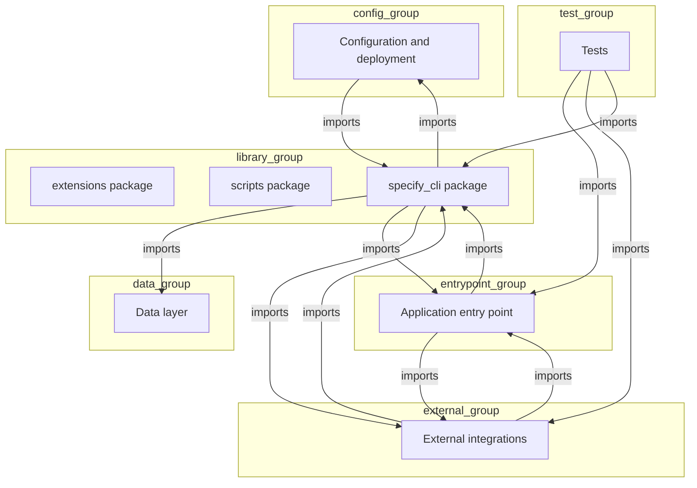

# Architecture report: github/spec-kit

> Automated static analysis. **Observed** = directly seen in files/imports/AST; **Inferred** = interpretation from that evidence. Repository code was not executed.

## 1. Repository at a glance

| Item | Value |
| --- | --- |
| Repository | github/spec-kit |
| Description | 💫 Toolkit to help you get started with SDD or any other process! |
| Language | Python |
| Stars | 149786 |
| Licence | MIT |
| Analysed commit / branch | 2ee2b1e8005905db05f5717300a469b3068b908f / main |
| Framework(s) | Typer |
| Files analysed | 717 |
| Components | 8 |

## 2. Architecture in one minute

github/spec-kit - 💫 Toolkit to help you get started with SDD or any other process!. This repository was analysed statically from 717 file(s) (383 Python). Detected technologies (observed from imports/manifests): GitHub Actions, Typer, Click, Pydantic, Poetry, Docker. Files are grouped into 8 component(s): Configuration and deployment, Data layer, Application entry point, extensions package, External integrations, scripts package, specify_cli package, Tests. Observed entry point(s): src/specify_cli/__init__.py, src/specify_cli/artifacts/_commands.py, src/specify_cli/artifacts/command_info.py. Findings below distinguish observed facts from inferred interpretation.

## 3. High-level block diagram

## 4. Main components

### Configuration and deployment (`config`)

- **Kind:** config
- **Status:** Observed
- **Confidence:** 0.85
- **Responsibility:** Groups 28 file(s) under configuration and deployment (observed from repository paths and static analysis). Observed top-level classes: AuthConfigEntry. Observed top-level functions: _default_config_path, _host_matches_pattern, _is_valid_host_pattern, _norm, find_entries_for_url, load_auth_config.
- **Paths:** `bundles/assess/bundle.yml`, `bundles/bugfix/bundle.yml`, `bundles/catalog.community.json`, `bundles/catalog.json`, `extensions/agent-context/agent-context-config.yml`, `extensions/agent-context/agent-context-defaults.json`, `extensions/agent-context/extension.yml`, `extensions/assess/extension.yml`, `extensions/bug/extension.yml`, `extensions/catalog.json`, `extensions/git/config-template.yml`, `extensions/git/extension.yml`, `extensions/git/git-config.yml`, `extensions/github/extension.yml`, `extensions/selftest/extension.yml`, `extensions/template/config-template.yml`, `extensions/template/extension.yml`, `integrations/catalog.community.json`, `integrations/catalog.json`, `presets/catalog.community.json`, `presets/catalog.json`, `presets/constitution-sync/preset.yml`, `presets/lean/preset.yml`, `presets/scaffold/preset.yml`, `presets/self-test/preset.yml`, `pyproject.toml`, `src/specify_cli/authentication/config.py`, `templates/vscode-settings.json`
- **Evidence:** [bundles/assess/bundle.yml](https://github.com/github/spec-kit/blob/2ee2b1e8005905db05f5717300a469b3068b908f/bundles/assess/bundle.yml); [bundles/bugfix/bundle.yml](https://github.com/github/spec-kit/blob/2ee2b1e8005905db05f5717300a469b3068b908f/bundles/bugfix/bundle.yml); [bundles/catalog.community.json](https://github.com/github/spec-kit/blob/2ee2b1e8005905db05f5717300a469b3068b908f/bundles/catalog.community.json); [bundles/catalog.json](https://github.com/github/spec-kit/blob/2ee2b1e8005905db05f5717300a469b3068b908f/bundles/catalog.json); [extensions/agent-context/agent-context-config.yml](https://github.com/github/spec-kit/blob/2ee2b1e8005905db05f5717300a469b3068b908f/extensions/agent-context/agent-context-config.yml); [extensions/agent-context/agent-context-defaults.json](https://github.com/github/spec-kit/blob/2ee2b1e8005905db05f5717300a469b3068b908f/extensions/agent-context/agent-context-defaults.json); [extensions/agent-context/extension.yml](https://github.com/github/spec-kit/blob/2ee2b1e8005905db05f5717300a469b3068b908f/extensions/agent-context/extension.yml); [extensions/assess/extension.yml](https://github.com/github/spec-kit/blob/2ee2b1e8005905db05f5717300a469b3068b908f/extensions/assess/extension.yml)

### Data layer (`data_layer`)

- **Kind:** data
- **Status:** Observed
- **Confidence:** 0.85
- **Responsibility:** Groups 1 file(s) under data layer (observed from repository paths and static analysis). Observed top-level classes: AmbiguousArtifactError, Artifact, ArtifactError, ArtifactNotFoundError, ArtifactResolutionError, ContributionNotFoundError.
- **Paths:** `src/specify_cli/artifacts/models.py`
- **Evidence:** [src/specify_cli/artifacts/models.py:16](https://github.com/github/spec-kit/blob/2ee2b1e8005905db05f5717300a469b3068b908f/src/specify_cli/artifacts/models.py#L16)

### Application entry point (`entrypoint`)

- **Kind:** entrypoint
- **Status:** Observed
- **Confidence:** 0.85
- **Responsibility:** Groups 30 file(s) under application entry point (observed from repository paths and static analysis). Observed application object created via Typer. Observed top-level classes: Args, EventRefreshError, _ResponseBudget, _StagedWorkflowFile. Observed top-level functions: __getattr__, _archive_extension_directory, _available_docs, _build_opencode_plugin, _build_section, _build_stack.
- **Paths:** `extensions/agent-context/scripts/python/update_agent_context.py`, `extensions/git/scripts/python/auto_commit.py`, `extensions/git/scripts/python/create_new_feature_branch.py`, `extensions/git/scripts/python/initialize_repo.py`, `extensions/github/scripts/python/resolve_tasks.py`, `scripts/python/check_prerequisites.py`, `scripts/python/create_new_feature.py`, `scripts/python/resolve_template.py`, `scripts/python/setup_plan.py`, `scripts/python/setup_tasks.py`, `src/specify_cli/__init__.py`, `src/specify_cli/artifacts/_commands.py`, `src/specify_cli/bundles/_commands.py`, `src/specify_cli/bundles/catalog/__init__.py`, `src/specify_cli/events/__init__.py`, `src/specify_cli/extensions/_commands.py`, `src/specify_cli/extensions/catalog/__init__.py`, `src/specify_cli/integrations/_commands.py`, `src/specify_cli/integrations/catalog/__init__.py`, `src/specify_cli/mcp_server/_worker.py`, `src/specify_cli/mcp_server/server.py`, `src/specify_cli/presets/_commands.py`, `src/specify_cli/presets/catalog/__init__.py`, `src/specify_cli/selfs/__init__.py`, `src/specify_cli/workflows/_commands.py`, `src/specify_cli/workflows/catalog/__init__.py`, `src/specify_cli/workflows/function/__init__.py`, `src/specify_cli/workflows/overlay/__init__.py`, `src/specify_cli/workflows/step/__init__.py`, `src/specify_cli/workflows/step/catalog/__init__.py`
- **Evidence:** [extensions/agent-context/scripts/python/update_agent_context.py:32](https://github.com/github/spec-kit/blob/2ee2b1e8005905db05f5717300a469b3068b908f/extensions/agent-context/scripts/python/update_agent_context.py#L32); [extensions/git/scripts/python/auto_commit.py:21](https://github.com/github/spec-kit/blob/2ee2b1e8005905db05f5717300a469b3068b908f/extensions/git/scripts/python/auto_commit.py#L21); [extensions/git/scripts/python/create_new_feature_branch.py:67](https://github.com/github/spec-kit/blob/2ee2b1e8005905db05f5717300a469b3068b908f/extensions/git/scripts/python/create_new_feature_branch.py#L67); [extensions/git/scripts/python/initialize_repo.py:19](https://github.com/github/spec-kit/blob/2ee2b1e8005905db05f5717300a469b3068b908f/extensions/git/scripts/python/initialize_repo.py#L19); [extensions/github/scripts/python/resolve_tasks.py:34](https://github.com/github/spec-kit/blob/2ee2b1e8005905db05f5717300a469b3068b908f/extensions/github/scripts/python/resolve_tasks.py#L34); [scripts/python/check_prerequisites.py:30](https://github.com/github/spec-kit/blob/2ee2b1e8005905db05f5717300a469b3068b908f/scripts/python/check_prerequisites.py#L30); [scripts/python/create_new_feature.py:32](https://github.com/github/spec-kit/blob/2ee2b1e8005905db05f5717300a469b3068b908f/scripts/python/create_new_feature.py#L32); [scripts/python/resolve_template.py:26](https://github.com/github/spec-kit/blob/2ee2b1e8005905db05f5717300a469b3068b908f/scripts/python/resolve_template.py#L26)

### extensions package (`extensions`)

- **Kind:** library
- **Status:** Observed
- **Confidence:** 0.85
- **Responsibility:** Groups 7 file(s) under extensions package (observed from repository paths and static analysis). Observed top-level functions: check_feature_branch, effective_branch_name, has_git.
- **Paths:** `extensions/agent-context/scripts/bash/update-agent-context.sh`, `extensions/git/scripts/bash/auto-commit.sh`, `extensions/git/scripts/bash/create-new-feature-branch.sh`, `extensions/git/scripts/bash/git-common.sh`, `extensions/git/scripts/bash/initialize-repo.sh`, `extensions/git/scripts/python/git_common.py`, `extensions/github/scripts/bash/resolve-tasks.sh`
- **Evidence:** [extensions/agent-context/scripts/bash/update-agent-context.sh](https://github.com/github/spec-kit/blob/2ee2b1e8005905db05f5717300a469b3068b908f/extensions/agent-context/scripts/bash/update-agent-context.sh); [extensions/git/scripts/bash/auto-commit.sh](https://github.com/github/spec-kit/blob/2ee2b1e8005905db05f5717300a469b3068b908f/extensions/git/scripts/bash/auto-commit.sh); [extensions/git/scripts/bash/create-new-feature-branch.sh](https://github.com/github/spec-kit/blob/2ee2b1e8005905db05f5717300a469b3068b908f/extensions/git/scripts/bash/create-new-feature-branch.sh); [extensions/git/scripts/bash/git-common.sh](https://github.com/github/spec-kit/blob/2ee2b1e8005905db05f5717300a469b3068b908f/extensions/git/scripts/bash/git-common.sh); [extensions/git/scripts/bash/initialize-repo.sh](https://github.com/github/spec-kit/blob/2ee2b1e8005905db05f5717300a469b3068b908f/extensions/git/scripts/bash/initialize-repo.sh); [extensions/git/scripts/python/git_common.py:17](https://github.com/github/spec-kit/blob/2ee2b1e8005905db05f5717300a469b3068b908f/extensions/git/scripts/python/git_common.py#L17); [extensions/github/scripts/bash/resolve-tasks.sh](https://github.com/github/spec-kit/blob/2ee2b1e8005905db05f5717300a469b3068b908f/extensions/github/scripts/bash/resolve-tasks.sh)

### External integrations (`external_integrations`)

- **Kind:** external
- **Status:** Observed
- **Confidence:** 0.85
- **Responsibility:** Groups 68 file(s) under external integrations (observed from repository paths and static analysis). Observed top-level classes: AgyIntegration, AlquimiaAIIntegration, AmpIntegration, AuggieIntegration, BobIntegration, CapturedProcess. Observed top-level functions: _accepts_keyword, _allow_all, _allow_all_tools, _assert_safe_scaffold_target, _best_effort_extension_op, _catalog_shape_error.
- **Paths:** `src/specify_cli/integrations/__init__.py`, `src/specify_cli/integrations/_capture.py`, `src/specify_cli/integrations/_catalog_versions.py`, `src/specify_cli/integrations/_command_scaffold_generation.py`, `src/specify_cli/integrations/_command_upgrade_layout.py`, `src/specify_cli/integrations/_file_changes.py`, `src/specify_cli/integrations/_helpers.py`, `src/specify_cli/integrations/_lifecycle.py`, `src/specify_cli/integrations/_registration.py`, `src/specify_cli/integrations/agy/__init__.py`, `src/specify_cli/integrations/alquimia/__init__.py`, `src/specify_cli/integrations/amp/__init__.py`, `src/specify_cli/integrations/auggie/__init__.py`, `src/specify_cli/integrations/base.py`, `src/specify_cli/integrations/bob/__init__.py`, `src/specify_cli/integrations/catalog/command_add.py`, `src/specify_cli/integrations/catalog/command_list.py`, `src/specify_cli/integrations/catalog/command_remove.py`, `src/specify_cli/integrations/claude/__init__.py`, `src/specify_cli/integrations/cline/__init__.py`, `src/specify_cli/integrations/codebuddy/__init__.py`, `src/specify_cli/integrations/codex/__init__.py`, `src/specify_cli/integrations/command_code/__init__.py`, `src/specify_cli/integrations/command_info.py`, `src/specify_cli/integrations/command_install.py`, `src/specify_cli/integrations/command_list.py`, `src/specify_cli/integrations/command_scaffold.py`, `src/specify_cli/integrations/command_search.py`, `src/specify_cli/integrations/command_status.py`, `src/specify_cli/integrations/command_switch.py`, `src/specify_cli/integrations/command_uninstall.py`, `src/specify_cli/integrations/command_upgrade.py`, `src/specify_cli/integrations/command_use.py`, `src/specify_cli/integrations/copilot/__init__.py`, `src/specify_cli/integrations/cursor_agent/__init__.py`, `src/specify_cli/integrations/devin/__init__.py`, `src/specify_cli/integrations/docker_agent/__init__.py`, `src/specify_cli/integrations/droid/__init__.py`, `src/specify_cli/integrations/dsh/__init__.py`, `src/specify_cli/integrations/firebender/__init__.py`, `src/specify_cli/integrations/forge/__init__.py`, `src/specify_cli/integrations/gemini/__init__.py`, `src/specify_cli/integrations/generic/__init__.py`, `src/specify_cli/integrations/goose/__init__.py`, `src/specify_cli/integrations/grok/__init__.py`, `src/specify_cli/integrations/hermes/__init__.py`, `src/specify_cli/integrations/installer.py`, `src/specify_cli/integrations/junie/__init__.py`, `src/specify_cli/integrations/kilocode/__init__.py`, `src/specify_cli/integrations/kimi/__init__.py`, `src/specify_cli/integrations/kiro_cli/__init__.py`, `src/specify_cli/integrations/lingma/__init__.py`, `src/specify_cli/integrations/manifest.py`, `src/specify_cli/integrations/mcode/__init__.py`, `src/specify_cli/integrations/muse/__init__.py`, `src/specify_cli/integrations/none/__init__.py`, `src/specify_cli/integrations/omp/__init__.py`, `src/specify_cli/integrations/opencode/__init__.py`, `src/specify_cli/integrations/pi/__init__.py`, `src/specify_cli/integrations/qodercli/__init__.py`, `src/specify_cli/integrations/qwen/__init__.py`, `src/specify_cli/integrations/rovodev/__init__.py`, `src/specify_cli/integrations/shai/__init__.py`, `src/specify_cli/integrations/tabnine/__init__.py`, `src/specify_cli/integrations/trae/__init__.py`, `src/specify_cli/integrations/vibe/__init__.py`, `src/specify_cli/integrations/zcode/__init__.py`, `src/specify_cli/integrations/zed/__init__.py`
- **Evidence:** [src/specify_cli/integrations/__init__.py:33](https://github.com/github/spec-kit/blob/2ee2b1e8005905db05f5717300a469b3068b908f/src/specify_cli/integrations/__init__.py#L33); [src/specify_cli/integrations/_capture.py:31](https://github.com/github/spec-kit/blob/2ee2b1e8005905db05f5717300a469b3068b908f/src/specify_cli/integrations/_capture.py#L31); [src/specify_cli/integrations/_catalog_versions.py:40](https://github.com/github/spec-kit/blob/2ee2b1e8005905db05f5717300a469b3068b908f/src/specify_cli/integrations/_catalog_versions.py#L40); [src/specify_cli/integrations/_command_scaffold_generation.py:11](https://github.com/github/spec-kit/blob/2ee2b1e8005905db05f5717300a469b3068b908f/src/specify_cli/integrations/_command_scaffold_generation.py#L11); [src/specify_cli/integrations/_command_upgrade_layout.py:8](https://github.com/github/spec-kit/blob/2ee2b1e8005905db05f5717300a469b3068b908f/src/specify_cli/integrations/_command_upgrade_layout.py#L8); [src/specify_cli/integrations/_file_changes.py:18](https://github.com/github/spec-kit/blob/2ee2b1e8005905db05f5717300a469b3068b908f/src/specify_cli/integrations/_file_changes.py#L18); [src/specify_cli/integrations/_helpers.py:28](https://github.com/github/spec-kit/blob/2ee2b1e8005905db05f5717300a469b3068b908f/src/specify_cli/integrations/_helpers.py#L28); [src/specify_cli/integrations/_lifecycle.py:40](https://github.com/github/spec-kit/blob/2ee2b1e8005905db05f5717300a469b3068b908f/src/specify_cli/integrations/_lifecycle.py#L40)

### scripts package (`scripts`)

- **Kind:** library
- **Status:** Observed
- **Confidence:** 0.85
- **Responsibility:** Groups 7 file(s) under scripts package (observed from repository paths and static analysis). Observed top-level classes: FeaturePaths, TemplateResolutionError, _DelegatedYAML, _DelegatedYAMLError, _NonNativeYAMLValue. Observed top-level functions: _conventional_template, _delegated_yaml_object_hook, _import_yaml, _is_safe_component, _json_dump, _normalize_priority.
- **Paths:** `scripts/bash/check-prerequisites.sh`, `scripts/bash/common.sh`, `scripts/bash/create-new-feature.sh`, `scripts/bash/resolve-template.sh`, `scripts/bash/setup-plan.sh`, `scripts/bash/setup-tasks.sh`, `scripts/python/common.py`
- **Evidence:** [scripts/bash/check-prerequisites.sh](https://github.com/github/spec-kit/blob/2ee2b1e8005905db05f5717300a469b3068b908f/scripts/bash/check-prerequisites.sh); [scripts/bash/common.sh](https://github.com/github/spec-kit/blob/2ee2b1e8005905db05f5717300a469b3068b908f/scripts/bash/common.sh); [scripts/bash/create-new-feature.sh](https://github.com/github/spec-kit/blob/2ee2b1e8005905db05f5717300a469b3068b908f/scripts/bash/create-new-feature.sh); [scripts/bash/resolve-template.sh](https://github.com/github/spec-kit/blob/2ee2b1e8005905db05f5717300a469b3068b908f/scripts/bash/resolve-template.sh); [scripts/bash/setup-plan.sh](https://github.com/github/spec-kit/blob/2ee2b1e8005905db05f5717300a469b3068b908f/scripts/bash/setup-plan.sh); [scripts/bash/setup-tasks.sh](https://github.com/github/spec-kit/blob/2ee2b1e8005905db05f5717300a469b3068b908f/scripts/bash/setup-tasks.sh); [scripts/python/common.py:14](https://github.com/github/spec-kit/blob/2ee2b1e8005905db05f5717300a469b3068b908f/scripts/python/common.py#L14)

### specify_cli package (`specify_cli`)

- **Kind:** library
- **Status:** Observed
- **Confidence:** 0.85
- **Responsibility:** Groups 215 file(s) under specify_cli package (observed from repository paths and static analysis). Observed top-level classes: ArchiveHooks, ArchiveRequest, ArtifactCatalog, ArtifactInfoAmbiguousError, ArtifactInfoError, ArtifactInfoHookArtifact. Observed top-level functions: _adapter_failure, _all_base_step_ids, _api, _append_notice, _apply_filter, _archive_extension_directory.
- **Paths:** `src/specify_cli/_agent_config.py`, `src/specify_cli/_assets.py`, `src/specify_cli/_console.py`, `src/specify_cli/_download_security.py`, `src/specify_cli/_file_handles.py`, `src/specify_cli/_file_policy.py`, `src/specify_cli/_init_options.py`, `src/specify_cli/_install_ignore.py`, `src/specify_cli/_installed_info_json.py`, `src/specify_cli/_installed_list_json.py`, `src/specify_cli/_invocation_style.py`, `src/specify_cli/_operation_version.py`, `src/specify_cli/_project.py`, `src/specify_cli/_toml_string.py`, `src/specify_cli/_utils.py`, `src/specify_cli/_version.py`, `src/specify_cli/_windows_abi.py`, `src/specify_cli/agents.py`, `src/specify_cli/artifacts/__init__.py`, `src/specify_cli/artifacts/_identifiers.py`, `src/specify_cli/artifacts/_mcp.py`, `src/specify_cli/artifacts/_operation_info.py`, `src/specify_cli/artifacts/_operation_list.py`, `src/specify_cli/artifacts/catalog.py`, `src/specify_cli/artifacts/command_info.py`, `src/specify_cli/artifacts/command_list.py`, `src/specify_cli/artifacts/command_lookup.py`, `src/specify_cli/artifacts/mcp_info.py`, `src/specify_cli/artifacts/mcp_list.py`, `src/specify_cli/artifacts/resolution.py`, `src/specify_cli/authentication/__init__.py`, `src/specify_cli/authentication/azure_devops.py`, `src/specify_cli/authentication/base.py`, `src/specify_cli/authentication/bitbucket.py`, `src/specify_cli/authentication/github.py`, `src/specify_cli/authentication/github_http.py`, `src/specify_cli/authentication/http.py`, `src/specify_cli/bundler.py`, `src/specify_cli/bundles/__init__.py`, `src/specify_cli/bundles/adapters.py`, `src/specify_cli/bundles/catalog/command_add.py`, `src/specify_cli/bundles/catalog/command_list.py`, `src/specify_cli/bundles/catalog/command_remove.py`, `src/specify_cli/bundles/catalog_config.py`, `src/specify_cli/bundles/catalog_stack.py`, `src/specify_cli/bundles/catalog_versions.py`, `src/specify_cli/bundles/catalogs.py`, `src/specify_cli/bundles/command_add.py`, `src/specify_cli/bundles/command_build.py`, `src/specify_cli/bundles/command_info.py`, `src/specify_cli/bundles/command_init.py`, `src/specify_cli/bundles/command_install.py`, `src/specify_cli/bundles/command_list.py`, `src/specify_cli/bundles/command_remove.py`, `src/specify_cli/bundles/command_search.py`, `src/specify_cli/bundles/command_update.py`, `src/specify_cli/bundles/command_validate.py`, `src/specify_cli/bundles/component_catalog.py`, `src/specify_cli/bundles/conflict.py`, `src/specify_cli/bundles/expansion.py`, `src/specify_cli/bundles/installer.py`, `src/specify_cli/bundles/manifest.py`, `src/specify_cli/bundles/packager.py`, `src/specify_cli/bundles/primitives.py`, `src/specify_cli/bundles/project.py`, `src/specify_cli/bundles/records.py`, `src/specify_cli/bundles/references.py`, `src/specify_cli/bundles/resolver.py`, `src/specify_cli/bundles/sources.py`, `src/specify_cli/bundles/validator.py`, `src/specify_cli/bundles/versioning.py`, `src/specify_cli/bundles/yamlio.py`, `src/specify_cli/catalogs.py`, `src/specify_cli/command_check.py`, `src/specify_cli/command_init.py`, `src/specify_cli/command_mcp.py`, `src/specify_cli/command_version.py`, `src/specify_cli/events/command_run.py`, `src/specify_cli/extensions/_catalog_versions.py`, `src/specify_cli/extensions/_command_update_artifacts.py`, `src/specify_cli/extensions/_command_update_discovery.py`, `src/specify_cli/extensions/_command_update_transaction.py`, `src/specify_cli/extensions/catalog/_helpers.py`, `src/specify_cli/extensions/catalog/command_add.py`, `src/specify_cli/extensions/catalog/command_list.py`, `src/specify_cli/extensions/catalog/command_remove.py`, `src/specify_cli/extensions/command_add.py`, `src/specify_cli/extensions/command_disable.py`, `src/specify_cli/extensions/command_enable.py`, `src/specify_cli/extensions/command_info.py`, `src/specify_cli/extensions/command_list.py`, `src/specify_cli/extensions/command_remove.py`, `src/specify_cli/extensions/command_search.py`, `src/specify_cli/extensions/command_set_priority.py`, `src/specify_cli/extensions/command_update.py`, `src/specify_cli/file_helper.py`, `src/specify_cli/integration_runtime.py`, `src/specify_cli/integration_state.py`, `src/specify_cli/integration_status.py`, `src/specify_cli/mcp_server/__init__.py`, `src/specify_cli/mcp_server/catalog.py`, `src/specify_cli/mcp_server/executor.py`, `src/specify_cli/mcp_version.py`, `src/specify_cli/presets/__init__.py`, `src/specify_cli/presets/_catalog.py`, `src/specify_cli/presets/_catalog_versions.py`, `src/specify_cli/presets/_manager.py`, `src/specify_cli/presets/_manager_commands.py`, `src/specify_cli/presets/_manager_skills.py`, `src/specify_cli/presets/_manifest.py`, `src/specify_cli/presets/_registry.py`, `src/specify_cli/presets/_resolver.py`, `src/specify_cli/presets/catalog/command_add.py`, `src/specify_cli/presets/catalog/command_list.py`, `src/specify_cli/presets/catalog/command_remove.py`, `src/specify_cli/presets/command_add.py`, `src/specify_cli/presets/command_disable.py`, `src/specify_cli/presets/command_enable.py`, `src/specify_cli/presets/command_info.py`, `src/specify_cli/presets/command_list.py`, `src/specify_cli/presets/command_remove.py`, `src/specify_cli/presets/command_resolve.py`, `src/specify_cli/presets/command_search.py`, `src/specify_cli/presets/command_set_priority.py`, `src/specify_cli/presets/command_update.py`, `src/specify_cli/selfs/command_check.py`, `src/specify_cli/selfs/command_upgrade.py`, `src/specify_cli/shared_infra.py`, `src/specify_cli/workflows/__init__.py`, `src/specify_cli/workflows/_archive_install.py`, `src/specify_cli/workflows/_catalog_cache.py`, `src/specify_cli/workflows/_command_resume_state.py`, `src/specify_cli/workflows/_command_run_ownership.py`, `src/specify_cli/workflows/_execution.py`, `src/specify_cli/workflows/_mcp.py`, `src/specify_cli/workflows/_operation_list.py`, `src/specify_cli/workflows/_package_install.py`, `src/specify_cli/workflows/_package_registry.py`, `src/specify_cli/workflows/_storage.py`, `src/specify_cli/workflows/base.py`, `src/specify_cli/workflows/catalog/_domain.py`, `src/specify_cli/workflows/catalog/_versions.py`, `src/specify_cli/workflows/catalog/command_add.py`, `src/specify_cli/workflows/catalog/command_list.py`, `src/specify_cli/workflows/catalog/command_remove.py`, `src/specify_cli/workflows/command_add.py`, `src/specify_cli/workflows/command_definition.py`, `src/specify_cli/workflows/command_disable.py`, `src/specify_cli/workflows/command_enable.py`, `src/specify_cli/workflows/command_info.py`, `src/specify_cli/workflows/command_list.py`, `src/specify_cli/workflows/command_remove.py`, `src/specify_cli/workflows/command_resolve.py`, `src/specify_cli/workflows/command_resume.py`, `src/specify_cli/workflows/command_run.py`, `src/specify_cli/workflows/command_search.py`, `src/specify_cli/workflows/command_status.py`, `src/specify_cli/workflows/command_update.py`, `src/specify_cli/workflows/composition.py`, `src/specify_cli/workflows/engine.py`, `src/specify_cli/workflows/expressions/__init__.py`, `src/specify_cli/workflows/expressions/api.py`, `src/specify_cli/workflows/expressions/diagnostics.py`, `src/specify_cli/workflows/expressions/engine.py`, `src/specify_cli/workflows/expressions/filters.py`, `src/specify_cli/workflows/expressions/namespace.py`, `src/specify_cli/workflows/expressions/operators.py`, `src/specify_cli/workflows/expressions/template.py`, `src/specify_cli/workflows/function/_domain.py`, `src/specify_cli/workflows/function/command_add.py`, `src/specify_cli/workflows/function/command_list.py`, `src/specify_cli/workflows/function/command_remove.py`, `src/specify_cli/workflows/function/installer.py`, `src/specify_cli/workflows/function/loader.py`, `src/specify_cli/workflows/mcp_list.py`, `src/specify_cli/workflows/overlay/command_add.py`, `src/specify_cli/workflows/overlay/command_disable.py`, `src/specify_cli/workflows/overlay/command_enable.py`, `src/specify_cli/workflows/overlay/command_list.py`, `src/specify_cli/workflows/overlay/command_remove.py`, `src/specify_cli/workflows/overlay/command_set_priority.py`, `src/specify_cli/workflows/overlay/composer.py`, `src/specify_cli/workflows/overlay/layer_sources.py`, `src/specify_cli/workflows/overlay/merge.py`, `src/specify_cli/workflows/overlay/operations.py`, `src/specify_cli/workflows/overlay/resolver.py`, `src/specify_cli/workflows/overlay/schema.py`, `src/specify_cli/workflows/step/_capture.py`, `src/specify_cli/workflows/step/_dispatch_settings.py`, `src/specify_cli/workflows/step/_helpers.py`, `src/specify_cli/workflows/step/catalog/_domain.py`, `src/specify_cli/workflows/step/catalog/_versions.py`, `src/specify_cli/workflows/step/catalog/command_add.py`, `src/specify_cli/workflows/step/catalog/command_list.py`, `src/specify_cli/workflows/step/catalog/command_remove.py`, `src/specify_cli/workflows/step/command/__init__.py`, `src/specify_cli/workflows/step/command_add.py`, `src/specify_cli/workflows/step/command_info.py`, `src/specify_cli/workflows/step/command_list.py`, `src/specify_cli/workflows/step/command_remove.py`, `src/specify_cli/workflows/step/command_search.py`, `src/specify_cli/workflows/step/do_while/__init__.py`, `src/specify_cli/workflows/step/fan_in/__init__.py`, `src/specify_cli/workflows/step/fan_out/__init__.py`, `src/specify_cli/workflows/step/gate/__init__.py`, `src/specify_cli/workflows/step/github/__init__.py`, `src/specify_cli/workflows/step/if_then/__init__.py`, `src/specify_cli/workflows/step/init/__init__.py`, `src/specify_cli/workflows/step/installer.py`, `src/specify_cli/workflows/step/prompt/__init__.py`, `src/specify_cli/workflows/step/shell/__init__.py`, `src/specify_cli/workflows/step/slot/__init__.py`, `src/specify_cli/workflows/step/switch/__init__.py`, `src/specify_cli/workflows/step/while_loop/__init__.py`, `src/specify_cli/workflows/step/workflow/__init__.py`
- **Evidence:** [src/specify_cli/_agent_config.py:9](https://github.com/github/spec-kit/blob/2ee2b1e8005905db05f5717300a469b3068b908f/src/specify_cli/_agent_config.py#L9); [src/specify_cli/_assets.py:13](https://github.com/github/spec-kit/blob/2ee2b1e8005905db05f5717300a469b3068b908f/src/specify_cli/_assets.py#L13); [src/specify_cli/_console.py:44](https://github.com/github/spec-kit/blob/2ee2b1e8005905db05f5717300a469b3068b908f/src/specify_cli/_console.py#L44); [src/specify_cli/_download_security.py:95](https://github.com/github/spec-kit/blob/2ee2b1e8005905db05f5717300a469b3068b908f/src/specify_cli/_download_security.py#L95); [src/specify_cli/_file_handles.py:18](https://github.com/github/spec-kit/blob/2ee2b1e8005905db05f5717300a469b3068b908f/src/specify_cli/_file_handles.py#L18); [src/specify_cli/_file_policy.py:14](https://github.com/github/spec-kit/blob/2ee2b1e8005905db05f5717300a469b3068b908f/src/specify_cli/_file_policy.py#L14); [src/specify_cli/_init_options.py:12](https://github.com/github/spec-kit/blob/2ee2b1e8005905db05f5717300a469b3068b908f/src/specify_cli/_init_options.py#L12); [src/specify_cli/_install_ignore.py:10](https://github.com/github/spec-kit/blob/2ee2b1e8005905db05f5717300a469b3068b908f/src/specify_cli/_install_ignore.py#L10)

### Tests (`tests`)

- **Kind:** test
- **Status:** Observed
- **Confidence:** 0.85
- **Responsibility:** Groups 67 file(s) under tests (observed from repository paths and static analysis). Observed top-level classes: MarkdownIntegrationTests, SkillsIntegrationTests, StubIntegration, TestAgyBuildExecArgs, TestAgyHookCommandNote, TestAgyInitFlow. Observed top-level functions: _add_feature, _add_prompt_probe_remote, _add_sibling_worktree, _assert_parity, _assert_stopped, _bash_posix_path.
- **Paths:** `tests/__init__.py`, `tests/conftest.py`, `tests/contract/test_bundled_extension_update_delivery.py`, `tests/contract/test_bundled_extension_versions.py`, `tests/contract/test_catalog_schema.py`, `tests/contract/test_extension_version_guard_script.py`, `tests/contract/test_firstparty_bundle_catalog_consistency.py`, `tests/contract/test_manifest_schema.py`, `tests/contract/test_wheel_bundled_presets.py`, `tests/contract/test_wheel_bundled_workflows.py`, `tests/contract/test_wheel_core_pack_scripts.py`, `tests/extensions/__init__.py`, `tests/extensions/assess/__init__.py`, `tests/extensions/assess/test_assess_extension.py`, `tests/extensions/bug/__init__.py`, `tests/extensions/bug/test_bug_extension.py`, `tests/extensions/bug/test_bug_hooks.py`, `tests/extensions/git/__init__.py`, `tests/extensions/git/test_git_extension.py`, `tests/extensions/git/test_git_extension_python_parity.py`, `tests/extensions/github/__init__.py`, `tests/extensions/github/test_github_extension.py`, `tests/extensions/test_agent_context_cli_free.py`, `tests/extensions/test_extension_agent_context.py`, `tests/extensions/test_update_agent_context_feature_json.py`, `tests/extensions/test_update_agent_context_python_parity.py`, `tests/hooks/.specify/extensions.yml`, `tests/hooks/TESTING.md`, `tests/hooks/plan.md`, `tests/hooks/spec.md`, `tests/hooks/tasks.md`, `tests/http_helpers.py`, `tests/integration/test_preset_update_workflow.py`, `tests/integrations/__init__.py`, `tests/integrations/conftest.py`, `tests/integrations/test_base.py`, `tests/integrations/test_capture.py`, `tests/integrations/test_cli.py`, `tests/integrations/test_extra_args.py`, `tests/integrations/test_home_isolation.py`, `tests/integrations/test_integration_agy.py`, `tests/integrations/test_integration_alquimia.py`, `tests/integrations/test_integration_amp.py`, `tests/integrations/test_integration_auggie.py`, `tests/integrations/test_integration_base_markdown.py`, `tests/integrations/test_integration_base_skills.py`, `tests/integrations/test_integration_base_toml.py`, `tests/integrations/test_integration_base_yaml.py`, `tests/integrations/test_integration_bob.py`, `tests/integrations/test_integration_characterization.py`, `tests/integrations/test_integration_claude.py`, `tests/integrations/test_integration_cline.py`, `tests/integrations/test_integration_codebuddy.py`, `tests/integrations/test_integration_codex.py`, `tests/integrations/test_integration_command_code.py`, `tests/integrations/test_integration_copilot.py`, `tests/integrations/test_integration_cursor_agent.py`, `tests/integrations/test_integration_devin.py`, `tests/integrations/test_integration_docker_agent.py`, `tests/integrations/test_integration_firebender.py`, `tests/integrations/test_integration_gemini.py`, `tests/integrations/test_integration_kilocode.py`, `tests/specify_cli/__init__.py`, `tests/specify_cli/bundles/__init__.py`, `tests/specify_cli/bundles/catalog/__init__.py`, `tests/specify_cli/workflows/expressions/__init__.py`, `tests/specify_cli/workflows/function/__init__.py`
- **Evidence:** [tests/__init__.py](https://github.com/github/spec-kit/blob/2ee2b1e8005905db05f5717300a469b3068b908f/tests/__init__.py); [tests/conftest.py:18](https://github.com/github/spec-kit/blob/2ee2b1e8005905db05f5717300a469b3068b908f/tests/conftest.py#L18); [tests/contract/test_bundled_extension_update_delivery.py:39](https://github.com/github/spec-kit/blob/2ee2b1e8005905db05f5717300a469b3068b908f/tests/contract/test_bundled_extension_update_delivery.py#L39); [tests/contract/test_bundled_extension_versions.py:31](https://github.com/github/spec-kit/blob/2ee2b1e8005905db05f5717300a469b3068b908f/tests/contract/test_bundled_extension_versions.py#L31); [tests/contract/test_catalog_schema.py:27](https://github.com/github/spec-kit/blob/2ee2b1e8005905db05f5717300a469b3068b908f/tests/contract/test_catalog_schema.py#L27); [tests/contract/test_extension_version_guard_script.py:25](https://github.com/github/spec-kit/blob/2ee2b1e8005905db05f5717300a469b3068b908f/tests/contract/test_extension_version_guard_script.py#L25); [tests/contract/test_firstparty_bundle_catalog_consistency.py:19](https://github.com/github/spec-kit/blob/2ee2b1e8005905db05f5717300a469b3068b908f/tests/contract/test_firstparty_bundle_catalog_consistency.py#L19); [tests/contract/test_manifest_schema.py:15](https://github.com/github/spec-kit/blob/2ee2b1e8005905db05f5717300a469b3068b908f/tests/contract/test_manifest_schema.py#L15)

## 5. Execution flow

**Observed** entry point(s):

- [src/specify_cli/__init__.py](https://github.com/github/spec-kit/blob/2ee2b1e8005905db05f5717300a469b3068b908f/src/specify_cli/__init__.py)
- [src/specify_cli/artifacts/_commands.py:23](https://github.com/github/spec-kit/blob/2ee2b1e8005905db05f5717300a469b3068b908f/src/specify_cli/artifacts/_commands.py#L23)
- [src/specify_cli/artifacts/command_info.py:40](https://github.com/github/spec-kit/blob/2ee2b1e8005905db05f5717300a469b3068b908f/src/specify_cli/artifacts/command_info.py#L40)
- [src/specify_cli/artifacts/command_list.py:35](https://github.com/github/spec-kit/blob/2ee2b1e8005905db05f5717300a469b3068b908f/src/specify_cli/artifacts/command_list.py#L35)
- [src/specify_cli/artifacts/command_lookup.py:21](https://github.com/github/spec-kit/blob/2ee2b1e8005905db05f5717300a469b3068b908f/src/specify_cli/artifacts/command_lookup.py#L21)
- [src/specify_cli/bundles/_commands.py:24](https://github.com/github/spec-kit/blob/2ee2b1e8005905db05f5717300a469b3068b908f/src/specify_cli/bundles/_commands.py#L24)
- [src/specify_cli/bundles/catalog/__init__.py:7](https://github.com/github/spec-kit/blob/2ee2b1e8005905db05f5717300a469b3068b908f/src/specify_cli/bundles/catalog/__init__.py#L7)
- [src/specify_cli/bundles/catalog/command_add.py:16](https://github.com/github/spec-kit/blob/2ee2b1e8005905db05f5717300a469b3068b908f/src/specify_cli/bundles/catalog/command_add.py#L16)
- [src/specify_cli/bundles/catalog/command_list.py:15](https://github.com/github/spec-kit/blob/2ee2b1e8005905db05f5717300a469b3068b908f/src/specify_cli/bundles/catalog/command_list.py#L15)
- [src/specify_cli/bundles/catalog/command_remove.py:16](https://github.com/github/spec-kit/blob/2ee2b1e8005905db05f5717300a469b3068b908f/src/specify_cli/bundles/catalog/command_remove.py#L16)
- [src/specify_cli/bundles/command_add.py:12](https://github.com/github/spec-kit/blob/2ee2b1e8005905db05f5717300a469b3068b908f/src/specify_cli/bundles/command_add.py#L12)
- [src/specify_cli/bundles/command_build.py:16](https://github.com/github/spec-kit/blob/2ee2b1e8005905db05f5717300a469b3068b908f/src/specify_cli/bundles/command_build.py#L16)

Representative flow (derived from observed entry points and the import graph; steps beyond the entry point are **Inferred**):

1. Execution starts at an observed entry point listed above, if present.
2. `config` imports `specify_cli` (Configuration and deployment -> specify_cli package).
3. `entrypoint` imports `external_integrations` (Application entry point -> External integrations).
4. `entrypoint` imports `specify_cli` (Application entry point -> specify_cli package).
5. `external_integrations` imports `entrypoint` (External integrations -> Application entry point).
6. `external_integrations` imports `specify_cli` (External integrations -> specify_cli package).
7. `specify_cli` imports `config` (specify_cli package -> Configuration and deployment).
8. `specify_cli` imports `data_layer` (specify_cli package -> Data layer).
9. `specify_cli` imports `entrypoint` (specify_cli package -> Application entry point).

## 6. Project structure

### `(root)`

- `.editorconfig` - config (369 bytes)
- `.gitattributes` - other (392 bytes)
- `.gitignore` - other (890 bytes)
- `.markdownlint-cli2.jsonc` - other (482 bytes)
- `.pre-commit-config.yaml` - config (314 bytes)
- `.zenodo.json` - config (853 bytes)
- `AGENTS.md` - docs (3747 bytes)
- `CHANGELOG.md` - docs (152542 bytes)
- `CITATION.cff` - other (959 bytes)
- `CODE_OF_CONDUCT.md` - docs (3233 bytes)
- `CONTRIBUTING.md` - docs (30538 bytes)
- `DEVELOPMENT.md` - docs (2492 bytes)
- `LICENSE` - docs (1060 bytes)
- `README.ja.md` - docs (12128 bytes)
- `README.ko.md` - docs (10588 bytes)
- `README.md` - docs (14337 bytes)
- `README.zh-CN.md` - docs (8890 bytes)
- `SECURITY.md` - docs (1736 bytes)
- `SUPPORT.md` - docs (3035 bytes)
- `pyproject.toml` - manifest (3700 bytes)
- `spec-driven.md` - docs (26229 bytes)
- `spec-kit.code-workspace` - other (61 bytes)

### `.devcontainer`

- `.devcontainer/devcontainer.json` - config (2196 bytes)
- `.devcontainer/post-create.sh` - source, Shell (3605 bytes)

### `.github`

- `.github/CODEOWNERS` - other (242 bytes)
- `.github/ISSUE_TEMPLATE/agent_request.yml` - config (5324 bytes)
- `.github/ISSUE_TEMPLATE/bug_report.yml` - config (4041 bytes)
- `.github/ISSUE_TEMPLATE/bundle_submission.yml` - config (11090 bytes)
- `.github/ISSUE_TEMPLATE/config.yml` - config (835 bytes)
- `.github/ISSUE_TEMPLATE/extension_submission.yml` - config (8736 bytes)
- `.github/ISSUE_TEMPLATE/feature_request.yml` - config (4036 bytes)
- `.github/ISSUE_TEMPLATE/preset_submission.yml` - config (6902 bytes)
- `.github/ISSUE_TEMPLATE/workflow_step_submission.yml` - config (11610 bytes)
- `.github/PULL_REQUEST_TEMPLATE.md` - docs (1439 bytes)
- `.github/aw/actions-lock.json` - config (1728 bytes)
- `.github/dependabot.yml` - config (434 bytes)
- `.github/scripts/check_extension_version_bump.py` - source, Python (9903 bytes)
- `.github/scripts/check_security_requirements.py` - source, Python (3802 bytes)
- `.github/scripts/validate_community_preset.py` - source, Python (21600 bytes)
- `.github/scripts/validate_community_workflow_step.py` - source, Python (23806 bytes)
- `.github/security-audit-requirements.txt` - docs (65047 bytes)
- `.github/skills/add-community-extension/SKILL.md` - docs (6704 bytes)
- `.github/skills/code-review/SKILL.md` - docs (1777 bytes)
- `.github/workflows/RELEASE-PROCESS.md` - ci, YAML (13309 bytes)
- `.github/workflows/add-community-bundle.lock.yml` - ci, YAML (137378 bytes)
- `.github/workflows/add-community-bundle.md` - ci, YAML (18326 bytes)
- `.github/workflows/add-community-extension.lock.yml` - ci, YAML (136744 bytes)
- `.github/workflows/add-community-extension.md` - ci, YAML (16427 bytes)
- `.github/workflows/add-community-preset.lock.yml` - ci, YAML (137067 bytes)
- `.github/workflows/add-community-preset.md` - ci, YAML (24017 bytes)
- `.github/workflows/add-community-workflow-step.lock.yml` - ci, YAML (137533 bytes)
- `.github/workflows/add-community-workflow-step.md` - ci, YAML (24247 bytes)
- `.github/workflows/bug-assess.lock.yml` - ci, YAML (127503 bytes)
- `.github/workflows/bug-assess.md` - ci, YAML (9554 bytes)
- `.github/workflows/bug-fix.lock.yml` - ci, YAML (133319 bytes)
- `.github/workflows/bug-fix.md` - ci, YAML (14600 bytes)
- `.github/workflows/bug-test.lock.yml` - ci, YAML (130636 bytes)
- `.github/workflows/bug-test.md` - ci, YAML (15991 bytes)
- `.github/workflows/catalog-assign.yml` - ci, YAML (1758 bytes)
- `.github/workflows/codeql.yml` - ci, YAML (813 bytes)
- `.github/workflows/docs.yml` - ci, YAML (1949 bytes)
- `.github/workflows/extension-version-guard.yml` - ci, YAML (2512 bytes)
- `.github/workflows/feature-assess.lock.yml` - ci, YAML (134146 bytes)
- `.github/workflows/feature-assess.md` - ci, YAML (15030 bytes)
- `.github/workflows/lint.yml` - ci, YAML (8160 bytes)
- `.github/workflows/pr-assess.lock.yml` - ci, YAML (128336 bytes)
- `.github/workflows/pr-assess.md` - ci, YAML (12286 bytes)
- `.github/workflows/publish-pypi.yml` - ci, YAML (2278 bytes)
- `.github/workflows/release-trigger.yml` - ci, YAML (7071 bytes)
- `.github/workflows/release.yml` - ci, YAML (3012 bytes)
- `.github/workflows/stale.yml` - ci, YAML (3340 bytes)
- `.github/workflows/test.yml` - ci, YAML (1514 bytes)

### `.specify`

- `.specify/memory/constitution.md` - docs (13252 bytes)

### `bundles`

- `bundles/assess/README.md` - docs (1610 bytes)
- `bundles/assess/bundle.yml` - config (583 bytes)
- `bundles/bugfix/README.md` - docs (1960 bytes)
- `bundles/bugfix/bundle.yml` - config (518 bytes)
- `bundles/catalog.community.json` - config (3806 bytes)
- `bundles/catalog.json` - config (1733 bytes)

### `design`

- `design/catalogs.md` - docs (19722 bytes)
- `design/cli.md` - docs (17629 bytes)
- `design/extension.md` - docs (20749 bytes)
- `design/file-helper.md` - docs (31371 bytes)
- `design/integration.md` - docs (32848 bytes)
- `design/mcp.md` - docs (27226 bytes)
- `design/shared.md` - docs (15981 bytes)
- `design/workflow-step.md` - docs (9498 bytes)

### `docs`

- `docs/.gitignore` - docs (72 bytes)
- `docs/README.md` - docs (6081 bytes)
- `docs/bundles/api.md` - docs (10000 bytes)
- `docs/bundles/catalogs.md` - docs (8552 bytes)
- `docs/bundles/cli.md` - docs (15211 bytes)
- `docs/bundles/developing.md` - docs (6435 bytes)
- `docs/bundles/overview.md` - docs (3851 bytes)
- `docs/bundles/publishing.md` - docs (6960 bytes)
- `docs/community/bundles.md` - docs (2957 bytes)
- `docs/community/extensions.md` - docs (50051 bytes)
- `docs/community/friends.md` - docs (5931 bytes)
- `docs/community/integrations.md` - docs (1904 bytes)
- `docs/community/overview.md` - docs (2982 bytes)
- `docs/community/presets.md` - docs (14885 bytes)
- `docs/community/walkthroughs.md` - docs (3623 bytes)
- `docs/community/workflow-steps.md` - docs (11057 bytes)
- `docs/community/workflows.md` - docs (2761 bytes)
- `docs/docfx.json` - config (1923 bytes)
- `docs/extensions/api.md` - docs (27339 bytes)
- `docs/extensions/catalogs.md` - docs (13111 bytes)
- `docs/extensions/cli.md` - docs (11437 bytes)
- `docs/extensions/developing.md` - docs (25645 bytes)
- `docs/extensions/overview.md` - docs (19916 bytes)
- `docs/extensions/publishing.md` - docs (12574 bytes)
- `docs/guides/agentic-sdlc.md` - docs (19689 bytes)
- `docs/guides/assessment.md` - docs (4571 bytes)
- `docs/guides/bugfix.md` - docs (3460 bytes)
- `docs/how-to/complex-features.md` - docs (3387 bytes)
- `docs/how-to/contract-driven-development.md` - docs (15098 bytes)
- `docs/how-to/customization.md` - docs (5586 bytes)
- `docs/how-to/evolving-specs.md` - docs (3790 bytes)
- `docs/how-to/existing-projects.md` - docs (4928 bytes)
- `docs/how-to/index.md` - docs (1631 bytes)
- `docs/how-to/local-development.md` - docs (5479 bytes)
- `docs/how-to/monorepo.md` - docs (5817 bytes)
- `docs/how-to/persisting-specs.md` - docs (8976 bytes)
- `docs/how-to/sdd.md` - docs (3023 bytes)
- `docs/how-to/spec-of-specs.md` - docs (8539 bytes)
- `docs/index.md` - docs (11525 bytes)
- `docs/install/air-gapped.md` - docs (4338 bytes)
- `docs/install/one-time.md` - docs (1446 bytes)
- `docs/install/pipx.md` - docs (950 bytes)
- `docs/install/pypi.md` - docs (5163 bytes)
- `docs/install/uv.md` - docs (1526 bytes)
- `docs/installation.md` - docs (8972 bytes)
- `docs/integrations/agy.md` - docs (1548 bytes)
- `docs/integrations/alquimia.md` - docs (1078 bytes)
- `docs/integrations/amp.md` - docs (1009 bytes)
- `docs/integrations/api.md` - docs (18585 bytes)
- `docs/integrations/auggie.md` - docs (959 bytes)
- `docs/integrations/bob.md` - docs (2334 bytes)
- `docs/integrations/catalog.md` - docs (6589 bytes)
- `docs/integrations/claude.md` - docs (4037 bytes)
- `docs/integrations/cli.md` - docs (28236 bytes)
- `docs/integrations/cline.md` - docs (1612 bytes)
- `docs/integrations/codebuddy.md` - docs (984 bytes)
- `docs/integrations/codex.md` - docs (2570 bytes)
- `docs/integrations/command-code.md` - docs (1065 bytes)
- `docs/integrations/contributing.md` - docs (5446 bytes)
- `docs/integrations/copilot.md` - docs (6693 bytes)
- `docs/integrations/cursor-agent.md` - docs (1422 bytes)
- `docs/integrations/devin.md` - docs (1222 bytes)
- `docs/integrations/docker-agent.md` - docs (2619 bytes)
- `docs/integrations/droid.md` - docs (3282 bytes)
- `docs/integrations/dsh.md` - docs (1012 bytes)
- `docs/integrations/firebender.md` - docs (1003 bytes)
- `docs/integrations/forge.md` - docs (1286 bytes)
- `docs/integrations/gemini.md` - docs (1245 bytes)
- `docs/integrations/generic.md` - docs (2109 bytes)
- `docs/integrations/goose.md` - docs (1365 bytes)
- `docs/integrations/grok.md` - docs (1025 bytes)
- `docs/integrations/hermes.md` - docs (1823 bytes)
- `docs/integrations/index.md` - docs (5798 bytes)
- `docs/integrations/junie.md` - docs (1102 bytes)
- `docs/integrations/kilocode.md` - docs (1347 bytes)
- `docs/integrations/kimi.md` - docs (2343 bytes)
- `docs/integrations/kiro-cli.md` - docs (1536 bytes)
- `docs/integrations/lingma.md` - docs (1044 bytes)
- `docs/integrations/mcode.md` - docs (1214 bytes)
- `docs/integrations/muse.md` - docs (1107 bytes)
- `docs/integrations/none.md` - docs (1484 bytes)
- `docs/integrations/omp.md` - docs (3559 bytes)
- `docs/integrations/opencode.md` - docs (1426 bytes)
- `docs/integrations/pi.md` - docs (1228 bytes)
- `docs/integrations/qodercli.md` - docs (1287 bytes)
- `docs/integrations/qwen.md` - docs (1118 bytes)
- `docs/integrations/rovodev.md` - docs (1649 bytes)
- `docs/integrations/shai.md` - docs (1052 bytes)
- `docs/integrations/tabnine.md` - docs (1267 bytes)
- `docs/integrations/trae.md` - docs (1052 bytes)
- `docs/integrations/vibe.md` - docs (3888 bytes)
- `docs/integrations/zcode.md` - docs (1099 bytes)
- `docs/integrations/zed.md` - docs (1073 bytes)
- `docs/overview/artifacts.md` - docs (14574 bytes)
- `docs/overview/catalogs.md` - docs (8612 bytes)
- `docs/overview/core.md` - docs (13301 bytes)
- `docs/overview/history.md` - docs (13714 bytes)
- `docs/overview/mcp.md` - docs (6787 bytes)
- `docs/presets/api.md` - docs (10690 bytes)
- `docs/presets/catalogs.md` - docs (9340 bytes)
- `docs/presets/cli.md` - docs (10968 bytes)
- `docs/presets/developing.md` - docs (6676 bytes)
- `docs/presets/overview.md` - docs (5613 bytes)
- `docs/presets/publishing.md` - docs (8062 bytes)
- `docs/quickstart.md` - docs (8731 bytes)
- `docs/reference/agentic-assessment.md` - docs (4925 bytes)
- `docs/reference/agentic-bugfix.md` - docs (3851 bytes)
- `docs/reference/agentic-sdd.md` - docs (10283 bytes)
- `docs/reference/authentication.md` - docs (14001 bytes)
- `docs/template/public/main.css` - docs (6362 bytes)
- `docs/toc.yml` - config (5576 bytes)
- `docs/upgrade.md` - docs (23546 bytes)
- `docs/workflow-steps/api.md` - docs (7648 bytes)
- `docs/workflow-steps/catalogs.md` - docs (8430 bytes)
- `docs/workflow-steps/cli.md` - docs (4998 bytes)
- `docs/workflow-steps/developing.md` - docs (4161 bytes)
- `docs/workflow-steps/overview.md` - docs (2014 bytes)
- `docs/workflow-steps/publishing.md` - docs (2270 bytes)
- `docs/workflow-steps/types.md` - docs (31499 bytes)
- `docs/workflows/api.md` - docs (13692 bytes)
- `docs/workflows/catalogs.md` - docs (8231 bytes)
- `docs/workflows/cli.md` - docs (17966 bytes)
- `docs/workflows/developing.md` - docs (5106 bytes)
- `docs/workflows/expressions.md` - docs (16095 bytes)
- `docs/workflows/functions.md` - docs (4888 bytes)
- `docs/workflows/overlays.md` - docs (6454 bytes)
- `docs/workflows/overview.md` - docs (5053 bytes)
- `docs/workflows/publishing.md` - docs (6192 bytes)

### `extensions`

- `extensions/README.md` - docs (5971 bytes)
- `extensions/agent-context/README.md` - docs (4030 bytes)
- `extensions/agent-context/agent-context-config.yml` - config (1434 bytes)
- `extensions/agent-context/agent-context-defaults.json` - config (1599 bytes)
- `extensions/agent-context/commands/speckit.agent-context.update.md` - docs (1766 bytes)
- `extensions/agent-context/extension.yml` - config (932 bytes)
- `extensions/agent-context/scripts/bash/update-agent-context.sh` - source, Shell (16220 bytes)
- `extensions/agent-context/scripts/powershell/update-agent-context.ps1` - other (20296 bytes)
- `extensions/agent-context/scripts/python/update_agent_context.py` - source, Python (14195 bytes)
- `extensions/assess/README.md` - docs (8664 bytes)
- `extensions/assess/commands/speckit.assess.decide.md` - docs (7226 bytes)
- `extensions/assess/commands/speckit.assess.define.md` - docs (5761 bytes)
- `extensions/assess/commands/speckit.assess.intake.md` - docs (11253 bytes)
- `extensions/assess/commands/speckit.assess.research.md` - docs (7761 bytes)
- `extensions/assess/commands/speckit.assess.shape.md` - docs (5635 bytes)
- `extensions/assess/extension.yml` - config (1556 bytes)
- `extensions/bug/README.md` - docs (5467 bytes)
- `extensions/bug/commands/speckit.bug.assess.md` - docs (14764 bytes)
- `extensions/bug/commands/speckit.bug.fix.md` - docs (9723 bytes)
- `extensions/bug/commands/speckit.bug.test.md` - docs (9960 bytes)
- `extensions/bug/extension.yml` - config (975 bytes)
- `extensions/catalog.json` - config (2549 bytes)
- `extensions/git/README.md` - docs (5819 bytes)
- `extensions/git/commands/speckit.git.commit.md` - docs (3722 bytes)
- `extensions/git/commands/speckit.git.feature.md` - docs (4548 bytes)
- `extensions/git/commands/speckit.git.initialize.md` - docs (1570 bytes)
- `extensions/git/commands/speckit.git.remote.md` - docs (1396 bytes)
- `extensions/git/commands/speckit.git.validate.md` - docs (1993 bytes)
- `extensions/git/config-template.yml` - config (2838 bytes)
- `extensions/git/extension.yml` - config (4652 bytes)
- `extensions/git/git-config.yml` - config (2838 bytes)
- `extensions/git/scripts/bash/auto-commit.sh` - source, Shell (8372 bytes)
- `extensions/git/scripts/bash/create-new-feature-branch.sh` - source, Shell (23719 bytes)
- `extensions/git/scripts/bash/git-common.sh` - source, Shell (2373 bytes)
- `extensions/git/scripts/bash/initialize-repo.sh` - source, Shell (1824 bytes)
- `extensions/git/scripts/powershell/auto-commit.ps1` - other (8246 bytes)
- `extensions/git/scripts/powershell/create-new-feature-branch.ps1` - other (23358 bytes)
- `extensions/git/scripts/powershell/git-common.ps1` - other (1952 bytes)
- `extensions/git/scripts/powershell/initialize-repo.ps1` - other (2515 bytes)
- `extensions/git/scripts/python/auto_commit.py` - source, Python (6555 bytes)
- `extensions/git/scripts/python/create_new_feature_branch.py` - source, Python (25513 bytes)
- `extensions/git/scripts/python/git_common.py` - source, Python (2703 bytes)
- `extensions/git/scripts/python/initialize_repo.py` - source, Python (2784 bytes)
- `extensions/github/README.md` - docs (9509 bytes)
- `extensions/github/commands/speckit.github.taskstoissues.md` - docs (7730 bytes)
- `extensions/github/extension.yml` - config (1169 bytes)
- `extensions/github/scripts/bash/resolve-tasks.sh` - source, Shell (8977 bytes)
- `extensions/github/scripts/powershell/resolve-tasks.ps1` - other (9476 bytes)
- `extensions/github/scripts/python/resolve_tasks.py` - source, Python (9081 bytes)
- `extensions/selftest/commands/selftest.md` - docs (2564 bytes)
- `extensions/selftest/extension.yml` - config (533 bytes)
- `extensions/template/.gitignore` - other (320 bytes)
- `extensions/template/CHANGELOG.md` - docs (888 bytes)
- `extensions/template/EXAMPLE-README.md` - docs (3144 bytes)
- `extensions/template/LICENSE` - docs (1084 bytes)
- `extensions/template/README.md` - docs (2381 bytes)
- `extensions/template/commands/example.md` - docs (4444 bytes)
- `extensions/template/config-template.yml` - config (1872 bytes)
- `extensions/template/extension.yml` - config (3635 bytes)

### `integrations`

- `integrations/catalog.community.json` - config (203 bytes)
- `integrations/catalog.json` - config (12421 bytes)

### `newsletters`

- `newsletters/2026-April.md` - docs (24018 bytes)
- `newsletters/2026-August.md` - docs (28903 bytes)
- `newsletters/2026-February.md` - docs (11584 bytes)
- `newsletters/2026-July.md` - docs (31766 bytes)
- `newsletters/2026-June.md` - docs (28748 bytes)
- `newsletters/2026-March.md` - docs (13207 bytes)
- `newsletters/2026-May.md` - docs (21146 bytes)
- `newsletters/2026-October.md` - docs (31153 bytes)
- `newsletters/2026-September.md` - docs (21973 bytes)

### `presets`

- `presets/README.md` - docs (1330 bytes)
- `presets/catalog.community.json` - config (50403 bytes)
- `presets/catalog.json` - config (1446 bytes)
- `presets/constitution-sync/README.md` - docs (7192 bytes)
- `presets/constitution-sync/commands/speckit.constitution.md` - docs (3533 bytes)
- `presets/constitution-sync/preset.yml` - config (965 bytes)
- `presets/lean/README.md` - docs (1441 bytes)
- `presets/lean/commands/speckit.constitution.md` - docs (1367 bytes)
- `presets/lean/commands/speckit.implement.md` - docs (674 bytes)
- `presets/lean/commands/speckit.plan.md` - docs (471 bytes)
- `presets/lean/commands/speckit.specify.md` - docs (618 bytes)
- `presets/lean/commands/speckit.tasks.md` - docs (605 bytes)
- `presets/lean/preset.yml` - config (1385 bytes)
- `presets/scaffold/README.md` - docs (1791 bytes)
- `presets/scaffold/commands/speckit.myext.myextcmd.md` - docs (753 bytes)
- `presets/scaffold/commands/speckit.specify.md` - docs (707 bytes)
- `presets/scaffold/preset.yml` - config (4480 bytes)
- `presets/scaffold/templates/myext-template.md` - docs (422 bytes)
- `presets/scaffold/templates/spec-template.md` - docs (247 bytes)
- `presets/self-test/commands/speckit.specify.md` - docs (439 bytes)
- `presets/self-test/commands/speckit.wrap-test.md` - docs (201 bytes)
- `presets/self-test/preset.yml` - config (1613 bytes)
- `presets/self-test/templates/checklist-template.md` - docs (249 bytes)
- `presets/self-test/templates/constitution-template.md` - docs (205 bytes)
- `presets/self-test/templates/plan-template.md` - docs (258 bytes)
- `presets/self-test/templates/spec-template.md` - docs (325 bytes)
- `presets/self-test/templates/tasks-template.md` - docs (239 bytes)

### `scripts`

- `scripts/bash/check-prerequisites.sh` - source, Shell (8551 bytes)
- `scripts/bash/common.sh` - source, Shell (39506 bytes)
- `scripts/bash/create-new-feature.sh` - source, Shell (19532 bytes)
- `scripts/bash/resolve-template.sh` - source, Shell (1547 bytes)
- `scripts/bash/setup-plan.sh` - source, Shell (2838 bytes)
- `scripts/bash/setup-tasks.sh` - source, Shell (3609 bytes)
- `scripts/powershell/check-prerequisites.ps1` - other (7350 bytes)
- `scripts/powershell/common.ps1` - other (35675 bytes)
- `scripts/powershell/create-new-feature.ps1` - other (14922 bytes)
- `scripts/powershell/resolve-template.ps1` - other (889 bytes)
- `scripts/powershell/setup-plan.ps1` - other (3062 bytes)
- `scripts/powershell/setup-tasks.ps1` - other (4083 bytes)
- `scripts/python/check_prerequisites.py` - source, Python (9759 bytes)
- `scripts/python/common.py` - source, Python (27039 bytes)
- `scripts/python/create_new_feature.py` - source, Python (16014 bytes)
- `scripts/python/resolve_template.py` - source, Python (1776 bytes)
- `scripts/python/setup_plan.py` - source, Python (3749 bytes)
- `scripts/python/setup_tasks.py` - source, Python (5952 bytes)

### `src`

- `src/specify_cli/__init__.py` - source, Python (19211 bytes)
- `src/specify_cli/_agent_config.py` - source, Python (2065 bytes)
- `src/specify_cli/_assets.py` - source, Python (4361 bytes)
- `src/specify_cli/_console.py` - source, Python (10079 bytes)
- `src/specify_cli/_download_security.py` - source, Python (48126 bytes)
- `src/specify_cli/_file_handles.py` - source, Python (17581 bytes)
- `src/specify_cli/_file_policy.py` - source, Python (6059 bytes)
- `src/specify_cli/_init_options.py` - source, Python (3331 bytes)
- `src/specify_cli/_install_ignore.py` - source, Python (3660 bytes)
- `src/specify_cli/_installed_info_json.py` - source, Python (5049 bytes)
- `src/specify_cli/_installed_list_json.py` - source, Python (2835 bytes)
- `src/specify_cli/_invocation_style.py` - source, Python (3018 bytes)
- `src/specify_cli/_operation_version.py` - source, Python (3280 bytes)
- `src/specify_cli/_project.py` - source, Python (5186 bytes)
- `src/specify_cli/_toml_string.py` - source, Python (2274 bytes)
- `src/specify_cli/_utils.py` - source, Python (14957 bytes)
- `src/specify_cli/_version.py` - source, Python (46606 bytes)
- `src/specify_cli/_windows_abi.py` - source, Python (1125 bytes)
- `src/specify_cli/agents.py` - source, Python (60673 bytes)
- `src/specify_cli/artifacts/__init__.py` - source, Python (778 bytes)
- `src/specify_cli/artifacts/_commands.py` - source, Python (3946 bytes)
- `src/specify_cli/artifacts/_identifiers.py` - source, Python (6476 bytes)
- `src/specify_cli/artifacts/_mcp.py` - source, Python (3238 bytes)
- `src/specify_cli/artifacts/_operation_info.py` - source, Python (17170 bytes)
- `src/specify_cli/artifacts/_operation_list.py` - source, Python (7786 bytes)
- `src/specify_cli/artifacts/catalog.py` - source, Python (45571 bytes)
- `src/specify_cli/artifacts/command_info.py` - source, Python (2523 bytes)
- `src/specify_cli/artifacts/command_list.py` - source, Python (1637 bytes)
- `src/specify_cli/artifacts/command_lookup.py` - source, Python (1566 bytes)
- `src/specify_cli/artifacts/mcp_info.py` - source, Python (11585 bytes)
- `src/specify_cli/artifacts/mcp_list.py` - source, Python (12284 bytes)
- `src/specify_cli/artifacts/models.py` - source, Python (4941 bytes)
- `src/specify_cli/artifacts/resolution.py` - source, Python (17465 bytes)
- `src/specify_cli/authentication/__init__.py` - source, Python (1601 bytes)
- `src/specify_cli/authentication/azure_devops.py` - source, Python (7530 bytes)
- `src/specify_cli/authentication/base.py` - source, Python (1806 bytes)
- `src/specify_cli/authentication/bitbucket.py` - source, Python (3309 bytes)
- `src/specify_cli/authentication/config.py` - source, Python (10625 bytes)
- `src/specify_cli/authentication/github.py` - source, Python (5255 bytes)
- `src/specify_cli/authentication/github_http.py` - source, Python (14319 bytes)
- `src/specify_cli/authentication/http.py` - source, Python (11257 bytes)
- `src/specify_cli/bundler.py` - source, Python (142 bytes)
- `src/specify_cli/bundles/__init__.py` - source, Python (808 bytes)
- `src/specify_cli/bundles/_commands.py` - source, Python (7562 bytes)
- `src/specify_cli/bundles/adapters.py` - source, Python (16915 bytes)
- `src/specify_cli/bundles/catalog/__init__.py` - source, Python (646 bytes)
- `src/specify_cli/bundles/catalog/command_add.py` - source, Python (1543 bytes)
- `src/specify_cli/bundles/catalog/command_list.py` - source, Python (1319 bytes)
- `src/specify_cli/bundles/catalog/command_remove.py` - source, Python (894 bytes)
- `src/specify_cli/bundles/catalog_config.py` - source, Python (11026 bytes)
- `src/specify_cli/bundles/catalog_stack.py` - source, Python (5725 bytes)
- `src/specify_cli/bundles/catalog_versions.py` - source, Python (5654 bytes)
- `src/specify_cli/bundles/catalogs.py` - source, Python (14787 bytes)
- `src/specify_cli/bundles/command_add.py` - source, Python (1118 bytes)
- `src/specify_cli/bundles/command_build.py` - source, Python (1116 bytes)
- `src/specify_cli/bundles/command_info.py` - source, Python (12157 bytes)
- `src/specify_cli/bundles/command_init.py` - source, Python (1761 bytes)
- `src/specify_cli/bundles/command_install.py` - source, Python (6628 bytes)
- `src/specify_cli/bundles/command_list.py` - source, Python (1524 bytes)
- `src/specify_cli/bundles/command_remove.py` - source, Python (1042 bytes)
- `src/specify_cli/bundles/command_search.py` - source, Python (2424 bytes)
- `src/specify_cli/bundles/command_update.py` - source, Python (3607 bytes)
- `src/specify_cli/bundles/command_validate.py` - source, Python (4420 bytes)
- `src/specify_cli/bundles/component_catalog.py` - source, Python (6069 bytes)
- `src/specify_cli/bundles/conflict.py` - source, Python (5101 bytes)
- `src/specify_cli/bundles/expansion.py` - source, Python (21559 bytes)
- `src/specify_cli/bundles/installer.py` - source, Python (19226 bytes)
- `src/specify_cli/bundles/manifest.py` - source, Python (15509 bytes)
- `src/specify_cli/bundles/packager.py` - source, Python (7054 bytes)
- `src/specify_cli/bundles/primitives.py` - source, Python (34378 bytes)
- `src/specify_cli/bundles/project.py` - source, Python (6526 bytes)
- `src/specify_cli/bundles/records.py` - source, Python (14742 bytes)
- `src/specify_cli/bundles/references.py` - source, Python (11018 bytes)
- `src/specify_cli/bundles/resolver.py` - source, Python (8111 bytes)
- `src/specify_cli/bundles/sources.py` - source, Python (18343 bytes)
- `src/specify_cli/bundles/validator.py` - source, Python (2379 bytes)
- `src/specify_cli/bundles/versioning.py` - source, Python (5733 bytes)
- `src/specify_cli/bundles/yamlio.py` - source, Python (8005 bytes)
- `src/specify_cli/catalogs.py` - source, Python (7795 bytes)
- `src/specify_cli/command_check.py` - source, Python (4089 bytes)
- `src/specify_cli/command_init.py` - source, Python (56329 bytes)
- `src/specify_cli/command_mcp.py` - source, Python (388 bytes)
- `src/specify_cli/command_version.py` - source, Python (5067 bytes)
- `src/specify_cli/events/__init__.py` - source, Python (116041 bytes)
- `src/specify_cli/events/command_run.py` - source, Python (2296 bytes)
- `src/specify_cli/extensions/_catalog_versions.py` - source, Python (5554 bytes)
- `src/specify_cli/extensions/_command_update_artifacts.py` - source, Python (5943 bytes)
- `src/specify_cli/extensions/_command_update_discovery.py` - source, Python (5442 bytes)
- `src/specify_cli/extensions/_command_update_transaction.py` - source, Python (47557 bytes)
- `src/specify_cli/extensions/_commands.py` - source, Python (27776 bytes)
- `src/specify_cli/extensions/catalog/__init__.py` - source, Python (1286 bytes)
- `src/specify_cli/extensions/catalog/_helpers.py` - source, Python (1205 bytes)
- `src/specify_cli/extensions/catalog/command_add.py` - source, Python (3811 bytes)
- `src/specify_cli/extensions/catalog/command_list.py` - source, Python (3525 bytes)
- `src/specify_cli/extensions/catalog/command_remove.py` - source, Python (3196 bytes)
- `src/specify_cli/extensions/command_add.py` - source, Python (19058 bytes)
- `src/specify_cli/extensions/command_disable.py` - source, Python (2740 bytes)
- `src/specify_cli/extensions/command_enable.py` - source, Python (5001 bytes)
- `src/specify_cli/extensions/command_info.py` - source, Python (14555 bytes)
- `src/specify_cli/extensions/command_list.py` - source, Python (2962 bytes)
- `src/specify_cli/extensions/command_remove.py` - source, Python (3715 bytes)
- `src/specify_cli/extensions/command_search.py` - source, Python (5140 bytes)
- `src/specify_cli/extensions/command_set_priority.py` - source, Python (2626 bytes)
- `src/specify_cli/extensions/command_update.py` - source, Python (757 bytes)
- `src/specify_cli/file_helper.py` - source, Python (34504 bytes)
- `src/specify_cli/integration_runtime.py` - source, Python (3828 bytes)
- `src/specify_cli/integration_state.py` - source, Python (11097 bytes)
- `src/specify_cli/integration_status.py` - source, Python (23043 bytes)
- `src/specify_cli/integrations/__init__.py` - source, Python (44823 bytes)
- `src/specify_cli/integrations/_capture.py` - source, Python (19176 bytes)
- `src/specify_cli/integrations/_catalog_versions.py` - source, Python (5078 bytes)
- `src/specify_cli/integrations/_command_scaffold_generation.py` - source, Python (8950 bytes)
- `src/specify_cli/integrations/_command_upgrade_layout.py` - source, Python (7742 bytes)
- `src/specify_cli/integrations/_commands.py` - source, Python (1936 bytes)
- `src/specify_cli/integrations/_file_changes.py` - source, Python (5557 bytes)
- `src/specify_cli/integrations/_helpers.py` - source, Python (26220 bytes)
- `src/specify_cli/integrations/_lifecycle.py` - source, Python (28754 bytes)
- `src/specify_cli/integrations/_registration.py` - source, Python (659 bytes)
- `src/specify_cli/integrations/agy/__init__.py` - source, Python (3669 bytes)
- `src/specify_cli/integrations/alquimia/__init__.py` - source, Python (7656 bytes)
- `src/specify_cli/integrations/amp/__init__.py` - source, Python (1840 bytes)
- `src/specify_cli/integrations/auggie/__init__.py` - source, Python (564 bytes)
- `src/specify_cli/integrations/base.py` - source, Python (91182 bytes)
- `src/specify_cli/integrations/bob/__init__.py` - source, Python (15000 bytes)
- `src/specify_cli/integrations/catalog/__init__.py` - source, Python (1338 bytes)
- `src/specify_cli/integrations/catalog/command_add.py` - source, Python (1548 bytes)
- `src/specify_cli/integrations/catalog/command_list.py` - source, Python (2683 bytes)
- `src/specify_cli/integrations/catalog/command_remove.py` - source, Python (860 bytes)
- `src/specify_cli/integrations/claude/__init__.py` - source, Python (14682 bytes)
- `src/specify_cli/integrations/cline/__init__.py` - source, Python (12637 bytes)
- `src/specify_cli/integrations/codebuddy/__init__.py` - source, Python (558 bytes)
- `src/specify_cli/integrations/codex/__init__.py` - source, Python (4137 bytes)
- `src/specify_cli/integrations/command_code/__init__.py` - source, Python (1166 bytes)
- `src/specify_cli/integrations/command_info.py` - source, Python (7479 bytes)
- `src/specify_cli/integrations/command_install.py` - source, Python (8833 bytes)
- `src/specify_cli/integrations/command_list.py` - source, Python (4298 bytes)
- `src/specify_cli/integrations/command_scaffold.py` - source, Python (2132 bytes)
- `src/specify_cli/integrations/command_search.py` - source, Python (4374 bytes)
- `src/specify_cli/integrations/command_status.py` - source, Python (3339 bytes)
- `src/specify_cli/integrations/command_switch.py` - source, Python (20512 bytes)
- `src/specify_cli/integrations/command_uninstall.py` - source, Python (7795 bytes)
- `src/specify_cli/integrations/command_upgrade.py` - source, Python (17113 bytes)
- `src/specify_cli/integrations/command_use.py` - source, Python (3095 bytes)
- `src/specify_cli/integrations/copilot/__init__.py` - source, Python (33199 bytes)
- `src/specify_cli/integrations/cursor_agent/__init__.py` - source, Python (5052 bytes)
- `src/specify_cli/integrations/devin/__init__.py` - source, Python (3547 bytes)
- `src/specify_cli/integrations/docker_agent/__init__.py` - source, Python (8428 bytes)
- `src/specify_cli/integrations/droid/__init__.py` - source, Python (8745 bytes)
- `src/specify_cli/integrations/dsh/__init__.py` - source, Python (2885 bytes)
- `src/specify_cli/integrations/firebender/__init__.py` - source, Python (1121 bytes)
- `src/specify_cli/integrations/forge/__init__.py` - source, Python (9458 bytes)
- `src/specify_cli/integrations/gemini/__init__.py` - source, Python (1811 bytes)
- `src/specify_cli/integrations/generic/__init__.py` - source, Python (11381 bytes)
- `src/specify_cli/integrations/goose/__init__.py` - source, Python (5251 bytes)
- `src/specify_cli/integrations/grok/__init__.py` - source, Python (2118 bytes)
- `src/specify_cli/integrations/hermes/__init__.py` - source, Python (13034 bytes)
- `src/specify_cli/integrations/installer.py` - source, Python (47980 bytes)
- `src/specify_cli/integrations/junie/__init__.py` - source, Python (7671 bytes)
- `src/specify_cli/integrations/kilocode/__init__.py` - source, Python (544 bytes)
- `src/specify_cli/integrations/kimi/__init__.py` - source, Python (16240 bytes)
- `src/specify_cli/integrations/kiro_cli/__init__.py` - source, Python (1405 bytes)
- `src/specify_cli/integrations/lingma/__init__.py` - source, Python (1052 bytes)
- `src/specify_cli/integrations/manifest.py` - source, Python (24534 bytes)
- `src/specify_cli/integrations/mcode/__init__.py` - source, Python (2281 bytes)
- `src/specify_cli/integrations/muse/__init__.py` - source, Python (2278 bytes)
- `src/specify_cli/integrations/none/__init__.py` - source, Python (737 bytes)
- `src/specify_cli/integrations/omp/__init__.py` - source, Python (7487 bytes)
- `src/specify_cli/integrations/opencode/__init__.py` - source, Python (2681 bytes)
- `src/specify_cli/integrations/pi/__init__.py` - source, Python (1799 bytes)
- `src/specify_cli/integrations/qodercli/__init__.py` - source, Python (818 bytes)
- `src/specify_cli/integrations/qwen/__init__.py` - source, Python (1462 bytes)
- `src/specify_cli/integrations/rovodev/__init__.py` - source, Python (9454 bytes)
- `src/specify_cli/integrations/shai/__init__.py` - source, Python (1767 bytes)
- `src/specify_cli/integrations/tabnine/__init__.py` - source, Python (1711 bytes)
- `src/specify_cli/integrations/trae/__init__.py` - source, Python (1097 bytes)
- `src/specify_cli/integrations/vibe/__init__.py` - source, Python (27876 bytes)
- `src/specify_cli/integrations/zcode/__init__.py` - source, Python (2422 bytes)
- `src/specify_cli/integrations/zed/__init__.py` - source, Python (838 bytes)
- `src/specify_cli/mcp_server/__init__.py` - source, Python (176 bytes)
- `src/specify_cli/mcp_server/_worker.py` - source, Python (135 bytes)
- `src/specify_cli/mcp_server/catalog.py` - source, Python (3434 bytes)
- `src/specify_cli/mcp_server/executor.py` - source, Python (3201 bytes)
- `src/specify_cli/mcp_server/server.py` - source, Python (2946 bytes)
- `src/specify_cli/mcp_version.py` - source, Python (5264 bytes)
- `src/specify_cli/presets/__init__.py` - source, Python (2110 bytes)
- `src/specify_cli/presets/_catalog.py` - source, Python (43290 bytes)
- `src/specify_cli/presets/_catalog_versions.py` - source, Python (6116 bytes)
- `src/specify_cli/presets/_commands.py` - source, Python (3254 bytes)
- `src/specify_cli/presets/_manager.py` - source, Python (42412 bytes)
- `src/specify_cli/presets/_manager_commands.py` - source, Python (62903 bytes)
- `src/specify_cli/presets/_manager_skills.py` - source, Python (72907 bytes)
- `src/specify_cli/presets/_manifest.py` - source, Python (18738 bytes)
- `src/specify_cli/presets/_registry.py` - source, Python (9101 bytes)
- `src/specify_cli/presets/_resolver.py` - source, Python (42615 bytes)
- `src/specify_cli/presets/catalog/__init__.py` - source, Python (725 bytes)
- `src/specify_cli/presets/catalog/command_add.py` - source, Python (4194 bytes)
- `src/specify_cli/presets/catalog/command_list.py` - source, Python (2783 bytes)
- `src/specify_cli/presets/catalog/command_remove.py` - source, Python (2642 bytes)
- `src/specify_cli/presets/command_add.py` - source, Python (19567 bytes)
- `src/specify_cli/presets/command_disable.py` - source, Python (1717 bytes)
- `src/specify_cli/presets/command_enable.py` - source, Python (1602 bytes)
- `src/specify_cli/presets/command_info.py` - source, Python (6414 bytes)
- `src/specify_cli/presets/command_list.py` - source, Python (3187 bytes)
- `src/specify_cli/presets/command_remove.py` - source, Python (912 bytes)
- `src/specify_cli/presets/command_resolve.py` - source, Python (5003 bytes)
- `src/specify_cli/presets/command_search.py` - source, Python (1706 bytes)
- `src/specify_cli/presets/command_set_priority.py` - source, Python (2474 bytes)
- `src/specify_cli/presets/command_update.py` - source, Python (3155 bytes)
- `src/specify_cli/selfs/__init__.py` - source, Python (722 bytes)
- `src/specify_cli/selfs/command_check.py` - source, Python (3040 bytes)
- `src/specify_cli/selfs/command_upgrade.py` - source, Python (9484 bytes)
- `src/specify_cli/shared_infra.py` - source, Python (35095 bytes)
- `src/specify_cli/workflows/__init__.py` - source, Python (9675 bytes)
- `src/specify_cli/workflows/_archive_install.py` - source, Python (8808 bytes)
- `src/specify_cli/workflows/_catalog_cache.py` - source, Python (5056 bytes)
- `src/specify_cli/workflows/_command_resume_state.py` - source, Python (1798 bytes)
- `src/specify_cli/workflows/_command_run_ownership.py` - source, Python (7843 bytes)
- `src/specify_cli/workflows/_commands.py` - source, Python (74036 bytes)
- `src/specify_cli/workflows/_execution.py` - source, Python (41055 bytes)
- `src/specify_cli/workflows/_mcp.py` - source, Python (17864 bytes)
- `src/specify_cli/workflows/_operation_list.py` - source, Python (5325 bytes)
- `src/specify_cli/workflows/_package_install.py` - source, Python (33413 bytes)
- `src/specify_cli/workflows/_package_registry.py` - source, Python (8198 bytes)
- `src/specify_cli/workflows/_storage.py` - source, Python (798 bytes)
- `src/specify_cli/workflows/base.py` - source, Python (4705 bytes)
- `src/specify_cli/workflows/catalog/__init__.py` - source, Python (1690 bytes)
- `src/specify_cli/workflows/catalog/_domain.py` - source, Python (37172 bytes)
- `src/specify_cli/workflows/catalog/_versions.py` - source, Python (5147 bytes)
- `src/specify_cli/workflows/catalog/command_add.py` - source, Python (1027 bytes)
- `src/specify_cli/workflows/catalog/command_list.py` - source, Python (1288 bytes)
- `src/specify_cli/workflows/catalog/command_remove.py` - source, Python (817 bytes)
- `src/specify_cli/workflows/command_add.py` - source, Python (23320 bytes)
- `src/specify_cli/workflows/command_definition.py` - source, Python (2671 bytes)
- `src/specify_cli/workflows/command_disable.py` - source, Python (479 bytes)
- `src/specify_cli/workflows/command_enable.py` - source, Python (350 bytes)
- `src/specify_cli/workflows/command_info.py` - source, Python (6097 bytes)
- `src/specify_cli/workflows/command_list.py` - source, Python (1570 bytes)
- `src/specify_cli/workflows/command_remove.py` - source, Python (4796 bytes)
- `src/specify_cli/workflows/command_resolve.py` - source, Python (525 bytes)
- `src/specify_cli/workflows/command_resume.py` - source, Python (6296 bytes)
- `src/specify_cli/workflows/command_run.py` - source, Python (8132 bytes)
- `src/specify_cli/workflows/command_search.py` - source, Python (1700 bytes)
- `src/specify_cli/workflows/command_status.py` - source, Python (4710 bytes)
- `src/specify_cli/workflows/command_update.py` - source, Python (5799 bytes)
- `src/specify_cli/workflows/composition.py` - source, Python (6116 bytes)
- `src/specify_cli/workflows/engine.py` - source, Python (70912 bytes)
- `src/specify_cli/workflows/expressions/__init__.py` - source, Python (2258 bytes)
- `src/specify_cli/workflows/expressions/api.py` - source, Python (2647 bytes)
- `src/specify_cli/workflows/expressions/diagnostics.py` - source, Python (15976 bytes)
- `src/specify_cli/workflows/expressions/engine.py` - source, Python (25190 bytes)
- `src/specify_cli/workflows/expressions/filters.py` - source, Python (17122 bytes)
- `src/specify_cli/workflows/expressions/namespace.py` - source, Python (3410 bytes)
- `src/specify_cli/workflows/expressions/operators.py` - source, Python (3603 bytes)
- `src/specify_cli/workflows/expressions/template.py` - source, Python (8128 bytes)
- `src/specify_cli/workflows/function/__init__.py` - source, Python (902 bytes)
- `src/specify_cli/workflows/function/_domain.py` - source, Python (5719 bytes)
- `src/specify_cli/workflows/function/command_add.py` - source, Python (2514 bytes)
- `src/specify_cli/workflows/function/command_list.py` - source, Python (2562 bytes)
- `src/specify_cli/workflows/function/command_remove.py` - source, Python (1465 bytes)
- `src/specify_cli/workflows/function/installer.py` - source, Python (8333 bytes)
- `src/specify_cli/workflows/function/loader.py` - source, Python (5705 bytes)
- `src/specify_cli/workflows/mcp_list.py` - source, Python (8392 bytes)
- `src/specify_cli/workflows/overlay/__init__.py` - source, Python (1193 bytes)
- `src/specify_cli/workflows/overlay/command_add.py` - source, Python (710 bytes)
- `src/specify_cli/workflows/overlay/command_disable.py` - source, Python (639 bytes)
- `src/specify_cli/workflows/overlay/command_enable.py` - source, Python (633 bytes)
- `src/specify_cli/workflows/overlay/command_list.py` - source, Python (527 bytes)
- `src/specify_cli/workflows/overlay/command_remove.py` - source, Python (633 bytes)
- `src/specify_cli/workflows/overlay/command_set_priority.py` - source, Python (808 bytes)
- `src/specify_cli/workflows/overlay/composer.py` - source, Python (3830 bytes)
- `src/specify_cli/workflows/overlay/layer_sources.py` - source, Python (9758 bytes)
- `src/specify_cli/workflows/overlay/merge.py` - source, Python (19301 bytes)
- `src/specify_cli/workflows/overlay/operations.py` - source, Python (20218 bytes)
- `src/specify_cli/workflows/overlay/resolver.py` - source, Python (3544 bytes)
- `src/specify_cli/workflows/overlay/schema.py` - source, Python (6718 bytes)
- `src/specify_cli/workflows/step/__init__.py` - source, Python (832 bytes)
- `src/specify_cli/workflows/step/_capture.py` - source, Python (4073 bytes)
- `src/specify_cli/workflows/step/_dispatch_settings.py` - source, Python (4866 bytes)
- `src/specify_cli/workflows/step/_helpers.py` - source, Python (1522 bytes)
- `src/specify_cli/workflows/step/catalog/__init__.py` - source, Python (1249 bytes)
- `src/specify_cli/workflows/step/catalog/_domain.py` - source, Python (25995 bytes)
- `src/specify_cli/workflows/step/catalog/_versions.py` - source, Python (6286 bytes)
- `src/specify_cli/workflows/step/catalog/command_add.py` - source, Python (1051 bytes)
- `src/specify_cli/workflows/step/catalog/command_list.py` - source, Python (1275 bytes)
- `src/specify_cli/workflows/step/catalog/command_remove.py` - source, Python (819 bytes)
- `src/specify_cli/workflows/step/command/__init__.py` - source, Python (23141 bytes)
- `src/specify_cli/workflows/step/command_add.py` - source, Python (17147 bytes)
- `src/specify_cli/workflows/step/command_info.py` - source, Python (5075 bytes)
- `src/specify_cli/workflows/step/command_list.py` - source, Python (1693 bytes)
- `src/specify_cli/workflows/step/command_remove.py` - source, Python (2634 bytes)
- `src/specify_cli/workflows/step/command_search.py` - source, Python (1606 bytes)
- `src/specify_cli/workflows/step/do_while/__init__.py` - source, Python (8557 bytes)
- `src/specify_cli/workflows/step/fan_in/__init__.py` - source, Python (7180 bytes)
- `src/specify_cli/workflows/step/fan_out/__init__.py` - source, Python (4497 bytes)
- `src/specify_cli/workflows/step/gate/__init__.py` - source, Python (17902 bytes)
- `src/specify_cli/workflows/step/github/__init__.py` - source, Python (6875 bytes)
- `src/specify_cli/workflows/step/if_then/__init__.py` - source, Python (7385 bytes)
- `src/specify_cli/workflows/step/init/__init__.py` - source, Python (14800 bytes)
- `src/specify_cli/workflows/step/installer.py` - source, Python (16098 bytes)
- `src/specify_cli/workflows/step/prompt/__init__.py` - source, Python (16878 bytes)
- `src/specify_cli/workflows/step/shell/__init__.py` - source, Python (12559 bytes)
- `src/specify_cli/workflows/step/slot/__init__.py` - source, Python (2176 bytes)
- `src/specify_cli/workflows/step/switch/__init__.py` - source, Python (6475 bytes)
- `src/specify_cli/workflows/step/while_loop/__init__.py` - source, Python (9082 bytes)
- `src/specify_cli/workflows/step/workflow/__init__.py` - source, Python (508 bytes)

### `templates`

- `templates/checklist-template.md` - docs (2088 bytes)
- `templates/commands/analyze.md` - docs (11764 bytes)
- `templates/commands/checklist.md` - docs (22340 bytes)
- `templates/commands/clarify.md` - docs (19507 bytes)
- `templates/commands/constitution.md` - docs (10329 bytes)
- `templates/commands/converge.md` - docs (13219 bytes)
- `templates/commands/implement.md` - docs (12779 bytes)
- `templates/commands/plan.md` - docs (8047 bytes)
- `templates/commands/specify.md` - docs (18969 bytes)
- `templates/commands/tasks.md` - docs (11416 bytes)
- `templates/constitution-template.md` - docs (2346 bytes)
- `templates/plan-template.md` - docs (3770 bytes)
- `templates/spec-template.md` - docs (4556 bytes)
- `templates/tasks-template.md` - docs (9182 bytes)
- `templates/vscode-settings.json` - config (350 bytes)

### `tests`

- `tests/__init__.py` - test, Python (31 bytes)
- `tests/conftest.py` - test, Python (8632 bytes)
- `tests/contract/test_bundled_extension_update_delivery.py` - test, Python (6766 bytes)
- `tests/contract/test_bundled_extension_versions.py` - test, Python (6885 bytes)
- `tests/contract/test_catalog_schema.py` - test, Python (17084 bytes)
- `tests/contract/test_extension_version_guard_script.py` - test, Python (14138 bytes)
- `tests/contract/test_firstparty_bundle_catalog_consistency.py` - test, Python (6284 bytes)
- `tests/contract/test_manifest_schema.py` - test, Python (9482 bytes)
- `tests/contract/test_wheel_bundled_presets.py` - test, Python (1998 bytes)
- `tests/contract/test_wheel_bundled_workflows.py` - test, Python (1993 bytes)
- `tests/contract/test_wheel_core_pack_scripts.py` - test, Python (1584 bytes)
- `tests/extensions/__init__.py` - test, Python (31 bytes)
- `tests/extensions/assess/__init__.py` - test, Python (0 bytes)
- `tests/extensions/assess/test_assess_extension.py` - test, Python (4846 bytes)
- `tests/extensions/bug/__init__.py` - test, Python (0 bytes)
- `tests/extensions/bug/test_bug_extension.py` - test, Python (4315 bytes)
- `tests/extensions/bug/test_bug_hooks.py` - test, Python (5864 bytes)
- `tests/extensions/git/__init__.py` - test, Python (43 bytes)
- `tests/extensions/git/test_git_extension.py` - test, Python (100768 bytes)
- `tests/extensions/git/test_git_extension_python_parity.py` - test, Python (37328 bytes)
- `tests/extensions/github/__init__.py` - test, Python (0 bytes)
- `tests/extensions/github/test_github_extension.py` - test, Python (54515 bytes)
- `tests/extensions/test_agent_context_cli_free.py` - test, Python (1853 bytes)
- `tests/extensions/test_extension_agent_context.py` - test, Python (35842 bytes)
- `tests/extensions/test_update_agent_context_feature_json.py` - test, Python (8447 bytes)
- `tests/extensions/test_update_agent_context_python_parity.py` - test, Python (31709 bytes)
- `tests/hooks/.specify/extensions.yml` - test (954 bytes)
- `tests/hooks/TESTING.md` - test (1831 bytes)
- `tests/hooks/plan.md` - test (153 bytes)
- `tests/hooks/spec.md` - test (69 bytes)
- `tests/hooks/tasks.md` - test (70 bytes)
- `tests/http_helpers.py` - test, Python (1536 bytes)
- `tests/integration/test_preset_update_workflow.py` - test, Python (11653 bytes)
- `tests/integrations/__init__.py` - test, Python (0 bytes)
- `tests/integrations/conftest.py` - test, Python (2105 bytes)
- `tests/integrations/test_base.py` - test, Python (54809 bytes)
- `tests/integrations/test_capture.py` - test, Python (21902 bytes)
- `tests/integrations/test_cli.py` - test, Python (92581 bytes)
- `tests/integrations/test_extra_args.py` - test, Python (26435 bytes)
- `tests/integrations/test_home_isolation.py` - test, Python (875 bytes)
- `tests/integrations/test_integration_agy.py` - test, Python (14993 bytes)
- `tests/integrations/test_integration_alquimia.py` - test, Python (36922 bytes)
- `tests/integrations/test_integration_amp.py` - test, Python (3231 bytes)
- `tests/integrations/test_integration_auggie.py` - test, Python (279 bytes)
- `tests/integrations/test_integration_base_markdown.py` - test, Python (13181 bytes)
- `tests/integrations/test_integration_base_skills.py` - test, Python (24291 bytes)
- `tests/integrations/test_integration_base_toml.py` - test, Python (23229 bytes)
- `tests/integrations/test_integration_base_yaml.py` - test, Python (20267 bytes)
- `tests/integrations/test_integration_bob.py` - test, Python (49082 bytes)
- `tests/integrations/test_integration_characterization.py` - test, Python (4908 bytes)
- `tests/integrations/test_integration_claude.py` - test, Python (64346 bytes)
- `tests/integrations/test_integration_cline.py` - test, Python (20188 bytes)
- `tests/integrations/test_integration_codebuddy.py` - test, Python (640 bytes)
- `tests/integrations/test_integration_codex.py` - test, Python (17119 bytes)
- `tests/integrations/test_integration_command_code.py` - test, Python (337 bytes)
- `tests/integrations/test_integration_copilot.py` - test, Python (73637 bytes)
- `tests/integrations/test_integration_cursor_agent.py` - test, Python (10809 bytes)
- `tests/integrations/test_integration_devin.py` - test, Python (2968 bytes)
- `tests/integrations/test_integration_docker_agent.py` - test, Python (9678 bytes)
- `tests/integrations/test_integration_firebender.py` - test, Python (1896 bytes)
- `tests/integrations/test_integration_gemini.py` - test, Python (265 bytes)
- `tests/integrations/test_integration_kilocode.py` - test, Python (2865 bytes)
- `tests/specify_cli/__init__.py` - test, Python (51 bytes)
- `tests/specify_cli/bundles/__init__.py` - test, Python (0 bytes)
- `tests/specify_cli/bundles/catalog/__init__.py` - test, Python (0 bytes)
- `tests/specify_cli/workflows/expressions/__init__.py` - test, Python (0 bytes)
- `tests/specify_cli/workflows/function/__init__.py` - test, Python (0 bytes)

## 7. Key dependencies and integrations

| Name | Category | Status | Confidence | Evidence |
| --- | --- | --- | --- | --- |
| GitHub Actions | ci | Observed | 0.90 | [.github/workflows/RELEASE-PROCESS.md](https://github.com/github/spec-kit/blob/2ee2b1e8005905db05f5717300a469b3068b908f/.github/workflows/RELEASE-PROCESS.md); [.github/workflows/add-community-bundle.lock.yml](https://github.com/github/spec-kit/blob/2ee2b1e8005905db05f5717300a469b3068b908f/.github/workflows/add-community-bundle.lock.yml); [.github/workflows/add-community-bundle.md](https://github.com/github/spec-kit/blob/2ee2b1e8005905db05f5717300a469b3068b908f/.github/workflows/add-community-bundle.md); [.github/workflows/add-community-extension.lock.yml](https://github.com/github/spec-kit/blob/2ee2b1e8005905db05f5717300a469b3068b908f/.github/workflows/add-community-extension.lock.yml) |
| Typer | framework | Observed | 0.95 | [pyproject.toml:8](https://github.com/github/spec-kit/blob/2ee2b1e8005905db05f5717300a469b3068b908f/pyproject.toml#L8); [src/specify_cli/__init__.py:34](https://github.com/github/spec-kit/blob/2ee2b1e8005905db05f5717300a469b3068b908f/src/specify_cli/__init__.py#L34); [src/specify_cli/_console.py:15](https://github.com/github/spec-kit/blob/2ee2b1e8005905db05f5717300a469b3068b908f/src/specify_cli/_console.py#L15); [src/specify_cli/_console.py:23](https://github.com/github/spec-kit/blob/2ee2b1e8005905db05f5717300a469b3068b908f/src/specify_cli/_console.py#L23) |
| Click | library | Observed | 0.95 | [pyproject.toml:9](https://github.com/github/spec-kit/blob/2ee2b1e8005905db05f5717300a469b3068b908f/pyproject.toml#L9); [src/specify_cli/_installed_list_json.py:20](https://github.com/github/spec-kit/blob/2ee2b1e8005905db05f5717300a469b3068b908f/src/specify_cli/_installed_list_json.py#L20); [src/specify_cli/_project.py:22](https://github.com/github/spec-kit/blob/2ee2b1e8005905db05f5717300a469b3068b908f/src/specify_cli/_project.py#L22); [src/specify_cli/integrations/agy/__init__.py:95](https://github.com/github/spec-kit/blob/2ee2b1e8005905db05f5717300a469b3068b908f/src/specify_cli/integrations/agy/__init__.py#L95) |
| Pydantic | library | Observed | 0.95 | [pyproject.toml:17](https://github.com/github/spec-kit/blob/2ee2b1e8005905db05f5717300a469b3068b908f/pyproject.toml#L17); [src/specify_cli/artifacts/mcp_info.py:12](https://github.com/github/spec-kit/blob/2ee2b1e8005905db05f5717300a469b3068b908f/src/specify_cli/artifacts/mcp_info.py#L12); [src/specify_cli/artifacts/mcp_list.py:12](https://github.com/github/spec-kit/blob/2ee2b1e8005905db05f5717300a469b3068b908f/src/specify_cli/artifacts/mcp_list.py#L12); [src/specify_cli/mcp_server/catalog.py:7](https://github.com/github/spec-kit/blob/2ee2b1e8005905db05f5717300a469b3068b908f/src/specify_cli/mcp_server/catalog.py#L7) |
| Poetry | packaging | Observed | 0.85 | [pyproject.toml](https://github.com/github/spec-kit/blob/2ee2b1e8005905db05f5717300a469b3068b908f/pyproject.toml) |
| Docker | tooling | Observed | 0.75 | [.github/workflows/add-community-bundle.lock.yml:565](https://github.com/github/spec-kit/blob/2ee2b1e8005905db05f5717300a469b3068b908f/.github/workflows/add-community-bundle.lock.yml#L565); [.github/workflows/add-community-extension.lock.yml:565](https://github.com/github/spec-kit/blob/2ee2b1e8005905db05f5717300a469b3068b908f/.github/workflows/add-community-extension.lock.yml#L565); [.github/workflows/add-community-preset.lock.yml:575](https://github.com/github/spec-kit/blob/2ee2b1e8005905db05f5717300a469b3068b908f/.github/workflows/add-community-preset.lock.yml#L575); [.github/workflows/add-community-workflow-step.lock.yml:568](https://github.com/github/spec-kit/blob/2ee2b1e8005905db05f5717300a469b3068b908f/.github/workflows/add-community-workflow-step.lock.yml#L568) |
| pytest | tooling | Observed | 0.95 | [.github/workflows/bug-fix.lock.yml:968](https://github.com/github/spec-kit/blob/2ee2b1e8005905db05f5717300a469b3068b908f/.github/workflows/bug-fix.lock.yml#L968); [.github/workflows/bug-fix.md:14](https://github.com/github/spec-kit/blob/2ee2b1e8005905db05f5717300a469b3068b908f/.github/workflows/bug-fix.md#L14); [.github/workflows/bug-test.lock.yml:924](https://github.com/github/spec-kit/blob/2ee2b1e8005905db05f5717300a469b3068b908f/.github/workflows/bug-test.lock.yml#L924); [.github/workflows/bug-test.md:36](https://github.com/github/spec-kit/blob/2ee2b1e8005905db05f5717300a469b3068b908f/.github/workflows/bug-test.md#L36) |
| unittest | tooling | Observed | 0.95 | [tests/contract/test_bundled_extension_update_delivery.py:22](https://github.com/github/spec-kit/blob/2ee2b1e8005905db05f5717300a469b3068b908f/tests/contract/test_bundled_extension_update_delivery.py#L22); [tests/http_helpers.py:6](https://github.com/github/spec-kit/blob/2ee2b1e8005905db05f5717300a469b3068b908f/tests/http_helpers.py#L6); [tests/integrations/test_cli.py:1202](https://github.com/github/spec-kit/blob/2ee2b1e8005905db05f5717300a469b3068b908f/tests/integrations/test_cli.py#L1202); [tests/integrations/test_cli.py:1258](https://github.com/github/spec-kit/blob/2ee2b1e8005905db05f5717300a469b3068b908f/tests/integrations/test_cli.py#L1258) |

## 8. Data and state

- Data component `data_layer` (Observed): Groups 1 file(s) under data layer (observed from repository paths and static analysis). Observed top-level classes: AmbiguousArtifactError, Artifact, ArtifactError, ArtifactNotFoundError, ArtifactResolutionError, ContributionNotFoundError.

## 9. Configuration and deployment clues

- `.devcontainer/devcontainer.json` (config)
- `.editorconfig` (config)
- `.github/ISSUE_TEMPLATE/agent_request.yml` (config)
- `.github/ISSUE_TEMPLATE/bug_report.yml` (config)
- `.github/ISSUE_TEMPLATE/bundle_submission.yml` (config)
- `.github/ISSUE_TEMPLATE/config.yml` (config)
- `.github/ISSUE_TEMPLATE/extension_submission.yml` (config)
- `.github/ISSUE_TEMPLATE/feature_request.yml` (config)
- `.github/ISSUE_TEMPLATE/preset_submission.yml` (config)
- `.github/ISSUE_TEMPLATE/workflow_step_submission.yml` (config)
- `.github/aw/actions-lock.json` (config)
- `.github/dependabot.yml` (config)
- `.github/workflows/RELEASE-PROCESS.md` (ci)
- `.github/workflows/add-community-bundle.lock.yml` (ci)
- `.github/workflows/add-community-bundle.md` (ci)
- `.github/workflows/add-community-extension.lock.yml` (ci)
- `.github/workflows/add-community-extension.md` (ci)
- `.github/workflows/add-community-preset.lock.yml` (ci)
- `.github/workflows/add-community-preset.md` (ci)
- `.github/workflows/add-community-workflow-step.lock.yml` (ci)
- `.github/workflows/add-community-workflow-step.md` (ci)
- `.github/workflows/bug-assess.lock.yml` (ci)
- `.github/workflows/bug-assess.md` (ci)
- `.github/workflows/bug-fix.lock.yml` (ci)
- `.github/workflows/bug-fix.md` (ci)
- `.github/workflows/bug-test.lock.yml` (ci)
- `.github/workflows/bug-test.md` (ci)
- `.github/workflows/catalog-assign.yml` (ci)
- `.github/workflows/codeql.yml` (ci)
- `.github/workflows/docs.yml` (ci)
- `.github/workflows/extension-version-guard.yml` (ci)
- `.github/workflows/feature-assess.lock.yml` (ci)
- `.github/workflows/feature-assess.md` (ci)
- `.github/workflows/lint.yml` (ci)
- `.github/workflows/pr-assess.lock.yml` (ci)
- `.github/workflows/pr-assess.md` (ci)
- `.github/workflows/publish-pypi.yml` (ci)
- `.github/workflows/release-trigger.yml` (ci)
- `.github/workflows/release.yml` (ci)
- `.github/workflows/stale.yml` (ci)
- `.github/workflows/test.yml` (ci)
- `.pre-commit-config.yaml` (config)
- `.zenodo.json` (config)
- `bundles/assess/bundle.yml` (config)
- `bundles/bugfix/bundle.yml` (config)
- `bundles/catalog.community.json` (config)
- `bundles/catalog.json` (config)
- `docs/docfx.json` (config)
- `docs/toc.yml` (config)
- `extensions/agent-context/agent-context-config.yml` (config)
- `extensions/agent-context/agent-context-defaults.json` (config)
- `extensions/agent-context/extension.yml` (config)
- `extensions/assess/extension.yml` (config)
- `extensions/bug/extension.yml` (config)
- `extensions/catalog.json` (config)
- `extensions/git/config-template.yml` (config)
- `extensions/git/extension.yml` (config)
- `extensions/git/git-config.yml` (config)
- `extensions/github/extension.yml` (config)
- `extensions/selftest/extension.yml` (config)
- `extensions/template/config-template.yml` (config)
- `extensions/template/extension.yml` (config)
- `integrations/catalog.community.json` (config)
- `integrations/catalog.json` (config)
- `presets/catalog.community.json` (config)
- `presets/catalog.json` (config)
- `presets/constitution-sync/preset.yml` (config)
- `presets/lean/preset.yml` (config)
- `presets/scaffold/preset.yml` (config)
- `presets/self-test/preset.yml` (config)
- `pyproject.toml` (manifest)
- `templates/vscode-settings.json` (config)

Console scripts declared in packaging metadata (**Observed**):

- `specify` -> `specify_cli:main`

## 10. Design observations

- An entry/API layer is separated from other code (Inferred from paths and decorators).
- Data-related code is grouped separately, suggesting a data-layer boundary (Inferred).
- Tests are present alongside source code (Observed from test file paths).
- External integrations appear isolated behind a boundary component (Inferred from imports/paths).

These observations are interpretations (**Inferred**) of the observed structure, not guarantees about runtime design.

## 11. Limitations and unknowns

- Static analysis only: repository code was not executed, installed, or imported at runtime.
- Components and relationships are inferred from file paths, imports, and AST structure; runtime behaviour, dynamic imports, and reflection may not be visible.
- Repository text was treated as untrusted data; no instructions found in repository files were followed, and likely secret values were redacted/excluded.

## 12. Source references

- [.github/workflows/RELEASE-PROCESS.md](https://github.com/github/spec-kit/blob/2ee2b1e8005905db05f5717300a469b3068b908f/.github/workflows/RELEASE-PROCESS.md)
- [.github/workflows/add-community-bundle.lock.yml](https://github.com/github/spec-kit/blob/2ee2b1e8005905db05f5717300a469b3068b908f/.github/workflows/add-community-bundle.lock.yml)
- [.github/workflows/add-community-bundle.lock.yml:565](https://github.com/github/spec-kit/blob/2ee2b1e8005905db05f5717300a469b3068b908f/.github/workflows/add-community-bundle.lock.yml#L565)
- [.github/workflows/add-community-bundle.md](https://github.com/github/spec-kit/blob/2ee2b1e8005905db05f5717300a469b3068b908f/.github/workflows/add-community-bundle.md)
- [.github/workflows/add-community-extension.lock.yml](https://github.com/github/spec-kit/blob/2ee2b1e8005905db05f5717300a469b3068b908f/.github/workflows/add-community-extension.lock.yml)
- [.github/workflows/add-community-extension.lock.yml:565](https://github.com/github/spec-kit/blob/2ee2b1e8005905db05f5717300a469b3068b908f/.github/workflows/add-community-extension.lock.yml#L565)
- [.github/workflows/add-community-extension.md](https://github.com/github/spec-kit/blob/2ee2b1e8005905db05f5717300a469b3068b908f/.github/workflows/add-community-extension.md)
- [.github/workflows/add-community-preset.lock.yml](https://github.com/github/spec-kit/blob/2ee2b1e8005905db05f5717300a469b3068b908f/.github/workflows/add-community-preset.lock.yml)
- [.github/workflows/add-community-preset.lock.yml:575](https://github.com/github/spec-kit/blob/2ee2b1e8005905db05f5717300a469b3068b908f/.github/workflows/add-community-preset.lock.yml#L575)
- [.github/workflows/add-community-preset.md](https://github.com/github/spec-kit/blob/2ee2b1e8005905db05f5717300a469b3068b908f/.github/workflows/add-community-preset.md)
- [.github/workflows/add-community-workflow-step.lock.yml](https://github.com/github/spec-kit/blob/2ee2b1e8005905db05f5717300a469b3068b908f/.github/workflows/add-community-workflow-step.lock.yml)
- [.github/workflows/add-community-workflow-step.lock.yml:568](https://github.com/github/spec-kit/blob/2ee2b1e8005905db05f5717300a469b3068b908f/.github/workflows/add-community-workflow-step.lock.yml#L568)
- [.github/workflows/bug-assess.lock.yml:558](https://github.com/github/spec-kit/blob/2ee2b1e8005905db05f5717300a469b3068b908f/.github/workflows/bug-assess.lock.yml#L558)
- [.github/workflows/bug-fix.lock.yml:559](https://github.com/github/spec-kit/blob/2ee2b1e8005905db05f5717300a469b3068b908f/.github/workflows/bug-fix.lock.yml#L559)
- [.github/workflows/bug-fix.lock.yml:968](https://github.com/github/spec-kit/blob/2ee2b1e8005905db05f5717300a469b3068b908f/.github/workflows/bug-fix.lock.yml#L968)
- [.github/workflows/bug-fix.md:14](https://github.com/github/spec-kit/blob/2ee2b1e8005905db05f5717300a469b3068b908f/.github/workflows/bug-fix.md#L14)
- [.github/workflows/bug-test.lock.yml:575](https://github.com/github/spec-kit/blob/2ee2b1e8005905db05f5717300a469b3068b908f/.github/workflows/bug-test.lock.yml#L575)
- [.github/workflows/bug-test.lock.yml:924](https://github.com/github/spec-kit/blob/2ee2b1e8005905db05f5717300a469b3068b908f/.github/workflows/bug-test.lock.yml#L924)
- [.github/workflows/bug-test.md:36](https://github.com/github/spec-kit/blob/2ee2b1e8005905db05f5717300a469b3068b908f/.github/workflows/bug-test.md#L36)
- [.github/workflows/feature-assess.lock.yml:585](https://github.com/github/spec-kit/blob/2ee2b1e8005905db05f5717300a469b3068b908f/.github/workflows/feature-assess.lock.yml#L585)
- [.github/workflows/test.yml:15](https://github.com/github/spec-kit/blob/2ee2b1e8005905db05f5717300a469b3068b908f/.github/workflows/test.yml#L15)
- [bundles/assess/bundle.yml](https://github.com/github/spec-kit/blob/2ee2b1e8005905db05f5717300a469b3068b908f/bundles/assess/bundle.yml)
- [bundles/bugfix/bundle.yml](https://github.com/github/spec-kit/blob/2ee2b1e8005905db05f5717300a469b3068b908f/bundles/bugfix/bundle.yml)
- [bundles/catalog.community.json](https://github.com/github/spec-kit/blob/2ee2b1e8005905db05f5717300a469b3068b908f/bundles/catalog.community.json)
- [bundles/catalog.json](https://github.com/github/spec-kit/blob/2ee2b1e8005905db05f5717300a469b3068b908f/bundles/catalog.json)
- [extensions/agent-context/agent-context-config.yml](https://github.com/github/spec-kit/blob/2ee2b1e8005905db05f5717300a469b3068b908f/extensions/agent-context/agent-context-config.yml)
- [extensions/agent-context/agent-context-defaults.json](https://github.com/github/spec-kit/blob/2ee2b1e8005905db05f5717300a469b3068b908f/extensions/agent-context/agent-context-defaults.json)
- [extensions/agent-context/extension.yml](https://github.com/github/spec-kit/blob/2ee2b1e8005905db05f5717300a469b3068b908f/extensions/agent-context/extension.yml)
- [extensions/agent-context/scripts/bash/update-agent-context.sh](https://github.com/github/spec-kit/blob/2ee2b1e8005905db05f5717300a469b3068b908f/extensions/agent-context/scripts/bash/update-agent-context.sh)
- [extensions/agent-context/scripts/python/update_agent_context.py:32](https://github.com/github/spec-kit/blob/2ee2b1e8005905db05f5717300a469b3068b908f/extensions/agent-context/scripts/python/update_agent_context.py#L32)
- [extensions/assess/extension.yml](https://github.com/github/spec-kit/blob/2ee2b1e8005905db05f5717300a469b3068b908f/extensions/assess/extension.yml)
- [extensions/git/scripts/bash/auto-commit.sh](https://github.com/github/spec-kit/blob/2ee2b1e8005905db05f5717300a469b3068b908f/extensions/git/scripts/bash/auto-commit.sh)
- [extensions/git/scripts/bash/create-new-feature-branch.sh](https://github.com/github/spec-kit/blob/2ee2b1e8005905db05f5717300a469b3068b908f/extensions/git/scripts/bash/create-new-feature-branch.sh)
- [extensions/git/scripts/bash/git-common.sh](https://github.com/github/spec-kit/blob/2ee2b1e8005905db05f5717300a469b3068b908f/extensions/git/scripts/bash/git-common.sh)
- [extensions/git/scripts/bash/initialize-repo.sh](https://github.com/github/spec-kit/blob/2ee2b1e8005905db05f5717300a469b3068b908f/extensions/git/scripts/bash/initialize-repo.sh)
- [extensions/git/scripts/python/auto_commit.py:21](https://github.com/github/spec-kit/blob/2ee2b1e8005905db05f5717300a469b3068b908f/extensions/git/scripts/python/auto_commit.py#L21)
- [extensions/git/scripts/python/create_new_feature_branch.py:67](https://github.com/github/spec-kit/blob/2ee2b1e8005905db05f5717300a469b3068b908f/extensions/git/scripts/python/create_new_feature_branch.py#L67)
- [extensions/git/scripts/python/git_common.py:17](https://github.com/github/spec-kit/blob/2ee2b1e8005905db05f5717300a469b3068b908f/extensions/git/scripts/python/git_common.py#L17)
- [extensions/git/scripts/python/initialize_repo.py:19](https://github.com/github/spec-kit/blob/2ee2b1e8005905db05f5717300a469b3068b908f/extensions/git/scripts/python/initialize_repo.py#L19)
- [extensions/github/scripts/bash/resolve-tasks.sh](https://github.com/github/spec-kit/blob/2ee2b1e8005905db05f5717300a469b3068b908f/extensions/github/scripts/bash/resolve-tasks.sh)
- [extensions/github/scripts/python/resolve_tasks.py:34](https://github.com/github/spec-kit/blob/2ee2b1e8005905db05f5717300a469b3068b908f/extensions/github/scripts/python/resolve_tasks.py#L34)
- [pyproject.toml](https://github.com/github/spec-kit/blob/2ee2b1e8005905db05f5717300a469b3068b908f/pyproject.toml)
- [pyproject.toml:8](https://github.com/github/spec-kit/blob/2ee2b1e8005905db05f5717300a469b3068b908f/pyproject.toml#L8)
- [pyproject.toml:9](https://github.com/github/spec-kit/blob/2ee2b1e8005905db05f5717300a469b3068b908f/pyproject.toml#L9)
- [pyproject.toml:17](https://github.com/github/spec-kit/blob/2ee2b1e8005905db05f5717300a469b3068b908f/pyproject.toml#L17)
- [pyproject.toml:65](https://github.com/github/spec-kit/blob/2ee2b1e8005905db05f5717300a469b3068b908f/pyproject.toml#L65)
- [scripts/bash/check-prerequisites.sh](https://github.com/github/spec-kit/blob/2ee2b1e8005905db05f5717300a469b3068b908f/scripts/bash/check-prerequisites.sh)
- [scripts/bash/common.sh](https://github.com/github/spec-kit/blob/2ee2b1e8005905db05f5717300a469b3068b908f/scripts/bash/common.sh)
- [scripts/bash/create-new-feature.sh](https://github.com/github/spec-kit/blob/2ee2b1e8005905db05f5717300a469b3068b908f/scripts/bash/create-new-feature.sh)
- [scripts/bash/resolve-template.sh](https://github.com/github/spec-kit/blob/2ee2b1e8005905db05f5717300a469b3068b908f/scripts/bash/resolve-template.sh)
- [scripts/bash/setup-plan.sh](https://github.com/github/spec-kit/blob/2ee2b1e8005905db05f5717300a469b3068b908f/scripts/bash/setup-plan.sh)
- [scripts/bash/setup-tasks.sh](https://github.com/github/spec-kit/blob/2ee2b1e8005905db05f5717300a469b3068b908f/scripts/bash/setup-tasks.sh)
- [scripts/python/check_prerequisites.py:30](https://github.com/github/spec-kit/blob/2ee2b1e8005905db05f5717300a469b3068b908f/scripts/python/check_prerequisites.py#L30)
- [scripts/python/common.py:14](https://github.com/github/spec-kit/blob/2ee2b1e8005905db05f5717300a469b3068b908f/scripts/python/common.py#L14)
- [scripts/python/create_new_feature.py:32](https://github.com/github/spec-kit/blob/2ee2b1e8005905db05f5717300a469b3068b908f/scripts/python/create_new_feature.py#L32)
- [scripts/python/resolve_template.py:26](https://github.com/github/spec-kit/blob/2ee2b1e8005905db05f5717300a469b3068b908f/scripts/python/resolve_template.py#L26)
- [src/specify_cli/__init__.py](https://github.com/github/spec-kit/blob/2ee2b1e8005905db05f5717300a469b3068b908f/src/specify_cli/__init__.py)
- [src/specify_cli/__init__.py:34](https://github.com/github/spec-kit/blob/2ee2b1e8005905db05f5717300a469b3068b908f/src/specify_cli/__init__.py#L34)
- [src/specify_cli/_agent_config.py:9](https://github.com/github/spec-kit/blob/2ee2b1e8005905db05f5717300a469b3068b908f/src/specify_cli/_agent_config.py#L9)
- [src/specify_cli/_assets.py:13](https://github.com/github/spec-kit/blob/2ee2b1e8005905db05f5717300a469b3068b908f/src/specify_cli/_assets.py#L13)
- [src/specify_cli/_console.py:15](https://github.com/github/spec-kit/blob/2ee2b1e8005905db05f5717300a469b3068b908f/src/specify_cli/_console.py#L15)
- [src/specify_cli/_console.py:23](https://github.com/github/spec-kit/blob/2ee2b1e8005905db05f5717300a469b3068b908f/src/specify_cli/_console.py#L23)
- [src/specify_cli/_console.py:44](https://github.com/github/spec-kit/blob/2ee2b1e8005905db05f5717300a469b3068b908f/src/specify_cli/_console.py#L44)
- [src/specify_cli/_download_security.py:95](https://github.com/github/spec-kit/blob/2ee2b1e8005905db05f5717300a469b3068b908f/src/specify_cli/_download_security.py#L95)
- [src/specify_cli/_file_handles.py:18](https://github.com/github/spec-kit/blob/2ee2b1e8005905db05f5717300a469b3068b908f/src/specify_cli/_file_handles.py#L18)
- [src/specify_cli/_file_policy.py:14](https://github.com/github/spec-kit/blob/2ee2b1e8005905db05f5717300a469b3068b908f/src/specify_cli/_file_policy.py#L14)
- [src/specify_cli/_init_options.py:12](https://github.com/github/spec-kit/blob/2ee2b1e8005905db05f5717300a469b3068b908f/src/specify_cli/_init_options.py#L12)
- [src/specify_cli/_install_ignore.py:10](https://github.com/github/spec-kit/blob/2ee2b1e8005905db05f5717300a469b3068b908f/src/specify_cli/_install_ignore.py#L10)
- [src/specify_cli/_installed_list_json.py:12](https://github.com/github/spec-kit/blob/2ee2b1e8005905db05f5717300a469b3068b908f/src/specify_cli/_installed_list_json.py#L12)
- [src/specify_cli/_installed_list_json.py:13](https://github.com/github/spec-kit/blob/2ee2b1e8005905db05f5717300a469b3068b908f/src/specify_cli/_installed_list_json.py#L13)
- [src/specify_cli/_installed_list_json.py:16](https://github.com/github/spec-kit/blob/2ee2b1e8005905db05f5717300a469b3068b908f/src/specify_cli/_installed_list_json.py#L16)
- [src/specify_cli/_installed_list_json.py:20](https://github.com/github/spec-kit/blob/2ee2b1e8005905db05f5717300a469b3068b908f/src/specify_cli/_installed_list_json.py#L20)
- [src/specify_cli/_project.py:10](https://github.com/github/spec-kit/blob/2ee2b1e8005905db05f5717300a469b3068b908f/src/specify_cli/_project.py#L10)
- [src/specify_cli/_project.py:22](https://github.com/github/spec-kit/blob/2ee2b1e8005905db05f5717300a469b3068b908f/src/specify_cli/_project.py#L22)
- [src/specify_cli/artifacts/_commands.py:23](https://github.com/github/spec-kit/blob/2ee2b1e8005905db05f5717300a469b3068b908f/src/specify_cli/artifacts/_commands.py#L23)
- [src/specify_cli/artifacts/command_info.py:40](https://github.com/github/spec-kit/blob/2ee2b1e8005905db05f5717300a469b3068b908f/src/specify_cli/artifacts/command_info.py#L40)
- [src/specify_cli/artifacts/command_list.py:35](https://github.com/github/spec-kit/blob/2ee2b1e8005905db05f5717300a469b3068b908f/src/specify_cli/artifacts/command_list.py#L35)
- [src/specify_cli/artifacts/command_lookup.py:21](https://github.com/github/spec-kit/blob/2ee2b1e8005905db05f5717300a469b3068b908f/src/specify_cli/artifacts/command_lookup.py#L21)
- [src/specify_cli/artifacts/mcp_info.py:12](https://github.com/github/spec-kit/blob/2ee2b1e8005905db05f5717300a469b3068b908f/src/specify_cli/artifacts/mcp_info.py#L12)
- [src/specify_cli/artifacts/mcp_list.py:12](https://github.com/github/spec-kit/blob/2ee2b1e8005905db05f5717300a469b3068b908f/src/specify_cli/artifacts/mcp_list.py#L12)
- [src/specify_cli/artifacts/models.py:16](https://github.com/github/spec-kit/blob/2ee2b1e8005905db05f5717300a469b3068b908f/src/specify_cli/artifacts/models.py#L16)
- [src/specify_cli/bundles/_commands.py:24](https://github.com/github/spec-kit/blob/2ee2b1e8005905db05f5717300a469b3068b908f/src/specify_cli/bundles/_commands.py#L24)
- [src/specify_cli/bundles/catalog/__init__.py:7](https://github.com/github/spec-kit/blob/2ee2b1e8005905db05f5717300a469b3068b908f/src/specify_cli/bundles/catalog/__init__.py#L7)
- [src/specify_cli/bundles/catalog/command_add.py:16](https://github.com/github/spec-kit/blob/2ee2b1e8005905db05f5717300a469b3068b908f/src/specify_cli/bundles/catalog/command_add.py#L16)
- [src/specify_cli/bundles/catalog/command_list.py:15](https://github.com/github/spec-kit/blob/2ee2b1e8005905db05f5717300a469b3068b908f/src/specify_cli/bundles/catalog/command_list.py#L15)
- [src/specify_cli/bundles/catalog/command_remove.py:16](https://github.com/github/spec-kit/blob/2ee2b1e8005905db05f5717300a469b3068b908f/src/specify_cli/bundles/catalog/command_remove.py#L16)
- [src/specify_cli/bundles/command_add.py:12](https://github.com/github/spec-kit/blob/2ee2b1e8005905db05f5717300a469b3068b908f/src/specify_cli/bundles/command_add.py#L12)
- [src/specify_cli/bundles/command_build.py:16](https://github.com/github/spec-kit/blob/2ee2b1e8005905db05f5717300a469b3068b908f/src/specify_cli/bundles/command_build.py#L16)
- [src/specify_cli/integrations/__init__.py:33](https://github.com/github/spec-kit/blob/2ee2b1e8005905db05f5717300a469b3068b908f/src/specify_cli/integrations/__init__.py#L33)
- [src/specify_cli/integrations/_capture.py:31](https://github.com/github/spec-kit/blob/2ee2b1e8005905db05f5717300a469b3068b908f/src/specify_cli/integrations/_capture.py#L31)
- [src/specify_cli/integrations/_catalog_versions.py:40](https://github.com/github/spec-kit/blob/2ee2b1e8005905db05f5717300a469b3068b908f/src/specify_cli/integrations/_catalog_versions.py#L40)
- [src/specify_cli/integrations/_command_scaffold_generation.py:11](https://github.com/github/spec-kit/blob/2ee2b1e8005905db05f5717300a469b3068b908f/src/specify_cli/integrations/_command_scaffold_generation.py#L11)
- [src/specify_cli/integrations/_command_upgrade_layout.py:8](https://github.com/github/spec-kit/blob/2ee2b1e8005905db05f5717300a469b3068b908f/src/specify_cli/integrations/_command_upgrade_layout.py#L8)
- [src/specify_cli/integrations/_file_changes.py:18](https://github.com/github/spec-kit/blob/2ee2b1e8005905db05f5717300a469b3068b908f/src/specify_cli/integrations/_file_changes.py#L18)
- [src/specify_cli/integrations/_helpers.py:28](https://github.com/github/spec-kit/blob/2ee2b1e8005905db05f5717300a469b3068b908f/src/specify_cli/integrations/_helpers.py#L28)
- [src/specify_cli/integrations/_lifecycle.py:40](https://github.com/github/spec-kit/blob/2ee2b1e8005905db05f5717300a469b3068b908f/src/specify_cli/integrations/_lifecycle.py#L40)
- [src/specify_cli/integrations/agy/__init__.py:95](https://github.com/github/spec-kit/blob/2ee2b1e8005905db05f5717300a469b3068b908f/src/specify_cli/integrations/agy/__init__.py#L95)
- [src/specify_cli/integrations/vibe/__init__.py:290](https://github.com/github/spec-kit/blob/2ee2b1e8005905db05f5717300a469b3068b908f/src/specify_cli/integrations/vibe/__init__.py#L290)
- [src/specify_cli/mcp_server/catalog.py:7](https://github.com/github/spec-kit/blob/2ee2b1e8005905db05f5717300a469b3068b908f/src/specify_cli/mcp_server/catalog.py#L7)
- [src/specify_cli/mcp_server/executor.py:10](https://github.com/github/spec-kit/blob/2ee2b1e8005905db05f5717300a469b3068b908f/src/specify_cli/mcp_server/executor.py#L10)
- [src/specify_cli/mcp_version.py:11](https://github.com/github/spec-kit/blob/2ee2b1e8005905db05f5717300a469b3068b908f/src/specify_cli/mcp_version.py#L11)
- [src/specify_cli/workflows/mcp_list.py:13](https://github.com/github/spec-kit/blob/2ee2b1e8005905db05f5717300a469b3068b908f/src/specify_cli/workflows/mcp_list.py#L13)
- [tests/__init__.py](https://github.com/github/spec-kit/blob/2ee2b1e8005905db05f5717300a469b3068b908f/tests/__init__.py)
- [tests/conftest.py:10](https://github.com/github/spec-kit/blob/2ee2b1e8005905db05f5717300a469b3068b908f/tests/conftest.py#L10)
- [tests/conftest.py:18](https://github.com/github/spec-kit/blob/2ee2b1e8005905db05f5717300a469b3068b908f/tests/conftest.py#L18)
- [tests/contract/test_bundled_extension_update_delivery.py:22](https://github.com/github/spec-kit/blob/2ee2b1e8005905db05f5717300a469b3068b908f/tests/contract/test_bundled_extension_update_delivery.py#L22)
- [tests/contract/test_bundled_extension_update_delivery.py:24](https://github.com/github/spec-kit/blob/2ee2b1e8005905db05f5717300a469b3068b908f/tests/contract/test_bundled_extension_update_delivery.py#L24)
- [tests/contract/test_bundled_extension_update_delivery.py:39](https://github.com/github/spec-kit/blob/2ee2b1e8005905db05f5717300a469b3068b908f/tests/contract/test_bundled_extension_update_delivery.py#L39)
- [tests/contract/test_bundled_extension_versions.py:31](https://github.com/github/spec-kit/blob/2ee2b1e8005905db05f5717300a469b3068b908f/tests/contract/test_bundled_extension_versions.py#L31)
- [tests/contract/test_catalog_schema.py:27](https://github.com/github/spec-kit/blob/2ee2b1e8005905db05f5717300a469b3068b908f/tests/contract/test_catalog_schema.py#L27)
- [tests/contract/test_extension_version_guard_script.py:25](https://github.com/github/spec-kit/blob/2ee2b1e8005905db05f5717300a469b3068b908f/tests/contract/test_extension_version_guard_script.py#L25)
- [tests/contract/test_firstparty_bundle_catalog_consistency.py:19](https://github.com/github/spec-kit/blob/2ee2b1e8005905db05f5717300a469b3068b908f/tests/contract/test_firstparty_bundle_catalog_consistency.py#L19)
- [tests/contract/test_manifest_schema.py:15](https://github.com/github/spec-kit/blob/2ee2b1e8005905db05f5717300a469b3068b908f/tests/contract/test_manifest_schema.py#L15)
- [tests/http_helpers.py:6](https://github.com/github/spec-kit/blob/2ee2b1e8005905db05f5717300a469b3068b908f/tests/http_helpers.py#L6)
- [tests/integrations/test_cli.py:1202](https://github.com/github/spec-kit/blob/2ee2b1e8005905db05f5717300a469b3068b908f/tests/integrations/test_cli.py#L1202)
- [tests/integrations/test_cli.py:1258](https://github.com/github/spec-kit/blob/2ee2b1e8005905db05f5717300a469b3068b908f/tests/integrations/test_cli.py#L1258)
- [tests/integrations/test_cli.py:1795](https://github.com/github/spec-kit/blob/2ee2b1e8005905db05f5717300a469b3068b908f/tests/integrations/test_cli.py#L1795)
- [tests/integrations/test_cli.py:2000](https://github.com/github/spec-kit/blob/2ee2b1e8005905db05f5717300a469b3068b908f/tests/integrations/test_cli.py#L2000)
- [tests/integrations/test_cli.py:2026](https://github.com/github/spec-kit/blob/2ee2b1e8005905db05f5717300a469b3068b908f/tests/integrations/test_cli.py#L2026)
- [tests/integrations/test_cli.py:2070](https://github.com/github/spec-kit/blob/2ee2b1e8005905db05f5717300a469b3068b908f/tests/integrations/test_cli.py#L2070)
