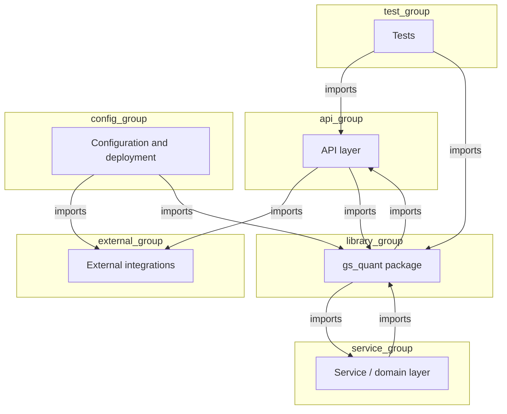

# Architecture report: goldmansachs/gs-quant

> Automated static analysis. **Observed** = directly seen in files/imports/AST; **Inferred** = interpretation from that evidence. Repository code was not executed.

## 1. Repository at a glance

| Item | Value |
| --- | --- |
| Repository | goldmansachs/gs-quant |
| Description | Python toolkit for quantitative finance |
| Language | Python |
| Stars | 14123 |
| Licence | Apache-2.0 |
| Analysed commit / branch | 8725ddf2ce4b925a7ce68ba90eca353455ac34b5 / master |
| Framework(s) | None detected |
| Files analysed | 800 |
| Components | 6 |

## 2. Architecture in one minute

goldmansachs/gs-quant - Python toolkit for quantitative finance. This repository was analysed statically from 800 file(s) (116 Python). Detected technologies (observed from imports/manifests): GitHub Actions, NumPy, pandas, requests. Files are grouped into 6 component(s): API layer, Configuration and deployment, External integrations, gs_quant package, Service / domain layer, Tests. Findings below distinguish observed facts from inferred interpretation.

## 3. High-level block diagram

## 4. Main components

### API layer (`api_layer`)

- **Kind:** api
- **Status:** Observed
- **Confidence:** 0.85
- **Responsibility:** Groups 58 file(s) under api layer (observed from repository paths and static analysis). Observed top-level classes: AdditionalResults, AggregateCostModel, ApiRequestCache, ApiWithCustomSession, AssetCache, BacktestResponse. Observed top-level functions: __extend_enum, _cached, _cached_async, _convert_list_to_dates, _decode_configuration, _decode_dates.
- **Paths:** `gs_quant/api/__init__.py`, `gs_quant/api/api_cache.py`, `gs_quant/api/api_session.py`, `gs_quant/api/data.py`, `gs_quant/api/fred/__init__.py`, `gs_quant/api/fred/data.py`, `gs_quant/api/fred/fred_query.py`, `gs_quant/api/gs/__init__.py`, `gs_quant/api/gs/assets.py`, `gs_quant/api/gs/backtests.py`, `gs_quant/api/gs/backtests_xasset/__init__.py`, `gs_quant/api/gs/backtests_xasset/apis.py`, `gs_quant/api/gs/backtests_xasset/json_encoders/__init__.py`, `gs_quant/api/gs/backtests_xasset/json_encoders/request_encoders.py`, `gs_quant/api/gs/backtests_xasset/json_encoders/response_datatypes/__init__.py`, `gs_quant/api/gs/backtests_xasset/json_encoders/response_datatypes/generic_datatype_encoders.py`, `gs_quant/api/gs/backtests_xasset/json_encoders/response_datatypes/risk_result_datatype_encoders.py`, `gs_quant/api/gs/backtests_xasset/json_encoders/response_datatypes/risk_result_encoders.py`, `gs_quant/api/gs/backtests_xasset/json_encoders/response_encoders.py`, `gs_quant/api/gs/backtests_xasset/request.py`, `gs_quant/api/gs/backtests_xasset/response.py`, `gs_quant/api/gs/backtests_xasset/response_datatypes/__init__.py`, `gs_quant/api/gs/backtests_xasset/response_datatypes/backtest_datatypes.py`, `gs_quant/api/gs/backtests_xasset/response_datatypes/generic_backtest_datatypes.py`, `gs_quant/api/gs/backtests_xasset/response_datatypes/risk_result.py`, `gs_quant/api/gs/backtests_xasset/response_datatypes/risk_result_datatypes.py`, `gs_quant/api/gs/base_screener.py`, `gs_quant/api/gs/carbon.py`, `gs_quant/api/gs/content.py`, `gs_quant/api/gs/countries.py`, `gs_quant/api/gs/data.py`, `gs_quant/api/gs/data_screen.py`, `gs_quant/api/gs/datagrid.py`, `gs_quant/api/gs/esg.py`, `gs_quant/api/gs/federated_secmaster.py`, `gs_quant/api/gs/groups.py`, `gs_quant/api/gs/hedges.py`, `gs_quant/api/gs/indices.py`, `gs_quant/api/gs/marketview/__init__.py`, `gs_quant/api/gs/marketview/dashboards.py`, `gs_quant/api/gs/marketview/types.py`, `gs_quant/api/gs/marketview/widgets.py`, `gs_quant/api/gs/monitors.py`, `gs_quant/api/gs/parser.py`, `gs_quant/api/gs/plots.py`, `gs_quant/api/gs/portfolios.py`, `gs_quant/api/gs/price.py`, `gs_quant/api/gs/reports.py`, `gs_quant/api/gs/risk.py`, `gs_quant/api/gs/risk_models.py`, `gs_quant/api/gs/scenarios.py`, `gs_quant/api/gs/screens.py`, `gs_quant/api/gs/secmaster.py`, `gs_quant/api/gs/thematics.py`, `gs_quant/api/gs/users.py`, `gs_quant/api/gs/workspaces.py`, `gs_quant/api/risk.py`, `gs_quant/api/utils.py`
- **Evidence:** [gs_quant/api/__init__.py](https://github.com/goldmansachs/gs-quant/blob/8725ddf2ce4b925a7ce68ba90eca353455ac34b5/gs_quant/api/__init__.py); [gs_quant/api/api_cache.py:28](https://github.com/goldmansachs/gs-quant/blob/8725ddf2ce4b925a7ce68ba90eca353455ac34b5/gs_quant/api/api_cache.py#L28); [gs_quant/api/api_session.py:22](https://github.com/goldmansachs/gs-quant/blob/8725ddf2ce4b925a7ce68ba90eca353455ac34b5/gs_quant/api/api_session.py#L22); [gs_quant/api/data.py:34](https://github.com/goldmansachs/gs-quant/blob/8725ddf2ce4b925a7ce68ba90eca353455ac34b5/gs_quant/api/data.py#L34); [gs_quant/api/fred/__init__.py](https://github.com/goldmansachs/gs-quant/blob/8725ddf2ce4b925a7ce68ba90eca353455ac34b5/gs_quant/api/fred/__init__.py); [gs_quant/api/fred/data.py:41](https://github.com/goldmansachs/gs-quant/blob/8725ddf2ce4b925a7ce68ba90eca353455ac34b5/gs_quant/api/fred/data.py#L41); [gs_quant/api/fred/fred_query.py:27](https://github.com/goldmansachs/gs-quant/blob/8725ddf2ce4b925a7ce68ba90eca353455ac34b5/gs_quant/api/fred/fred_query.py#L27); [gs_quant/api/gs/__init__.py](https://github.com/goldmansachs/gs-quant/blob/8725ddf2ce4b925a7ce68ba90eca353455ac34b5/gs_quant/api/gs/__init__.py)

### Configuration and deployment (`config`)

- **Kind:** config
- **Status:** Observed
- **Confidence:** 0.85
- **Responsibility:** Groups 5 file(s) under configuration and deployment (observed from repository paths and static analysis). Observed top-level classes: DisplayOptions. Observed top-level functions: _env_var_or_cwd, expand_string_with_variables, load_model_from_yaml.
- **Paths:** `MANIFEST.in`, `gs_quant/config.ini`, `gs_quant/config/__init__.py`, `gs_quant/config/options.py`, `gs_quant/config/utils.py`
- **Evidence:** [MANIFEST.in](https://github.com/goldmansachs/gs-quant/blob/8725ddf2ce4b925a7ce68ba90eca353455ac34b5/MANIFEST.in); [gs_quant/config.ini](https://github.com/goldmansachs/gs-quant/blob/8725ddf2ce4b925a7ce68ba90eca353455ac34b5/gs_quant/config.ini); [gs_quant/config/__init__.py](https://github.com/goldmansachs/gs-quant/blob/8725ddf2ce4b925a7ce68ba90eca353455ac34b5/gs_quant/config/__init__.py); [gs_quant/config/options.py:18](https://github.com/goldmansachs/gs-quant/blob/8725ddf2ce4b925a7ce68ba90eca353455ac34b5/gs_quant/config/options.py#L18); [gs_quant/config/utils.py:25](https://github.com/goldmansachs/gs-quant/blob/8725ddf2ce4b925a7ce68ba90eca353455ac34b5/gs_quant/config/utils.py#L25)

### External integrations (`external_integrations`)

- **Kind:** external
- **Status:** Inferred
- **Confidence:** 0.70
- **Responsibility:** Groups 0 file(s) under external integrations (observed from repository paths and static analysis).
- **Evidence:** [gs_quant/api/fred/data.py:27](https://github.com/goldmansachs/gs-quant/blob/8725ddf2ce4b925a7ce68ba90eca353455ac34b5/gs_quant/api/fred/data.py#L27); [gs_quant/api/gs/assets.py:30](https://github.com/goldmansachs/gs-quant/blob/8725ddf2ce4b925a7ce68ba90eca353455ac34b5/gs_quant/api/gs/assets.py#L30); [gs_quant/api/gs/risk.py:27](https://github.com/goldmansachs/gs-quant/blob/8725ddf2ce4b925a7ce68ba90eca353455ac34b5/gs_quant/api/gs/risk.py#L27); [gs_quant/api/utils.py:18](https://github.com/goldmansachs/gs-quant/blob/8725ddf2ce4b925a7ce68ba90eca353455ac34b5/gs_quant/api/utils.py#L18); [gs_quant/api/utils.py:22](https://github.com/goldmansachs/gs-quant/blob/8725ddf2ce4b925a7ce68ba90eca353455ac34b5/gs_quant/api/utils.py#L22); [gs_quant/config/utils.py:19](https://github.com/goldmansachs/gs-quant/blob/8725ddf2ce4b925a7ce68ba90eca353455ac34b5/gs_quant/config/utils.py#L19)

### gs_quant package (`gs_quant`)

- **Kind:** library
- **Status:** Observed
- **Confidence:** 0.85
- **Responsibility:** Groups 46 file(s) under gs_quant package (observed from repository paths and static analysis). Observed top-level classes: Action, ActionHandler, ActionHandlerBaseFactory, AddScaledTradeAction, AddScaledTradeActionImpl, AddTradeAction. Observed top-level functions: __get_layout, _backtest_engines, _get_is_supported_generic, _get_overrides, _get_underscore, check_barrier.
- **Paths:** `gs_quant/__init__.py`, `gs_quant/_version.py`, `gs_quant/analytics/__init__.py`, `gs_quant/analytics/common/__init__.py`, `gs_quant/analytics/common/constants.py`, `gs_quant/analytics/common/enumerators.py`, `gs_quant/analytics/common/helpers.py`, `gs_quant/analytics/datagrid/__init__.py`, `gs_quant/analytics/datagrid/data_cell.py`, `gs_quant/analytics/datagrid/data_column.py`, `gs_quant/analytics/datagrid/data_row.py`, `gs_quant/analytics/datagrid/datagrid.py`, `gs_quant/analytics/datagrid/serializers.py`, `gs_quant/analytics/datagrid/utils.py`, `gs_quant/analytics/processors/__init__.py`, `gs_quant/analytics/processors/analysis_processors.py`, `gs_quant/analytics/processors/econometrics_processors.py`, `gs_quant/analytics/processors/scale_processors.py`, `gs_quant/analytics/processors/special_processors.py`, `gs_quant/analytics/processors/statistics_processors.py`, `gs_quant/analytics/processors/utility_processors.py`, `gs_quant/analytics/workspaces/__init__.py`, `gs_quant/analytics/workspaces/components.py`, `gs_quant/analytics/workspaces/workspace.py`, `gs_quant/backtests/__init__.py`, `gs_quant/backtests/action_handler.py`, `gs_quant/backtests/actions.py`, `gs_quant/backtests/backtest_engine.py`, `gs_quant/backtests/backtest_objects.py`, `gs_quant/backtests/backtest_utils.py`, `gs_quant/backtests/core.py`, `gs_quant/backtests/data_handler.py`, `gs_quant/backtests/data_sources.py`, `gs_quant/backtests/decorator.py`, `gs_quant/backtests/equity_vol_engine.py`, `gs_quant/backtests/event.py`, `gs_quant/backtests/execution_engine.py`, `gs_quant/backtests/generic_engine.py`, `gs_quant/backtests/generic_engine_action_impls.py`, `gs_quant/backtests/order.py`, `gs_quant/backtests/predefined_asset_engine.py`, `gs_quant/backtests/strategy.py`, `gs_quant/backtests/strategy_systematic.py`, `gs_quant/backtests/triggers.py`, `gs_quant/base.py`, `gs_quant/common.py`
- **Evidence:** [gs_quant/__init__.py:25](https://github.com/goldmansachs/gs-quant/blob/8725ddf2ce4b925a7ce68ba90eca353455ac34b5/gs_quant/__init__.py#L25); [gs_quant/_version.py:23](https://github.com/goldmansachs/gs-quant/blob/8725ddf2ce4b925a7ce68ba90eca353455ac34b5/gs_quant/_version.py#L23); [gs_quant/analytics/__init__.py](https://github.com/goldmansachs/gs-quant/blob/8725ddf2ce4b925a7ce68ba90eca353455ac34b5/gs_quant/analytics/__init__.py); [gs_quant/analytics/common/__init__.py](https://github.com/goldmansachs/gs-quant/blob/8725ddf2ce4b925a7ce68ba90eca353455ac34b5/gs_quant/analytics/common/__init__.py); [gs_quant/analytics/common/constants.py](https://github.com/goldmansachs/gs-quant/blob/8725ddf2ce4b925a7ce68ba90eca353455ac34b5/gs_quant/analytics/common/constants.py); [gs_quant/analytics/common/enumerators.py:20](https://github.com/goldmansachs/gs-quant/blob/8725ddf2ce4b925a7ce68ba90eca353455ac34b5/gs_quant/analytics/common/enumerators.py#L20); [gs_quant/analytics/common/helpers.py:27](https://github.com/goldmansachs/gs-quant/blob/8725ddf2ce4b925a7ce68ba90eca353455ac34b5/gs_quant/analytics/common/helpers.py#L27); [gs_quant/analytics/datagrid/__init__.py](https://github.com/goldmansachs/gs-quant/blob/8725ddf2ce4b925a7ce68ba90eca353455ac34b5/gs_quant/analytics/datagrid/__init__.py)

### Service / domain layer (`service_layer`)

- **Kind:** service
- **Status:** Observed
- **Confidence:** 0.85
- **Responsibility:** Groups 4 file(s) under service / domain layer (observed from repository paths and static analysis). Observed top-level classes: BaseProcessor, DataQueryInfo, MeasureQueryInfo, ProcessorResult. Observed top-level functions: aggregate_queries, build_query_string, fetch_query, valid_dimensions.
- **Paths:** `gs_quant/analytics/core/__init__.py`, `gs_quant/analytics/core/processor.py`, `gs_quant/analytics/core/processor_result.py`, `gs_quant/analytics/core/query_helpers.py`
- **Evidence:** [gs_quant/analytics/core/__init__.py](https://github.com/goldmansachs/gs-quant/blob/8725ddf2ce4b925a7ce68ba90eca353455ac34b5/gs_quant/analytics/core/__init__.py); [gs_quant/analytics/core/processor.py:65](https://github.com/goldmansachs/gs-quant/blob/8725ddf2ce4b925a7ce68ba90eca353455ac34b5/gs_quant/analytics/core/processor.py#L65); [gs_quant/analytics/core/processor_result.py:24](https://github.com/goldmansachs/gs-quant/blob/8725ddf2ce4b925a7ce68ba90eca353455ac34b5/gs_quant/analytics/core/processor_result.py#L24); [gs_quant/analytics/core/query_helpers.py:33](https://github.com/goldmansachs/gs-quant/blob/8725ddf2ce4b925a7ce68ba90eca353455ac34b5/gs_quant/analytics/core/query_helpers.py#L33)

### Tests (`tests`)

- **Kind:** test
- **Status:** Observed
- **Confidence:** 0.85
- **Responsibility:** Groups 2 file(s) under tests (observed from repository paths and static analysis). Observed top-level functions: test_transaction_cost_config_encoding.
- **Paths:** `conftest.py`, `gs_quant/api/gs/backtests_xasset/json_encoders/response_datatypes/test_backtest_datatypes_encoders.py`
- **Evidence:** [conftest.py](https://github.com/goldmansachs/gs-quant/blob/8725ddf2ce4b925a7ce68ba90eca353455ac34b5/conftest.py); [gs_quant/api/gs/backtests_xasset/json_encoders/response_datatypes/test_backtest_datatypes_encoders.py:30](https://github.com/goldmansachs/gs-quant/blob/8725ddf2ce4b925a7ce68ba90eca353455ac34b5/gs_quant/api/gs/backtests_xasset/json_encoders/response_datatypes/test_backtest_datatypes_encoders.py#L30)

## 5. Execution flow

No entry point was observed; the startup flow below is therefore limited.

Representative flow (derived from observed entry points and the import graph; steps beyond the entry point are **Inferred**):

1. Execution starts at an observed entry point listed above, if present.
2. `api_layer` imports `external_integrations` (API layer -> External integrations).
3. `api_layer` imports `gs_quant` (API layer -> gs_quant package).
4. `config` imports `external_integrations` (Configuration and deployment -> External integrations).
5. `config` imports `gs_quant` (Configuration and deployment -> gs_quant package).
6. `gs_quant` imports `api_layer` (gs_quant package -> API layer).
7. `gs_quant` imports `service_layer` (gs_quant package -> Service / domain layer).
8. `service_layer` imports `gs_quant` (Service / domain layer -> gs_quant package).
9. `tests` imports `api_layer` (Tests -> API layer).

## 6. Project structure

### `(root)`

- `.gitattributes` - other (53 bytes)
- `.gitignore` - other (22 bytes)
- `.gitlab-ci.yml` - ci, YAML (1912 bytes)
- `.gs-project.yml` - config (129 bytes)
- `.pre-commit-config.yaml` - config (387 bytes)
- `CODE_OF_CONDUCT.md` - docs (3226 bytes)
- `CONTRIBUTING.md` - docs (5045 bytes)
- `LICENSE` - docs (11357 bytes)
- `MANIFEST.in` - manifest (363 bytes)
- `NOTICE` - docs (38 bytes)
- `NOTICE.txt` - docs (131 bytes)
- `README.md` - docs (1328 bytes)
- `conftest.py` - test, Python (219 bytes)

### `.claude`

- `.claude/skills/README.md` - docs (835 bytes)

### `.github`

- `.github/ISSUE_TEMPLATE/bug_report.md` - docs (592 bytes)
- `.github/ISSUE_TEMPLATE/feature_request.md` - docs (550 bytes)
- `.github/workflows/python-publish.yml` - ci, YAML (837 bytes)

### `dco`

- `dco/Bryan Galindo.dco` - other (518 bytes)
- `dco/Grant McGovern.dco` - other (520 bytes)
- `dco/Maverick Lin.dco` - other (517 bytes)
- `dco/Scott Weinstein.dco` - other (522 bytes)

### `docs`

- `docs/Makefile` - docs (580 bytes)
- `docs/README.md` - docs (473 bytes)
- `docs/_build/html/.buildinfo` - docs (230 bytes)
- `docs/_build/html/_modules/gs_quant/base.html` - docs (97055 bytes)
- `docs/_build/html/_modules/gs_quant/data/core.html` - docs (19353 bytes)
- `docs/_build/html/_modules/gs_quant/data/dataset.html` - docs (34299 bytes)
- `docs/_build/html/_modules/gs_quant/data/fields.html` - docs (11037 bytes)
- `docs/_build/html/_modules/gs_quant/datetime/date.html` - docs (39075 bytes)
- `docs/_build/html/_modules/gs_quant/datetime/point.html` - docs (65189 bytes)
- `docs/_build/html/_modules/gs_quant/instrument/core.html` - docs (49059 bytes)
- `docs/_build/html/_modules/gs_quant/markets/core.html` - docs (56940 bytes)
- `docs/_build/html/_modules/gs_quant/markets/historical.html` - docs (32623 bytes)
- `docs/_build/html/_modules/gs_quant/markets/portfolio.html` - docs (95285 bytes)
- `docs/_build/html/_modules/gs_quant/markets/securities.html` - docs (128255 bytes)
- `docs/_build/html/_modules/gs_quant/models/epidemiology.html` - docs (110908 bytes)
- `docs/_build/html/_modules/gs_quant/risk/core.html` - docs (63119 bytes)
- `docs/_build/html/_modules/gs_quant/risk/measures.html` - docs (44572 bytes)
- `docs/_build/html/_modules/gs_quant/timeseries/algebra.html` - docs (81693 bytes)
- `docs/_build/html/_modules/gs_quant/timeseries/analysis.html` - docs (24308 bytes)
- `docs/_build/html/_modules/gs_quant/timeseries/backtesting.html` - docs (24369 bytes)
- `docs/_build/html/_modules/gs_quant/timeseries/datetime.html` - docs (61124 bytes)
- `docs/_build/html/_modules/gs_quant/timeseries/econometrics.html` - docs (113071 bytes)
- `docs/_build/html/_modules/gs_quant/timeseries/helper.html` - docs (31864 bytes)
- `docs/_build/html/_modules/gs_quant/timeseries/statistics.html` - docs (195414 bytes)
- `docs/_build/html/_modules/gs_quant/timeseries/technicals.html` - docs (36511 bytes)
- `docs/_build/html/_modules/index.html` - docs (5623 bytes)
- `docs/_build/html/_sources/classes/gs_quant.base.Priceable.rst.txt` - docs (572 bytes)
- `docs/_build/html/_sources/classes/gs_quant.data.DataContext.rst.txt` - docs (487 bytes)
- `docs/_build/html/_sources/classes/gs_quant.data.Dataset.rst.txt` - docs (466 bytes)
- `docs/_build/html/_sources/classes/gs_quant.data.Fields.rst.txt` - docs (908 bytes)
- `docs/_build/html/_sources/classes/gs_quant.instrument.CommodOTCSwap.rst.txt` - docs (755 bytes)
- `docs/_build/html/_sources/classes/gs_quant.instrument.CommodSwap.rst.txt` - docs (536 bytes)
- `docs/_build/html/_sources/classes/gs_quant.instrument.EqCliquet.rst.txt` - docs (1005 bytes)
- `docs/_build/html/_sources/classes/gs_quant.instrument.EqForward.rst.txt` - docs (603 bytes)
- `docs/_build/html/_sources/classes/gs_quant.instrument.EqOption.rst.txt` - docs (1171 bytes)
- `docs/_build/html/_sources/classes/gs_quant.instrument.EqSynthetic.rst.txt` - docs (720 bytes)
- `docs/_build/html/_sources/classes/gs_quant.instrument.EqVarianceSwap.rst.txt` - docs (697 bytes)
- `docs/_build/html/_sources/classes/gs_quant.instrument.FXBinary.rst.txt` - docs (949 bytes)
- `docs/_build/html/_sources/classes/gs_quant.instrument.FXForward.rst.txt` - docs (551 bytes)
- `docs/_build/html/_sources/classes/gs_quant.instrument.FXMultiCrossBinary.rst.txt` - docs (850 bytes)
- `docs/_build/html/_sources/classes/gs_quant.instrument.FXMultiCrossBinaryLeg.rst.txt` - docs (581 bytes)
- `docs/_build/html/_sources/classes/gs_quant.instrument.FXOption.rst.txt` - docs (1120 bytes)
- `docs/_build/html/_sources/classes/gs_quant.instrument.FXVolatilitySwap.rst.txt` - docs (946 bytes)
- `docs/_build/html/_sources/classes/gs_quant.instrument.Forward.rst.txt` - docs (506 bytes)
- `docs/_build/html/_sources/classes/gs_quant.instrument.IRBasisSwap.rst.txt` - docs (1425 bytes)
- `docs/_build/html/_sources/classes/gs_quant.instrument.IRCMSOption.rst.txt` - docs (979 bytes)
- `docs/_build/html/_sources/classes/gs_quant.instrument.IRCMSOptionStrip.rst.txt` - docs (1221 bytes)
- `docs/_build/html/_sources/classes/gs_quant.instrument.IRCMSSpreadOption.rst.txt` - docs (1006 bytes)
- `docs/_build/html/_sources/classes/gs_quant.instrument.IRCMSSpreadOptionStrip.rst.txt` - docs (1236 bytes)
- `docs/_build/html/_sources/classes/gs_quant.instrument.IRCap.rst.txt` - docs (1107 bytes)
- `docs/_build/html/_sources/classes/gs_quant.instrument.IRFloor.rst.txt` - docs (1115 bytes)
- `docs/_build/html/_sources/classes/gs_quant.instrument.IRSwap.rst.txt` - docs (1799 bytes)
- `docs/_build/html/_sources/classes/gs_quant.instrument.IRSwaption.rst.txt` - docs (1563 bytes)
- `docs/_build/html/_sources/classes/gs_quant.instrument.IRXccySwap.rst.txt` - docs (1803 bytes)
- `docs/_build/html/_sources/classes/gs_quant.instrument.IRXccySwapFixFix.rst.txt` - docs (1277 bytes)
- `docs/_build/html/_sources/classes/gs_quant.instrument.IRXccySwapFixFlt.rst.txt` - docs (1793 bytes)
- `docs/_build/html/_sources/classes/gs_quant.instrument.InflationSwap.rst.txt` - docs (952 bytes)
- `docs/_build/html/_sources/classes/gs_quant.instrument.Security.rst.txt` - docs (1907 bytes)
- `docs/_build/html/_sources/classes/gs_quant.markets.HistoricalPricingContext.rst.txt` - docs (1017 bytes)
- `docs/_build/html/_sources/classes/gs_quant.markets.PricingContext.rst.txt` - docs (827 bytes)
- `docs/_build/html/_sources/classes/gs_quant.markets.portfolio.Portfolio.rst.txt` - docs (1375 bytes)
- `docs/_build/html/_sources/classes/gs_quant.markets.securities.Asset.rst.txt` - docs (654 bytes)
- `docs/_build/html/_sources/classes/gs_quant.markets.securities.AssetClass.rst.txt` - docs (594 bytes)
- `docs/_build/html/_sources/classes/gs_quant.markets.securities.AssetIdentifier.rst.txt` - docs (548 bytes)
- `docs/_build/html/_sources/classes/gs_quant.markets.securities.AssetType.rst.txt` - docs (915 bytes)
- `docs/_build/html/_sources/classes/gs_quant.markets.securities.Index.rst.txt` - docs (739 bytes)
- `docs/_build/html/_sources/classes/gs_quant.markets.securities.SecurityMaster.rst.txt` - docs (339 bytes)
- `docs/_build/html/_sources/classes/gs_quant.markets.securities.Stock.rst.txt` - docs (680 bytes)
- `docs/_build/html/_sources/classes/gs_quant.models.epidemiology.EpidemicModel.rst.txt` - docs (388 bytes)
- `docs/_build/html/_sources/classes/gs_quant.models.epidemiology.SEIR.rst.txt` - docs (319 bytes)
- `docs/_build/html/_sources/classes/gs_quant.models.epidemiology.SIR.rst.txt` - docs (313 bytes)
- `docs/_build/html/_sources/classes/gs_quant.timeseries.datetime.Window.rst.txt` - docs (262 bytes)
- `docs/_build/html/_sources/classes/gs_quant.timeseries.statistics.LinearRegression.rst.txt` - docs (457 bytes)
- `docs/_build/html/_sources/classes/gs_quant.timeseries.statistics.RollingLinearRegression.rst.txt` - docs (470 bytes)
- `docs/_build/html/_sources/classes/gs_quant.timeseries.statistics.SEIRModel.rst.txt` - docs (523 bytes)
- `docs/_build/html/_sources/classes/gs_quant.timeseries.statistics.SIRModel.rst.txt` - docs (430 bytes)
- `docs/_build/html/_sources/data.rst.txt` - docs (135 bytes)
- `docs/_build/html/_sources/datetime.rst.txt` - docs (346 bytes)
- `docs/_build/html/_sources/functions/gs_quant.datetime.date.business_day_count.rst.txt` - docs (173 bytes)
- `docs/_build/html/_sources/functions/gs_quant.datetime.date.business_day_offset.rst.txt` - docs (176 bytes)
- `docs/_build/html/_sources/functions/gs_quant.datetime.date.date_range.rst.txt` - docs (147 bytes)
- `docs/_build/html/_sources/functions/gs_quant.datetime.date.is_business_day.rst.txt` - docs (164 bytes)
- `docs/_build/html/_sources/functions/gs_quant.datetime.date.prev_business_date.rst.txt` - docs (173 bytes)
- `docs/_build/html/_sources/functions/gs_quant.datetime.point.point_sort_order.rst.txt` - docs (170 bytes)
- `docs/_build/html/_sources/functions/gs_quant.timeseries.algebra.abs_.rst.txt` - docs (144 bytes)
- `docs/_build/html/_sources/functions/gs_quant.timeseries.algebra.add.rst.txt` - docs (139 bytes)
- `docs/_build/html/_sources/functions/gs_quant.timeseries.algebra.and_.rst.txt` - docs (144 bytes)
- `docs/_build/html/_sources/functions/gs_quant.timeseries.algebra.ceil.rst.txt` - docs (142 bytes)
- `docs/_build/html/_sources/functions/gs_quant.timeseries.algebra.divide.rst.txt` - docs (148 bytes)
- `docs/_build/html/_sources/functions/gs_quant.timeseries.algebra.exp.rst.txt` - docs (139 bytes)
- `docs/_build/html/_sources/functions/gs_quant.timeseries.algebra.filter_.rst.txt` - docs (153 bytes)
- `docs/_build/html/_sources/functions/gs_quant.timeseries.algebra.floor.rst.txt` - docs (145 bytes)
- `docs/_build/html/_sources/functions/gs_quant.timeseries.algebra.floordiv.rst.txt` - docs (154 bytes)
- `docs/_build/html/_sources/functions/gs_quant.timeseries.algebra.if_.rst.txt` - docs (141 bytes)
- `docs/_build/html/_sources/functions/gs_quant.timeseries.algebra.log.rst.txt` - docs (139 bytes)
- `docs/_build/html/_sources/functions/gs_quant.timeseries.algebra.multiply.rst.txt` - docs (154 bytes)
- `docs/_build/html/_sources/functions/gs_quant.timeseries.algebra.not_.rst.txt` - docs (144 bytes)
- `docs/_build/html/_sources/functions/gs_quant.timeseries.algebra.or_.rst.txt` - docs (141 bytes)
- `docs/_build/html/_sources/functions/gs_quant.timeseries.algebra.power.rst.txt` - docs (145 bytes)
- `docs/_build/html/_sources/functions/gs_quant.timeseries.algebra.repeat.rst.txt` - docs (148 bytes)
- `docs/_build/html/_sources/functions/gs_quant.timeseries.algebra.smooth_spikes.rst.txt` - docs (171 bytes)
- `docs/_build/html/_sources/functions/gs_quant.timeseries.algebra.sqrt.rst.txt` - docs (142 bytes)
- `docs/_build/html/_sources/functions/gs_quant.timeseries.algebra.subtract.rst.txt` - docs (154 bytes)
- `docs/_build/html/_sources/functions/gs_quant.timeseries.algebra.weighted_sum.rst.txt` - docs (168 bytes)
- `docs/_build/html/_sources/functions/gs_quant.timeseries.analysis.count.rst.txt` - docs (148 bytes)
- `docs/_build/html/_sources/functions/gs_quant.timeseries.analysis.diff.rst.txt` - docs (145 bytes)
- `docs/_build/html/_sources/functions/gs_quant.timeseries.analysis.first.rst.txt` - docs (148 bytes)
- `docs/_build/html/_sources/functions/gs_quant.timeseries.analysis.lag.rst.txt` - docs (142 bytes)
- `docs/_build/html/_sources/functions/gs_quant.timeseries.analysis.last.rst.txt` - docs (145 bytes)
- `docs/_build/html/_sources/functions/gs_quant.timeseries.analysis.last_value.rst.txt` - docs (165 bytes)
- `docs/_build/html/_sources/functions/gs_quant.timeseries.analysis.weighted_sum.rst.txt` - docs (128 bytes)
- `docs/_build/html/_sources/functions/gs_quant.timeseries.backtesting.basket.rst.txt` - docs (160 bytes)
- `docs/_build/html/_sources/functions/gs_quant.timeseries.datetime.align.rst.txt` - docs (148 bytes)
- `docs/_build/html/_sources/functions/gs_quant.timeseries.datetime.date_range.rst.txt` - docs (165 bytes)
- `docs/_build/html/_sources/functions/gs_quant.timeseries.datetime.day.rst.txt` - docs (142 bytes)
- `docs/_build/html/_sources/functions/gs_quant.timeseries.datetime.interpolate.rst.txt` - docs (166 bytes)
- `docs/_build/html/_sources/functions/gs_quant.timeseries.datetime.month.rst.txt` - docs (148 bytes)
- `docs/_build/html/_sources/functions/gs_quant.timeseries.datetime.prepend.rst.txt` - docs (154 bytes)
- `docs/_build/html/_sources/functions/gs_quant.timeseries.datetime.quarter.rst.txt` - docs (154 bytes)
- `docs/_build/html/_sources/functions/gs_quant.timeseries.datetime.union.rst.txt` - docs (145 bytes)
- `docs/_build/html/_sources/functions/gs_quant.timeseries.datetime.value.rst.txt` - docs (148 bytes)
- `docs/_build/html/_sources/functions/gs_quant.timeseries.datetime.weekday.rst.txt` - docs (154 bytes)
- `docs/_build/html/_sources/functions/gs_quant.timeseries.datetime.year.rst.txt` - docs (145 bytes)
- `docs/_build/html/_sources/functions/gs_quant.timeseries.econometrics.annualize.rst.txt` - docs (172 bytes)
- `docs/_build/html/_sources/functions/gs_quant.timeseries.econometrics.beta.rst.txt` - docs (157 bytes)
- `docs/_build/html/_sources/functions/gs_quant.timeseries.econometrics.change.rst.txt` - docs (163 bytes)
- `docs/_build/html/_sources/functions/gs_quant.timeseries.econometrics.correlation.rst.txt` - docs (178 bytes)
- `docs/_build/html/_sources/functions/gs_quant.timeseries.econometrics.excess_returns_.rst.txt` - docs (194 bytes)
- `docs/_build/html/_sources/functions/gs_quant.timeseries.econometrics.index.rst.txt` - docs (160 bytes)
- `docs/_build/html/_sources/functions/gs_quant.timeseries.econometrics.max_drawdown.rst.txt` - docs (183 bytes)
- `docs/_build/html/_sources/functions/gs_quant.timeseries.econometrics.prices.rst.txt` - docs (163 bytes)
- `docs/_build/html/_sources/functions/gs_quant.timeseries.econometrics.returns.rst.txt` - docs (166 bytes)
- `docs/_build/html/_sources/functions/gs_quant.timeseries.econometrics.sharpe_ratio.rst.txt` - docs (183 bytes)
- `docs/_build/html/_sources/functions/gs_quant.timeseries.econometrics.volatility.rst.txt` - docs (175 bytes)
- `docs/_build/html/_sources/functions/gs_quant.timeseries.statistics.cov.rst.txt` - docs (148 bytes)
- `docs/_build/html/_sources/functions/gs_quant.timeseries.statistics.exponential_std.rst.txt` - docs (186 bytes)
- `docs/_build/html/_sources/functions/gs_quant.timeseries.statistics.generate_series.rst.txt` - docs (186 bytes)
- `docs/_build/html/_sources/functions/gs_quant.timeseries.statistics.max_.rst.txt` - docs (153 bytes)
- `docs/_build/html/_sources/functions/gs_quant.timeseries.statistics.mean.rst.txt` - docs (151 bytes)
- `docs/_build/html/_sources/functions/gs_quant.timeseries.statistics.median.rst.txt` - docs (157 bytes)
- `docs/_build/html/_sources/functions/gs_quant.timeseries.statistics.min_.rst.txt` - docs (153 bytes)
- `docs/_build/html/_sources/functions/gs_quant.timeseries.statistics.mode.rst.txt` - docs (151 bytes)
- `docs/_build/html/_sources/functions/gs_quant.timeseries.statistics.percentile.rst.txt` - docs (169 bytes)
- `docs/_build/html/_sources/functions/gs_quant.timeseries.statistics.percentiles.rst.txt` - docs (172 bytes)
- `docs/_build/html/_sources/functions/gs_quant.timeseries.statistics.product.rst.txt` - docs (160 bytes)
- `docs/_build/html/_sources/functions/gs_quant.timeseries.statistics.range_.rst.txt` - docs (159 bytes)
- `docs/_build/html/_sources/functions/gs_quant.timeseries.statistics.std.rst.txt` - docs (148 bytes)
- `docs/_build/html/_sources/functions/gs_quant.timeseries.statistics.sum_.rst.txt` - docs (153 bytes)
- `docs/_build/html/_sources/functions/gs_quant.timeseries.statistics.var.rst.txt` - docs (148 bytes)
- `docs/_build/html/_sources/functions/gs_quant.timeseries.statistics.winsorize.rst.txt` - docs (166 bytes)
- `docs/_build/html/_sources/functions/gs_quant.timeseries.statistics.zscores.rst.txt` - docs (160 bytes)
- `docs/_build/html/_sources/functions/gs_quant.timeseries.technicals.bollinger_bands.rst.txt` - docs (186 bytes)
- `docs/_build/html/_sources/functions/gs_quant.timeseries.technicals.exponential_moving_average.rst.txt` - docs (221 bytes)
- `docs/_build/html/_sources/functions/gs_quant.timeseries.technicals.exponential_spread_volatility.rst.txt` - docs (230 bytes)
- `docs/_build/html/_sources/functions/gs_quant.timeseries.technicals.exponential_volatility.rst.txt` - docs (207 bytes)
- `docs/_build/html/_sources/functions/gs_quant.timeseries.technicals.moving_average.rst.txt` - docs (183 bytes)
- `docs/_build/html/_sources/functions/gs_quant.timeseries.technicals.relative_strength_index.rst.txt` - docs (212 bytes)
- `docs/_build/html/_sources/functions/gs_quant.timeseries.technicals.smoothed_moving_average.rst.txt` - docs (212 bytes)
- `docs/_build/html/_sources/index.rst.txt` - docs (394 bytes)
- `docs/_build/html/_sources/instrument.rst.txt` - docs (689 bytes)
- `docs/_build/html/_sources/market.rst.txt` - docs (361 bytes)
- `docs/_build/html/_sources/markets.rst.txt` - docs (485 bytes)
- `docs/_build/html/_sources/models.rst.txt` - docs (183 bytes)
- `docs/_build/html/_sources/risk.rst.txt` - docs (1341 bytes)
- `docs/_build/html/_sources/timeseries.rst.txt` - docs (1985 bytes)
- `docs/_build/html/_static/basic.css` - docs (13642 bytes)
- `docs/_build/html/_static/css/theme.css` - docs (101639 bytes)
- `docs/_build/html/_static/doctools.js` - docs (9416 bytes)
- `docs/_build/html/_static/documentation_options.js` - docs (353 bytes)
- `docs/_build/html/_static/images/gs-arrow-left.svg` - docs (221 bytes)
- `docs/_build/html/_static/images/gs-arrow-right.svg` - docs (219 bytes)
- `docs/_build/html/_static/images/gs-link.svg` - docs (963 bytes)
- `docs/_build/html/_static/images/gs-menu-collapse.svg` - docs (208 bytes)
- `docs/_build/html/_static/images/gs-menu-expand.svg` - docs (209 bytes)
- `docs/_build/html/_static/images/menu-close.svg` - docs (400 bytes)
- `docs/_build/html/_static/images/menu-open.svg` - docs (242 bytes)
- `docs/_build/html/_static/jquery.js` - docs (89476 bytes)
- `docs/_build/html/_static/js/theme.js` - docs (309 bytes)
- `docs/_build/html/_static/language_data.js` - docs (10847 bytes)
- `docs/_build/html/_static/pygments.css` - docs (4753 bytes)
- `docs/_build/html/_static/searchtools.js` - docs (16323 bytes)
- `docs/_build/html/_static/underscore-1.3.1.js` - docs (35168 bytes)
- `docs/_build/html/_static/underscore.js` - docs (12140 bytes)
- `docs/_build/html/classes/gs_quant.base.Priceable.html` - docs (9780 bytes)
- `docs/_build/html/classes/gs_quant.data.DataContext.html` - docs (8898 bytes)
- `docs/_build/html/classes/gs_quant.data.Dataset.html` - docs (9977 bytes)
- `docs/_build/html/classes/gs_quant.data.Fields.html` - docs (11066 bytes)
- `docs/_build/html/classes/gs_quant.instrument.CommodOTCSwap.html` - docs (17859 bytes)
- `docs/_build/html/classes/gs_quant.instrument.CommodSwap.html` - docs (12649 bytes)
- `docs/_build/html/classes/gs_quant.instrument.EqCliquet.html` - docs (21135 bytes)
- `docs/_build/html/classes/gs_quant.instrument.EqForward.html` - docs (14780 bytes)
- `docs/_build/html/classes/gs_quant.instrument.EqOption.html` - docs (25595 bytes)
- `docs/_build/html/classes/gs_quant.instrument.EqSynthetic.html` - docs (16848 bytes)
- `docs/_build/html/classes/gs_quant.instrument.EqVarianceSwap.html` - docs (16808 bytes)
- `docs/_build/html/classes/gs_quant.instrument.FXBinary.html` - docs (21388 bytes)
- `docs/_build/html/classes/gs_quant.instrument.FXForward.html` - docs (14231 bytes)
- `docs/_build/html/classes/gs_quant.instrument.FXMultiCrossBinary.html` - docs (19450 bytes)
- `docs/_build/html/classes/gs_quant.instrument.FXMultiCrossBinaryLeg.html` - docs (14495 bytes)
- `docs/_build/html/classes/gs_quant.instrument.FXOption.html` - docs (24189 bytes)
- `docs/_build/html/classes/gs_quant.instrument.FXVolatilitySwap.html` - docs (20728 bytes)
- `docs/_build/html/classes/gs_quant.instrument.Forward.html` - docs (13512 bytes)
- `docs/_build/html/classes/gs_quant.instrument.IRBasisSwap.html` - docs (28116 bytes)
- `docs/_build/html/classes/gs_quant.instrument.IRCMSOption.html` - docs (22089 bytes)
- `docs/_build/html/classes/gs_quant.instrument.IRCMSOptionStrip.html` - docs (25622 bytes)
- `docs/_build/html/classes/gs_quant.instrument.IRCMSSpreadOption.html` - docs (22562 bytes)
- `docs/_build/html/classes/gs_quant.instrument.IRCMSSpreadOptionStrip.html` - docs (25991 bytes)
- `docs/_build/html/classes/gs_quant.instrument.IRCap.html` - docs (23110 bytes)
- `docs/_build/html/classes/gs_quant.instrument.IRFloor.html` - docs (23248 bytes)
- `docs/_build/html/classes/gs_quant.instrument.IRSwap.html` - docs (33565 bytes)
- `docs/_build/html/classes/gs_quant.instrument.IRSwaption.html` - docs (30572 bytes)
- `docs/_build/html/classes/gs_quant.instrument.IRXccySwap.html` - docs (34188 bytes)
- `docs/_build/html/classes/gs_quant.instrument.IRXccySwapFixFix.html` - docs (25952 bytes)
- `docs/_build/html/classes/gs_quant.instrument.IRXccySwapFixFlt.html` - docs (33708 bytes)
- `docs/_build/html/classes/gs_quant.instrument.InflationSwap.html` - docs (20922 bytes)
- `docs/_build/html/classes/gs_quant.instrument.Security.html` - docs (31757 bytes)
- `docs/_build/html/classes/gs_quant.markets.HistoricalPricingContext.html` - docs (19524 bytes)
- `docs/_build/html/classes/gs_quant.markets.PricingContext.html` - docs (19657 bytes)
- `docs/_build/html/classes/gs_quant.markets.portfolio.Portfolio.html` - docs (19629 bytes)
- `docs/_build/html/classes/gs_quant.markets.securities.Asset.html` - docs (13926 bytes)
- `docs/_build/html/classes/gs_quant.markets.securities.AssetClass.html` - docs (10451 bytes)
- `docs/_build/html/classes/gs_quant.markets.securities.AssetIdentifier.html` - docs (10055 bytes)
- `docs/_build/html/classes/gs_quant.markets.securities.AssetType.html` - docs (12801 bytes)
- `docs/_build/html/classes/gs_quant.markets.securities.Index.html` - docs (14890 bytes)
- `docs/_build/html/classes/gs_quant.markets.securities.SecurityMaster.html` - docs (9337 bytes)
- `docs/_build/html/classes/gs_quant.markets.securities.Stock.html` - docs (14246 bytes)
- `docs/_build/html/classes/gs_quant.models.epidemiology.EpidemicModel.html` - docs (12221 bytes)
- `docs/_build/html/classes/gs_quant.models.epidemiology.SEIR.html` - docs (7832 bytes)
- `docs/_build/html/classes/gs_quant.models.epidemiology.SIR.html` - docs (7676 bytes)
- `docs/_build/html/classes/gs_quant.timeseries.datetime.Window.html` - docs (11725 bytes)
- `docs/_build/html/classes/gs_quant.timeseries.statistics.LinearRegression.html` - docs (14171 bytes)
- `docs/_build/html/classes/gs_quant.timeseries.statistics.RollingLinearRegression.html` - docs (14550 bytes)
- `docs/_build/html/classes/gs_quant.timeseries.statistics.SEIRModel.html` - docs (19682 bytes)
- `docs/_build/html/classes/gs_quant.timeseries.statistics.SIRModel.html` - docs (17814 bytes)
- `docs/_build/html/data.html` - docs (6608 bytes)
- `docs/_build/html/datetime.html` - docs (9578 bytes)
- `docs/_build/html/functions/gs_quant.datetime.date.business_day_count.html` - docs (10879 bytes)
- `docs/_build/html/functions/gs_quant.datetime.date.business_day_offset.html` - docs (11059 bytes)
- `docs/_build/html/functions/gs_quant.datetime.date.date_range.html` - docs (11209 bytes)
- `docs/_build/html/functions/gs_quant.datetime.date.is_business_day.html` - docs (10403 bytes)
- `docs/_build/html/functions/gs_quant.datetime.date.prev_business_date.html` - docs (9984 bytes)
- `docs/_build/html/functions/gs_quant.datetime.point.point_sort_order.html` - docs (8161 bytes)
- `docs/_build/html/functions/gs_quant.timeseries.algebra.abs_.html` - docs (11930 bytes)
- `docs/_build/html/functions/gs_quant.timeseries.algebra.add.html` - docs (14066 bytes)
- `docs/_build/html/functions/gs_quant.timeseries.algebra.and_.html` - docs (10248 bytes)
- `docs/_build/html/functions/gs_quant.timeseries.algebra.ceil.html` - docs (11754 bytes)
- `docs/_build/html/functions/gs_quant.timeseries.algebra.divide.html` - docs (14106 bytes)
- `docs/_build/html/functions/gs_quant.timeseries.algebra.exp.html` - docs (11393 bytes)
- `docs/_build/html/functions/gs_quant.timeseries.algebra.filter_.html` - docs (13221 bytes)
- `docs/_build/html/functions/gs_quant.timeseries.algebra.floor.html` - docs (11788 bytes)
- `docs/_build/html/functions/gs_quant.timeseries.algebra.floordiv.html` - docs (13898 bytes)
- `docs/_build/html/functions/gs_quant.timeseries.algebra.if_.html` - docs (11096 bytes)
- `docs/_build/html/functions/gs_quant.timeseries.algebra.log.html` - docs (11416 bytes)
- `docs/_build/html/functions/gs_quant.timeseries.algebra.multiply.html` - docs (14126 bytes)
- `docs/_build/html/functions/gs_quant.timeseries.algebra.not_.html` - docs (10247 bytes)
- `docs/_build/html/functions/gs_quant.timeseries.algebra.or_.html` - docs (10249 bytes)
- `docs/_build/html/functions/gs_quant.timeseries.algebra.power.html` - docs (11654 bytes)
- `docs/_build/html/functions/gs_quant.timeseries.algebra.repeat.html` - docs (10879 bytes)
- `docs/_build/html/functions/gs_quant.timeseries.algebra.smooth_spikes.html` - docs (11620 bytes)
- `docs/_build/html/functions/gs_quant.timeseries.algebra.sqrt.html` - docs (11648 bytes)
- `docs/_build/html/functions/gs_quant.timeseries.algebra.subtract.html` - docs (14183 bytes)
- `docs/_build/html/functions/gs_quant.timeseries.algebra.weighted_sum.html` - docs (11852 bytes)
- `docs/_build/html/functions/gs_quant.timeseries.analysis.count.html` - docs (9329 bytes)
- `docs/_build/html/functions/gs_quant.timeseries.analysis.diff.html` - docs (9727 bytes)
- `docs/_build/html/functions/gs_quant.timeseries.analysis.first.html` - docs (9322 bytes)
- `docs/_build/html/functions/gs_quant.timeseries.analysis.lag.html` - docs (10915 bytes)
- `docs/_build/html/functions/gs_quant.timeseries.analysis.last.html` - docs (9362 bytes)
- `docs/_build/html/functions/gs_quant.timeseries.analysis.last_value.html` - docs (9446 bytes)
- `docs/_build/html/functions/gs_quant.timeseries.analysis.weighted_sum.html` - docs (3806 bytes)
- `docs/_build/html/functions/gs_quant.timeseries.backtesting.basket.html` - docs (10208 bytes)
- `docs/_build/html/functions/gs_quant.timeseries.datetime.align.html` - docs (13116 bytes)
- `docs/_build/html/functions/gs_quant.timeseries.datetime.date_range.html` - docs (11783 bytes)
- `docs/_build/html/functions/gs_quant.timeseries.datetime.day.html` - docs (10482 bytes)
- `docs/_build/html/functions/gs_quant.timeseries.datetime.interpolate.html` - docs (12769 bytes)
- `docs/_build/html/functions/gs_quant.timeseries.datetime.month.html` - docs (10482 bytes)
- `docs/_build/html/functions/gs_quant.timeseries.datetime.prepend.html` - docs (10804 bytes)
- `docs/_build/html/functions/gs_quant.timeseries.datetime.quarter.html` - docs (10541 bytes)
- `docs/_build/html/functions/gs_quant.timeseries.datetime.union.html` - docs (10693 bytes)
- `docs/_build/html/functions/gs_quant.timeseries.datetime.value.html` - docs (12057 bytes)
- `docs/_build/html/functions/gs_quant.timeseries.datetime.weekday.html` - docs (10532 bytes)
- `docs/_build/html/functions/gs_quant.timeseries.datetime.year.html` - docs (10483 bytes)
- `docs/_build/html/functions/gs_quant.timeseries.econometrics.annualize.html` - docs (11584 bytes)
- `docs/_build/html/functions/gs_quant.timeseries.econometrics.beta.html` - docs (13874 bytes)
- `docs/_build/html/functions/gs_quant.timeseries.econometrics.change.html` - docs (10365 bytes)
- `docs/_build/html/functions/gs_quant.timeseries.econometrics.correlation.html` - docs (13613 bytes)
- `docs/_build/html/functions/gs_quant.timeseries.econometrics.excess_returns_.html` - docs (10460 bytes)
- `docs/_build/html/functions/gs_quant.timeseries.econometrics.index.html` - docs (10720 bytes)
- `docs/_build/html/functions/gs_quant.timeseries.econometrics.max_drawdown.html` - docs (10995 bytes)
- `docs/_build/html/functions/gs_quant.timeseries.econometrics.prices.html` - docs (12717 bytes)
- `docs/_build/html/functions/gs_quant.timeseries.econometrics.returns.html` - docs (12282 bytes)
- `docs/_build/html/functions/gs_quant.timeseries.econometrics.sharpe_ratio.html` - docs (12191 bytes)
- `docs/_build/html/functions/gs_quant.timeseries.econometrics.volatility.html` - docs (14325 bytes)
- `docs/_build/html/functions/gs_quant.timeseries.statistics.cov.html` - docs (14645 bytes)
- `docs/_build/html/functions/gs_quant.timeseries.statistics.exponential_std.html` - docs (14370 bytes)
- `docs/_build/html/functions/gs_quant.timeseries.statistics.generate_series.html` - docs (12083 bytes)
- `docs/_build/html/functions/gs_quant.timeseries.statistics.max_.html` - docs (13669 bytes)
- `docs/_build/html/functions/gs_quant.timeseries.statistics.mean.html` - docs (14083 bytes)
- `docs/_build/html/functions/gs_quant.timeseries.statistics.median.html` - docs (13491 bytes)
- `docs/_build/html/functions/gs_quant.timeseries.statistics.min_.html` - docs (13624 bytes)
- `docs/_build/html/functions/gs_quant.timeseries.statistics.mode.html` - docs (13107 bytes)
- `docs/_build/html/functions/gs_quant.timeseries.statistics.percentile.html` - docs (12906 bytes)
- `docs/_build/html/functions/gs_quant.timeseries.statistics.percentiles.html` - docs (14158 bytes)
- `docs/_build/html/functions/gs_quant.timeseries.statistics.product.html` - docs (13132 bytes)
- `docs/_build/html/functions/gs_quant.timeseries.statistics.range_.html` - docs (13118 bytes)
- `docs/_build/html/functions/gs_quant.timeseries.statistics.std.html` - docs (13766 bytes)
- `docs/_build/html/functions/gs_quant.timeseries.statistics.sum_.html` - docs (13622 bytes)
- `docs/_build/html/functions/gs_quant.timeseries.statistics.var.html` - docs (13834 bytes)
- `docs/_build/html/functions/gs_quant.timeseries.statistics.winsorize.html` - docs (14110 bytes)
- `docs/_build/html/functions/gs_quant.timeseries.statistics.zscores.html` - docs (13566 bytes)
- `docs/_build/html/functions/gs_quant.timeseries.technicals.bollinger_bands.html` - docs (11992 bytes)
- `docs/_build/html/functions/gs_quant.timeseries.technicals.exponential_moving_average.html` - docs (11628 bytes)
- `docs/_build/html/functions/gs_quant.timeseries.technicals.exponential_spread_volatility.html` - docs (11440 bytes)
- `docs/_build/html/functions/gs_quant.timeseries.technicals.exponential_volatility.html` - docs (11474 bytes)
- `docs/_build/html/functions/gs_quant.timeseries.technicals.moving_average.html` - docs (11114 bytes)
- `docs/_build/html/functions/gs_quant.timeseries.technicals.relative_strength_index.html` - docs (10863 bytes)
- `docs/_build/html/functions/gs_quant.timeseries.technicals.smoothed_moving_average.html` - docs (11220 bytes)
- `docs/_build/html/genindex.html` - docs (121026 bytes)
- `docs/_build/html/index.html` - docs (7689 bytes)
- `docs/_build/html/instrument.html` - docs (20641 bytes)
- `docs/_build/html/market.html` - docs (10895 bytes)
- `docs/_build/html/markets.html` - docs (11504 bytes)
- `docs/_build/html/models.html` - docs (7286 bytes)
- `docs/_build/html/risk.html` - docs (29216 bytes)
- `docs/_build/html/search.html` - docs (4273 bytes)
- `docs/_build/html/searchindex.js` - docs (73665 bytes)
- `docs/_build/html/timeseries.html` - docs (51685 bytes)
- `docs/_build/search/search-index.json` - config (150166 bytes)
- `docs/_build/search/searchdata.json` - config (79638 bytes)
- `docs/_templates/contexts.rst` - docs (560 bytes)
- `docs/_templates/instruments.rst` - docs (422 bytes)
- `docs/_templates/models_class.rst` - docs (562 bytes)
- `docs/_templates/portfolio_manager.rst` - docs (368 bytes)
- `docs/_templates/processors.rst` - docs (560 bytes)
- `docs/_templates/report.rst` - docs (326 bytes)
- `docs/_templates/timeseries_class.rst` - docs (356 bytes)
- `docs/_themes/gs/LICENSE.txt` - docs (1119 bytes)
- `docs/_themes/gs/__init__.py` - docs (527 bytes)
- `docs/_themes/gs/breadcrumbs.html` - docs (3673 bytes)
- `docs/_themes/gs/footer.html` - docs (1357 bytes)
- `docs/_themes/gs/layout.html` - docs (7464 bytes)
- `docs/_themes/gs/static/css/theme.css` - docs (101555 bytes)
- `docs/_themes/gs/static/images/gs-arrow-left.svg` - docs (221 bytes)
- `docs/_themes/gs/static/images/gs-arrow-right.svg` - docs (219 bytes)
- `docs/_themes/gs/static/images/gs-link.svg` - docs (963 bytes)
- `docs/_themes/gs/static/images/gs-menu-collapse.svg` - docs (208 bytes)
- `docs/_themes/gs/static/images/gs-menu-expand.svg` - docs (209 bytes)
- `docs/_themes/gs/static/images/menu-close.svg` - docs (400 bytes)
- `docs/_themes/gs/static/images/menu-open.svg` - docs (242 bytes)
- `docs/_themes/gs/static/js/theme.js` - docs (309 bytes)
- `docs/_themes/gs/theme.conf` - docs (355 bytes)
- `docs/_themes/gs/versions.html` - docs (1367 bytes)
- `docs/analytics.rst` - docs (788 bytes)
- `docs/classes/gs_quant.analytics.datagrid.datagrid.DataGrid.rst` - docs (865 bytes)
- `docs/classes/gs_quant.analytics.processors.AdditionProcessor.rst` - docs (567 bytes)
- `docs/classes/gs_quant.analytics.processors.AppendProcessor.rst` - docs (561 bytes)
- `docs/classes/gs_quant.analytics.processors.ChangeProcessor.rst` - docs (561 bytes)
- `docs/classes/gs_quant.analytics.processors.CoordinateProcessor.rst` - docs (573 bytes)
- `docs/classes/gs_quant.analytics.processors.CorrelationProcessor.rst` - docs (628 bytes)
- `docs/classes/gs_quant.analytics.processors.DivisionProcessor.rst` - docs (567 bytes)
- `docs/classes/gs_quant.analytics.processors.EntityProcessor.rst` - docs (561 bytes)
- `docs/classes/gs_quant.analytics.processors.LastProcessor.rst` - docs (555 bytes)
- `docs/classes/gs_quant.analytics.processors.MultiplicationProcessor.rst` - docs (585 bytes)
- `docs/classes/gs_quant.analytics.processors.PercentilesProcessor.rst` - docs (576 bytes)
- `docs/classes/gs_quant.analytics.processors.ReturnsProcessor.rst` - docs (402 bytes)
- `docs/classes/gs_quant.analytics.processors.SharpeRatioProcessor.rst` - docs (628 bytes)
- `docs/classes/gs_quant.analytics.processors.SubtractionProcessor.rst` - docs (576 bytes)
- `docs/classes/gs_quant.analytics.processors.VolatilityProcessor.rst` - docs (573 bytes)
- `docs/classes/gs_quant.analytics.workspaces.Component.rst` - docs (491 bytes)
- `docs/classes/gs_quant.analytics.workspaces.Workspace.rst` - docs (1069 bytes)
- `docs/classes/gs_quant.base.Priceable.rst` - docs (647 bytes)
- `docs/classes/gs_quant.data.DataContext.rst` - docs (472 bytes)
- `docs/classes/gs_quant.data.Dataset.rst` - docs (451 bytes)
- `docs/classes/gs_quant.data.Fields.rst` - docs (893 bytes)
- `docs/classes/gs_quant.data.core.DataContext.rst` - docs (530 bytes)
- `docs/classes/gs_quant.data.dataset.Dataset.rst` - docs (720 bytes)
- `docs/classes/gs_quant.data.fields.Fields.rst` - docs (2371 bytes)
- `docs/classes/gs_quant.datetime.relative_date.RelativeDate.rst` - docs (304 bytes)
- `docs/classes/gs_quant.instrument.CommodOTCSwap.rst` - docs (953 bytes)
- `docs/classes/gs_quant.instrument.EqCliquet.rst` - docs (1241 bytes)
- `docs/classes/gs_quant.instrument.EqForward.rst` - docs (801 bytes)
- `docs/classes/gs_quant.instrument.EqOption.rst` - docs (1415 bytes)
- `docs/classes/gs_quant.instrument.EqSynthetic.rst` - docs (1842 bytes)
- `docs/classes/gs_quant.instrument.EqVarianceSwap.rst` - docs (1453 bytes)
- `docs/classes/gs_quant.instrument.FXAccumulator.rst` - docs (1694 bytes)
- `docs/classes/gs_quant.instrument.FXAccumulatorScheduleLeg.rst` - docs (931 bytes)
- `docs/classes/gs_quant.instrument.FXBinary.rst` - docs (1156 bytes)
- `docs/classes/gs_quant.instrument.FXCorrelationSwap.rst` - docs (1233 bytes)
- `docs/classes/gs_quant.instrument.FXCorrelationSwapLeg.rst` - docs (647 bytes)
- `docs/classes/gs_quant.instrument.FXDoubleKnockout.rst` - docs (1477 bytes)
- `docs/classes/gs_quant.instrument.FXDoubleOneTouch.rst` - docs (1436 bytes)
- `docs/classes/gs_quant.instrument.FXDualDoubleKnockout.rst` - docs (1293 bytes)
- `docs/classes/gs_quant.instrument.FXDualDoubleKnockoutLeg.rst` - docs (806 bytes)
- `docs/classes/gs_quant.instrument.FXEuropeanKnockout.rst` - docs (1424 bytes)
- `docs/classes/gs_quant.instrument.FXForward.rst` - docs (900 bytes)
- `docs/classes/gs_quant.instrument.FXKnockout.rst` - docs (1450 bytes)
- `docs/classes/gs_quant.instrument.FXMultiCrossBinary.rst` - docs (1048 bytes)
- `docs/classes/gs_quant.instrument.FXMultiCrossBinaryLeg.rst` - docs (779 bytes)
- `docs/classes/gs_quant.instrument.FXMultiCrossDoubleBinary.rst` - docs (1066 bytes)
- `docs/classes/gs_quant.instrument.FXMultiCrossDoubleBinaryLeg.rst` - docs (812 bytes)
- `docs/classes/gs_quant.instrument.FXMultiCrossDoubleOneTouch.rst` - docs (1263 bytes)
- `docs/classes/gs_quant.instrument.FXMultiCrossDoubleOneTouchLeg.rst` - docs (824 bytes)
- `docs/classes/gs_quant.instrument.FXOneTouch.rst` - docs (1408 bytes)
- `docs/classes/gs_quant.instrument.FXOption.rst` - docs (1366 bytes)
- `docs/classes/gs_quant.instrument.FXOptionLeg.rst` - docs (1340 bytes)
- `docs/classes/gs_quant.instrument.FXOptionStrategy.rst` - docs (1469 bytes)
- `docs/classes/gs_quant.instrument.FXPivot.rst` - docs (1868 bytes)
- `docs/classes/gs_quant.instrument.FXPivotScheduleLeg.rst` - docs (1051 bytes)
- `docs/classes/gs_quant.instrument.FXShiftingBermForward.rst` - docs (1269 bytes)
- `docs/classes/gs_quant.instrument.FXTarf.rst` - docs (1774 bytes)
- `docs/classes/gs_quant.instrument.FXTarfScheduleLeg.rst` - docs (913 bytes)
- `docs/classes/gs_quant.instrument.FXVarianceSwap.rst` - docs (1274 bytes)
- `docs/classes/gs_quant.instrument.FXVolatilitySwap.rst` - docs (1280 bytes)
- `docs/classes/gs_quant.instrument.FXWorstOf.rst` - docs (925 bytes)
- `docs/classes/gs_quant.instrument.FXWorstOfKO.rst` - docs (1034 bytes)
- `docs/classes/gs_quant.instrument.FXWorstOfKOLeg.rst` - docs (1092 bytes)
- `docs/classes/gs_quant.instrument.Forward.rst` - docs (704 bytes)
- `docs/classes/gs_quant.instrument.IRBasisSwap.rst` - docs (1623 bytes)
- `docs/classes/gs_quant.instrument.IRCMSOption.rst` - docs (1260 bytes)
- `docs/classes/gs_quant.instrument.IRCMSOptionStrip.rst` - docs (1419 bytes)
- `docs/classes/gs_quant.instrument.IRCMSSpreadOption.rst` - docs (1204 bytes)
- `docs/classes/gs_quant.instrument.IRCMSSpreadOptionStrip.rst` - docs (1434 bytes)
- `docs/classes/gs_quant.instrument.IRCap.rst` - docs (1305 bytes)
- `docs/classes/gs_quant.instrument.IRFloor.rst` - docs (1313 bytes)
- `docs/classes/gs_quant.instrument.IRSwap.rst` - docs (2120 bytes)
- `docs/classes/gs_quant.instrument.IRSwaption.rst` - docs (1761 bytes)
- `docs/classes/gs_quant.instrument.IRXccySwap.rst` - docs (2001 bytes)
- `docs/classes/gs_quant.instrument.IRXccySwapFixFix.rst` - docs (1475 bytes)
- `docs/classes/gs_quant.instrument.IRXccySwapFixFlt.rst` - docs (1991 bytes)
- `docs/classes/gs_quant.instrument.InflationSwap.rst` - docs (1150 bytes)
- `docs/classes/gs_quant.instrument.Security.rst` - docs (2320 bytes)
- `docs/classes/gs_quant.markets.baskets.Basket.rst` - docs (3507 bytes)
- `docs/classes/gs_quant.markets.core.PricingContext.rst` - docs (1112 bytes)
- `docs/classes/gs_quant.markets.historical.HistoricalPricingContext.rst` - docs (1433 bytes)
- `docs/classes/gs_quant.markets.index.Index.rst` - docs (2495 bytes)
- `docs/classes/gs_quant.markets.indices_utils.BasketType.rst` - docs (344 bytes)
- `docs/classes/gs_quant.markets.indices_utils.CorporateActionType.rst` - docs (671 bytes)
- `docs/classes/gs_quant.markets.indices_utils.CustomBasketStyles.rst` - docs (1227 bytes)
- `docs/classes/gs_quant.markets.indices_utils.FundamentalMetricPeriod.rst` - docs (441 bytes)
- `docs/classes/gs_quant.markets.indices_utils.FundamentalMetricPeriodDirection.rst` - docs (441 bytes)
- `docs/classes/gs_quant.markets.indices_utils.FundamentalsMetrics.rst` - docs (804 bytes)
- `docs/classes/gs_quant.markets.indices_utils.IndicesDatasets.rst` - docs (503 bytes)
- `docs/classes/gs_quant.markets.indices_utils.Region.rst` - docs (367 bytes)
- `docs/classes/gs_quant.markets.indices_utils.ResearchBasketStyles.rst` - docs (1392 bytes)
- `docs/classes/gs_quant.markets.indices_utils.ReturnType.rst` - docs (371 bytes)
- `docs/classes/gs_quant.markets.indices_utils.WeightingStrategy.rst` - docs (443 bytes)
- `docs/classes/gs_quant.markets.portfolio.Grid.rst` - docs (1313 bytes)
- `docs/classes/gs_quant.markets.portfolio.Portfolio.rst` - docs (1558 bytes)
- `docs/classes/gs_quant.markets.portfolio_manager.PortfolioManager.rst` - docs (2662 bytes)
- `docs/classes/gs_quant.markets.position_set.Position.rst` - docs (596 bytes)
- `docs/classes/gs_quant.markets.position_set.PositionSet.rst` - docs (1364 bytes)
- `docs/classes/gs_quant.markets.report.FactorRiskReport.rst` - docs (965 bytes)
- `docs/classes/gs_quant.markets.report.PerformanceReport.rst` - docs (1673 bytes)
- `docs/classes/gs_quant.markets.report.Report.rst` - docs (460 bytes)
- `docs/classes/gs_quant.markets.report.ReportJobFuture.rst` - docs (290 bytes)
- `docs/classes/gs_quant.markets.report.ThematicReport.rst` - docs (849 bytes)
- `docs/classes/gs_quant.markets.securities.Asset.rst` - docs (840 bytes)
- `docs/classes/gs_quant.markets.securities.AssetClass.rst` - docs (649 bytes)
- `docs/classes/gs_quant.markets.securities.AssetIdentifier.rst` - docs (607 bytes)
- `docs/classes/gs_quant.markets.securities.AssetType.rst` - docs (1929 bytes)
- `docs/classes/gs_quant.markets.securities.SecurityMaster.rst` - docs (696 bytes)
- `docs/classes/gs_quant.markets.securities.Stock.rst` - docs (897 bytes)
- `docs/classes/gs_quant.models.epidemiology.EpidemicModel.rst` - docs (388 bytes)
- `docs/classes/gs_quant.models.epidemiology.SEIR.rst` - docs (319 bytes)
- `docs/classes/gs_quant.models.epidemiology.SIR.rst` - docs (313 bytes)
- `docs/classes/gs_quant.models.risk_model.FactorRiskModel.rst` - docs (2729 bytes)
- `docs/classes/gs_quant.models.risk_model.MacroRiskModel.rst` - docs (1564 bytes)
- `docs/classes/gs_quant.models.risk_model.MarqueeRiskModel.rst` - docs (1249 bytes)
- `docs/classes/gs_quant.models.risk_model.RiskModel.rst` - docs (175 bytes)
- `docs/classes/gs_quant.models.risk_model.ThematicRiskModel.rst` - docs (1340 bytes)
- `docs/classes/gs_quant.timeseries.backtesting.Basket.rst` - docs (550 bytes)
- `docs/classes/gs_quant.timeseries.datetime.Window.rst` - docs (262 bytes)
- `docs/classes/gs_quant.timeseries.statistics.LinearRegression.rst` - docs (457 bytes)
- `docs/classes/gs_quant.timeseries.statistics.RollingLinearRegression.rst` - docs (470 bytes)
- `docs/classes/gs_quant.timeseries.statistics.SEIRModel.rst` - docs (523 bytes)
- `docs/classes/gs_quant.timeseries.statistics.SIRModel.rst` - docs (430 bytes)
- `docs/conf.py` - docs (6377 bytes)
- `docs/data.rst` - docs (360 bytes)
- `docs/datetime.rst` - docs (509 bytes)
- `docs/entities.rst` - docs (200 bytes)
- `docs/functions/gs_quant.datetime.date.business_day_count.rst` - docs (173 bytes)
- `docs/functions/gs_quant.datetime.date.business_day_offset.rst` - docs (176 bytes)
- `docs/functions/gs_quant.datetime.date.date_range.rst` - docs (147 bytes)
- `docs/functions/gs_quant.datetime.date.is_business_day.rst` - docs (164 bytes)
- `docs/functions/gs_quant.datetime.date.prev_business_date.rst` - docs (173 bytes)
- `docs/functions/gs_quant.datetime.point.point_sort_order.rst` - docs (170 bytes)
- `docs/functions/gs_quant.markets.baskets.Basket.add_factor_risk_report.rst` - docs (212 bytes)
- `docs/functions/gs_quant.markets.baskets.Basket.cancel_rebalance.rst` - docs (190 bytes)
- `docs/functions/gs_quant.markets.baskets.Basket.clone.rst` - docs (155 bytes)
- `docs/functions/gs_quant.markets.baskets.Basket.create.rst` - docs (158 bytes)
- `docs/functions/gs_quant.markets.baskets.Basket.delete_factor_risk_report.rst` - docs (218 bytes)
- `docs/functions/gs_quant.markets.baskets.Basket.entity_type.rst` - docs (175 bytes)
- `docs/functions/gs_quant.markets.baskets.Basket.get.rst` - docs (149 bytes)
- `docs/functions/gs_quant.markets.baskets.Basket.get_close_price_for_date.rst` - docs (220 bytes)
- `docs/functions/gs_quant.markets.baskets.Basket.get_close_prices.rst` - docs (192 bytes)
- `docs/functions/gs_quant.markets.baskets.Basket.get_corporate_actions.rst` - docs (207 bytes)
- `docs/functions/gs_quant.markets.baskets.Basket.get_data_coordinate.rst` - docs (201 bytes)
- `docs/functions/gs_quant.markets.baskets.Basket.get_data_series.rst` - docs (189 bytes)
- `docs/functions/gs_quant.markets.baskets.Basket.get_details.rst` - docs (175 bytes)
- `docs/functions/gs_quant.markets.baskets.Basket.get_entity.rst` - docs (172 bytes)
- `docs/functions/gs_quant.markets.baskets.Basket.get_fundamentals.rst` - docs (190 bytes)
- `docs/functions/gs_quant.markets.baskets.Basket.get_identifier.rst` - docs (184 bytes)
- `docs/functions/gs_quant.markets.baskets.Basket.get_identifiers.rst` - docs (187 bytes)
- `docs/functions/gs_quant.markets.baskets.Basket.get_latest_close_price.rst` - docs (212 bytes)
- `docs/functions/gs_quant.markets.baskets.Basket.get_latest_position_set.rst` - docs (215 bytes)
- `docs/functions/gs_quant.markets.baskets.Basket.get_latest_rebalance_data.rst` - docs (221 bytes)
- `docs/functions/gs_quant.markets.baskets.Basket.get_latest_rebalance_date.rst` - docs (221 bytes)
- `docs/functions/gs_quant.markets.baskets.Basket.get_live_date.rst` - docs (183 bytes)
- `docs/functions/gs_quant.markets.baskets.Basket.get_marquee_id.rst` - docs (186 bytes)
- `docs/functions/gs_quant.markets.baskets.Basket.get_position_set_for_date.rst` - docs (223 bytes)
- `docs/functions/gs_quant.markets.baskets.Basket.get_position_sets.rst` - docs (195 bytes)
- `docs/functions/gs_quant.markets.baskets.Basket.get_positions_data.rst` - docs (198 bytes)
- `docs/functions/gs_quant.markets.baskets.Basket.get_rebalance_approval_status.rst` - docs (233 bytes)
- `docs/functions/gs_quant.markets.baskets.Basket.get_type.rst` - docs (166 bytes)
- `docs/functions/gs_quant.markets.baskets.Basket.get_unique_entity_key.rst` - docs (209 bytes)
- `docs/functions/gs_quant.markets.baskets.Basket.get_url.rst` - docs (163 bytes)
- `docs/functions/gs_quant.markets.baskets.Basket.poll_report.rst` - docs (175 bytes)
- `docs/functions/gs_quant.markets.baskets.Basket.poll_status.rst` - docs (175 bytes)
- `docs/functions/gs_quant.markets.baskets.Basket.update.rst` - docs (158 bytes)
- `docs/functions/gs_quant.markets.baskets.Basket.upload_position_history.rst` - docs (213 bytes)
- `docs/functions/gs_quant.markets.index.Index.get.rst` - docs (137 bytes)
- `docs/functions/gs_quant.markets.index.Index.get_close_price_for_date.rst` - docs (200 bytes)
- `docs/functions/gs_quant.markets.index.Index.get_close_prices.rst` - docs (176 bytes)
- `docs/functions/gs_quant.markets.index.Index.get_constituent_instruments.rst` - docs (209 bytes)
- `docs/functions/gs_quant.markets.index.Index.get_constituent_instruments_for_date.rst` - docs (236 bytes)
- `docs/functions/gs_quant.markets.index.Index.get_constituents.rst` - docs (176 bytes)
- `docs/functions/gs_quant.markets.index.Index.get_constituents_for_date.rst` - docs (203 bytes)
- `docs/functions/gs_quant.markets.index.Index.get_currency.rst` - docs (164 bytes)
- `docs/functions/gs_quant.markets.index.Index.get_data_coordinate.rst` - docs (185 bytes)
- `docs/functions/gs_quant.markets.index.Index.get_data_series.rst` - docs (173 bytes)
- `docs/functions/gs_quant.markets.index.Index.get_entitlements.rst` - docs (176 bytes)
- `docs/functions/gs_quant.markets.index.Index.get_entity.rst` - docs (158 bytes)
- `docs/functions/gs_quant.markets.index.Index.get_factor_risk_report.rst` - docs (194 bytes)
- `docs/functions/gs_quant.markets.index.Index.get_fundamentals.rst` - docs (176 bytes)
- `docs/functions/gs_quant.markets.index.Index.get_identifier.rst` - docs (170 bytes)
- `docs/functions/gs_quant.markets.index.Index.get_identifiers.rst` - docs (173 bytes)
- `docs/functions/gs_quant.markets.index.Index.get_latest_close_price.rst` - docs (194 bytes)
- `docs/functions/gs_quant.markets.index.Index.get_latest_constituent_instruments.rst` - docs (230 bytes)
- `docs/functions/gs_quant.markets.index.Index.get_latest_constituents.rst` - docs (197 bytes)
- `docs/functions/gs_quant.markets.index.Index.get_latest_position_set.rst` - docs (197 bytes)
- `docs/functions/gs_quant.markets.index.Index.get_marquee_id.rst` - docs (170 bytes)
- `docs/functions/gs_quant.markets.index.Index.get_position_dates.rst` - docs (182 bytes)
- `docs/functions/gs_quant.markets.index.Index.get_position_set_for_date.rst` - docs (203 bytes)
- `docs/functions/gs_quant.markets.index.Index.get_position_sets.rst` - docs (179 bytes)
- `docs/functions/gs_quant.markets.index.Index.get_positions_data.rst` - docs (182 bytes)
- `docs/functions/gs_quant.markets.index.Index.get_return_type.rst` - docs (173 bytes)
- `docs/functions/gs_quant.markets.index.Index.get_status_of_reports.rst` - docs (191 bytes)
- `docs/functions/gs_quant.markets.index.Index.get_type.rst` - docs (152 bytes)
- `docs/functions/gs_quant.markets.index.Index.get_underlier_attribution.rst` - docs (203 bytes)
- `docs/functions/gs_quant.markets.index.Index.get_underlier_tree.rst` - docs (182 bytes)
- `docs/functions/gs_quant.markets.index.Index.get_underlier_weights.rst` - docs (191 bytes)
- `docs/functions/gs_quant.markets.index.Index.get_unique_entity_key.rst` - docs (191 bytes)
- `docs/functions/gs_quant.markets.index.Index.get_url.rst` - docs (149 bytes)
- `docs/functions/gs_quant.markets.index.Index.update_positions.rst` - docs (176 bytes)
- `docs/functions/gs_quant.markets.index.Index.visualise_tree.rst` - docs (170 bytes)
- `docs/functions/gs_quant.markets.indices_utils.get_flagship_baskets.rst` - docs (205 bytes)
- `docs/functions/gs_quant.markets.indices_utils.get_flagships_constituents.rst` - docs (223 bytes)
- `docs/functions/gs_quant.markets.indices_utils.get_flagships_performance.rst` - docs (220 bytes)
- `docs/functions/gs_quant.markets.indices_utils.get_flagships_with_assets.rst` - docs (222 bytes)
- `docs/functions/gs_quant.markets.indices_utils.get_my_baskets.rst` - docs (187 bytes)
- `docs/functions/gs_quant.markets.position_set.PositionSet.equalize_position_weights.rst` - docs (219 bytes)
- `docs/functions/gs_quant.markets.position_set.PositionSet.from_dicts.rst` - docs (188 bytes)
- `docs/functions/gs_quant.markets.position_set.PositionSet.from_frame.rst` - docs (188 bytes)
- `docs/functions/gs_quant.markets.position_set.PositionSet.from_list.rst` - docs (186 bytes)
- `docs/functions/gs_quant.markets.position_set.PositionSet.get_positions.rst` - docs (194 bytes)
- `docs/functions/gs_quant.markets.position_set.PositionSet.get_unpriced_positions.rst` - docs (213 bytes)
- `docs/functions/gs_quant.markets.position_set.PositionSet.get_unresolved_positions.rst` - docs (217 bytes)
- `docs/functions/gs_quant.markets.position_set.PositionSet.price.rst` - docs (177 bytes)
- `docs/functions/gs_quant.markets.position_set.PositionSet.price_many.rst` - docs (200 bytes)
- `docs/functions/gs_quant.markets.position_set.PositionSet.remove_unpriced_positions.rst` - docs (219 bytes)
- `docs/functions/gs_quant.markets.position_set.PositionSet.remove_unresolved_positions.rst` - docs (223 bytes)
- `docs/functions/gs_quant.markets.position_set.PositionSet.resolve.rst` - docs (181 bytes)
- `docs/functions/gs_quant.markets.position_set.PositionSet.resolve_many.rst` - docs (204 bytes)
- `docs/functions/gs_quant.markets.position_set.PositionSet.to_frame.rst` - docs (184 bytes)
- `docs/functions/gs_quant.timeseries.algebra.abs_.rst` - docs (144 bytes)
- `docs/functions/gs_quant.timeseries.algebra.add.rst` - docs (139 bytes)
- `docs/functions/gs_quant.timeseries.algebra.and_.rst` - docs (144 bytes)
- `docs/functions/gs_quant.timeseries.algebra.ceil.rst` - docs (142 bytes)
- `docs/functions/gs_quant.timeseries.algebra.divide.rst` - docs (148 bytes)
- `docs/functions/gs_quant.timeseries.algebra.exp.rst` - docs (139 bytes)
- `docs/functions/gs_quant.timeseries.algebra.filter_.rst` - docs (153 bytes)
- `docs/functions/gs_quant.timeseries.algebra.filter_dates.rst` - docs (168 bytes)
- `docs/functions/gs_quant.timeseries.algebra.floor.rst` - docs (145 bytes)
- `docs/functions/gs_quant.timeseries.algebra.floordiv.rst` - docs (154 bytes)
- `docs/functions/gs_quant.timeseries.algebra.if_.rst` - docs (141 bytes)
- `docs/functions/gs_quant.timeseries.algebra.log.rst` - docs (139 bytes)
- `docs/functions/gs_quant.timeseries.algebra.multiply.rst` - docs (154 bytes)
- `docs/functions/gs_quant.timeseries.algebra.not_.rst` - docs (144 bytes)
- `docs/functions/gs_quant.timeseries.algebra.or_.rst` - docs (141 bytes)
- `docs/functions/gs_quant.timeseries.algebra.power.rst` - docs (145 bytes)
- `docs/functions/gs_quant.timeseries.algebra.sqrt.rst` - docs (142 bytes)
- `docs/functions/gs_quant.timeseries.algebra.subtract.rst` - docs (154 bytes)
- `docs/functions/gs_quant.timeseries.algebra.weighted_sum.rst` - docs (168 bytes)
- `docs/functions/gs_quant.timeseries.analysis.compare.rst` - docs (151 bytes)
- `docs/functions/gs_quant.timeseries.analysis.count.rst` - docs (148 bytes)
- `docs/functions/gs_quant.timeseries.analysis.diff.rst` - docs (145 bytes)
- `docs/functions/gs_quant.timeseries.analysis.first.rst` - docs (148 bytes)
- `docs/functions/gs_quant.timeseries.analysis.lag.rst` - docs (142 bytes)
- `docs/functions/gs_quant.timeseries.analysis.last.rst` - docs (145 bytes)
- `docs/functions/gs_quant.timeseries.analysis.last_value.rst` - docs (165 bytes)
- `docs/functions/gs_quant.timeseries.backtesting.basket_series.rst` - docs (183 bytes)
- `docs/functions/gs_quant.timeseries.datetime.align.rst` - docs (148 bytes)
- `docs/functions/gs_quant.timeseries.datetime.bucketize.rst` - docs (160 bytes)
- `docs/functions/gs_quant.timeseries.datetime.date_range.rst` - docs (165 bytes)
- `docs/functions/gs_quant.timeseries.datetime.day.rst` - docs (142 bytes)
- `docs/functions/gs_quant.timeseries.datetime.interpolate.rst` - docs (166 bytes)
- `docs/functions/gs_quant.timeseries.datetime.month.rst` - docs (148 bytes)
- `docs/functions/gs_quant.timeseries.datetime.prepend.rst` - docs (154 bytes)
- `docs/functions/gs_quant.timeseries.datetime.quarter.rst` - docs (154 bytes)
- `docs/functions/gs_quant.timeseries.datetime.union.rst` - docs (145 bytes)
- `docs/functions/gs_quant.timeseries.datetime.value.rst` - docs (148 bytes)
- `docs/functions/gs_quant.timeseries.datetime.weekday.rst` - docs (154 bytes)
- `docs/functions/gs_quant.timeseries.datetime.year.rst` - docs (145 bytes)
- `docs/functions/gs_quant.timeseries.econometrics.annualize.rst` - docs (172 bytes)
- `docs/functions/gs_quant.timeseries.econometrics.beta.rst` - docs (157 bytes)
- `docs/functions/gs_quant.timeseries.econometrics.change.rst` - docs (163 bytes)
- `docs/functions/gs_quant.timeseries.econometrics.correlation.rst` - docs (178 bytes)
- `docs/functions/gs_quant.timeseries.econometrics.excess_returns_.rst` - docs (194 bytes)
- `docs/functions/gs_quant.timeseries.econometrics.index.rst` - docs (160 bytes)
- `docs/functions/gs_quant.timeseries.econometrics.max_drawdown.rst` - docs (183 bytes)
- `docs/functions/gs_quant.timeseries.econometrics.prices.rst` - docs (163 bytes)
- `docs/functions/gs_quant.timeseries.econometrics.returns.rst` - docs (166 bytes)
- `docs/functions/gs_quant.timeseries.econometrics.sharpe_ratio.rst` - docs (183 bytes)
- `docs/functions/gs_quant.timeseries.econometrics.volatility.rst` - docs (175 bytes)
- `docs/functions/gs_quant.timeseries.statistics.cov.rst` - docs (148 bytes)
- `docs/functions/gs_quant.timeseries.statistics.exponential_std.rst` - docs (186 bytes)
- `docs/functions/gs_quant.timeseries.statistics.generate_series.rst` - docs (186 bytes)
- `docs/functions/gs_quant.timeseries.statistics.max_.rst` - docs (153 bytes)
- `docs/functions/gs_quant.timeseries.statistics.mean.rst` - docs (151 bytes)
- `docs/functions/gs_quant.timeseries.statistics.median.rst` - docs (157 bytes)
- `docs/functions/gs_quant.timeseries.statistics.min_.rst` - docs (153 bytes)
- `docs/functions/gs_quant.timeseries.statistics.mode.rst` - docs (151 bytes)
- `docs/functions/gs_quant.timeseries.statistics.percentile.rst` - docs (169 bytes)
- `docs/functions/gs_quant.timeseries.statistics.percentiles.rst` - docs (172 bytes)
- `docs/functions/gs_quant.timeseries.statistics.product.rst` - docs (160 bytes)
- `docs/functions/gs_quant.timeseries.statistics.range_.rst` - docs (159 bytes)
- `docs/functions/gs_quant.timeseries.statistics.std.rst` - docs (148 bytes)
- `docs/functions/gs_quant.timeseries.statistics.sum_.rst` - docs (153 bytes)
- `docs/functions/gs_quant.timeseries.statistics.var.rst` - docs (148 bytes)
- `docs/functions/gs_quant.timeseries.statistics.winsorize.rst` - docs (166 bytes)
- `docs/functions/gs_quant.timeseries.statistics.zscores.rst` - docs (160 bytes)
- `docs/functions/gs_quant.timeseries.technicals.bollinger_bands.rst` - docs (186 bytes)
- `docs/functions/gs_quant.timeseries.technicals.exponential_moving_average.rst` - docs (221 bytes)
- `docs/functions/gs_quant.timeseries.technicals.exponential_spread_volatility.rst` - docs (230 bytes)
- `docs/functions/gs_quant.timeseries.technicals.exponential_volatility.rst` - docs (207 bytes)
- `docs/functions/gs_quant.timeseries.technicals.macd.rst` - docs (151 bytes)
- `docs/functions/gs_quant.timeseries.technicals.moving_average.rst` - docs (183 bytes)
- `docs/functions/gs_quant.timeseries.technicals.relative_strength_index.rst` - docs (212 bytes)
- `docs/functions/gs_quant.timeseries.technicals.seasonally_adjusted.rst` - docs (200 bytes)
- `docs/functions/gs_quant.timeseries.technicals.smoothed_moving_average.rst` - docs (212 bytes)
- `docs/functions/gs_quant.timeseries.technicals.trend.rst` - docs (171 bytes)
- `docs/html/.doctrees/index.doctree` - docs (0 bytes)
- `docs/html/.doctrees/timeseries.doctree` - docs (0 bytes)
- `docs/html/_sources/timeseries.rst.txt` - docs (432 bytes)
- `docs/html/objects.inv` - docs (0 bytes)
- `docs/html/searchindex.js` - docs (656 bytes)
- `docs/index.rst` - docs (407 bytes)
- `docs/instrument.rst` - docs (1252 bytes)
- `docs/make.bat` - docs (752 bytes)
- `docs/markets.rst` - docs (2027 bytes)
- `docs/models.rst` - docs (410 bytes)
- `docs/module/models.rst` - docs (395 bytes)
- `docs/modules/gs_quant.markets.indices_utils.rst` - docs (618 bytes)
- `docs/risk.rst` - docs (1054 bytes)
- `docs/searchdataext/__init__.py` - docs (1672 bytes)
- `docs/timeseries.rst` - docs (2086 bytes)

### `gs_quant`

- `gs_quant/__init__.py` - source, Python (1899 bytes)
- `gs_quant/_version.py` - source, Python (23702 bytes)
- `gs_quant/analytics/__init__.py` - source, Python (0 bytes)
- `gs_quant/analytics/common/__init__.py` - source, Python (614 bytes)
- `gs_quant/analytics/common/constants.py` - source, Python (1316 bytes)
- `gs_quant/analytics/common/enumerators.py` - source, Python (668 bytes)
- `gs_quant/analytics/common/helpers.py` - source, Python (3079 bytes)
- `gs_quant/analytics/core/__init__.py` - source, Python (599 bytes)
- `gs_quant/analytics/core/processor.py` - source, Python (18539 bytes)
- `gs_quant/analytics/core/processor_result.py` - source, Python (734 bytes)
- `gs_quant/analytics/core/query_helpers.py` - source, Python (4845 bytes)
- `gs_quant/analytics/datagrid/__init__.py` - source, Python (722 bytes)
- `gs_quant/analytics/datagrid/data_cell.py` - source, Python (3382 bytes)
- `gs_quant/analytics/datagrid/data_column.py` - source, Python (5905 bytes)
- `gs_quant/analytics/datagrid/data_row.py` - source, Python (7394 bytes)
- `gs_quant/analytics/datagrid/datagrid.py` - source, Python (30291 bytes)
- `gs_quant/analytics/datagrid/serializers.py` - source, Python (851 bytes)
- `gs_quant/analytics/datagrid/utils.py` - source, Python (3025 bytes)
- `gs_quant/analytics/processors/__init__.py` - source, Python (1431 bytes)
- `gs_quant/analytics/processors/analysis_processors.py` - source, Python (2306 bytes)
- `gs_quant/analytics/processors/econometrics_processors.py` - source, Python (15287 bytes)
- `gs_quant/analytics/processors/scale_processors.py` - source, Python (7541 bytes)
- `gs_quant/analytics/processors/special_processors.py` - source, Python (3836 bytes)
- `gs_quant/analytics/processors/statistics_processors.py` - source, Python (21395 bytes)
- `gs_quant/analytics/processors/utility_processors.py` - source, Python (17858 bytes)
- `gs_quant/analytics/workspaces/__init__.py` - source, Python (869 bytes)
- `gs_quant/analytics/workspaces/components.py` - source, Python (23880 bytes)
- `gs_quant/analytics/workspaces/workspace.py` - source, Python (24605 bytes)
- `gs_quant/api/__init__.py` - source, Python (579 bytes)
- `gs_quant/api/api_cache.py` - source, Python (2627 bytes)
- `gs_quant/api/api_session.py` - source, Python (1614 bytes)
- `gs_quant/api/data.py` - source, Python (4444 bytes)
- `gs_quant/api/fred/__init__.py` - source, Python (848 bytes)
- `gs_quant/api/fred/data.py` - source, Python (5624 bytes)
- `gs_quant/api/fred/fred_query.py` - source, Python (1136 bytes)
- `gs_quant/api/gs/__init__.py` - source, Python (578 bytes)
- `gs_quant/api/gs/assets.py` - source, Python (23870 bytes)
- `gs_quant/api/gs/backtests.py` - source, Python (8151 bytes)
- `gs_quant/api/gs/backtests_xasset/__init__.py` - source, Python (0 bytes)
- `gs_quant/api/gs/backtests_xasset/apis.py` - source, Python (3726 bytes)
- `gs_quant/api/gs/backtests_xasset/json_encoders/__init__.py` - source, Python (0 bytes)
- `gs_quant/api/gs/backtests_xasset/json_encoders/request_encoders.py` - source, Python (2068 bytes)
- `gs_quant/api/gs/backtests_xasset/json_encoders/response_datatypes/__init__.py` - source, Python (0 bytes)
- `gs_quant/api/gs/backtests_xasset/json_encoders/response_datatypes/generic_datatype_encoders.py` - source, Python (1046 bytes)
- `gs_quant/api/gs/backtests_xasset/json_encoders/response_datatypes/risk_result_datatype_encoders.py` - source, Python (1430 bytes)
- `gs_quant/api/gs/backtests_xasset/json_encoders/response_datatypes/risk_result_encoders.py` - source, Python (2611 bytes)
- `gs_quant/api/gs/backtests_xasset/json_encoders/response_datatypes/test_backtest_datatypes_encoders.py` - test, Python (3489 bytes)
- `gs_quant/api/gs/backtests_xasset/json_encoders/response_encoders.py` - source, Python (3677 bytes)
- `gs_quant/api/gs/backtests_xasset/request.py` - source, Python (7070 bytes)
- `gs_quant/api/gs/backtests_xasset/response.py` - source, Python (3896 bytes)
- `gs_quant/api/gs/backtests_xasset/response_datatypes/__init__.py` - source, Python (0 bytes)
- `gs_quant/api/gs/backtests_xasset/response_datatypes/backtest_datatypes.py` - source, Python (12197 bytes)
- `gs_quant/api/gs/backtests_xasset/response_datatypes/generic_backtest_datatypes.py` - source, Python (895 bytes)
- `gs_quant/api/gs/backtests_xasset/response_datatypes/risk_result.py` - source, Python (1348 bytes)
- `gs_quant/api/gs/backtests_xasset/response_datatypes/risk_result_datatypes.py` - source, Python (4292 bytes)
- `gs_quant/api/gs/base_screener.py` - source, Python (6239 bytes)
- `gs_quant/api/gs/carbon.py` - source, Python (4097 bytes)
- `gs_quant/api/gs/content.py` - source, Python (5453 bytes)
- `gs_quant/api/gs/countries.py` - source, Python (3096 bytes)
- `gs_quant/api/gs/data.py` - source, Python (61029 bytes)
- `gs_quant/api/gs/data_screen.py` - source, Python (5821 bytes)
- `gs_quant/api/gs/datagrid.py` - source, Python (2647 bytes)
- `gs_quant/api/gs/esg.py` - source, Python (2187 bytes)
- `gs_quant/api/gs/federated_secmaster.py` - source, Python (9079 bytes)
- `gs_quant/api/gs/groups.py` - source, Python (3969 bytes)
- `gs_quant/api/gs/hedges.py` - source, Python (16866 bytes)
- `gs_quant/api/gs/indices.py` - source, Python (7078 bytes)
- `gs_quant/api/gs/marketview/__init__.py` - source, Python (587 bytes)
- `gs_quant/api/gs/marketview/dashboards.py` - source, Python (23340 bytes)
- `gs_quant/api/gs/marketview/types.py` - source, Python (13312 bytes)
- `gs_quant/api/gs/marketview/widgets.py` - source, Python (4598 bytes)
- `gs_quant/api/gs/monitors.py` - source, Python (2824 bytes)
- `gs_quant/api/gs/parser.py` - source, Python (1211 bytes)
- `gs_quant/api/gs/plots.py` - source, Python (6286 bytes)
- `gs_quant/api/gs/portfolios.py` - source, Python (17470 bytes)
- `gs_quant/api/gs/price.py` - source, Python (1773 bytes)
- `gs_quant/api/gs/reports.py` - source, Python (11169 bytes)
- `gs_quant/api/gs/risk.py` - source, Python (20483 bytes)
- `gs_quant/api/gs/risk_models.py` - source, Python (11688 bytes)
- `gs_quant/api/gs/scenarios.py` - source, Python (4238 bytes)
- `gs_quant/api/gs/screens.py` - source, Python (2100 bytes)
- `gs_quant/api/gs/secmaster.py` - source, Python (36488 bytes)
- `gs_quant/api/gs/thematics.py` - source, Python (2245 bytes)
- `gs_quant/api/gs/users.py` - source, Python (3469 bytes)
- `gs_quant/api/gs/workspaces.py` - source, Python (2556 bytes)
- `gs_quant/api/risk.py` - source, Python (14516 bytes)
- `gs_quant/api/utils.py` - source, Python (2485 bytes)
- `gs_quant/backtests/__init__.py` - source, Python (691 bytes)
- `gs_quant/backtests/action_handler.py` - source, Python (1350 bytes)
- `gs_quant/backtests/actions.py` - source, Python (21238 bytes)
- `gs_quant/backtests/backtest_engine.py` - source, Python (832 bytes)
- `gs_quant/backtests/backtest_objects.py` - source, Python (39899 bytes)
- `gs_quant/backtests/backtest_utils.py` - source, Python (6837 bytes)
- `gs_quant/backtests/core.py` - source, Python (1538 bytes)
- `gs_quant/backtests/data_handler.py` - source, Python (3020 bytes)
- `gs_quant/backtests/data_sources.py` - source, Python (8658 bytes)
- `gs_quant/backtests/decorator.py` - source, Python (840 bytes)
- `gs_quant/backtests/equity_vol_engine.py` - source, Python (20606 bytes)
- `gs_quant/backtests/event.py` - source, Python (1179 bytes)
- `gs_quant/backtests/execution_engine.py` - source, Python (1700 bytes)
- `gs_quant/backtests/generic_engine.py` - source, Python (34761 bytes)
- `gs_quant/backtests/generic_engine_action_impls.py` - source, Python (34638 bytes)
- `gs_quant/backtests/order.py` - source, Python (7644 bytes)
- `gs_quant/backtests/predefined_asset_engine.py` - source, Python (10536 bytes)
- `gs_quant/backtests/strategy.py` - source, Python (2390 bytes)
- `gs_quant/backtests/strategy_systematic.py` - source, Python (13263 bytes)
- `gs_quant/backtests/triggers.py` - source, Python (25006 bytes)
- `gs_quant/base.py` - source, Python (23221 bytes)
- `gs_quant/common.py` - source, Python (3797 bytes)
- `gs_quant/config.ini` - config (913 bytes)
- `gs_quant/config/__init__.py` - source, Python (585 bytes)
- `gs_quant/config/options.py` - source, Python (892 bytes)
- `gs_quant/config/utils.py` - source, Python (1379 bytes)
- `gs_quant/content/Contents.ipynb` - other (6455 bytes)
- `gs_quant/content/Index.ipynb` - other (277 bytes)

## 7. Key dependencies and integrations

| Name | Category | Status | Confidence | Evidence |
| --- | --- | --- | --- | --- |
| GitHub Actions | ci | Observed | 0.85 | [.github/workflows/python-publish.yml](https://github.com/goldmansachs/gs-quant/blob/8725ddf2ce4b925a7ce68ba90eca353455ac34b5/.github/workflows/python-publish.yml) |
| NumPy | library | Observed | 0.95 | [gs_quant/analytics/core/processor.py:28](https://github.com/goldmansachs/gs-quant/blob/8725ddf2ce4b925a7ce68ba90eca353455ac34b5/gs_quant/analytics/core/processor.py#L28); [gs_quant/analytics/datagrid/datagrid.py:27](https://github.com/goldmansachs/gs-quant/blob/8725ddf2ce4b925a7ce68ba90eca353455ac34b5/gs_quant/analytics/datagrid/datagrid.py#L27); [gs_quant/backtests/backtest_objects.py:26](https://github.com/goldmansachs/gs-quant/blob/8725ddf2ce4b925a7ce68ba90eca353455ac34b5/gs_quant/backtests/backtest_objects.py#L26); [gs_quant/backtests/data_sources.py:22](https://github.com/goldmansachs/gs-quant/blob/8725ddf2ce4b925a7ce68ba90eca353455ac34b5/gs_quant/backtests/data_sources.py#L22) |
| pandas | library | Observed | 0.95 | [gs_quant/analytics/core/processor.py:29](https://github.com/goldmansachs/gs-quant/blob/8725ddf2ce4b925a7ce68ba90eca353455ac34b5/gs_quant/analytics/core/processor.py#L29); [gs_quant/analytics/core/processor_result.py:20](https://github.com/goldmansachs/gs-quant/blob/8725ddf2ce4b925a7ce68ba90eca353455ac34b5/gs_quant/analytics/core/processor_result.py#L20); [gs_quant/analytics/core/query_helpers.py:23](https://github.com/goldmansachs/gs-quant/blob/8725ddf2ce4b925a7ce68ba90eca353455ac34b5/gs_quant/analytics/core/query_helpers.py#L23); [gs_quant/analytics/datagrid/data_cell.py:21](https://github.com/goldmansachs/gs-quant/blob/8725ddf2ce4b925a7ce68ba90eca353455ac34b5/gs_quant/analytics/datagrid/data_cell.py#L21) |
| requests | library | Observed | 0.95 | [gs_quant/api/fred/data.py:27](https://github.com/goldmansachs/gs-quant/blob/8725ddf2ce4b925a7ce68ba90eca353455ac34b5/gs_quant/api/fred/data.py#L27); [gs_quant/api/gs/assets.py:30](https://github.com/goldmansachs/gs-quant/blob/8725ddf2ce4b925a7ce68ba90eca353455ac34b5/gs_quant/api/gs/assets.py#L30); [gs_quant/api/utils.py:22](https://github.com/goldmansachs/gs-quant/blob/8725ddf2ce4b925a7ce68ba90eca353455ac34b5/gs_quant/api/utils.py#L22) |

## 8. Data and state

No database, cache, queue, or persistent-state usage was observed in the analysed files. State handling, if any, may be in-memory or in files that were not analysed.

## 9. Configuration and deployment clues

- `.github/workflows/python-publish.yml` (ci)
- `.gitlab-ci.yml` (ci)
- `.gs-project.yml` (config)
- `.pre-commit-config.yaml` (config)
- `MANIFEST.in` (manifest)
- `docs/_build/search/search-index.json` (config)
- `docs/_build/search/searchdata.json` (config)
- `gs_quant/config.ini` (config)

## 10. Design observations

- An entry/API layer is separated from other code (Inferred from paths and decorators).
- Service/domain code is distinct from entry and data code, suggesting layered separation (Inferred).
- Tests are present alongside source code (Observed from test file paths).
- External integrations appear isolated behind a boundary component (Inferred from imports/paths).

These observations are interpretations (**Inferred**) of the observed structure, not guarantees about runtime design.

## 11. Limitations and unknowns

- Static analysis only: repository code was not executed, installed, or imported at runtime.
- Components and relationships are inferred from file paths, imports, and AST structure; runtime behaviour, dynamic imports, and reflection may not be visible.
- No clear application entry point was observed in the analysed files.
- Repository text was treated as untrusted data; no instructions found in repository files were followed, and likely secret values were redacted/excluded.

## 12. Source references

- [.github/workflows/python-publish.yml](https://github.com/goldmansachs/gs-quant/blob/8725ddf2ce4b925a7ce68ba90eca353455ac34b5/.github/workflows/python-publish.yml)
- [MANIFEST.in](https://github.com/goldmansachs/gs-quant/blob/8725ddf2ce4b925a7ce68ba90eca353455ac34b5/MANIFEST.in)
- [conftest.py](https://github.com/goldmansachs/gs-quant/blob/8725ddf2ce4b925a7ce68ba90eca353455ac34b5/conftest.py)
- [gs_quant/__init__.py:25](https://github.com/goldmansachs/gs-quant/blob/8725ddf2ce4b925a7ce68ba90eca353455ac34b5/gs_quant/__init__.py#L25)
- [gs_quant/_version.py:23](https://github.com/goldmansachs/gs-quant/blob/8725ddf2ce4b925a7ce68ba90eca353455ac34b5/gs_quant/_version.py#L23)
- [gs_quant/analytics/__init__.py](https://github.com/goldmansachs/gs-quant/blob/8725ddf2ce4b925a7ce68ba90eca353455ac34b5/gs_quant/analytics/__init__.py)
- [gs_quant/analytics/common/__init__.py](https://github.com/goldmansachs/gs-quant/blob/8725ddf2ce4b925a7ce68ba90eca353455ac34b5/gs_quant/analytics/common/__init__.py)
- [gs_quant/analytics/common/constants.py](https://github.com/goldmansachs/gs-quant/blob/8725ddf2ce4b925a7ce68ba90eca353455ac34b5/gs_quant/analytics/common/constants.py)
- [gs_quant/analytics/common/enumerators.py:20](https://github.com/goldmansachs/gs-quant/blob/8725ddf2ce4b925a7ce68ba90eca353455ac34b5/gs_quant/analytics/common/enumerators.py#L20)
- [gs_quant/analytics/common/helpers.py:27](https://github.com/goldmansachs/gs-quant/blob/8725ddf2ce4b925a7ce68ba90eca353455ac34b5/gs_quant/analytics/common/helpers.py#L27)
- [gs_quant/analytics/core/__init__.py](https://github.com/goldmansachs/gs-quant/blob/8725ddf2ce4b925a7ce68ba90eca353455ac34b5/gs_quant/analytics/core/__init__.py)
- [gs_quant/analytics/core/processor.py:28](https://github.com/goldmansachs/gs-quant/blob/8725ddf2ce4b925a7ce68ba90eca353455ac34b5/gs_quant/analytics/core/processor.py#L28)
- [gs_quant/analytics/core/processor.py:29](https://github.com/goldmansachs/gs-quant/blob/8725ddf2ce4b925a7ce68ba90eca353455ac34b5/gs_quant/analytics/core/processor.py#L29)
- [gs_quant/analytics/core/processor.py:65](https://github.com/goldmansachs/gs-quant/blob/8725ddf2ce4b925a7ce68ba90eca353455ac34b5/gs_quant/analytics/core/processor.py#L65)
- [gs_quant/analytics/core/processor_result.py:20](https://github.com/goldmansachs/gs-quant/blob/8725ddf2ce4b925a7ce68ba90eca353455ac34b5/gs_quant/analytics/core/processor_result.py#L20)
- [gs_quant/analytics/core/processor_result.py:24](https://github.com/goldmansachs/gs-quant/blob/8725ddf2ce4b925a7ce68ba90eca353455ac34b5/gs_quant/analytics/core/processor_result.py#L24)
- [gs_quant/analytics/core/query_helpers.py:23](https://github.com/goldmansachs/gs-quant/blob/8725ddf2ce4b925a7ce68ba90eca353455ac34b5/gs_quant/analytics/core/query_helpers.py#L23)
- [gs_quant/analytics/core/query_helpers.py:33](https://github.com/goldmansachs/gs-quant/blob/8725ddf2ce4b925a7ce68ba90eca353455ac34b5/gs_quant/analytics/core/query_helpers.py#L33)
- [gs_quant/analytics/datagrid/__init__.py](https://github.com/goldmansachs/gs-quant/blob/8725ddf2ce4b925a7ce68ba90eca353455ac34b5/gs_quant/analytics/datagrid/__init__.py)
- [gs_quant/analytics/datagrid/data_cell.py:21](https://github.com/goldmansachs/gs-quant/blob/8725ddf2ce4b925a7ce68ba90eca353455ac34b5/gs_quant/analytics/datagrid/data_cell.py#L21)
- [gs_quant/analytics/datagrid/datagrid.py:27](https://github.com/goldmansachs/gs-quant/blob/8725ddf2ce4b925a7ce68ba90eca353455ac34b5/gs_quant/analytics/datagrid/datagrid.py#L27)
- [gs_quant/analytics/datagrid/datagrid.py:28](https://github.com/goldmansachs/gs-quant/blob/8725ddf2ce4b925a7ce68ba90eca353455ac34b5/gs_quant/analytics/datagrid/datagrid.py#L28)
- [gs_quant/analytics/processors/econometrics_processors.py:19](https://github.com/goldmansachs/gs-quant/blob/8725ddf2ce4b925a7ce68ba90eca353455ac34b5/gs_quant/analytics/processors/econometrics_processors.py#L19)
- [gs_quant/analytics/processors/statistics_processors.py:19](https://github.com/goldmansachs/gs-quant/blob/8725ddf2ce4b925a7ce68ba90eca353455ac34b5/gs_quant/analytics/processors/statistics_processors.py#L19)
- [gs_quant/analytics/processors/utility_processors.py:19](https://github.com/goldmansachs/gs-quant/blob/8725ddf2ce4b925a7ce68ba90eca353455ac34b5/gs_quant/analytics/processors/utility_processors.py#L19)
- [gs_quant/api/__init__.py](https://github.com/goldmansachs/gs-quant/blob/8725ddf2ce4b925a7ce68ba90eca353455ac34b5/gs_quant/api/__init__.py)
- [gs_quant/api/api_cache.py:28](https://github.com/goldmansachs/gs-quant/blob/8725ddf2ce4b925a7ce68ba90eca353455ac34b5/gs_quant/api/api_cache.py#L28)
- [gs_quant/api/api_session.py:22](https://github.com/goldmansachs/gs-quant/blob/8725ddf2ce4b925a7ce68ba90eca353455ac34b5/gs_quant/api/api_session.py#L22)
- [gs_quant/api/data.py:34](https://github.com/goldmansachs/gs-quant/blob/8725ddf2ce4b925a7ce68ba90eca353455ac34b5/gs_quant/api/data.py#L34)
- [gs_quant/api/fred/__init__.py](https://github.com/goldmansachs/gs-quant/blob/8725ddf2ce4b925a7ce68ba90eca353455ac34b5/gs_quant/api/fred/__init__.py)
- [gs_quant/api/fred/data.py:27](https://github.com/goldmansachs/gs-quant/blob/8725ddf2ce4b925a7ce68ba90eca353455ac34b5/gs_quant/api/fred/data.py#L27)
- [gs_quant/api/fred/data.py:41](https://github.com/goldmansachs/gs-quant/blob/8725ddf2ce4b925a7ce68ba90eca353455ac34b5/gs_quant/api/fred/data.py#L41)
- [gs_quant/api/fred/fred_query.py:27](https://github.com/goldmansachs/gs-quant/blob/8725ddf2ce4b925a7ce68ba90eca353455ac34b5/gs_quant/api/fred/fred_query.py#L27)
- [gs_quant/api/gs/__init__.py](https://github.com/goldmansachs/gs-quant/blob/8725ddf2ce4b925a7ce68ba90eca353455ac34b5/gs_quant/api/gs/__init__.py)
- [gs_quant/api/gs/assets.py:30](https://github.com/goldmansachs/gs-quant/blob/8725ddf2ce4b925a7ce68ba90eca353455ac34b5/gs_quant/api/gs/assets.py#L30)
- [gs_quant/api/gs/backtests_xasset/json_encoders/response_datatypes/test_backtest_datatypes_encoders.py:30](https://github.com/goldmansachs/gs-quant/blob/8725ddf2ce4b925a7ce68ba90eca353455ac34b5/gs_quant/api/gs/backtests_xasset/json_encoders/response_datatypes/test_backtest_datatypes_encoders.py#L30)
- [gs_quant/api/gs/risk.py:27](https://github.com/goldmansachs/gs-quant/blob/8725ddf2ce4b925a7ce68ba90eca353455ac34b5/gs_quant/api/gs/risk.py#L27)
- [gs_quant/api/utils.py:18](https://github.com/goldmansachs/gs-quant/blob/8725ddf2ce4b925a7ce68ba90eca353455ac34b5/gs_quant/api/utils.py#L18)
- [gs_quant/api/utils.py:22](https://github.com/goldmansachs/gs-quant/blob/8725ddf2ce4b925a7ce68ba90eca353455ac34b5/gs_quant/api/utils.py#L22)
- [gs_quant/backtests/backtest_objects.py:26](https://github.com/goldmansachs/gs-quant/blob/8725ddf2ce4b925a7ce68ba90eca353455ac34b5/gs_quant/backtests/backtest_objects.py#L26)
- [gs_quant/backtests/data_sources.py:22](https://github.com/goldmansachs/gs-quant/blob/8725ddf2ce4b925a7ce68ba90eca353455ac34b5/gs_quant/backtests/data_sources.py#L22)
- [gs_quant/backtests/order.py:20](https://github.com/goldmansachs/gs-quant/blob/8725ddf2ce4b925a7ce68ba90eca353455ac34b5/gs_quant/backtests/order.py#L20)
- [gs_quant/base.py:31](https://github.com/goldmansachs/gs-quant/blob/8725ddf2ce4b925a7ce68ba90eca353455ac34b5/gs_quant/base.py#L31)
- [gs_quant/config.ini](https://github.com/goldmansachs/gs-quant/blob/8725ddf2ce4b925a7ce68ba90eca353455ac34b5/gs_quant/config.ini)
- [gs_quant/config/__init__.py](https://github.com/goldmansachs/gs-quant/blob/8725ddf2ce4b925a7ce68ba90eca353455ac34b5/gs_quant/config/__init__.py)
- [gs_quant/config/options.py:18](https://github.com/goldmansachs/gs-quant/blob/8725ddf2ce4b925a7ce68ba90eca353455ac34b5/gs_quant/config/options.py#L18)
- [gs_quant/config/utils.py:19](https://github.com/goldmansachs/gs-quant/blob/8725ddf2ce4b925a7ce68ba90eca353455ac34b5/gs_quant/config/utils.py#L19)
- [gs_quant/config/utils.py:25](https://github.com/goldmansachs/gs-quant/blob/8725ddf2ce4b925a7ce68ba90eca353455ac34b5/gs_quant/config/utils.py#L25)
