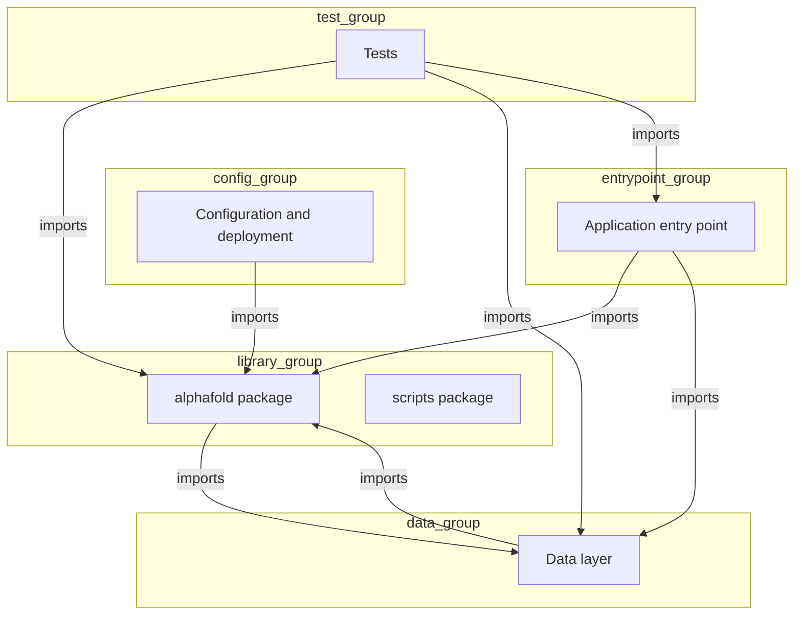

# Architecture report: google-deepmind/alphafold

> Automated static analysis. **Observed** = directly seen in files/imports/AST; **Inferred** = interpretation from that evidence. Repository code was not executed.

## 1. Repository at a glance

| Item | Value |
| --- | --- |
| Repository | google-deepmind/alphafold |
| Description | Open source code for AlphaFold 2. |
| Language | Python |
| Stars | 14939 |
| Licence | Apache-2.0 |
| Analysed commit / branch | c77e5d2a8961d1a353632c462914ff0a32a950f6 / main |
| Framework(s) | None detected |
| Files analysed | 116 |
| Components | 6 |

## 2. Architecture in one minute

google-deepmind/alphafold - Open source code for AlphaFold 2.. This repository was analysed statically from 116 file(s) (87 Python). Detected technologies (observed from imports/manifests): NumPy, Poetry, setuptools, Docker, pytest, unittest. Files are grouped into 6 component(s): alphafold package, Configuration and deployment, Data layer, Application entry point, scripts package, Tests. Observed entry point(s): alphafold/common/confidence_test.py, alphafold/common/protein_test.py, alphafold/common/residue_constants_test.py. Findings below distinguish observed facts from inferred interpretation.

## 3. High-level block diagram

## 4. Main components

### alphafold package (`alphafold`)

- **Kind:** library
- **Status:** Observed
- **Confidence:** 0.85
- **Responsibility:** Groups 46 file(s) under alphafold package (observed from repository paths and static analysis). Observed top-level classes: AlphaFold, AlphaFoldIteration, AmberRelaxation, Attention, BaseConfig, ConfigMeta. Observed top-level functions: _add_restraints, _calculate_bin_centers, _calculate_expected_aligned_error, _chain_end, _check_atom_mask_is_ideal, _check_cleaned_atoms.
- **Paths:** `alphafold/__init__.py`, `alphafold/common/__init__.py`, `alphafold/common/confidence.py`, `alphafold/common/mmcif_metadata.py`, `alphafold/common/protein.py`, `alphafold/common/residue_constants.py`, `alphafold/model/__init__.py`, `alphafold/model/all_atom.py`, `alphafold/model/all_atom_multimer.py`, `alphafold/model/base_config.py`, `alphafold/model/common_modules.py`, `alphafold/model/data.py`, `alphafold/model/features.py`, `alphafold/model/folding.py`, `alphafold/model/folding_multimer.py`, `alphafold/model/geometry/__init__.py`, `alphafold/model/geometry/rigid_matrix_vector.py`, `alphafold/model/geometry/rotation_matrix.py`, `alphafold/model/geometry/struct_of_array.py`, `alphafold/model/geometry/utils.py`, `alphafold/model/geometry/vector.py`, `alphafold/model/layer_stack.py`, `alphafold/model/lddt.py`, `alphafold/model/mapping.py`, `alphafold/model/modules.py`, `alphafold/model/modules_multimer.py`, `alphafold/model/prng.py`, `alphafold/model/quat_affine.py`, `alphafold/model/r3.py`, `alphafold/model/tf/__init__.py`, `alphafold/model/tf/data_transforms.py`, `alphafold/model/tf/input_pipeline.py`, `alphafold/model/tf/protein_features.py`, `alphafold/model/tf/proteins_dataset.py`, `alphafold/model/tf/shape_helpers.py`, `alphafold/model/tf/shape_placeholders.py`, `alphafold/model/tf/utils.py`, `alphafold/model/utils.py`, `alphafold/notebooks/__init__.py`, `alphafold/notebooks/notebook_utils.py`, `alphafold/relax/__init__.py`, `alphafold/relax/amber_minimize.py`, `alphafold/relax/cleanup.py`, `alphafold/relax/relax.py`, `alphafold/relax/utils.py`, `alphafold/version.py`
- **Evidence:** [alphafold/__init__.py](https://github.com/google-deepmind/alphafold/blob/c77e5d2a8961d1a353632c462914ff0a32a950f6/alphafold/__init__.py); [alphafold/common/__init__.py](https://github.com/google-deepmind/alphafold/blob/c77e5d2a8961d1a353632c462914ff0a32a950f6/alphafold/common/__init__.py); [alphafold/common/confidence.py:23](https://github.com/google-deepmind/alphafold/blob/c77e5d2a8961d1a353632c462914ff0a32a950f6/alphafold/common/confidence.py#L23); [alphafold/common/mmcif_metadata.py:72](https://github.com/google-deepmind/alphafold/blob/c77e5d2a8961d1a353632c462914ff0a32a950f6/alphafold/common/mmcif_metadata.py#L72); [alphafold/common/protein.py:65](https://github.com/google-deepmind/alphafold/blob/c77e5d2a8961d1a353632c462914ff0a32a950f6/alphafold/common/protein.py#L65); [alphafold/common/residue_constants.py:413](https://github.com/google-deepmind/alphafold/blob/c77e5d2a8961d1a353632c462914ff0a32a950f6/alphafold/common/residue_constants.py#L413); [alphafold/model/__init__.py](https://github.com/google-deepmind/alphafold/blob/c77e5d2a8961d1a353632c462914ff0a32a950f6/alphafold/model/__init__.py); [alphafold/model/all_atom.py:44](https://github.com/google-deepmind/alphafold/blob/c77e5d2a8961d1a353632c462914ff0a32a950f6/alphafold/model/all_atom.py#L44)

### Configuration and deployment (`config`)

- **Kind:** config
- **Status:** Observed
- **Confidence:** 0.85
- **Responsibility:** Groups 6 file(s) under configuration and deployment (observed from repository paths and static analysis). Observed top-level classes: AlphaFoldConfig, CommonData, Data, DgramFeatures, DistogramHead, EmbeddingsAndEvoformer. Observed top-level functions: _apply_model_1_diff, _apply_model_1_multimer_v3_diff, _apply_model_1_ptm_diff, _apply_model_2_diff, _apply_model_2_multimer_v3_diff, _apply_model_2_ptm_diff.
- **Paths:** `alphafold/model/config.py`, `docker/Dockerfile`, `docker/requirements.txt`, `pyproject.toml`, `requirements.txt`, `server/example.json`
- **Evidence:** [alphafold/model/config.py:688](https://github.com/google-deepmind/alphafold/blob/c77e5d2a8961d1a353632c462914ff0a32a950f6/alphafold/model/config.py#L688); [docker/Dockerfile](https://github.com/google-deepmind/alphafold/blob/c77e5d2a8961d1a353632c462914ff0a32a950f6/docker/Dockerfile); [docker/requirements.txt](https://github.com/google-deepmind/alphafold/blob/c77e5d2a8961d1a353632c462914ff0a32a950f6/docker/requirements.txt); [pyproject.toml](https://github.com/google-deepmind/alphafold/blob/c77e5d2a8961d1a353632c462914ff0a32a950f6/pyproject.toml); [requirements.txt](https://github.com/google-deepmind/alphafold/blob/c77e5d2a8961d1a353632c462914ff0a32a950f6/requirements.txt); [server/example.json](https://github.com/google-deepmind/alphafold/blob/c77e5d2a8961d1a353632c462914ff0a32a950f6/server/example.json)

### Data layer (`data_layer`)

- **Kind:** data
- **Status:** Observed
- **Confidence:** 0.85
- **Responsibility:** Groups 18 file(s) under data layer (observed from repository paths and static analysis). Observed top-level classes: AlignRatioError, AtomSite, CaDistanceError, DataPipeline, DateError, DuplicateError. Observed top-level functions: _assess_hhsearch_hit, _build_query_to_hit_index_mapping, _check_residue_distances, _concatenate_paired_and_unpaired_features, _convert_sto_seq_to_a3m, _correct_msa_restypes.
- **Paths:** `alphafold/data/__init__.py`, `alphafold/data/feature_processing.py`, `alphafold/data/mmcif_parsing.py`, `alphafold/data/msa_identifiers.py`, `alphafold/data/msa_pairing.py`, `alphafold/data/parsers.py`, `alphafold/data/pipeline.py`, `alphafold/data/pipeline_multimer.py`, `alphafold/data/templates.py`, `alphafold/data/tools/__init__.py`, `alphafold/data/tools/hhblits.py`, `alphafold/data/tools/hhsearch.py`, `alphafold/data/tools/hmmbuild.py`, `alphafold/data/tools/hmmsearch.py`, `alphafold/data/tools/jackhmmer.py`, `alphafold/data/tools/kalign.py`, `alphafold/data/tools/utils.py`, `alphafold/model/model.py`
- **Evidence:** [alphafold/data/__init__.py](https://github.com/google-deepmind/alphafold/blob/c77e5d2a8961d1a353632c462914ff0a32a950f6/alphafold/data/__init__.py); [alphafold/data/feature_processing.py:60](https://github.com/google-deepmind/alphafold/blob/c77e5d2a8961d1a353632c462914ff0a32a950f6/alphafold/data/feature_processing.py#L60); [alphafold/data/mmcif_parsing.py:35](https://github.com/google-deepmind/alphafold/blob/c77e5d2a8961d1a353632c462914ff0a32a950f6/alphafold/data/mmcif_parsing.py#L35); [alphafold/data/msa_identifiers.py:51](https://github.com/google-deepmind/alphafold/blob/c77e5d2a8961d1a353632c462914ff0a32a950f6/alphafold/data/msa_identifiers.py#L51); [alphafold/data/msa_pairing.py:71](https://github.com/google-deepmind/alphafold/blob/c77e5d2a8961d1a353632c462914ff0a32a950f6/alphafold/data/msa_pairing.py#L71); [alphafold/data/parsers.py:30](https://github.com/google-deepmind/alphafold/blob/c77e5d2a8961d1a353632c462914ff0a32a950f6/alphafold/data/parsers.py#L30); [alphafold/data/pipeline.py:37](https://github.com/google-deepmind/alphafold/blob/c77e5d2a8961d1a353632c462914ff0a32a950f6/alphafold/data/pipeline.py#L37); [alphafold/data/pipeline_multimer.py:40](https://github.com/google-deepmind/alphafold/blob/c77e5d2a8961d1a353632c462914ff0a32a950f6/alphafold/data/pipeline_multimer.py#L40)

### Application entry point (`entrypoint`)

- **Kind:** entrypoint
- **Status:** Observed
- **Confidence:** 0.85
- **Responsibility:** Groups 2 file(s) under application entry point (observed from repository paths and static analysis). Observed top-level classes: ModelsToRelax. Observed top-level functions: _check_flag, _create_mount, _jnp_to_np, _save_confidence_json_file, _save_mmcif_file, _save_pae_json_file.
- **Paths:** `docker/run_docker.py`, `run_alphafold.py`
- **Evidence:** [docker/run_docker.py:133](https://github.com/google-deepmind/alphafold/blob/c77e5d2a8961d1a353632c462914ff0a32a950f6/docker/run_docker.py#L133); [run_alphafold.py:51](https://github.com/google-deepmind/alphafold/blob/c77e5d2a8961d1a353632c462914ff0a32a950f6/run_alphafold.py#L51)

### scripts package (`scripts`)

- **Kind:** library
- **Status:** Observed
- **Confidence:** 0.85
- **Responsibility:** Groups 11 file(s) under scripts package (observed from repository paths and static analysis).
- **Paths:** `scripts/download_all_data.sh`, `scripts/download_alphafold_params.sh`, `scripts/download_bfd.sh`, `scripts/download_mgnify.sh`, `scripts/download_pdb70.sh`, `scripts/download_pdb_mmcif.sh`, `scripts/download_pdb_seqres.sh`, `scripts/download_small_bfd.sh`, `scripts/download_uniprot.sh`, `scripts/download_uniref30.sh`, `scripts/download_uniref90.sh`
- **Evidence:** [scripts/download_all_data.sh](https://github.com/google-deepmind/alphafold/blob/c77e5d2a8961d1a353632c462914ff0a32a950f6/scripts/download_all_data.sh); [scripts/download_alphafold_params.sh](https://github.com/google-deepmind/alphafold/blob/c77e5d2a8961d1a353632c462914ff0a32a950f6/scripts/download_alphafold_params.sh); [scripts/download_bfd.sh](https://github.com/google-deepmind/alphafold/blob/c77e5d2a8961d1a353632c462914ff0a32a950f6/scripts/download_bfd.sh); [scripts/download_mgnify.sh](https://github.com/google-deepmind/alphafold/blob/c77e5d2a8961d1a353632c462914ff0a32a950f6/scripts/download_mgnify.sh); [scripts/download_pdb70.sh](https://github.com/google-deepmind/alphafold/blob/c77e5d2a8961d1a353632c462914ff0a32a950f6/scripts/download_pdb70.sh); [scripts/download_pdb_mmcif.sh](https://github.com/google-deepmind/alphafold/blob/c77e5d2a8961d1a353632c462914ff0a32a950f6/scripts/download_pdb_mmcif.sh); [scripts/download_pdb_seqres.sh](https://github.com/google-deepmind/alphafold/blob/c77e5d2a8961d1a353632c462914ff0a32a950f6/scripts/download_pdb_seqres.sh); [scripts/download_small_bfd.sh](https://github.com/google-deepmind/alphafold/blob/c77e5d2a8961d1a353632c462914ff0a32a950f6/scripts/download_small_bfd.sh)

### Tests (`tests`)

- **Kind:** test
- **Status:** Observed
- **Confidence:** 0.85
- **Responsibility:** Groups 20 file(s) under tests (observed from repository paths and static analysis). Observed routes: PATCH sys.stdout. Observed top-level classes: AllAtomTest, AmberMinimizeTest, CleanupTest, ConfidenceTest, ConfigTest, FeaturesTest. Observed top-level functions: _get_mask_for_ca_c_n_violation_mask, _get_positions_for_ca_c_n_violation_mask, _lines_to_structure, _load_test_protein, _pdb_to_structure, _relu.
- **Paths:** `alphafold/common/confidence_test.py`, `alphafold/common/protein_test.py`, `alphafold/common/residue_constants_test.py`, `alphafold/model/all_atom_test.py`, `alphafold/model/base_config_test.py`, `alphafold/model/config_test.py`, `alphafold/model/geometry/test_utils.py`, `alphafold/model/layer_stack_test.py`, `alphafold/model/lddt_test.py`, `alphafold/model/prng_test.py`, `alphafold/model/quat_affine_test.py`, `alphafold/model/tf/protein_features_test.py`, `alphafold/model/tf/shape_helpers_test.py`, `alphafold/notebooks/notebook_utils_test.py`, `alphafold/relax/amber_minimize_test.py`, `alphafold/relax/cleanup_test.py`, `alphafold/relax/relax_test.py`, `alphafold/relax/utils_test.py`, `conftest.py`, `run_alphafold_test.py`
- **Evidence:** [alphafold/common/confidence_test.py:23](https://github.com/google-deepmind/alphafold/blob/c77e5d2a8961d1a353632c462914ff0a32a950f6/alphafold/common/confidence_test.py#L23); [alphafold/common/protein_test.py:28](https://github.com/google-deepmind/alphafold/blob/c77e5d2a8961d1a353632c462914ff0a32a950f6/alphafold/common/protein_test.py#L28); [alphafold/common/residue_constants_test.py:23](https://github.com/google-deepmind/alphafold/blob/c77e5d2a8961d1a353632c462914ff0a32a950f6/alphafold/common/residue_constants_test.py#L23); [alphafold/model/all_atom_test.py:33](https://github.com/google-deepmind/alphafold/blob/c77e5d2a8961d1a353632c462914ff0a32a950f6/alphafold/model/all_atom_test.py#L33); [alphafold/model/base_config_test.py:23](https://github.com/google-deepmind/alphafold/blob/c77e5d2a8961d1a353632c462914ff0a32a950f6/alphafold/model/base_config_test.py#L23); [alphafold/model/config_test.py:22](https://github.com/google-deepmind/alphafold/blob/c77e5d2a8961d1a353632c462914ff0a32a950f6/alphafold/model/config_test.py#L22); [alphafold/model/geometry/test_utils.py:25](https://github.com/google-deepmind/alphafold/blob/c77e5d2a8961d1a353632c462914ff0a32a950f6/alphafold/model/geometry/test_utils.py#L25); [alphafold/model/layer_stack_test.py:30](https://github.com/google-deepmind/alphafold/blob/c77e5d2a8961d1a353632c462914ff0a32a950f6/alphafold/model/layer_stack_test.py#L30)

## 5. Execution flow

**Observed** entry point(s):

- [alphafold/common/confidence_test.py:51](https://github.com/google-deepmind/alphafold/blob/c77e5d2a8961d1a353632c462914ff0a32a950f6/alphafold/common/confidence_test.py#L51)
- [alphafold/common/protein_test.py:174](https://github.com/google-deepmind/alphafold/blob/c77e5d2a8961d1a353632c462914ff0a32a950f6/alphafold/common/protein_test.py#L174)
- [alphafold/common/residue_constants_test.py:226](https://github.com/google-deepmind/alphafold/blob/c77e5d2a8961d1a353632c462914ff0a32a950f6/alphafold/common/residue_constants_test.py#L226)
- [alphafold/model/all_atom_test.py:297](https://github.com/google-deepmind/alphafold/blob/c77e5d2a8961d1a353632c462914ff0a32a950f6/alphafold/model/all_atom_test.py#L297)
- [alphafold/model/base_config_test.py:175](https://github.com/google-deepmind/alphafold/blob/c77e5d2a8961d1a353632c462914ff0a32a950f6/alphafold/model/base_config_test.py#L175)
- [alphafold/model/config_test.py:34](https://github.com/google-deepmind/alphafold/blob/c77e5d2a8961d1a353632c462914ff0a32a950f6/alphafold/model/config_test.py#L34)
- [alphafold/model/layer_stack_test.py:340](https://github.com/google-deepmind/alphafold/blob/c77e5d2a8961d1a353632c462914ff0a32a950f6/alphafold/model/layer_stack_test.py#L340)
- [alphafold/model/lddt_test.py:93](https://github.com/google-deepmind/alphafold/blob/c77e5d2a8961d1a353632c462914ff0a32a950f6/alphafold/model/lddt_test.py#L93)
- [alphafold/model/prng_test.py:42](https://github.com/google-deepmind/alphafold/blob/c77e5d2a8961d1a353632c462914ff0a32a950f6/alphafold/model/prng_test.py#L42)
- [alphafold/model/quat_affine_test.py:145](https://github.com/google-deepmind/alphafold/blob/c77e5d2a8961d1a353632c462914ff0a32a950f6/alphafold/model/quat_affine_test.py#L145)
- [alphafold/model/tf/protein_features_test.py:40](https://github.com/google-deepmind/alphafold/blob/c77e5d2a8961d1a353632c462914ff0a32a950f6/alphafold/model/tf/protein_features_test.py#L40)
- [alphafold/model/tf/shape_helpers_test.py:39](https://github.com/google-deepmind/alphafold/blob/c77e5d2a8961d1a353632c462914ff0a32a950f6/alphafold/model/tf/shape_helpers_test.py#L39)

**Observed** routes (from decorators):

- `PATCH sys.stdout` -> `test_show_msa_info` in `alphafold/notebooks/notebook_utils_test.py:196`

Representative flow (derived from observed entry points and the import graph; steps beyond the entry point are **Inferred**):

1. Execution starts at an observed entry point listed above, if present.
2. `alphafold` imports `data_layer` (alphafold package -> Data layer).
3. `config` imports `alphafold` (Configuration and deployment -> alphafold package).
4. `data_layer` imports `alphafold` (Data layer -> alphafold package).
5. `entrypoint` imports `alphafold` (Application entry point -> alphafold package).
6. `entrypoint` imports `data_layer` (Application entry point -> Data layer).
7. `tests` imports `alphafold` (Tests -> alphafold package).
8. `tests` imports `data_layer` (Tests -> Data layer).
9. `tests` imports `entrypoint` (Tests -> Application entry point).

## 6. Project structure

### `(root)`

- `.dockerignore` - container (32 bytes)
- `CONTRIBUTING.md` - docs (973 bytes)
- `LICENSE` - docs (11358 bytes)
- `README.md` - docs (35387 bytes)
- `conftest.py` - test, Python (936 bytes)
- `pyproject.toml` - manifest (2359 bytes)
- `requirements.txt` - manifest (221 bytes)
- `run_alphafold.py` - source, Python (23280 bytes)
- `run_alphafold_test.py` - test, Python (4311 bytes)

### `afdb`

- `afdb/README.md` - docs (19329 bytes)

### `alphafold`

- `alphafold/__init__.py` - source, Python (663 bytes)
- `alphafold/common/__init__.py` - source, Python (655 bytes)
- `alphafold/common/confidence.py` - source, Python (8160 bytes)
- `alphafold/common/confidence_test.py` - test, Python (1476 bytes)
- `alphafold/common/mmcif_metadata.py` - source, Python (7561 bytes)
- `alphafold/common/protein.py` - source, Python (20850 bytes)
- `alphafold/common/protein_test.py` - test, Python (5927 bytes)
- `alphafold/common/residue_constants.py` - source, Python (51758 bytes)
- `alphafold/common/residue_constants_test.py` - test, Python (9514 bytes)
- `alphafold/common/testdata/glucagon.pdb` - other (51273 bytes)
- `alphafold/data/__init__.py` - source, Python (634 bytes)
- `alphafold/data/feature_processing.py` - source, Python (8694 bytes)
- `alphafold/data/mmcif_parsing.py` - source, Python (14006 bytes)
- `alphafold/data/msa_identifiers.py` - source, Python (2959 bytes)
- `alphafold/data/msa_pairing.py` - source, Python (18928 bytes)
- `alphafold/data/parsers.py` - source, Python (21349 bytes)
- `alphafold/data/pipeline.py` - source, Python (10532 bytes)
- `alphafold/data/pipeline_multimer.py` - source, Python (11161 bytes)
- `alphafold/data/templates.py` - source, Python (41424 bytes)
- `alphafold/data/tools/__init__.py` - source, Python (639 bytes)
- `alphafold/data/tools/hhblits.py` - source, Python (5470 bytes)
- `alphafold/data/tools/hhsearch.py` - source, Python (3667 bytes)
- `alphafold/data/tools/hmmbuild.py` - source, Python (4555 bytes)
- `alphafold/data/tools/hmmsearch.py` - source, Python (4558 bytes)
- `alphafold/data/tools/jackhmmer.py` - source, Python (8321 bytes)
- `alphafold/data/tools/kalign.py` - source, Python (3420 bytes)
- `alphafold/data/tools/utils.py` - source, Python (1223 bytes)
- `alphafold/model/__init__.py` - source, Python (617 bytes)
- `alphafold/model/all_atom.py` - source, Python (47121 bytes)
- `alphafold/model/all_atom_multimer.py` - source, Python (39595 bytes)
- `alphafold/model/all_atom_test.py` - test, Python (9428 bytes)
- `alphafold/model/base_config.py` - source, Python (6420 bytes)
- `alphafold/model/base_config_test.py` - test, Python (5036 bytes)
- `alphafold/model/common_modules.py` - source, Python (5814 bytes)
- `alphafold/model/config.py` - source, Python (39461 bytes)
- `alphafold/model/config_test.py` - test, Python (1263 bytes)
- `alphafold/model/data.py` - source, Python (1097 bytes)
- `alphafold/model/features.py` - source, Python (2343 bytes)
- `alphafold/model/folding.py` - source, Python (36649 bytes)
- `alphafold/model/folding_multimer.py` - source, Python (40774 bytes)
- `alphafold/model/geometry/__init__.py` - source, Python (1172 bytes)
- `alphafold/model/geometry/rigid_matrix_vector.py` - source, Python (4155 bytes)
- `alphafold/model/geometry/rotation_matrix.py` - source, Python (5682 bytes)
- `alphafold/model/geometry/struct_of_array.py` - source, Python (7685 bytes)
- `alphafold/model/geometry/test_utils.py` - test, Python (3893 bytes)
- `alphafold/model/geometry/utils.py` - source, Python (859 bytes)
- `alphafold/model/geometry/vector.py` - source, Python (6780 bytes)
- `alphafold/model/layer_stack.py` - source, Python (8997 bytes)
- `alphafold/model/layer_stack_test.py` - test, Python (10301 bytes)
- `alphafold/model/lddt.py` - source, Python (3537 bytes)
- `alphafold/model/lddt_test.py` - test, Python (2614 bytes)
- `alphafold/model/mapping.py` - source, Python (8219 bytes)
- `alphafold/model/model.py` - source, Python (6269 bytes)
- `alphafold/model/modules.py` - source, Python (74007 bytes)
- `alphafold/model/modules_multimer.py` - source, Python (41844 bytes)
- `alphafold/model/prng.py` - source, Python (1978 bytes)
- `alphafold/model/prng_test.py` - test, Python (1179 bytes)
- `alphafold/model/quat_affine.py` - source, Python (17210 bytes)
- `alphafold/model/quat_affine_test.py` - test, Python (4930 bytes)
- `alphafold/model/r3.py` - source, Python (10919 bytes)
- `alphafold/model/tf/__init__.py` - source, Python (633 bytes)
- `alphafold/model/tf/data_transforms.py` - source, Python (19592 bytes)
- `alphafold/model/tf/input_pipeline.py` - source, Python (5270 bytes)
- `alphafold/model/tf/protein_features.py` - source, Python (5011 bytes)
- `alphafold/model/tf/protein_features_test.py` - test, Python (1459 bytes)
- `alphafold/model/tf/proteins_dataset.py` - source, Python (4567 bytes)
- `alphafold/model/tf/shape_helpers.py` - source, Python (1415 bytes)
- `alphafold/model/tf/shape_helpers_test.py` - test, Python (1286 bytes)
- `alphafold/model/tf/shape_placeholders.py` - source, Python (812 bytes)
- `alphafold/model/tf/utils.py` - source, Python (1040 bytes)
- `alphafold/model/utils.py` - source, Python (7296 bytes)
- `alphafold/notebooks/__init__.py` - source, Python (626 bytes)
- `alphafold/notebooks/notebook_utils.py` - source, Python (6720 bytes)
- `alphafold/notebooks/notebook_utils_test.py` - test, Python (9566 bytes)
- `alphafold/relax/__init__.py` - source, Python (618 bytes)
- `alphafold/relax/amber_minimize.py` - source, Python (18993 bytes)
- `alphafold/relax/amber_minimize_test.py` - test, Python (4437 bytes)
- `alphafold/relax/cleanup.py` - source, Python (4807 bytes)
- `alphafold/relax/cleanup_test.py` - test, Python (6496 bytes)
- `alphafold/relax/relax.py` - source, Python (3247 bytes)
- `alphafold/relax/relax_test.py` - test, Python (3706 bytes)
- `alphafold/relax/testdata/model_output.pdb` - other (7861 bytes)
- `alphafold/relax/testdata/multiple_disulfides_target.pdb` - other (119447 bytes)
- `alphafold/relax/testdata/with_violations.pdb` - other (96362 bytes)
- `alphafold/relax/testdata/with_violations_casp14.pdb` - other (96362 bytes)
- `alphafold/relax/utils.py` - source, Python (2493 bytes)
- `alphafold/relax/utils_test.py` - test, Python (1981 bytes)
- `alphafold/version.py` - source, Python (674 bytes)

### `docker`

- `docker/Dockerfile` - container (3513 bytes)
- `docker/requirements.txt` - manifest (79 bytes)
- `docker/run_docker.py` - source, Python (10933 bytes)

### `docs`

- `docs/technical_note_v2.3.0.md` - docs (3779 bytes)

### `notebooks`

- `notebooks/AlphaFold.ipynb` - other (738 bytes)

### `scripts`

- `scripts/download_all_data.sh` - source, Shell (2450 bytes)
- `scripts/download_alphafold_params.sh` - source, Shell (1402 bytes)
- `scripts/download_bfd.sh` - source, Shell (1530 bytes)
- `scripts/download_mgnify.sh` - source, Shell (1438 bytes)
- `scripts/download_pdb70.sh` - source, Shell (1414 bytes)
- `scripts/download_pdb_mmcif.sh` - source, Shell (2355 bytes)
- `scripts/download_pdb_seqres.sh` - source, Shell (1494 bytes)
- `scripts/download_small_bfd.sh` - source, Shell (1362 bytes)
- `scripts/download_uniprot.sh` - source, Shell (2063 bytes)
- `scripts/download_uniref30.sh` - source, Shell (1485 bytes)
- `scripts/download_uniref90.sh` - source, Shell (1331 bytes)

### `server`

- `server/README.md` - docs (10569 bytes)
- `server/example.json` - config (4494 bytes)

## 7. Key dependencies and integrations

| Name | Category | Status | Confidence | Evidence |
| --- | --- | --- | --- | --- |
| NumPy | library | Observed | 0.95 | [alphafold/common/confidence.py:20](https://github.com/google-deepmind/alphafold/blob/c77e5d2a8961d1a353632c462914ff0a32a950f6/alphafold/common/confidence.py#L20); [alphafold/common/confidence_test.py:20](https://github.com/google-deepmind/alphafold/blob/c77e5d2a8961d1a353632c462914ff0a32a950f6/alphafold/common/confidence_test.py#L20); [alphafold/common/mmcif_metadata.py:19](https://github.com/google-deepmind/alphafold/blob/c77e5d2a8961d1a353632c462914ff0a32a950f6/alphafold/common/mmcif_metadata.py#L19); [alphafold/common/protein.py:28](https://github.com/google-deepmind/alphafold/blob/c77e5d2a8961d1a353632c462914ff0a32a950f6/alphafold/common/protein.py#L28) |
| Poetry | packaging | Observed | 0.85 | [pyproject.toml](https://github.com/google-deepmind/alphafold/blob/c77e5d2a8961d1a353632c462914ff0a32a950f6/pyproject.toml) |
| setuptools | packaging | Observed | 0.90 | [pyproject.toml:16](https://github.com/google-deepmind/alphafold/blob/c77e5d2a8961d1a353632c462914ff0a32a950f6/pyproject.toml#L16); [requirements.txt:12](https://github.com/google-deepmind/alphafold/blob/c77e5d2a8961d1a353632c462914ff0a32a950f6/requirements.txt#L12) |
| Docker | tooling | Observed | 0.85 | [docker/Dockerfile](https://github.com/google-deepmind/alphafold/blob/c77e5d2a8961d1a353632c462914ff0a32a950f6/docker/Dockerfile) |
| pytest | tooling | Observed | 0.90 | [conftest.py:23](https://github.com/google-deepmind/alphafold/blob/c77e5d2a8961d1a353632c462914ff0a32a950f6/conftest.py#L23); [pyproject.toml:54](https://github.com/google-deepmind/alphafold/blob/c77e5d2a8961d1a353632c462914ff0a32a950f6/pyproject.toml#L54); [requirements.txt:11](https://github.com/google-deepmind/alphafold/blob/c77e5d2a8961d1a353632c462914ff0a32a950f6/requirements.txt#L11) |
| unittest | tooling | Observed | 0.95 | [alphafold/model/base_config_test.py:16](https://github.com/google-deepmind/alphafold/blob/c77e5d2a8961d1a353632c462914ff0a32a950f6/alphafold/model/base_config_test.py#L16); [alphafold/notebooks/notebook_utils_test.py:16](https://github.com/google-deepmind/alphafold/blob/c77e5d2a8961d1a353632c462914ff0a32a950f6/alphafold/notebooks/notebook_utils_test.py#L16); [run_alphafold_test.py:17](https://github.com/google-deepmind/alphafold/blob/c77e5d2a8961d1a353632c462914ff0a32a950f6/run_alphafold_test.py#L17) |

## 8. Data and state

- Data component `data_layer` (Observed): Groups 18 file(s) under data layer (observed from repository paths and static analysis). Observed top-level classes: AlignRatioError, AtomSite, CaDistanceError, DataPipeline, DateError, DuplicateError. Observed top-level functions: _assess_hhsearch_hit, _build_query_to_hit_index_mapping, _check_res…

## 9. Configuration and deployment clues

- `.dockerignore` (container)
- `docker/Dockerfile` (container)
- `docker/requirements.txt` (manifest)
- `pyproject.toml` (manifest)
- `requirements.txt` (manifest)
- `server/example.json` (config)

Console scripts declared in packaging metadata (**Observed**):

- `run_alphafold` -> `run_alphafold:main`

## 10. Design observations

- An entry/API layer is separated from other code (Inferred from paths and decorators).
- Data-related code is grouped separately, suggesting a data-layer boundary (Inferred).
- Tests are present alongside source code (Observed from test file paths).

These observations are interpretations (**Inferred**) of the observed structure, not guarantees about runtime design.

## 11. Limitations and unknowns

- Static analysis only: repository code was not executed, installed, or imported at runtime.
- Components and relationships are inferred from file paths, imports, and AST structure; runtime behaviour, dynamic imports, and reflection may not be visible.
- Repository text was treated as untrusted data; no instructions found in repository files were followed, and likely secret values were redacted/excluded.

## 12. Source references

- [alphafold/__init__.py](https://github.com/google-deepmind/alphafold/blob/c77e5d2a8961d1a353632c462914ff0a32a950f6/alphafold/__init__.py)
- [alphafold/common/__init__.py](https://github.com/google-deepmind/alphafold/blob/c77e5d2a8961d1a353632c462914ff0a32a950f6/alphafold/common/__init__.py)
- [alphafold/common/confidence.py:20](https://github.com/google-deepmind/alphafold/blob/c77e5d2a8961d1a353632c462914ff0a32a950f6/alphafold/common/confidence.py#L20)
- [alphafold/common/confidence.py:23](https://github.com/google-deepmind/alphafold/blob/c77e5d2a8961d1a353632c462914ff0a32a950f6/alphafold/common/confidence.py#L23)
- [alphafold/common/confidence_test.py:20](https://github.com/google-deepmind/alphafold/blob/c77e5d2a8961d1a353632c462914ff0a32a950f6/alphafold/common/confidence_test.py#L20)
- [alphafold/common/confidence_test.py:23](https://github.com/google-deepmind/alphafold/blob/c77e5d2a8961d1a353632c462914ff0a32a950f6/alphafold/common/confidence_test.py#L23)
- [alphafold/common/confidence_test.py:51](https://github.com/google-deepmind/alphafold/blob/c77e5d2a8961d1a353632c462914ff0a32a950f6/alphafold/common/confidence_test.py#L51)
- [alphafold/common/mmcif_metadata.py:19](https://github.com/google-deepmind/alphafold/blob/c77e5d2a8961d1a353632c462914ff0a32a950f6/alphafold/common/mmcif_metadata.py#L19)
- [alphafold/common/mmcif_metadata.py:72](https://github.com/google-deepmind/alphafold/blob/c77e5d2a8961d1a353632c462914ff0a32a950f6/alphafold/common/mmcif_metadata.py#L72)
- [alphafold/common/protein.py:28](https://github.com/google-deepmind/alphafold/blob/c77e5d2a8961d1a353632c462914ff0a32a950f6/alphafold/common/protein.py#L28)
- [alphafold/common/protein.py:65](https://github.com/google-deepmind/alphafold/blob/c77e5d2a8961d1a353632c462914ff0a32a950f6/alphafold/common/protein.py#L65)
- [alphafold/common/protein_test.py:21](https://github.com/google-deepmind/alphafold/blob/c77e5d2a8961d1a353632c462914ff0a32a950f6/alphafold/common/protein_test.py#L21)
- [alphafold/common/protein_test.py:28](https://github.com/google-deepmind/alphafold/blob/c77e5d2a8961d1a353632c462914ff0a32a950f6/alphafold/common/protein_test.py#L28)
- [alphafold/common/protein_test.py:174](https://github.com/google-deepmind/alphafold/blob/c77e5d2a8961d1a353632c462914ff0a32a950f6/alphafold/common/protein_test.py#L174)
- [alphafold/common/residue_constants.py:23](https://github.com/google-deepmind/alphafold/blob/c77e5d2a8961d1a353632c462914ff0a32a950f6/alphafold/common/residue_constants.py#L23)
- [alphafold/common/residue_constants.py:413](https://github.com/google-deepmind/alphafold/blob/c77e5d2a8961d1a353632c462914ff0a32a950f6/alphafold/common/residue_constants.py#L413)
- [alphafold/common/residue_constants_test.py:20](https://github.com/google-deepmind/alphafold/blob/c77e5d2a8961d1a353632c462914ff0a32a950f6/alphafold/common/residue_constants_test.py#L20)
- [alphafold/common/residue_constants_test.py:23](https://github.com/google-deepmind/alphafold/blob/c77e5d2a8961d1a353632c462914ff0a32a950f6/alphafold/common/residue_constants_test.py#L23)
- [alphafold/common/residue_constants_test.py:226](https://github.com/google-deepmind/alphafold/blob/c77e5d2a8961d1a353632c462914ff0a32a950f6/alphafold/common/residue_constants_test.py#L226)
- [alphafold/data/__init__.py](https://github.com/google-deepmind/alphafold/blob/c77e5d2a8961d1a353632c462914ff0a32a950f6/alphafold/data/__init__.py)
- [alphafold/data/feature_processing.py:22](https://github.com/google-deepmind/alphafold/blob/c77e5d2a8961d1a353632c462914ff0a32a950f6/alphafold/data/feature_processing.py#L22)
- [alphafold/data/feature_processing.py:60](https://github.com/google-deepmind/alphafold/blob/c77e5d2a8961d1a353632c462914ff0a32a950f6/alphafold/data/feature_processing.py#L60)
- [alphafold/data/mmcif_parsing.py:35](https://github.com/google-deepmind/alphafold/blob/c77e5d2a8961d1a353632c462914ff0a32a950f6/alphafold/data/mmcif_parsing.py#L35)
- [alphafold/data/msa_identifiers.py:51](https://github.com/google-deepmind/alphafold/blob/c77e5d2a8961d1a353632c462914ff0a32a950f6/alphafold/data/msa_identifiers.py#L51)
- [alphafold/data/msa_pairing.py:71](https://github.com/google-deepmind/alphafold/blob/c77e5d2a8961d1a353632c462914ff0a32a950f6/alphafold/data/msa_pairing.py#L71)
- [alphafold/data/parsers.py:30](https://github.com/google-deepmind/alphafold/blob/c77e5d2a8961d1a353632c462914ff0a32a950f6/alphafold/data/parsers.py#L30)
- [alphafold/data/pipeline.py:37](https://github.com/google-deepmind/alphafold/blob/c77e5d2a8961d1a353632c462914ff0a32a950f6/alphafold/data/pipeline.py#L37)
- [alphafold/data/pipeline_multimer.py:40](https://github.com/google-deepmind/alphafold/blob/c77e5d2a8961d1a353632c462914ff0a32a950f6/alphafold/data/pipeline_multimer.py#L40)
- [alphafold/model/__init__.py](https://github.com/google-deepmind/alphafold/blob/c77e5d2a8961d1a353632c462914ff0a32a950f6/alphafold/model/__init__.py)
- [alphafold/model/all_atom.py:44](https://github.com/google-deepmind/alphafold/blob/c77e5d2a8961d1a353632c462914ff0a32a950f6/alphafold/model/all_atom.py#L44)
- [alphafold/model/all_atom_test.py:33](https://github.com/google-deepmind/alphafold/blob/c77e5d2a8961d1a353632c462914ff0a32a950f6/alphafold/model/all_atom_test.py#L33)
- [alphafold/model/all_atom_test.py:297](https://github.com/google-deepmind/alphafold/blob/c77e5d2a8961d1a353632c462914ff0a32a950f6/alphafold/model/all_atom_test.py#L297)
- [alphafold/model/base_config_test.py:16](https://github.com/google-deepmind/alphafold/blob/c77e5d2a8961d1a353632c462914ff0a32a950f6/alphafold/model/base_config_test.py#L16)
- [alphafold/model/base_config_test.py:23](https://github.com/google-deepmind/alphafold/blob/c77e5d2a8961d1a353632c462914ff0a32a950f6/alphafold/model/base_config_test.py#L23)
- [alphafold/model/base_config_test.py:175](https://github.com/google-deepmind/alphafold/blob/c77e5d2a8961d1a353632c462914ff0a32a950f6/alphafold/model/base_config_test.py#L175)
- [alphafold/model/config.py:688](https://github.com/google-deepmind/alphafold/blob/c77e5d2a8961d1a353632c462914ff0a32a950f6/alphafold/model/config.py#L688)
- [alphafold/model/config_test.py:22](https://github.com/google-deepmind/alphafold/blob/c77e5d2a8961d1a353632c462914ff0a32a950f6/alphafold/model/config_test.py#L22)
- [alphafold/model/config_test.py:34](https://github.com/google-deepmind/alphafold/blob/c77e5d2a8961d1a353632c462914ff0a32a950f6/alphafold/model/config_test.py#L34)
- [alphafold/model/geometry/test_utils.py:25](https://github.com/google-deepmind/alphafold/blob/c77e5d2a8961d1a353632c462914ff0a32a950f6/alphafold/model/geometry/test_utils.py#L25)
- [alphafold/model/layer_stack_test.py:30](https://github.com/google-deepmind/alphafold/blob/c77e5d2a8961d1a353632c462914ff0a32a950f6/alphafold/model/layer_stack_test.py#L30)
- [alphafold/model/layer_stack_test.py:340](https://github.com/google-deepmind/alphafold/blob/c77e5d2a8961d1a353632c462914ff0a32a950f6/alphafold/model/layer_stack_test.py#L340)
- [alphafold/model/lddt_test.py:93](https://github.com/google-deepmind/alphafold/blob/c77e5d2a8961d1a353632c462914ff0a32a950f6/alphafold/model/lddt_test.py#L93)
- [alphafold/model/prng_test.py:42](https://github.com/google-deepmind/alphafold/blob/c77e5d2a8961d1a353632c462914ff0a32a950f6/alphafold/model/prng_test.py#L42)
- [alphafold/model/quat_affine_test.py:145](https://github.com/google-deepmind/alphafold/blob/c77e5d2a8961d1a353632c462914ff0a32a950f6/alphafold/model/quat_affine_test.py#L145)
- [alphafold/model/tf/protein_features_test.py:40](https://github.com/google-deepmind/alphafold/blob/c77e5d2a8961d1a353632c462914ff0a32a950f6/alphafold/model/tf/protein_features_test.py#L40)
- [alphafold/model/tf/shape_helpers_test.py:39](https://github.com/google-deepmind/alphafold/blob/c77e5d2a8961d1a353632c462914ff0a32a950f6/alphafold/model/tf/shape_helpers_test.py#L39)
- [alphafold/notebooks/notebook_utils_test.py:16](https://github.com/google-deepmind/alphafold/blob/c77e5d2a8961d1a353632c462914ff0a32a950f6/alphafold/notebooks/notebook_utils_test.py#L16)
- [conftest.py:23](https://github.com/google-deepmind/alphafold/blob/c77e5d2a8961d1a353632c462914ff0a32a950f6/conftest.py#L23)
- [docker/Dockerfile](https://github.com/google-deepmind/alphafold/blob/c77e5d2a8961d1a353632c462914ff0a32a950f6/docker/Dockerfile)
- [docker/requirements.txt](https://github.com/google-deepmind/alphafold/blob/c77e5d2a8961d1a353632c462914ff0a32a950f6/docker/requirements.txt)
- [docker/run_docker.py:133](https://github.com/google-deepmind/alphafold/blob/c77e5d2a8961d1a353632c462914ff0a32a950f6/docker/run_docker.py#L133)
- [pyproject.toml](https://github.com/google-deepmind/alphafold/blob/c77e5d2a8961d1a353632c462914ff0a32a950f6/pyproject.toml)
- [pyproject.toml:16](https://github.com/google-deepmind/alphafold/blob/c77e5d2a8961d1a353632c462914ff0a32a950f6/pyproject.toml#L16)
- [pyproject.toml:54](https://github.com/google-deepmind/alphafold/blob/c77e5d2a8961d1a353632c462914ff0a32a950f6/pyproject.toml#L54)
- [requirements.txt](https://github.com/google-deepmind/alphafold/blob/c77e5d2a8961d1a353632c462914ff0a32a950f6/requirements.txt)
- [requirements.txt:11](https://github.com/google-deepmind/alphafold/blob/c77e5d2a8961d1a353632c462914ff0a32a950f6/requirements.txt#L11)
- [requirements.txt:12](https://github.com/google-deepmind/alphafold/blob/c77e5d2a8961d1a353632c462914ff0a32a950f6/requirements.txt#L12)
- [run_alphafold.py:51](https://github.com/google-deepmind/alphafold/blob/c77e5d2a8961d1a353632c462914ff0a32a950f6/run_alphafold.py#L51)
- [run_alphafold_test.py:17](https://github.com/google-deepmind/alphafold/blob/c77e5d2a8961d1a353632c462914ff0a32a950f6/run_alphafold_test.py#L17)
- [scripts/download_all_data.sh](https://github.com/google-deepmind/alphafold/blob/c77e5d2a8961d1a353632c462914ff0a32a950f6/scripts/download_all_data.sh)
- [scripts/download_alphafold_params.sh](https://github.com/google-deepmind/alphafold/blob/c77e5d2a8961d1a353632c462914ff0a32a950f6/scripts/download_alphafold_params.sh)
- [scripts/download_bfd.sh](https://github.com/google-deepmind/alphafold/blob/c77e5d2a8961d1a353632c462914ff0a32a950f6/scripts/download_bfd.sh)
- [scripts/download_mgnify.sh](https://github.com/google-deepmind/alphafold/blob/c77e5d2a8961d1a353632c462914ff0a32a950f6/scripts/download_mgnify.sh)
- [scripts/download_pdb70.sh](https://github.com/google-deepmind/alphafold/blob/c77e5d2a8961d1a353632c462914ff0a32a950f6/scripts/download_pdb70.sh)
- [scripts/download_pdb_mmcif.sh](https://github.com/google-deepmind/alphafold/blob/c77e5d2a8961d1a353632c462914ff0a32a950f6/scripts/download_pdb_mmcif.sh)
- [scripts/download_pdb_seqres.sh](https://github.com/google-deepmind/alphafold/blob/c77e5d2a8961d1a353632c462914ff0a32a950f6/scripts/download_pdb_seqres.sh)
- [scripts/download_small_bfd.sh](https://github.com/google-deepmind/alphafold/blob/c77e5d2a8961d1a353632c462914ff0a32a950f6/scripts/download_small_bfd.sh)
- [server/example.json](https://github.com/google-deepmind/alphafold/blob/c77e5d2a8961d1a353632c462914ff0a32a950f6/server/example.json)
