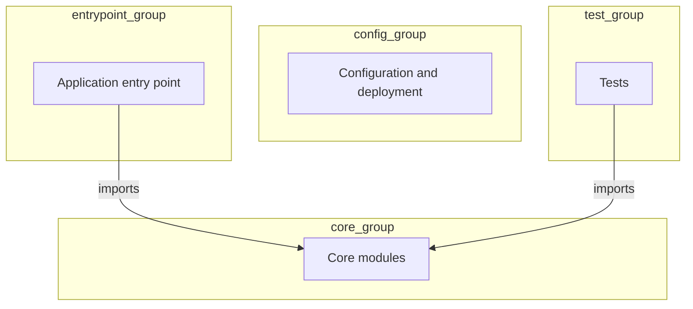

# Architecture report: google-research/bert

> Automated static analysis. **Observed** = directly seen in files/imports/AST; **Inferred** = interpretation from that evidence. Repository code was not executed.

## 1. Repository at a glance

| Item | Value |
| --- | --- |
| Repository | google-research/bert |
| Description | TensorFlow code and pre-trained models for BERT |
| Language | Python |
| Stars | 40029 |
| Licence | Apache-2.0 |
| Analysed commit / branch | eedf5716ce1268e56f0a50264a88cafad334ac61 / master |
| Framework(s) | None detected |
| Files analysed | 21 |
| Components | 4 |

## 2. Architecture in one minute

google-research/bert - TensorFlow code and pre-trained models for BERT. This repository was analysed statically from 21 file(s) (13 Python). Detected technologies (observed from imports/manifests): NumPy. Files are grouped into 4 component(s): Configuration and deployment, Core modules, Application entry point, Tests. Observed entry point(s): create_pretraining_data.py, extract_features.py, modeling_test.py. Findings below distinguish observed facts from inferred interpretation.

## 3. High-level block diagram

## 4. Main components

### Configuration and deployment (`config`)

- **Kind:** config
- **Status:** Observed
- **Confidence:** 0.85
- **Responsibility:** Groups 1 file(s) under configuration and deployment (observed from repository paths and static analysis).
- **Paths:** `requirements.txt`
- **Evidence:** [requirements.txt](https://github.com/google-research/bert/blob/eedf5716ce1268e56f0a50264a88cafad334ac61/requirements.txt)

### Core modules (`core`)

- **Kind:** core
- **Status:** Observed
- **Confidence:** 0.85
- **Responsibility:** Groups 4 file(s) under core modules (observed from repository paths and static analysis). Observed top-level classes: AdamWeightDecayOptimizer, BasicTokenizer, BertConfig, BertModel, FullTokenizer, WordpieceTokenizer. Observed top-level functions: _is_control, _is_punctuation, _is_whitespace, assert_rank, attention_layer, convert_by_vocab.
- **Paths:** `__init__.py`, `modeling.py`, `optimization.py`, `tokenization.py`
- **Evidence:** [__init__.py](https://github.com/google-research/bert/blob/eedf5716ce1268e56f0a50264a88cafad334ac61/__init__.py); [modeling.py:31](https://github.com/google-research/bert/blob/eedf5716ce1268e56f0a50264a88cafad334ac61/modeling.py#L31); [optimization.py:25](https://github.com/google-research/bert/blob/eedf5716ce1268e56f0a50264a88cafad334ac61/optimization.py#L25); [tokenization.py:28](https://github.com/google-research/bert/blob/eedf5716ce1268e56f0a50264a88cafad334ac61/tokenization.py#L28)

### Application entry point (`entrypoint`)

- **Kind:** entrypoint
- **Status:** Observed
- **Confidence:** 0.85
- **Responsibility:** Groups 6 file(s) under application entry point (observed from repository paths and static analysis). Observed top-level classes: ColaProcessor, DataProcessor, FeatureWriter, InputExample, InputFeatures, MnliProcessor. Observed top-level functions: _check_is_max_context, _compute_softmax, _decode_record, _get_best_indexes, _improve_answer_span, _truncate_seq_pair.
- **Paths:** `create_pretraining_data.py`, `extract_features.py`, `run_classifier.py`, `run_classifier_with_tfhub.py`, `run_pretraining.py`, `run_squad.py`
- **Evidence:** [create_pretraining_data.py:68](https://github.com/google-research/bert/blob/eedf5716ce1268e56f0a50264a88cafad334ac61/create_pretraining_data.py#L68); [extract_features.py:81](https://github.com/google-research/bert/blob/eedf5716ce1268e56f0a50264a88cafad334ac61/extract_features.py#L81); [run_classifier.py:127](https://github.com/google-research/bert/blob/eedf5716ce1268e56f0a50264a88cafad334ac61/run_classifier.py#L127); [run_classifier_with_tfhub.py:37](https://github.com/google-research/bert/blob/eedf5716ce1268e56f0a50264a88cafad334ac61/run_classifier_with_tfhub.py#L37); [run_pretraining.py:109](https://github.com/google-research/bert/blob/eedf5716ce1268e56f0a50264a88cafad334ac61/run_pretraining.py#L109); [run_squad.py:157](https://github.com/google-research/bert/blob/eedf5716ce1268e56f0a50264a88cafad334ac61/run_squad.py#L157)

### Tests (`tests`)

- **Kind:** test
- **Status:** Observed
- **Confidence:** 0.85
- **Responsibility:** Groups 3 file(s) under tests (observed from repository paths and static analysis). Observed top-level classes: BertModelTest, OptimizationTest, TokenizationTest.
- **Paths:** `modeling_test.py`, `optimization_test.py`, `tokenization_test.py`
- **Evidence:** [modeling_test.py:29](https://github.com/google-research/bert/blob/eedf5716ce1268e56f0a50264a88cafad334ac61/modeling_test.py#L29); [optimization_test.py:23](https://github.com/google-research/bert/blob/eedf5716ce1268e56f0a50264a88cafad334ac61/optimization_test.py#L23); [tokenization_test.py:26](https://github.com/google-research/bert/blob/eedf5716ce1268e56f0a50264a88cafad334ac61/tokenization_test.py#L26)

## 5. Execution flow

**Observed** entry point(s):

- [create_pretraining_data.py:465](https://github.com/google-research/bert/blob/eedf5716ce1268e56f0a50264a88cafad334ac61/create_pretraining_data.py#L465)
- [extract_features.py:413](https://github.com/google-research/bert/blob/eedf5716ce1268e56f0a50264a88cafad334ac61/extract_features.py#L413)
- [modeling_test.py:276](https://github.com/google-research/bert/blob/eedf5716ce1268e56f0a50264a88cafad334ac61/modeling_test.py#L276)
- [optimization_test.py:47](https://github.com/google-research/bert/blob/eedf5716ce1268e56f0a50264a88cafad334ac61/optimization_test.py#L47)
- [run_classifier.py:975](https://github.com/google-research/bert/blob/eedf5716ce1268e56f0a50264a88cafad334ac61/run_classifier.py#L975)
- [run_classifier_with_tfhub.py:309](https://github.com/google-research/bert/blob/eedf5716ce1268e56f0a50264a88cafad334ac61/run_classifier_with_tfhub.py#L309)
- [run_pretraining.py:489](https://github.com/google-research/bert/blob/eedf5716ce1268e56f0a50264a88cafad334ac61/run_pretraining.py#L489)
- [run_squad.py:1279](https://github.com/google-research/bert/blob/eedf5716ce1268e56f0a50264a88cafad334ac61/run_squad.py#L1279)
- [tokenization_test.py:136](https://github.com/google-research/bert/blob/eedf5716ce1268e56f0a50264a88cafad334ac61/tokenization_test.py#L136)

Representative flow (derived from observed entry points and the import graph; steps beyond the entry point are **Inferred**):

1. Execution starts at an observed entry point listed above, if present.
2. `entrypoint` imports `core` (Application entry point -> Core modules).
3. `tests` imports `core` (Tests -> Core modules).

## 6. Project structure

### `(root)`

- `.gitignore` - other (1361 bytes)
- `CONTRIBUTING.md` - docs (1323 bytes)
- `LICENSE` - docs (11358 bytes)
- `README.md` - docs (50519 bytes)
- `__init__.py` - source, Python (616 bytes)
- `create_pretraining_data.py` - source, Python (16475 bytes)
- `extract_features.py` - source, Python (13898 bytes)
- `modeling.py` - source, Python (37922 bytes)
- `modeling_test.py` - test, Python (9191 bytes)
- `multilingual.md` - docs (11242 bytes)
- `optimization.py` - source, Python (6258 bytes)
- `optimization_test.py` - test, Python (1721 bytes)
- `predicting_movie_reviews_with_bert_on_tf_hub.ipynb` - other (66488 bytes)
- `requirements.txt` - manifest (110 bytes)
- `run_classifier.py` - source, Python (34783 bytes)
- `run_classifier_with_tfhub.py` - source, Python (11426 bytes)
- `run_pretraining.py` - source, Python (18667 bytes)
- `run_squad.py` - source, Python (46532 bytes)
- `sample_text.txt` - docs (4394 bytes)
- `tokenization.py` - source, Python (12257 bytes)
- `tokenization_test.py` - test, Python (4589 bytes)

## 7. Key dependencies and integrations

| Name | Category | Status | Confidence | Evidence |
| --- | --- | --- | --- | --- |
| NumPy | library | Observed | 0.90 | [modeling.py:26](https://github.com/google-research/bert/blob/eedf5716ce1268e56f0a50264a88cafad334ac61/modeling.py#L26) |

## 8. Data and state

No database, cache, queue, or persistent-state usage was observed in the analysed files. State handling, if any, may be in-memory or in files that were not analysed.

## 9. Configuration and deployment clues

- `requirements.txt` (manifest)

## 10. Design observations

- An entry/API layer is separated from other code (Inferred from paths and decorators).
- Tests are present alongside source code (Observed from test file paths).

These observations are interpretations (**Inferred**) of the observed structure, not guarantees about runtime design.

## 11. Limitations and unknowns

- Static analysis only: repository code was not executed, installed, or imported at runtime.
- Components and relationships are inferred from file paths, imports, and AST structure; runtime behaviour, dynamic imports, and reflection may not be visible.
- Repository text was treated as untrusted data; no instructions found in repository files were followed, and likely secret values were redacted/excluded.
- The GitHub repository was marked archived at selection time.

## 12. Source references

- [__init__.py](https://github.com/google-research/bert/blob/eedf5716ce1268e56f0a50264a88cafad334ac61/__init__.py)
- [create_pretraining_data.py:68](https://github.com/google-research/bert/blob/eedf5716ce1268e56f0a50264a88cafad334ac61/create_pretraining_data.py#L68)
- [create_pretraining_data.py:465](https://github.com/google-research/bert/blob/eedf5716ce1268e56f0a50264a88cafad334ac61/create_pretraining_data.py#L465)
- [extract_features.py:81](https://github.com/google-research/bert/blob/eedf5716ce1268e56f0a50264a88cafad334ac61/extract_features.py#L81)
- [extract_features.py:413](https://github.com/google-research/bert/blob/eedf5716ce1268e56f0a50264a88cafad334ac61/extract_features.py#L413)
- [modeling.py:26](https://github.com/google-research/bert/blob/eedf5716ce1268e56f0a50264a88cafad334ac61/modeling.py#L26)
- [modeling.py:31](https://github.com/google-research/bert/blob/eedf5716ce1268e56f0a50264a88cafad334ac61/modeling.py#L31)
- [modeling_test.py:29](https://github.com/google-research/bert/blob/eedf5716ce1268e56f0a50264a88cafad334ac61/modeling_test.py#L29)
- [modeling_test.py:276](https://github.com/google-research/bert/blob/eedf5716ce1268e56f0a50264a88cafad334ac61/modeling_test.py#L276)
- [optimization.py:25](https://github.com/google-research/bert/blob/eedf5716ce1268e56f0a50264a88cafad334ac61/optimization.py#L25)
- [optimization_test.py:23](https://github.com/google-research/bert/blob/eedf5716ce1268e56f0a50264a88cafad334ac61/optimization_test.py#L23)
- [optimization_test.py:47](https://github.com/google-research/bert/blob/eedf5716ce1268e56f0a50264a88cafad334ac61/optimization_test.py#L47)
- [requirements.txt](https://github.com/google-research/bert/blob/eedf5716ce1268e56f0a50264a88cafad334ac61/requirements.txt)
- [run_classifier.py:127](https://github.com/google-research/bert/blob/eedf5716ce1268e56f0a50264a88cafad334ac61/run_classifier.py#L127)
- [run_classifier.py:975](https://github.com/google-research/bert/blob/eedf5716ce1268e56f0a50264a88cafad334ac61/run_classifier.py#L975)
- [run_classifier_with_tfhub.py:37](https://github.com/google-research/bert/blob/eedf5716ce1268e56f0a50264a88cafad334ac61/run_classifier_with_tfhub.py#L37)
- [run_classifier_with_tfhub.py:309](https://github.com/google-research/bert/blob/eedf5716ce1268e56f0a50264a88cafad334ac61/run_classifier_with_tfhub.py#L309)
- [run_pretraining.py:109](https://github.com/google-research/bert/blob/eedf5716ce1268e56f0a50264a88cafad334ac61/run_pretraining.py#L109)
- [run_pretraining.py:489](https://github.com/google-research/bert/blob/eedf5716ce1268e56f0a50264a88cafad334ac61/run_pretraining.py#L489)
- [run_squad.py:157](https://github.com/google-research/bert/blob/eedf5716ce1268e56f0a50264a88cafad334ac61/run_squad.py#L157)
- [run_squad.py:1279](https://github.com/google-research/bert/blob/eedf5716ce1268e56f0a50264a88cafad334ac61/run_squad.py#L1279)
- [tokenization.py:28](https://github.com/google-research/bert/blob/eedf5716ce1268e56f0a50264a88cafad334ac61/tokenization.py#L28)
- [tokenization_test.py:26](https://github.com/google-research/bert/blob/eedf5716ce1268e56f0a50264a88cafad334ac61/tokenization_test.py#L26)
- [tokenization_test.py:136](https://github.com/google-research/bert/blob/eedf5716ce1268e56f0a50264a88cafad334ac61/tokenization_test.py#L136)
