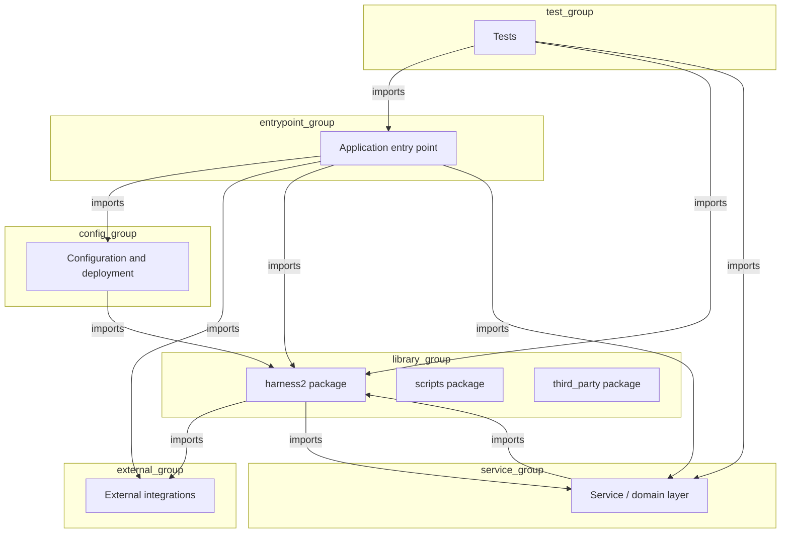

# Architecture report: google-research/harness2

> Automated static analysis. **Observed** = directly seen in files/imports/AST; **Inferred** = interpretation from that evidence. Repository code was not executed.

## 1. Repository at a glance

| Item | Value |
| --- | --- |
| Repository | google-research/harness2 |
| Description | Not provided |
| Language | Python |
| Stars | 23880 |
| Licence | Apache-2.0 |
| Analysed commit / branch | 6868817518876de8fd170c6a8354daca273b6191 / main |
| Framework(s) | FastAPI |
| Files analysed | 133 |
| Components | 8 |

## 2. Architecture in one minute

google-research/harness2. This repository was analysed statically from 133 file(s) (72 Python). Detected technologies (observed from imports/manifests): FastAPI, Poetry, setuptools, Docker, unittest. Files are grouped into 8 component(s): Configuration and deployment, Application entry point, External integrations, harness2 package, scripts package, Service / domain layer, Tests, third_party package. Observed entry point(s): harness2/benchmarks/jb_opencode_runner.py, harness2/benchmarks/wb_render.py, harness2/cli/bridge.py. Findings below distinguish observed facts from inferred interpretation.

## 3. High-level block diagram

## 4. Main components

### Configuration and deployment (`config`)

- **Kind:** config
- **Status:** Observed
- **Confidence:** 0.85
- **Responsibility:** Groups 15 file(s) under configuration and deployment (observed from repository paths and static analysis). Observed top-level classes: ConfigError. Observed top-level functions: documents_dir, env, env_int, jb_repo, lab_repo, load_dotenv.
- **Paths:** `MANIFEST.in`, `dependencies/ASSETS.json`, `harness2/cli/setup.py`, `harness2/config.py`, `pyproject.toml`, `third_party/jb_runner/harness_baseline_oc/harness.yaml`, `third_party/lab_runner/tts_lab/config.py`, `third_party/wb_runner/configs/harnesses/codex-harness/_defaults.yaml`, `third_party/wb_runner/configs/harnesses/codex-harness/versions/0.144.6.yaml`, `third_party/wb_runner/configs/harnesses/oc-harness/_defaults.yaml`, `third_party/wb_runner/configs/harnesses/oc-harness/versions/1.14.18.yaml`, `third_party/wb_runner/configs/harnesses/opencode/_defaults.yaml`, `third_party/wb_runner/configs/harnesses/opencode/docker/Dockerfile`, `third_party/wb_runner/configs/harnesses/opencode/presets/settings/v1_14.json`, `third_party/wb_runner/configs/harnesses/opencode/versions/1.14.18.yaml`
- **Evidence:** [MANIFEST.in](https://github.com/google-research/harness2/blob/6868817518876de8fd170c6a8354daca273b6191/MANIFEST.in); [dependencies/ASSETS.json](https://github.com/google-research/harness2/blob/6868817518876de8fd170c6a8354daca273b6191/dependencies/ASSETS.json); [harness2/cli/setup.py:26](https://github.com/google-research/harness2/blob/6868817518876de8fd170c6a8354daca273b6191/harness2/cli/setup.py#L26); [harness2/config.py:32](https://github.com/google-research/harness2/blob/6868817518876de8fd170c6a8354daca273b6191/harness2/config.py#L32); [pyproject.toml](https://github.com/google-research/harness2/blob/6868817518876de8fd170c6a8354daca273b6191/pyproject.toml); [third_party/jb_runner/harness_baseline_oc/harness.yaml](https://github.com/google-research/harness2/blob/6868817518876de8fd170c6a8354daca273b6191/third_party/jb_runner/harness_baseline_oc/harness.yaml); [third_party/lab_runner/tts_lab/config.py:9](https://github.com/google-research/harness2/blob/6868817518876de8fd170c6a8354daca273b6191/third_party/lab_runner/tts_lab/config.py#L9); [third_party/wb_runner/configs/harnesses/codex-harness/_defaults.yaml](https://github.com/google-research/harness2/blob/6868817518876de8fd170c6a8354daca273b6191/third_party/wb_runner/configs/harnesses/codex-harness/_defaults.yaml)

### Application entry point (`entrypoint`)

- **Kind:** entrypoint
- **Status:** Observed
- **Confidence:** 0.85
- **Responsibility:** Groups 16 file(s) under application entry point (observed from repository paths and static analysis). Observed top-level classes: RenderBackendError, RenderInputError, Settings. Observed top-level functions: _admit, _attempt, _binary_stub, _bridge, _bridge_interpreter, _bridge_main.
- **Paths:** `harness2/benchmarks/jb_opencode_runner.py`, `harness2/benchmarks/wb_render.py`, `harness2/cli/bridge.py`, `harness2/cli/check.py`, `harness2/cli/demo.py`, `harness2/cli/judge.py`, `harness2/cli/report.py`, `harness2/cli/run_sweep.py`, `scripts/check_provenance.py`, `scripts/check_setup.py`, `scripts/render_readme_typing.py`, `scripts/setup_benchmark.py`, `scripts/split_tasks.py`, `third_party/lab_runner/adapt_runs_cx/run_codex_lab.py`, `third_party/lab_runner/opencode/run_opencode.py`, `third_party/lab_runner/opencode/scripts/read_doc.py`
- **Evidence:** [harness2/benchmarks/jb_opencode_runner.py:56](https://github.com/google-research/harness2/blob/6868817518876de8fd170c6a8354daca273b6191/harness2/benchmarks/jb_opencode_runner.py#L56); [harness2/benchmarks/wb_render.py:56](https://github.com/google-research/harness2/blob/6868817518876de8fd170c6a8354daca273b6191/harness2/benchmarks/wb_render.py#L56); [harness2/cli/bridge.py:42](https://github.com/google-research/harness2/blob/6868817518876de8fd170c6a8354daca273b6191/harness2/cli/bridge.py#L42); [harness2/cli/check.py:25](https://github.com/google-research/harness2/blob/6868817518876de8fd170c6a8354daca273b6191/harness2/cli/check.py#L25); [harness2/cli/demo.py:27](https://github.com/google-research/harness2/blob/6868817518876de8fd170c6a8354daca273b6191/harness2/cli/demo.py#L27); [harness2/cli/judge.py:50](https://github.com/google-research/harness2/blob/6868817518876de8fd170c6a8354daca273b6191/harness2/cli/judge.py#L50); [harness2/cli/report.py:37](https://github.com/google-research/harness2/blob/6868817518876de8fd170c6a8354daca273b6191/harness2/cli/report.py#L37); [harness2/cli/run_sweep.py:47](https://github.com/google-research/harness2/blob/6868817518876de8fd170c6a8354daca273b6191/harness2/cli/run_sweep.py#L47)

### External integrations (`external_integrations`)

- **Kind:** external
- **Status:** Inferred
- **Confidence:** 0.70
- **Responsibility:** Groups 0 file(s) under external integrations (observed from repository paths and static analysis).
- **Evidence:** [harness2/cli/bridge.py:23](https://github.com/google-research/harness2/blob/6868817518876de8fd170c6a8354daca273b6191/harness2/cli/bridge.py#L23); [harness2/substrate/codex.py:28](https://github.com/google-research/harness2/blob/6868817518876de8fd170c6a8354daca273b6191/harness2/substrate/codex.py#L28)

### harness2 package (`harness2`)

- **Kind:** library
- **Status:** Observed
- **Confidence:** 0.85
- **Responsibility:** Groups 15 file(s) under harness2 package (observed from repository paths and static analysis). Observed top-level classes: CodexSubstrate, DemoAdapter, DemoProposer, HelpFormatter, Install, JobBenchAdapter. Observed top-level functions: _channels, _clip, _component_index, _conc, _emit, _emit_if.
- **Paths:** `harness2/__init__.py`, `harness2/benchmarks/__init__.py`, `harness2/benchmarks/jobbench.py`, `harness2/benchmarks/lab.py`, `harness2/benchmarks/tasks.py`, `harness2/benchmarks/workbuddy.py`, `harness2/cli/__init__.py`, `harness2/cli/_common.py`, `harness2/demo.py`, `harness2/install.py`, `harness2/preflight.py`, `harness2/substrate/__init__.py`, `harness2/substrate/base.py`, `harness2/substrate/codex.py`, `harness2/substrate/opencode.py`
- **Evidence:** [harness2/__init__.py](https://github.com/google-research/harness2/blob/6868817518876de8fd170c6a8354daca273b6191/harness2/__init__.py); [harness2/benchmarks/__init__.py](https://github.com/google-research/harness2/blob/6868817518876de8fd170c6a8354daca273b6191/harness2/benchmarks/__init__.py); [harness2/benchmarks/jobbench.py:55](https://github.com/google-research/harness2/blob/6868817518876de8fd170c6a8354daca273b6191/harness2/benchmarks/jobbench.py#L55); [harness2/benchmarks/lab.py:265](https://github.com/google-research/harness2/blob/6868817518876de8fd170c6a8354daca273b6191/harness2/benchmarks/lab.py#L265); [harness2/benchmarks/tasks.py:26](https://github.com/google-research/harness2/blob/6868817518876de8fd170c6a8354daca273b6191/harness2/benchmarks/tasks.py#L26); [harness2/benchmarks/workbuddy.py:59](https://github.com/google-research/harness2/blob/6868817518876de8fd170c6a8354daca273b6191/harness2/benchmarks/workbuddy.py#L59); [harness2/cli/__init__.py](https://github.com/google-research/harness2/blob/6868817518876de8fd170c6a8354daca273b6191/harness2/cli/__init__.py); [harness2/cli/_common.py:41](https://github.com/google-research/harness2/blob/6868817518876de8fd170c6a8354daca273b6191/harness2/cli/_common.py#L41)

### scripts package (`scripts`)

- **Kind:** library
- **Status:** Observed
- **Confidence:** 0.85
- **Responsibility:** Groups 3 file(s) under scripts package (observed from repository paths and static analysis).
- **Paths:** `scripts/run_jobbench.sh`, `scripts/run_lab.sh`, `scripts/run_workbuddy.sh`
- **Evidence:** [scripts/run_jobbench.sh](https://github.com/google-research/harness2/blob/6868817518876de8fd170c6a8354daca273b6191/scripts/run_jobbench.sh); [scripts/run_lab.sh](https://github.com/google-research/harness2/blob/6868817518876de8fd170c6a8354daca273b6191/scripts/run_lab.sh); [scripts/run_workbuddy.sh](https://github.com/google-research/harness2/blob/6868817518876de8fd170c6a8354daca273b6191/scripts/run_workbuddy.sh)

### Service / domain layer (`service_layer`)

- **Kind:** service
- **Status:** Observed
- **Confidence:** 0.85
- **Responsibility:** Groups 14 file(s) under service / domain layer (observed from repository paths and static analysis). Observed top-level classes: BenchPrompts, BenchSpec, BenchmarkAdapter, BudgetError, ChannelSpec, ContextTree. Observed top-level functions: _accept_tree, _anon_id, _assets_line, _assets_note, _build_surface_texts, _call_fingerprint.
- **Paths:** `harness2/core/__init__.py`, `harness2/core/context.py`, `harness2/core/judge.py`, `harness2/core/ledger.py`, `harness2/core/library.py`, `harness2/core/prompts.py`, `harness2/core/proposer.py`, `harness2/core/recursion.py`, `harness2/core/report.py`, `harness2/core/runmark.py`, `harness2/core/schedule.py`, `harness2/core/selection.py`, `harness2/core/spec.py`, `harness2/core/tree.py`
- **Evidence:** [harness2/core/__init__.py](https://github.com/google-research/harness2/blob/6868817518876de8fd170c6a8354daca273b6191/harness2/core/__init__.py); [harness2/core/context.py:43](https://github.com/google-research/harness2/blob/6868817518876de8fd170c6a8354daca273b6191/harness2/core/context.py#L43); [harness2/core/judge.py:32](https://github.com/google-research/harness2/blob/6868817518876de8fd170c6a8354daca273b6191/harness2/core/judge.py#L32); [harness2/core/ledger.py:26](https://github.com/google-research/harness2/blob/6868817518876de8fd170c6a8354daca273b6191/harness2/core/ledger.py#L26); [harness2/core/library.py:39](https://github.com/google-research/harness2/blob/6868817518876de8fd170c6a8354daca273b6191/harness2/core/library.py#L39); [harness2/core/prompts.py:33](https://github.com/google-research/harness2/blob/6868817518876de8fd170c6a8354daca273b6191/harness2/core/prompts.py#L33); [harness2/core/proposer.py:45](https://github.com/google-research/harness2/blob/6868817518876de8fd170c6a8354daca273b6191/harness2/core/proposer.py#L45); [harness2/core/recursion.py:42](https://github.com/google-research/harness2/blob/6868817518876de8fd170c6a8354daca273b6191/harness2/core/recursion.py#L42)

### Tests (`tests`)

- **Kind:** test
- **Status:** Observed
- **Confidence:** 0.85
- **Responsibility:** Groups 25 file(s) under tests (observed from repository paths and static analysis). Observed top-level classes: BaselineJudgeTests, EnvExampleTests, FirstCandidateSelector, InputsFingerprintTests, JobbenchWorkerFailureTests, KilledRolloutTests. Observed top-level functions: _opencode_allows, load_nodes, write_fixture.
- **Paths:** `tests/fixtures/harvey-labs/.gitattributes`, `tests/fixtures/harvey-labs/LICENSE`, `tests/fixtures/harvey-labs/PROVENANCE.json`, `tests/fixtures/harvey-labs/evaluation/judge.py.txt`, `tests/fixtures/harvey-labs/evaluation/prompts/rubric_criterion.txt`, `tests/fixtures/harvey-labs/evaluation/run_eval.py.txt`, `tests/fixtures/harvey-labs/evaluation/scoring.py.txt`, `tests/fixtures/job-bench-eval/.gitattributes`, `tests/fixtures/job-bench-eval/PROVENANCE.json`, `tests/fixtures/job-bench-eval/judge.py.txt`, `tests/test_baseline_judge.py`, `tests/test_env_example.py`, `tests/test_jobbench_killed_rollout.py`, `tests/test_jobbench_rollout_isolation.py`, `tests/test_jobbench_worker_failure.py`, `tests/test_lab_judge_patch.py`, `tests/test_lab_nested_deliverables.py`, `tests/test_proposer_failures.py`, `tests/test_proposer_session_errors.py`, `tests/test_requested_mode_resume.py`, `tests/test_runner_seed.py`, `tests/test_stage_retry.py`, `tests/test_subprocess_env.py`, `tests/test_task_input_identity.py`, `tests/test_workflow.py`
- **Evidence:** [tests/fixtures/harvey-labs/.gitattributes](https://github.com/google-research/harness2/blob/6868817518876de8fd170c6a8354daca273b6191/tests/fixtures/harvey-labs/.gitattributes); [tests/fixtures/harvey-labs/LICENSE](https://github.com/google-research/harness2/blob/6868817518876de8fd170c6a8354daca273b6191/tests/fixtures/harvey-labs/LICENSE); [tests/fixtures/harvey-labs/PROVENANCE.json](https://github.com/google-research/harness2/blob/6868817518876de8fd170c6a8354daca273b6191/tests/fixtures/harvey-labs/PROVENANCE.json); [tests/fixtures/harvey-labs/evaluation/judge.py.txt](https://github.com/google-research/harness2/blob/6868817518876de8fd170c6a8354daca273b6191/tests/fixtures/harvey-labs/evaluation/judge.py.txt); [tests/fixtures/harvey-labs/evaluation/prompts/rubric_criterion.txt](https://github.com/google-research/harness2/blob/6868817518876de8fd170c6a8354daca273b6191/tests/fixtures/harvey-labs/evaluation/prompts/rubric_criterion.txt); [tests/fixtures/harvey-labs/evaluation/run_eval.py.txt](https://github.com/google-research/harness2/blob/6868817518876de8fd170c6a8354daca273b6191/tests/fixtures/harvey-labs/evaluation/run_eval.py.txt); [tests/fixtures/harvey-labs/evaluation/scoring.py.txt](https://github.com/google-research/harness2/blob/6868817518876de8fd170c6a8354daca273b6191/tests/fixtures/harvey-labs/evaluation/scoring.py.txt); [tests/fixtures/job-bench-eval/.gitattributes](https://github.com/google-research/harness2/blob/6868817518876de8fd170c6a8354daca273b6191/tests/fixtures/job-bench-eval/.gitattributes)

### third_party package (`third_party`)

- **Kind:** library
- **Status:** Observed
- **Confidence:** 0.85
- **Responsibility:** Groups 10 file(s) under third_party package (observed from repository paths and static analysis). Observed top-level classes: CodexAgent, CodexHarnessAgent, OcAgent, OcHarnessAgent, RenderResult. Observed top-level functions: _blank_ts_literals, _component, _copy_skill_scripts, _ensure_mode_subagent, _script_doc, _strip_comments.
- **Paths:** `third_party/jb_runner/run_benchmark_codex_cli_adapt.sh`, `third_party/lab_runner/opencode/__init__.py`, `third_party/lab_runner/opencode/render.py`, `third_party/lab_runner/opencode/render_tree.py`, `third_party/lab_runner/opencode/session.py`, `third_party/lab_runner/tts_lab/__init__.py`, `third_party/wb_runner/agents/codex_agent.py`, `third_party/wb_runner/agents/codex_harness_agent.py`, `third_party/wb_runner/agents/oc_agent.py`, `third_party/wb_runner/agents/oc_harness_agent.py`
- **Evidence:** [third_party/jb_runner/run_benchmark_codex_cli_adapt.sh](https://github.com/google-research/harness2/blob/6868817518876de8fd170c6a8354daca273b6191/third_party/jb_runner/run_benchmark_codex_cli_adapt.sh); [third_party/lab_runner/opencode/__init__.py](https://github.com/google-research/harness2/blob/6868817518876de8fd170c6a8354daca273b6191/third_party/lab_runner/opencode/__init__.py); [third_party/lab_runner/opencode/render.py:64](https://github.com/google-research/harness2/blob/6868817518876de8fd170c6a8354daca273b6191/third_party/lab_runner/opencode/render.py#L64); [third_party/lab_runner/opencode/render_tree.py](https://github.com/google-research/harness2/blob/6868817518876de8fd170c6a8354daca273b6191/third_party/lab_runner/opencode/render_tree.py); [third_party/lab_runner/opencode/session.py:14](https://github.com/google-research/harness2/blob/6868817518876de8fd170c6a8354daca273b6191/third_party/lab_runner/opencode/session.py#L14); [third_party/lab_runner/tts_lab/__init__.py](https://github.com/google-research/harness2/blob/6868817518876de8fd170c6a8354daca273b6191/third_party/lab_runner/tts_lab/__init__.py); [third_party/wb_runner/agents/codex_agent.py:35](https://github.com/google-research/harness2/blob/6868817518876de8fd170c6a8354daca273b6191/third_party/wb_runner/agents/codex_agent.py#L35); [third_party/wb_runner/agents/codex_harness_agent.py:18](https://github.com/google-research/harness2/blob/6868817518876de8fd170c6a8354daca273b6191/third_party/wb_runner/agents/codex_harness_agent.py#L18)

## 5. Execution flow

**Observed** entry point(s):

- [harness2/benchmarks/jb_opencode_runner.py:346](https://github.com/google-research/harness2/blob/6868817518876de8fd170c6a8354daca273b6191/harness2/benchmarks/jb_opencode_runner.py#L346)
- [harness2/benchmarks/wb_render.py:560](https://github.com/google-research/harness2/blob/6868817518876de8fd170c6a8354daca273b6191/harness2/benchmarks/wb_render.py#L560)
- [harness2/cli/bridge.py](https://github.com/google-research/harness2/blob/6868817518876de8fd170c6a8354daca273b6191/harness2/cli/bridge.py)
- [harness2/cli/check.py](https://github.com/google-research/harness2/blob/6868817518876de8fd170c6a8354daca273b6191/harness2/cli/check.py)
- [harness2/cli/demo.py](https://github.com/google-research/harness2/blob/6868817518876de8fd170c6a8354daca273b6191/harness2/cli/demo.py)
- [harness2/cli/judge.py](https://github.com/google-research/harness2/blob/6868817518876de8fd170c6a8354daca273b6191/harness2/cli/judge.py)
- [harness2/cli/report.py](https://github.com/google-research/harness2/blob/6868817518876de8fd170c6a8354daca273b6191/harness2/cli/report.py)
- [harness2/cli/run_sweep.py](https://github.com/google-research/harness2/blob/6868817518876de8fd170c6a8354daca273b6191/harness2/cli/run_sweep.py)
- [harness2/cli/setup.py](https://github.com/google-research/harness2/blob/6868817518876de8fd170c6a8354daca273b6191/harness2/cli/setup.py)
- [scripts/check_provenance.py:42](https://github.com/google-research/harness2/blob/6868817518876de8fd170c6a8354daca273b6191/scripts/check_provenance.py#L42)
- [scripts/check_setup.py:20](https://github.com/google-research/harness2/blob/6868817518876de8fd170c6a8354daca273b6191/scripts/check_setup.py#L20)
- [scripts/render_readme_typing.py:139](https://github.com/google-research/harness2/blob/6868817518876de8fd170c6a8354daca273b6191/scripts/render_readme_typing.py#L139)

Representative flow (derived from observed entry points and the import graph; steps beyond the entry point are **Inferred**):

1. Execution starts at an observed entry point listed above, if present.
2. `config` imports `harness2` (Configuration and deployment -> harness2 package).
3. `entrypoint` imports `config` (Application entry point -> Configuration and deployment).
4. `entrypoint` imports `external_integrations` (Application entry point -> External integrations).
5. `entrypoint` imports `harness2` (Application entry point -> harness2 package).
6. `entrypoint` imports `service_layer` (Application entry point -> Service / domain layer).
7. `harness2` imports `external_integrations` (harness2 package -> External integrations).
8. `harness2` imports `service_layer` (harness2 package -> Service / domain layer).
9. `service_layer` imports `harness2` (Service / domain layer -> harness2 package).

## 6. Project structure

### `(root)`

- `.env.example` - config (1038 bytes)
- `.gitignore` - other (383 bytes)
- `CONTRIBUTING.md` - docs (1129 bytes)
- `LICENSE` - docs (11358 bytes)
- `MANIFEST.in` - manifest (265 bytes)
- `README.md` - docs (9374 bytes)
- `pyproject.toml` - manifest (1195 bytes)

### `dependencies`

- `dependencies/ASSETS.json` - config (5856 bytes)
- `dependencies/PINNED.md` - docs (2258 bytes)
- `dependencies/README.md` - docs (1377 bytes)

### `docs`

- `docs/BENCHMARKS.md` - docs (5894 bytes)
- `docs/EXPERIMENTS.md` - docs (5414 bytes)
- `docs/SETUP.md` - docs (7057 bytes)

### `harness2`

- `harness2/__init__.py` - source, Python (639 bytes)
- `harness2/benchmarks/__init__.py` - source, Python (632 bytes)
- `harness2/benchmarks/jb_opencode_runner.py` - source, Python (13196 bytes)
- `harness2/benchmarks/jobbench.py` - source, Python (52082 bytes)
- `harness2/benchmarks/lab.py` - source, Python (46045 bytes)
- `harness2/benchmarks/tasks.py` - source, Python (3901 bytes)
- `harness2/benchmarks/wb_render.py` - source, Python (20690 bytes)
- `harness2/benchmarks/workbuddy.py` - source, Python (41933 bytes)
- `harness2/cli/__init__.py` - source, Python (631 bytes)
- `harness2/cli/_common.py` - source, Python (5520 bytes)
- `harness2/cli/bridge.py` - source, Python (3728 bytes)
- `harness2/cli/check.py` - source, Python (1745 bytes)
- `harness2/cli/demo.py` - source, Python (2141 bytes)
- `harness2/cli/judge.py` - source, Python (8438 bytes)
- `harness2/cli/report.py` - source, Python (4428 bytes)
- `harness2/cli/run_sweep.py` - source, Python (9359 bytes)
- `harness2/cli/setup.py` - manifest, Python (4361 bytes)
- `harness2/config.py` - source, Python (8514 bytes)
- `harness2/core/__init__.py` - source, Python (802 bytes)
- `harness2/core/context.py` - source, Python (21597 bytes)
- `harness2/core/judge.py` - source, Python (5545 bytes)
- `harness2/core/ledger.py` - source, Python (4536 bytes)
- `harness2/core/library.py` - source, Python (8449 bytes)
- `harness2/core/prompts.py` - source, Python (66499 bytes)
- `harness2/core/proposer.py` - source, Python (18500 bytes)
- `harness2/core/recursion.py` - source, Python (19376 bytes)
- `harness2/core/report.py` - source, Python (6183 bytes)
- `harness2/core/runmark.py` - source, Python (6321 bytes)
- `harness2/core/schedule.py` - source, Python (33567 bytes)
- `harness2/core/selection.py` - source, Python (18262 bytes)
- `harness2/core/spec.py` - source, Python (9720 bytes)
- `harness2/core/tree.py` - source, Python (16265 bytes)
- `harness2/demo.py` - source, Python (6978 bytes)
- `harness2/install.py` - source, Python (12499 bytes)
- `harness2/preflight.py` - source, Python (6533 bytes)
- `harness2/substrate/__init__.py` - source, Python (1155 bytes)
- `harness2/substrate/base.py` - source, Python (2891 bytes)
- `harness2/substrate/codex.py` - source, Python (18094 bytes)
- `harness2/substrate/opencode.py` - source, Python (15605 bytes)

### `scripts`

- `scripts/check_provenance.py` - source, Python (1463 bytes)
- `scripts/check_setup.py` - source, Python (749 bytes)
- `scripts/render_readme_typing.py` - source, Python (5712 bytes)
- `scripts/run_jobbench.sh` - source, Shell (1780 bytes)
- `scripts/run_lab.sh` - source, Shell (1772 bytes)
- `scripts/run_workbuddy.sh` - source, Shell (1867 bytes)
- `scripts/setup_benchmark.py` - source, Python (749 bytes)
- `scripts/split_tasks.py` - source, Python (2596 bytes)

### `tests`

- `tests/fixtures/harvey-labs/.gitattributes` - test (89 bytes)
- `tests/fixtures/harvey-labs/LICENSE` - test (1066 bytes)
- `tests/fixtures/harvey-labs/PROVENANCE.json` - test (1001 bytes)
- `tests/fixtures/harvey-labs/evaluation/judge.py.txt` - test (10042 bytes)
- `tests/fixtures/harvey-labs/evaluation/prompts/rubric_criterion.txt` - test (531 bytes)
- `tests/fixtures/harvey-labs/evaluation/run_eval.py.txt` - test (11243 bytes)
- `tests/fixtures/harvey-labs/evaluation/scoring.py.txt` - test (14895 bytes)
- `tests/fixtures/job-bench-eval/.gitattributes` - test (89 bytes)
- `tests/fixtures/job-bench-eval/PROVENANCE.json` - test (528 bytes)
- `tests/fixtures/job-bench-eval/judge.py.txt` - test (32186 bytes)
- `tests/test_baseline_judge.py` - test, Python (5796 bytes)
- `tests/test_env_example.py` - test, Python (3376 bytes)
- `tests/test_jobbench_killed_rollout.py` - test, Python (6264 bytes)
- `tests/test_jobbench_rollout_isolation.py` - test, Python (6719 bytes)
- `tests/test_jobbench_worker_failure.py` - test, Python (8272 bytes)
- `tests/test_lab_judge_patch.py` - test, Python (8293 bytes)
- `tests/test_lab_nested_deliverables.py` - test, Python (8323 bytes)
- `tests/test_proposer_failures.py` - test, Python (12681 bytes)
- `tests/test_proposer_session_errors.py` - test, Python (3988 bytes)
- `tests/test_requested_mode_resume.py` - test, Python (2814 bytes)
- `tests/test_runner_seed.py` - test, Python (5880 bytes)
- `tests/test_stage_retry.py` - test, Python (3588 bytes)
- `tests/test_subprocess_env.py` - test, Python (13755 bytes)
- `tests/test_task_input_identity.py` - test, Python (12670 bytes)
- `tests/test_workflow.py` - test, Python (15350 bytes)

### `third_party`

- `third_party/README.md` - docs (972 bytes)
- `third_party/jb_runner/LICENSE` - docs (11357 bytes)
- `third_party/jb_runner/PROVENANCE.md` - docs (1363 bytes)
- `third_party/jb_runner/codex_base_harness/AGENTS.md` - docs (116 bytes)
- `third_party/jb_runner/harness_baseline_oc/LongTermMEMORY.md` - docs (114 bytes)
- `third_party/jb_runner/harness_baseline_oc/guardrails.md` - docs (74 bytes)
- `third_party/jb_runner/harness_baseline_oc/harness.yaml` - config (2181 bytes)
- `third_party/jb_runner/harness_baseline_oc/plugin/README.md` - docs (1598 bytes)
- `third_party/jb_runner/harness_baseline_oc/scripts/README.md` - docs (589 bytes)
- `third_party/jb_runner/harness_baseline_oc/sub_agents/README.md` - docs (372 bytes)
- `third_party/jb_runner/harness_baseline_oc/systemprompt.md` - docs (370 bytes)
- `third_party/jb_runner/harness_baseline_oc/tool_descriptions/tool_guidance.md` - docs (87 bytes)
- `third_party/jb_runner/run_benchmark_codex_cli_adapt.sh` - source, Shell (20526 bytes)
- `third_party/lab_runner/LICENSE` - docs (1066 bytes)
- `third_party/lab_runner/PROVENANCE.md` - docs (598 bytes)
- `third_party/lab_runner/adapt_runs_cx/run_codex_lab.py` - source, Python (16474 bytes)
- `third_party/lab_runner/opencode/README.md` - docs (701 bytes)
- `third_party/lab_runner/opencode/__init__.py` - source, Python (233 bytes)
- `third_party/lab_runner/opencode/render.py` - source, Python (17527 bytes)
- `third_party/lab_runner/opencode/render_tree.py` - source, Python (690 bytes)
- `third_party/lab_runner/opencode/run_opencode.py` - source, Python (19781 bytes)
- `third_party/lab_runner/opencode/scripts/read_doc.py` - source, Python (3554 bytes)
- `third_party/lab_runner/opencode/session.py` - source, Python (4653 bytes)
- `third_party/lab_runner/tts_lab/__init__.py` - source, Python (429 bytes)
- `third_party/lab_runner/tts_lab/config.py` - source, Python (482 bytes)
- `third_party/licenses/harvey-labs.LICENSE` - other (1066 bytes)
- `third_party/licenses/job-bench-eval.LICENSE` - other (11357 bytes)
- `third_party/licenses/opencode.LICENSE` - other (1065 bytes)
- `third_party/licenses/workbuddy-bench.LICENSE` - other (10277 bytes)
- `third_party/patches/harvey-labs-judge-vertex-anthropic.diff` - other (12929 bytes)
- `third_party/patches/job-bench-eval-judge.diff` - other (2202 bytes)
- `third_party/patches/opencode-compat.diff` - other (1607 bytes)
- `third_party/patches/workbuddy-bench-runtime.diff` - other (43663 bytes)
- `third_party/wb_runner/LICENSE` - docs (10277 bytes)
- `third_party/wb_runner/PROVENANCE.md` - docs (626 bytes)
- `third_party/wb_runner/agents/codex_agent.py` - source, Python (17095 bytes)
- `third_party/wb_runner/agents/codex_harness_agent.py` - source, Python (3155 bytes)
- `third_party/wb_runner/agents/oc_agent.py` - source, Python (20695 bytes)
- `third_party/wb_runner/agents/oc_harness_agent.py` - source, Python (4388 bytes)
- `third_party/wb_runner/configs/harnesses/codex-harness/_defaults.yaml` - config (413 bytes)
- `third_party/wb_runner/configs/harnesses/codex-harness/versions/0.144.6.yaml` - config (124 bytes)
- `third_party/wb_runner/configs/harnesses/oc-harness/_defaults.yaml` - config (1861 bytes)
- `third_party/wb_runner/configs/harnesses/oc-harness/versions/1.14.18.yaml` - config (1293 bytes)
- `third_party/wb_runner/configs/harnesses/opencode/CONFIG.md` - docs (337 bytes)
- `third_party/wb_runner/configs/harnesses/opencode/_defaults.yaml` - config (1594 bytes)
- `third_party/wb_runner/configs/harnesses/opencode/docker/Dockerfile` - container (4536 bytes)
- `third_party/wb_runner/configs/harnesses/opencode/presets/settings/v1_14.json` - config (350 bytes)
- `third_party/wb_runner/configs/harnesses/opencode/versions/1.14.18.yaml` - config (1240 bytes)

## 7. Key dependencies and integrations

| Name | Category | Status | Confidence | Evidence |
| --- | --- | --- | --- | --- |
| FastAPI | framework | Observed | 0.85 | [pyproject.toml:24](https://github.com/google-research/harness2/blob/6868817518876de8fd170c6a8354daca273b6191/pyproject.toml#L24) |
| Poetry | packaging | Observed | 0.85 | [pyproject.toml](https://github.com/google-research/harness2/blob/6868817518876de8fd170c6a8354daca273b6191/pyproject.toml) |
| setuptools | packaging | Observed | 0.85 | [pyproject.toml:2](https://github.com/google-research/harness2/blob/6868817518876de8fd170c6a8354daca273b6191/pyproject.toml#L2) |
| Docker | tooling | Observed | 0.85 | [third_party/wb_runner/configs/harnesses/opencode/docker/Dockerfile](https://github.com/google-research/harness2/blob/6868817518876de8fd170c6a8354daca273b6191/third_party/wb_runner/configs/harnesses/opencode/docker/Dockerfile) |
| unittest | tooling | Observed | 0.95 | [tests/test_baseline_judge.py:23](https://github.com/google-research/harness2/blob/6868817518876de8fd170c6a8354daca273b6191/tests/test_baseline_judge.py#L23); [tests/test_env_example.py:25](https://github.com/google-research/harness2/blob/6868817518876de8fd170c6a8354daca273b6191/tests/test_env_example.py#L25); [tests/test_jobbench_killed_rollout.py:20](https://github.com/google-research/harness2/blob/6868817518876de8fd170c6a8354daca273b6191/tests/test_jobbench_killed_rollout.py#L20); [tests/test_jobbench_killed_rollout.py:22](https://github.com/google-research/harness2/blob/6868817518876de8fd170c6a8354daca273b6191/tests/test_jobbench_killed_rollout.py#L22) |

## 8. Data and state

No database, cache, queue, or persistent-state usage was observed in the analysed files. State handling, if any, may be in-memory or in files that were not analysed.

## 9. Configuration and deployment clues

- `.env.example` (config)
- `MANIFEST.in` (manifest)
- `dependencies/ASSETS.json` (config)
- `harness2/cli/setup.py` (manifest)
- `pyproject.toml` (manifest)
- `third_party/jb_runner/harness_baseline_oc/harness.yaml` (config)
- `third_party/wb_runner/configs/harnesses/codex-harness/_defaults.yaml` (config)
- `third_party/wb_runner/configs/harnesses/codex-harness/versions/0.144.6.yaml` (config)
- `third_party/wb_runner/configs/harnesses/oc-harness/_defaults.yaml` (config)
- `third_party/wb_runner/configs/harnesses/oc-harness/versions/1.14.18.yaml` (config)
- `third_party/wb_runner/configs/harnesses/opencode/_defaults.yaml` (config)
- `third_party/wb_runner/configs/harnesses/opencode/docker/Dockerfile` (container)
- `third_party/wb_runner/configs/harnesses/opencode/presets/settings/v1_14.json` (config)
- `third_party/wb_runner/configs/harnesses/opencode/versions/1.14.18.yaml` (config)

Environment variable *names* seen in example env files (values never recorded):

- `.env.example`: `GOOGLE_CLOUD_LOCATION`, `GOOGLE_CLOUD_PROJECT`, `HARNESS2_CODEX_API_KEY`, `HARNESS2_CODEX_BASE_URL`, `HARNESS2_CODEX_CONTAINER_URL`, `HARNESS2_CODEX_MODEL`, `HARNESS2_IMPROVER_MODEL`, `HARNESS2_JUDGE_API_KEY`, `HARNESS2_JUDGE_BASE_URL`, `HARNESS2_JUDGE_MODEL`, `HARNESS2_RUNS_DIR`, `HARNESS2_SOLVER_MODEL`

Console scripts declared in packaging metadata (**Observed**):

- `harness2` -> `harness2.cli.run_sweep:main`
- `harness2-bridge` -> `harness2.cli.bridge:main`
- `harness2-check` -> `harness2.cli.check:main`
- `harness2-demo` -> `harness2.cli.demo:main`
- `harness2-judge` -> `harness2.cli.judge:main`
- `harness2-report` -> `harness2.cli.report:main`
- `harness2-setup` -> `harness2.cli.setup:main`

## 10. Design observations

- An entry/API layer is separated from other code (Inferred from paths and decorators).
- Service/domain code is distinct from entry and data code, suggesting layered separation (Inferred).
- Tests are present alongside source code (Observed from test file paths).
- External integrations appear isolated behind a boundary component (Inferred from imports/paths).

These observations are interpretations (**Inferred**) of the observed structure, not guarantees about runtime design.

## 11. Limitations and unknowns

- Static analysis only: repository code was not executed, installed, or imported at runtime.
- Components and relationships are inferred from file paths, imports, and AST structure; runtime behaviour, dynamic imports, and reflection may not be visible.
- Repository text was treated as untrusted data; no instructions found in repository files were followed, and likely secret values were redacted/excluded.

## 12. Source references

- [MANIFEST.in](https://github.com/google-research/harness2/blob/6868817518876de8fd170c6a8354daca273b6191/MANIFEST.in)
- [dependencies/ASSETS.json](https://github.com/google-research/harness2/blob/6868817518876de8fd170c6a8354daca273b6191/dependencies/ASSETS.json)
- [harness2/__init__.py](https://github.com/google-research/harness2/blob/6868817518876de8fd170c6a8354daca273b6191/harness2/__init__.py)
- [harness2/benchmarks/__init__.py](https://github.com/google-research/harness2/blob/6868817518876de8fd170c6a8354daca273b6191/harness2/benchmarks/__init__.py)
- [harness2/benchmarks/jb_opencode_runner.py:56](https://github.com/google-research/harness2/blob/6868817518876de8fd170c6a8354daca273b6191/harness2/benchmarks/jb_opencode_runner.py#L56)
- [harness2/benchmarks/jb_opencode_runner.py:346](https://github.com/google-research/harness2/blob/6868817518876de8fd170c6a8354daca273b6191/harness2/benchmarks/jb_opencode_runner.py#L346)
- [harness2/benchmarks/jobbench.py:55](https://github.com/google-research/harness2/blob/6868817518876de8fd170c6a8354daca273b6191/harness2/benchmarks/jobbench.py#L55)
- [harness2/benchmarks/lab.py:265](https://github.com/google-research/harness2/blob/6868817518876de8fd170c6a8354daca273b6191/harness2/benchmarks/lab.py#L265)
- [harness2/benchmarks/tasks.py:26](https://github.com/google-research/harness2/blob/6868817518876de8fd170c6a8354daca273b6191/harness2/benchmarks/tasks.py#L26)
- [harness2/benchmarks/wb_render.py:56](https://github.com/google-research/harness2/blob/6868817518876de8fd170c6a8354daca273b6191/harness2/benchmarks/wb_render.py#L56)
- [harness2/benchmarks/wb_render.py:560](https://github.com/google-research/harness2/blob/6868817518876de8fd170c6a8354daca273b6191/harness2/benchmarks/wb_render.py#L560)
- [harness2/benchmarks/workbuddy.py:59](https://github.com/google-research/harness2/blob/6868817518876de8fd170c6a8354daca273b6191/harness2/benchmarks/workbuddy.py#L59)
- [harness2/cli/__init__.py](https://github.com/google-research/harness2/blob/6868817518876de8fd170c6a8354daca273b6191/harness2/cli/__init__.py)
- [harness2/cli/_common.py:41](https://github.com/google-research/harness2/blob/6868817518876de8fd170c6a8354daca273b6191/harness2/cli/_common.py#L41)
- [harness2/cli/bridge.py](https://github.com/google-research/harness2/blob/6868817518876de8fd170c6a8354daca273b6191/harness2/cli/bridge.py)
- [harness2/cli/bridge.py:23](https://github.com/google-research/harness2/blob/6868817518876de8fd170c6a8354daca273b6191/harness2/cli/bridge.py#L23)
- [harness2/cli/bridge.py:42](https://github.com/google-research/harness2/blob/6868817518876de8fd170c6a8354daca273b6191/harness2/cli/bridge.py#L42)
- [harness2/cli/check.py](https://github.com/google-research/harness2/blob/6868817518876de8fd170c6a8354daca273b6191/harness2/cli/check.py)
- [harness2/cli/check.py:25](https://github.com/google-research/harness2/blob/6868817518876de8fd170c6a8354daca273b6191/harness2/cli/check.py#L25)
- [harness2/cli/demo.py](https://github.com/google-research/harness2/blob/6868817518876de8fd170c6a8354daca273b6191/harness2/cli/demo.py)
- [harness2/cli/demo.py:27](https://github.com/google-research/harness2/blob/6868817518876de8fd170c6a8354daca273b6191/harness2/cli/demo.py#L27)
- [harness2/cli/judge.py](https://github.com/google-research/harness2/blob/6868817518876de8fd170c6a8354daca273b6191/harness2/cli/judge.py)
- [harness2/cli/judge.py:50](https://github.com/google-research/harness2/blob/6868817518876de8fd170c6a8354daca273b6191/harness2/cli/judge.py#L50)
- [harness2/cli/report.py](https://github.com/google-research/harness2/blob/6868817518876de8fd170c6a8354daca273b6191/harness2/cli/report.py)
- [harness2/cli/report.py:37](https://github.com/google-research/harness2/blob/6868817518876de8fd170c6a8354daca273b6191/harness2/cli/report.py#L37)
- [harness2/cli/run_sweep.py](https://github.com/google-research/harness2/blob/6868817518876de8fd170c6a8354daca273b6191/harness2/cli/run_sweep.py)
- [harness2/cli/run_sweep.py:47](https://github.com/google-research/harness2/blob/6868817518876de8fd170c6a8354daca273b6191/harness2/cli/run_sweep.py#L47)
- [harness2/cli/setup.py](https://github.com/google-research/harness2/blob/6868817518876de8fd170c6a8354daca273b6191/harness2/cli/setup.py)
- [harness2/cli/setup.py:26](https://github.com/google-research/harness2/blob/6868817518876de8fd170c6a8354daca273b6191/harness2/cli/setup.py#L26)
- [harness2/config.py:32](https://github.com/google-research/harness2/blob/6868817518876de8fd170c6a8354daca273b6191/harness2/config.py#L32)
- [harness2/core/__init__.py](https://github.com/google-research/harness2/blob/6868817518876de8fd170c6a8354daca273b6191/harness2/core/__init__.py)
- [harness2/core/context.py:43](https://github.com/google-research/harness2/blob/6868817518876de8fd170c6a8354daca273b6191/harness2/core/context.py#L43)
- [harness2/core/judge.py:32](https://github.com/google-research/harness2/blob/6868817518876de8fd170c6a8354daca273b6191/harness2/core/judge.py#L32)
- [harness2/core/ledger.py:26](https://github.com/google-research/harness2/blob/6868817518876de8fd170c6a8354daca273b6191/harness2/core/ledger.py#L26)
- [harness2/core/library.py:39](https://github.com/google-research/harness2/blob/6868817518876de8fd170c6a8354daca273b6191/harness2/core/library.py#L39)
- [harness2/core/prompts.py:33](https://github.com/google-research/harness2/blob/6868817518876de8fd170c6a8354daca273b6191/harness2/core/prompts.py#L33)
- [harness2/core/proposer.py:45](https://github.com/google-research/harness2/blob/6868817518876de8fd170c6a8354daca273b6191/harness2/core/proposer.py#L45)
- [harness2/core/recursion.py:42](https://github.com/google-research/harness2/blob/6868817518876de8fd170c6a8354daca273b6191/harness2/core/recursion.py#L42)
- [harness2/substrate/codex.py:28](https://github.com/google-research/harness2/blob/6868817518876de8fd170c6a8354daca273b6191/harness2/substrate/codex.py#L28)
- [pyproject.toml](https://github.com/google-research/harness2/blob/6868817518876de8fd170c6a8354daca273b6191/pyproject.toml)
- [pyproject.toml:2](https://github.com/google-research/harness2/blob/6868817518876de8fd170c6a8354daca273b6191/pyproject.toml#L2)
- [pyproject.toml:24](https://github.com/google-research/harness2/blob/6868817518876de8fd170c6a8354daca273b6191/pyproject.toml#L24)
- [scripts/check_provenance.py:42](https://github.com/google-research/harness2/blob/6868817518876de8fd170c6a8354daca273b6191/scripts/check_provenance.py#L42)
- [scripts/check_setup.py:20](https://github.com/google-research/harness2/blob/6868817518876de8fd170c6a8354daca273b6191/scripts/check_setup.py#L20)
- [scripts/render_readme_typing.py:139](https://github.com/google-research/harness2/blob/6868817518876de8fd170c6a8354daca273b6191/scripts/render_readme_typing.py#L139)
- [scripts/run_jobbench.sh](https://github.com/google-research/harness2/blob/6868817518876de8fd170c6a8354daca273b6191/scripts/run_jobbench.sh)
- [scripts/run_lab.sh](https://github.com/google-research/harness2/blob/6868817518876de8fd170c6a8354daca273b6191/scripts/run_lab.sh)
- [scripts/run_workbuddy.sh](https://github.com/google-research/harness2/blob/6868817518876de8fd170c6a8354daca273b6191/scripts/run_workbuddy.sh)
- [tests/fixtures/harvey-labs/.gitattributes](https://github.com/google-research/harness2/blob/6868817518876de8fd170c6a8354daca273b6191/tests/fixtures/harvey-labs/.gitattributes)
- [tests/fixtures/harvey-labs/LICENSE](https://github.com/google-research/harness2/blob/6868817518876de8fd170c6a8354daca273b6191/tests/fixtures/harvey-labs/LICENSE)
- [tests/fixtures/harvey-labs/PROVENANCE.json](https://github.com/google-research/harness2/blob/6868817518876de8fd170c6a8354daca273b6191/tests/fixtures/harvey-labs/PROVENANCE.json)
- [tests/fixtures/harvey-labs/evaluation/judge.py.txt](https://github.com/google-research/harness2/blob/6868817518876de8fd170c6a8354daca273b6191/tests/fixtures/harvey-labs/evaluation/judge.py.txt)
- [tests/fixtures/harvey-labs/evaluation/prompts/rubric_criterion.txt](https://github.com/google-research/harness2/blob/6868817518876de8fd170c6a8354daca273b6191/tests/fixtures/harvey-labs/evaluation/prompts/rubric_criterion.txt)
- [tests/fixtures/harvey-labs/evaluation/run_eval.py.txt](https://github.com/google-research/harness2/blob/6868817518876de8fd170c6a8354daca273b6191/tests/fixtures/harvey-labs/evaluation/run_eval.py.txt)
- [tests/fixtures/harvey-labs/evaluation/scoring.py.txt](https://github.com/google-research/harness2/blob/6868817518876de8fd170c6a8354daca273b6191/tests/fixtures/harvey-labs/evaluation/scoring.py.txt)
- [tests/fixtures/job-bench-eval/.gitattributes](https://github.com/google-research/harness2/blob/6868817518876de8fd170c6a8354daca273b6191/tests/fixtures/job-bench-eval/.gitattributes)
- [tests/test_baseline_judge.py:23](https://github.com/google-research/harness2/blob/6868817518876de8fd170c6a8354daca273b6191/tests/test_baseline_judge.py#L23)
- [tests/test_env_example.py:25](https://github.com/google-research/harness2/blob/6868817518876de8fd170c6a8354daca273b6191/tests/test_env_example.py#L25)
- [tests/test_jobbench_killed_rollout.py:20](https://github.com/google-research/harness2/blob/6868817518876de8fd170c6a8354daca273b6191/tests/test_jobbench_killed_rollout.py#L20)
- [tests/test_jobbench_killed_rollout.py:22](https://github.com/google-research/harness2/blob/6868817518876de8fd170c6a8354daca273b6191/tests/test_jobbench_killed_rollout.py#L22)
- [tests/test_jobbench_rollout_isolation.py:21](https://github.com/google-research/harness2/blob/6868817518876de8fd170c6a8354daca273b6191/tests/test_jobbench_rollout_isolation.py#L21)
- [tests/test_jobbench_rollout_isolation.py:23](https://github.com/google-research/harness2/blob/6868817518876de8fd170c6a8354daca273b6191/tests/test_jobbench_rollout_isolation.py#L23)
- [tests/test_jobbench_worker_failure.py:25](https://github.com/google-research/harness2/blob/6868817518876de8fd170c6a8354daca273b6191/tests/test_jobbench_worker_failure.py#L25)
- [tests/test_jobbench_worker_failure.py:29](https://github.com/google-research/harness2/blob/6868817518876de8fd170c6a8354daca273b6191/tests/test_jobbench_worker_failure.py#L29)
- [third_party/jb_runner/harness_baseline_oc/harness.yaml](https://github.com/google-research/harness2/blob/6868817518876de8fd170c6a8354daca273b6191/third_party/jb_runner/harness_baseline_oc/harness.yaml)
- [third_party/jb_runner/run_benchmark_codex_cli_adapt.sh](https://github.com/google-research/harness2/blob/6868817518876de8fd170c6a8354daca273b6191/third_party/jb_runner/run_benchmark_codex_cli_adapt.sh)
- [third_party/lab_runner/opencode/__init__.py](https://github.com/google-research/harness2/blob/6868817518876de8fd170c6a8354daca273b6191/third_party/lab_runner/opencode/__init__.py)
- [third_party/lab_runner/opencode/render.py:64](https://github.com/google-research/harness2/blob/6868817518876de8fd170c6a8354daca273b6191/third_party/lab_runner/opencode/render.py#L64)
- [third_party/lab_runner/opencode/render_tree.py](https://github.com/google-research/harness2/blob/6868817518876de8fd170c6a8354daca273b6191/third_party/lab_runner/opencode/render_tree.py)
- [third_party/lab_runner/opencode/session.py:14](https://github.com/google-research/harness2/blob/6868817518876de8fd170c6a8354daca273b6191/third_party/lab_runner/opencode/session.py#L14)
- [third_party/lab_runner/tts_lab/__init__.py](https://github.com/google-research/harness2/blob/6868817518876de8fd170c6a8354daca273b6191/third_party/lab_runner/tts_lab/__init__.py)
- [third_party/lab_runner/tts_lab/config.py:9](https://github.com/google-research/harness2/blob/6868817518876de8fd170c6a8354daca273b6191/third_party/lab_runner/tts_lab/config.py#L9)
- [third_party/wb_runner/agents/codex_agent.py:35](https://github.com/google-research/harness2/blob/6868817518876de8fd170c6a8354daca273b6191/third_party/wb_runner/agents/codex_agent.py#L35)
- [third_party/wb_runner/agents/codex_harness_agent.py:18](https://github.com/google-research/harness2/blob/6868817518876de8fd170c6a8354daca273b6191/third_party/wb_runner/agents/codex_harness_agent.py#L18)
- [third_party/wb_runner/configs/harnesses/codex-harness/_defaults.yaml](https://github.com/google-research/harness2/blob/6868817518876de8fd170c6a8354daca273b6191/third_party/wb_runner/configs/harnesses/codex-harness/_defaults.yaml)
- [third_party/wb_runner/configs/harnesses/opencode/docker/Dockerfile](https://github.com/google-research/harness2/blob/6868817518876de8fd170c6a8354daca273b6191/third_party/wb_runner/configs/harnesses/opencode/docker/Dockerfile)
