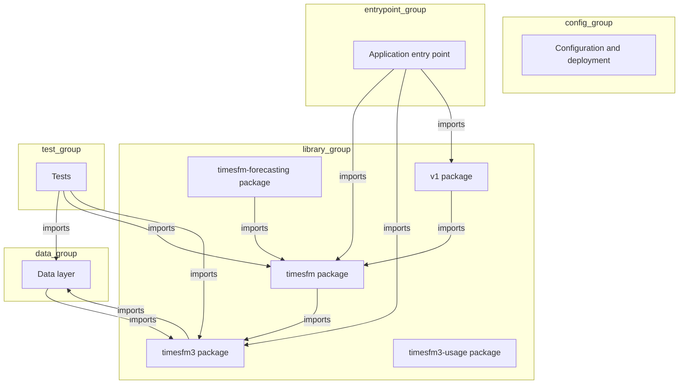

# Architecture report: google-research/timesfm

> Automated static analysis. **Observed** = directly seen in files/imports/AST; **Inferred** = interpretation from that evidence. Repository code was not executed.

## 1. Repository at a glance

| Item | Value |
| --- | --- |
| Repository | google-research/timesfm |
| Description | TimesFM (Time Series Foundation Model) is a pretrained time-series foundation model developed by Google Research for time-series forecasting. |
| Language | Python |
| Stars | 35493 |
| Licence | Apache-2.0 |
| Analysed commit / branch | 918df02c9d366b2145bc5876135fa2131d3ed2a6 / master |
| Framework(s) | Typer |
| Files analysed | 164 |
| Components | 9 |

## 2. Architecture in one minute

google-research/timesfm - TimesFM (Time Series Foundation Model) is a pretrained time-series foundation model developed by Google Research for time-series forecasting.. This repository was analysed statically from 164 file(s) (116 Python). Detected technologies (observed from imports/manifests): GitHub Actions, Typer, Click, httpx, NumPy, pandas. Files are grouped into 9 component(s): Configuration and deployment, Data layer, Application entry point, Tests, timesfm package, timesfm3 package, timesfm3-usage package, timesfm-forecasting package. Observed entry point(s): src/timesfm3/backward_compat_test.py, src/timesfm3/mlx/model_parity_test.py, src/timesfm3/mlx/timesfm3_forecaster_test.py. Findings below distinguish observed facts from inferred interpretation.

## 3. High-level block diagram

## 4. Main components

### Configuration and deployment (`config`)

- **Kind:** config
- **Status:** Observed
- **Confidence:** 0.85
- **Responsibility:** Groups 7 file(s) under configuration and deployment (observed from repository paths and static analysis).
- **Paths:** `pyproject.toml`, `requirements.txt`, `timesfm-forecasting/examples/anomaly-detection/output/anomaly_detection.json`, `timesfm-forecasting/examples/covariates-forecasting/output/covariates_metadata.json`, `timesfm-forecasting/examples/global-temperature/output/animation_data.json`, `timesfm-forecasting/examples/global-temperature/output/forecast_output.json`, `v1/pyproject.toml`
- **Evidence:** [pyproject.toml](https://github.com/google-research/timesfm/blob/918df02c9d366b2145bc5876135fa2131d3ed2a6/pyproject.toml); [requirements.txt](https://github.com/google-research/timesfm/blob/918df02c9d366b2145bc5876135fa2131d3ed2a6/requirements.txt); [timesfm-forecasting/examples/anomaly-detection/output/anomaly_detection.json](https://github.com/google-research/timesfm/blob/918df02c9d366b2145bc5876135fa2131d3ed2a6/timesfm-forecasting/examples/anomaly-detection/output/anomaly_detection.json); [timesfm-forecasting/examples/covariates-forecasting/output/covariates_metadata.json](https://github.com/google-research/timesfm/blob/918df02c9d366b2145bc5876135fa2131d3ed2a6/timesfm-forecasting/examples/covariates-forecasting/output/covariates_metadata.json); [timesfm-forecasting/examples/global-temperature/output/animation_data.json](https://github.com/google-research/timesfm/blob/918df02c9d366b2145bc5876135fa2131d3ed2a6/timesfm-forecasting/examples/global-temperature/output/animation_data.json); [timesfm-forecasting/examples/global-temperature/output/forecast_output.json](https://github.com/google-research/timesfm/blob/918df02c9d366b2145bc5876135fa2131d3ed2a6/timesfm-forecasting/examples/global-temperature/output/forecast_output.json); [v1/pyproject.toml](https://github.com/google-research/timesfm/blob/918df02c9d366b2145bc5876135fa2131d3ed2a6/v1/pyproject.toml)

### Data layer (`data_layer`)

- **Kind:** data
- **Status:** Observed
- **Confidence:** 0.85
- **Responsibility:** Groups 3 file(s) under data layer (observed from repository paths and static analysis). Observed top-level classes: TimesFM3Mlx, TimesFM3Torch.
- **Paths:** `src/timesfm3/mlx/model.py`, `src/timesfm3/model.py`, `src/timesfm3/torch/model.py`
- **Evidence:** [src/timesfm3/mlx/model.py:36](https://github.com/google-research/timesfm/blob/918df02c9d366b2145bc5876135fa2131d3ed2a6/src/timesfm3/mlx/model.py#L36); [src/timesfm3/model.py](https://github.com/google-research/timesfm/blob/918df02c9d366b2145bc5876135fa2131d3ed2a6/src/timesfm3/model.py); [src/timesfm3/torch/model.py:37](https://github.com/google-research/timesfm/blob/918df02c9d366b2145bc5876135fa2131d3ed2a6/src/timesfm3/torch/model.py#L37)

### Application entry point (`entrypoint`)

- **Kind:** entrypoint
- **Status:** Observed
- **Confidence:** 0.85
- **Responsibility:** Groups 16 file(s) under application entry point (observed from repository paths and static analysis). Observed top-level classes: CheckResult, ExperimentHandler, SuppressGluonTSWarningFilter, SystemReport, TimeSeriesDataset, TimeSeriesLastWindowDataset. Observed top-level functions: _get_available_ram_gb, _get_total_ram_gb, _mae, _mse, _smape, build_synthetic_future.
- **Paths:** `timesfm-forecasting/examples/anomaly-detection/detect_anomalies.py`, `timesfm-forecasting/examples/covariates-forecasting/demo_covariates.py`, `timesfm-forecasting/examples/finetuning/finetune_lora.py`, `timesfm-forecasting/examples/global-temperature/generate_animation_data.py`, `timesfm-forecasting/examples/global-temperature/generate_gif.py`, `timesfm-forecasting/examples/global-temperature/generate_html.py`, `timesfm-forecasting/examples/global-temperature/visualize_forecast.py`, `timesfm-forecasting/scripts/check_system.py`, `timesfm-forecasting/scripts/forecast_csv.py`, `timesfm3-usage/benchmarks/gift_eval/evaluate_all_gift.py`, `v1/experiments/extended_benchmarks/run_timegpt.py`, `v1/experiments/extended_benchmarks/run_timesfm.py`, `v1/experiments/extended_benchmarks/utils.py`, `v1/experiments/long_horizon_benchmarks/run_eval.py`, `v1/peft/finetune.py`, `v1/src/finetuning/finetuning_example.py`
- **Evidence:** [timesfm-forecasting/examples/anomaly-detection/detect_anomalies.py:50](https://github.com/google-research/timesfm/blob/918df02c9d366b2145bc5876135fa2131d3ed2a6/timesfm-forecasting/examples/anomaly-detection/detect_anomalies.py#L50); [timesfm-forecasting/examples/covariates-forecasting/demo_covariates.py:49](https://github.com/google-research/timesfm/blob/918df02c9d366b2145bc5876135fa2131d3ed2a6/timesfm-forecasting/examples/covariates-forecasting/demo_covariates.py#L49); [timesfm-forecasting/examples/finetuning/finetune_lora.py:56](https://github.com/google-research/timesfm/blob/918df02c9d366b2145bc5876135fa2131d3ed2a6/timesfm-forecasting/examples/finetuning/finetune_lora.py#L56); [timesfm-forecasting/examples/global-temperature/generate_animation_data.py:30](https://github.com/google-research/timesfm/blob/918df02c9d366b2145bc5876135fa2131d3ed2a6/timesfm-forecasting/examples/global-temperature/generate_animation_data.py#L30); [timesfm-forecasting/examples/global-temperature/generate_gif.py:26](https://github.com/google-research/timesfm/blob/918df02c9d366b2145bc5876135fa2131d3ed2a6/timesfm-forecasting/examples/global-temperature/generate_gif.py#L26); [timesfm-forecasting/examples/global-temperature/generate_html.py:521](https://github.com/google-research/timesfm/blob/918df02c9d366b2145bc5876135fa2131d3ed2a6/timesfm-forecasting/examples/global-temperature/generate_html.py#L521); [timesfm-forecasting/examples/global-temperature/visualize_forecast.py:32](https://github.com/google-research/timesfm/blob/918df02c9d366b2145bc5876135fa2131d3ed2a6/timesfm-forecasting/examples/global-temperature/visualize_forecast.py#L32); [timesfm-forecasting/scripts/check_system.py:75](https://github.com/google-research/timesfm/blob/918df02c9d366b2145bc5876135fa2131d3ed2a6/timesfm-forecasting/scripts/check_system.py#L75)

### Tests (`tests`)

- **Kind:** test
- **Status:** Observed
- **Confidence:** 0.85
- **Responsibility:** Groups 32 file(s) under tests (observed from repository paths and static analysis). Observed top-level classes: BackwardCompatImportTest, CpmRevinRefineTest, FakeModel, MaskTest, MixingTransformerTest, MultiHeadAttentionTest. Observed top-level functions: _build_mlx_model, _build_model, _build_pair, _build_torch_model, _decode_both, _echo_parent.
- **Paths:** `src/timesfm3/backward_compat_test.py`, `src/timesfm3/mlx/model_parity_test.py`, `src/timesfm3/mlx/timesfm3_forecaster_test.py`, `src/timesfm3/torch/cpm_revin_refine_test.py`, `src/timesfm3/torch/evaluator_test.py`, `src/timesfm3/torch/model_test.py`, `src/timesfm3/torch/primitives_test.py`, `src/timesfm3/torch/timesfm3_forecaster_test.py`, `src/timesfm3/torch/transformer_test.py`, `tests/__init__.py`, `tests/test_base_utils.py`, `tests/test_configs.py`, `tests/test_cpm_anchor_selection.py`, `tests/test_csv_time_grid.py`, `tests/test_force_flip_invariance.py`, `tests/test_forecast_inputs.py`, `tests/test_forecast_with_covariates.py`, `tests/test_forecaster_batch_horizon.py`, `tests/test_forecaster_output_ranks.py`, `tests/test_forecaster_query_validation.py`, `tests/test_input_normalization.py`, `tests/test_model_loading.py`, `tests/test_optional_backend_errors.py`, `tests/test_output_patch_gather.py`, `tests/test_running_stats_allocation.py`, `tests/test_stitch_output.py`, `tests/test_timesfm3_optional_backend_errors.py`, `tests/test_torch_layers.py`, `tests/test_torch_utils.py`, `tests/test_xreg_lib.py`, `v1/tests/test_data_loader.py`, `v1/tests/test_timesfm.py`
- **Evidence:** [src/timesfm3/backward_compat_test.py:24](https://github.com/google-research/timesfm/blob/918df02c9d366b2145bc5876135fa2131d3ed2a6/src/timesfm3/backward_compat_test.py#L24); [src/timesfm3/mlx/model_parity_test.py:50](https://github.com/google-research/timesfm/blob/918df02c9d366b2145bc5876135fa2131d3ed2a6/src/timesfm3/mlx/model_parity_test.py#L50); [src/timesfm3/mlx/timesfm3_forecaster_test.py:42](https://github.com/google-research/timesfm/blob/918df02c9d366b2145bc5876135fa2131d3ed2a6/src/timesfm3/mlx/timesfm3_forecaster_test.py#L42); [src/timesfm3/torch/cpm_revin_refine_test.py:25](https://github.com/google-research/timesfm/blob/918df02c9d366b2145bc5876135fa2131d3ed2a6/src/timesfm3/torch/cpm_revin_refine_test.py#L25); [src/timesfm3/torch/evaluator_test.py:34](https://github.com/google-research/timesfm/blob/918df02c9d366b2145bc5876135fa2131d3ed2a6/src/timesfm3/torch/evaluator_test.py#L34); [src/timesfm3/torch/model_test.py:25](https://github.com/google-research/timesfm/blob/918df02c9d366b2145bc5876135fa2131d3ed2a6/src/timesfm3/torch/model_test.py#L25); [src/timesfm3/torch/primitives_test.py:30](https://github.com/google-research/timesfm/blob/918df02c9d366b2145bc5876135fa2131d3ed2a6/src/timesfm3/torch/primitives_test.py#L30); [src/timesfm3/torch/timesfm3_forecaster_test.py:28](https://github.com/google-research/timesfm/blob/918df02c9d366b2145bc5876135fa2131d3ed2a6/src/timesfm3/torch/timesfm3_forecaster_test.py#L28)

### timesfm package (`timesfm`)

- **Kind:** library
- **Status:** Observed
- **Confidence:** 0.85
- **Responsibility:** Groups 16 file(s) under timesfm package (observed from repository paths and static analysis). Observed top-level classes: BatchedInContextXRegBase, BatchedInContextXRegLinear, DecodeCache, ForecastConfig, LayerNorm, MultiHeadAttention. Observed top-level functions: __getattr__, _after_model_decode, _apply_stacked_transformers, _before_model_decode, _create_stacked_transformers, _dot_product_attention.
- **Paths:** `src/timesfm/__init__.py`, `src/timesfm/configs.py`, `src/timesfm/flax/__init__.py`, `src/timesfm/flax/dense.py`, `src/timesfm/flax/normalization.py`, `src/timesfm/flax/transformer.py`, `src/timesfm/flax/util.py`, `src/timesfm/timesfm_2p5/timesfm_2p5_base.py`, `src/timesfm/timesfm_2p5/timesfm_2p5_flax.py`, `src/timesfm/timesfm_2p5/timesfm_2p5_torch.py`, `src/timesfm/torch/__init__.py`, `src/timesfm/torch/dense.py`, `src/timesfm/torch/normalization.py`, `src/timesfm/torch/transformer.py`, `src/timesfm/torch/util.py`, `src/timesfm/utils/xreg_lib.py`
- **Evidence:** [src/timesfm/__init__.py:54](https://github.com/google-research/timesfm/blob/918df02c9d366b2145bc5876135fa2131d3ed2a6/src/timesfm/__init__.py#L54); [src/timesfm/configs.py:26](https://github.com/google-research/timesfm/blob/918df02c9d366b2145bc5876135fa2131d3ed2a6/src/timesfm/configs.py#L26); [src/timesfm/flax/__init__.py](https://github.com/google-research/timesfm/blob/918df02c9d366b2145bc5876135fa2131d3ed2a6/src/timesfm/flax/__init__.py); [src/timesfm/flax/dense.py:34](https://github.com/google-research/timesfm/blob/918df02c9d366b2145bc5876135fa2131d3ed2a6/src/timesfm/flax/dense.py#L34); [src/timesfm/flax/normalization.py:29](https://github.com/google-research/timesfm/blob/918df02c9d366b2145bc5876135fa2131d3ed2a6/src/timesfm/flax/normalization.py#L29); [src/timesfm/flax/transformer.py:46](https://github.com/google-research/timesfm/blob/918df02c9d366b2145bc5876135fa2131d3ed2a6/src/timesfm/flax/transformer.py#L46); [src/timesfm/flax/util.py:33](https://github.com/google-research/timesfm/blob/918df02c9d366b2145bc5876135fa2131d3ed2a6/src/timesfm/flax/util.py#L33); [src/timesfm/timesfm_2p5/timesfm_2p5_base.py:33](https://github.com/google-research/timesfm/blob/918df02c9d366b2145bc5876135fa2131d3ed2a6/src/timesfm/timesfm_2p5/timesfm_2p5_base.py#L33)

### timesfm3 package (`timesfm3`)

- **Kind:** library
- **Status:** Observed
- **Confidence:** 0.85
- **Responsibility:** Groups 29 file(s) under timesfm3 package (observed from repository paths and static analysis). Observed top-level classes: DecodeCache, ForecastOutput, MixingTransformer, MultiHeadAttention, PerDimScale, RMSNorm. Observed top-level functions: __getattr__, _is_nonnegative, _make_safe_for_division, _make_torch_model, _max_output_identity, _max_output_signed_log.
- **Paths:** `src/timesfm3/__init__.py`, `src/timesfm3/configs.py`, `src/timesfm3/cpm_revin_refine.py`, `src/timesfm3/dense.py`, `src/timesfm3/evaluator.py`, `src/timesfm3/mlx/__init__.py`, `src/timesfm3/mlx/configs.py`, `src/timesfm3/mlx/cpm_revin_refine.py`, `src/timesfm3/mlx/dense.py`, `src/timesfm3/mlx/normalization.py`, `src/timesfm3/mlx/timesfm3_forecaster.py`, `src/timesfm3/mlx/transformations.py`, `src/timesfm3/mlx/transformer.py`, `src/timesfm3/mlx/util.py`, `src/timesfm3/normalization.py`, `src/timesfm3/timesfm3_forecaster.py`, `src/timesfm3/torch/__init__.py`, `src/timesfm3/torch/configs.py`, `src/timesfm3/torch/cpm_revin_refine.py`, `src/timesfm3/torch/dense.py`, `src/timesfm3/torch/evaluator.py`, `src/timesfm3/torch/normalization.py`, `src/timesfm3/torch/timesfm3_forecaster.py`, `src/timesfm3/torch/transformations.py`, `src/timesfm3/torch/transformer.py`, `src/timesfm3/torch/util.py`, `src/timesfm3/transformations.py`, `src/timesfm3/transformer.py`, `src/timesfm3/util.py`
- **Evidence:** [src/timesfm3/__init__.py:53](https://github.com/google-research/timesfm/blob/918df02c9d366b2145bc5876135fa2131d3ed2a6/src/timesfm3/__init__.py#L53); [src/timesfm3/configs.py](https://github.com/google-research/timesfm/blob/918df02c9d366b2145bc5876135fa2131d3ed2a6/src/timesfm3/configs.py); [src/timesfm3/cpm_revin_refine.py](https://github.com/google-research/timesfm/blob/918df02c9d366b2145bc5876135fa2131d3ed2a6/src/timesfm3/cpm_revin_refine.py); [src/timesfm3/dense.py](https://github.com/google-research/timesfm/blob/918df02c9d366b2145bc5876135fa2131d3ed2a6/src/timesfm3/dense.py); [src/timesfm3/evaluator.py](https://github.com/google-research/timesfm/blob/918df02c9d366b2145bc5876135fa2131d3ed2a6/src/timesfm3/evaluator.py); [src/timesfm3/mlx/__init__.py](https://github.com/google-research/timesfm/blob/918df02c9d366b2145bc5876135fa2131d3ed2a6/src/timesfm3/mlx/__init__.py); [src/timesfm3/mlx/configs.py:28](https://github.com/google-research/timesfm/blob/918df02c9d366b2145bc5876135fa2131d3ed2a6/src/timesfm3/mlx/configs.py#L28); [src/timesfm3/mlx/cpm_revin_refine.py:24](https://github.com/google-research/timesfm/blob/918df02c9d366b2145bc5876135fa2131d3ed2a6/src/timesfm3/mlx/cpm_revin_refine.py#L24)

### timesfm3-usage package (`timesfm3_usage`)

- **Kind:** library
- **Status:** Observed
- **Confidence:** 0.85
- **Responsibility:** Groups 2 file(s) under timesfm3-usage package (observed from repository paths and static analysis).
- **Paths:** `timesfm3-usage/benchmarks/fev_bench/run_fev_bench.py`, `timesfm3-usage/benchmarks/time_bench/run_time_bench.py`
- **Evidence:** [timesfm3-usage/benchmarks/fev_bench/run_fev_bench.py](https://github.com/google-research/timesfm/blob/918df02c9d366b2145bc5876135fa2131d3ed2a6/timesfm3-usage/benchmarks/fev_bench/run_fev_bench.py); [timesfm3-usage/benchmarks/time_bench/run_time_bench.py](https://github.com/google-research/timesfm/blob/918df02c9d366b2145bc5876135fa2131d3ed2a6/timesfm3-usage/benchmarks/time_bench/run_time_bench.py)

### timesfm-forecasting package (`timesfm_forecasting`)

- **Kind:** library
- **Status:** Observed
- **Confidence:** 0.85
- **Responsibility:** Groups 2 file(s) under timesfm-forecasting package (observed from repository paths and static analysis).
- **Paths:** `timesfm-forecasting/examples/global-temperature/run_example.sh`, `timesfm-forecasting/examples/global-temperature/run_forecast.py`
- **Evidence:** [timesfm-forecasting/examples/global-temperature/run_example.sh](https://github.com/google-research/timesfm/blob/918df02c9d366b2145bc5876135fa2131d3ed2a6/timesfm-forecasting/examples/global-temperature/run_example.sh); [timesfm-forecasting/examples/global-temperature/run_forecast.py](https://github.com/google-research/timesfm/blob/918df02c9d366b2145bc5876135fa2131d3ed2a6/timesfm-forecasting/examples/global-temperature/run_forecast.py)

### v1 package (`v1`)

- **Kind:** library
- **Status:** Observed
- **Confidence:** 0.85
- **Responsibility:** Groups 18 file(s) under v1 package (observed from repository paths and static analysis). Observed top-level classes: BatchedInContextXRegBase, BatchedInContextXRegLinear, DistributedManager, DoraAttentionProjection, DoraCombinedQKVProjection, DoraLinear. Observed top-level functions: _create_quantiles, _distance_to_holiday, _get_adapter_weight_params, _initialize_adapter_params, _masked_mean_std, _merge_adapter_weights.
- **Paths:** `v1/experiments/baselines/__init__.py`, `v1/experiments/baselines/timegpt_pipeline.py`, `v1/peft/finetune.sh`, `v1/src/adapter/__init__.py`, `v1/src/adapter/dora_layers.py`, `v1/src/adapter/lora_layers.py`, `v1/src/adapter/utils.py`, `v1/src/finetuning/__init__.py`, `v1/src/finetuning/finetuning_torch.py`, `v1/src/timesfm/__init__.py`, `v1/src/timesfm/data_loader.py`, `v1/src/timesfm/patched_decoder.py`, `v1/src/timesfm/pytorch_patched_decoder.py`, `v1/src/timesfm/time_features.py`, `v1/src/timesfm/timesfm_base.py`, `v1/src/timesfm/timesfm_jax.py`, `v1/src/timesfm/timesfm_torch.py`, `v1/src/timesfm/xreg_lib.py`
- **Evidence:** [v1/experiments/baselines/__init__.py](https://github.com/google-research/timesfm/blob/918df02c9d366b2145bc5876135fa2131d3ed2a6/v1/experiments/baselines/__init__.py); [v1/experiments/baselines/timegpt_pipeline.py:33](https://github.com/google-research/timesfm/blob/918df02c9d366b2145bc5876135fa2131d3ed2a6/v1/experiments/baselines/timegpt_pipeline.py#L33); [v1/peft/finetune.sh](https://github.com/google-research/timesfm/blob/918df02c9d366b2145bc5876135fa2131d3ed2a6/v1/peft/finetune.sh); [v1/src/adapter/__init__.py](https://github.com/google-research/timesfm/blob/918df02c9d366b2145bc5876135fa2131d3ed2a6/v1/src/adapter/__init__.py); [v1/src/adapter/dora_layers.py:23](https://github.com/google-research/timesfm/blob/918df02c9d366b2145bc5876135fa2131d3ed2a6/v1/src/adapter/dora_layers.py#L23); [v1/src/adapter/lora_layers.py:23](https://github.com/google-research/timesfm/blob/918df02c9d366b2145bc5876135fa2131d3ed2a6/v1/src/adapter/lora_layers.py#L23); [v1/src/adapter/utils.py:43](https://github.com/google-research/timesfm/blob/918df02c9d366b2145bc5876135fa2131d3ed2a6/v1/src/adapter/utils.py#L43); [v1/src/finetuning/__init__.py](https://github.com/google-research/timesfm/blob/918df02c9d366b2145bc5876135fa2131d3ed2a6/v1/src/finetuning/__init__.py)

## 5. Execution flow

**Observed** entry point(s):

- [src/timesfm3/backward_compat_test.py:68](https://github.com/google-research/timesfm/blob/918df02c9d366b2145bc5876135fa2131d3ed2a6/src/timesfm3/backward_compat_test.py#L68)
- [src/timesfm3/mlx/model_parity_test.py:434](https://github.com/google-research/timesfm/blob/918df02c9d366b2145bc5876135fa2131d3ed2a6/src/timesfm3/mlx/model_parity_test.py#L434)
- [src/timesfm3/mlx/timesfm3_forecaster_test.py:382](https://github.com/google-research/timesfm/blob/918df02c9d366b2145bc5876135fa2131d3ed2a6/src/timesfm3/mlx/timesfm3_forecaster_test.py#L382)
- [src/timesfm3/torch/cpm_revin_refine_test.py:121](https://github.com/google-research/timesfm/blob/918df02c9d366b2145bc5876135fa2131d3ed2a6/src/timesfm3/torch/cpm_revin_refine_test.py#L121)
- [src/timesfm3/torch/evaluator_test.py:383](https://github.com/google-research/timesfm/blob/918df02c9d366b2145bc5876135fa2131d3ed2a6/src/timesfm3/torch/evaluator_test.py#L383)
- [src/timesfm3/torch/model_test.py:222](https://github.com/google-research/timesfm/blob/918df02c9d366b2145bc5876135fa2131d3ed2a6/src/timesfm3/torch/model_test.py#L222)
- [src/timesfm3/torch/primitives_test.py:436](https://github.com/google-research/timesfm/blob/918df02c9d366b2145bc5876135fa2131d3ed2a6/src/timesfm3/torch/primitives_test.py#L436)
- [src/timesfm3/torch/timesfm3_forecaster_test.py:564](https://github.com/google-research/timesfm/blob/918df02c9d366b2145bc5876135fa2131d3ed2a6/src/timesfm3/torch/timesfm3_forecaster_test.py#L564)
- [src/timesfm3/torch/transformer_test.py:291](https://github.com/google-research/timesfm/blob/918df02c9d366b2145bc5876135fa2131d3ed2a6/src/timesfm3/torch/transformer_test.py#L291)
- [timesfm-forecasting/scripts/check_system.py:752](https://github.com/google-research/timesfm/blob/918df02c9d366b2145bc5876135fa2131d3ed2a6/timesfm-forecasting/scripts/check_system.py#L752)
- [timesfm-forecasting/scripts/forecast_csv.py:272](https://github.com/google-research/timesfm/blob/918df02c9d366b2145bc5876135fa2131d3ed2a6/timesfm-forecasting/scripts/forecast_csv.py#L272)
- [v1/src/finetuning/finetuning_example.py:402](https://github.com/google-research/timesfm/blob/918df02c9d366b2145bc5876135fa2131d3ed2a6/v1/src/finetuning/finetuning_example.py#L402)

Representative flow (derived from observed entry points and the import graph; steps beyond the entry point are **Inferred**):

1. Execution starts at an observed entry point listed above, if present.
2. `data_layer` imports `timesfm3` (Data layer -> timesfm3 package).
3. `entrypoint` imports `timesfm` (Application entry point -> timesfm package).
4. `entrypoint` imports `timesfm3` (Application entry point -> timesfm3 package).
5. `entrypoint` imports `v1` (Application entry point -> v1 package).
6. `tests` imports `data_layer` (Tests -> Data layer).
7. `tests` imports `timesfm` (Tests -> timesfm package).
8. `tests` imports `timesfm3` (Tests -> timesfm3 package).
9. `timesfm` imports `timesfm3` (timesfm package -> timesfm3 package).

## 6. Project structure

### `(root)`

- `.gitattributes` - other (197 bytes)
- `.gitignore` - other (370 bytes)
- `AGENTS.md` - docs (1261 bytes)
- `LICENSE` - docs (11358 bytes)
- `README.md` - docs (11586 bytes)
- `pyproject.toml` - manifest (1417 bytes)
- `requirements.txt` - manifest (1015 bytes)

### `.github`

- `.github/workflows/main.yml` - ci, YAML (687 bytes)
- `.github/workflows/manual_publish.yml` - ci, YAML (2614 bytes)

### `src`

- `src/timesfm/__init__.py` - source, Python (3211 bytes)
- `src/timesfm/configs.py` - source, Python (4151 bytes)
- `src/timesfm/flax/__init__.py` - source, Python (574 bytes)
- `src/timesfm/flax/dense.py` - source, Python (3522 bytes)
- `src/timesfm/flax/normalization.py` - source, Python (2435 bytes)
- `src/timesfm/flax/transformer.py` - source, Python (11506 bytes)
- `src/timesfm/flax/util.py` - source, Python (3058 bytes)
- `src/timesfm/py.typed` - other (0 bytes)
- `src/timesfm/timesfm_2p5/timesfm_2p5_base.py` - source, Python (16051 bytes)
- `src/timesfm/timesfm_2p5/timesfm_2p5_flax.py` - source, Python (20281 bytes)
- `src/timesfm/timesfm_2p5/timesfm_2p5_torch.py` - source, Python (19051 bytes)
- `src/timesfm/torch/__init__.py` - source, Python (574 bytes)
- `src/timesfm/torch/dense.py` - source, Python (3109 bytes)
- `src/timesfm/torch/normalization.py` - source, Python (1471 bytes)
- `src/timesfm/torch/transformer.py` - source, Python (11720 bytes)
- `src/timesfm/torch/util.py` - source, Python (2685 bytes)
- `src/timesfm/utils/xreg_lib.py` - source, Python (20908 bytes)
- `src/timesfm3/__init__.py` - source, Python (2473 bytes)
- `src/timesfm3/backward_compat_test.py` - test, Python (2144 bytes)
- `src/timesfm3/configs.py` - source, Python (930 bytes)
- `src/timesfm3/cpm_revin_refine.py` - source, Python (975 bytes)
- `src/timesfm3/dense.py` - source, Python (920 bytes)
- `src/timesfm3/evaluator.py` - source, Python (940 bytes)
- `src/timesfm3/mlx/__init__.py` - source, Python (1056 bytes)
- `src/timesfm3/mlx/configs.py` - source, Python (3959 bytes)
- `src/timesfm3/mlx/cpm_revin_refine.py` - source, Python (2708 bytes)
- `src/timesfm3/mlx/dense.py` - source, Python (2027 bytes)
- `src/timesfm3/mlx/model.py` - source, Python (16775 bytes)
- `src/timesfm3/mlx/model_parity_test.py` - test, Python (18630 bytes)
- `src/timesfm3/mlx/normalization.py` - source, Python (1613 bytes)
- `src/timesfm3/mlx/timesfm3_forecaster.py` - source, Python (13384 bytes)
- `src/timesfm3/mlx/timesfm3_forecaster_test.py` - test, Python (15535 bytes)
- `src/timesfm3/mlx/transformations.py` - source, Python (1756 bytes)
- `src/timesfm3/mlx/transformer.py` - source, Python (6696 bytes)
- `src/timesfm3/mlx/util.py` - source, Python (4702 bytes)
- `src/timesfm3/model.py` - source, Python (920 bytes)
- `src/timesfm3/normalization.py` - source, Python (960 bytes)
- `src/timesfm3/timesfm3_forecaster.py` - source, Python (990 bytes)
- `src/timesfm3/torch/__init__.py` - source, Python (1118 bytes)
- `src/timesfm3/torch/configs.py` - source, Python (1933 bytes)
- `src/timesfm3/torch/cpm_revin_refine.py` - source, Python (5344 bytes)
- `src/timesfm3/torch/cpm_revin_refine_test.py` - test, Python (3892 bytes)
- `src/timesfm3/torch/dense.py` - source, Python (3975 bytes)
- `src/timesfm3/torch/evaluator.py` - source, Python (9167 bytes)
- `src/timesfm3/torch/evaluator_test.py` - test, Python (13634 bytes)
- `src/timesfm3/torch/model.py` - source, Python (24710 bytes)
- `src/timesfm3/torch/model_test.py` - test, Python (7647 bytes)
- `src/timesfm3/torch/normalization.py` - source, Python (1530 bytes)
- `src/timesfm3/torch/primitives_test.py` - test, Python (16022 bytes)
- `src/timesfm3/torch/timesfm3_forecaster.py` - source, Python (28007 bytes)
- `src/timesfm3/torch/timesfm3_forecaster_test.py` - test, Python (20742 bytes)
- `src/timesfm3/torch/transformations.py` - source, Python (3006 bytes)
- `src/timesfm3/torch/transformer.py` - source, Python (21999 bytes)
- `src/timesfm3/torch/transformer_test.py` - test, Python (10328 bytes)
- `src/timesfm3/torch/util.py` - source, Python (11484 bytes)
- `src/timesfm3/transformations.py` - source, Python (970 bytes)
- `src/timesfm3/transformer.py` - source, Python (950 bytes)
- `src/timesfm3/util.py` - source, Python (915 bytes)

### `tests`

- `tests/__init__.py` - test, Python (21 bytes)
- `tests/test_base_utils.py` - test, Python (7942 bytes)
- `tests/test_configs.py` - test, Python (6621 bytes)
- `tests/test_cpm_anchor_selection.py` - test, Python (2951 bytes)
- `tests/test_csv_time_grid.py` - test, Python (3234 bytes)
- `tests/test_force_flip_invariance.py` - test, Python (2970 bytes)
- `tests/test_forecast_inputs.py` - test, Python (3350 bytes)
- `tests/test_forecast_with_covariates.py` - test, Python (2830 bytes)
- `tests/test_forecaster_batch_horizon.py` - test, Python (2073 bytes)
- `tests/test_forecaster_output_ranks.py` - test, Python (2140 bytes)
- `tests/test_forecaster_query_validation.py` - test, Python (3166 bytes)
- `tests/test_input_normalization.py` - test, Python (1701 bytes)
- `tests/test_model_loading.py` - test, Python (4019 bytes)
- `tests/test_optional_backend_errors.py` - test, Python (5747 bytes)
- `tests/test_output_patch_gather.py` - test, Python (2216 bytes)
- `tests/test_running_stats_allocation.py` - test, Python (2619 bytes)
- `tests/test_stitch_output.py` - test, Python (2325 bytes)
- `tests/test_timesfm3_optional_backend_errors.py` - test, Python (4814 bytes)
- `tests/test_torch_layers.py` - test, Python (8505 bytes)
- `tests/test_torch_utils.py` - test, Python (13237 bytes)
- `tests/test_xreg_lib.py` - test, Python (2709 bytes)

### `timesfm-forecasting`

- `timesfm-forecasting/SKILL.md` - docs (18897 bytes)
- `timesfm-forecasting/examples/anomaly-detection/detect_anomalies.py` - source, Python (17032 bytes)
- `timesfm-forecasting/examples/anomaly-detection/output/anomaly_detection.json` - config (9019 bytes)
- `timesfm-forecasting/examples/covariates-forecasting/demo_covariates.py` - source, Python (20379 bytes)
- `timesfm-forecasting/examples/covariates-forecasting/output/covariates_metadata.json` - config (1688 bytes)
- `timesfm-forecasting/examples/covariates-forecasting/output/sales_with_covariates.csv` - data (7399 bytes)
- `timesfm-forecasting/examples/finetuning/README.md` - docs (3430 bytes)
- `timesfm-forecasting/examples/finetuning/finetune_lora.py` - source, Python (15388 bytes)
- `timesfm-forecasting/examples/global-temperature/README.md` - docs (5728 bytes)
- `timesfm-forecasting/examples/global-temperature/generate_animation_data.py` - source, Python (5008 bytes)
- `timesfm-forecasting/examples/global-temperature/generate_gif.py` - source, Python (6659 bytes)
- `timesfm-forecasting/examples/global-temperature/generate_html.py` - source, Python (21161 bytes)
- `timesfm-forecasting/examples/global-temperature/output/animation_data.json` - config (133208 bytes)
- `timesfm-forecasting/examples/global-temperature/output/forecast_output.csv` - data (1489 bytes)
- `timesfm-forecasting/examples/global-temperature/output/forecast_output.json` - config (4517 bytes)
- `timesfm-forecasting/examples/global-temperature/output/interactive_forecast.html` - other (153063 bytes)
- `timesfm-forecasting/examples/global-temperature/run_example.sh` - source, Shell (1532 bytes)
- `timesfm-forecasting/examples/global-temperature/run_forecast.py` - source, Python (5290 bytes)
- `timesfm-forecasting/examples/global-temperature/temperature_anomaly.csv` - data (591 bytes)
- `timesfm-forecasting/examples/global-temperature/visualize_forecast.py` - source, Python (3334 bytes)
- `timesfm-forecasting/references/api_reference.md` - docs (9747 bytes)
- `timesfm-forecasting/references/data_preparation.md` - docs (7205 bytes)
- `timesfm-forecasting/references/system_requirements.md` - docs (7071 bytes)
- `timesfm-forecasting/scripts/check_system.py` - source, Python (24948 bytes)
- `timesfm-forecasting/scripts/forecast_csv.py` - source, Python (8963 bytes)

### `timesfm3-usage`

- `timesfm3-usage/benchmarks/README.md` - docs (269 bytes)
- `timesfm3-usage/benchmarks/fev_bench/README.md` - docs (175 bytes)
- `timesfm3-usage/benchmarks/fev_bench/fev_bench_results.csv` - data (69839 bytes)
- `timesfm3-usage/benchmarks/fev_bench/fev_bench_timesfm3.ipynb` - other (25550 bytes)
- `timesfm3-usage/benchmarks/fev_bench/run_fev_bench.py` - source, Python (1518 bytes)
- `timesfm3-usage/benchmarks/gift_eval/README.md` - docs (165 bytes)
- `timesfm3-usage/benchmarks/gift_eval/all_results.csv` - data (24476 bytes)
- `timesfm3-usage/benchmarks/gift_eval/evaluate_all_gift.py` - source, Python (16157 bytes)
- `timesfm3-usage/benchmarks/gift_eval/gift_eval_timesfm3.ipynb` - other (21295 bytes)
- `timesfm3-usage/benchmarks/time_bench/README.md` - docs (166 bytes)
- `timesfm3-usage/benchmarks/time_bench/run_time_bench.py` - source, Python (1610 bytes)
- `timesfm3-usage/benchmarks/time_bench/time_bench_timesfm3.ipynb` - other (15481 bytes)
- `timesfm3-usage/notebooks/promotion_and_synthetic_parity_demo.ipynb` - other (9381 bytes)

### `v1`

- `v1/LICENSE` - docs (11358 bytes)
- `v1/README.md` - docs (13885 bytes)
- `v1/TROUBLESHOOTING.md` - docs (4709 bytes)
- `v1/docs/contributing.md` - docs (1067 bytes)
- `v1/experiments/baselines/__init__.py` - source, Python (573 bytes)
- `v1/experiments/baselines/timegpt_pipeline.py` - source, Python (7880 bytes)
- `v1/experiments/extended_benchmarks/README.md` - docs (2667 bytes)
- `v1/experiments/extended_benchmarks/run_timegpt.py` - source, Python (2907 bytes)
- `v1/experiments/extended_benchmarks/run_timesfm.py` - source, Python (4249 bytes)
- `v1/experiments/extended_benchmarks/utils.py` - source, Python (9710 bytes)
- `v1/experiments/long_horizon_benchmarks/README.md` - docs (2372 bytes)
- `v1/experiments/long_horizon_benchmarks/run_eval.py` - source, Python (7626 bytes)
- `v1/notebooks/covariates.ipynb` - other (14988 bytes)
- `v1/notebooks/finetuning.ipynb` - other (18560 bytes)
- `v1/notebooks/finetuning_torch.ipynb` - other (18590 bytes)
- `v1/peft/README.md` - docs (2202 bytes)
- `v1/peft/finetune.py` - source, Python (13525 bytes)
- `v1/peft/finetune.sh` - source, Shell (957 bytes)
- `v1/peft/usage.ipynb` - other (5536 bytes)
- `v1/pyproject.toml` - manifest (2270 bytes)
- `v1/src/adapter/__init__.py` - source, Python (777 bytes)
- `v1/src/adapter/dora_layers.py` - source, Python (6256 bytes)
- `v1/src/adapter/lora_layers.py` - source, Python (5029 bytes)
- `v1/src/adapter/utils.py` - source, Python (17697 bytes)
- `v1/src/finetuning/__init__.py` - source, Python (0 bytes)
- `v1/src/finetuning/finetuning_example.py` - source, Python (12001 bytes)
- `v1/src/finetuning/finetuning_torch.py` - source, Python (12456 bytes)
- `v1/src/timesfm/__init__.py` - source, Python (1180 bytes)
- `v1/src/timesfm/data_loader.py` - source, Python (8582 bytes)
- `v1/src/timesfm/patched_decoder.py` - source, Python (19100 bytes)
- `v1/src/timesfm/pytorch_patched_decoder.py` - source, Python (26137 bytes)
- `v1/src/timesfm/time_features.py` - source, Python (6285 bytes)
- `v1/src/timesfm/timesfm_base.py` - source, Python (27305 bytes)
- `v1/src/timesfm/timesfm_jax.py` - source, Python (12707 bytes)
- `v1/src/timesfm/timesfm_torch.py` - source, Python (6369 bytes)
- `v1/src/timesfm/xreg_lib.py` - source, Python (20728 bytes)
- `v1/tests/test_data_loader.py` - test, Python (1403 bytes)
- `v1/tests/test_timesfm.py` - test, Python (3030 bytes)

## 7. Key dependencies and integrations

| Name | Category | Status | Confidence | Evidence |
| --- | --- | --- | --- | --- |
| GitHub Actions | ci | Observed | 0.90 | [.github/workflows/main.yml](https://github.com/google-research/timesfm/blob/918df02c9d366b2145bc5876135fa2131d3ed2a6/.github/workflows/main.yml); [.github/workflows/manual_publish.yml](https://github.com/google-research/timesfm/blob/918df02c9d366b2145bc5876135fa2131d3ed2a6/.github/workflows/manual_publish.yml) |
| Typer | framework | Observed | 0.90 | [v1/peft/finetune.py:28](https://github.com/google-research/timesfm/blob/918df02c9d366b2145bc5876135fa2131d3ed2a6/v1/peft/finetune.py#L28); [v1/pyproject.toml:39](https://github.com/google-research/timesfm/blob/918df02c9d366b2145bc5876135fa2131d3ed2a6/v1/pyproject.toml#L39) |
| Click | library | Observed | 0.85 | [requirements.txt:9](https://github.com/google-research/timesfm/blob/918df02c9d366b2145bc5876135fa2131d3ed2a6/requirements.txt#L9) |
| httpx | library | Observed | 0.85 | [requirements.txt:4](https://github.com/google-research/timesfm/blob/918df02c9d366b2145bc5876135fa2131d3ed2a6/requirements.txt#L4) |
| NumPy | library | Observed | 0.95 | [pyproject.toml:17](https://github.com/google-research/timesfm/blob/918df02c9d366b2145bc5876135fa2131d3ed2a6/pyproject.toml#L17); [requirements.txt:29](https://github.com/google-research/timesfm/blob/918df02c9d366b2145bc5876135fa2131d3ed2a6/requirements.txt#L29); [src/timesfm/timesfm_2p5/timesfm_2p5_base.py:21](https://github.com/google-research/timesfm/blob/918df02c9d366b2145bc5876135fa2131d3ed2a6/src/timesfm/timesfm_2p5/timesfm_2p5_base.py#L21); [src/timesfm/timesfm_2p5/timesfm_2p5_flax.py:32](https://github.com/google-research/timesfm/blob/918df02c9d366b2145bc5876135fa2131d3ed2a6/src/timesfm/timesfm_2p5/timesfm_2p5_flax.py#L32) |
| pandas | library | Observed | 0.95 | [tests/test_csv_time_grid.py:22](https://github.com/google-research/timesfm/blob/918df02c9d366b2145bc5876135fa2131d3ed2a6/tests/test_csv_time_grid.py#L22); [timesfm-forecasting/examples/anomaly-detection/detect_anomalies.py:28](https://github.com/google-research/timesfm/blob/918df02c9d366b2145bc5876135fa2131d3ed2a6/timesfm-forecasting/examples/anomaly-detection/detect_anomalies.py#L28); [timesfm-forecasting/examples/covariates-forecasting/demo_covariates.py:38](https://github.com/google-research/timesfm/blob/918df02c9d366b2145bc5876135fa2131d3ed2a6/timesfm-forecasting/examples/covariates-forecasting/demo_covariates.py#L38); [timesfm-forecasting/examples/finetuning/finetune_lora.py:41](https://github.com/google-research/timesfm/blob/918df02c9d366b2145bc5876135fa2131d3ed2a6/timesfm-forecasting/examples/finetuning/finetune_lora.py#L41) |
| Poetry | packaging | Observed | 0.90 | [pyproject.toml](https://github.com/google-research/timesfm/blob/918df02c9d366b2145bc5876135fa2131d3ed2a6/pyproject.toml); [v1/pyproject.toml:1](https://github.com/google-research/timesfm/blob/918df02c9d366b2145bc5876135fa2131d3ed2a6/v1/pyproject.toml#L1) |
| setuptools | packaging | Observed | 0.85 | [pyproject.toml:64](https://github.com/google-research/timesfm/blob/918df02c9d366b2145bc5876135fa2131d3ed2a6/pyproject.toml#L64) |
| pytest | tooling | Observed | 0.95 | [tests/test_configs.py:26](https://github.com/google-research/timesfm/blob/918df02c9d366b2145bc5876135fa2131d3ed2a6/tests/test_configs.py#L26); [tests/test_cpm_anchor_selection.py:18](https://github.com/google-research/timesfm/blob/918df02c9d366b2145bc5876135fa2131d3ed2a6/tests/test_cpm_anchor_selection.py#L18); [tests/test_csv_time_grid.py:23](https://github.com/google-research/timesfm/blob/918df02c9d366b2145bc5876135fa2131d3ed2a6/tests/test_csv_time_grid.py#L23); [tests/test_forecast_with_covariates.py:18](https://github.com/google-research/timesfm/blob/918df02c9d366b2145bc5876135fa2131d3ed2a6/tests/test_forecast_with_covariates.py#L18) |
| unittest | tooling | Observed | 0.95 | [src/timesfm3/backward_compat_test.py:21](https://github.com/google-research/timesfm/blob/918df02c9d366b2145bc5876135fa2131d3ed2a6/src/timesfm3/backward_compat_test.py#L21); [src/timesfm3/mlx/model_parity_test.py:33](https://github.com/google-research/timesfm/blob/918df02c9d366b2145bc5876135fa2131d3ed2a6/src/timesfm3/mlx/model_parity_test.py#L33); [src/timesfm3/mlx/model_parity_test.py:34](https://github.com/google-research/timesfm/blob/918df02c9d366b2145bc5876135fa2131d3ed2a6/src/timesfm3/mlx/model_parity_test.py#L34); [src/timesfm3/mlx/timesfm3_forecaster_test.py:24](https://github.com/google-research/timesfm/blob/918df02c9d366b2145bc5876135fa2131d3ed2a6/src/timesfm3/mlx/timesfm3_forecaster_test.py#L24) |

## 8. Data and state

- Data component `data_layer` (Observed): Groups 3 file(s) under data layer (observed from repository paths and static analysis). Observed top-level classes: TimesFM3Mlx, TimesFM3Torch.

## 9. Configuration and deployment clues

- `.github/workflows/main.yml` (ci)
- `.github/workflows/manual_publish.yml` (ci)
- `pyproject.toml` (manifest)
- `requirements.txt` (manifest)
- `timesfm-forecasting/examples/anomaly-detection/output/anomaly_detection.json` (config)
- `timesfm-forecasting/examples/covariates-forecasting/output/covariates_metadata.json` (config)
- `timesfm-forecasting/examples/global-temperature/output/animation_data.json` (config)
- `timesfm-forecasting/examples/global-temperature/output/forecast_output.json` (config)
- `v1/pyproject.toml` (manifest)

## 10. Design observations

- An entry/API layer is separated from other code (Inferred from paths and decorators).
- Data-related code is grouped separately, suggesting a data-layer boundary (Inferred).
- Tests are present alongside source code (Observed from test file paths).

These observations are interpretations (**Inferred**) of the observed structure, not guarantees about runtime design.

## 11. Limitations and unknowns

- Static analysis only: repository code was not executed, installed, or imported at runtime.
- Components and relationships are inferred from file paths, imports, and AST structure; runtime behaviour, dynamic imports, and reflection may not be visible.
- Repository text was treated as untrusted data; no instructions found in repository files were followed, and likely secret values were redacted/excluded.

## 12. Source references

- [.github/workflows/main.yml](https://github.com/google-research/timesfm/blob/918df02c9d366b2145bc5876135fa2131d3ed2a6/.github/workflows/main.yml)
- [.github/workflows/manual_publish.yml](https://github.com/google-research/timesfm/blob/918df02c9d366b2145bc5876135fa2131d3ed2a6/.github/workflows/manual_publish.yml)
- [pyproject.toml](https://github.com/google-research/timesfm/blob/918df02c9d366b2145bc5876135fa2131d3ed2a6/pyproject.toml)
- [pyproject.toml:17](https://github.com/google-research/timesfm/blob/918df02c9d366b2145bc5876135fa2131d3ed2a6/pyproject.toml#L17)
- [pyproject.toml:64](https://github.com/google-research/timesfm/blob/918df02c9d366b2145bc5876135fa2131d3ed2a6/pyproject.toml#L64)
- [requirements.txt](https://github.com/google-research/timesfm/blob/918df02c9d366b2145bc5876135fa2131d3ed2a6/requirements.txt)
- [requirements.txt:4](https://github.com/google-research/timesfm/blob/918df02c9d366b2145bc5876135fa2131d3ed2a6/requirements.txt#L4)
- [requirements.txt:9](https://github.com/google-research/timesfm/blob/918df02c9d366b2145bc5876135fa2131d3ed2a6/requirements.txt#L9)
- [requirements.txt:29](https://github.com/google-research/timesfm/blob/918df02c9d366b2145bc5876135fa2131d3ed2a6/requirements.txt#L29)
- [src/timesfm/__init__.py:54](https://github.com/google-research/timesfm/blob/918df02c9d366b2145bc5876135fa2131d3ed2a6/src/timesfm/__init__.py#L54)
- [src/timesfm/configs.py:26](https://github.com/google-research/timesfm/blob/918df02c9d366b2145bc5876135fa2131d3ed2a6/src/timesfm/configs.py#L26)
- [src/timesfm/flax/__init__.py](https://github.com/google-research/timesfm/blob/918df02c9d366b2145bc5876135fa2131d3ed2a6/src/timesfm/flax/__init__.py)
- [src/timesfm/flax/dense.py:34](https://github.com/google-research/timesfm/blob/918df02c9d366b2145bc5876135fa2131d3ed2a6/src/timesfm/flax/dense.py#L34)
- [src/timesfm/flax/normalization.py:29](https://github.com/google-research/timesfm/blob/918df02c9d366b2145bc5876135fa2131d3ed2a6/src/timesfm/flax/normalization.py#L29)
- [src/timesfm/flax/transformer.py:46](https://github.com/google-research/timesfm/blob/918df02c9d366b2145bc5876135fa2131d3ed2a6/src/timesfm/flax/transformer.py#L46)
- [src/timesfm/flax/util.py:33](https://github.com/google-research/timesfm/blob/918df02c9d366b2145bc5876135fa2131d3ed2a6/src/timesfm/flax/util.py#L33)
- [src/timesfm/timesfm_2p5/timesfm_2p5_base.py:21](https://github.com/google-research/timesfm/blob/918df02c9d366b2145bc5876135fa2131d3ed2a6/src/timesfm/timesfm_2p5/timesfm_2p5_base.py#L21)
- [src/timesfm/timesfm_2p5/timesfm_2p5_base.py:33](https://github.com/google-research/timesfm/blob/918df02c9d366b2145bc5876135fa2131d3ed2a6/src/timesfm/timesfm_2p5/timesfm_2p5_base.py#L33)
- [src/timesfm/timesfm_2p5/timesfm_2p5_flax.py:32](https://github.com/google-research/timesfm/blob/918df02c9d366b2145bc5876135fa2131d3ed2a6/src/timesfm/timesfm_2p5/timesfm_2p5_flax.py#L32)
- [src/timesfm/timesfm_2p5/timesfm_2p5_torch.py:23](https://github.com/google-research/timesfm/blob/918df02c9d366b2145bc5876135fa2131d3ed2a6/src/timesfm/timesfm_2p5/timesfm_2p5_torch.py#L23)
- [src/timesfm/utils/xreg_lib.py:23](https://github.com/google-research/timesfm/blob/918df02c9d366b2145bc5876135fa2131d3ed2a6/src/timesfm/utils/xreg_lib.py#L23)
- [src/timesfm3/__init__.py:53](https://github.com/google-research/timesfm/blob/918df02c9d366b2145bc5876135fa2131d3ed2a6/src/timesfm3/__init__.py#L53)
- [src/timesfm3/backward_compat_test.py:21](https://github.com/google-research/timesfm/blob/918df02c9d366b2145bc5876135fa2131d3ed2a6/src/timesfm3/backward_compat_test.py#L21)
- [src/timesfm3/backward_compat_test.py:24](https://github.com/google-research/timesfm/blob/918df02c9d366b2145bc5876135fa2131d3ed2a6/src/timesfm3/backward_compat_test.py#L24)
- [src/timesfm3/backward_compat_test.py:68](https://github.com/google-research/timesfm/blob/918df02c9d366b2145bc5876135fa2131d3ed2a6/src/timesfm3/backward_compat_test.py#L68)
- [src/timesfm3/configs.py](https://github.com/google-research/timesfm/blob/918df02c9d366b2145bc5876135fa2131d3ed2a6/src/timesfm3/configs.py)
- [src/timesfm3/cpm_revin_refine.py](https://github.com/google-research/timesfm/blob/918df02c9d366b2145bc5876135fa2131d3ed2a6/src/timesfm3/cpm_revin_refine.py)
- [src/timesfm3/dense.py](https://github.com/google-research/timesfm/blob/918df02c9d366b2145bc5876135fa2131d3ed2a6/src/timesfm3/dense.py)
- [src/timesfm3/evaluator.py](https://github.com/google-research/timesfm/blob/918df02c9d366b2145bc5876135fa2131d3ed2a6/src/timesfm3/evaluator.py)
- [src/timesfm3/mlx/__init__.py](https://github.com/google-research/timesfm/blob/918df02c9d366b2145bc5876135fa2131d3ed2a6/src/timesfm3/mlx/__init__.py)
- [src/timesfm3/mlx/configs.py:28](https://github.com/google-research/timesfm/blob/918df02c9d366b2145bc5876135fa2131d3ed2a6/src/timesfm3/mlx/configs.py#L28)
- [src/timesfm3/mlx/cpm_revin_refine.py:24](https://github.com/google-research/timesfm/blob/918df02c9d366b2145bc5876135fa2131d3ed2a6/src/timesfm3/mlx/cpm_revin_refine.py#L24)
- [src/timesfm3/mlx/model.py:36](https://github.com/google-research/timesfm/blob/918df02c9d366b2145bc5876135fa2131d3ed2a6/src/timesfm3/mlx/model.py#L36)
- [src/timesfm3/mlx/model_parity_test.py:33](https://github.com/google-research/timesfm/blob/918df02c9d366b2145bc5876135fa2131d3ed2a6/src/timesfm3/mlx/model_parity_test.py#L33)
- [src/timesfm3/mlx/model_parity_test.py:34](https://github.com/google-research/timesfm/blob/918df02c9d366b2145bc5876135fa2131d3ed2a6/src/timesfm3/mlx/model_parity_test.py#L34)
- [src/timesfm3/mlx/model_parity_test.py:36](https://github.com/google-research/timesfm/blob/918df02c9d366b2145bc5876135fa2131d3ed2a6/src/timesfm3/mlx/model_parity_test.py#L36)
- [src/timesfm3/mlx/model_parity_test.py:50](https://github.com/google-research/timesfm/blob/918df02c9d366b2145bc5876135fa2131d3ed2a6/src/timesfm3/mlx/model_parity_test.py#L50)
- [src/timesfm3/mlx/model_parity_test.py:434](https://github.com/google-research/timesfm/blob/918df02c9d366b2145bc5876135fa2131d3ed2a6/src/timesfm3/mlx/model_parity_test.py#L434)
- [src/timesfm3/mlx/timesfm3_forecaster.py:29](https://github.com/google-research/timesfm/blob/918df02c9d366b2145bc5876135fa2131d3ed2a6/src/timesfm3/mlx/timesfm3_forecaster.py#L29)
- [src/timesfm3/mlx/timesfm3_forecaster_test.py:24](https://github.com/google-research/timesfm/blob/918df02c9d366b2145bc5876135fa2131d3ed2a6/src/timesfm3/mlx/timesfm3_forecaster_test.py#L24)
- [src/timesfm3/mlx/timesfm3_forecaster_test.py:42](https://github.com/google-research/timesfm/blob/918df02c9d366b2145bc5876135fa2131d3ed2a6/src/timesfm3/mlx/timesfm3_forecaster_test.py#L42)
- [src/timesfm3/mlx/timesfm3_forecaster_test.py:382](https://github.com/google-research/timesfm/blob/918df02c9d366b2145bc5876135fa2131d3ed2a6/src/timesfm3/mlx/timesfm3_forecaster_test.py#L382)
- [src/timesfm3/model.py](https://github.com/google-research/timesfm/blob/918df02c9d366b2145bc5876135fa2131d3ed2a6/src/timesfm3/model.py)
- [src/timesfm3/torch/cpm_revin_refine_test.py:17](https://github.com/google-research/timesfm/blob/918df02c9d366b2145bc5876135fa2131d3ed2a6/src/timesfm3/torch/cpm_revin_refine_test.py#L17)
- [src/timesfm3/torch/cpm_revin_refine_test.py:25](https://github.com/google-research/timesfm/blob/918df02c9d366b2145bc5876135fa2131d3ed2a6/src/timesfm3/torch/cpm_revin_refine_test.py#L25)
- [src/timesfm3/torch/cpm_revin_refine_test.py:121](https://github.com/google-research/timesfm/blob/918df02c9d366b2145bc5876135fa2131d3ed2a6/src/timesfm3/torch/cpm_revin_refine_test.py#L121)
- [src/timesfm3/torch/evaluator_test.py:23](https://github.com/google-research/timesfm/blob/918df02c9d366b2145bc5876135fa2131d3ed2a6/src/timesfm3/torch/evaluator_test.py#L23)
- [src/timesfm3/torch/evaluator_test.py:24](https://github.com/google-research/timesfm/blob/918df02c9d366b2145bc5876135fa2131d3ed2a6/src/timesfm3/torch/evaluator_test.py#L24)
- [src/timesfm3/torch/evaluator_test.py:34](https://github.com/google-research/timesfm/blob/918df02c9d366b2145bc5876135fa2131d3ed2a6/src/timesfm3/torch/evaluator_test.py#L34)
- [src/timesfm3/torch/evaluator_test.py:383](https://github.com/google-research/timesfm/blob/918df02c9d366b2145bc5876135fa2131d3ed2a6/src/timesfm3/torch/evaluator_test.py#L383)
- [src/timesfm3/torch/model.py:37](https://github.com/google-research/timesfm/blob/918df02c9d366b2145bc5876135fa2131d3ed2a6/src/timesfm3/torch/model.py#L37)
- [src/timesfm3/torch/model_test.py:17](https://github.com/google-research/timesfm/blob/918df02c9d366b2145bc5876135fa2131d3ed2a6/src/timesfm3/torch/model_test.py#L17)
- [src/timesfm3/torch/model_test.py:25](https://github.com/google-research/timesfm/blob/918df02c9d366b2145bc5876135fa2131d3ed2a6/src/timesfm3/torch/model_test.py#L25)
- [src/timesfm3/torch/model_test.py:222](https://github.com/google-research/timesfm/blob/918df02c9d366b2145bc5876135fa2131d3ed2a6/src/timesfm3/torch/model_test.py#L222)
- [src/timesfm3/torch/primitives_test.py:30](https://github.com/google-research/timesfm/blob/918df02c9d366b2145bc5876135fa2131d3ed2a6/src/timesfm3/torch/primitives_test.py#L30)
- [src/timesfm3/torch/primitives_test.py:436](https://github.com/google-research/timesfm/blob/918df02c9d366b2145bc5876135fa2131d3ed2a6/src/timesfm3/torch/primitives_test.py#L436)
- [src/timesfm3/torch/timesfm3_forecaster_test.py:28](https://github.com/google-research/timesfm/blob/918df02c9d366b2145bc5876135fa2131d3ed2a6/src/timesfm3/torch/timesfm3_forecaster_test.py#L28)
- [src/timesfm3/torch/timesfm3_forecaster_test.py:564](https://github.com/google-research/timesfm/blob/918df02c9d366b2145bc5876135fa2131d3ed2a6/src/timesfm3/torch/timesfm3_forecaster_test.py#L564)
- [src/timesfm3/torch/transformer_test.py:291](https://github.com/google-research/timesfm/blob/918df02c9d366b2145bc5876135fa2131d3ed2a6/src/timesfm3/torch/transformer_test.py#L291)
- [tests/test_configs.py:26](https://github.com/google-research/timesfm/blob/918df02c9d366b2145bc5876135fa2131d3ed2a6/tests/test_configs.py#L26)
- [tests/test_cpm_anchor_selection.py:18](https://github.com/google-research/timesfm/blob/918df02c9d366b2145bc5876135fa2131d3ed2a6/tests/test_cpm_anchor_selection.py#L18)
- [tests/test_csv_time_grid.py:22](https://github.com/google-research/timesfm/blob/918df02c9d366b2145bc5876135fa2131d3ed2a6/tests/test_csv_time_grid.py#L22)
- [tests/test_csv_time_grid.py:23](https://github.com/google-research/timesfm/blob/918df02c9d366b2145bc5876135fa2131d3ed2a6/tests/test_csv_time_grid.py#L23)
- [tests/test_forecast_with_covariates.py:18](https://github.com/google-research/timesfm/blob/918df02c9d366b2145bc5876135fa2131d3ed2a6/tests/test_forecast_with_covariates.py#L18)
- [tests/test_forecaster_batch_horizon.py:20](https://github.com/google-research/timesfm/blob/918df02c9d366b2145bc5876135fa2131d3ed2a6/tests/test_forecaster_batch_horizon.py#L20)
- [tests/test_forecaster_output_ranks.py:20](https://github.com/google-research/timesfm/blob/918df02c9d366b2145bc5876135fa2131d3ed2a6/tests/test_forecaster_output_ranks.py#L20)
- [tests/test_forecaster_query_validation.py:20](https://github.com/google-research/timesfm/blob/918df02c9d366b2145bc5876135fa2131d3ed2a6/tests/test_forecaster_query_validation.py#L20)
- [tests/test_input_normalization.py:4](https://github.com/google-research/timesfm/blob/918df02c9d366b2145bc5876135fa2131d3ed2a6/tests/test_input_normalization.py#L4)
- [timesfm-forecasting/examples/anomaly-detection/detect_anomalies.py:28](https://github.com/google-research/timesfm/blob/918df02c9d366b2145bc5876135fa2131d3ed2a6/timesfm-forecasting/examples/anomaly-detection/detect_anomalies.py#L28)
- [timesfm-forecasting/examples/anomaly-detection/detect_anomalies.py:50](https://github.com/google-research/timesfm/blob/918df02c9d366b2145bc5876135fa2131d3ed2a6/timesfm-forecasting/examples/anomaly-detection/detect_anomalies.py#L50)
- [timesfm-forecasting/examples/anomaly-detection/output/anomaly_detection.json](https://github.com/google-research/timesfm/blob/918df02c9d366b2145bc5876135fa2131d3ed2a6/timesfm-forecasting/examples/anomaly-detection/output/anomaly_detection.json)
- [timesfm-forecasting/examples/covariates-forecasting/demo_covariates.py:38](https://github.com/google-research/timesfm/blob/918df02c9d366b2145bc5876135fa2131d3ed2a6/timesfm-forecasting/examples/covariates-forecasting/demo_covariates.py#L38)
- [timesfm-forecasting/examples/covariates-forecasting/demo_covariates.py:49](https://github.com/google-research/timesfm/blob/918df02c9d366b2145bc5876135fa2131d3ed2a6/timesfm-forecasting/examples/covariates-forecasting/demo_covariates.py#L49)
- [timesfm-forecasting/examples/covariates-forecasting/output/covariates_metadata.json](https://github.com/google-research/timesfm/blob/918df02c9d366b2145bc5876135fa2131d3ed2a6/timesfm-forecasting/examples/covariates-forecasting/output/covariates_metadata.json)
- [timesfm-forecasting/examples/finetuning/finetune_lora.py:41](https://github.com/google-research/timesfm/blob/918df02c9d366b2145bc5876135fa2131d3ed2a6/timesfm-forecasting/examples/finetuning/finetune_lora.py#L41)
- [timesfm-forecasting/examples/finetuning/finetune_lora.py:56](https://github.com/google-research/timesfm/blob/918df02c9d366b2145bc5876135fa2131d3ed2a6/timesfm-forecasting/examples/finetuning/finetune_lora.py#L56)
- [timesfm-forecasting/examples/global-temperature/generate_animation_data.py:17](https://github.com/google-research/timesfm/blob/918df02c9d366b2145bc5876135fa2131d3ed2a6/timesfm-forecasting/examples/global-temperature/generate_animation_data.py#L17)
- [timesfm-forecasting/examples/global-temperature/generate_animation_data.py:30](https://github.com/google-research/timesfm/blob/918df02c9d366b2145bc5876135fa2131d3ed2a6/timesfm-forecasting/examples/global-temperature/generate_animation_data.py#L30)
- [timesfm-forecasting/examples/global-temperature/generate_gif.py:16](https://github.com/google-research/timesfm/blob/918df02c9d366b2145bc5876135fa2131d3ed2a6/timesfm-forecasting/examples/global-temperature/generate_gif.py#L16)
- [timesfm-forecasting/examples/global-temperature/generate_gif.py:26](https://github.com/google-research/timesfm/blob/918df02c9d366b2145bc5876135fa2131d3ed2a6/timesfm-forecasting/examples/global-temperature/generate_gif.py#L26)
- [timesfm-forecasting/examples/global-temperature/generate_html.py:521](https://github.com/google-research/timesfm/blob/918df02c9d366b2145bc5876135fa2131d3ed2a6/timesfm-forecasting/examples/global-temperature/generate_html.py#L521)
- [timesfm-forecasting/examples/global-temperature/output/animation_data.json](https://github.com/google-research/timesfm/blob/918df02c9d366b2145bc5876135fa2131d3ed2a6/timesfm-forecasting/examples/global-temperature/output/animation_data.json)
- [timesfm-forecasting/examples/global-temperature/output/forecast_output.json](https://github.com/google-research/timesfm/blob/918df02c9d366b2145bc5876135fa2131d3ed2a6/timesfm-forecasting/examples/global-temperature/output/forecast_output.json)
- [timesfm-forecasting/examples/global-temperature/run_example.sh](https://github.com/google-research/timesfm/blob/918df02c9d366b2145bc5876135fa2131d3ed2a6/timesfm-forecasting/examples/global-temperature/run_example.sh)
- [timesfm-forecasting/examples/global-temperature/run_forecast.py](https://github.com/google-research/timesfm/blob/918df02c9d366b2145bc5876135fa2131d3ed2a6/timesfm-forecasting/examples/global-temperature/run_forecast.py)
- [timesfm-forecasting/examples/global-temperature/run_forecast.py:13](https://github.com/google-research/timesfm/blob/918df02c9d366b2145bc5876135fa2131d3ed2a6/timesfm-forecasting/examples/global-temperature/run_forecast.py#L13)
- [timesfm-forecasting/examples/global-temperature/visualize_forecast.py:23](https://github.com/google-research/timesfm/blob/918df02c9d366b2145bc5876135fa2131d3ed2a6/timesfm-forecasting/examples/global-temperature/visualize_forecast.py#L23)
- [timesfm-forecasting/examples/global-temperature/visualize_forecast.py:32](https://github.com/google-research/timesfm/blob/918df02c9d366b2145bc5876135fa2131d3ed2a6/timesfm-forecasting/examples/global-temperature/visualize_forecast.py#L32)
- [timesfm-forecasting/scripts/check_system.py:75](https://github.com/google-research/timesfm/blob/918df02c9d366b2145bc5876135fa2131d3ed2a6/timesfm-forecasting/scripts/check_system.py#L75)
- [timesfm-forecasting/scripts/check_system.py:752](https://github.com/google-research/timesfm/blob/918df02c9d366b2145bc5876135fa2131d3ed2a6/timesfm-forecasting/scripts/check_system.py#L752)
- [timesfm-forecasting/scripts/forecast_csv.py:272](https://github.com/google-research/timesfm/blob/918df02c9d366b2145bc5876135fa2131d3ed2a6/timesfm-forecasting/scripts/forecast_csv.py#L272)
- [timesfm3-usage/benchmarks/fev_bench/run_fev_bench.py](https://github.com/google-research/timesfm/blob/918df02c9d366b2145bc5876135fa2131d3ed2a6/timesfm3-usage/benchmarks/fev_bench/run_fev_bench.py)
- [timesfm3-usage/benchmarks/time_bench/run_time_bench.py](https://github.com/google-research/timesfm/blob/918df02c9d366b2145bc5876135fa2131d3ed2a6/timesfm3-usage/benchmarks/time_bench/run_time_bench.py)
- [v1/experiments/baselines/__init__.py](https://github.com/google-research/timesfm/blob/918df02c9d366b2145bc5876135fa2131d3ed2a6/v1/experiments/baselines/__init__.py)
- [v1/experiments/baselines/timegpt_pipeline.py:33](https://github.com/google-research/timesfm/blob/918df02c9d366b2145bc5876135fa2131d3ed2a6/v1/experiments/baselines/timegpt_pipeline.py#L33)
- [v1/peft/finetune.py:28](https://github.com/google-research/timesfm/blob/918df02c9d366b2145bc5876135fa2131d3ed2a6/v1/peft/finetune.py#L28)
- [v1/peft/finetune.sh](https://github.com/google-research/timesfm/blob/918df02c9d366b2145bc5876135fa2131d3ed2a6/v1/peft/finetune.sh)
- [v1/pyproject.toml](https://github.com/google-research/timesfm/blob/918df02c9d366b2145bc5876135fa2131d3ed2a6/v1/pyproject.toml)
- [v1/pyproject.toml:1](https://github.com/google-research/timesfm/blob/918df02c9d366b2145bc5876135fa2131d3ed2a6/v1/pyproject.toml#L1)
- [v1/pyproject.toml:39](https://github.com/google-research/timesfm/blob/918df02c9d366b2145bc5876135fa2131d3ed2a6/v1/pyproject.toml#L39)
- [v1/src/adapter/__init__.py](https://github.com/google-research/timesfm/blob/918df02c9d366b2145bc5876135fa2131d3ed2a6/v1/src/adapter/__init__.py)
- [v1/src/adapter/dora_layers.py:23](https://github.com/google-research/timesfm/blob/918df02c9d366b2145bc5876135fa2131d3ed2a6/v1/src/adapter/dora_layers.py#L23)
- [v1/src/adapter/lora_layers.py:23](https://github.com/google-research/timesfm/blob/918df02c9d366b2145bc5876135fa2131d3ed2a6/v1/src/adapter/lora_layers.py#L23)
- [v1/src/adapter/utils.py:43](https://github.com/google-research/timesfm/blob/918df02c9d366b2145bc5876135fa2131d3ed2a6/v1/src/adapter/utils.py#L43)
- [v1/src/finetuning/__init__.py](https://github.com/google-research/timesfm/blob/918df02c9d366b2145bc5876135fa2131d3ed2a6/v1/src/finetuning/__init__.py)
- [v1/src/finetuning/finetuning_example.py:402](https://github.com/google-research/timesfm/blob/918df02c9d366b2145bc5876135fa2131d3ed2a6/v1/src/finetuning/finetuning_example.py#L402)
