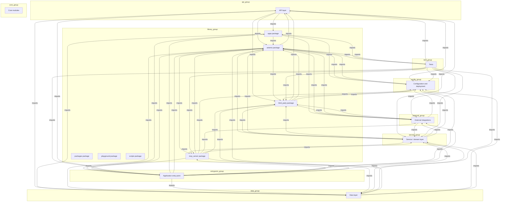

# Architecture report: google/artemis

> Automated static analysis. **Observed** = directly seen in files/imports/AST; **Inferred** = interpretation from that evidence. Repository code was not executed.

## 1. Repository at a glance

| Item | Value |
| --- | --- |
| Repository | google/artemis |
| Description | ARTEMIS turns natural-language instructions into reliable Android automation. It automates end-to-end workflows, captures logs, and integrates seamlessly with AI coding assistants such as Antigravity, Codex, and Claude Code.  It also achieves 99%+ success rate on AndroidWorld Benchmark. |
| Language | Python |
| Stars | 17445 |
| Licence | Apache-2.0 |
| Analysed commit / branch | 351ca8422f7b5b54e80a9c1ce03a222e02415b6b / main |
| Framework(s) | FastAPI, Typer |
| Files analysed | 785 |
| Components | 15 |

## 2. Architecture in one minute

google/artemis - ARTEMIS turns natural-language instructions into reliable Android automation. It automates end-to-end workflows, captures logs, and integrates seamlessly with AI coding assistants such as Antigravity…. This repository was analysed statically from 785 file(s) (608 Python). Detected technologies (observed from imports/manifests): GitHub Actions, SQLite, FastAPI, Typer, httpx, NumPy. Files are grouped into 15 component(s): API layer, apps package, artemis package, Configuration and deployment, Core modules, Data layer, Application entry point, External integrations. Observed entry point(s): apps/admin_console/server.py, artemis/__main__.py, artemis/interfaces/cli/commands/helper.py. Findings below distinguish observed facts from inferred interpretation.

## 3. High-level block diagram

## 4. Main components

### API layer (`api_layer`)

- **Kind:** api
- **Status:** Observed
- **Confidence:** 0.85
- **Responsibility:** Groups 21 file(s) under api layer (observed from repository paths and static analysis). Observed routes: GET /admin, GET /debug, GET /images/{image_name}, GET /api/images/{image_name}, GET /videos/{video_path:path}. Observed top-level classes: Bounds, ConnectAdbRequest, ConnectAdbServerRequest, CoordinatesSelectorRequest, ElementQuery, LaunchEmulatorRequest. Observed top-level functions: _allowed_media_roots, _get_session_video_sync, _list_sessions_sync, _require_local_admin_request, _require_local_lifecycle_request, _require_loopback_request.
- **Paths:** `apps/admin_console/routers/__init__.py`, `apps/admin_console/routers/media.py`, `apps/admin_console/routers/replay.py`, `apps/admin_console/routers/sessions.py`, `apps/admin_console/routers/steps.py`, `apps/admin_console/routers/stream.py`, `apps/admin_console/routers/system.py`, `apps/admin_console/routers/tasks.py`, `artemis/controllers/__init__.py`, `artemis/controllers/controller_factory.py`, `artemis/controllers/device_controller.py`, `artemis/controllers/types.py`, `artemis/controllers/unified_controller.py`, `playground/backend_manager/app/routers/__init__.py`, `playground/backend_manager/app/routers/auth_router.py`, `playground/backend_manager/app/routers/health_router.py`, `playground/backend_manager/app/routers/session_router.py`, `third_party/mobile_use/controllers/__init__.py`, `third_party/mobile_use/controllers/platform_specific_commands_controller.py`, `third_party/mobile_use/controllers/types.py`, `third_party/mobile_use/controllers/unified_controller.py`
- **Evidence:** [apps/admin_console/routers/__init__.py](https://github.com/google/artemis/blob/351ca8422f7b5b54e80a9c1ce03a222e02415b6b/apps/admin_console/routers/__init__.py); [apps/admin_console/routers/media.py:38](https://github.com/google/artemis/blob/351ca8422f7b5b54e80a9c1ce03a222e02415b6b/apps/admin_console/routers/media.py#L38); [apps/admin_console/routers/replay.py:34](https://github.com/google/artemis/blob/351ca8422f7b5b54e80a9c1ce03a222e02415b6b/apps/admin_console/routers/replay.py#L34); [apps/admin_console/routers/sessions.py:42](https://github.com/google/artemis/blob/351ca8422f7b5b54e80a9c1ce03a222e02415b6b/apps/admin_console/routers/sessions.py#L42); [apps/admin_console/routers/steps.py:36](https://github.com/google/artemis/blob/351ca8422f7b5b54e80a9c1ce03a222e02415b6b/apps/admin_console/routers/steps.py#L36); [apps/admin_console/routers/stream.py:32](https://github.com/google/artemis/blob/351ca8422f7b5b54e80a9c1ce03a222e02415b6b/apps/admin_console/routers/stream.py#L32); [apps/admin_console/routers/system.py:35](https://github.com/google/artemis/blob/351ca8422f7b5b54e80a9c1ce03a222e02415b6b/apps/admin_console/routers/system.py#L35); [apps/admin_console/routers/tasks.py:46](https://github.com/google/artemis/blob/351ca8422f7b5b54e80a9c1ce03a222e02415b6b/apps/admin_console/routers/tasks.py#L46)

### apps package (`apps`)

- **Kind:** library
- **Status:** Observed
- **Confidence:** 0.85
- **Responsibility:** Groups 33 file(s) under apps package (observed from repository paths and static analysis). Observed top-level classes: ReplayManager, ReplayRequest, RunRequest, StopRequest.
- **Paths:** `apps/__init__.py`, `apps/admin_console/__init__.py`, `apps/admin_console/replay_manager.py`, `apps/admin_console/schemas/__init__.py`, `apps/admin_console/schemas/task_schema.py`, `apps/showcase_ui/src/app/app.component.spec.ts`, `apps/showcase_ui/src/app/app.component.ts`, `apps/showcase_ui/src/app/app.config.ts`, `apps/showcase_ui/src/app/app.routes.ts`, `apps/showcase_ui/src/app/components/agent-stream/agent-stream-startup.spec.ts`, `apps/showcase_ui/src/app/components/agent-stream/agent-stream.component.ts`, `apps/showcase_ui/src/app/components/chat-interface/chat-interface.component.ts`, `apps/showcase_ui/src/app/components/floating-video-player/floating-video-player.component.ts`, `apps/showcase_ui/src/app/components/legacy-agent-stream/legacy-agent-stream.component.ts`, `apps/showcase_ui/src/app/components/nav-switcher/nav-switcher.component.ts`, `apps/showcase_ui/src/app/pages/home/home.component.ts`, `apps/showcase_ui/src/app/pages/legacy-workspace/legacy-workspace.component.ts`, `apps/showcase_ui/src/app/pages/workspace/workspace.component.ts`, `apps/showcase_ui/src/app/utils/action-formatter.util.spec.ts`, `apps/showcase_ui/src/app/utils/action-formatter.util.ts`, `apps/showcase_ui/src/app/utils/image-overlay.util.spec.ts`, `apps/showcase_ui/src/app/utils/image-overlay.util.ts`, `apps/showcase_ui/src/app/utils/markdown-parser.util.spec.ts`, `apps/showcase_ui/src/app/utils/markdown-parser.util.ts`, `apps/showcase_ui/src/app/utils/recording-timeline.util.spec.ts`, `apps/showcase_ui/src/app/utils/recording-timeline.util.ts`, `apps/showcase_ui/src/app/utils/run-info.util.spec.ts`, `apps/showcase_ui/src/app/utils/run-info.util.ts`, `apps/showcase_ui/src/app/utils/stream-aggregator.util.spec.ts`, `apps/showcase_ui/src/app/utils/stream-aggregator.util.ts`, `apps/showcase_ui/src/app/utils/tool-formatter.util.spec.ts`, `apps/showcase_ui/src/app/utils/tool-formatter.util.ts`, `apps/showcase_ui/src/main.ts`
- **Evidence:** [apps/__init__.py](https://github.com/google/artemis/blob/351ca8422f7b5b54e80a9c1ce03a222e02415b6b/apps/__init__.py); [apps/admin_console/__init__.py](https://github.com/google/artemis/blob/351ca8422f7b5b54e80a9c1ce03a222e02415b6b/apps/admin_console/__init__.py); [apps/admin_console/replay_manager.py:82](https://github.com/google/artemis/blob/351ca8422f7b5b54e80a9c1ce03a222e02415b6b/apps/admin_console/replay_manager.py#L82); [apps/admin_console/schemas/__init__.py](https://github.com/google/artemis/blob/351ca8422f7b5b54e80a9c1ce03a222e02415b6b/apps/admin_console/schemas/__init__.py); [apps/admin_console/schemas/task_schema.py:18](https://github.com/google/artemis/blob/351ca8422f7b5b54e80a9c1ce03a222e02415b6b/apps/admin_console/schemas/task_schema.py#L18); [apps/showcase_ui/src/app/app.component.spec.ts](https://github.com/google/artemis/blob/351ca8422f7b5b54e80a9c1ce03a222e02415b6b/apps/showcase_ui/src/app/app.component.spec.ts); [apps/showcase_ui/src/app/app.component.ts](https://github.com/google/artemis/blob/351ca8422f7b5b54e80a9c1ce03a222e02415b6b/apps/showcase_ui/src/app/app.component.ts); [apps/showcase_ui/src/app/app.config.ts](https://github.com/google/artemis/blob/351ca8422f7b5b54e80a9c1ce03a222e02415b6b/apps/showcase_ui/src/app/app.config.ts)

### artemis package (`artemis`)

- **Kind:** library
- **Status:** Observed
- **Confidence:** 0.85
- **Responsibility:** Groups 185 file(s) under artemis package (observed from repository paths and static analysis). Observed top-level classes: AccessibilityHelperManager, ActionCode, ActionResult, ActionSession, ActionSpec, Actuator. Observed top-level functions: _abbreviate, _absorb_post_screenshot, _action_lines, _action_phrase, _action_text, _active_verdicts.
- **Paths:** `artemis/__init__.py`, `artemis/_legacy_imports.py`, `artemis/_version.py`, `artemis/agents/__init__.py`, `artemis/agents/checker/checker.py`, `artemis/agents/diagnoser/diagnoser.py`, `artemis/agents/explorer/constants.py`, `artemis/agents/explorer/explorer.py`, `artemis/agents/explorer/geometry.py`, `artemis/agents/explorer/native_runner.py`, `artemis/agents/explorer/perception_tools.py`, `artemis/agents/explorer/run_setup.py`, `artemis/agents/explorer/screen_index.py`, `artemis/agents/explorer/tiers.py`, `artemis/agents/explorer/tool_declarations.py`, `artemis/agents/explorer/universal_runner.py`, `artemis/agents/flash/context_compressor.py`, `artemis/agents/flash/runner.py`, `artemis/agents/flash/summarizer.py`, `artemis/agents/history_analyzer/history_analyzer.py`, `artemis/agents/image_processor/image_processor.py`, `artemis/agents/log_analyzer/log_analyzer.py`, `artemis/agents/log_analyzer/output_analyzer.py`, `artemis/agents/object_detector/object_detector.py`, `artemis/agents/operator/operator.py`, `artemis/agents/operator/prompts.py`, `artemis/agents/outputter/outputter.py`, `artemis/agents/planner/planner.py`, `artemis/agents/prompt_assembly.py`, `artemis/agents/summarizer/summarizer.py`, `artemis/agents/validator/action_execution.py`, `artemis/agents/validator/categories.py`, `artemis/agents/validator/execution_loop.py`, `artemis/agents/validator/incidents.py`, `artemis/agents/validator/precondition_pixel.py`, `artemis/agents/validator/precondition_xml.py`, `artemis/agents/validator/tool_declarations.py`, `artemis/agents/validator/validator.py`, `artemis/agents/video_analyzer/__init__.py`, `artemis/agents/video_analyzer/audio_native.py`, `artemis/agents/video_analyzer/blackboard.py`, `artemis/agents/video_analyzer/chunk_agentic.py`, `artemis/agents/video_analyzer/chunk_conversation.py`, `artemis/agents/video_analyzer/chunk_native.py`, `artemis/agents/video_analyzer/conflict_resolution.py`, `artemis/agents/video_analyzer/gemini_files.py`, `artemis/agents/video_analyzer/native_coordinator.py`, `artemis/agents/video_analyzer/reliability.py`, `artemis/agents/video_analyzer/universal_engine.py`, `artemis/agents/video_analyzer/universal_tools.py`, `artemis/agents/video_analyzer/video_analyzer.py`, `artemis/constants.py`, `artemis/context.py`, `artemis/data_engine/context_vars.py`, `artemis/data_engine/engine.py`, `artemis/data_engine/history_reader.py`, `artemis/data_engine/storage.py`, `artemis/data_engine/trace.py`, `artemis/drivers/__init__.py`, `artemis/drivers/android/adb_driver.py`, `artemis/drivers/android/hierarchy.py`, `artemis/drivers/android/input_ime.py`, `artemis/drivers/android/recorder.py`, `artemis/drivers/base.py`, `artemis/drivers/cloud/cloud_driver.py`, `artemis/drivers/factory.py`, `artemis/drivers/mock/mock_driver.py`, `artemis/drivers/types.py`, `artemis/graph/checkpoints.py`, `artemis/graph/graph.py`, `artemis/graph/perception.py`, `artemis/graph/state.py`, `artemis/graph/visibility.py`, `artemis/interfaces/cli/__init__.py`, `artemis/interfaces/cli/commands/__init__.py`, `artemis/interfaces/cli/commands/batch.py`, `artemis/interfaces/cli/commands/doctor.py`, `artemis/interfaces/cli/commands/init.py`, `artemis/interfaces/cli/commands/mcp.py`, `artemis/interfaces/cli/commands/server_lifecycle.py`, `artemis/interfaces/cli/commands/ui.py`, `artemis/interfaces/sdk/__init__.py`, `artemis/interfaces/sdk/task.py`, `artemis/llm/__init__.py`, `artemis/llm/fake_model.py`, `artemis/llm/google/__init__.py`, `artemis/llm/google/provider.py`, `artemis/llm/google/usage.py`, `artemis/llm/parser.py`, `artemis/llm/reliability.py`, `artemis/llm/router.py`, `artemis/llm/structured.py`, `artemis/mcp/__init__.py`, `artemis/mcp/action_executor.py`, `artemis/mcp/action_manifest.py`, `artemis/mcp/action_names.py`, `artemis/mcp/action_server.py`, `artemis/mcp/action_session.py`, `artemis/mcp/action_specs.py`, `artemis/mcp/action_types.py`, `artemis/mcp/actuators/__init__.py`, `artemis/mcp/actuators/adb.py`, `artemis/mcp/actuators/base.py`, `artemis/mcp/actuators/mock.py`, `artemis/mcp/observation.py`, `artemis/memory/__init__.py`, `artemis/memory/chunking.py`, `artemis/memory/context_policy.py`, `artemis/memory/step_memory.py`, `artemis/memory/transcript.py`, `artemis/platform/__init__.py`, `artemis/platform/base.py`, `artemis/platform/darwin.py`, `artemis/platform/linux.py`, `artemis/platform/windows.py`, `artemis/resources/__init__.py`, `artemis/resources/showcase_ui/polyfills-5CFQRCPP.js`, `artemis/runtime/__init__.py`, `artemis/runtime/adb_endpoint.py`, `artemis/runtime/awake_lease.py`, `artemis/runtime/cancel_requests.py`, `artemis/runtime/device_lock.py`, `artemis/runtime/device_pool.py`, `artemis/runtime/helper_manager.py`, `artemis/runtime/process_probe.py`, `artemis/runtime/server_lifecycle.py`, `artemis/runtime/supervisor.py`, `artemis/runtime/trace_store.py`, `artemis/sdk/__init__.py`, `artemis/sdk/agent.py`, `artemis/sdk/builders/__init__.py`, `artemis/sdk/builders/agent_config_builder.py`, `artemis/sdk/constants.py`, `artemis/sdk/run_outcome.py`, `artemis/sdk/types/__init__.py`, `artemis/sdk/types/agent.py`, `artemis/sdk/utils.py`, `artemis/telemetry/__init__.py`, `artemis/telemetry/replay.py`, `artemis/telemetry/tracer.py`, `artemis/toolchain/__init__.py`, `artemis/toolchain/descriptors.py`, `artemis/toolchain/resolver.py`, `artemis/tools/base.py`, `artemis/tools/command_tool.py`, `artemis/tools/committee_tool.py`, `artemis/tools/diagnoser_submit_answer_tool.py`, `artemis/tools/diagnostic_tool.py`, `artemis/tools/explorer_tool.py`, `artemis/tools/history/__init__.py`, `artemis/tools/history/replay.py`, `artemis/tools/history/screenshot.py`, `artemis/tools/history/search.py`, `artemis/tools/image_processor_tool.py`, `artemis/tools/index.py`, `artemis/tools/log_tool.py`, `artemis/tools/mobile/launch_app.py`, `artemis/tools/mobile/log_utils.py`, `artemis/tools/mobile/ocr.py`, `artemis/tools/mobile/read_hierarchy.py`, `artemis/tools/mobile/read_logs.py`, `artemis/tools/mobile/search_logs.py`, `artemis/tools/object_detection_tool.py`, `artemis/tools/scratchpad.py`, `artemis/tools/system/adb_shell.py`, `artemis/tools/tool_wrapper.py`, `artemis/tools/video_tool.py`, `artemis/tools/wait_tool.py`, `artemis/utils/app_launch_utils.py`, `artemis/utils/coordinates.py`, `artemis/utils/credentials_validator.py`, `artemis/utils/cv_canvas.py`, `artemis/utils/cython_compat.py`, `artemis/utils/image_diff.py`, `artemis/utils/image_hash.py`, `artemis/utils/notes.py`, `artemis/utils/ocr_xml_fusion.py`, `artemis/utils/plan_grammar.py`, `artemis/utils/python_executor.py`, `artemis/utils/startup_progress.py`, `artemis/utils/task_tree.py`, `artemis/utils/text.py`, `artemis/utils/ui_filter.py`, `artemis/utils/video.py`, `artemis/utils/visualization.py`
- **Evidence:** [artemis/__init__.py](https://github.com/google/artemis/blob/351ca8422f7b5b54e80a9c1ce03a222e02415b6b/artemis/__init__.py); [artemis/_legacy_imports.py:57](https://github.com/google/artemis/blob/351ca8422f7b5b54e80a9c1ce03a222e02415b6b/artemis/_legacy_imports.py#L57); [artemis/_version.py:20](https://github.com/google/artemis/blob/351ca8422f7b5b54e80a9c1ce03a222e02415b6b/artemis/_version.py#L20); [artemis/agents/__init__.py](https://github.com/google/artemis/blob/351ca8422f7b5b54e80a9c1ce03a222e02415b6b/artemis/agents/__init__.py); [artemis/agents/checker/checker.py:79](https://github.com/google/artemis/blob/351ca8422f7b5b54e80a9c1ce03a222e02415b6b/artemis/agents/checker/checker.py#L79); [artemis/agents/diagnoser/diagnoser.py:67](https://github.com/google/artemis/blob/351ca8422f7b5b54e80a9c1ce03a222e02415b6b/artemis/agents/diagnoser/diagnoser.py#L67); [artemis/agents/explorer/constants.py](https://github.com/google/artemis/blob/351ca8422f7b5b54e80a9c1ce03a222e02415b6b/artemis/agents/explorer/constants.py); [artemis/agents/explorer/explorer.py:68](https://github.com/google/artemis/blob/351ca8422f7b5b54e80a9c1ce03a222e02415b6b/artemis/agents/explorer/explorer.py#L68)

### Configuration and deployment (`config`)

- **Kind:** config
- **Status:** Observed
- **Confidence:** 0.85
- **Responsibility:** Groups 45 file(s) under configuration and deployment (observed from repository paths and static analysis). Observed top-level classes: AgentGlobalConfig, CascadingConfigEngine, CheckerConfig, CommitteeConfig, ExecutionConfig, ExplorerConfig. Observed top-level functions: _copy_release_resources, _deep_merge, _expand_default_into_nodes, _resolve_variable, _showcase_dist, _strip_json_comments.
- **Paths:** `Dockerfile`, `apps/admin_console/core/config.py`, `apps/showcase_ui/angular.json`, `apps/showcase_ui/package.json`, `apps/showcase_ui/proxy.conf.json`, `apps/showcase_ui/tsconfig.app.json`, `apps/showcase_ui/tsconfig.json`, `apps/showcase_ui/tsconfig.spec.json`, `artemis/agents/checker/checker.json`, `artemis/agents/diagnoser/diagnoser.json`, `artemis/agents/explorer/explorer.json`, `artemis/agents/object_detector/object_detector.json`, `artemis/agents/operator/operator.json`, `artemis/agents/planner/planner.json`, `artemis/config/__init__.py`, `artemis/config/agent.py`, `artemis/config/constants.py`, `artemis/config/core/__init__.py`, `artemis/config/core/engine.py`, `artemis/config/core/interpolator.py`, `artemis/config/llm.py`, `artemis/config/paths.py`, `artemis/config/runtime.py`, `artemis/config/settings.py`, `artemis/tools/committee_prompts.json`, `packages/artemis-accessibility-helper/helper_manifest.json`, `packages/artemis-client/pyproject.toml`, `playground/artemis_container/.dockerignore`, `playground/artemis_container/Dockerfile`, `playground/artemis_container/docker-compose.yml`, `playground/backend_manager/Dockerfile`, `playground/backend_manager/app/config.py`, `playground/backend_manager/docker-compose.yml`, `playground/backend_manager/requirements.txt`, `playground/nginx_container/.dockerignore`, `playground/nginx_container/Dockerfile`, `playground/nginx_container/docker-compose.yml`, `playground/nginx_container/html/502.json`, `playground/nginx_container/html/504.json`, `pyproject.toml`, `pyright-core.json`, `setup.py`, `third_party/mobile_use/config/__init__.py`, `third_party/mobile_use/config/llm.py`, `third_party/mobile_use/config/output.py`
- **Evidence:** [Dockerfile](https://github.com/google/artemis/blob/351ca8422f7b5b54e80a9c1ce03a222e02415b6b/Dockerfile); [apps/admin_console/core/config.py](https://github.com/google/artemis/blob/351ca8422f7b5b54e80a9c1ce03a222e02415b6b/apps/admin_console/core/config.py); [apps/showcase_ui/angular.json](https://github.com/google/artemis/blob/351ca8422f7b5b54e80a9c1ce03a222e02415b6b/apps/showcase_ui/angular.json); [apps/showcase_ui/package.json](https://github.com/google/artemis/blob/351ca8422f7b5b54e80a9c1ce03a222e02415b6b/apps/showcase_ui/package.json); [apps/showcase_ui/proxy.conf.json](https://github.com/google/artemis/blob/351ca8422f7b5b54e80a9c1ce03a222e02415b6b/apps/showcase_ui/proxy.conf.json); [apps/showcase_ui/tsconfig.app.json](https://github.com/google/artemis/blob/351ca8422f7b5b54e80a9c1ce03a222e02415b6b/apps/showcase_ui/tsconfig.app.json); [apps/showcase_ui/tsconfig.json](https://github.com/google/artemis/blob/351ca8422f7b5b54e80a9c1ce03a222e02415b6b/apps/showcase_ui/tsconfig.json); [apps/showcase_ui/tsconfig.spec.json](https://github.com/google/artemis/blob/351ca8422f7b5b54e80a9c1ce03a222e02415b6b/apps/showcase_ui/tsconfig.spec.json)

### Core modules (`core`)

- **Kind:** core
- **Status:** Observed
- **Confidence:** 0.85
- **Responsibility:** Groups 1 file(s) under core modules (observed from repository paths and static analysis).
- **Paths:** `start.sh`
- **Evidence:** [start.sh](https://github.com/google/artemis/blob/351ca8422f7b5b54e80a9c1ce03a222e02415b6b/start.sh)

### Data layer (`data_layer`)

- **Kind:** data
- **Status:** Observed
- **Confidence:** 0.85
- **Responsibility:** Groups 18 file(s) under data layer (observed from repository paths and static analysis). Observed top-level classes: BackgroundTaskRecord, Capabilities, Device, FailedOutputRecord, HistoryChunkRecord, ImageRecord. Observed top-level functions: _canonicalize_status, _device_from_payload, _integer, _string, db_session, get_db.
- **Paths:** `apps/admin_console/database/__init__.py`, `apps/admin_console/database/connection.py`, `apps/admin_console/database/repositories/__init__.py`, `apps/admin_console/database/repositories/session_repository.py`, `apps/admin_console/database/repositories/step_repository.py`, `apps/admin_console/database/repositories/trace_repository.py`, `apps/showcase_ui/src/app/core/data/smart-tasks.data.ts`, `apps/showcase_ui/src/app/core/models/markdown.model.ts`, `apps/showcase_ui/src/app/core/models/pro-tuning.model.spec.ts`, `apps/showcase_ui/src/app/core/models/pro-tuning.model.ts`, `apps/showcase_ui/src/app/core/models/session.model.ts`, `apps/showcase_ui/src/app/core/models/stream.model.ts`, `apps/showcase_ui/src/app/core/models/system.model.ts`, `artemis/data_engine/models.py`, `artemis/llm/schemas.py`, `artemis/telemetry/models.py`, `artemis/telemetry/storage/json_storage.py`, `packages/artemis-client/src/artemis_client/models.py`
- **Evidence:** [apps/admin_console/database/__init__.py](https://github.com/google/artemis/blob/351ca8422f7b5b54e80a9c1ce03a222e02415b6b/apps/admin_console/database/__init__.py); [apps/admin_console/database/connection.py:27](https://github.com/google/artemis/blob/351ca8422f7b5b54e80a9c1ce03a222e02415b6b/apps/admin_console/database/connection.py#L27); [apps/admin_console/database/repositories/__init__.py](https://github.com/google/artemis/blob/351ca8422f7b5b54e80a9c1ce03a222e02415b6b/apps/admin_console/database/repositories/__init__.py); [apps/admin_console/database/repositories/session_repository.py:32](https://github.com/google/artemis/blob/351ca8422f7b5b54e80a9c1ce03a222e02415b6b/apps/admin_console/database/repositories/session_repository.py#L32); [apps/admin_console/database/repositories/step_repository.py:25](https://github.com/google/artemis/blob/351ca8422f7b5b54e80a9c1ce03a222e02415b6b/apps/admin_console/database/repositories/step_repository.py#L25); [apps/admin_console/database/repositories/trace_repository.py:24](https://github.com/google/artemis/blob/351ca8422f7b5b54e80a9c1ce03a222e02415b6b/apps/admin_console/database/repositories/trace_repository.py#L24); [apps/showcase_ui/src/app/core/data/smart-tasks.data.ts](https://github.com/google/artemis/blob/351ca8422f7b5b54e80a9c1ce03a222e02415b6b/apps/showcase_ui/src/app/core/data/smart-tasks.data.ts); [apps/showcase_ui/src/app/core/models/markdown.model.ts](https://github.com/google/artemis/blob/351ca8422f7b5b54e80a9c1ce03a222e02415b6b/apps/showcase_ui/src/app/core/models/markdown.model.ts)

### Application entry point (`entrypoint`)

- **Kind:** entrypoint
- **Status:** Observed
- **Confidence:** 0.85
- **Responsibility:** Groups 22 file(s) under application entry point (observed from repository paths and static analysis). Observed application object created via FastAPI, Typer. Observed routes: GET /, GET /{full_path:path}, GET /. Observed top-level classes: ArtemisUvicornServer, CloudRunProxyHandler, GroundTruthEvent. Observed top-level functions: _analyze, _assert_calculation, _bool, _compact, _contains_any, _element_value.
- **Paths:** `apps/admin_console/server.py`, `artemis/__main__.py`, `artemis/interfaces/cli/commands/helper.py`, `artemis/interfaces/cli/commands/run.py`, `artemis/interfaces/cli/commands/server.py`, `artemis/interfaces/cli/commands/trace.py`, `artemis/interfaces/cli/main.py`, `artemis/main.py`, `artemis/mcp/adb_server.py`, `artemis/mcp/xml_search_server.py`, `mcp_server/__main__.py`, `mcp_server/background/task_runner.py`, `mcp_server/server.py`, `packages/artemis-client/examples/basic.py`, `playground/backend_manager/app/main.py`, `scripts/check_dependency_sources.py`, `scripts/quality_ratchet.py`, `scripts/real_device_video_acceptance.py`, `scripts/run_edge_case_part.py`, `scripts/run_ui.py`, `scripts/verify_concurrency_and_devices.py`, `third_party/mobile_use/main.py`
- **Evidence:** [apps/admin_console/server.py:111](https://github.com/google/artemis/blob/351ca8422f7b5b54e80a9c1ce03a222e02415b6b/apps/admin_console/server.py#L111); [artemis/__main__.py](https://github.com/google/artemis/blob/351ca8422f7b5b54e80a9c1ce03a222e02415b6b/artemis/__main__.py); [artemis/interfaces/cli/commands/helper.py:37](https://github.com/google/artemis/blob/351ca8422f7b5b54e80a9c1ce03a222e02415b6b/artemis/interfaces/cli/commands/helper.py#L37); [artemis/interfaces/cli/commands/run.py:44](https://github.com/google/artemis/blob/351ca8422f7b5b54e80a9c1ce03a222e02415b6b/artemis/interfaces/cli/commands/run.py#L44); [artemis/interfaces/cli/commands/server.py:35](https://github.com/google/artemis/blob/351ca8422f7b5b54e80a9c1ce03a222e02415b6b/artemis/interfaces/cli/commands/server.py#L35); [artemis/interfaces/cli/commands/trace.py:29](https://github.com/google/artemis/blob/351ca8422f7b5b54e80a9c1ce03a222e02415b6b/artemis/interfaces/cli/commands/trace.py#L29); [artemis/interfaces/cli/main.py:41](https://github.com/google/artemis/blob/351ca8422f7b5b54e80a9c1ce03a222e02415b6b/artemis/interfaces/cli/main.py#L41); [artemis/main.py:27](https://github.com/google/artemis/blob/351ca8422f7b5b54e80a9c1ce03a222e02415b6b/artemis/main.py#L27)

### External integrations (`external_integrations`)

- **Kind:** external
- **Status:** Observed
- **Confidence:** 0.85
- **Responsibility:** Groups 8 file(s) under external integrations (observed from repository paths and static analysis). Observed top-level classes: AccessibilityClient, ArtemisClient, DeviceOfflineError, FallbackScreenClient, HelperEmptyHierarchy, HelperRequestError. Observed top-level functions: _dimensions, _ensure_maestro_not_installed, _is_package_installed, _normalize_choice, _parse_ocr_response, _read_error_body.
- **Paths:** `artemis/clients/accessibility_client.py`, `artemis/clients/screen_client_factory.py`, `artemis/interfaces/sdk/client.py`, `artemis/runtime/daemon_client.py`, `artemis/utils/ocr_api.py`, `packages/artemis-client/src/artemis_client/client.py`, `third_party/mobile_use/clients/__init__.py`, `third_party/mobile_use/clients/ui_automator_client.py`
- **Evidence:** [artemis/clients/accessibility_client.py:88](https://github.com/google/artemis/blob/351ca8422f7b5b54e80a9c1ce03a222e02415b6b/artemis/clients/accessibility_client.py#L88); [artemis/clients/screen_client_factory.py:60](https://github.com/google/artemis/blob/351ca8422f7b5b54e80a9c1ce03a222e02415b6b/artemis/clients/screen_client_factory.py#L60); [artemis/interfaces/sdk/client.py](https://github.com/google/artemis/blob/351ca8422f7b5b54e80a9c1ce03a222e02415b6b/artemis/interfaces/sdk/client.py); [artemis/runtime/daemon_client.py:39](https://github.com/google/artemis/blob/351ca8422f7b5b54e80a9c1ce03a222e02415b6b/artemis/runtime/daemon_client.py#L39); [artemis/utils/ocr_api.py:26](https://github.com/google/artemis/blob/351ca8422f7b5b54e80a9c1ce03a222e02415b6b/artemis/utils/ocr_api.py#L26); [packages/artemis-client/src/artemis_client/client.py:25](https://github.com/google/artemis/blob/351ca8422f7b5b54e80a9c1ce03a222e02415b6b/packages/artemis-client/src/artemis_client/client.py#L25); [third_party/mobile_use/clients/__init__.py](https://github.com/google/artemis/blob/351ca8422f7b5b54e80a9c1ce03a222e02415b6b/third_party/mobile_use/clients/__init__.py); [third_party/mobile_use/clients/ui_automator_client.py:66](https://github.com/google/artemis/blob/351ca8422f7b5b54e80a9c1ce03a222e02415b6b/third_party/mobile_use/clients/ui_automator_client.py#L66)

### mcp_server package (`mcp_server`)

- **Kind:** library
- **Status:** Observed
- **Confidence:** 0.85
- **Responsibility:** Groups 20 file(s) under mcp_server package (observed from repository paths and static analysis). Observed top-level classes: AgentApiNotifier, BaseNotifier, CompositeNotifier, DesktopNotifier, FileNotifier, ScriptNotifier. Observed top-level functions: _apply_safe_fixes, _busy_step, _cleanup_stale_locks, _collect_logs, _compact_device, _compact_emulator.
- **Paths:** `mcp_server/__init__.py`, `mcp_server/background/__init__.py`, `mcp_server/base.py`, `mcp_server/notifiers/__init__.py`, `mcp_server/notifiers/agentapi.py`, `mcp_server/notifiers/base.py`, `mcp_server/notifiers/composite.py`, `mcp_server/notifiers/desktop.py`, `mcp_server/notifiers/file.py`, `mcp_server/notifiers/script.py`, `mcp_server/notifiers/webhook.py`, `mcp_server/tools/__init__.py`, `mcp_server/tools/device_state.py`, `mcp_server/tools/diagnose.py`, `mcp_server/tools/inspect_trace.py`, `mcp_server/tools/task_manager.py`, `mcp_server/tools/task_runner.py`, `mcp_server/utils/__init__.py`, `mcp_server/utils/device_utils.py`, `mcp_server/utils/env_utils.py`
- **Evidence:** [mcp_server/__init__.py](https://github.com/google/artemis/blob/351ca8422f7b5b54e80a9c1ce03a222e02415b6b/mcp_server/__init__.py); [mcp_server/background/__init__.py](https://github.com/google/artemis/blob/351ca8422f7b5b54e80a9c1ce03a222e02415b6b/mcp_server/background/__init__.py); [mcp_server/base.py](https://github.com/google/artemis/blob/351ca8422f7b5b54e80a9c1ce03a222e02415b6b/mcp_server/base.py); [mcp_server/notifiers/__init__.py:30](https://github.com/google/artemis/blob/351ca8422f7b5b54e80a9c1ce03a222e02415b6b/mcp_server/notifiers/__init__.py#L30); [mcp_server/notifiers/agentapi.py:29](https://github.com/google/artemis/blob/351ca8422f7b5b54e80a9c1ce03a222e02415b6b/mcp_server/notifiers/agentapi.py#L29); [mcp_server/notifiers/base.py:21](https://github.com/google/artemis/blob/351ca8422f7b5b54e80a9c1ce03a222e02415b6b/mcp_server/notifiers/base.py#L21); [mcp_server/notifiers/composite.py:30](https://github.com/google/artemis/blob/351ca8422f7b5b54e80a9c1ce03a222e02415b6b/mcp_server/notifiers/composite.py#L30); [mcp_server/notifiers/desktop.py:29](https://github.com/google/artemis/blob/351ca8422f7b5b54e80a9c1ce03a222e02415b6b/mcp_server/notifiers/desktop.py#L29)

### packages package (`packages`)

- **Kind:** library
- **Status:** Observed
- **Confidence:** 0.85
- **Responsibility:** Groups 13 file(s) under packages package (observed from repository paths and static analysis). Observed top-level classes: ApiError, ArtemisClientError, AuthenticationError, ConflictError, JsonTransport, NetworkError.
- **Paths:** `packages/artemis-accessibility-helper/app/src/main/java/com/artemis/helper/A11yNode.java`, `packages/artemis-accessibility-helper/app/src/main/java/com/artemis/helper/ArtemisAccessibilityService.java`, `packages/artemis-accessibility-helper/app/src/main/java/com/artemis/helper/CommandServer.java`, `packages/artemis-accessibility-helper/app/src/main/java/com/artemis/helper/DisplayUtils.java`, `packages/artemis-accessibility-helper/app/src/main/java/com/artemis/helper/GestureController.java`, `packages/artemis-accessibility-helper/app/src/main/java/com/artemis/helper/HierarchyDumper.java`, `packages/artemis-accessibility-helper/app/src/main/java/com/artemis/helper/TokenReceiver.java`, `packages/artemis-accessibility-helper/app/src/main/java/com/artemis/helper/TokenStore.java`, `packages/artemis-accessibility-helper/app/src/main/java/com/artemis/helper/XmlUtils.java`, `packages/artemis-accessibility-helper/build_apk.sh`, `packages/artemis-client/src/artemis_client/__init__.py`, `packages/artemis-client/src/artemis_client/errors.py`, `packages/artemis-client/src/artemis_client/transport.py`
- **Evidence:** [packages/artemis-accessibility-helper/app/src/main/java/com/artemis/helper/A11yNode.java](https://github.com/google/artemis/blob/351ca8422f7b5b54e80a9c1ce03a222e02415b6b/packages/artemis-accessibility-helper/app/src/main/java/com/artemis/helper/A11yNode.java); [packages/artemis-accessibility-helper/app/src/main/java/com/artemis/helper/ArtemisAccessibilityService.java](https://github.com/google/artemis/blob/351ca8422f7b5b54e80a9c1ce03a222e02415b6b/packages/artemis-accessibility-helper/app/src/main/java/com/artemis/helper/ArtemisAccessibilityService.java); [packages/artemis-accessibility-helper/app/src/main/java/com/artemis/helper/CommandServer.java](https://github.com/google/artemis/blob/351ca8422f7b5b54e80a9c1ce03a222e02415b6b/packages/artemis-accessibility-helper/app/src/main/java/com/artemis/helper/CommandServer.java); [packages/artemis-accessibility-helper/app/src/main/java/com/artemis/helper/DisplayUtils.java](https://github.com/google/artemis/blob/351ca8422f7b5b54e80a9c1ce03a222e02415b6b/packages/artemis-accessibility-helper/app/src/main/java/com/artemis/helper/DisplayUtils.java); [packages/artemis-accessibility-helper/app/src/main/java/com/artemis/helper/GestureController.java](https://github.com/google/artemis/blob/351ca8422f7b5b54e80a9c1ce03a222e02415b6b/packages/artemis-accessibility-helper/app/src/main/java/com/artemis/helper/GestureController.java); [packages/artemis-accessibility-helper/app/src/main/java/com/artemis/helper/HierarchyDumper.java](https://github.com/google/artemis/blob/351ca8422f7b5b54e80a9c1ce03a222e02415b6b/packages/artemis-accessibility-helper/app/src/main/java/com/artemis/helper/HierarchyDumper.java); [packages/artemis-accessibility-helper/app/src/main/java/com/artemis/helper/TokenReceiver.java](https://github.com/google/artemis/blob/351ca8422f7b5b54e80a9c1ce03a222e02415b6b/packages/artemis-accessibility-helper/app/src/main/java/com/artemis/helper/TokenReceiver.java); [packages/artemis-accessibility-helper/app/src/main/java/com/artemis/helper/TokenStore.java](https://github.com/google/artemis/blob/351ca8422f7b5b54e80a9c1ce03a222e02415b6b/packages/artemis-accessibility-helper/app/src/main/java/com/artemis/helper/TokenStore.java)

### playground package (`playground`)

- **Kind:** library
- **Status:** Observed
- **Confidence:** 0.85
- **Responsibility:** Groups 11 file(s) under playground package (observed from repository paths and static analysis). Observed top-level classes: CreateSessionRequest, HeartbeatResponse, OTPRequest, OTPRequestResponse, OTPVerify, SessionListItem. Observed top-level functions: create_access_token, decode_access_token, get_current_user.
- **Paths:** `playground/artemis_container/docker-entrypoint.sh`, `playground/backend_manager/app/__init__.py`, `playground/backend_manager/app/auth/__init__.py`, `playground/backend_manager/app/auth/jwt_handler.py`, `playground/backend_manager/app/schemas/__init__.py`, `playground/backend_manager/app/schemas/auth_schema.py`, `playground/backend_manager/app/schemas/session_schema.py`, `playground/backend_manager/app/static/app.js`, `playground/deploy_to_cos.sh`, `playground/nginx_container/certs/generate_dev_certs.sh`, `playground/nginx_container/docker-entrypoint.sh`
- **Evidence:** [playground/artemis_container/docker-entrypoint.sh](https://github.com/google/artemis/blob/351ca8422f7b5b54e80a9c1ce03a222e02415b6b/playground/artemis_container/docker-entrypoint.sh); [playground/backend_manager/app/__init__.py](https://github.com/google/artemis/blob/351ca8422f7b5b54e80a9c1ce03a222e02415b6b/playground/backend_manager/app/__init__.py); [playground/backend_manager/app/auth/__init__.py](https://github.com/google/artemis/blob/351ca8422f7b5b54e80a9c1ce03a222e02415b6b/playground/backend_manager/app/auth/__init__.py); [playground/backend_manager/app/auth/jwt_handler.py:24](https://github.com/google/artemis/blob/351ca8422f7b5b54e80a9c1ce03a222e02415b6b/playground/backend_manager/app/auth/jwt_handler.py#L24); [playground/backend_manager/app/schemas/__init__.py](https://github.com/google/artemis/blob/351ca8422f7b5b54e80a9c1ce03a222e02415b6b/playground/backend_manager/app/schemas/__init__.py); [playground/backend_manager/app/schemas/auth_schema.py:18](https://github.com/google/artemis/blob/351ca8422f7b5b54e80a9c1ce03a222e02415b6b/playground/backend_manager/app/schemas/auth_schema.py#L18); [playground/backend_manager/app/schemas/session_schema.py:20](https://github.com/google/artemis/blob/351ca8422f7b5b54e80a9c1ce03a222e02415b6b/playground/backend_manager/app/schemas/session_schema.py#L20); [playground/backend_manager/app/static/app.js](https://github.com/google/artemis/blob/351ca8422f7b5b54e80a9c1ce03a222e02415b6b/playground/backend_manager/app/static/app.js)

### scripts package (`scripts`)

- **Kind:** library
- **Status:** Observed
- **Confidence:** 0.85
- **Responsibility:** Groups 1 file(s) under scripts package (observed from repository paths and static analysis).
- **Paths:** `scripts/install_deps.sh`
- **Evidence:** [scripts/install_deps.sh](https://github.com/google/artemis/blob/351ca8422f7b5b54e80a9c1ce03a222e02415b6b/scripts/install_deps.sh)

### Service / domain layer (`service_layer`)

- **Kind:** service
- **Status:** Observed
- **Confidence:** 0.85
- **Responsibility:** Groups 44 file(s) under service / domain layer (observed from repository paths and static analysis). Observed top-level classes: AdbDeviceProbe, AdbKeyStatus, AdbServerConnectionManager, AppInfo, BaseProbe, BigQueryMappingService. Observed top-level functions: _awake_enabled, _begin_llm_request, _configure_usb_stay_awake, _count_elements, _decoded_length, _describe_failure.
- **Paths:** `apps/admin_console/core/__init__.py`, `apps/admin_console/core/security.py`, `apps/admin_console/core/state.py`, `apps/admin_console/services/__init__.py`, `apps/admin_console/services/device_stream_service.py`, `apps/admin_console/services/ipc_service.py`, `apps/admin_console/services/media_service.py`, `apps/admin_console/services/model_service.py`, `apps/admin_console/services/task_preset_catalog.py`, `apps/admin_console/services/task_queue_service.py`, `apps/admin_console/services/worker_process_io.py`, `apps/showcase_ui/src/app/core/services/task-recommendation.service.ts`, `apps/showcase_ui/src/app/services/agent.service.spec.ts`, `apps/showcase_ui/src/app/services/agent.service.ts`, `apps/showcase_ui/src/app/services/system.service.spec.ts`, `apps/showcase_ui/src/app/services/system.service.ts`, `artemis/core/__init__.py`, `artemis/core/diagnostics/__init__.py`, `artemis/core/diagnostics/adb_keys.py`, `artemis/core/diagnostics/adb_server_connection.py`, `artemis/core/diagnostics/device_smoke.py`, `artemis/core/diagnostics/emulator_manager.py`, `artemis/core/diagnostics/engine.py`, `artemis/core/diagnostics/hierarchy_parity.py`, `artemis/core/diagnostics/probes/adb_probe.py`, `artemis/core/diagnostics/probes/base.py`, `artemis/core/diagnostics/probes/credentials_probe.py`, `artemis/core/diagnostics/probes/host_probe.py`, `artemis/core/diagnostics/probes/runtime_probe.py`, `artemis/core/diagnostics/probes/toolchain_probe.py`, `artemis/core/diagnostics/readiness.py`, `artemis/core/diagnostics/schema.py`, `artemis/core/tool_declaration.py`, `artemis/core/tool_failure.py`, `artemis/runtime/awake_service.py`, `artemis/services/llm.py`, `artemis/services/token_meter.py`, `playground/backend_manager/app/auth/otp_service.py`, `playground/backend_manager/app/services/__init__.py`, `playground/backend_manager/app/services/bigquery_service.py`, `playground/backend_manager/app/services/cloud_orchestrator_service.py`, `playground/backend_manager/app/services/docker_service.py`, `playground/backend_manager/app/services/session_manager.py`, `third_party/mobile_use/llm_service.py`
- **Evidence:** [apps/admin_console/core/__init__.py](https://github.com/google/artemis/blob/351ca8422f7b5b54e80a9c1ce03a222e02415b6b/apps/admin_console/core/__init__.py); [apps/admin_console/core/security.py:53](https://github.com/google/artemis/blob/351ca8422f7b5b54e80a9c1ce03a222e02415b6b/apps/admin_console/core/security.py#L53); [apps/admin_console/core/state.py:23](https://github.com/google/artemis/blob/351ca8422f7b5b54e80a9c1ce03a222e02415b6b/apps/admin_console/core/state.py#L23); [apps/admin_console/services/__init__.py](https://github.com/google/artemis/blob/351ca8422f7b5b54e80a9c1ce03a222e02415b6b/apps/admin_console/services/__init__.py); [apps/admin_console/services/device_stream_service.py:32](https://github.com/google/artemis/blob/351ca8422f7b5b54e80a9c1ce03a222e02415b6b/apps/admin_console/services/device_stream_service.py#L32); [apps/admin_console/services/ipc_service.py:29](https://github.com/google/artemis/blob/351ca8422f7b5b54e80a9c1ce03a222e02415b6b/apps/admin_console/services/ipc_service.py#L29); [apps/admin_console/services/media_service.py:34](https://github.com/google/artemis/blob/351ca8422f7b5b54e80a9c1ce03a222e02415b6b/apps/admin_console/services/media_service.py#L34); [apps/admin_console/services/model_service.py:23](https://github.com/google/artemis/blob/351ca8422f7b5b54e80a9c1ce03a222e02415b6b/apps/admin_console/services/model_service.py#L23)

### Tests (`tests`)

- **Kind:** test
- **Status:** Observed
- **Confidence:** 0.85
- **Responsibility:** Groups 244 file(s) under tests (observed from repository paths and static analysis). Observed routes: PATCH urllib.request.urlopen, PATCH urllib.request.urlopen, PATCH urllib.request.urlopen, PATCH urllib.request.urlopen, PATCH artemis.agents.diagnoser.diagnoser.get_llm. Observed top-level classes: ArtemisClientTests, BrokenNotifier, DummyCtx, DummyDataEngine, DummyNotifier, DummyState. Observed top-level functions: _action_step, _adb_probe, _adb_server_tools, _age, _agent_with, _agentic_analyzer.
- **Paths:** `artemis/utils/element_hit_test.py`, `packages/artemis-client/tests/test_client.py`, `packages/artemis-client/tests/test_transport.py`, `scripts/test_all_edge_cases.py`, `tests/conftest.py`, `tests/e2e/play_youtube.py`, `tests/e2e/test_multi_port_end_to_end.py`, `tests/fixtures/action_surfaces/action_server_manifest.json`, `tests/fixtures/action_surfaces/adb_server_manifest.json`, `tests/fixtures/action_surfaces/operator_shells.json`, `tests/fixtures/action_surfaces/tool_declarations.json`, `tests/integration/agents/explorer/test_explorer_all_tools/helpers.py`, `tests/integration/agents/explorer/test_explorer_all_tools/run_live_tools_test.py`, `tests/integration/agents/explorer/test_explorer_all_tools/seed_mock_image.py`, `tests/integration/agents/explorer/test_explorer_all_tools/test_coordinate_normalization_swap.py`, `tests/integration/agents/explorer/test_explorer_all_tools/test_explorer_all_tools.py`, `tests/integration/agents/explorer/test_explorer_all_tools/test_explorer_ask_image_processor.py`, `tests/integration/agents/explorer/test_explorer_all_tools/test_explorer_ask_image_processor_jupyter.py`, `tests/integration/agents/explorer/test_explorer_all_tools/test_object_detector_concurrency.py`, `tests/integration/test_artemis_login.py`, `tests/integration/test_cloud_gateway.py`, `tests/integration/test_flash_standalone_news.py`, `tests/integration/test_flash_standalone_youtube.py`, `tests/integration/test_ime.py`, `tests/integration/test_physical_actions.py`, `tests/integration/test_remote_adb.py`, `tests/integration/test_thin_sdk_live.py`, `tests/tools/checker/test_checker_tools.py`, `tests/tools/conftest.py`, `tests/tools/diagnoser/test_diagnoser_tools.py`, `tests/tools/explorer/test_explorer_tools.py`, `tests/tools/history_analyzer/test_history_analyzer_tools.py`, `tests/tools/hopper/test_hopper_tools.py`, `tests/tools/image_processor/test_image_processor_tools.py`, `tests/tools/log_analyzer/test_log_analyzer_tools.py`, `tests/tools/object_detector/test_object_detector_tools.py`, `tests/tools/operator/test_operator_tools.py`, `tests/tools/outputter/test_outputter_tools.py`, `tests/tools/planner/test_planner_tools.py`, `tests/tools/summarizer/test_summarizer_tools.py`, `tests/tools/validator/test_validator_tools.py`, `tests/tools/video_analyzer/test_video_analyzer_tools.py`, `tests/unit/admin_console/test_graceful_stop_and_recovery.py`, `tests/unit/admin_console/test_media_recording_lifecycle.py`, `tests/unit/admin_console/test_media_recording_recovery.py`, `tests/unit/admin_console/test_model_service.py`, `tests/unit/admin_console/test_replay_state.py`, `tests/unit/admin_console/test_security_boundary.py`, `tests/unit/admin_console/test_server_lifecycle.py`, `tests/unit/admin_console/test_server_status_endpoint.py`, `tests/unit/admin_console/test_session_checks_endpoint.py`, `tests/unit/admin_console/test_session_list_batching.py`, `tests/unit/admin_console/test_session_repository_liveness.py`, `tests/unit/admin_console/test_session_status_normalization.py`, `tests/unit/admin_console/test_session_usage_endpoint.py`, `tests/unit/admin_console/test_startup_progress.py`, `tests/unit/admin_console/test_step_repository.py`, `tests/unit/admin_console/test_system_emulator_endpoints.py`, `tests/unit/admin_console/test_task_device_readiness.py`, `tests/unit/admin_console/test_task_queue_service.py`, `tests/unit/agents/flash/test_turn_index_snapshot.py`, `tests/unit/agents/test_check_prompt_assembly.py`, `tests/unit/agents/test_checker.py`, `tests/unit/agents/test_checker_structured_report.py`, `tests/unit/agents/test_diagnoser.py`, `tests/unit/agents/test_diagnoser_failures.py`, `tests/unit/agents/test_execution_incident_prompt.py`, `tests/unit/agents/test_explorer.py`, `tests/unit/agents/test_explorer_geometry.py`, `tests/unit/agents/test_explorer_perception_regressions.py`, `tests/unit/agents/test_explorer_prepass.py`, `tests/unit/agents/test_explorer_screen_index.py`, `tests/unit/agents/test_explorer_tiers.py`, `tests/unit/agents/test_explorer_universal.py`, `tests/unit/agents/test_flash_runner.py`, `tests/unit/agents/test_flash_runner_ledger.py`, `tests/unit/agents/test_flash_scrub_edge.py`, `tests/unit/agents/test_flash_step_summarizer.py`, `tests/unit/agents/test_historical_state_hint.py`, `tests/unit/agents/test_history_analyzer.py`, `tests/unit/agents/test_log_analyzer.py`, `tests/unit/agents/test_operator.py`, `tests/unit/agents/test_operator_plan_ledger.py`, `tests/unit/agents/test_operator_prompt_estimate.py`, `tests/unit/agents/test_operator_prompts.py`, `tests/unit/agents/test_operator_reasoning_reminder.py`, `tests/unit/agents/test_operator_transcript.py`, `tests/unit/agents/test_outputter.py`, `tests/unit/agents/test_plan_mutation_guardrails.py`, `tests/unit/agents/test_planner_node.py`, `tests/unit/agents/test_precondition_pixel_target.py`, `tests/unit/agents/test_prompt_assembly.py`, `tests/unit/agents/test_summarizer.py`, `tests/unit/agents/test_validator.py`, `tests/unit/agents/test_video_agentic.py`, `tests/unit/agents/test_video_analyzer.py`, `tests/unit/agents/test_video_analyzer_universal.py`, `tests/unit/agents/test_video_audio_native.py`, `tests/unit/agents/test_video_blackboard.py`, `tests/unit/agents/test_video_reliability.py`, `tests/unit/clients/test_accessibility_client.py`, `tests/unit/clients/test_screen_client_factory.py`, `tests/unit/config/test_video_processing_config.py`, `tests/unit/core/test_adb_keys.py`, `tests/unit/core/test_adb_server_connection.py`, `tests/unit/core/test_config_engine.py`, `tests/unit/core/test_device_smoke.py`, `tests/unit/core/test_diagnostics.py`, `tests/unit/core/test_host_probe.py`, `tests/unit/core/test_platform.py`, `tests/unit/core/test_readiness.py`, `tests/unit/core/test_toolchain.py`, `tests/unit/data_engine/test_end_to_end_thoughts.py`, `tests/unit/data_engine/test_engine.py`, `tests/unit/data_engine/test_history_chunk_storage.py`, `tests/unit/data_engine/test_latency_optimizations_deep.py`, `tests/unit/data_engine/test_offline_reader.py`, `tests/unit/data_engine/test_step_summary_versioning.py`, `tests/unit/data_engine/test_trace_detached_lens_calls.py`, `tests/unit/data_engine/test_trace_enhancements.py`, `tests/unit/graph/test_checker_events.py`, `tests/unit/graph/test_checkpoints.py`, `tests/unit/graph/test_exit_settlement.py`, `tests/unit/graph/test_graph.py`, `tests/unit/graph/test_guidance_plan_edit.py`, `tests/unit/graph/test_state_contract.py`, `tests/unit/mcp/test_action_executor_helper_tools.py`, `tests/unit/mcp/test_action_executor_semantics.py`, `tests/unit/mcp/test_action_manifest.py`, `tests/unit/mcp/test_action_server.py`, `tests/unit/mcp/test_action_session.py`, `tests/unit/mcp/test_action_specs.py`, `tests/unit/mcp/test_actuators.py`, `tests/unit/mcp/test_adb_server_contract.py`, `tests/unit/mcp/test_background_task_runner.py`, `tests/unit/mcp/test_backward_compatibility.py`, `tests/unit/mcp/test_device_utils.py`, `tests/unit/mcp/test_diagnose_tool.py`, `tests/unit/mcp/test_mcp_stdio_lifecycle.py`, `tests/unit/mcp/test_mcp_tools.py`, `tests/unit/mcp/test_notifiers.py`, `tests/unit/mcp/test_spawn_watchdog.py`, `tests/unit/mcp/test_task_reconcile.py`, `tests/unit/memory/test_context_policy.py`, `tests/unit/memory/test_history_chunking.py`, `tests/unit/memory/test_step_memory_service.py`, `tests/unit/memory/test_transcript_ledger.py`, `tests/unit/runtime/test_awake_lease.py`, `tests/unit/runtime/test_awake_service.py`, `tests/unit/runtime/test_cancel_requests.py`, `tests/unit/runtime/test_daemon_client.py`, `tests/unit/runtime/test_device_lock.py`, `tests/unit/runtime/test_device_pool.py`, `tests/unit/runtime/test_helper_bundle.py`, `tests/unit/runtime/test_helper_manager.py`, `tests/unit/runtime/test_process_probe.py`, `tests/unit/runtime/test_server_process_lifecycle.py`, `tests/unit/runtime/test_supervisor.py`, `tests/unit/runtime/test_trace_store.py`, `tests/unit/sdk/test_agent_config_builder_tuning.py`, `tests/unit/sdk/test_agent_external_cancel.py`, `tests/unit/sdk/test_agent_trace_finalization.py`, `tests/unit/sdk/test_run_tuning_summary.py`, `tests/unit/services/test_token_meter_ratio.py`, `tests/unit/test_await.py`, `tests/unit/test_bootstrap_scripts_encoding.py`, `tests/unit/test_cli.py`, `tests/unit/test_config_package.py`, `tests/unit/test_context.py`, `tests/unit/test_controller_factory.py`, `tests/unit/test_credentials_validator.py`, `tests/unit/test_drivers.py`, `tests/unit/test_gemini_role.py`, `tests/unit/test_google_provider.py`, `tests/unit/test_google_usage.py`, `tests/unit/test_hierarchy_backend_visibility.py`, `tests/unit/test_hierarchy_fidelity.py`, `tests/unit/test_install_paths.py`, `tests/unit/test_llm_gateway.py`, `tests/unit/test_llm_grounding.py`, `tests/unit/test_llm_pause.py`, `tests/unit/test_llm_reliability.py`, `tests/unit/test_llm_structured.py`, `tests/unit/test_main_entrypoint.py`, `tests/unit/test_memory_config.py`, `tests/unit/test_packaging_resources.py`, `tests/unit/test_planner.py`, `tests/unit/test_sdk.py`, `tests/unit/test_telemetry.py`, `tests/unit/test_third_party_boundary.py`, `tests/unit/test_token_meter.py`, `tests/unit/test_ui_automator_client_awake.py`, `tests/unit/test_ui_command.py`, `tests/unit/test_unified_controller_video.py`, `tests/unit/test_update.py`, `tests/unit/tools/history/test_declarations.py`, `tests/unit/tools/history/test_replay.py`, `tests/unit/tools/history/test_result_messages.py`, `tests/unit/tools/history/test_screenshot.py`, `tests/unit/tools/history/test_search.py`, `tests/unit/tools/history/test_tool_failures.py`, `tests/unit/tools/test_append_note_pure_tool.py`, `tests/unit/tools/test_append_note_tool.py`, `tests/unit/tools/test_command_tool.py`, `tests/unit/tools/test_committee_tool.py`, `tests/unit/tools/test_explorer_tool.py`, `tests/unit/tools/test_image_processor_tool.py`, `tests/unit/tools/test_launch_app.py`, `tests/unit/tools/test_launch_app_tool.py`, `tests/unit/tools/test_list_notes_pure_tool.py`, `tests/unit/tools/test_list_notes_tool.py`, `tests/unit/tools/test_log_tool.py`, `tests/unit/tools/test_log_utils.py`, `tests/unit/tools/test_object_detection_tool.py`, `tests/unit/tools/test_object_detection_trace.py`, `tests/unit/tools/test_ocr_tool.py`, `tests/unit/tools/test_read_hierarchy_tool.py`, `tests/unit/tools/test_read_logs_tool.py`, `tests/unit/tools/test_read_note_pure_tool.py`, `tests/unit/tools/test_read_note_tool.py`, `tests/unit/tools/test_save_note_pure_tool.py`, `tests/unit/tools/test_save_note_tool.py`, `tests/unit/tools/test_search_logs.py`, `tests/unit/tools/test_tool_failure.py`, `tests/unit/tools/test_update_note_pure_tool.py`, `tests/unit/tools/test_update_note_tool.py`, `tests/unit/tools/test_video_analyzer_pure_tool.py`, `tests/unit/tools/test_video_analyzer_tool.py`, `tests/unit/tools/test_wait_tool.py`, `tests/unit/utils/test_app_launch_utils.py`, `tests/unit/utils/test_attempt_markers.py`, `tests/unit/utils/test_coordinate_space.py`, `tests/unit/utils/test_coordinates_sequence.py`, `tests/unit/utils/test_element_hit_test.py`, `tests/unit/utils/test_image_diff.py`, `tests/unit/utils/test_image_hash.py`, `tests/unit/utils/test_media.py`, `tests/unit/utils/test_notes.py`, `tests/unit/utils/test_ocr_xml_fusion.py`, `tests/unit/utils/test_optional_ocr.py`, `tests/unit/utils/test_plan_grammar.py`, `tests/unit/utils/test_task_tree.py`, `tests/unit/utils/test_ui_filter.py`, `tests/unit/utils/test_video_manifest.py`
- **Evidence:** [artemis/utils/element_hit_test.py:26](https://github.com/google/artemis/blob/351ca8422f7b5b54e80a9c1ce03a222e02415b6b/artemis/utils/element_hit_test.py#L26); [packages/artemis-client/tests/test_client.py:25](https://github.com/google/artemis/blob/351ca8422f7b5b54e80a9c1ce03a222e02415b6b/packages/artemis-client/tests/test_client.py#L25); [packages/artemis-client/tests/test_transport.py:21](https://github.com/google/artemis/blob/351ca8422f7b5b54e80a9c1ce03a222e02415b6b/packages/artemis-client/tests/test_transport.py#L21); [scripts/test_all_edge_cases.py:30](https://github.com/google/artemis/blob/351ca8422f7b5b54e80a9c1ce03a222e02415b6b/scripts/test_all_edge_cases.py#L30); [tests/conftest.py:30](https://github.com/google/artemis/blob/351ca8422f7b5b54e80a9c1ce03a222e02415b6b/tests/conftest.py#L30); [tests/e2e/play_youtube.py:24](https://github.com/google/artemis/blob/351ca8422f7b5b54e80a9c1ce03a222e02415b6b/tests/e2e/play_youtube.py#L24); [tests/e2e/test_multi_port_end_to_end.py:62](https://github.com/google/artemis/blob/351ca8422f7b5b54e80a9c1ce03a222e02415b6b/tests/e2e/test_multi_port_end_to_end.py#L62); [tests/fixtures/action_surfaces/action_server_manifest.json](https://github.com/google/artemis/blob/351ca8422f7b5b54e80a9c1ce03a222e02415b6b/tests/fixtures/action_surfaces/action_server_manifest.json)

### third_party package (`third_party`)

- **Kind:** library
- **Status:** Observed
- **Confidence:** 0.85
- **Responsibility:** Groups 31 file(s) under third_party package (observed from repository paths and static analysis). Observed top-level classes: AgentBase, AgentConfigBase, AgentConfigBuilderBase, AgentError, AgentNotInitializedError, AgentProfile. Observed top-level functions: _handle_initial_app_launch, _poll_for_app_ready, _save_gif_ffmpeg, _save_gif_pillow, _validate_and_prepare_file, abort_recording.
- **Paths:** `third_party/mobile_use/__init__.py`, `third_party/mobile_use/agents/__init__.py`, `third_party/mobile_use/agents/hopper/__init__.py`, `third_party/mobile_use/agents/hopper/hopper.py`, `third_party/mobile_use/context.py`, `third_party/mobile_use/graph.py`, `third_party/mobile_use/sdk/__init__.py`, `third_party/mobile_use/sdk/agent.py`, `third_party/mobile_use/sdk/builders/__init__.py`, `third_party/mobile_use/sdk/builders/agent_config_builder.py`, `third_party/mobile_use/sdk/builders/index.py`, `third_party/mobile_use/sdk/builders/task_request_builder.py`, `third_party/mobile_use/sdk/types/__init__.py`, `third_party/mobile_use/sdk/types/agent.py`, `third_party/mobile_use/sdk/types/exceptions.py`, `third_party/mobile_use/sdk/types/task.py`, `third_party/mobile_use/testing.py`, `third_party/mobile_use/tools/__init__.py`, `third_party/mobile_use/tools/index.py`, `third_party/mobile_use/tools/mobile/__init__.py`, `third_party/mobile_use/tools/mobile/launch_app.py`, `third_party/mobile_use/tools/tool_wrapper.py`, `third_party/mobile_use/utils/__init__.py`, `third_party/mobile_use/utils/app_launch_utils.py`, `third_party/mobile_use/utils/cli_helpers.py`, `third_party/mobile_use/utils/decorators.py`, `third_party/mobile_use/utils/file.py`, `third_party/mobile_use/utils/logger.py`, `third_party/mobile_use/utils/media.py`, `third_party/mobile_use/utils/shell_utils.py`, `third_party/mobile_use/utils/video.py`
- **Evidence:** [third_party/mobile_use/__init__.py](https://github.com/google/artemis/blob/351ca8422f7b5b54e80a9c1ce03a222e02415b6b/third_party/mobile_use/__init__.py); [third_party/mobile_use/agents/__init__.py](https://github.com/google/artemis/blob/351ca8422f7b5b54e80a9c1ce03a222e02415b6b/third_party/mobile_use/agents/__init__.py); [third_party/mobile_use/agents/hopper/__init__.py](https://github.com/google/artemis/blob/351ca8422f7b5b54e80a9c1ce03a222e02415b6b/third_party/mobile_use/agents/hopper/__init__.py); [third_party/mobile_use/agents/hopper/hopper.py:33](https://github.com/google/artemis/blob/351ca8422f7b5b54e80a9c1ce03a222e02415b6b/third_party/mobile_use/agents/hopper/hopper.py#L33); [third_party/mobile_use/context.py:39](https://github.com/google/artemis/blob/351ca8422f7b5b54e80a9c1ce03a222e02415b6b/third_party/mobile_use/context.py#L39); [third_party/mobile_use/graph.py:29](https://github.com/google/artemis/blob/351ca8422f7b5b54e80a9c1ce03a222e02415b6b/third_party/mobile_use/graph.py#L29); [third_party/mobile_use/sdk/__init__.py](https://github.com/google/artemis/blob/351ca8422f7b5b54e80a9c1ce03a222e02415b6b/third_party/mobile_use/sdk/__init__.py); [third_party/mobile_use/sdk/agent.py:103](https://github.com/google/artemis/blob/351ca8422f7b5b54e80a9c1ce03a222e02415b6b/third_party/mobile_use/sdk/agent.py#L103)

## 5. Execution flow

**Observed** entry point(s):

- [apps/admin_console/server.py](https://github.com/google/artemis/blob/351ca8422f7b5b54e80a9c1ce03a222e02415b6b/apps/admin_console/server.py)
- [artemis/__main__.py:17](https://github.com/google/artemis/blob/351ca8422f7b5b54e80a9c1ce03a222e02415b6b/artemis/__main__.py#L17)
- [artemis/interfaces/cli/commands/helper.py:37](https://github.com/google/artemis/blob/351ca8422f7b5b54e80a9c1ce03a222e02415b6b/artemis/interfaces/cli/commands/helper.py#L37)
- [artemis/interfaces/cli/commands/server.py:35](https://github.com/google/artemis/blob/351ca8422f7b5b54e80a9c1ce03a222e02415b6b/artemis/interfaces/cli/commands/server.py#L35)
- [artemis/interfaces/cli/commands/trace.py:29](https://github.com/google/artemis/blob/351ca8422f7b5b54e80a9c1ce03a222e02415b6b/artemis/interfaces/cli/commands/trace.py#L29)
- [artemis/interfaces/cli/main.py](https://github.com/google/artemis/blob/351ca8422f7b5b54e80a9c1ce03a222e02415b6b/artemis/interfaces/cli/main.py)
- [artemis/main.py:57](https://github.com/google/artemis/blob/351ca8422f7b5b54e80a9c1ce03a222e02415b6b/artemis/main.py#L57)
- [artemis/mcp/adb_server.py:482](https://github.com/google/artemis/blob/351ca8422f7b5b54e80a9c1ce03a222e02415b6b/artemis/mcp/adb_server.py#L482)
- [artemis/mcp/xml_search_server.py:290](https://github.com/google/artemis/blob/351ca8422f7b5b54e80a9c1ce03a222e02415b6b/artemis/mcp/xml_search_server.py#L290)
- [mcp_server/__main__.py:19](https://github.com/google/artemis/blob/351ca8422f7b5b54e80a9c1ce03a222e02415b6b/mcp_server/__main__.py#L19)
- [mcp_server/background/task_runner.py:415](https://github.com/google/artemis/blob/351ca8422f7b5b54e80a9c1ce03a222e02415b6b/mcp_server/background/task_runner.py#L415)
- [mcp_server/server.py:105](https://github.com/google/artemis/blob/351ca8422f7b5b54e80a9c1ce03a222e02415b6b/mcp_server/server.py#L105)

**Observed** routes (from decorators):

- `GET /admin` -> `get_admin_index` in `apps/admin_console/routers/media.py:76`
- `GET /debug` -> `get_admin_index` in `apps/admin_console/routers/media.py:76`
- `GET /images/{image_name}` -> `get_image` in `apps/admin_console/routers/media.py:90`
- `GET /api/images/{image_name}` -> `get_image` in `apps/admin_console/routers/media.py:90`
- `GET /videos/{video_path:path}` -> `get_video` in `apps/admin_console/routers/media.py:105`
- `GET /api/sessions/{session_id}/video` -> `get_session_video` in `apps/admin_console/routers/media.py:111`
- `GET /local_file` -> `get_local_file` in `apps/admin_console/routers/media.py:180`
- `GET /api/sessions/{session_id}/plan` -> `get_task_plan` in `apps/admin_console/routers/media.py:186`
- `GET /api/sessions/{session_id}/notes` -> `get_all_notes` in `apps/admin_console/routers/media.py:191`
- `GET /api/sessions/{session_id}/checks` -> `get_session_checks` in `apps/admin_console/routers/media.py:196`
- `GET /api/devices` -> `list_devices` in `apps/admin_console/routers/replay.py:34`
- `GET /api/replay/tools` -> `get_replay_tools` in `apps/admin_console/routers/replay.py:40`
- `GET /api/replay/config` -> `get_replay_config` in `apps/admin_console/routers/replay.py:46`
- `GET /api/sessions/{session_id}/replay_steps` -> `get_replay_steps` in `apps/admin_console/routers/replay.py:55`
- `POST /api/sessions/{session_id}/steps/{step_number}/replay` -> `trigger_step_replay_endpoint` in `apps/admin_console/routers/replay.py:66`
- `GET /api/sessions/{session_id}/steps/{step_number}/replay_traces` -> `get_step_replay_traces_endpoint` in `apps/admin_console/routers/replay.py:83`
- `GET /api/sessions` -> `list_sessions` in `apps/admin_console/routers/sessions.py:42`
- `GET /api/sessions/{session_id}` -> `get_session_details` in `apps/admin_console/routers/sessions.py:171`
- `GET /api/sessions/{session_id}/usage` -> `get_session_usage` in `apps/admin_console/routers/sessions.py:180`
- `GET /api/sessions/{session_id}/tree` -> `get_tree` in `apps/admin_console/routers/sessions.py:189`
- `GET /api/sessions/{session_id}/background_tasks` -> `get_session_background_tasks` in `apps/admin_console/routers/sessions.py:197`
- `GET /api/sessions/{session_id}/startup_progress` -> `get_session_startup_progress` in `apps/admin_console/routers/sessions.py:205`
- `POST /api/cleanup` -> `cleanup_history_endpoint` in `apps/admin_console/routers/sessions.py:213`
- `POST /api/sessions/{session_id}/delete` -> `delete_session_endpoint` in `apps/admin_console/routers/sessions.py:228`
- `GET /api/sessions/{session_id}/steps` -> `get_session_steps` in `apps/admin_console/routers/steps.py:36`
- `GET /api/steps/{step_id}/traces` -> `get_step_traces_endpoint` in `apps/admin_console/routers/steps.py:44`
- `GET /api/traces/{trace_id}` -> `get_trace` in `apps/admin_console/routers/steps.py:70`
- `GET /api/traces/{trace_id}/download` -> `download_trace` in `apps/admin_console/routers/steps.py:94`
- `GET /api/stream/device-live` -> `stream_device_live` in `apps/admin_console/routers/stream.py:32`
- `GET /api/stream/device-state` -> `get_device_stream_state` in `apps/admin_console/routers/stream.py:47`
- `GET /readiness` -> `get_system_readiness` in `apps/admin_console/routers/system.py:102`
- `POST /devices/select` -> `select_active_device` in `apps/admin_console/routers/system.py:108`
- `POST /adb/restart` -> `restart_adb_server` in `apps/admin_console/routers/system.py:125`
- `POST /adb/heal-keys` -> `heal_adb_keys` in `apps/admin_console/routers/system.py:137`
- `POST /adb/connect` -> `connect_wireless_adb` in `apps/admin_console/routers/system.py:155`
- `GET /adb/server` -> `get_adb_server_status` in `apps/admin_console/routers/system.py:175`
- `POST /adb/server/connect` -> `connect_adb_server` in `apps/admin_console/routers/system.py:181`
- `POST /adb/server/probe` -> `probe_adb_server` in `apps/admin_console/routers/system.py:202`
- `POST /adb/server/local` -> `use_local_adb_server` in `apps/admin_console/routers/system.py:213`
- `POST /emulator/launch` -> `launch_emulator` in `apps/admin_console/routers/system.py:235`
- `GET /emulator/status` -> `get_emulator_status` in `apps/admin_console/routers/system.py:246`
- `POST /emulator/stop` -> `stop_emulator` in `apps/admin_console/routers/system.py:252`
- `POST /emulator/dismiss` -> `dismiss_emulator` in `apps/admin_console/routers/system.py:258`
- `GET /credentials` -> `get_credentials` in `apps/admin_console/routers/system.py:288`
- `POST /credentials/test` -> `test_credentials` in `apps/admin_console/routers/system.py:308`
- `POST /credentials` -> `update_credentials` in `apps/admin_console/routers/system.py:334`
- `GET /model-config-env` -> `get_model_config_and_env` in `apps/admin_console/routers/system.py:374`
- `GET /server-status` -> `get_server_runtime_status` in `apps/admin_console/routers/system.py:497`
- `POST /restart` -> `restart_server_endpoint` in `apps/admin_console/routers/system.py:552`
- `POST /shutdown` -> `shutdown_server_endpoint` in `apps/admin_console/routers/system.py:598`
- `GET /api/tasks/presets` -> `get_task_presets` in `apps/admin_console/routers/tasks.py:46`
- `GET /api/tasks/catalog` -> `get_task_catalog` in `apps/admin_console/routers/tasks.py:61`
- `POST /api/run` -> `run_task` in `apps/admin_console/routers/tasks.py:70`
- `GET /api/run/defaults` -> `get_run_defaults` in `apps/admin_console/routers/tasks.py:185`
- `GET /api/devices` -> `list_devices` in `apps/admin_console/routers/tasks.py:201`
- `POST /api/stop` -> `stop_task` in `apps/admin_console/routers/tasks.py:208`
- `POST /api/resume` -> `resume_task` in `apps/admin_console/routers/tasks.py:243`
- `GET /api/status` -> `get_status` in `apps/admin_console/routers/tasks.py:251`
- `GET /api/stream` -> `stream_events` in `apps/admin_console/routers/tasks.py:388`
- `GET /api/stream/{session_id}` -> `stream_events` in `apps/admin_console/routers/tasks.py:388`
- `GET /` -> `serve_showcase_root` in `apps/admin_console/server.py:276`
- `GET /{full_path:path}` -> `serve_showcase_spa` in `apps/admin_console/server.py:282`
- `PATCH urllib.request.urlopen` -> `test_sends_json_and_bearer_token` in `packages/artemis-client/tests/test_transport.py:41`
- `PATCH urllib.request.urlopen` -> `test_maps_unauthorized_response` in `packages/artemis-client/tests/test_transport.py:54`
- `PATCH urllib.request.urlopen` -> `test_invalid_json_raises_protocol_error` in `packages/artemis-client/tests/test_transport.py:68`
- `PATCH urllib.request.urlopen` -> `test_network_failure_is_wrapped` in `packages/artemis-client/tests/test_transport.py:76`
- `GET /` -> `serve_spa_root` in `playground/backend_manager/app/main.py:69`
- `POST /otp/send` -> `request_otp` in `playground/backend_manager/app/routers/auth_router.py:32`
- `POST /otp/verify` -> `verify_otp` in `playground/backend_manager/app/routers/auth_router.py:43`
- `GET /me` -> `get_current_user_profile` in `playground/backend_manager/app/routers/auth_router.py:63`
- `GET /validate-session` -> `validate_session_ingress` in `playground/backend_manager/app/routers/auth_router.py:69`
- `GET /healthz` -> `health_check` in `playground/backend_manager/app/routers/health_router.py:22`
- `POST /create` -> `create_new_session` in `playground/backend_manager/app/routers/session_router.py:29`
- `GET ` -> `list_user_sessions` in `playground/backend_manager/app/routers/session_router.py:45`
- `GET /{session_id}` -> `get_session_details` in `playground/backend_manager/app/routers/session_router.py:51`
- `POST /{session_id}/heartbeat` -> `session_heartbeat` in `playground/backend_manager/app/routers/session_router.py:66`
- `DELETE /{session_id}` -> `terminate_session` in `playground/backend_manager/app/routers/session_router.py:81`
- `PATCH artemis.agents.diagnoser.diagnoser.get_llm` -> `test_diagnostic_agent_simple_call` in `tests/unit/agents/test_diagnoser.py:54`
- `PATCH artemis.agents.diagnoser.diagnoser.get_video_analyzer_tool` -> `test_diagnostic_agent_simple_call` in `tests/unit/agents/test_diagnoser.py:54`
- `PATCH artemis.agents.diagnoser.diagnoser.get_analyze_logs_tool` -> `test_diagnostic_agent_simple_call` in `tests/unit/agents/test_diagnoser.py:54`
- `PATCH artemis.agents.diagnoser.diagnoser.get_llm` -> `test_diagnostic_agent_tool_calls` in `tests/unit/agents/test_diagnoser.py:92`
- `PATCH artemis.agents.diagnoser.diagnoser.get_video_analyzer_tool` -> `test_diagnostic_agent_tool_calls` in `tests/unit/agents/test_diagnoser.py:92`
- `PATCH artemis.agents.diagnoser.diagnoser.get_analyze_logs_tool` -> `test_diagnostic_agent_tool_calls` in `tests/unit/agents/test_diagnoser.py:92`
- `PATCH artemis.agents.diagnoser.diagnoser.get_llm` -> `test_diagnostic_agent_no_video_tool_when_disabled` in `tests/unit/agents/test_diagnoser.py:170`
- `PATCH artemis.agents.diagnoser.diagnoser.get_video_analyzer_tool` -> `test_diagnostic_agent_no_video_tool_when_disabled` in `tests/unit/agents/test_diagnoser.py:170`
- `PATCH artemis.agents.diagnoser.diagnoser.get_analyze_logs_tool` -> `test_diagnostic_agent_no_video_tool_when_disabled` in `tests/unit/agents/test_diagnoser.py:170`
- `PATCH artemis.agents.diagnoser.diagnoser.get_llm` -> `test_diagnoser_background_job_lifecycle` in `tests/unit/agents/test_diagnoser.py:218`
- `PATCH artemis.tools.video_tool.VideoAnalyzer` -> `test_diagnoser_background_job_lifecycle` in `tests/unit/agents/test_diagnoser.py:218`
- `PATCH artemis.agents.diagnoser.diagnoser.get_llm` -> `test_maestro_uninstall_timeout` in `tests/unit/agents/test_diagnoser_failures.py:65`
- `PATCH artemis.tools.video_tool.get_video_analyzer_tool` -> `test_maestro_uninstall_timeout` in `tests/unit/agents/test_diagnoser_failures.py:65`
- `PATCH artemis.tools.log_tool.get_analyze_logs_tool` -> `test_maestro_uninstall_timeout` in `tests/unit/agents/test_diagnoser_failures.py:65`
- `PATCH artemis.agents.diagnoser.diagnoser.get_ui_hierarchy_tool` -> `test_maestro_uninstall_timeout` in `tests/unit/agents/test_diagnoser_failures.py:65`
- `PATCH artemis.agents.diagnoser.diagnoser.get_llm` -> `test_uiautomator2_connection_lost` in `tests/unit/agents/test_diagnoser_failures.py:139`
- `PATCH artemis.tools.video_tool.get_video_analyzer_tool` -> `test_uiautomator2_connection_lost` in `tests/unit/agents/test_diagnoser_failures.py:139`
- `PATCH artemis.tools.log_tool.get_analyze_logs_tool` -> `test_uiautomator2_connection_lost` in `tests/unit/agents/test_diagnoser_failures.py:139`
- `PATCH artemis.agents.diagnoser.diagnoser.get_ui_hierarchy_tool` -> `test_uiautomator2_connection_lost` in `tests/unit/agents/test_diagnoser_failures.py:139`
- `PATCH artemis.agents.diagnoser.diagnoser.get_llm` -> `test_ui_hierarchy_dump_stall` in `tests/unit/agents/test_diagnoser_failures.py:213`
- `PATCH artemis.tools.video_tool.get_video_analyzer_tool` -> `test_ui_hierarchy_dump_stall` in `tests/unit/agents/test_diagnoser_failures.py:213`
- `PATCH artemis.tools.log_tool.get_analyze_logs_tool` -> `test_ui_hierarchy_dump_stall` in `tests/unit/agents/test_diagnoser_failures.py:213`
- `PATCH artemis.agents.diagnoser.diagnoser.get_ui_hierarchy_tool` -> `test_ui_hierarchy_dump_stall` in `tests/unit/agents/test_diagnoser_failures.py:213`
- `PATCH artemis.agents.diagnoser.diagnoser.get_llm` -> `test_device_offline` in `tests/unit/agents/test_diagnoser_failures.py:285`
- `PATCH artemis.tools.video_tool.get_video_analyzer_tool` -> `test_device_offline` in `tests/unit/agents/test_diagnoser_failures.py:285`
- `PATCH artemis.tools.log_tool.get_analyze_logs_tool` -> `test_device_offline` in `tests/unit/agents/test_diagnoser_failures.py:285`
- `PATCH artemis.agents.diagnoser.diagnoser.get_ui_hierarchy_tool` -> `test_device_offline` in `tests/unit/agents/test_diagnoser_failures.py:285`
- `PATCH artemis.agents.outputter.outputter.get_llm` -> `test_outputter_applies_schema_in_separate_formatting_pass` in `tests/unit/agents/test_outputter.py:86`
- `PATCH artemis.agents.outputter.outputter.get_llm` -> `test_outputter_with_history_and_image` in `tests/unit/agents/test_outputter.py:110`
- `PATCH artemis.agents.outputter.outputter.get_llm` -> `test_outputter_builds_concise_history` in `tests/unit/agents/test_outputter.py:159`
- `PATCH artemis.tools.video_tool.VideoAnalyzer` -> `test_outputter_executes_video_analyzer_tool` in `tests/unit/agents/test_outputter.py:272`
- `PATCH artemis.agents.outputter.outputter.get_llm` -> `test_outputter_executes_video_analyzer_tool` in `tests/unit/agents/test_outputter.py:272`
- `PATCH artemis.agents.outputter.outputter.get_llm` -> `test_outputter_executes_save_note_tool` in `tests/unit/agents/test_outputter.py:357`
- `PATCH artemis.agents.outputter.outputter.get_read_note_tool_pure` -> `test_outputter_tool_message_status_is_structural` in `tests/unit/agents/test_outputter.py:438`
- `PATCH artemis.agents.outputter.outputter.get_llm` -> `test_outputter_tool_message_status_is_structural` in `tests/unit/agents/test_outputter.py:438`
- `PATCH artemis.agents.outputter.outputter.get_llm` -> `test_outputter_returns_text_for_content_block_replies` in `tests/unit/agents/test_outputter.py:486`
- `PATCH artemis.agents.outputter.outputter.get_llm` -> `test_outputter_nudges_once_after_empty_reply` in `tests/unit/agents/test_outputter.py:509`
- `PATCH artemis.agents.outputter.outputter.get_llm` -> `test_outputter_nudges_only_once` in `tests/unit/agents/test_outputter.py:528`
- `PATCH artemis.agents.outputter.outputter.MAX_TURNS` -> `test_outputter_final_turn_runs_no_tools_and_returns_text` in `tests/unit/agents/test_outputter.py:546`
- `PATCH artemis.agents.outputter.outputter.get_read_note_tool_pure` -> `test_outputter_final_turn_runs_no_tools_and_returns_text` in `tests/unit/agents/test_outputter.py:546`
- `PATCH artemis.agents.outputter.outputter.get_llm` -> `test_outputter_final_turn_runs_no_tools_and_returns_text` in `tests/unit/agents/test_outputter.py:546`
- `PATCH artemis.agents.outputter.outputter.MAX_TURNS` -> `test_outputter_falls_back_to_saved_report` in `tests/unit/agents/test_outputter.py:574`
- `PATCH artemis.agents.outputter.outputter.get_llm` -> `test_outputter_falls_back_to_saved_report` in `tests/unit/agents/test_outputter.py:574`
- `PATCH artemis.agents.outputter.outputter.get_llm` -> `test_outputter_formatting_pass_sees_saved_report` in `tests/unit/agents/test_outputter.py:602`
- `PATCH artemis.agents.outputter.outputter.get_save_note_tool_pure` -> `test_outputter_runs_reads_concurrently_and_writes_in_order` in `tests/unit/agents/test_outputter.py:635`
- `PATCH artemis.agents.outputter.outputter.get_history_tools` -> `test_outputter_runs_reads_concurrently_and_writes_in_order` in `tests/unit/agents/test_outputter.py:635`
- `PATCH artemis.agents.outputter.outputter.get_llm` -> `test_outputter_runs_reads_concurrently_and_writes_in_order` in `tests/unit/agents/test_outputter.py:635`
- `PATCH artemis.agents.outputter.outputter.get_history_tools` -> `test_outputter_puts_image_messages_after_all_tool_results` in `tests/unit/agents/test_outputter.py:669`
- `PATCH artemis.agents.outputter.outputter.get_llm` -> `test_outputter_puts_image_messages_after_all_tool_results` in `tests/unit/agents/test_outputter.py:669`
- `PATCH artemis.agents.outputter.outputter.get_llm` -> `test_outputter_formatting_failure_degrades` in `tests/unit/agents/test_outputter.py:714`
- `PATCH artemis.agents.outputter.outputter.get_llm` -> `test_outputter_shows_target_schema_while_investigating` in `tests/unit/agents/test_outputter.py:731`
- `PATCH artemis.runtime.awake_service.ScreenAwakeLease` -> `test_usb_policy_is_primary_when_android_reports_it_active` in `tests/unit/runtime/test_awake_service.py:18`
- `PATCH artemis.runtime.awake_service.subprocess.run` -> `test_usb_policy_is_primary_when_android_reports_it_active` in `tests/unit/runtime/test_awake_service.py:18`
- `PATCH artemis.runtime.awake_service.ScreenAwakeLease` -> `test_inactive_usb_policy_falls_back_to_effective_host_heartbeat` in `tests/unit/runtime/test_awake_service.py:42`
- `PATCH artemis.runtime.awake_service.subprocess.run` -> `test_inactive_usb_policy_falls_back_to_effective_host_heartbeat` in `tests/unit/runtime/test_awake_service.py:42`
- `PATCH artemis.runtime.awake_service.subprocess.run` -> `test_awake_strategy_can_be_disabled` in `tests/unit/runtime/test_awake_service.py:59`
- `PATCH artemis.runtime.awake_service.threading.Thread` -> `test_host_heartbeat_lives_until_host_shutdown` in `tests/unit/runtime/test_awake_service.py:70`
- `PATCH artemis.runtime.awake_service.threading.Event` -> `test_host_heartbeat_lives_until_host_shutdown` in `tests/unit/runtime/test_awake_service.py:70`
- `PATCH artemis.runtime.awake_service._configure_usb_stay_awake` -> `test_host_heartbeat_lives_until_host_shutdown` in `tests/unit/runtime/test_awake_service.py:70`
- `PATCH artemis.runtime.awake_service._run_awake_adb_command` -> `test_heartbeat_loop_uses_verified_user_activity_key` in `tests/unit/runtime/test_awake_service.py:96`
- `PATCH artemis.runtime.awake_service.threading.Thread` -> `test_heartbeat_loop_uses_verified_user_activity_key` in `tests/unit/runtime/test_awake_service.py:96`
- `PATCH artemis.runtime.awake_service.threading.Event` -> `test_heartbeat_loop_uses_verified_user_activity_key` in `tests/unit/runtime/test_awake_service.py:96`
- `PATCH artemis.runtime.awake_service._configure_usb_stay_awake` -> `test_heartbeat_loop_uses_verified_user_activity_key` in `tests/unit/runtime/test_awake_service.py:96`
- `PATCH artemis.runtime.awake_service.threading.Thread` -> `test_service_monitor_enrolls_a_device_attached_after_start` in `tests/unit/runtime/test_awake_service.py:121`
- `PATCH artemis.runtime.awake_service.threading.Event` -> `test_service_monitor_enrolls_a_device_attached_after_start` in `tests/unit/runtime/test_awake_service.py:121`
- `PATCH artemis.runtime.awake_service._discover_connected_device_ids` -> `test_service_monitor_enrolls_a_device_attached_after_start` in `tests/unit/runtime/test_awake_service.py:121`
- `PATCH artemis.runtime.awake_service._configure_usb_stay_awake` -> `test_service_monitor_enrolls_a_device_attached_after_start` in `tests/unit/runtime/test_awake_service.py:121`
- `PATCH artemis.runtime.awake_service.threading.Thread` -> `test_disconnect_reconciliation_stops_heartbeat_and_allows_reenrollment` in `tests/unit/runtime/test_awake_service.py:144`
- `PATCH artemis.runtime.awake_service.threading.Event` -> `test_disconnect_reconciliation_stops_heartbeat_and_allows_reenrollment` in `tests/unit/runtime/test_awake_service.py:144`
- `PATCH artemis.runtime.awake_service._configure_usb_stay_awake` -> `test_disconnect_reconciliation_stops_heartbeat_and_allows_reenrollment` in `tests/unit/runtime/test_awake_service.py:144`
- `PATCH artemis.runtime.device_pool.device_pool.get_claimed_serials` -> `test_discovery_keeps_only_pool_claimed_devices` in `tests/unit/runtime/test_awake_service.py:164`
- `PATCH artemis.runtime.awake_service.AdbClient` -> `test_discovery_keeps_only_pool_claimed_devices` in `tests/unit/runtime/test_awake_service.py:164`
- `PATCH artemis.runtime.device_pool.device_pool.get_claimed_serials` -> `test_discovery_returns_nothing_when_pool_claims_no_device` in `tests/unit/runtime/test_awake_service.py:182`
- `PATCH artemis.runtime.awake_service.AdbClient` -> `test_discovery_returns_nothing_when_pool_claims_no_device` in `tests/unit/runtime/test_awake_service.py:182`
- `PATCH third_party.mobile_use.clients.ui_automator_client.u2.connect` -> `test_new_ui_connection_enrolls_device_in_shared_awake_strategy` in `tests/unit/test_ui_automator_client_awake.py:15`
- `PATCH third_party.mobile_use.clients.ui_automator_client.ensure_device_awake` -> `test_new_ui_connection_enrolls_device_in_shared_awake_strategy` in `tests/unit/test_ui_automator_client_awake.py:15`
- `PATCH third_party.mobile_use.clients.ui_automator_client._ensure_maestro_not_installed` -> `test_new_ui_connection_enrolls_device_in_shared_awake_strategy` in `tests/unit/test_ui_automator_client_awake.py:15`
- `PATCH third_party.mobile_use.clients.ui_automator_client.u2.connect` -> `test_failed_ui_connection_does_not_stop_process_awake_service` in `tests/unit/test_ui_automator_client_awake.py:37`
- `PATCH third_party.mobile_use.clients.ui_automator_client.ensure_device_awake` -> `test_failed_ui_connection_does_not_stop_process_awake_service` in `tests/unit/test_ui_automator_client_awake.py:37`
- `PATCH third_party.mobile_use.clients.ui_automator_client._ensure_maestro_not_installed` -> `test_failed_ui_connection_does_not_stop_process_awake_service` in `tests/unit/test_ui_automator_client_awake.py:37`
- `PATCH third_party.mobile_use.clients.ui_automator_client.u2.connect` -> `test_client_disconnect_does_not_send_power_cleanup_commands` in `tests/unit/test_ui_automator_client_awake.py:55`
- `PATCH third_party.mobile_use.clients.ui_automator_client.ensure_device_awake` -> `test_client_disconnect_does_not_send_power_cleanup_commands` in `tests/unit/test_ui_automator_client_awake.py:55`
- `PATCH third_party.mobile_use.clients.ui_automator_client._ensure_maestro_not_installed` -> `test_client_disconnect_does_not_send_power_cleanup_commands` in `tests/unit/test_ui_automator_client_awake.py:55`
- `PATCH asyncio.create_subprocess_exec` -> `test_run_command_sync` in `tests/unit/tools/test_command_tool.py:98`
- `PATCH asyncio.create_subprocess_exec` -> `test_run_command_persistent_env` in `tests/unit/tools/test_command_tool.py:130`
- `PATCH asyncio.create_subprocess_exec` -> `test_run_command_async_and_status` in `tests/unit/tools/test_command_tool.py:177`
- `PATCH asyncio.create_subprocess_exec` -> `test_run_command_kill` in `tests/unit/tools/test_command_tool.py:228`
- `PATCH asyncio.create_subprocess_exec` -> `test_run_short_command_success` in `tests/unit/tools/test_command_tool.py:280`
- `PATCH asyncio.create_subprocess_exec` -> `test_run_short_command_timeout` in `tests/unit/tools/test_command_tool.py:306`
- `PATCH asyncio.create_subprocess_exec` -> `test_run_command_sync_long_output` in `tests/unit/tools/test_command_tool.py:323`
- `PATCH asyncio.create_subprocess_exec` -> `test_run_command_many_short_lines_is_shown_inline` in `tests/unit/tools/test_command_tool.py:353`
- `PATCH asyncio.create_subprocess_exec` -> `test_run_command_empty_output_is_labelled` in `tests/unit/tools/test_command_tool.py:368`
- `PATCH artemis.agents.log_analyzer.output_analyzer.get_llm` -> `test_analyze_task_output_tool` in `tests/unit/tools/test_command_tool.py:379`
- `PATCH artemis.agents.log_analyzer.output_analyzer.get_llm` -> `test_analyze_task_output_tool_direct_execute` in `tests/unit/tools/test_command_tool.py:552`
- `PATCH asyncio.create_subprocess_exec` -> `test_persistent_reports_script_exit_code` in `tests/unit/tools/test_command_tool.py:639`
- `PATCH asyncio.create_subprocess_exec` -> `test_stdin_closed_unless_interactive` in `tests/unit/tools/test_command_tool.py:675`
- `PATCH asyncio.create_subprocess_exec` -> `test_send_input_rejected_for_non_interactive_task` in `tests/unit/tools/test_command_tool.py:689`
- `PATCH asyncio.create_subprocess_exec` -> `test_shutdown_kills_background_tasks_and_records_them` in `tests/unit/tools/test_command_tool.py:708`
- `PATCH asyncio.create_subprocess_exec` -> `test_sync_long_output_is_not_reannounced` in `tests/unit/tools/test_command_tool.py:749`
- `PATCH third_party.mobile_use.tools.mobile.launch_app.list_packages_async` -> `test_find_package_cache_hit` in `tests/unit/tools/test_launch_app.py:32`
- `PATCH third_party.mobile_use.tools.mobile.launch_app.hopper` -> `test_find_package_cache_hit` in `tests/unit/tools/test_launch_app.py:32`
- `PATCH third_party.mobile_use.tools.mobile.launch_app.list_packages_async` -> `test_find_package_not_found_caches_none` in `tests/unit/tools/test_launch_app.py:58`
- `PATCH third_party.mobile_use.tools.mobile.launch_app.hopper` -> `test_find_package_not_found_caches_none` in `tests/unit/tools/test_launch_app.py:58`
- `PATCH third_party.mobile_use.tools.mobile.launch_app.list_packages_async` -> `test_find_package_passes_use_fallback` in `tests/unit/tools/test_launch_app.py:79`
- `PATCH third_party.mobile_use.tools.mobile.launch_app.hopper` -> `test_find_package_passes_use_fallback` in `tests/unit/tools/test_launch_app.py:79`
- `PATCH artemis.tools.mobile.log_utils.get_adb_device` -> `test_fetch_and_filter_logs_basic` in `tests/unit/tools/test_log_utils.py:36`
- `PATCH artemis.tools.mobile.log_utils.get_adb_device` -> `test_fetch_and_filter_logs_since_time_success` in `tests/unit/tools/test_log_utils.py:48`
- `PATCH artemis.tools.mobile.log_utils.resolve_time` -> `test_fetch_and_filter_logs_since_time_success` in `tests/unit/tools/test_log_utils.py:48`
- `PATCH artemis.tools.mobile.log_utils.get_adb_device` -> `test_fetch_and_filter_logs_since_time_fallback` in `tests/unit/tools/test_log_utils.py:69`
- `PATCH artemis.tools.mobile.log_utils.resolve_time` -> `test_fetch_and_filter_logs_since_time_fallback` in `tests/unit/tools/test_log_utils.py:69`
- `PATCH artemis.tools.mobile.log_utils.get_adb_device` -> `test_fetch_and_filter_logs_until_time` in `tests/unit/tools/test_log_utils.py:99`
- `PATCH artemis.tools.mobile.log_utils.resolve_time` -> `test_fetch_and_filter_logs_until_time` in `tests/unit/tools/test_log_utils.py:99`
- `PATCH artemis.utils.app_launch_utils.get_adb_device` -> `test_get_foreground_task_reads_dumpsys` in `tests/unit/utils/test_app_launch_utils.py:213`
- `PATCH artemis.utils.app_launch_utils.get_adb_device` -> `test_get_foreground_task_falls_back_to_the_full_dump_without_grep` in `tests/unit/utils/test_app_launch_utils.py:229`
- `PATCH artemis.utils.app_launch_utils.get_adb_device` -> `test_get_foreground_task_tolerates_missing_device_and_errors` in `tests/unit/utils/test_app_launch_utils.py:262`
- `PATCH artemis.utils.app_launch_utils.get_foreground_task` -> `test_launch_app_success_immediate` in `tests/unit/utils/test_app_launch_utils.py:281`
- `PATCH third_party.mobile_use.utils.app_launch_utils.UnifiedMobileController` -> `test_launch_app_success_immediate` in `tests/unit/utils/test_app_launch_utils.py:281`
- `PATCH artemis.utils.app_launch_utils.get_current_foreground_package_async` -> `test_launch_app_success_immediate` in `tests/unit/utils/test_app_launch_utils.py:281`
- `PATCH artemis.utils.app_launch_utils.get_foreground_task` -> `test_launch_app_success_when_top_task_belongs_to_app` in `tests/unit/utils/test_app_launch_utils.py:302`
- `PATCH third_party.mobile_use.utils.app_launch_utils.UnifiedMobileController` -> `test_launch_app_success_when_top_task_belongs_to_app` in `tests/unit/utils/test_app_launch_utils.py:302`
- `PATCH artemis.utils.app_launch_utils.get_current_foreground_package_async` -> `test_launch_app_success_when_top_task_belongs_to_app` in `tests/unit/utils/test_app_launch_utils.py:302`
- `PATCH artemis.utils.app_launch_utils.get_foreground_task` -> `test_launch_app_success_permission_overlay_in_app_task` in `tests/unit/utils/test_app_launch_utils.py:325`
- `PATCH third_party.mobile_use.utils.app_launch_utils.UnifiedMobileController` -> `test_launch_app_success_permission_overlay_in_app_task` in `tests/unit/utils/test_app_launch_utils.py:325`
- `PATCH artemis.utils.app_launch_utils.get_current_foreground_package_async` -> `test_launch_app_success_permission_overlay_in_app_task` in `tests/unit/utils/test_app_launch_utils.py:325`
- `PATCH artemis.utils.app_launch_utils.get_foreground_task` -> `test_launch_app_failure_when_top_task_is_another_app` in `tests/unit/utils/test_app_launch_utils.py:351`
- `PATCH third_party.mobile_use.utils.app_launch_utils.UnifiedMobileController` -> `test_launch_app_failure_when_top_task_is_another_app` in `tests/unit/utils/test_app_launch_utils.py:351`
- `PATCH artemis.utils.app_launch_utils.get_current_foreground_package_async` -> `test_launch_app_failure_when_top_task_is_another_app` in `tests/unit/utils/test_app_launch_utils.py:351`
- `PATCH artemis.utils.app_launch_utils.get_foreground_task` -> `test_launch_timeout_message_names_foreground_package_and_task` in `tests/unit/utils/test_app_launch_utils.py:373`
- `PATCH third_party.mobile_use.utils.app_launch_utils.UnifiedMobileController` -> `test_launch_timeout_message_names_foreground_package_and_task` in `tests/unit/utils/test_app_launch_utils.py:373`
- `PATCH artemis.utils.app_launch_utils.get_current_foreground_package_async` -> `test_launch_timeout_message_names_foreground_package_and_task` in `tests/unit/utils/test_app_launch_utils.py:373`
- `PATCH artemis.utils.app_launch_utils.get_foreground_task` -> `test_launch_app_null_focus_keeps_polling_without_reading_task` in `tests/unit/utils/test_app_launch_utils.py:403`
- `PATCH third_party.mobile_use.utils.app_launch_utils.UnifiedMobileController` -> `test_launch_app_null_focus_keeps_polling_without_reading_task` in `tests/unit/utils/test_app_launch_utils.py:403`
- `PATCH artemis.utils.app_launch_utils.get_current_foreground_package_async` -> `test_launch_app_null_focus_keeps_polling_without_reading_task` in `tests/unit/utils/test_app_launch_utils.py:403`
- `PATCH third_party.mobile_use.utils.app_launch_utils.launch_app_with_retries` -> `test_initial_launch_skips_launch_when_app_task_is_already_foreground` in `tests/unit/utils/test_app_launch_utils.py:428`
- `PATCH artemis.utils.app_launch_utils.get_foreground_task` -> `test_initial_launch_skips_launch_when_app_task_is_already_foreground` in `tests/unit/utils/test_app_launch_utils.py:428`
- `PATCH artemis.utils.app_launch_utils.get_current_foreground_package_async` -> `test_initial_launch_skips_launch_when_app_task_is_already_foreground` in `tests/unit/utils/test_app_launch_utils.py:428`
- `PATCH third_party.mobile_use.utils.app_launch_utils.launch_app_with_retries` -> `test_initial_launch_launches_when_another_app_is_foreground` in `tests/unit/utils/test_app_launch_utils.py:447`
- `PATCH artemis.utils.app_launch_utils.get_foreground_task` -> `test_initial_launch_launches_when_another_app_is_foreground` in `tests/unit/utils/test_app_launch_utils.py:447`
- `PATCH artemis.utils.app_launch_utils.get_current_foreground_package_async` -> `test_initial_launch_launches_when_another_app_is_foreground` in `tests/unit/utils/test_app_launch_utils.py:447`

Representative flow (derived from observed entry points and the import graph; steps beyond the entry point are **Inferred**):

1. Execution starts at an observed entry point listed above, if present.
2. `api_layer` imports `apps` (API layer -> apps package).
3. `api_layer` imports `artemis` (API layer -> artemis package).
4. `api_layer` imports `config` (API layer -> Configuration and deployment).
5. `api_layer` imports `data_layer` (API layer -> Data layer).
6. `api_layer` imports `service_layer` (API layer -> Service / domain layer).
7. `api_layer` imports `third_party` (API layer -> third_party package).
8. `apps` imports `artemis` (apps package -> artemis package).
9. `apps` imports `config` (apps package -> Configuration and deployment).

## 6. Project structure

### `(root)`

- `.dockerignore` - container (176 bytes)
- `.env.example` - config (1250 bytes)
- `.gitignore` - other (1325 bytes)
- `.pre-commit-config.yaml` - config (480 bytes)
- `.quality-baseline.json` - config (108 bytes)
- `CONTRIBUTING.md` - docs (1697 bytes)
- `Dockerfile` - container (2277 bytes)
- `LICENSE` - docs (11344 bytes)
- `Makefile` - other (4473 bytes)
- `README.md` - docs (17798 bytes)
- `README_CN.md` - docs (18178 bytes)
- `pyproject.toml` - manifest (6430 bytes)
- `pyright-core.json` - config (492 bytes)
- `setup.py` - manifest, Python (5932 bytes)
- `start.bat` - other (1124 bytes)
- `start.sh` - source, Shell (19016 bytes)

### `.github`

- `.github/workflows/ci.yml` - ci, YAML (5090 bytes)

### `apps`

- `apps/__init__.py` - source, Python (611 bytes)
- `apps/admin_console/__init__.py` - source, Python (682 bytes)
- `apps/admin_console/core/__init__.py` - source, Python (574 bytes)
- `apps/admin_console/core/config.py` - source, Python (1161 bytes)
- `apps/admin_console/core/security.py` - source, Python (6845 bytes)
- `apps/admin_console/core/state.py` - source, Python (9100 bytes)
- `apps/admin_console/database/__init__.py` - source, Python (574 bytes)
- `apps/admin_console/database/connection.py` - source, Python (2084 bytes)
- `apps/admin_console/database/repositories/__init__.py` - source, Python (574 bytes)
- `apps/admin_console/database/repositories/session_repository.py` - source, Python (23629 bytes)
- `apps/admin_console/database/repositories/step_repository.py` - source, Python (22064 bytes)
- `apps/admin_console/database/repositories/trace_repository.py` - source, Python (5047 bytes)
- `apps/admin_console/replay_manager.py` - source, Python (104142 bytes)
- `apps/admin_console/routers/__init__.py` - source, Python (574 bytes)
- `apps/admin_console/routers/media.py` - source, Python (7414 bytes)
- `apps/admin_console/routers/replay.py` - source, Python (3314 bytes)
- `apps/admin_console/routers/sessions.py` - source, Python (9202 bytes)
- `apps/admin_console/routers/steps.py` - source, Python (4117 bytes)
- `apps/admin_console/routers/stream.py` - source, Python (1940 bytes)
- `apps/admin_console/routers/system.py` - source, Python (22365 bytes)
- `apps/admin_console/routers/tasks.py` - source, Python (20780 bytes)
- `apps/admin_console/schemas/__init__.py` - source, Python (574 bytes)
- `apps/admin_console/schemas/task_schema.py` - source, Python (1604 bytes)
- `apps/admin_console/server.py` - source, Python (18503 bytes)
- `apps/admin_console/services/__init__.py` - source, Python (574 bytes)
- `apps/admin_console/services/device_stream_service.py` - source, Python (5374 bytes)
- `apps/admin_console/services/ipc_service.py` - source, Python (10997 bytes)
- `apps/admin_console/services/media_service.py` - source, Python (25006 bytes)
- `apps/admin_console/services/model_service.py` - source, Python (5889 bytes)
- `apps/admin_console/services/task_preset_catalog.py` - source, Python (19022 bytes)
- `apps/admin_console/services/task_queue_service.py` - source, Python (70749 bytes)
- `apps/admin_console/services/worker_process_io.py` - source, Python (5265 bytes)
- `apps/showcase_ui/README.md` - docs (1157 bytes)
- `apps/showcase_ui/angular.json` - config (3370 bytes)
- `apps/showcase_ui/package.json` - manifest (1100 bytes)
- `apps/showcase_ui/proxy.conf.json` - config (421 bytes)
- `apps/showcase_ui/public/logo.svg` - other (2563 bytes)
- `apps/showcase_ui/src/app/app.component.html` - other (641 bytes)
- `apps/showcase_ui/src/app/app.component.scss` - other (596 bytes)
- `apps/showcase_ui/src/app/app.component.spec.ts` - source, TypeScript (1428 bytes)
- `apps/showcase_ui/src/app/app.component.ts` - source, TypeScript (1067 bytes)
- `apps/showcase_ui/src/app/app.config.ts` - source, TypeScript (1019 bytes)
- `apps/showcase_ui/src/app/app.routes.ts` - source, TypeScript (1096 bytes)
- `apps/showcase_ui/src/app/components/agent-stream/agent-stream-startup.spec.ts` - source, TypeScript (4839 bytes)
- `apps/showcase_ui/src/app/components/agent-stream/agent-stream.component.html` - other (90637 bytes)
- `apps/showcase_ui/src/app/components/agent-stream/agent-stream.component.scss` - other (102752 bytes)
- `apps/showcase_ui/src/app/components/agent-stream/agent-stream.component.ts` - source, TypeScript (78638 bytes)
- `apps/showcase_ui/src/app/components/chat-interface/chat-interface.component.html` - other (17323 bytes)
- `apps/showcase_ui/src/app/components/chat-interface/chat-interface.component.scss` - other (27700 bytes)
- `apps/showcase_ui/src/app/components/chat-interface/chat-interface.component.ts` - source, TypeScript (8934 bytes)
- `apps/showcase_ui/src/app/components/floating-video-player/floating-video-player.component.html` - other (23132 bytes)
- `apps/showcase_ui/src/app/components/floating-video-player/floating-video-player.component.scss` - other (25095 bytes)
- `apps/showcase_ui/src/app/components/floating-video-player/floating-video-player.component.ts` - source, TypeScript (19565 bytes)
- `apps/showcase_ui/src/app/components/legacy-agent-stream/legacy-agent-stream.component.html` - other (5809 bytes)
- `apps/showcase_ui/src/app/components/legacy-agent-stream/legacy-agent-stream.component.scss` - other (10266 bytes)
- `apps/showcase_ui/src/app/components/legacy-agent-stream/legacy-agent-stream.component.ts` - source, TypeScript (2268 bytes)
- `apps/showcase_ui/src/app/components/nav-switcher/nav-switcher.component.scss` - other (3315 bytes)
- `apps/showcase_ui/src/app/components/nav-switcher/nav-switcher.component.ts` - source, TypeScript (1708 bytes)
- `apps/showcase_ui/src/app/core/data/smart-tasks.data.ts` - source, TypeScript (13740 bytes)
- `apps/showcase_ui/src/app/core/models/markdown.model.ts` - source, TypeScript (1270 bytes)
- `apps/showcase_ui/src/app/core/models/pro-tuning.model.spec.ts` - source, TypeScript (1855 bytes)
- `apps/showcase_ui/src/app/core/models/pro-tuning.model.ts` - source, TypeScript (6560 bytes)
- `apps/showcase_ui/src/app/core/models/session.model.ts` - source, TypeScript (2612 bytes)
- `apps/showcase_ui/src/app/core/models/stream.model.ts` - source, TypeScript (6747 bytes)
- `apps/showcase_ui/src/app/core/models/system.model.ts` - source, TypeScript (2821 bytes)
- `apps/showcase_ui/src/app/core/services/task-recommendation.service.ts` - source, TypeScript (3339 bytes)
- `apps/showcase_ui/src/app/pages/home/home.component.html` - other (105599 bytes)
- `apps/showcase_ui/src/app/pages/home/home.component.scss` - other (143266 bytes)
- `apps/showcase_ui/src/app/pages/home/home.component.ts` - source, TypeScript (38850 bytes)
- `apps/showcase_ui/src/app/pages/legacy-workspace/legacy-workspace.component.html` - other (1326 bytes)
- `apps/showcase_ui/src/app/pages/legacy-workspace/legacy-workspace.component.scss` - other (3500 bytes)
- `apps/showcase_ui/src/app/pages/legacy-workspace/legacy-workspace.component.ts` - source, TypeScript (1940 bytes)
- `apps/showcase_ui/src/app/pages/workspace/workspace.component.html` - other (9698 bytes)
- `apps/showcase_ui/src/app/pages/workspace/workspace.component.scss` - other (24920 bytes)
- `apps/showcase_ui/src/app/pages/workspace/workspace.component.ts` - source, TypeScript (10126 bytes)
- `apps/showcase_ui/src/app/services/agent.service.spec.ts` - source, TypeScript (16358 bytes)
- `apps/showcase_ui/src/app/services/agent.service.ts` - source, TypeScript (74724 bytes)
- `apps/showcase_ui/src/app/services/system.service.spec.ts` - source, TypeScript (5087 bytes)
- `apps/showcase_ui/src/app/services/system.service.ts` - source, TypeScript (19187 bytes)
- `apps/showcase_ui/src/app/utils/action-formatter.util.spec.ts` - source, TypeScript (17769 bytes)
- `apps/showcase_ui/src/app/utils/action-formatter.util.ts` - source, TypeScript (39433 bytes)
- `apps/showcase_ui/src/app/utils/image-overlay.util.spec.ts` - source, TypeScript (2820 bytes)
- `apps/showcase_ui/src/app/utils/image-overlay.util.ts` - source, TypeScript (25241 bytes)
- `apps/showcase_ui/src/app/utils/markdown-parser.util.spec.ts` - source, TypeScript (2704 bytes)
- `apps/showcase_ui/src/app/utils/markdown-parser.util.ts` - source, TypeScript (12452 bytes)
- `apps/showcase_ui/src/app/utils/recording-timeline.util.spec.ts` - source, TypeScript (4972 bytes)
- `apps/showcase_ui/src/app/utils/recording-timeline.util.ts` - source, TypeScript (5097 bytes)
- `apps/showcase_ui/src/app/utils/run-info.util.spec.ts` - source, TypeScript (3470 bytes)
- `apps/showcase_ui/src/app/utils/run-info.util.ts` - source, TypeScript (4453 bytes)
- `apps/showcase_ui/src/app/utils/stream-aggregator.util.spec.ts` - source, TypeScript (26227 bytes)
- `apps/showcase_ui/src/app/utils/stream-aggregator.util.ts` - source, TypeScript (41059 bytes)
- `apps/showcase_ui/src/app/utils/tool-formatter.util.spec.ts` - source, TypeScript (14841 bytes)
- `apps/showcase_ui/src/app/utils/tool-formatter.util.ts` - source, TypeScript (51585 bytes)
- `apps/showcase_ui/src/index.html` - other (1598 bytes)
- `apps/showcase_ui/src/main.ts` - source, TypeScript (846 bytes)
- `apps/showcase_ui/src/styles.scss` - other (2075 bytes)
- `apps/showcase_ui/tsconfig.app.json` - config (619 bytes)
- `apps/showcase_ui/tsconfig.json` - config (915 bytes)
- `apps/showcase_ui/tsconfig.spec.json` - config (629 bytes)

### `artemis`

- `artemis/__init__.py` - source, Python (1430 bytes)
- `artemis/__main__.py` - source, Python (657 bytes)
- `artemis/_legacy_imports.py` - source, Python (3930 bytes)
- `artemis/_version.py` - source, Python (1001 bytes)
- `artemis/agents/__init__.py` - source, Python (641 bytes)
- `artemis/agents/checker/checker.json` - config (5433 bytes)
- `artemis/agents/checker/checker.py` - source, Python (32726 bytes)
- `artemis/agents/diagnoser/diagnoser.json` - config (1891 bytes)
- `artemis/agents/diagnoser/diagnoser.py` - source, Python (24170 bytes)
- `artemis/agents/explorer/constants.py` - source, Python (2176 bytes)
- `artemis/agents/explorer/explorer.json` - config (6606 bytes)
- `artemis/agents/explorer/explorer.py` - source, Python (20397 bytes)
- `artemis/agents/explorer/geometry.py` - source, Python (3015 bytes)
- `artemis/agents/explorer/native_runner.py` - source, Python (34503 bytes)
- `artemis/agents/explorer/perception_tools.py` - source, Python (25686 bytes)
- `artemis/agents/explorer/run_setup.py` - source, Python (17314 bytes)
- `artemis/agents/explorer/screen_index.py` - source, Python (10219 bytes)
- `artemis/agents/explorer/tiers.py` - source, Python (3414 bytes)
- `artemis/agents/explorer/tool_declarations.py` - source, Python (16461 bytes)
- `artemis/agents/explorer/universal_runner.py` - source, Python (11951 bytes)
- `artemis/agents/flash/context_compressor.py` - source, Python (20879 bytes)
- `artemis/agents/flash/flash_runner.md` - docs (9629 bytes)
- `artemis/agents/flash/flash_summarizer.md` - docs (4926 bytes)
- `artemis/agents/flash/flash_summarizer_single.md` - docs (5240 bytes)
- `artemis/agents/flash/runner.py` - source, Python (51629 bytes)
- `artemis/agents/flash/summarizer.py` - source, Python (22692 bytes)
- `artemis/agents/history_analyzer/history_analyzer.md` - docs (985 bytes)
- `artemis/agents/history_analyzer/history_analyzer.py` - source, Python (7431 bytes)
- `artemis/agents/image_processor/image_processor.md` - docs (4092 bytes)
- `artemis/agents/image_processor/image_processor.py` - source, Python (12653 bytes)
- `artemis/agents/log_analyzer/log_analyzer.md` - docs (1700 bytes)
- `artemis/agents/log_analyzer/log_analyzer.py` - source, Python (16707 bytes)
- `artemis/agents/log_analyzer/log_reader_sub_agent.md` - docs (419 bytes)
- `artemis/agents/log_analyzer/output_analyzer.md` - docs (533 bytes)
- `artemis/agents/log_analyzer/output_analyzer.py` - source, Python (6299 bytes)
- `artemis/agents/object_detector/object_detector.json` - config (571 bytes)
- `artemis/agents/object_detector/object_detector.py` - source, Python (6895 bytes)
- `artemis/agents/operator/operator.json` - config (25027 bytes)
- `artemis/agents/operator/operator.py` - source, Python (59942 bytes)
- `artemis/agents/operator/prompts.py` - source, Python (44625 bytes)
- `artemis/agents/outputter/outputter.md` - docs (1946 bytes)
- `artemis/agents/outputter/outputter.py` - source, Python (21869 bytes)
- `artemis/agents/planner/planner.json` - config (21941 bytes)
- `artemis/agents/planner/planner.py` - source, Python (17752 bytes)
- `artemis/agents/prompt_assembly.py` - source, Python (3097 bytes)
- `artemis/agents/summarizer/summarizer.py` - source, Python (8376 bytes)
- `artemis/agents/validator/action_execution.py` - source, Python (3816 bytes)
- `artemis/agents/validator/categories.py` - source, Python (1251 bytes)
- `artemis/agents/validator/execution_loop.py` - source, Python (17713 bytes)
- `artemis/agents/validator/incidents.py` - source, Python (4109 bytes)
- `artemis/agents/validator/pixel_safety_net.md` - docs (2217 bytes)
- `artemis/agents/validator/precondition_pixel.py` - source, Python (11899 bytes)
- `artemis/agents/validator/precondition_xml.py` - source, Python (24093 bytes)
- `artemis/agents/validator/tool_declarations.py` - source, Python (11557 bytes)
- `artemis/agents/validator/validator.py` - source, Python (7919 bytes)
- `artemis/agents/video_analyzer/__init__.py` - source, Python (652 bytes)
- `artemis/agents/video_analyzer/audio_native.py` - source, Python (20447 bytes)
- `artemis/agents/video_analyzer/blackboard.py` - source, Python (31163 bytes)
- `artemis/agents/video_analyzer/chunk_agentic.py` - source, Python (17684 bytes)
- `artemis/agents/video_analyzer/chunk_conversation.py` - source, Python (16956 bytes)
- `artemis/agents/video_analyzer/chunk_native.py` - source, Python (17231 bytes)
- `artemis/agents/video_analyzer/conflict_resolution.py` - source, Python (4750 bytes)
- `artemis/agents/video_analyzer/gemini_files.py` - source, Python (5836 bytes)
- `artemis/agents/video_analyzer/native_coordinator.py` - source, Python (19444 bytes)
- `artemis/agents/video_analyzer/reliability.py` - source, Python (4777 bytes)
- `artemis/agents/video_analyzer/universal_engine.py` - source, Python (17190 bytes)
- `artemis/agents/video_analyzer/universal_tools.py` - source, Python (13076 bytes)
- `artemis/agents/video_analyzer/video_analyzer.md` - docs (3159 bytes)
- `artemis/agents/video_analyzer/video_analyzer.py` - source, Python (36820 bytes)
- `artemis/agents/video_analyzer/video_sub_agent.md` - docs (1990 bytes)
- `artemis/agents/video_analyzer/video_sub_agent_audio.md` - docs (1253 bytes)
- `artemis/clients/accessibility_client.py` - source, Python (17113 bytes)
- `artemis/clients/screen_client_factory.py` - source, Python (15400 bytes)
- `artemis/config/__init__.py` - source, Python (7855 bytes)
- `artemis/config/agent.py` - source, Python (41870 bytes)
- `artemis/config/constants.py` - source, Python (5194 bytes)
- `artemis/config/core/__init__.py` - source, Python (861 bytes)
- `artemis/config/core/engine.py` - source, Python (4507 bytes)
- `artemis/config/core/interpolator.py` - source, Python (2781 bytes)
- `artemis/config/llm.py` - source, Python (8989 bytes)
- `artemis/config/paths.py` - source, Python (8226 bytes)
- `artemis/config/runtime.py` - source, Python (6776 bytes)
- `artemis/config/settings.py` - source, Python (12021 bytes)
- `artemis/constants.py` - source, Python (1730 bytes)
- `artemis/context.py` - source, Python (12459 bytes)
- `artemis/controllers/__init__.py` - source, Python (1255 bytes)
- `artemis/controllers/controller_factory.py` - source, Python (1569 bytes)
- `artemis/controllers/device_controller.py` - source, Python (1248 bytes)
- `artemis/controllers/types.py` - source, Python (1119 bytes)
- `artemis/controllers/unified_controller.py` - source, Python (27627 bytes)
- `artemis/core/__init__.py` - source, Python (774 bytes)
- `artemis/core/diagnostics/__init__.py` - source, Python (2566 bytes)
- `artemis/core/diagnostics/adb_keys.py` - source, Python (9590 bytes)
- `artemis/core/diagnostics/adb_server_connection.py` - source, Python (12112 bytes)
- `artemis/core/diagnostics/device_smoke.py` - source, Python (14165 bytes)
- `artemis/core/diagnostics/emulator_manager.py` - source, Python (21327 bytes)
- `artemis/core/diagnostics/engine.py` - source, Python (18263 bytes)
- `artemis/core/diagnostics/hierarchy_parity.py` - source, Python (8143 bytes)
- `artemis/core/diagnostics/probes/adb_probe.py` - source, Python (35361 bytes)
- `artemis/core/diagnostics/probes/base.py` - source, Python (1425 bytes)
- `artemis/core/diagnostics/probes/credentials_probe.py` - source, Python (11062 bytes)
- `artemis/core/diagnostics/probes/host_probe.py` - source, Python (17840 bytes)
- `artemis/core/diagnostics/probes/runtime_probe.py` - source, Python (5844 bytes)
- `artemis/core/diagnostics/probes/toolchain_probe.py` - source, Python (4726 bytes)
- `artemis/core/diagnostics/readiness.py` - source, Python (3148 bytes)
- `artemis/core/diagnostics/schema.py` - source, Python (4980 bytes)
- `artemis/core/tool_declaration.py` - source, Python (1413 bytes)
- `artemis/core/tool_failure.py` - source, Python (2065 bytes)
- `artemis/data_engine/context_vars.py` - source, Python (898 bytes)
- `artemis/data_engine/engine.py` - source, Python (64064 bytes)
- `artemis/data_engine/history_reader.py` - source, Python (5674 bytes)
- `artemis/data_engine/models.py` - source, Python (4604 bytes)
- `artemis/data_engine/storage.py` - source, Python (49227 bytes)
- `artemis/data_engine/trace.py` - source, Python (26089 bytes)
- `artemis/drivers/__init__.py` - source, Python (1318 bytes)
- `artemis/drivers/android/adb_driver.py` - source, Python (20888 bytes)
- `artemis/drivers/android/hierarchy.py` - source, Python (2298 bytes)
- `artemis/drivers/android/input_ime.py` - source, Python (4877 bytes)
- `artemis/drivers/android/recorder.py` - source, Python (2168 bytes)
- `artemis/drivers/base.py` - source, Python (10668 bytes)
- `artemis/drivers/cloud/cloud_driver.py` - source, Python (3472 bytes)
- `artemis/drivers/factory.py` - source, Python (3034 bytes)
- `artemis/drivers/mock/mock_driver.py` - source, Python (5981 bytes)
- `artemis/drivers/types.py` - source, Python (1922 bytes)
- `artemis/graph/checkpoints.py` - source, Python (46945 bytes)
- `artemis/graph/graph.py` - source, Python (43987 bytes)
- `artemis/graph/perception.py` - source, Python (9513 bytes)
- `artemis/graph/state.py` - source, Python (5529 bytes)
- `artemis/graph/visibility.py` - source, Python (8356 bytes)
- `artemis/interfaces/cli/__init__.py` - source, Python (688 bytes)
- `artemis/interfaces/cli/commands/__init__.py` - source, Python (602 bytes)
- `artemis/interfaces/cli/commands/batch.py` - source, Python (10213 bytes)
- `artemis/interfaces/cli/commands/doctor.py` - source, Python (16645 bytes)
- `artemis/interfaces/cli/commands/helper.py` - source, Python (9353 bytes)
- `artemis/interfaces/cli/commands/init.py` - source, Python (7454 bytes)
- `artemis/interfaces/cli/commands/mcp.py` - source, Python (36101 bytes)
- `artemis/interfaces/cli/commands/run.py` - source, Python (18231 bytes)
- `artemis/interfaces/cli/commands/server.py` - source, Python (5684 bytes)
- `artemis/interfaces/cli/commands/server_lifecycle.py` - source, Python (11735 bytes)
- `artemis/interfaces/cli/commands/trace.py` - source, Python (4100 bytes)
- `artemis/interfaces/cli/commands/ui.py` - source, Python (15636 bytes)
- `artemis/interfaces/cli/main.py` - source, Python (3793 bytes)
- `artemis/interfaces/sdk/__init__.py` - source, Python (1009 bytes)
- `artemis/interfaces/sdk/client.py` - source, Python (659 bytes)
- `artemis/interfaces/sdk/task.py` - source, Python (2709 bytes)
- `artemis/llm/__init__.py` - source, Python (785 bytes)
- `artemis/llm/fake_model.py` - source, Python (6383 bytes)
- `artemis/llm/google/__init__.py` - source, Python (1921 bytes)
- `artemis/llm/google/provider.py` - source, Python (7180 bytes)
- `artemis/llm/google/usage.py` - source, Python (4661 bytes)
- `artemis/llm/parser.py` - source, Python (1227 bytes)
- `artemis/llm/reliability.py` - source, Python (10970 bytes)
- `artemis/llm/router.py` - source, Python (15744 bytes)
- `artemis/llm/schemas.py` - source, Python (1309 bytes)
- `artemis/llm/structured.py` - source, Python (6290 bytes)
- `artemis/main.py` - source, Python (1990 bytes)
- `artemis/mcp/__init__.py` - source, Python (795 bytes)
- `artemis/mcp/action_executor.py` - source, Python (31280 bytes)
- `artemis/mcp/action_manifest.py` - source, Python (12154 bytes)
- `artemis/mcp/action_names.py` - source, Python (7001 bytes)
- `artemis/mcp/action_server.py` - source, Python (8279 bytes)
- `artemis/mcp/action_session.py` - source, Python (11001 bytes)
- `artemis/mcp/action_specs.py` - source, Python (36512 bytes)
- `artemis/mcp/action_types.py` - source, Python (3010 bytes)
- `artemis/mcp/actuators/__init__.py` - source, Python (863 bytes)
- `artemis/mcp/actuators/adb.py` - source, Python (16483 bytes)
- `artemis/mcp/actuators/base.py` - source, Python (4142 bytes)
- `artemis/mcp/actuators/mock.py` - source, Python (2666 bytes)
- `artemis/mcp/adb_server.py` - source, Python (16102 bytes)
- `artemis/mcp/observation.py` - source, Python (5038 bytes)
- `artemis/mcp/xml_search_server.py` - source, Python (9487 bytes)
- `artemis/memory/__init__.py` - source, Python (2866 bytes)
- `artemis/memory/chunking.py` - source, Python (79436 bytes)
- `artemis/memory/context_policy.py` - source, Python (8186 bytes)
- `artemis/memory/step_capsule.md` - docs (8297 bytes)
- `artemis/memory/step_memory.py` - source, Python (12051 bytes)
- `artemis/memory/transcript.py` - source, Python (36265 bytes)
- `artemis/platform/__init__.py` - source, Python (1653 bytes)
- `artemis/platform/base.py` - source, Python (3099 bytes)
- `artemis/platform/darwin.py` - source, Python (5963 bytes)
- `artemis/platform/linux.py` - source, Python (6965 bytes)
- `artemis/platform/windows.py` - source, Python (6329 bytes)
- `artemis/resources/__init__.py` - source, Python (1791 bytes)
- `artemis/resources/config/artemis.jsonc` - other (14852 bytes)
- `artemis/resources/showcase_ui/index.html` - other (62093 bytes)
- `artemis/resources/showcase_ui/logo.svg` - other (2563 bytes)
- `artemis/resources/showcase_ui/polyfills-5CFQRCPP.js` - source, JavaScript (34585 bytes)
- `artemis/resources/showcase_ui/styles-CDJM3XQS.css` - other (32187 bytes)
- `artemis/runtime/__init__.py` - source, Python (2942 bytes)
- `artemis/runtime/adb_endpoint.py` - source, Python (5992 bytes)
- `artemis/runtime/awake_lease.py` - source, Python (10271 bytes)
- `artemis/runtime/awake_service.py` - source, Python (12766 bytes)
- `artemis/runtime/cancel_requests.py` - source, Python (8138 bytes)
- `artemis/runtime/daemon_client.py` - source, Python (14968 bytes)
- `artemis/runtime/device_lock.py` - source, Python (40005 bytes)
- `artemis/runtime/device_pool.py` - source, Python (19689 bytes)
- `artemis/runtime/helper_manager.py` - source, Python (44963 bytes)
- `artemis/runtime/process_probe.py` - source, Python (3781 bytes)
- `artemis/runtime/server_lifecycle.py` - source, Python (16473 bytes)
- `artemis/runtime/supervisor.py` - source, Python (4299 bytes)
- `artemis/runtime/trace_store.py` - source, Python (13391 bytes)
- `artemis/sdk/__init__.py` - source, Python (867 bytes)
- `artemis/sdk/agent.py` - source, Python (20439 bytes)
- `artemis/sdk/builders/__init__.py` - source, Python (1012 bytes)
- `artemis/sdk/builders/agent_config_builder.py` - source, Python (21503 bytes)
- `artemis/sdk/constants.py` - source, Python (608 bytes)
- `artemis/sdk/run_outcome.py` - source, Python (2269 bytes)
- `artemis/sdk/types/__init__.py` - source, Python (1568 bytes)
- `artemis/sdk/types/agent.py` - source, Python (3484 bytes)
- `artemis/sdk/utils.py` - source, Python (830 bytes)
- `artemis/services/llm.py` - source, Python (39497 bytes)
- `artemis/services/token_meter.py` - source, Python (10403 bytes)
- `artemis/telemetry/__init__.py` - source, Python (984 bytes)
- `artemis/telemetry/models.py` - source, Python (2746 bytes)
- `artemis/telemetry/replay.py` - source, Python (1202 bytes)
- `artemis/telemetry/storage/json_storage.py` - source, Python (1663 bytes)
- `artemis/telemetry/tracer.py` - source, Python (3141 bytes)
- `artemis/toolchain/__init__.py` - source, Python (1679 bytes)
- `artemis/toolchain/descriptors.py` - source, Python (3084 bytes)
- `artemis/toolchain/resolver.py` - source, Python (7762 bytes)
- `artemis/tools/base.py` - source, Python (9399 bytes)
- `artemis/tools/command_tool.py` - source, Python (47085 bytes)
- `artemis/tools/committee_prompts.json` - config (2429 bytes)
- `artemis/tools/committee_tool.py` - source, Python (17042 bytes)
- `artemis/tools/diagnoser_submit_answer_tool.py` - source, Python (3134 bytes)
- `artemis/tools/diagnostic_tool.py` - source, Python (4459 bytes)
- `artemis/tools/explorer_tool.py` - source, Python (21048 bytes)
- `artemis/tools/history/__init__.py` - source, Python (14168 bytes)
- `artemis/tools/history/replay.py` - source, Python (4513 bytes)
- `artemis/tools/history/screenshot.py` - source, Python (5404 bytes)
- `artemis/tools/history/search.py` - source, Python (22084 bytes)
- `artemis/tools/image_processor_tool.py` - source, Python (4414 bytes)
- `artemis/tools/index.py` - source, Python (1651 bytes)
- `artemis/tools/log_tool.py` - source, Python (3844 bytes)
- `artemis/tools/mobile/launch_app.py` - source, Python (4993 bytes)
- `artemis/tools/mobile/log_utils.py` - source, Python (4982 bytes)
- `artemis/tools/mobile/ocr.py` - source, Python (7820 bytes)
- `artemis/tools/mobile/read_hierarchy.py` - source, Python (4309 bytes)
- `artemis/tools/mobile/read_logs.py` - source, Python (4114 bytes)
- `artemis/tools/mobile/search_logs.py` - source, Python (8902 bytes)
- `artemis/tools/object_detection_tool.py` - source, Python (9303 bytes)
- `artemis/tools/scratchpad.py` - source, Python (26929 bytes)
- `artemis/tools/system/adb_shell.py` - source, Python (898 bytes)
- `artemis/tools/tool_wrapper.py` - source, Python (10679 bytes)
- `artemis/tools/video_tool.py` - source, Python (9926 bytes)
- `artemis/tools/wait_tool.py` - source, Python (3043 bytes)
- `artemis/utils/app_launch_utils.py` - source, Python (9070 bytes)
- `artemis/utils/coordinates.py` - source, Python (23749 bytes)
- `artemis/utils/credentials_validator.py` - source, Python (8827 bytes)
- `artemis/utils/cv_canvas.py` - source, Python (6515 bytes)
- `artemis/utils/cython_compat.py` - source, Python (1620 bytes)
- `artemis/utils/element_hit_test.py` - test, Python (3058 bytes)
- `artemis/utils/image_diff.py` - source, Python (12555 bytes)
- `artemis/utils/image_hash.py` - source, Python (3367 bytes)
- `artemis/utils/notes.py` - source, Python (18453 bytes)
- `artemis/utils/ocr_api.py` - source, Python (3666 bytes)
- `artemis/utils/ocr_xml_fusion.py` - source, Python (12118 bytes)
- `artemis/utils/plan_grammar.py` - source, Python (21754 bytes)
- `artemis/utils/python_executor.py` - source, Python (8008 bytes)
- `artemis/utils/startup_progress.py` - source, Python (1825 bytes)
- `artemis/utils/task_tree.py` - source, Python (47495 bytes)
- `artemis/utils/text.py` - source, Python (1288 bytes)
- `artemis/utils/ui_filter.py` - source, Python (23536 bytes)
- `artemis/utils/video.py` - source, Python (22757 bytes)
- `artemis/utils/visualization.py` - source, Python (29629 bytes)

### `config`

- `config/artemis.jsonc` - other (14852 bytes)

### `docs`

- `docs/assets/generate_banner.py` - docs (8044 bytes)
- `docs/assets/generate_ui_showcase.py` - docs (16418 bytes)
- `docs/assets/logo/logo.svg` - docs (2569 bytes)
- `docs/assets/logo/logo_silhouette.svg` - docs (2569 bytes)

### `mcp_server`

- `mcp_server/README.md` - docs (10851 bytes)
- `mcp_server/__init__.py` - source, Python (773 bytes)
- `mcp_server/__main__.py` - source, Python (700 bytes)
- `mcp_server/background/__init__.py` - source, Python (615 bytes)
- `mcp_server/background/task_runner.py` - source, Python (17414 bytes)
- `mcp_server/base.py` - source, Python (2147 bytes)
- `mcp_server/notifiers/__init__.py` - source, Python (2363 bytes)
- `mcp_server/notifiers/agentapi.py` - source, Python (11971 bytes)
- `mcp_server/notifiers/base.py` - source, Python (1397 bytes)
- `mcp_server/notifiers/composite.py` - source, Python (2906 bytes)
- `mcp_server/notifiers/desktop.py` - source, Python (4241 bytes)
- `mcp_server/notifiers/file.py` - source, Python (2193 bytes)
- `mcp_server/notifiers/script.py` - source, Python (3058 bytes)
- `mcp_server/notifiers/webhook.py` - source, Python (2767 bytes)
- `mcp_server/rules.md` - docs (13606 bytes)
- `mcp_server/server.py` - source, Python (3701 bytes)
- `mcp_server/tools/__init__.py` - source, Python (1061 bytes)
- `mcp_server/tools/device_state.py` - source, Python (4499 bytes)
- `mcp_server/tools/diagnose.py` - source, Python (50778 bytes)
- `mcp_server/tools/inspect_trace.py` - source, Python (16850 bytes)
- `mcp_server/tools/task_manager.py` - source, Python (27974 bytes)
- `mcp_server/tools/task_runner.py` - source, Python (24195 bytes)
- `mcp_server/utils/__init__.py` - source, Python (611 bytes)
- `mcp_server/utils/device_utils.py` - source, Python (5886 bytes)
- `mcp_server/utils/env_utils.py` - source, Python (2315 bytes)

### `packages`

- `packages/artemis-accessibility-helper/.gitignore` - other (42 bytes)
- `packages/artemis-accessibility-helper/app/build.gradle.kts` - other (891 bytes)
- `packages/artemis-accessibility-helper/app/src/main/AndroidManifest.xml` - other (2033 bytes)
- `packages/artemis-accessibility-helper/app/src/main/java/com/artemis/helper/A11yNode.java` - source, Java (9879 bytes)
- `packages/artemis-accessibility-helper/app/src/main/java/com/artemis/helper/ArtemisAccessibilityService.java` - source, Java (9356 bytes)
- `packages/artemis-accessibility-helper/app/src/main/java/com/artemis/helper/CommandServer.java` - source, Java (19101 bytes)
- `packages/artemis-accessibility-helper/app/src/main/java/com/artemis/helper/DisplayUtils.java` - source, Java (3972 bytes)
- `packages/artemis-accessibility-helper/app/src/main/java/com/artemis/helper/GestureController.java` - source, Java (9474 bytes)
- `packages/artemis-accessibility-helper/app/src/main/java/com/artemis/helper/HierarchyDumper.java` - source, Java (35006 bytes)
- `packages/artemis-accessibility-helper/app/src/main/java/com/artemis/helper/TokenReceiver.java` - source, Java (1232 bytes)
- `packages/artemis-accessibility-helper/app/src/main/java/com/artemis/helper/TokenStore.java` - source, Java (1210 bytes)
- `packages/artemis-accessibility-helper/app/src/main/java/com/artemis/helper/XmlUtils.java` - source, Java (3913 bytes)
- `packages/artemis-accessibility-helper/app/src/main/res/values/strings.xml` - other (239 bytes)
- `packages/artemis-accessibility-helper/app/src/main/res/xml/accessibility_service_config.xml` - other (560 bytes)
- `packages/artemis-accessibility-helper/build.gradle.kts` - other (74 bytes)
- `packages/artemis-accessibility-helper/build_apk.sh` - source, Shell (7240 bytes)
- `packages/artemis-accessibility-helper/gradle.properties` - other (76 bytes)
- `packages/artemis-accessibility-helper/helper_manifest.json` - config (209 bytes)
- `packages/artemis-accessibility-helper/settings.gradle.kts` - other (347 bytes)
- `packages/artemis-client/DESIGN.md` - docs (3505 bytes)
- `packages/artemis-client/README.md` - docs (3239 bytes)
- `packages/artemis-client/examples/basic.py` - source, Python (865 bytes)
- `packages/artemis-client/pyproject.toml` - manifest (935 bytes)
- `packages/artemis-client/src/artemis_client/__init__.py` - source, Python (1088 bytes)
- `packages/artemis-client/src/artemis_client/client.py` - source, Python (15789 bytes)
- `packages/artemis-client/src/artemis_client/errors.py` - source, Python (1859 bytes)
- `packages/artemis-client/src/artemis_client/models.py` - source, Python (6816 bytes)
- `packages/artemis-client/src/artemis_client/py.typed` - other (1 bytes)
- `packages/artemis-client/src/artemis_client/transport.py` - source, Python (4507 bytes)
- `packages/artemis-client/tests/test_client.py` - test, Python (9606 bytes)
- `packages/artemis-client/tests/test_transport.py` - test, Python (2888 bytes)

### `playground`

- `playground/artemis_container/.dockerignore` - container (137 bytes)
- `playground/artemis_container/Dockerfile` - container (1957 bytes)
- `playground/artemis_container/README.md` - docs (4330 bytes)
- `playground/artemis_container/docker-compose.yml` - container (1501 bytes)
- `playground/artemis_container/docker-entrypoint.sh` - source, Shell (2754 bytes)
- `playground/backend_manager/Dockerfile` - container (1376 bytes)
- `playground/backend_manager/README.md` - docs (6347 bytes)
- `playground/backend_manager/app/__init__.py` - source, Python (15 bytes)
- `playground/backend_manager/app/auth/__init__.py` - source, Python (15 bytes)
- `playground/backend_manager/app/auth/jwt_handler.py` - source, Python (2545 bytes)
- `playground/backend_manager/app/auth/otp_service.py` - source, Python (2988 bytes)
- `playground/backend_manager/app/config.py` - source, Python (2551 bytes)
- `playground/backend_manager/app/main.py` - source, Python (2664 bytes)
- `playground/backend_manager/app/routers/__init__.py` - source, Python (18 bytes)
- `playground/backend_manager/app/routers/auth_router.py` - source, Python (2856 bytes)
- `playground/backend_manager/app/routers/health_router.py` - source, Python (926 bytes)
- `playground/backend_manager/app/routers/session_router.py` - source, Python (3444 bytes)
- `playground/backend_manager/app/schemas/__init__.py` - source, Python (18 bytes)
- `playground/backend_manager/app/schemas/auth_schema.py` - source, Python (1508 bytes)
- `playground/backend_manager/app/schemas/session_schema.py` - source, Python (2409 bytes)
- `playground/backend_manager/app/services/__init__.py` - source, Python (19 bytes)
- `playground/backend_manager/app/services/bigquery_service.py` - source, Python (6839 bytes)
- `playground/backend_manager/app/services/cloud_orchestrator_service.py` - source, Python (9557 bytes)
- `playground/backend_manager/app/services/docker_service.py` - source, Python (6918 bytes)
- `playground/backend_manager/app/services/session_manager.py` - source, Python (9486 bytes)
- `playground/backend_manager/app/static/app.js` - source, JavaScript (9567 bytes)
- `playground/backend_manager/app/static/index.html` - other (3545 bytes)
- `playground/backend_manager/app/static/style.css` - other (5518 bytes)
- `playground/backend_manager/docker-compose.yml` - container (1539 bytes)
- `playground/backend_manager/requirements.txt` - manifest (240 bytes)
- `playground/deploy_to_cos.sh` - source, Shell (4731 bytes)
- `playground/nginx_container/.dockerignore` - container (45 bytes)
- `playground/nginx_container/Dockerfile` - container (1679 bytes)
- `playground/nginx_container/README.md` - docs (5632 bytes)
- `playground/nginx_container/certs/.gitkeep` - other (72 bytes)
- `playground/nginx_container/certs/generate_dev_certs.sh` - source, Shell (1166 bytes)
- `playground/nginx_container/conf/conf.d/artemis_ssl.conf` - other (5148 bytes)
- `playground/nginx_container/conf/conf.d/http_redirect.conf` - other (1130 bytes)
- `playground/nginx_container/conf/includes/proxy_headers.conf` - other (954 bytes)
- `playground/nginx_container/conf/includes/sse_params.conf` - other (714 bytes)
- `playground/nginx_container/conf/includes/websocket_params.conf` - other (664 bytes)
- `playground/nginx_container/conf/nginx.conf` - other (2653 bytes)
- `playground/nginx_container/docker-compose.yml` - container (1294 bytes)
- `playground/nginx_container/docker-entrypoint.sh` - source, Shell (1723 bytes)
- `playground/nginx_container/html/502.json` - config (220 bytes)
- `playground/nginx_container/html/504.json` - config (164 bytes)
- `playground/nginx_container/html/index.html` - other (1716 bytes)

### `scripts`

- `scripts/check_dependency_sources.py` - source, Python (2532 bytes)
- `scripts/install_deps.ps1` - other (23039 bytes)
- `scripts/install_deps.sh` - source, Shell (23117 bytes)
- `scripts/quality_ratchet.py` - source, Python (3133 bytes)
- `scripts/real_device_video_acceptance.py` - source, Python (19747 bytes)
- `scripts/run_edge_case_part.py` - source, Python (11918 bytes)
- `scripts/run_ui.py` - source, Python (8801 bytes)
- `scripts/start.ps1` - other (22090 bytes)
- `scripts/test_all_edge_cases.py` - test, Python (10148 bytes)
- `scripts/verify_concurrency_and_devices.py` - source, Python (15062 bytes)

### `tests`

- `tests/conftest.py` - test, Python (1523 bytes)
- `tests/e2e/play_youtube.py` - test, Python (11069 bytes)
- `tests/e2e/test_multi_port_end_to_end.py` - test, Python (11683 bytes)
- `tests/fixtures/action_surfaces/action_server_manifest.json` - test (32653 bytes)
- `tests/fixtures/action_surfaces/adb_server_manifest.json` - test (5991 bytes)
- `tests/fixtures/action_surfaces/operator_shells.json` - test (13008 bytes)
- `tests/fixtures/action_surfaces/tool_declarations.json` - test (12811 bytes)
- `tests/integration/agents/explorer/test_explorer_all_tools/helpers.py` - test, Python (2534 bytes)
- `tests/integration/agents/explorer/test_explorer_all_tools/run_live_tools_test.py` - test, Python (9552 bytes)
- `tests/integration/agents/explorer/test_explorer_all_tools/seed_mock_image.py` - test, Python (5198 bytes)
- `tests/integration/agents/explorer/test_explorer_all_tools/test_coordinate_normalization_swap.py` - test, Python (2259 bytes)
- `tests/integration/agents/explorer/test_explorer_all_tools/test_explorer_all_tools.py` - test, Python (12195 bytes)
- `tests/integration/agents/explorer/test_explorer_all_tools/test_explorer_ask_image_processor.py` - test, Python (14237 bytes)
- `tests/integration/agents/explorer/test_explorer_all_tools/test_explorer_ask_image_processor_jupyter.py` - test, Python (10712 bytes)
- `tests/integration/agents/explorer/test_explorer_all_tools/test_object_detector_concurrency.py` - test, Python (4846 bytes)
- `tests/integration/test_artemis_login.py` - test, Python (2789 bytes)
- `tests/integration/test_cloud_gateway.py` - test, Python (4513 bytes)
- `tests/integration/test_flash_standalone_news.py` - test, Python (1846 bytes)
- `tests/integration/test_flash_standalone_youtube.py` - test, Python (1827 bytes)
- `tests/integration/test_ime.py` - test, Python (1076 bytes)
- `tests/integration/test_physical_actions.py` - test, Python (3561 bytes)
- `tests/integration/test_remote_adb.py` - test, Python (6013 bytes)
- `tests/integration/test_thin_sdk_live.py` - test, Python (5014 bytes)
- `tests/tools/checker/test_checker_tools.py` - test, Python (850 bytes)
- `tests/tools/conftest.py` - test, Python (3151 bytes)
- `tests/tools/diagnoser/test_diagnoser_tools.py` - test, Python (4096 bytes)
- `tests/tools/explorer/test_explorer_tools.py` - test, Python (2825 bytes)
- `tests/tools/history_analyzer/test_history_analyzer_tools.py` - test, Python (2582 bytes)
- `tests/tools/hopper/test_hopper_tools.py` - test, Python (759 bytes)
- `tests/tools/image_processor/test_image_processor_tools.py` - test, Python (1666 bytes)
- `tests/tools/log_analyzer/test_log_analyzer_tools.py` - test, Python (2394 bytes)
- `tests/tools/object_detector/test_object_detector_tools.py` - test, Python (2160 bytes)
- `tests/tools/operator/test_operator_tools.py` - test, Python (1548 bytes)
- `tests/tools/outputter/test_outputter_tools.py` - test, Python (2005 bytes)
- `tests/tools/planner/test_planner_tools.py` - test, Python (749 bytes)
- `tests/tools/summarizer/test_summarizer_tools.py` - test, Python (652 bytes)
- `tests/tools/validator/test_validator_tools.py` - test, Python (2672 bytes)
- `tests/tools/video_analyzer/test_video_analyzer_tools.py` - test, Python (5593 bytes)
- `tests/unit/admin_console/test_graceful_stop_and_recovery.py` - test, Python (10352 bytes)
- `tests/unit/admin_console/test_media_recording_lifecycle.py` - test, Python (3459 bytes)
- `tests/unit/admin_console/test_media_recording_recovery.py` - test, Python (8382 bytes)
- `tests/unit/admin_console/test_model_service.py` - test, Python (2064 bytes)
- `tests/unit/admin_console/test_replay_state.py` - test, Python (4306 bytes)
- `tests/unit/admin_console/test_security_boundary.py` - test, Python (7160 bytes)
- `tests/unit/admin_console/test_server_lifecycle.py` - test, Python (5664 bytes)
- `tests/unit/admin_console/test_server_status_endpoint.py` - test, Python (2650 bytes)
- `tests/unit/admin_console/test_session_checks_endpoint.py` - test, Python (3223 bytes)
- `tests/unit/admin_console/test_session_list_batching.py` - test, Python (3408 bytes)
- `tests/unit/admin_console/test_session_repository_liveness.py` - test, Python (1519 bytes)
- `tests/unit/admin_console/test_session_status_normalization.py` - test, Python (2293 bytes)
- `tests/unit/admin_console/test_session_usage_endpoint.py` - test, Python (4450 bytes)
- `tests/unit/admin_console/test_startup_progress.py` - test, Python (1401 bytes)
- `tests/unit/admin_console/test_step_repository.py` - test, Python (3250 bytes)
- `tests/unit/admin_console/test_system_emulator_endpoints.py` - test, Python (3916 bytes)
- `tests/unit/admin_console/test_task_device_readiness.py` - test, Python (8433 bytes)
- `tests/unit/admin_console/test_task_queue_service.py` - test, Python (41390 bytes)
- `tests/unit/agents/flash/test_turn_index_snapshot.py` - test, Python (10822 bytes)
- `tests/unit/agents/test_check_prompt_assembly.py` - test, Python (7746 bytes)
- `tests/unit/agents/test_checker.py` - test, Python (28752 bytes)
- `tests/unit/agents/test_checker_structured_report.py` - test, Python (2056 bytes)
- `tests/unit/agents/test_diagnoser.py` - test, Python (11913 bytes)
- `tests/unit/agents/test_diagnoser_failures.py` - test, Python (11369 bytes)
- `tests/unit/agents/test_execution_incident_prompt.py` - test, Python (8708 bytes)
- `tests/unit/agents/test_explorer.py` - test, Python (47912 bytes)
- `tests/unit/agents/test_explorer_geometry.py` - test, Python (4986 bytes)
- `tests/unit/agents/test_explorer_perception_regressions.py` - test, Python (1927 bytes)
- `tests/unit/agents/test_explorer_prepass.py` - test, Python (18222 bytes)
- `tests/unit/agents/test_explorer_screen_index.py` - test, Python (4698 bytes)
- `tests/unit/agents/test_explorer_tiers.py` - test, Python (21475 bytes)
- `tests/unit/agents/test_explorer_universal.py` - test, Python (4179 bytes)
- `tests/unit/agents/test_flash_runner.py` - test, Python (22271 bytes)
- `tests/unit/agents/test_flash_runner_ledger.py` - test, Python (29305 bytes)
- `tests/unit/agents/test_flash_scrub_edge.py` - test, Python (30733 bytes)
- `tests/unit/agents/test_flash_step_summarizer.py` - test, Python (34341 bytes)
- `tests/unit/agents/test_historical_state_hint.py` - test, Python (6013 bytes)
- `tests/unit/agents/test_history_analyzer.py` - test, Python (15541 bytes)
- `tests/unit/agents/test_log_analyzer.py` - test, Python (2884 bytes)
- `tests/unit/agents/test_operator.py` - test, Python (57631 bytes)
- `tests/unit/agents/test_operator_plan_ledger.py` - test, Python (10388 bytes)
- `tests/unit/agents/test_operator_prompt_estimate.py` - test, Python (4382 bytes)
- `tests/unit/agents/test_operator_prompts.py` - test, Python (3638 bytes)
- `tests/unit/agents/test_operator_reasoning_reminder.py` - test, Python (5287 bytes)
- `tests/unit/agents/test_operator_transcript.py` - test, Python (13874 bytes)
- `tests/unit/agents/test_outputter.py` - test, Python (27060 bytes)
- `tests/unit/agents/test_plan_mutation_guardrails.py` - test, Python (11435 bytes)
- `tests/unit/agents/test_planner_node.py` - test, Python (3662 bytes)
- `tests/unit/agents/test_precondition_pixel_target.py` - test, Python (4883 bytes)
- `tests/unit/agents/test_prompt_assembly.py` - test, Python (7113 bytes)
- `tests/unit/agents/test_summarizer.py` - test, Python (8046 bytes)
- `tests/unit/agents/test_validator.py` - test, Python (32135 bytes)
- `tests/unit/agents/test_video_agentic.py` - test, Python (41626 bytes)
- `tests/unit/agents/test_video_analyzer.py` - test, Python (21107 bytes)
- `tests/unit/agents/test_video_analyzer_universal.py` - test, Python (15946 bytes)
- `tests/unit/agents/test_video_audio_native.py` - test, Python (5951 bytes)
- `tests/unit/agents/test_video_blackboard.py` - test, Python (9855 bytes)
- `tests/unit/agents/test_video_reliability.py` - test, Python (17237 bytes)
- `tests/unit/clients/test_accessibility_client.py` - test, Python (12505 bytes)
- `tests/unit/clients/test_screen_client_factory.py` - test, Python (8551 bytes)
- `tests/unit/config/test_video_processing_config.py` - test, Python (1446 bytes)
- `tests/unit/core/test_adb_keys.py` - test, Python (6823 bytes)
- `tests/unit/core/test_adb_server_connection.py` - test, Python (9575 bytes)
- `tests/unit/core/test_config_engine.py` - test, Python (1743 bytes)
- `tests/unit/core/test_device_smoke.py` - test, Python (12453 bytes)
- `tests/unit/core/test_diagnostics.py` - test, Python (17818 bytes)
- `tests/unit/core/test_host_probe.py` - test, Python (18868 bytes)
- `tests/unit/core/test_platform.py` - test, Python (3043 bytes)
- `tests/unit/core/test_readiness.py` - test, Python (5255 bytes)
- `tests/unit/core/test_toolchain.py` - test, Python (1754 bytes)
- `tests/unit/data_engine/test_end_to_end_thoughts.py` - test, Python (5727 bytes)
- `tests/unit/data_engine/test_engine.py` - test, Python (23159 bytes)
- `tests/unit/data_engine/test_history_chunk_storage.py` - test, Python (3559 bytes)
- `tests/unit/data_engine/test_latency_optimizations_deep.py` - test, Python (17740 bytes)
- `tests/unit/data_engine/test_offline_reader.py` - test, Python (4960 bytes)
- `tests/unit/data_engine/test_step_summary_versioning.py` - test, Python (5931 bytes)
- `tests/unit/data_engine/test_trace_detached_lens_calls.py` - test, Python (3062 bytes)
- `tests/unit/data_engine/test_trace_enhancements.py` - test, Python (6764 bytes)
- `tests/unit/graph/test_checker_events.py` - test, Python (12437 bytes)
- `tests/unit/graph/test_checkpoints.py` - test, Python (46184 bytes)
- `tests/unit/graph/test_exit_settlement.py` - test, Python (18066 bytes)
- `tests/unit/graph/test_graph.py` - test, Python (11076 bytes)
- `tests/unit/graph/test_guidance_plan_edit.py` - test, Python (3791 bytes)
- `tests/unit/graph/test_state_contract.py` - test, Python (3567 bytes)
- `tests/unit/mcp/test_action_executor_helper_tools.py` - test, Python (12754 bytes)
- `tests/unit/mcp/test_action_executor_semantics.py` - test, Python (13207 bytes)
- `tests/unit/mcp/test_action_manifest.py` - test, Python (10726 bytes)
- `tests/unit/mcp/test_action_server.py` - test, Python (5564 bytes)
- `tests/unit/mcp/test_action_session.py` - test, Python (6785 bytes)
- `tests/unit/mcp/test_action_specs.py` - test, Python (9490 bytes)
- `tests/unit/mcp/test_actuators.py` - test, Python (5360 bytes)
- `tests/unit/mcp/test_adb_server_contract.py` - test, Python (10013 bytes)
- `tests/unit/mcp/test_background_task_runner.py` - test, Python (3491 bytes)
- `tests/unit/mcp/test_backward_compatibility.py` - test, Python (2147 bytes)
- `tests/unit/mcp/test_device_utils.py` - test, Python (2480 bytes)
- `tests/unit/mcp/test_diagnose_tool.py` - test, Python (47840 bytes)
- `tests/unit/mcp/test_mcp_stdio_lifecycle.py` - test, Python (8926 bytes)
- `tests/unit/mcp/test_mcp_tools.py` - test, Python (25127 bytes)
- `tests/unit/mcp/test_notifiers.py` - test, Python (7683 bytes)
- `tests/unit/mcp/test_spawn_watchdog.py` - test, Python (3727 bytes)
- `tests/unit/mcp/test_task_reconcile.py` - test, Python (5522 bytes)
- `tests/unit/memory/test_context_policy.py` - test, Python (9497 bytes)
- `tests/unit/memory/test_history_chunking.py` - test, Python (102320 bytes)
- `tests/unit/memory/test_step_memory_service.py` - test, Python (8707 bytes)
- `tests/unit/memory/test_transcript_ledger.py` - test, Python (30175 bytes)
- `tests/unit/runtime/test_awake_lease.py` - test, Python (3669 bytes)
- `tests/unit/runtime/test_awake_service.py` - test, Python (6655 bytes)
- `tests/unit/runtime/test_cancel_requests.py` - test, Python (2996 bytes)
- `tests/unit/runtime/test_daemon_client.py` - test, Python (7460 bytes)
- `tests/unit/runtime/test_device_lock.py` - test, Python (14033 bytes)
- `tests/unit/runtime/test_device_pool.py` - test, Python (10142 bytes)
- `tests/unit/runtime/test_helper_bundle.py` - test, Python (1880 bytes)
- `tests/unit/runtime/test_helper_manager.py` - test, Python (27600 bytes)
- `tests/unit/runtime/test_process_probe.py` - test, Python (2089 bytes)
- `tests/unit/runtime/test_server_process_lifecycle.py` - test, Python (10180 bytes)
- `tests/unit/runtime/test_supervisor.py` - test, Python (947 bytes)
- `tests/unit/runtime/test_trace_store.py` - test, Python (8853 bytes)
- `tests/unit/sdk/test_agent_config_builder_tuning.py` - test, Python (5324 bytes)
- `tests/unit/sdk/test_agent_external_cancel.py` - test, Python (1688 bytes)
- `tests/unit/sdk/test_agent_trace_finalization.py` - test, Python (5011 bytes)
- `tests/unit/sdk/test_run_tuning_summary.py` - test, Python (1539 bytes)
- `tests/unit/services/test_token_meter_ratio.py` - test, Python (4303 bytes)
- `tests/unit/test_await.py` - test, Python (805 bytes)
- `tests/unit/test_bootstrap_scripts_encoding.py` - test, Python (1703 bytes)
- `tests/unit/test_cli.py` - test, Python (41122 bytes)
- `tests/unit/test_config_package.py` - test, Python (34790 bytes)
- `tests/unit/test_context.py` - test, Python (2233 bytes)
- `tests/unit/test_controller_factory.py` - test, Python (1278 bytes)
- `tests/unit/test_credentials_validator.py` - test, Python (2925 bytes)
- `tests/unit/test_drivers.py` - test, Python (6860 bytes)
- `tests/unit/test_gemini_role.py` - test, Python (2532 bytes)
- `tests/unit/test_google_provider.py` - test, Python (5715 bytes)
- `tests/unit/test_google_usage.py` - test, Python (3496 bytes)
- `tests/unit/test_hierarchy_backend_visibility.py` - test, Python (14965 bytes)
- `tests/unit/test_hierarchy_fidelity.py` - test, Python (6290 bytes)
- `tests/unit/test_install_paths.py` - test, Python (3514 bytes)
- `tests/unit/test_llm_gateway.py` - test, Python (9435 bytes)
- `tests/unit/test_llm_grounding.py` - test, Python (6214 bytes)
- `tests/unit/test_llm_pause.py` - test, Python (5617 bytes)
- `tests/unit/test_llm_reliability.py` - test, Python (3696 bytes)
- `tests/unit/test_llm_structured.py` - test, Python (2428 bytes)
- `tests/unit/test_main_entrypoint.py` - test, Python (2561 bytes)
- `tests/unit/test_memory_config.py` - test, Python (8964 bytes)
- `tests/unit/test_packaging_resources.py` - test, Python (2230 bytes)
- `tests/unit/test_planner.py` - test, Python (2811 bytes)
- `tests/unit/test_sdk.py` - test, Python (4360 bytes)
- `tests/unit/test_telemetry.py` - test, Python (2134 bytes)
- `tests/unit/test_third_party_boundary.py` - test, Python (4305 bytes)
- `tests/unit/test_token_meter.py` - test, Python (6567 bytes)
- `tests/unit/test_ui_automator_client_awake.py` - test, Python (2555 bytes)
- `tests/unit/test_ui_command.py` - test, Python (6571 bytes)
- `tests/unit/test_unified_controller_video.py` - test, Python (27772 bytes)
- `tests/unit/test_update.py` - test, Python (1166 bytes)
- `tests/unit/tools/history/test_declarations.py` - test, Python (4090 bytes)
- `tests/unit/tools/history/test_replay.py` - test, Python (7312 bytes)
- `tests/unit/tools/history/test_result_messages.py` - test, Python (4386 bytes)
- `tests/unit/tools/history/test_screenshot.py` - test, Python (6521 bytes)
- `tests/unit/tools/history/test_search.py` - test, Python (18153 bytes)
- `tests/unit/tools/history/test_tool_failures.py` - test, Python (3159 bytes)
- `tests/unit/tools/test_append_note_pure_tool.py` - test, Python (4439 bytes)
- `tests/unit/tools/test_append_note_tool.py` - test, Python (6029 bytes)
- `tests/unit/tools/test_command_tool.py` - test, Python (27937 bytes)
- `tests/unit/tools/test_committee_tool.py` - test, Python (13652 bytes)
- `tests/unit/tools/test_explorer_tool.py` - test, Python (27219 bytes)
- `tests/unit/tools/test_image_processor_tool.py` - test, Python (3400 bytes)
- `tests/unit/tools/test_launch_app.py` - test, Python (3540 bytes)
- `tests/unit/tools/test_launch_app_tool.py` - test, Python (6785 bytes)
- `tests/unit/tools/test_list_notes_pure_tool.py` - test, Python (3711 bytes)
- `tests/unit/tools/test_list_notes_tool.py` - test, Python (4914 bytes)
- `tests/unit/tools/test_log_tool.py` - test, Python (3488 bytes)
- `tests/unit/tools/test_log_utils.py` - test, Python (4316 bytes)
- `tests/unit/tools/test_object_detection_tool.py` - test, Python (6843 bytes)
- `tests/unit/tools/test_object_detection_trace.py` - test, Python (2561 bytes)
- `tests/unit/tools/test_ocr_tool.py` - test, Python (7362 bytes)
- `tests/unit/tools/test_read_hierarchy_tool.py` - test, Python (5193 bytes)
- `tests/unit/tools/test_read_logs_tool.py` - test, Python (4472 bytes)
- `tests/unit/tools/test_read_note_pure_tool.py` - test, Python (4428 bytes)
- `tests/unit/tools/test_read_note_tool.py` - test, Python (5647 bytes)
- `tests/unit/tools/test_save_note_pure_tool.py` - test, Python (4023 bytes)
- `tests/unit/tools/test_save_note_tool.py` - test, Python (5465 bytes)
- `tests/unit/tools/test_search_logs.py` - test, Python (10274 bytes)
- `tests/unit/tools/test_tool_failure.py` - test, Python (4726 bytes)
- `tests/unit/tools/test_update_note_pure_tool.py` - test, Python (4810 bytes)
- `tests/unit/tools/test_update_note_tool.py` - test, Python (6451 bytes)
- `tests/unit/tools/test_video_analyzer_pure_tool.py` - test, Python (4789 bytes)
- `tests/unit/tools/test_video_analyzer_tool.py` - test, Python (6525 bytes)
- `tests/unit/tools/test_wait_tool.py` - test, Python (3237 bytes)
- `tests/unit/utils/test_app_launch_utils.py` - test, Python (21849 bytes)
- `tests/unit/utils/test_attempt_markers.py` - test, Python (1936 bytes)
- `tests/unit/utils/test_coordinate_space.py` - test, Python (3838 bytes)
- `tests/unit/utils/test_coordinates_sequence.py` - test, Python (3743 bytes)
- `tests/unit/utils/test_element_hit_test.py` - test, Python (3121 bytes)
- `tests/unit/utils/test_image_diff.py` - test, Python (5850 bytes)
- `tests/unit/utils/test_image_hash.py` - test, Python (2802 bytes)
- `tests/unit/utils/test_media.py` - test, Python (1498 bytes)
- `tests/unit/utils/test_notes.py` - test, Python (5976 bytes)
- `tests/unit/utils/test_ocr_xml_fusion.py` - test, Python (8992 bytes)
- `tests/unit/utils/test_optional_ocr.py` - test, Python (7102 bytes)
- `tests/unit/utils/test_plan_grammar.py` - test, Python (12949 bytes)
- `tests/unit/utils/test_task_tree.py` - test, Python (38872 bytes)
- `tests/unit/utils/test_ui_filter.py` - test, Python (11528 bytes)
- `tests/unit/utils/test_video_manifest.py` - test, Python (5221 bytes)

### `third_party`

- `third_party/mobile_use/LICENSE` - docs (10761 bytes)
- `third_party/mobile_use/METADATA` - other (861 bytes)
- `third_party/mobile_use/NOTICE` - docs (552 bytes)
- `third_party/mobile_use/__init__.py` - source, Python (855 bytes)
- `third_party/mobile_use/agents/__init__.py` - source, Python (574 bytes)
- `third_party/mobile_use/agents/hopper/__init__.py` - source, Python (574 bytes)
- `third_party/mobile_use/agents/hopper/hopper.md` - docs (902 bytes)
- `third_party/mobile_use/agents/hopper/hopper.py` - source, Python (3190 bytes)
- `third_party/mobile_use/clients/__init__.py` - source, Python (574 bytes)
- `third_party/mobile_use/clients/ui_automator_client.py` - source, Python (16072 bytes)
- `third_party/mobile_use/config/__init__.py` - source, Python (574 bytes)
- `third_party/mobile_use/config/llm.py` - source, Python (6959 bytes)
- `third_party/mobile_use/config/output.py` - source, Python (6743 bytes)
- `third_party/mobile_use/context.py` - source, Python (3497 bytes)
- `third_party/mobile_use/controllers/__init__.py` - source, Python (574 bytes)
- `third_party/mobile_use/controllers/platform_specific_commands_controller.py` - source, Python (5279 bytes)
- `third_party/mobile_use/controllers/types.py` - source, Python (3058 bytes)
- `third_party/mobile_use/controllers/unified_controller.py` - source, Python (6814 bytes)
- `third_party/mobile_use/graph.py` - source, Python (1771 bytes)
- `third_party/mobile_use/llm_service.py` - source, Python (7137 bytes)
- `third_party/mobile_use/main.py` - source, Python (4550 bytes)
- `third_party/mobile_use/sdk/__init__.py` - source, Python (574 bytes)
- `third_party/mobile_use/sdk/agent.py` - source, Python (44277 bytes)
- `third_party/mobile_use/sdk/builders/__init__.py` - source, Python (574 bytes)
- `third_party/mobile_use/sdk/builders/agent_config_builder.py` - source, Python (8566 bytes)
- `third_party/mobile_use/sdk/builders/index.py` - source, Python (1222 bytes)
- `third_party/mobile_use/sdk/builders/task_request_builder.py` - source, Python (8277 bytes)
- `third_party/mobile_use/sdk/types/__init__.py` - source, Python (574 bytes)
- `third_party/mobile_use/sdk/types/agent.py` - source, Python (3267 bytes)
- `third_party/mobile_use/sdk/types/exceptions.py` - source, Python (3663 bytes)
- `third_party/mobile_use/sdk/types/task.py` - source, Python (8003 bytes)
- `third_party/mobile_use/testing.py` - source, Python (1922 bytes)
- `third_party/mobile_use/tools/__init__.py` - source, Python (574 bytes)
- `third_party/mobile_use/tools/index.py` - source, Python (1745 bytes)
- `third_party/mobile_use/tools/mobile/__init__.py` - source, Python (574 bytes)
- `third_party/mobile_use/tools/mobile/launch_app.py` - source, Python (3569 bytes)
- `third_party/mobile_use/tools/tool_wrapper.py` - source, Python (2017 bytes)
- `third_party/mobile_use/utils/__init__.py` - source, Python (574 bytes)
- `third_party/mobile_use/utils/app_launch_utils.py` - source, Python (7970 bytes)
- `third_party/mobile_use/utils/cli_helpers.py` - source, Python (2388 bytes)
- `third_party/mobile_use/utils/decorators.py` - source, Python (4878 bytes)
- `third_party/mobile_use/utils/file.py` - source, Python (1102 bytes)
- `third_party/mobile_use/utils/logger.py` - source, Python (7727 bytes)
- `third_party/mobile_use/utils/media.py` - source, Python (6643 bytes)
- `third_party/mobile_use/utils/shell_utils.py` - source, Python (1475 bytes)
- `third_party/mobile_use/utils/video.py` - source, Python (13007 bytes)

## 7. Key dependencies and integrations

| Name | Category | Status | Confidence | Evidence |
| --- | --- | --- | --- | --- |
| GitHub Actions | ci | Observed | 0.85 | [.github/workflows/ci.yml](https://github.com/google/artemis/blob/351ca8422f7b5b54e80a9c1ce03a222e02415b6b/.github/workflows/ci.yml) |
| SQLite | database | Observed | 0.95 | [apps/admin_console/database/connection.py:18](https://github.com/google/artemis/blob/351ca8422f7b5b54e80a9c1ce03a222e02415b6b/apps/admin_console/database/connection.py#L18); [apps/admin_console/database/repositories/session_repository.py:18](https://github.com/google/artemis/blob/351ca8422f7b5b54e80a9c1ce03a222e02415b6b/apps/admin_console/database/repositories/session_repository.py#L18); [apps/admin_console/replay_manager.py:19](https://github.com/google/artemis/blob/351ca8422f7b5b54e80a9c1ce03a222e02415b6b/apps/admin_console/replay_manager.py#L19); [apps/admin_console/replay_manager.py:209](https://github.com/google/artemis/blob/351ca8422f7b5b54e80a9c1ce03a222e02415b6b/apps/admin_console/replay_manager.py#L209) |
| FastAPI | framework | Observed | 0.95 | [apps/admin_console/routers/media.py:17](https://github.com/google/artemis/blob/351ca8422f7b5b54e80a9c1ce03a222e02415b6b/apps/admin_console/routers/media.py#L17); [apps/admin_console/routers/media.py:18](https://github.com/google/artemis/blob/351ca8422f7b5b54e80a9c1ce03a222e02415b6b/apps/admin_console/routers/media.py#L18); [apps/admin_console/routers/replay.py:16](https://github.com/google/artemis/blob/351ca8422f7b5b54e80a9c1ce03a222e02415b6b/apps/admin_console/routers/replay.py#L16); [apps/admin_console/routers/sessions.py:19](https://github.com/google/artemis/blob/351ca8422f7b5b54e80a9c1ce03a222e02415b6b/apps/admin_console/routers/sessions.py#L19) |
| Typer | framework | Observed | 0.95 | [artemis/interfaces/cli/commands/batch.py:30](https://github.com/google/artemis/blob/351ca8422f7b5b54e80a9c1ce03a222e02415b6b/artemis/interfaces/cli/commands/batch.py#L30); [artemis/interfaces/cli/commands/doctor.py:37](https://github.com/google/artemis/blob/351ca8422f7b5b54e80a9c1ce03a222e02415b6b/artemis/interfaces/cli/commands/doctor.py#L37); [artemis/interfaces/cli/commands/helper.py:30](https://github.com/google/artemis/blob/351ca8422f7b5b54e80a9c1ce03a222e02415b6b/artemis/interfaces/cli/commands/helper.py#L30); [artemis/interfaces/cli/commands/mcp.py:34](https://github.com/google/artemis/blob/351ca8422f7b5b54e80a9c1ce03a222e02415b6b/artemis/interfaces/cli/commands/mcp.py#L34) |
| httpx | library | Observed | 0.95 | [artemis/agents/explorer/run_setup.py:34](https://github.com/google/artemis/blob/351ca8422f7b5b54e80a9c1ce03a222e02415b6b/artemis/agents/explorer/run_setup.py#L34); [artemis/utils/credentials_validator.py:17](https://github.com/google/artemis/blob/351ca8422f7b5b54e80a9c1ce03a222e02415b6b/artemis/utils/credentials_validator.py#L17); [artemis/utils/ocr_api.py:18](https://github.com/google/artemis/blob/351ca8422f7b5b54e80a9c1ce03a222e02415b6b/artemis/utils/ocr_api.py#L18); [playground/backend_manager/app/services/cloud_orchestrator_service.py:18](https://github.com/google/artemis/blob/351ca8422f7b5b54e80a9c1ce03a222e02415b6b/playground/backend_manager/app/services/cloud_orchestrator_service.py#L18) |
| NumPy | library | Observed | 0.95 | [artemis/utils/image_diff.py:23](https://github.com/google/artemis/blob/351ca8422f7b5b54e80a9c1ce03a222e02415b6b/artemis/utils/image_diff.py#L23); [docs/assets/generate_banner.py:35](https://github.com/google/artemis/blob/351ca8422f7b5b54e80a9c1ce03a222e02415b6b/docs/assets/generate_banner.py#L35); [pyproject.toml:67](https://github.com/google/artemis/blob/351ca8422f7b5b54e80a9c1ce03a222e02415b6b/pyproject.toml#L67); [tests/integration/agents/explorer/test_explorer_all_tools/test_explorer_ask_image_processor.py:290](https://github.com/google/artemis/blob/351ca8422f7b5b54e80a9c1ce03a222e02415b6b/tests/integration/agents/explorer/test_explorer_all_tools/test_explorer_ask_image_processor.py#L290) |
| Pydantic | library | Observed | 0.95 | [apps/admin_console/routers/system.py:23](https://github.com/google/artemis/blob/351ca8422f7b5b54e80a9c1ce03a222e02415b6b/apps/admin_console/routers/system.py#L23); [apps/admin_console/schemas/task_schema.py:15](https://github.com/google/artemis/blob/351ca8422f7b5b54e80a9c1ce03a222e02415b6b/apps/admin_console/schemas/task_schema.py#L15); [apps/admin_console/services/task_preset_catalog.py:18](https://github.com/google/artemis/blob/351ca8422f7b5b54e80a9c1ce03a222e02415b6b/apps/admin_console/services/task_preset_catalog.py#L18); [artemis/agents/checker/checker.py:45](https://github.com/google/artemis/blob/351ca8422f7b5b54e80a9c1ce03a222e02415b6b/artemis/agents/checker/checker.py#L45) |
| requests | library | Observed | 0.95 | [pyproject.toml:59](https://github.com/google/artemis/blob/351ca8422f7b5b54e80a9c1ce03a222e02415b6b/pyproject.toml#L59); [scripts/run_edge_case_part.py:17](https://github.com/google/artemis/blob/351ca8422f7b5b54e80a9c1ce03a222e02415b6b/scripts/run_edge_case_part.py#L17); [scripts/test_all_edge_cases.py:14](https://github.com/google/artemis/blob/351ca8422f7b5b54e80a9c1ce03a222e02415b6b/scripts/test_all_edge_cases.py#L14) |
| Uvicorn | library | Observed | 0.95 | [apps/admin_console/server.py:50](https://github.com/google/artemis/blob/351ca8422f7b5b54e80a9c1ce03a222e02415b6b/apps/admin_console/server.py#L50); [playground/backend_manager/app/main.py:78](https://github.com/google/artemis/blob/351ca8422f7b5b54e80a9c1ce03a222e02415b6b/playground/backend_manager/app/main.py#L78); [playground/backend_manager/requirements.txt:2](https://github.com/google/artemis/blob/351ca8422f7b5b54e80a9c1ce03a222e02415b6b/playground/backend_manager/requirements.txt#L2); [pyproject.toml:57](https://github.com/google/artemis/blob/351ca8422f7b5b54e80a9c1ce03a222e02415b6b/pyproject.toml#L57) |
| Poetry | packaging | Observed | 0.90 | [packages/artemis-client/pyproject.toml](https://github.com/google/artemis/blob/351ca8422f7b5b54e80a9c1ce03a222e02415b6b/packages/artemis-client/pyproject.toml); [pyproject.toml](https://github.com/google/artemis/blob/351ca8422f7b5b54e80a9c1ce03a222e02415b6b/pyproject.toml) |
| setuptools | packaging | Observed | 0.95 | [packages/artemis-client/pyproject.toml:2](https://github.com/google/artemis/blob/351ca8422f7b5b54e80a9c1ce03a222e02415b6b/packages/artemis-client/pyproject.toml#L2); [pyproject.toml:98](https://github.com/google/artemis/blob/351ca8422f7b5b54e80a9c1ce03a222e02415b6b/pyproject.toml#L98); [setup.py:19](https://github.com/google/artemis/blob/351ca8422f7b5b54e80a9c1ce03a222e02415b6b/setup.py#L19); [setup.py:20](https://github.com/google/artemis/blob/351ca8422f7b5b54e80a9c1ce03a222e02415b6b/setup.py#L20) |
| Docker | tooling | Observed | 0.90 | [Dockerfile](https://github.com/google/artemis/blob/351ca8422f7b5b54e80a9c1ce03a222e02415b6b/Dockerfile); [playground/artemis_container/Dockerfile](https://github.com/google/artemis/blob/351ca8422f7b5b54e80a9c1ce03a222e02415b6b/playground/artemis_container/Dockerfile); [playground/backend_manager/Dockerfile](https://github.com/google/artemis/blob/351ca8422f7b5b54e80a9c1ce03a222e02415b6b/playground/backend_manager/Dockerfile); [playground/nginx_container/Dockerfile](https://github.com/google/artemis/blob/351ca8422f7b5b54e80a9c1ce03a222e02415b6b/playground/nginx_container/Dockerfile) |
| Docker Compose | tooling | Observed | 0.90 | [playground/artemis_container/docker-compose.yml](https://github.com/google/artemis/blob/351ca8422f7b5b54e80a9c1ce03a222e02415b6b/playground/artemis_container/docker-compose.yml); [playground/backend_manager/docker-compose.yml](https://github.com/google/artemis/blob/351ca8422f7b5b54e80a9c1ce03a222e02415b6b/playground/backend_manager/docker-compose.yml); [playground/nginx_container/docker-compose.yml](https://github.com/google/artemis/blob/351ca8422f7b5b54e80a9c1ce03a222e02415b6b/playground/nginx_container/docker-compose.yml) |
| pytest | tooling | Observed | 0.95 | [.github/workflows/ci.yml:69](https://github.com/google/artemis/blob/351ca8422f7b5b54e80a9c1ce03a222e02415b6b/.github/workflows/ci.yml#L69); [pyproject.toml:82](https://github.com/google/artemis/blob/351ca8422f7b5b54e80a9c1ce03a222e02415b6b/pyproject.toml#L82); [tests/conftest.py:24](https://github.com/google/artemis/blob/351ca8422f7b5b54e80a9c1ce03a222e02415b6b/tests/conftest.py#L24); [tests/e2e/test_multi_port_end_to_end.py:35](https://github.com/google/artemis/blob/351ca8422f7b5b54e80a9c1ce03a222e02415b6b/tests/e2e/test_multi_port_end_to_end.py#L35) |
| TypeScript | tooling | Observed | 0.85 | [apps/showcase_ui/package.json:37](https://github.com/google/artemis/blob/351ca8422f7b5b54e80a9c1ce03a222e02415b6b/apps/showcase_ui/package.json#L37) |
| unittest | tooling | Observed | 0.95 | [apps/admin_console/replay_manager.py:1887](https://github.com/google/artemis/blob/351ca8422f7b5b54e80a9c1ce03a222e02415b6b/apps/admin_console/replay_manager.py#L1887); [packages/artemis-client/tests/test_client.py:11](https://github.com/google/artemis/blob/351ca8422f7b5b54e80a9c1ce03a222e02415b6b/packages/artemis-client/tests/test_client.py#L11); [packages/artemis-client/tests/test_transport.py:13](https://github.com/google/artemis/blob/351ca8422f7b5b54e80a9c1ce03a222e02415b6b/packages/artemis-client/tests/test_transport.py#L13); [packages/artemis-client/tests/test_transport.py:16](https://github.com/google/artemis/blob/351ca8422f7b5b54e80a9c1ce03a222e02415b6b/packages/artemis-client/tests/test_transport.py#L16) |

## 8. Data and state

- **SQLite** (Observed, confidence 0.95) - evidence: [apps/admin_console/database/connection.py:18](https://github.com/google/artemis/blob/351ca8422f7b5b54e80a9c1ce03a222e02415b6b/apps/admin_console/database/connection.py#L18); [apps/admin_console/database/repositories/session_repository.py:18](https://github.com/google/artemis/blob/351ca8422f7b5b54e80a9c1ce03a222e02415b6b/apps/admin_console/database/repositories/session_repository.py#L18); [apps/admin_console/replay_manager.py:19](https://github.com/google/artemis/blob/351ca8422f7b5b54e80a9c1ce03a222e02415b6b/apps/admin_console/replay_manager.py#L19); [apps/admin_console/replay_manager.py:209](https://github.com/google/artemis/blob/351ca8422f7b5b54e80a9c1ce03a222e02415b6b/apps/admin_console/replay_manager.py#L209)
- Data component `data_layer` (Observed): Groups 18 file(s) under data layer (observed from repository paths and static analysis). Observed top-level classes: BackgroundTaskRecord, Capabilities, Device, FailedOutputRecord, HistoryChunkRecord, ImageRecord. Observed top-level functions: _canonicalize_status, _device_from_payload, _integer, _…

## 9. Configuration and deployment clues

- `.dockerignore` (container)
- `.env.example` (config)
- `.github/workflows/ci.yml` (ci)
- `.pre-commit-config.yaml` (config)
- `.quality-baseline.json` (config)
- `Dockerfile` (container)
- `apps/showcase_ui/angular.json` (config)
- `apps/showcase_ui/package.json` (manifest)
- `apps/showcase_ui/proxy.conf.json` (config)
- `apps/showcase_ui/tsconfig.app.json` (config)
- `apps/showcase_ui/tsconfig.json` (config)
- `apps/showcase_ui/tsconfig.spec.json` (config)
- `artemis/agents/checker/checker.json` (config)
- `artemis/agents/diagnoser/diagnoser.json` (config)
- `artemis/agents/explorer/explorer.json` (config)
- `artemis/agents/object_detector/object_detector.json` (config)
- `artemis/agents/operator/operator.json` (config)
- `artemis/agents/planner/planner.json` (config)
- `artemis/tools/committee_prompts.json` (config)
- `packages/artemis-accessibility-helper/helper_manifest.json` (config)
- `packages/artemis-client/pyproject.toml` (manifest)
- `playground/artemis_container/.dockerignore` (container)
- `playground/artemis_container/Dockerfile` (container)
- `playground/artemis_container/docker-compose.yml` (container)
- `playground/backend_manager/Dockerfile` (container)
- `playground/backend_manager/docker-compose.yml` (container)
- `playground/backend_manager/requirements.txt` (manifest)
- `playground/nginx_container/.dockerignore` (container)
- `playground/nginx_container/Dockerfile` (container)
- `playground/nginx_container/docker-compose.yml` (container)
- `playground/nginx_container/html/502.json` (config)
- `playground/nginx_container/html/504.json` (config)
- `pyproject.toml` (manifest)
- `pyright-core.json` (config)
- `setup.py` (manifest)

Environment variable *names* seen in example env files (values never recorded):

- `.env.example`: `ADB_HOST`, `ADB_PORT`, `ANTHROPIC_API_KEY`, `ARTEMIS_DEFAULT_PROFILE`, `ARTEMIS_HELPER_AUTO_INSTALL`, `ARTEMIS_HIERARCHY_BACKEND`, `ARTEMIS_KEEP_DEVICE_AWAKE`, `GEMINI_API_KEY`, `GOOGLE_API_KEY`, `OCR_API_KEY`, `OPENAI_API_KEY`, `OPEN_ROUTER_API_KEY`, `XAI_API_KEY`

Console scripts declared in packaging metadata (**Observed**):

- `artemis` -> `artemis.interfaces.cli.main:cli`
- `artemis-admin` -> `apps.admin_console.server:main`

## 10. Design observations

- An entry/API layer is separated from other code (Inferred from paths and decorators).
- Data-related code is grouped separately, suggesting a data-layer boundary (Inferred).
- Service/domain code is distinct from entry and data code, suggesting layered separation (Inferred).
- Tests are present alongside source code (Observed from test file paths).
- External integrations appear isolated behind a boundary component (Inferred from imports/paths).

These observations are interpretations (**Inferred**) of the observed structure, not guarantees about runtime design.

## 11. Limitations and unknowns

- Static analysis only: repository code was not executed, installed, or imported at runtime.
- Components and relationships are inferred from file paths, imports, and AST structure; runtime behaviour, dynamic imports, and reflection may not be visible.
- Repository text was treated as untrusted data; no instructions found in repository files were followed, and likely secret values were redacted/excluded.

## 12. Source references

- [.github/workflows/ci.yml](https://github.com/google/artemis/blob/351ca8422f7b5b54e80a9c1ce03a222e02415b6b/.github/workflows/ci.yml)
- [.github/workflows/ci.yml:69](https://github.com/google/artemis/blob/351ca8422f7b5b54e80a9c1ce03a222e02415b6b/.github/workflows/ci.yml#L69)
- [Dockerfile](https://github.com/google/artemis/blob/351ca8422f7b5b54e80a9c1ce03a222e02415b6b/Dockerfile)
- [apps/__init__.py](https://github.com/google/artemis/blob/351ca8422f7b5b54e80a9c1ce03a222e02415b6b/apps/__init__.py)
- [apps/admin_console/__init__.py](https://github.com/google/artemis/blob/351ca8422f7b5b54e80a9c1ce03a222e02415b6b/apps/admin_console/__init__.py)
- [apps/admin_console/core/__init__.py](https://github.com/google/artemis/blob/351ca8422f7b5b54e80a9c1ce03a222e02415b6b/apps/admin_console/core/__init__.py)
- [apps/admin_console/core/config.py](https://github.com/google/artemis/blob/351ca8422f7b5b54e80a9c1ce03a222e02415b6b/apps/admin_console/core/config.py)
- [apps/admin_console/core/security.py:53](https://github.com/google/artemis/blob/351ca8422f7b5b54e80a9c1ce03a222e02415b6b/apps/admin_console/core/security.py#L53)
- [apps/admin_console/core/state.py:23](https://github.com/google/artemis/blob/351ca8422f7b5b54e80a9c1ce03a222e02415b6b/apps/admin_console/core/state.py#L23)
- [apps/admin_console/database/__init__.py](https://github.com/google/artemis/blob/351ca8422f7b5b54e80a9c1ce03a222e02415b6b/apps/admin_console/database/__init__.py)
- [apps/admin_console/database/connection.py:18](https://github.com/google/artemis/blob/351ca8422f7b5b54e80a9c1ce03a222e02415b6b/apps/admin_console/database/connection.py#L18)
- [apps/admin_console/database/connection.py:27](https://github.com/google/artemis/blob/351ca8422f7b5b54e80a9c1ce03a222e02415b6b/apps/admin_console/database/connection.py#L27)
- [apps/admin_console/database/repositories/__init__.py](https://github.com/google/artemis/blob/351ca8422f7b5b54e80a9c1ce03a222e02415b6b/apps/admin_console/database/repositories/__init__.py)
- [apps/admin_console/database/repositories/session_repository.py:18](https://github.com/google/artemis/blob/351ca8422f7b5b54e80a9c1ce03a222e02415b6b/apps/admin_console/database/repositories/session_repository.py#L18)
- [apps/admin_console/database/repositories/session_repository.py:32](https://github.com/google/artemis/blob/351ca8422f7b5b54e80a9c1ce03a222e02415b6b/apps/admin_console/database/repositories/session_repository.py#L32)
- [apps/admin_console/database/repositories/step_repository.py:25](https://github.com/google/artemis/blob/351ca8422f7b5b54e80a9c1ce03a222e02415b6b/apps/admin_console/database/repositories/step_repository.py#L25)
- [apps/admin_console/database/repositories/trace_repository.py:24](https://github.com/google/artemis/blob/351ca8422f7b5b54e80a9c1ce03a222e02415b6b/apps/admin_console/database/repositories/trace_repository.py#L24)
- [apps/admin_console/replay_manager.py:19](https://github.com/google/artemis/blob/351ca8422f7b5b54e80a9c1ce03a222e02415b6b/apps/admin_console/replay_manager.py#L19)
- [apps/admin_console/replay_manager.py:82](https://github.com/google/artemis/blob/351ca8422f7b5b54e80a9c1ce03a222e02415b6b/apps/admin_console/replay_manager.py#L82)
- [apps/admin_console/replay_manager.py:209](https://github.com/google/artemis/blob/351ca8422f7b5b54e80a9c1ce03a222e02415b6b/apps/admin_console/replay_manager.py#L209)
- [apps/admin_console/replay_manager.py:1685](https://github.com/google/artemis/blob/351ca8422f7b5b54e80a9c1ce03a222e02415b6b/apps/admin_console/replay_manager.py#L1685)
- [apps/admin_console/replay_manager.py:1887](https://github.com/google/artemis/blob/351ca8422f7b5b54e80a9c1ce03a222e02415b6b/apps/admin_console/replay_manager.py#L1887)
- [apps/admin_console/routers/__init__.py](https://github.com/google/artemis/blob/351ca8422f7b5b54e80a9c1ce03a222e02415b6b/apps/admin_console/routers/__init__.py)
- [apps/admin_console/routers/media.py:17](https://github.com/google/artemis/blob/351ca8422f7b5b54e80a9c1ce03a222e02415b6b/apps/admin_console/routers/media.py#L17)
- [apps/admin_console/routers/media.py:18](https://github.com/google/artemis/blob/351ca8422f7b5b54e80a9c1ce03a222e02415b6b/apps/admin_console/routers/media.py#L18)
- [apps/admin_console/routers/media.py:38](https://github.com/google/artemis/blob/351ca8422f7b5b54e80a9c1ce03a222e02415b6b/apps/admin_console/routers/media.py#L38)
- [apps/admin_console/routers/replay.py:16](https://github.com/google/artemis/blob/351ca8422f7b5b54e80a9c1ce03a222e02415b6b/apps/admin_console/routers/replay.py#L16)
- [apps/admin_console/routers/replay.py:34](https://github.com/google/artemis/blob/351ca8422f7b5b54e80a9c1ce03a222e02415b6b/apps/admin_console/routers/replay.py#L34)
- [apps/admin_console/routers/sessions.py:19](https://github.com/google/artemis/blob/351ca8422f7b5b54e80a9c1ce03a222e02415b6b/apps/admin_console/routers/sessions.py#L19)
- [apps/admin_console/routers/sessions.py:42](https://github.com/google/artemis/blob/351ca8422f7b5b54e80a9c1ce03a222e02415b6b/apps/admin_console/routers/sessions.py#L42)
- [apps/admin_console/routers/steps.py:17](https://github.com/google/artemis/blob/351ca8422f7b5b54e80a9c1ce03a222e02415b6b/apps/admin_console/routers/steps.py#L17)
- [apps/admin_console/routers/steps.py:18](https://github.com/google/artemis/blob/351ca8422f7b5b54e80a9c1ce03a222e02415b6b/apps/admin_console/routers/steps.py#L18)
- [apps/admin_console/routers/steps.py:36](https://github.com/google/artemis/blob/351ca8422f7b5b54e80a9c1ce03a222e02415b6b/apps/admin_console/routers/steps.py#L36)
- [apps/admin_console/routers/stream.py:20](https://github.com/google/artemis/blob/351ca8422f7b5b54e80a9c1ce03a222e02415b6b/apps/admin_console/routers/stream.py#L20)
- [apps/admin_console/routers/stream.py:21](https://github.com/google/artemis/blob/351ca8422f7b5b54e80a9c1ce03a222e02415b6b/apps/admin_console/routers/stream.py#L21)
- [apps/admin_console/routers/stream.py:32](https://github.com/google/artemis/blob/351ca8422f7b5b54e80a9c1ce03a222e02415b6b/apps/admin_console/routers/stream.py#L32)
- [apps/admin_console/routers/system.py:23](https://github.com/google/artemis/blob/351ca8422f7b5b54e80a9c1ce03a222e02415b6b/apps/admin_console/routers/system.py#L23)
- [apps/admin_console/routers/system.py:35](https://github.com/google/artemis/blob/351ca8422f7b5b54e80a9c1ce03a222e02415b6b/apps/admin_console/routers/system.py#L35)
- [apps/admin_console/routers/tasks.py:46](https://github.com/google/artemis/blob/351ca8422f7b5b54e80a9c1ce03a222e02415b6b/apps/admin_console/routers/tasks.py#L46)
- [apps/admin_console/schemas/__init__.py](https://github.com/google/artemis/blob/351ca8422f7b5b54e80a9c1ce03a222e02415b6b/apps/admin_console/schemas/__init__.py)
- [apps/admin_console/schemas/task_schema.py:15](https://github.com/google/artemis/blob/351ca8422f7b5b54e80a9c1ce03a222e02415b6b/apps/admin_console/schemas/task_schema.py#L15)
- [apps/admin_console/schemas/task_schema.py:18](https://github.com/google/artemis/blob/351ca8422f7b5b54e80a9c1ce03a222e02415b6b/apps/admin_console/schemas/task_schema.py#L18)
- [apps/admin_console/server.py](https://github.com/google/artemis/blob/351ca8422f7b5b54e80a9c1ce03a222e02415b6b/apps/admin_console/server.py)
- [apps/admin_console/server.py:50](https://github.com/google/artemis/blob/351ca8422f7b5b54e80a9c1ce03a222e02415b6b/apps/admin_console/server.py#L50)
- [apps/admin_console/server.py:111](https://github.com/google/artemis/blob/351ca8422f7b5b54e80a9c1ce03a222e02415b6b/apps/admin_console/server.py#L111)
- [apps/admin_console/services/__init__.py](https://github.com/google/artemis/blob/351ca8422f7b5b54e80a9c1ce03a222e02415b6b/apps/admin_console/services/__init__.py)
- [apps/admin_console/services/device_stream_service.py:32](https://github.com/google/artemis/blob/351ca8422f7b5b54e80a9c1ce03a222e02415b6b/apps/admin_console/services/device_stream_service.py#L32)
- [apps/admin_console/services/ipc_service.py:29](https://github.com/google/artemis/blob/351ca8422f7b5b54e80a9c1ce03a222e02415b6b/apps/admin_console/services/ipc_service.py#L29)
- [apps/admin_console/services/media_service.py:34](https://github.com/google/artemis/blob/351ca8422f7b5b54e80a9c1ce03a222e02415b6b/apps/admin_console/services/media_service.py#L34)
- [apps/admin_console/services/model_service.py:23](https://github.com/google/artemis/blob/351ca8422f7b5b54e80a9c1ce03a222e02415b6b/apps/admin_console/services/model_service.py#L23)
- [apps/admin_console/services/task_preset_catalog.py:18](https://github.com/google/artemis/blob/351ca8422f7b5b54e80a9c1ce03a222e02415b6b/apps/admin_console/services/task_preset_catalog.py#L18)
- [apps/showcase_ui/angular.json](https://github.com/google/artemis/blob/351ca8422f7b5b54e80a9c1ce03a222e02415b6b/apps/showcase_ui/angular.json)
- [apps/showcase_ui/package.json](https://github.com/google/artemis/blob/351ca8422f7b5b54e80a9c1ce03a222e02415b6b/apps/showcase_ui/package.json)
- [apps/showcase_ui/package.json:37](https://github.com/google/artemis/blob/351ca8422f7b5b54e80a9c1ce03a222e02415b6b/apps/showcase_ui/package.json#L37)
- [apps/showcase_ui/proxy.conf.json](https://github.com/google/artemis/blob/351ca8422f7b5b54e80a9c1ce03a222e02415b6b/apps/showcase_ui/proxy.conf.json)
- [apps/showcase_ui/src/app/app.component.spec.ts](https://github.com/google/artemis/blob/351ca8422f7b5b54e80a9c1ce03a222e02415b6b/apps/showcase_ui/src/app/app.component.spec.ts)
- [apps/showcase_ui/src/app/app.component.ts](https://github.com/google/artemis/blob/351ca8422f7b5b54e80a9c1ce03a222e02415b6b/apps/showcase_ui/src/app/app.component.ts)
- [apps/showcase_ui/src/app/app.config.ts](https://github.com/google/artemis/blob/351ca8422f7b5b54e80a9c1ce03a222e02415b6b/apps/showcase_ui/src/app/app.config.ts)
- [apps/showcase_ui/src/app/core/data/smart-tasks.data.ts](https://github.com/google/artemis/blob/351ca8422f7b5b54e80a9c1ce03a222e02415b6b/apps/showcase_ui/src/app/core/data/smart-tasks.data.ts)
- [apps/showcase_ui/src/app/core/models/markdown.model.ts](https://github.com/google/artemis/blob/351ca8422f7b5b54e80a9c1ce03a222e02415b6b/apps/showcase_ui/src/app/core/models/markdown.model.ts)
- [apps/showcase_ui/tsconfig.app.json](https://github.com/google/artemis/blob/351ca8422f7b5b54e80a9c1ce03a222e02415b6b/apps/showcase_ui/tsconfig.app.json)
- [apps/showcase_ui/tsconfig.json](https://github.com/google/artemis/blob/351ca8422f7b5b54e80a9c1ce03a222e02415b6b/apps/showcase_ui/tsconfig.json)
- [apps/showcase_ui/tsconfig.spec.json](https://github.com/google/artemis/blob/351ca8422f7b5b54e80a9c1ce03a222e02415b6b/apps/showcase_ui/tsconfig.spec.json)
- [artemis/__init__.py](https://github.com/google/artemis/blob/351ca8422f7b5b54e80a9c1ce03a222e02415b6b/artemis/__init__.py)
- [artemis/__main__.py](https://github.com/google/artemis/blob/351ca8422f7b5b54e80a9c1ce03a222e02415b6b/artemis/__main__.py)
- [artemis/__main__.py:17](https://github.com/google/artemis/blob/351ca8422f7b5b54e80a9c1ce03a222e02415b6b/artemis/__main__.py#L17)
- [artemis/_legacy_imports.py:57](https://github.com/google/artemis/blob/351ca8422f7b5b54e80a9c1ce03a222e02415b6b/artemis/_legacy_imports.py#L57)
- [artemis/_version.py:20](https://github.com/google/artemis/blob/351ca8422f7b5b54e80a9c1ce03a222e02415b6b/artemis/_version.py#L20)
- [artemis/agents/__init__.py](https://github.com/google/artemis/blob/351ca8422f7b5b54e80a9c1ce03a222e02415b6b/artemis/agents/__init__.py)
- [artemis/agents/checker/checker.py:45](https://github.com/google/artemis/blob/351ca8422f7b5b54e80a9c1ce03a222e02415b6b/artemis/agents/checker/checker.py#L45)
- [artemis/agents/checker/checker.py:79](https://github.com/google/artemis/blob/351ca8422f7b5b54e80a9c1ce03a222e02415b6b/artemis/agents/checker/checker.py#L79)
- [artemis/agents/diagnoser/diagnoser.py:67](https://github.com/google/artemis/blob/351ca8422f7b5b54e80a9c1ce03a222e02415b6b/artemis/agents/diagnoser/diagnoser.py#L67)
- [artemis/agents/explorer/constants.py](https://github.com/google/artemis/blob/351ca8422f7b5b54e80a9c1ce03a222e02415b6b/artemis/agents/explorer/constants.py)
- [artemis/agents/explorer/explorer.py:68](https://github.com/google/artemis/blob/351ca8422f7b5b54e80a9c1ce03a222e02415b6b/artemis/agents/explorer/explorer.py#L68)
- [artemis/agents/explorer/run_setup.py:34](https://github.com/google/artemis/blob/351ca8422f7b5b54e80a9c1ce03a222e02415b6b/artemis/agents/explorer/run_setup.py#L34)
- [artemis/agents/log_analyzer/log_analyzer.py:21](https://github.com/google/artemis/blob/351ca8422f7b5b54e80a9c1ce03a222e02415b6b/artemis/agents/log_analyzer/log_analyzer.py#L21)
- [artemis/agents/outputter/outputter.py:48](https://github.com/google/artemis/blob/351ca8422f7b5b54e80a9c1ce03a222e02415b6b/artemis/agents/outputter/outputter.py#L48)
- [artemis/agents/planner/planner.py:22](https://github.com/google/artemis/blob/351ca8422f7b5b54e80a9c1ce03a222e02415b6b/artemis/agents/planner/planner.py#L22)
- [artemis/agents/validator/tool_declarations.py:28](https://github.com/google/artemis/blob/351ca8422f7b5b54e80a9c1ce03a222e02415b6b/artemis/agents/validator/tool_declarations.py#L28)
- [artemis/agents/video_analyzer/blackboard.py:25](https://github.com/google/artemis/blob/351ca8422f7b5b54e80a9c1ce03a222e02415b6b/artemis/agents/video_analyzer/blackboard.py#L25)
- [artemis/clients/accessibility_client.py:88](https://github.com/google/artemis/blob/351ca8422f7b5b54e80a9c1ce03a222e02415b6b/artemis/clients/accessibility_client.py#L88)
- [artemis/clients/screen_client_factory.py:60](https://github.com/google/artemis/blob/351ca8422f7b5b54e80a9c1ce03a222e02415b6b/artemis/clients/screen_client_factory.py#L60)
- [artemis/data_engine/engine.py:24](https://github.com/google/artemis/blob/351ca8422f7b5b54e80a9c1ce03a222e02415b6b/artemis/data_engine/engine.py#L24)
- [artemis/data_engine/history_reader.py:24](https://github.com/google/artemis/blob/351ca8422f7b5b54e80a9c1ce03a222e02415b6b/artemis/data_engine/history_reader.py#L24)
- [artemis/interfaces/cli/commands/batch.py:30](https://github.com/google/artemis/blob/351ca8422f7b5b54e80a9c1ce03a222e02415b6b/artemis/interfaces/cli/commands/batch.py#L30)
- [artemis/interfaces/cli/commands/doctor.py:37](https://github.com/google/artemis/blob/351ca8422f7b5b54e80a9c1ce03a222e02415b6b/artemis/interfaces/cli/commands/doctor.py#L37)
- [artemis/interfaces/cli/commands/helper.py:30](https://github.com/google/artemis/blob/351ca8422f7b5b54e80a9c1ce03a222e02415b6b/artemis/interfaces/cli/commands/helper.py#L30)
- [artemis/interfaces/cli/commands/helper.py:37](https://github.com/google/artemis/blob/351ca8422f7b5b54e80a9c1ce03a222e02415b6b/artemis/interfaces/cli/commands/helper.py#L37)
- [artemis/interfaces/cli/commands/mcp.py:34](https://github.com/google/artemis/blob/351ca8422f7b5b54e80a9c1ce03a222e02415b6b/artemis/interfaces/cli/commands/mcp.py#L34)
- [artemis/interfaces/cli/commands/run.py:39](https://github.com/google/artemis/blob/351ca8422f7b5b54e80a9c1ce03a222e02415b6b/artemis/interfaces/cli/commands/run.py#L39)
- [artemis/interfaces/cli/commands/run.py:44](https://github.com/google/artemis/blob/351ca8422f7b5b54e80a9c1ce03a222e02415b6b/artemis/interfaces/cli/commands/run.py#L44)
- [artemis/interfaces/cli/commands/server.py:32](https://github.com/google/artemis/blob/351ca8422f7b5b54e80a9c1ce03a222e02415b6b/artemis/interfaces/cli/commands/server.py#L32)
- [artemis/interfaces/cli/commands/server.py:35](https://github.com/google/artemis/blob/351ca8422f7b5b54e80a9c1ce03a222e02415b6b/artemis/interfaces/cli/commands/server.py#L35)
- [artemis/interfaces/cli/commands/server_lifecycle.py:27](https://github.com/google/artemis/blob/351ca8422f7b5b54e80a9c1ce03a222e02415b6b/artemis/interfaces/cli/commands/server_lifecycle.py#L27)
- [artemis/interfaces/cli/commands/trace.py:26](https://github.com/google/artemis/blob/351ca8422f7b5b54e80a9c1ce03a222e02415b6b/artemis/interfaces/cli/commands/trace.py#L26)
- [artemis/interfaces/cli/commands/trace.py:29](https://github.com/google/artemis/blob/351ca8422f7b5b54e80a9c1ce03a222e02415b6b/artemis/interfaces/cli/commands/trace.py#L29)
- [artemis/interfaces/cli/main.py](https://github.com/google/artemis/blob/351ca8422f7b5b54e80a9c1ce03a222e02415b6b/artemis/interfaces/cli/main.py)
- [artemis/interfaces/cli/main.py:41](https://github.com/google/artemis/blob/351ca8422f7b5b54e80a9c1ce03a222e02415b6b/artemis/interfaces/cli/main.py#L41)
- [artemis/interfaces/sdk/client.py](https://github.com/google/artemis/blob/351ca8422f7b5b54e80a9c1ce03a222e02415b6b/artemis/interfaces/sdk/client.py)
- [artemis/main.py:27](https://github.com/google/artemis/blob/351ca8422f7b5b54e80a9c1ce03a222e02415b6b/artemis/main.py#L27)
- [artemis/main.py:57](https://github.com/google/artemis/blob/351ca8422f7b5b54e80a9c1ce03a222e02415b6b/artemis/main.py#L57)
- [artemis/mcp/adb_server.py:482](https://github.com/google/artemis/blob/351ca8422f7b5b54e80a9c1ce03a222e02415b6b/artemis/mcp/adb_server.py#L482)
- [artemis/mcp/xml_search_server.py:290](https://github.com/google/artemis/blob/351ca8422f7b5b54e80a9c1ce03a222e02415b6b/artemis/mcp/xml_search_server.py#L290)
- [artemis/runtime/daemon_client.py:39](https://github.com/google/artemis/blob/351ca8422f7b5b54e80a9c1ce03a222e02415b6b/artemis/runtime/daemon_client.py#L39)
- [artemis/utils/credentials_validator.py:17](https://github.com/google/artemis/blob/351ca8422f7b5b54e80a9c1ce03a222e02415b6b/artemis/utils/credentials_validator.py#L17)
- [artemis/utils/element_hit_test.py:26](https://github.com/google/artemis/blob/351ca8422f7b5b54e80a9c1ce03a222e02415b6b/artemis/utils/element_hit_test.py#L26)
- [artemis/utils/image_diff.py:23](https://github.com/google/artemis/blob/351ca8422f7b5b54e80a9c1ce03a222e02415b6b/artemis/utils/image_diff.py#L23)
- [artemis/utils/ocr_api.py:18](https://github.com/google/artemis/blob/351ca8422f7b5b54e80a9c1ce03a222e02415b6b/artemis/utils/ocr_api.py#L18)
- [artemis/utils/ocr_api.py:26](https://github.com/google/artemis/blob/351ca8422f7b5b54e80a9c1ce03a222e02415b6b/artemis/utils/ocr_api.py#L26)
- [docs/assets/generate_banner.py:35](https://github.com/google/artemis/blob/351ca8422f7b5b54e80a9c1ce03a222e02415b6b/docs/assets/generate_banner.py#L35)
- [mcp_server/__init__.py](https://github.com/google/artemis/blob/351ca8422f7b5b54e80a9c1ce03a222e02415b6b/mcp_server/__init__.py)
- [mcp_server/__main__.py:19](https://github.com/google/artemis/blob/351ca8422f7b5b54e80a9c1ce03a222e02415b6b/mcp_server/__main__.py#L19)
- [mcp_server/background/__init__.py](https://github.com/google/artemis/blob/351ca8422f7b5b54e80a9c1ce03a222e02415b6b/mcp_server/background/__init__.py)
- [mcp_server/background/task_runner.py:415](https://github.com/google/artemis/blob/351ca8422f7b5b54e80a9c1ce03a222e02415b6b/mcp_server/background/task_runner.py#L415)
- [mcp_server/base.py](https://github.com/google/artemis/blob/351ca8422f7b5b54e80a9c1ce03a222e02415b6b/mcp_server/base.py)
- [mcp_server/notifiers/__init__.py:30](https://github.com/google/artemis/blob/351ca8422f7b5b54e80a9c1ce03a222e02415b6b/mcp_server/notifiers/__init__.py#L30)
- [mcp_server/notifiers/agentapi.py:29](https://github.com/google/artemis/blob/351ca8422f7b5b54e80a9c1ce03a222e02415b6b/mcp_server/notifiers/agentapi.py#L29)
- [mcp_server/notifiers/base.py:21](https://github.com/google/artemis/blob/351ca8422f7b5b54e80a9c1ce03a222e02415b6b/mcp_server/notifiers/base.py#L21)
- [mcp_server/notifiers/composite.py:30](https://github.com/google/artemis/blob/351ca8422f7b5b54e80a9c1ce03a222e02415b6b/mcp_server/notifiers/composite.py#L30)
- [mcp_server/notifiers/desktop.py:29](https://github.com/google/artemis/blob/351ca8422f7b5b54e80a9c1ce03a222e02415b6b/mcp_server/notifiers/desktop.py#L29)
- [mcp_server/server.py:105](https://github.com/google/artemis/blob/351ca8422f7b5b54e80a9c1ce03a222e02415b6b/mcp_server/server.py#L105)
- [packages/artemis-accessibility-helper/app/src/main/java/com/artemis/helper/A11yNode.java](https://github.com/google/artemis/blob/351ca8422f7b5b54e80a9c1ce03a222e02415b6b/packages/artemis-accessibility-helper/app/src/main/java/com/artemis/helper/A11yNode.java)
- [packages/artemis-accessibility-helper/app/src/main/java/com/artemis/helper/ArtemisAccessibilityService.java](https://github.com/google/artemis/blob/351ca8422f7b5b54e80a9c1ce03a222e02415b6b/packages/artemis-accessibility-helper/app/src/main/java/com/artemis/helper/ArtemisAccessibilityService.java)
- [packages/artemis-accessibility-helper/app/src/main/java/com/artemis/helper/CommandServer.java](https://github.com/google/artemis/blob/351ca8422f7b5b54e80a9c1ce03a222e02415b6b/packages/artemis-accessibility-helper/app/src/main/java/com/artemis/helper/CommandServer.java)
- [packages/artemis-accessibility-helper/app/src/main/java/com/artemis/helper/DisplayUtils.java](https://github.com/google/artemis/blob/351ca8422f7b5b54e80a9c1ce03a222e02415b6b/packages/artemis-accessibility-helper/app/src/main/java/com/artemis/helper/DisplayUtils.java)
- [packages/artemis-accessibility-helper/app/src/main/java/com/artemis/helper/GestureController.java](https://github.com/google/artemis/blob/351ca8422f7b5b54e80a9c1ce03a222e02415b6b/packages/artemis-accessibility-helper/app/src/main/java/com/artemis/helper/GestureController.java)
- [packages/artemis-accessibility-helper/app/src/main/java/com/artemis/helper/HierarchyDumper.java](https://github.com/google/artemis/blob/351ca8422f7b5b54e80a9c1ce03a222e02415b6b/packages/artemis-accessibility-helper/app/src/main/java/com/artemis/helper/HierarchyDumper.java)
- [packages/artemis-accessibility-helper/app/src/main/java/com/artemis/helper/TokenReceiver.java](https://github.com/google/artemis/blob/351ca8422f7b5b54e80a9c1ce03a222e02415b6b/packages/artemis-accessibility-helper/app/src/main/java/com/artemis/helper/TokenReceiver.java)
- [packages/artemis-accessibility-helper/app/src/main/java/com/artemis/helper/TokenStore.java](https://github.com/google/artemis/blob/351ca8422f7b5b54e80a9c1ce03a222e02415b6b/packages/artemis-accessibility-helper/app/src/main/java/com/artemis/helper/TokenStore.java)
- [packages/artemis-client/pyproject.toml](https://github.com/google/artemis/blob/351ca8422f7b5b54e80a9c1ce03a222e02415b6b/packages/artemis-client/pyproject.toml)
- [packages/artemis-client/pyproject.toml:2](https://github.com/google/artemis/blob/351ca8422f7b5b54e80a9c1ce03a222e02415b6b/packages/artemis-client/pyproject.toml#L2)
- [packages/artemis-client/src/artemis_client/client.py:25](https://github.com/google/artemis/blob/351ca8422f7b5b54e80a9c1ce03a222e02415b6b/packages/artemis-client/src/artemis_client/client.py#L25)
- [packages/artemis-client/tests/test_client.py:11](https://github.com/google/artemis/blob/351ca8422f7b5b54e80a9c1ce03a222e02415b6b/packages/artemis-client/tests/test_client.py#L11)
- [packages/artemis-client/tests/test_client.py:25](https://github.com/google/artemis/blob/351ca8422f7b5b54e80a9c1ce03a222e02415b6b/packages/artemis-client/tests/test_client.py#L25)
- [packages/artemis-client/tests/test_transport.py:13](https://github.com/google/artemis/blob/351ca8422f7b5b54e80a9c1ce03a222e02415b6b/packages/artemis-client/tests/test_transport.py#L13)
- [packages/artemis-client/tests/test_transport.py:16](https://github.com/google/artemis/blob/351ca8422f7b5b54e80a9c1ce03a222e02415b6b/packages/artemis-client/tests/test_transport.py#L16)
- [packages/artemis-client/tests/test_transport.py:21](https://github.com/google/artemis/blob/351ca8422f7b5b54e80a9c1ce03a222e02415b6b/packages/artemis-client/tests/test_transport.py#L21)
- [playground/artemis_container/Dockerfile](https://github.com/google/artemis/blob/351ca8422f7b5b54e80a9c1ce03a222e02415b6b/playground/artemis_container/Dockerfile)
- [playground/artemis_container/docker-compose.yml](https://github.com/google/artemis/blob/351ca8422f7b5b54e80a9c1ce03a222e02415b6b/playground/artemis_container/docker-compose.yml)
- [playground/artemis_container/docker-entrypoint.sh](https://github.com/google/artemis/blob/351ca8422f7b5b54e80a9c1ce03a222e02415b6b/playground/artemis_container/docker-entrypoint.sh)
- [playground/backend_manager/Dockerfile](https://github.com/google/artemis/blob/351ca8422f7b5b54e80a9c1ce03a222e02415b6b/playground/backend_manager/Dockerfile)
- [playground/backend_manager/app/__init__.py](https://github.com/google/artemis/blob/351ca8422f7b5b54e80a9c1ce03a222e02415b6b/playground/backend_manager/app/__init__.py)
- [playground/backend_manager/app/auth/__init__.py](https://github.com/google/artemis/blob/351ca8422f7b5b54e80a9c1ce03a222e02415b6b/playground/backend_manager/app/auth/__init__.py)
- [playground/backend_manager/app/auth/jwt_handler.py:24](https://github.com/google/artemis/blob/351ca8422f7b5b54e80a9c1ce03a222e02415b6b/playground/backend_manager/app/auth/jwt_handler.py#L24)
- [playground/backend_manager/app/main.py:78](https://github.com/google/artemis/blob/351ca8422f7b5b54e80a9c1ce03a222e02415b6b/playground/backend_manager/app/main.py#L78)
- [playground/backend_manager/app/schemas/__init__.py](https://github.com/google/artemis/blob/351ca8422f7b5b54e80a9c1ce03a222e02415b6b/playground/backend_manager/app/schemas/__init__.py)
- [playground/backend_manager/app/schemas/auth_schema.py:18](https://github.com/google/artemis/blob/351ca8422f7b5b54e80a9c1ce03a222e02415b6b/playground/backend_manager/app/schemas/auth_schema.py#L18)
- [playground/backend_manager/app/schemas/session_schema.py:20](https://github.com/google/artemis/blob/351ca8422f7b5b54e80a9c1ce03a222e02415b6b/playground/backend_manager/app/schemas/session_schema.py#L20)
- [playground/backend_manager/app/services/cloud_orchestrator_service.py:18](https://github.com/google/artemis/blob/351ca8422f7b5b54e80a9c1ce03a222e02415b6b/playground/backend_manager/app/services/cloud_orchestrator_service.py#L18)
- [playground/backend_manager/app/static/app.js](https://github.com/google/artemis/blob/351ca8422f7b5b54e80a9c1ce03a222e02415b6b/playground/backend_manager/app/static/app.js)
- [playground/backend_manager/docker-compose.yml](https://github.com/google/artemis/blob/351ca8422f7b5b54e80a9c1ce03a222e02415b6b/playground/backend_manager/docker-compose.yml)
- [playground/backend_manager/requirements.txt:2](https://github.com/google/artemis/blob/351ca8422f7b5b54e80a9c1ce03a222e02415b6b/playground/backend_manager/requirements.txt#L2)
- [playground/backend_manager/requirements.txt:9](https://github.com/google/artemis/blob/351ca8422f7b5b54e80a9c1ce03a222e02415b6b/playground/backend_manager/requirements.txt#L9)
- [playground/nginx_container/Dockerfile](https://github.com/google/artemis/blob/351ca8422f7b5b54e80a9c1ce03a222e02415b6b/playground/nginx_container/Dockerfile)
- [playground/nginx_container/docker-compose.yml](https://github.com/google/artemis/blob/351ca8422f7b5b54e80a9c1ce03a222e02415b6b/playground/nginx_container/docker-compose.yml)
- [pyproject.toml](https://github.com/google/artemis/blob/351ca8422f7b5b54e80a9c1ce03a222e02415b6b/pyproject.toml)
- [pyproject.toml:57](https://github.com/google/artemis/blob/351ca8422f7b5b54e80a9c1ce03a222e02415b6b/pyproject.toml#L57)
- [pyproject.toml:58](https://github.com/google/artemis/blob/351ca8422f7b5b54e80a9c1ce03a222e02415b6b/pyproject.toml#L58)
- [pyproject.toml:59](https://github.com/google/artemis/blob/351ca8422f7b5b54e80a9c1ce03a222e02415b6b/pyproject.toml#L59)
- [pyproject.toml:67](https://github.com/google/artemis/blob/351ca8422f7b5b54e80a9c1ce03a222e02415b6b/pyproject.toml#L67)
- [pyproject.toml:82](https://github.com/google/artemis/blob/351ca8422f7b5b54e80a9c1ce03a222e02415b6b/pyproject.toml#L82)
- [pyproject.toml:98](https://github.com/google/artemis/blob/351ca8422f7b5b54e80a9c1ce03a222e02415b6b/pyproject.toml#L98)
- [scripts/install_deps.sh](https://github.com/google/artemis/blob/351ca8422f7b5b54e80a9c1ce03a222e02415b6b/scripts/install_deps.sh)
- [scripts/run_edge_case_part.py:17](https://github.com/google/artemis/blob/351ca8422f7b5b54e80a9c1ce03a222e02415b6b/scripts/run_edge_case_part.py#L17)
- [scripts/test_all_edge_cases.py:14](https://github.com/google/artemis/blob/351ca8422f7b5b54e80a9c1ce03a222e02415b6b/scripts/test_all_edge_cases.py#L14)
- [scripts/test_all_edge_cases.py:30](https://github.com/google/artemis/blob/351ca8422f7b5b54e80a9c1ce03a222e02415b6b/scripts/test_all_edge_cases.py#L30)
- [setup.py:19](https://github.com/google/artemis/blob/351ca8422f7b5b54e80a9c1ce03a222e02415b6b/setup.py#L19)
- [setup.py:20](https://github.com/google/artemis/blob/351ca8422f7b5b54e80a9c1ce03a222e02415b6b/setup.py#L20)
- [setup.py:21](https://github.com/google/artemis/blob/351ca8422f7b5b54e80a9c1ce03a222e02415b6b/setup.py#L21)
- [start.sh](https://github.com/google/artemis/blob/351ca8422f7b5b54e80a9c1ce03a222e02415b6b/start.sh)
- [tests/conftest.py:24](https://github.com/google/artemis/blob/351ca8422f7b5b54e80a9c1ce03a222e02415b6b/tests/conftest.py#L24)
- [tests/conftest.py:30](https://github.com/google/artemis/blob/351ca8422f7b5b54e80a9c1ce03a222e02415b6b/tests/conftest.py#L30)
- [tests/e2e/play_youtube.py:24](https://github.com/google/artemis/blob/351ca8422f7b5b54e80a9c1ce03a222e02415b6b/tests/e2e/play_youtube.py#L24)
- [tests/e2e/test_multi_port_end_to_end.py:35](https://github.com/google/artemis/blob/351ca8422f7b5b54e80a9c1ce03a222e02415b6b/tests/e2e/test_multi_port_end_to_end.py#L35)
- [tests/e2e/test_multi_port_end_to_end.py:62](https://github.com/google/artemis/blob/351ca8422f7b5b54e80a9c1ce03a222e02415b6b/tests/e2e/test_multi_port_end_to_end.py#L62)
- [tests/fixtures/action_surfaces/action_server_manifest.json](https://github.com/google/artemis/blob/351ca8422f7b5b54e80a9c1ce03a222e02415b6b/tests/fixtures/action_surfaces/action_server_manifest.json)
- [tests/integration/agents/explorer/test_explorer_all_tools/helpers.py:19](https://github.com/google/artemis/blob/351ca8422f7b5b54e80a9c1ce03a222e02415b6b/tests/integration/agents/explorer/test_explorer_all_tools/helpers.py#L19)
- [tests/integration/agents/explorer/test_explorer_all_tools/run_live_tools_test.py:19](https://github.com/google/artemis/blob/351ca8422f7b5b54e80a9c1ce03a222e02415b6b/tests/integration/agents/explorer/test_explorer_all_tools/run_live_tools_test.py#L19)
- [tests/integration/agents/explorer/test_explorer_all_tools/test_coordinate_normalization_swap.py:15](https://github.com/google/artemis/blob/351ca8422f7b5b54e80a9c1ce03a222e02415b6b/tests/integration/agents/explorer/test_explorer_all_tools/test_coordinate_normalization_swap.py#L15)
- [tests/integration/agents/explorer/test_explorer_all_tools/test_coordinate_normalization_swap.py:17](https://github.com/google/artemis/blob/351ca8422f7b5b54e80a9c1ce03a222e02415b6b/tests/integration/agents/explorer/test_explorer_all_tools/test_coordinate_normalization_swap.py#L17)
- [tests/integration/agents/explorer/test_explorer_all_tools/test_explorer_all_tools.py:21](https://github.com/google/artemis/blob/351ca8422f7b5b54e80a9c1ce03a222e02415b6b/tests/integration/agents/explorer/test_explorer_all_tools/test_explorer_all_tools.py#L21)
- [tests/integration/agents/explorer/test_explorer_all_tools/test_explorer_all_tools.py:28](https://github.com/google/artemis/blob/351ca8422f7b5b54e80a9c1ce03a222e02415b6b/tests/integration/agents/explorer/test_explorer_all_tools/test_explorer_all_tools.py#L28)
- [tests/integration/agents/explorer/test_explorer_all_tools/test_explorer_ask_image_processor.py:28](https://github.com/google/artemis/blob/351ca8422f7b5b54e80a9c1ce03a222e02415b6b/tests/integration/agents/explorer/test_explorer_all_tools/test_explorer_ask_image_processor.py#L28)
- [tests/integration/agents/explorer/test_explorer_all_tools/test_explorer_ask_image_processor.py:290](https://github.com/google/artemis/blob/351ca8422f7b5b54e80a9c1ce03a222e02415b6b/tests/integration/agents/explorer/test_explorer_all_tools/test_explorer_ask_image_processor.py#L290)
- [tests/integration/agents/explorer/test_explorer_all_tools/test_explorer_ask_image_processor_jupyter.py:25](https://github.com/google/artemis/blob/351ca8422f7b5b54e80a9c1ce03a222e02415b6b/tests/integration/agents/explorer/test_explorer_all_tools/test_explorer_ask_image_processor_jupyter.py#L25)
- [tests/unit/admin_console/test_security_boundary.py:29](https://github.com/google/artemis/blob/351ca8422f7b5b54e80a9c1ce03a222e02415b6b/tests/unit/admin_console/test_security_boundary.py#L29)
- [tests/unit/admin_console/test_server_lifecycle.py:21](https://github.com/google/artemis/blob/351ca8422f7b5b54e80a9c1ce03a222e02415b6b/tests/unit/admin_console/test_server_lifecycle.py#L21)
- [tests/unit/admin_console/test_server_status_endpoint.py:24](https://github.com/google/artemis/blob/351ca8422f7b5b54e80a9c1ce03a222e02415b6b/tests/unit/admin_console/test_server_status_endpoint.py#L24)
- [tests/unit/agents/test_explorer.py:994](https://github.com/google/artemis/blob/351ca8422f7b5b54e80a9c1ce03a222e02415b6b/tests/unit/agents/test_explorer.py#L994)
- [tests/unit/agents/test_explorer.py:1129](https://github.com/google/artemis/blob/351ca8422f7b5b54e80a9c1ce03a222e02415b6b/tests/unit/agents/test_explorer.py#L1129)
- [tests/unit/utils/test_image_diff.py:19](https://github.com/google/artemis/blob/351ca8422f7b5b54e80a9c1ce03a222e02415b6b/tests/unit/utils/test_image_diff.py#L19)
- [third_party/mobile_use/__init__.py](https://github.com/google/artemis/blob/351ca8422f7b5b54e80a9c1ce03a222e02415b6b/third_party/mobile_use/__init__.py)
- [third_party/mobile_use/agents/__init__.py](https://github.com/google/artemis/blob/351ca8422f7b5b54e80a9c1ce03a222e02415b6b/third_party/mobile_use/agents/__init__.py)
- [third_party/mobile_use/agents/hopper/__init__.py](https://github.com/google/artemis/blob/351ca8422f7b5b54e80a9c1ce03a222e02415b6b/third_party/mobile_use/agents/hopper/__init__.py)
- [third_party/mobile_use/agents/hopper/hopper.py:33](https://github.com/google/artemis/blob/351ca8422f7b5b54e80a9c1ce03a222e02415b6b/third_party/mobile_use/agents/hopper/hopper.py#L33)
- [third_party/mobile_use/clients/__init__.py](https://github.com/google/artemis/blob/351ca8422f7b5b54e80a9c1ce03a222e02415b6b/third_party/mobile_use/clients/__init__.py)
- [third_party/mobile_use/clients/ui_automator_client.py:66](https://github.com/google/artemis/blob/351ca8422f7b5b54e80a9c1ce03a222e02415b6b/third_party/mobile_use/clients/ui_automator_client.py#L66)
- [third_party/mobile_use/context.py:39](https://github.com/google/artemis/blob/351ca8422f7b5b54e80a9c1ce03a222e02415b6b/third_party/mobile_use/context.py#L39)
- [third_party/mobile_use/graph.py:29](https://github.com/google/artemis/blob/351ca8422f7b5b54e80a9c1ce03a222e02415b6b/third_party/mobile_use/graph.py#L29)
- [third_party/mobile_use/sdk/__init__.py](https://github.com/google/artemis/blob/351ca8422f7b5b54e80a9c1ce03a222e02415b6b/third_party/mobile_use/sdk/__init__.py)
- [third_party/mobile_use/sdk/agent.py:103](https://github.com/google/artemis/blob/351ca8422f7b5b54e80a9c1ce03a222e02415b6b/third_party/mobile_use/sdk/agent.py#L103)
