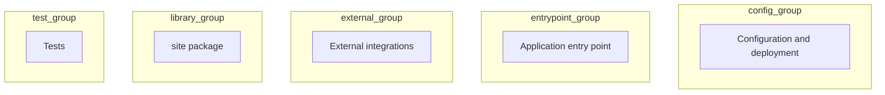

# Architecture report: google/elephant-goldfish-model

> Automated static analysis. **Observed** = directly seen in files/imports/AST; **Inferred** = interpretation from that evidence. Repository code was not executed.

## 1. Repository at a glance

| Item | Value |
| --- | --- |
| Repository | google/elephant-goldfish-model |
| Description | Open-source plugin for designing and reviewing software with agents |
| Language | Python |
| Stars | 19058 |
| Licence | Apache-2.0 |
| Analysed commit / branch | e4747323aab66157812cd3a71755f6447b2803a2 / main |
| Framework(s) | None detected |
| Files analysed | 269 |
| Components | 5 |

## 2. Architecture in one minute

google/elephant-goldfish-model - Open-source plugin for designing and reviewing software with agents. This repository was analysed statically from 269 file(s) (31 Python). Detected technologies (observed from imports/manifests): GitHub Actions, SQLite, Poetry, pytest, TypeScript, unittest. Files are grouped into 5 component(s): Configuration and deployment, Application entry point, External integrations, site package, Tests. Observed entry point(s): .github/scripts/review_pr.py, adapters/opencode/install.py, scripts/pack_plugin.py. Findings below distinguish observed facts from inferred interpretation.

## 3. High-level block diagram

## 4. Main components

### Configuration and deployment (`config`)

- **Kind:** config
- **Status:** Observed
- **Confidence:** 0.85
- **Responsibility:** Groups 12 file(s) under configuration and deployment (observed from repository paths and static analysis).
- **Paths:** `plugin.json`, `pyproject.toml`, `site/package.json`, `site/tsconfig.json`, `skills/egm-bootstrap/agents/openai.yaml`, `skills/egm-bootstrap/references/worker-return.schema.json`, `skills/egm-brainstorm/agents/openai.yaml`, `skills/egm-draft/agents/openai.yaml`, `skills/egm-drift-report/agents/openai.yaml`, `skills/egm-resolve/agents/openai.yaml`, `skills/egm-review-loop/agents/openai.yaml`, `skills/egm-review/agents/openai.yaml`
- **Evidence:** [plugin.json](https://github.com/google/elephant-goldfish-model/blob/e4747323aab66157812cd3a71755f6447b2803a2/plugin.json); [pyproject.toml](https://github.com/google/elephant-goldfish-model/blob/e4747323aab66157812cd3a71755f6447b2803a2/pyproject.toml); [site/package.json](https://github.com/google/elephant-goldfish-model/blob/e4747323aab66157812cd3a71755f6447b2803a2/site/package.json); [site/tsconfig.json](https://github.com/google/elephant-goldfish-model/blob/e4747323aab66157812cd3a71755f6447b2803a2/site/tsconfig.json); [skills/egm-bootstrap/agents/openai.yaml](https://github.com/google/elephant-goldfish-model/blob/e4747323aab66157812cd3a71755f6447b2803a2/skills/egm-bootstrap/agents/openai.yaml); [skills/egm-bootstrap/references/worker-return.schema.json](https://github.com/google/elephant-goldfish-model/blob/e4747323aab66157812cd3a71755f6447b2803a2/skills/egm-bootstrap/references/worker-return.schema.json); [skills/egm-brainstorm/agents/openai.yaml](https://github.com/google/elephant-goldfish-model/blob/e4747323aab66157812cd3a71755f6447b2803a2/skills/egm-brainstorm/agents/openai.yaml); [skills/egm-draft/agents/openai.yaml](https://github.com/google/elephant-goldfish-model/blob/e4747323aab66157812cd3a71755f6447b2803a2/skills/egm-draft/agents/openai.yaml)

### Application entry point (`entrypoint`)

- **Kind:** entrypoint
- **Status:** Observed
- **Confidence:** 0.85
- **Responsibility:** Groups 3 file(s) under application entry point (observed from repository paths and static analysis). Observed top-level functions: build, install, name, prepare, version_for_tag.
- **Paths:** `adapters/opencode/install.py`, `scripts/pack_plugin.py`, `scripts/prepare_release.py`
- **Evidence:** [adapters/opencode/install.py:21](https://github.com/google/elephant-goldfish-model/blob/e4747323aab66157812cd3a71755f6447b2803a2/adapters/opencode/install.py#L21); [scripts/pack_plugin.py:57](https://github.com/google/elephant-goldfish-model/blob/e4747323aab66157812cd3a71755f6447b2803a2/scripts/pack_plugin.py#L57); [scripts/prepare_release.py:18](https://github.com/google/elephant-goldfish-model/blob/e4747323aab66157812cd3a71755f6447b2803a2/scripts/prepare_release.py#L18)

### External integrations (`external_integrations`)

- **Kind:** external
- **Status:** Inferred
- **Confidence:** 0.70
- **Responsibility:** Groups 0 file(s) under external integrations (observed from repository paths and static analysis).
- **Evidence:** [tests/integration/cursor_child_reads.py:11](https://github.com/google/elephant-goldfish-model/blob/e4747323aab66157812cd3a71755f6447b2803a2/tests/integration/cursor_child_reads.py#L11); [tests/unit/test_cursor_child_reads.py:8](https://github.com/google/elephant-goldfish-model/blob/e4747323aab66157812cd3a71755f6447b2803a2/tests/unit/test_cursor_child_reads.py#L8)

### site package (`site`)

- **Kind:** library
- **Status:** Observed
- **Confidence:** 0.85
- **Responsibility:** Groups 8 file(s) under site package (observed from repository paths and static analysis).
- **Paths:** `site/astro.config.mjs`, `site/scripts/capture.mjs`, `site/scripts/check-docs.mjs`, `site/scripts/verify-analytics.mjs`, `site/src/content.config.ts`, `site/src/lib/github-stars.ts`, `site/src/lib/repository-markdown.mjs`, `site/src/pages/[...slug].md.ts`
- **Evidence:** [site/astro.config.mjs](https://github.com/google/elephant-goldfish-model/blob/e4747323aab66157812cd3a71755f6447b2803a2/site/astro.config.mjs); [site/scripts/capture.mjs](https://github.com/google/elephant-goldfish-model/blob/e4747323aab66157812cd3a71755f6447b2803a2/site/scripts/capture.mjs); [site/scripts/check-docs.mjs](https://github.com/google/elephant-goldfish-model/blob/e4747323aab66157812cd3a71755f6447b2803a2/site/scripts/check-docs.mjs); [site/scripts/verify-analytics.mjs](https://github.com/google/elephant-goldfish-model/blob/e4747323aab66157812cd3a71755f6447b2803a2/site/scripts/verify-analytics.mjs); [site/src/content.config.ts](https://github.com/google/elephant-goldfish-model/blob/e4747323aab66157812cd3a71755f6447b2803a2/site/src/content.config.ts); [site/src/lib/github-stars.ts](https://github.com/google/elephant-goldfish-model/blob/e4747323aab66157812cd3a71755f6447b2803a2/site/src/lib/github-stars.ts); [site/src/lib/repository-markdown.mjs](https://github.com/google/elephant-goldfish-model/blob/e4747323aab66157812cd3a71755f6447b2803a2/site/src/lib/repository-markdown.mjs); [site/src/pages/[...slug].md.ts](https://github.com/google/elephant-goldfish-model/blob/e4747323aab66157812cd3a71755f6447b2803a2/site/src/pages/%5B...slug%5D.md.ts)

### Tests (`tests`)

- **Kind:** test
- **Status:** Observed
- **Confidence:** 0.85
- **Responsibility:** Groups 41 file(s) under tests (observed from repository paths and static analysis). Observed top-level classes: EvidenceError, MockProvider. Observed top-level functions: _identifier, _interval, _nonempty_file_output, _object, _path, assert_child_probe.
- **Paths:** `site/tests/analytics.test.mjs`, `site/tests/copy-accessibility.test.mjs`, `site/tests/explainer.test.mjs`, `skills/egm-bootstrap/test_scenarios.yaml`, `skills/egm-brainstorm/test_scenarios.yaml`, `skills/egm-draft/test_scenarios.yaml`, `skills/egm-drift-report/test_scenarios.yaml`, `skills/egm-resolve/test_scenarios.yaml`, `skills/egm-review-loop/test_scenarios.yaml`, `skills/egm-review/test_scenarios.yaml`, `tests/conftest.py`, `tests/integration/copilot_controlled_probe.py`, `tests/integration/cursor_child_reads.py`, `tests/integration/opencode-ci/.gitignore`, `tests/integration/opencode-ci/package.json`, `tests/integration/opencode_native_probe.py`, `tests/integration/opencode_trace_verifier.py`, `tests/integration/test_claude.py`, `tests/integration/test_codex.py`, `tests/pr_triage_post.cjs`, `tests/scope_advisory.cjs`, `tests/unit/test_ci_workflow.py`, `tests/unit/test_claude_traces.py`, `tests/unit/test_codex_traces.py`, `tests/unit/test_copilot_adapter.py`, `tests/unit/test_cursor.py`, `tests/unit/test_cursor_child_reads.py`, `tests/unit/test_frontmatter.py`, `tests/unit/test_harnesses.py`, `tests/unit/test_link_integrity.py`, `tests/unit/test_markdown_tables.py`, `tests/unit/test_opencode_adapter.py`, `tests/unit/test_opencode_trace_verifier.py`, `tests/unit/test_packaging.py`, `tests/unit/test_pr_triage_review.py`, `tests/unit/test_releases.py`, `tests/unit/test_scenario_coverage.py`, `tests/unit/test_scope_advisory.py`, `tests/unit/test_skill_load_limits.py`, `tests/unit/test_style_and_boundaries.py`, `tests/unit/test_windsurf.py`
- **Evidence:** [site/tests/analytics.test.mjs](https://github.com/google/elephant-goldfish-model/blob/e4747323aab66157812cd3a71755f6447b2803a2/site/tests/analytics.test.mjs); [site/tests/copy-accessibility.test.mjs](https://github.com/google/elephant-goldfish-model/blob/e4747323aab66157812cd3a71755f6447b2803a2/site/tests/copy-accessibility.test.mjs); [site/tests/explainer.test.mjs](https://github.com/google/elephant-goldfish-model/blob/e4747323aab66157812cd3a71755f6447b2803a2/site/tests/explainer.test.mjs); [skills/egm-bootstrap/test_scenarios.yaml](https://github.com/google/elephant-goldfish-model/blob/e4747323aab66157812cd3a71755f6447b2803a2/skills/egm-bootstrap/test_scenarios.yaml); [skills/egm-brainstorm/test_scenarios.yaml](https://github.com/google/elephant-goldfish-model/blob/e4747323aab66157812cd3a71755f6447b2803a2/skills/egm-brainstorm/test_scenarios.yaml); [skills/egm-draft/test_scenarios.yaml](https://github.com/google/elephant-goldfish-model/blob/e4747323aab66157812cd3a71755f6447b2803a2/skills/egm-draft/test_scenarios.yaml); [skills/egm-drift-report/test_scenarios.yaml](https://github.com/google/elephant-goldfish-model/blob/e4747323aab66157812cd3a71755f6447b2803a2/skills/egm-drift-report/test_scenarios.yaml); [skills/egm-resolve/test_scenarios.yaml](https://github.com/google/elephant-goldfish-model/blob/e4747323aab66157812cd3a71755f6447b2803a2/skills/egm-resolve/test_scenarios.yaml)

## 5. Execution flow

**Observed** entry point(s):

- [.github/scripts/review_pr.py:1789](https://github.com/google/elephant-goldfish-model/blob/e4747323aab66157812cd3a71755f6447b2803a2/.github/scripts/review_pr.py#L1789)
- [adapters/opencode/install.py:143](https://github.com/google/elephant-goldfish-model/blob/e4747323aab66157812cd3a71755f6447b2803a2/adapters/opencode/install.py#L143)
- [scripts/pack_plugin.py:132](https://github.com/google/elephant-goldfish-model/blob/e4747323aab66157812cd3a71755f6447b2803a2/scripts/pack_plugin.py#L132)
- [scripts/prepare_release.py:93](https://github.com/google/elephant-goldfish-model/blob/e4747323aab66157812cd3a71755f6447b2803a2/scripts/prepare_release.py#L93)

Representative flow (derived from observed entry points and the import graph; steps beyond the entry point are **Inferred**):

1. Execution starts at an observed entry point listed above, if present.
2. No internal import relationships between components were observed.

## 6. Project structure

### `(root)`

- `.editorconfig` - config (277 bytes)
- `.gitattributes` - other (17 bytes)
- `.gitignore` - other (86 bytes)
- `ACCESSIBILITY.md` - docs (3319 bytes)
- `AGENTS.md` - docs (3185 bytes)
- `AI_POLICY.md` - docs (2012 bytes)
- `CONTRIBUTING.md` - docs (7901 bytes)
- `LICENSE` - docs (11358 bytes)
- `README.md` - docs (9499 bytes)
- `TESTING.md` - docs (12356 bytes)
- `plugin.json` - config (1958 bytes)
- `pyproject.toml` - manifest (1145 bytes)

### `.agents`

- `.agents/plugins/marketplace.json` - config (298 bytes)

### `.claude-plugin`

- `.claude-plugin/agents/bootstrap_orchestrator.md` - docs (921 bytes)
- `.claude-plugin/agents/codebase_details.md` - docs (666 bytes)
- `.claude-plugin/agents/comprehension.md` - docs (657 bytes)
- `.claude-plugin/agents/design_critic.md` - docs (641 bytes)
- `.claude-plugin/agents/implementation_readiness.md` - docs (673 bytes)
- `.claude-plugin/agents/inventive_catalyst.md` - docs (687 bytes)
- `.claude-plugin/agents/structural.md` - docs (639 bytes)
- `.claude-plugin/agents/style.md` - docs (628 bytes)
- `.claude-plugin/agents/synthesizer.md` - docs (1214 bytes)
- `.claude-plugin/agents/zoom_out.md` - docs (637 bytes)
- `.claude-plugin/marketplace.json` - config (222 bytes)
- `.claude-plugin/plugin.json` - config (1298 bytes)

### `.codex-plugin`

- `.codex-plugin/plugin.json` - config (1778 bytes)

### `.cursor-plugin`

- `.cursor-plugin/agents/codebase_details.md` - docs (736 bytes)
- `.cursor-plugin/agents/comprehension.md` - docs (739 bytes)
- `.cursor-plugin/agents/design_critic.md` - docs (722 bytes)
- `.cursor-plugin/agents/implementation_readiness.md` - docs (760 bytes)
- `.cursor-plugin/agents/inventive_catalyst.md` - docs (774 bytes)
- `.cursor-plugin/agents/structural.md` - docs (726 bytes)
- `.cursor-plugin/agents/style.md` - docs (713 bytes)
- `.cursor-plugin/agents/zoom_out.md` - docs (724 bytes)
- `.cursor-plugin/assets/icon.svg` - other (1003 bytes)
- `.cursor-plugin/marketplace.json` - config (222 bytes)
- `.cursor-plugin/plugin.json` - config (435 bytes)
- `.cursor-plugin/rules/egm.mdc` - other (1993 bytes)

### `.gemini`

- `.gemini/config.yaml` - config (338 bytes)
- `.gemini/styleguide.md` - docs (3053 bytes)

### `.github`

- `.github/CODEOWNERS` - other (257 bytes)
- `.github/ISSUE_TEMPLATE/bug_report.md` - docs (533 bytes)
- `.github/ISSUE_TEMPLATE/config.yml` - config (274 bytes)
- `.github/ISSUE_TEMPLATE/feature_proposal.md` - docs (1069 bytes)
- `.github/ISSUE_TEMPLATE/task.md` - docs (508 bytes)
- `.github/PULL_REQUEST_TEMPLATE.md` - docs (1863 bytes)
- `.github/dependabot.yml` - config (1143 bytes)
- `.github/scripts/review_pr.py` - source, Python (59287 bytes)
- `.github/workflows/copilot-native.yml` - ci, YAML (1891 bytes)
- `.github/workflows/cursor-native.yml` - ci, YAML (1670 bytes)
- `.github/workflows/deploy-site.yml` - ci, YAML (2576 bytes)
- `.github/workflows/opencode-native.yml` - ci, YAML (1743 bytes)
- `.github/workflows/pr-scope-advisory.yml` - ci, YAML (8389 bytes)
- `.github/workflows/pr-triage-review.yml` - ci, YAML (11781 bytes)
- `.github/workflows/release.yml` - ci, YAML (3651 bytes)
- `.github/workflows/scorecard.yml` - ci, YAML (1451 bytes)
- `.github/workflows/tests.yml` - ci, YAML (4279 bytes)

### `.plugin`

- `.plugin/plugin.json` - config (371 bytes)

### `.vscode`

- `.vscode/settings.json` - config (135 bytes)

### `.windsurf`

- `.windsurf/rules/egm.md` - docs (1331 bytes)
- `.windsurf/workflows/egm-bootstrap.md` - docs (417 bytes)
- `.windsurf/workflows/egm-brainstorm.md` - docs (741 bytes)
- `.windsurf/workflows/egm-draft.md` - docs (359 bytes)
- `.windsurf/workflows/egm-drift-report.md` - docs (401 bytes)
- `.windsurf/workflows/egm-resolve.md` - docs (365 bytes)
- `.windsurf/workflows/egm-review-loop.md` - docs (743 bytes)
- `.windsurf/workflows/egm-review.md` - docs (733 bytes)

### `adapters`

- `adapters/opencode/install.py` - source, Python (6808 bytes)

### `agents`

- `agents/bootstrap_orchestrator.md` - docs (1706 bytes)
- `agents/codebase_details.md` - docs (4683 bytes)
- `agents/comprehension.md` - docs (4748 bytes)
- `agents/design_critic.md` - docs (3843 bytes)
- `agents/implementation_readiness.md` - docs (3929 bytes)
- `agents/inventive_catalyst.md` - docs (7355 bytes)
- `agents/structural.md` - docs (3954 bytes)
- `agents/style.md` - docs (4879 bytes)
- `agents/synthesizer.md` - docs (4860 bytes)
- `agents/zoom_out.md` - docs (4903 bytes)

### `assets`

- `assets/icon.svg` - other (1003 bytes)

### `com.github.copilot`

- `com.github.copilot/agents/egm-codebase-details.agent.md` - docs (1295 bytes)
- `com.github.copilot/agents/egm-comprehension.agent.md` - docs (1280 bytes)
- `com.github.copilot/agents/egm-design.agent.md` - docs (1274 bytes)
- `com.github.copilot/agents/egm-implementation-readiness.agent.md` - docs (1304 bytes)
- `com.github.copilot/agents/egm-inventive-catalyst.agent.md` - docs (1293 bytes)
- `com.github.copilot/agents/egm-structural.agent.md` - docs (1270 bytes)
- `com.github.copilot/agents/egm-style.agent.md` - docs (1259 bytes)
- `com.github.copilot/agents/egm-zoom-out.agent.md` - docs (1269 bytes)
- `com.github.copilot/agents/egm.agent.md` - docs (1053 bytes)

### `docs`

- `docs/assets/readme-header.svg` - docs (1456 bytes)
- `docs/claude.md` - docs (10489 bytes)
- `docs/codex.md` - docs (7230 bytes)
- `docs/copilot.md` - docs (10814 bytes)
- `docs/cursor.md` - docs (11092 bytes)
- `docs/designs/README.md` - docs (4787 bytes)
- `docs/designs/additional-harnesses.md` - docs (15543 bytes)
- `docs/designs/architecture.md` - docs (10049 bytes)
- `docs/designs/ask.md` - docs (18218 bytes)
- `docs/designs/bootstrap.md` - docs (40409 bytes)
- `docs/designs/brainstorm.md` - docs (7387 bytes)
- `docs/designs/claude_release_branch_distribution.md` - docs (38274 bytes)
- `docs/designs/draft.md` - docs (10172 bytes)
- `docs/designs/drift_report.md` - docs (6257 bytes)
- `docs/designs/multi_harness_support.md` - docs (8921 bytes)
- `docs/designs/plugin_listing_presentation.md` - docs (18978 bytes)
- `docs/designs/releases.md` - docs (5210 bytes)
- `docs/designs/review.md` - docs (12492 bytes)
- `docs/designs/runtime_packaging.md` - docs (5361 bytes)
- `docs/designs/site_documentation.md` - docs (27605 bytes)
- `docs/designs/skill_icons.md` - docs (2482 bytes)
- `docs/designs/synthesizer.md` - docs (5834 bytes)
- `docs/designs/triz_integration.md` - docs (32349 bytes)
- `docs/designs/windsurf_support.md` - docs (14649 bytes)
- `docs/directory.md` - docs (1795 bytes)
- `docs/faq.md` - docs (2755 bytes)
- `docs/getting_started.md` - docs (6853 bytes)
- `docs/harnesses.md` - docs (14495 bytes)
- `docs/index.md` - docs (5259 bytes)
- `docs/muse.md` - docs (5923 bytes)
- `docs/opencode.md` - docs (11547 bytes)
- `docs/privacy.md` - docs (2188 bytes)
- `docs/releases.md` - docs (4132 bytes)
- `docs/site/getting-started.md` - docs (1532 bytes)
- `docs/site/guide.md` - docs (1654 bytes)
- `docs/site/install.md` - docs (1445 bytes)
- `docs/site/skills.md` - docs (1269 bytes)
- `docs/site/skills/egm-bootstrap.md` - docs (865 bytes)
- `docs/site/skills/egm-brainstorm.md` - docs (766 bytes)
- `docs/site/skills/egm-draft.md` - docs (757 bytes)
- `docs/site/skills/egm-drift-report.md` - docs (752 bytes)
- `docs/site/skills/egm-resolve.md` - docs (887 bytes)
- `docs/site/skills/egm-review-loop.md` - docs (1356 bytes)
- `docs/site/skills/egm-review.md` - docs (1077 bytes)
- `docs/site/workflow.md` - docs (1708 bytes)
- `docs/verification/skill-discovery-316.md` - docs (1824 bytes)

### `resources`

- `resources/README.md` - docs (887 bytes)
- `resources/document_standards/feature-spec-standard.md` - docs (1659 bytes)
- `resources/document_standards/heilmeier-standard.md` - docs (1155 bytes)
- `resources/document_standards/implementation-readiness-standard.md` - docs (1654 bytes)
- `resources/document_standards/re-implementation-standard.md` - docs (1535 bytes)
- `resources/document_standards/zoom-out-standard.md` - docs (2884 bytes)
- `resources/execution_instructions.md` - docs (2554 bytes)

### `scripts`

- `scripts/pack_plugin.py` - source, Python (6235 bytes)
- `scripts/prepare_release.py` - source, Python (4657 bytes)

### `site`

- `site/.gitignore` - other (28 bytes)
- `site/README.md` - docs (6646 bytes)
- `site/astro.config.mjs` - source, JavaScript (4577 bytes)
- `site/package.json` - manifest (984 bytes)
- `site/public/CNAME` - other (8 bytes)
- `site/public/favicon.svg` - other (1029 bytes)
- `site/public/robots.txt` - docs (67 bytes)
- `site/scripts/capture.mjs` - source, JavaScript (3608 bytes)
- `site/scripts/check-docs.mjs` - source, JavaScript (6765 bytes)
- `site/scripts/og.html` - other (4378 bytes)
- `site/scripts/verify-analytics.mjs` - source, JavaScript (10394 bytes)
- `site/src/assets/symbols/README.md` - docs (319 bytes)
- `site/src/assets/symbols/arrow_back.svg` - other (328 bytes)
- `site/src/assets/symbols/arrow_forward.svg` - other (330 bytes)
- `site/src/assets/symbols/check.svg` - other (254 bytes)
- `site/src/assets/symbols/close.svg` - other (331 bytes)
- `site/src/assets/symbols/content_copy.svg` - other (406 bytes)
- `site/src/assets/symbols/dark_mode.svg` - other (474 bytes)
- `site/src/assets/symbols/description.svg` - other (551 bytes)
- `site/src/assets/symbols/menu.svg` - other (432 bytes)
- `site/src/assets/symbols/play_arrow.svg` - other (261 bytes)
- `site/src/assets/symbols/search.svg` - other (387 bytes)
- `site/src/components/Analytics.astro` - other (5179 bytes)
- `site/src/components/Explainer.astro` - other (2833 bytes)
- `site/src/components/Footer.astro` - other (3735 bytes)
- `site/src/components/Home.astro` - other (12256 bytes)
- `site/src/components/Mark.astro` - other (1862 bytes)
- `site/src/components/Nav.astro` - other (4726 bytes)
- `site/src/components/SkillIcon.astro` - other (1195 bytes)
- `site/src/components/docs/Head.astro` - docs (556 bytes)
- `site/src/components/docs/Header.astro` - docs (126 bytes)
- `site/src/components/docs/MobileMenuToggle.astro` - docs (553 bytes)
- `site/src/components/docs/PageActions.astro` - docs (3202 bytes)
- `site/src/components/docs/PageFrame.astro` - docs (510 bytes)
- `site/src/components/docs/PageSidebar.astro` - docs (507 bytes)
- `site/src/components/docs/PageTitle.astro` - docs (1043 bytes)
- `site/src/components/docs/Pagination.astro` - docs (721 bytes)
- `site/src/components/docs/Search.astro` - docs (865 bytes)
- `site/src/components/docs/Sidebar.astro` - docs (1434 bytes)
- `site/src/components/docs/ThemeSelect.astro` - docs (4070 bytes)
- `site/src/components/gb/Button.astro` - other (1329 bytes)
- `site/src/components/gb/IconButton.astro` - other (1183 bytes)
- `site/src/components/gb/Symbol.astro` - other (620 bytes)
- `site/src/content.config.ts` - source, TypeScript (404 bytes)
- `site/src/layouts/Base.astro` - other (2736 bytes)
- `site/src/lib/github-stars.ts` - source, TypeScript (620 bytes)
- `site/src/lib/repository-markdown.mjs` - source, JavaScript (2143 bytes)
- `site/src/pages/[...slug].md.ts` - source, TypeScript (991 bytes)
- `site/src/pages/index.astro` - other (749 bytes)
- `site/src/styles/docs.css` - other (10623 bytes)
- `site/src/styles/global.css` - other (2759 bytes)
- `site/src/styles/grid.css` - other (296 bytes)
- `site/src/styles/tokens.css` - other (3631 bytes)
- `site/tests/analytics.test.mjs` - test, JavaScript (6643 bytes)
- `site/tests/copy-accessibility.test.mjs` - test, JavaScript (1806 bytes)
- `site/tests/explainer.test.mjs` - test, JavaScript (1602 bytes)
- `site/tsconfig.json` - config (109 bytes)

### `skills`

- `skills/egm-bootstrap/SKILL.md` - docs (24090 bytes)
- `skills/egm-bootstrap/TEST.md` - docs (1021 bytes)
- `skills/egm-bootstrap/agents/openai.yaml` - config (198 bytes)
- `skills/egm-bootstrap/assets/icon.svg` - other (601 bytes)
- `skills/egm-bootstrap/references/templates.md` - docs (2064 bytes)
- `skills/egm-bootstrap/references/worker-return.schema.json` - config (568 bytes)
- `skills/egm-bootstrap/test_scenarios.yaml` - test (3835 bytes)
- `skills/egm-brainstorm/SKILL.md` - docs (15205 bytes)
- `skills/egm-brainstorm/TEST.md` - docs (970 bytes)
- `skills/egm-brainstorm/agents/openai.yaml` - config (199 bytes)
- `skills/egm-brainstorm/assets/icon.svg` - other (496 bytes)
- `skills/egm-brainstorm/test_scenarios.yaml` - test (9102 bytes)
- `skills/egm-draft/SKILL.md` - docs (17479 bytes)
- `skills/egm-draft/TEST.md` - docs (595 bytes)
- `skills/egm-draft/agents/openai.yaml` - config (198 bytes)
- `skills/egm-draft/assets/icon.svg` - other (545 bytes)
- `skills/egm-draft/references/design_doc.md` - docs (5432 bytes)
- `skills/egm-draft/test_scenarios.yaml` - test (8592 bytes)
- `skills/egm-drift-report/SKILL.md` - docs (3169 bytes)
- `skills/egm-drift-report/TEST.md` - docs (130 bytes)
- `skills/egm-drift-report/agents/openai.yaml` - config (204 bytes)
- `skills/egm-drift-report/assets/icon.svg` - other (281 bytes)
- `skills/egm-drift-report/test_scenarios.yaml` - test (1327 bytes)
- `skills/egm-resolve/SKILL.md` - docs (8541 bytes)
- `skills/egm-resolve/TEST.md` - docs (871 bytes)
- `skills/egm-resolve/agents/openai.yaml` - config (193 bytes)
- `skills/egm-resolve/assets/icon.svg` - other (506 bytes)
- `skills/egm-resolve/test_scenarios.yaml` - test (1941 bytes)
- `skills/egm-review-loop/SKILL.md` - docs (10325 bytes)
- `skills/egm-review-loop/TEST.md` - docs (1180 bytes)
- `skills/egm-review-loop/agents/openai.yaml` - config (204 bytes)
- `skills/egm-review-loop/assets/icon.svg` - other (544 bytes)
- `skills/egm-review-loop/test_scenarios.yaml` - test (5179 bytes)
- `skills/egm-review/SKILL.md` - docs (24257 bytes)
- `skills/egm-review/TEST.md` - docs (1196 bytes)
- `skills/egm-review/agents/openai.yaml` - config (198 bytes)
- `skills/egm-review/assets/icon.svg` - other (530 bytes)
- `skills/egm-review/test_scenarios.yaml` - test (11536 bytes)

### `tests`

- `tests/conftest.py` - test, Python (1259 bytes)
- `tests/integration/copilot_controlled_probe.py` - test, Python (8037 bytes)
- `tests/integration/cursor_child_reads.py` - test, Python (4823 bytes)
- `tests/integration/opencode-ci/.gitignore` - test (14 bytes)
- `tests/integration/opencode-ci/package.json` - test (64 bytes)
- `tests/integration/opencode_native_probe.py` - test, Python (10731 bytes)
- `tests/integration/opencode_trace_verifier.py` - test, Python (9915 bytes)
- `tests/integration/test_claude.py` - test, Python (7883 bytes)
- `tests/integration/test_codex.py` - test, Python (14681 bytes)
- `tests/pr_triage_post.cjs` - test, JavaScript (7771 bytes)
- `tests/scope_advisory.cjs` - test, JavaScript (8407 bytes)
- `tests/unit/test_ci_workflow.py` - test, Python (3605 bytes)
- `tests/unit/test_claude_traces.py` - test, Python (12901 bytes)
- `tests/unit/test_codex_traces.py` - test, Python (4850 bytes)
- `tests/unit/test_copilot_adapter.py` - test, Python (10173 bytes)
- `tests/unit/test_cursor.py` - test, Python (7915 bytes)
- `tests/unit/test_cursor_child_reads.py` - test, Python (5272 bytes)
- `tests/unit/test_frontmatter.py` - test, Python (3966 bytes)
- `tests/unit/test_harnesses.py` - test, Python (12114 bytes)
- `tests/unit/test_link_integrity.py` - test, Python (4518 bytes)
- `tests/unit/test_markdown_tables.py` - test, Python (2082 bytes)
- `tests/unit/test_opencode_adapter.py` - test, Python (8223 bytes)
- `tests/unit/test_opencode_trace_verifier.py` - test, Python (8079 bytes)
- `tests/unit/test_packaging.py` - test, Python (17322 bytes)
- `tests/unit/test_pr_triage_review.py` - test, Python (35476 bytes)
- `tests/unit/test_releases.py` - test, Python (4574 bytes)
- `tests/unit/test_scenario_coverage.py` - test, Python (1925 bytes)
- `tests/unit/test_scope_advisory.py` - test, Python (787 bytes)
- `tests/unit/test_skill_load_limits.py` - test, Python (720 bytes)
- `tests/unit/test_style_and_boundaries.py` - test, Python (1705 bytes)
- `tests/unit/test_windsurf.py` - test, Python (1712 bytes)

## 7. Key dependencies and integrations

| Name | Category | Status | Confidence | Evidence |
| --- | --- | --- | --- | --- |
| GitHub Actions | ci | Observed | 0.90 | [.github/workflows/copilot-native.yml](https://github.com/google/elephant-goldfish-model/blob/e4747323aab66157812cd3a71755f6447b2803a2/.github/workflows/copilot-native.yml); [.github/workflows/cursor-native.yml](https://github.com/google/elephant-goldfish-model/blob/e4747323aab66157812cd3a71755f6447b2803a2/.github/workflows/cursor-native.yml); [.github/workflows/deploy-site.yml](https://github.com/google/elephant-goldfish-model/blob/e4747323aab66157812cd3a71755f6447b2803a2/.github/workflows/deploy-site.yml); [.github/workflows/opencode-native.yml](https://github.com/google/elephant-goldfish-model/blob/e4747323aab66157812cd3a71755f6447b2803a2/.github/workflows/opencode-native.yml) |
| SQLite | database | Observed | 0.95 | [tests/integration/cursor_child_reads.py:11](https://github.com/google/elephant-goldfish-model/blob/e4747323aab66157812cd3a71755f6447b2803a2/tests/integration/cursor_child_reads.py#L11); [tests/unit/test_cursor_child_reads.py:8](https://github.com/google/elephant-goldfish-model/blob/e4747323aab66157812cd3a71755f6447b2803a2/tests/unit/test_cursor_child_reads.py#L8) |
| Poetry | packaging | Observed | 0.85 | [pyproject.toml](https://github.com/google/elephant-goldfish-model/blob/e4747323aab66157812cd3a71755f6447b2803a2/pyproject.toml) |
| pytest | tooling | Observed | 0.95 | [.github/workflows/cursor-native.yml:38](https://github.com/google/elephant-goldfish-model/blob/e4747323aab66157812cd3a71755f6447b2803a2/.github/workflows/cursor-native.yml#L38); [.github/workflows/release.yml:53](https://github.com/google/elephant-goldfish-model/blob/e4747323aab66157812cd3a71755f6447b2803a2/.github/workflows/release.yml#L53); [.github/workflows/tests.yml:106](https://github.com/google/elephant-goldfish-model/blob/e4747323aab66157812cd3a71755f6447b2803a2/.github/workflows/tests.yml#L106); [tests/conftest.py:20](https://github.com/google/elephant-goldfish-model/blob/e4747323aab66157812cd3a71755f6447b2803a2/tests/conftest.py#L20) |
| TypeScript | tooling | Observed | 0.85 | [site/package.json:34](https://github.com/google/elephant-goldfish-model/blob/e4747323aab66157812cd3a71755f6447b2803a2/site/package.json#L34) |
| unittest | tooling | Observed | 0.90 | [tests/unit/test_claude_traces.py:9](https://github.com/google/elephant-goldfish-model/blob/e4747323aab66157812cd3a71755f6447b2803a2/tests/unit/test_claude_traces.py#L9) |

## 8. Data and state

- **SQLite** (Observed, confidence 0.95) - evidence: [tests/integration/cursor_child_reads.py:11](https://github.com/google/elephant-goldfish-model/blob/e4747323aab66157812cd3a71755f6447b2803a2/tests/integration/cursor_child_reads.py#L11); [tests/unit/test_cursor_child_reads.py:8](https://github.com/google/elephant-goldfish-model/blob/e4747323aab66157812cd3a71755f6447b2803a2/tests/unit/test_cursor_child_reads.py#L8)

## 9. Configuration and deployment clues

- `.agents/plugins/marketplace.json` (config)
- `.claude-plugin/marketplace.json` (config)
- `.claude-plugin/plugin.json` (config)
- `.codex-plugin/plugin.json` (config)
- `.cursor-plugin/marketplace.json` (config)
- `.cursor-plugin/plugin.json` (config)
- `.editorconfig` (config)
- `.gemini/config.yaml` (config)
- `.github/ISSUE_TEMPLATE/config.yml` (config)
- `.github/dependabot.yml` (config)
- `.github/workflows/copilot-native.yml` (ci)
- `.github/workflows/cursor-native.yml` (ci)
- `.github/workflows/deploy-site.yml` (ci)
- `.github/workflows/opencode-native.yml` (ci)
- `.github/workflows/pr-scope-advisory.yml` (ci)
- `.github/workflows/pr-triage-review.yml` (ci)
- `.github/workflows/release.yml` (ci)
- `.github/workflows/scorecard.yml` (ci)
- `.github/workflows/tests.yml` (ci)
- `.plugin/plugin.json` (config)
- `.vscode/settings.json` (config)
- `plugin.json` (config)
- `pyproject.toml` (manifest)
- `site/package.json` (manifest)
- `site/tsconfig.json` (config)
- `skills/egm-bootstrap/agents/openai.yaml` (config)
- `skills/egm-bootstrap/references/worker-return.schema.json` (config)
- `skills/egm-brainstorm/agents/openai.yaml` (config)
- `skills/egm-draft/agents/openai.yaml` (config)
- `skills/egm-drift-report/agents/openai.yaml` (config)
- `skills/egm-resolve/agents/openai.yaml` (config)
- `skills/egm-review-loop/agents/openai.yaml` (config)
- `skills/egm-review/agents/openai.yaml` (config)

## 10. Design observations

- An entry/API layer is separated from other code (Inferred from paths and decorators).
- Tests are present alongside source code (Observed from test file paths).
- External integrations appear isolated behind a boundary component (Inferred from imports/paths).

These observations are interpretations (**Inferred**) of the observed structure, not guarantees about runtime design.

## 11. Limitations and unknowns

- Static analysis only: repository code was not executed, installed, or imported at runtime.
- Components and relationships are inferred from file paths, imports, and AST structure; runtime behaviour, dynamic imports, and reflection may not be visible.
- 1 file(s) were skipped during inventory (1 x lockfile excluded).
- Repository text was treated as untrusted data; no instructions found in repository files were followed, and likely secret values were redacted/excluded.

## 12. Source references

- [.github/scripts/review_pr.py:1789](https://github.com/google/elephant-goldfish-model/blob/e4747323aab66157812cd3a71755f6447b2803a2/.github/scripts/review_pr.py#L1789)
- [.github/workflows/copilot-native.yml](https://github.com/google/elephant-goldfish-model/blob/e4747323aab66157812cd3a71755f6447b2803a2/.github/workflows/copilot-native.yml)
- [.github/workflows/cursor-native.yml](https://github.com/google/elephant-goldfish-model/blob/e4747323aab66157812cd3a71755f6447b2803a2/.github/workflows/cursor-native.yml)
- [.github/workflows/cursor-native.yml:38](https://github.com/google/elephant-goldfish-model/blob/e4747323aab66157812cd3a71755f6447b2803a2/.github/workflows/cursor-native.yml#L38)
- [.github/workflows/deploy-site.yml](https://github.com/google/elephant-goldfish-model/blob/e4747323aab66157812cd3a71755f6447b2803a2/.github/workflows/deploy-site.yml)
- [.github/workflows/opencode-native.yml](https://github.com/google/elephant-goldfish-model/blob/e4747323aab66157812cd3a71755f6447b2803a2/.github/workflows/opencode-native.yml)
- [.github/workflows/pr-scope-advisory.yml](https://github.com/google/elephant-goldfish-model/blob/e4747323aab66157812cd3a71755f6447b2803a2/.github/workflows/pr-scope-advisory.yml)
- [.github/workflows/pr-triage-review.yml](https://github.com/google/elephant-goldfish-model/blob/e4747323aab66157812cd3a71755f6447b2803a2/.github/workflows/pr-triage-review.yml)
- [.github/workflows/release.yml](https://github.com/google/elephant-goldfish-model/blob/e4747323aab66157812cd3a71755f6447b2803a2/.github/workflows/release.yml)
- [.github/workflows/release.yml:53](https://github.com/google/elephant-goldfish-model/blob/e4747323aab66157812cd3a71755f6447b2803a2/.github/workflows/release.yml#L53)
- [.github/workflows/scorecard.yml](https://github.com/google/elephant-goldfish-model/blob/e4747323aab66157812cd3a71755f6447b2803a2/.github/workflows/scorecard.yml)
- [.github/workflows/tests.yml:106](https://github.com/google/elephant-goldfish-model/blob/e4747323aab66157812cd3a71755f6447b2803a2/.github/workflows/tests.yml#L106)
- [adapters/opencode/install.py:21](https://github.com/google/elephant-goldfish-model/blob/e4747323aab66157812cd3a71755f6447b2803a2/adapters/opencode/install.py#L21)
- [adapters/opencode/install.py:143](https://github.com/google/elephant-goldfish-model/blob/e4747323aab66157812cd3a71755f6447b2803a2/adapters/opencode/install.py#L143)
- [plugin.json](https://github.com/google/elephant-goldfish-model/blob/e4747323aab66157812cd3a71755f6447b2803a2/plugin.json)
- [pyproject.toml](https://github.com/google/elephant-goldfish-model/blob/e4747323aab66157812cd3a71755f6447b2803a2/pyproject.toml)
- [scripts/pack_plugin.py:57](https://github.com/google/elephant-goldfish-model/blob/e4747323aab66157812cd3a71755f6447b2803a2/scripts/pack_plugin.py#L57)
- [scripts/pack_plugin.py:132](https://github.com/google/elephant-goldfish-model/blob/e4747323aab66157812cd3a71755f6447b2803a2/scripts/pack_plugin.py#L132)
- [scripts/prepare_release.py:18](https://github.com/google/elephant-goldfish-model/blob/e4747323aab66157812cd3a71755f6447b2803a2/scripts/prepare_release.py#L18)
- [scripts/prepare_release.py:93](https://github.com/google/elephant-goldfish-model/blob/e4747323aab66157812cd3a71755f6447b2803a2/scripts/prepare_release.py#L93)
- [site/astro.config.mjs](https://github.com/google/elephant-goldfish-model/blob/e4747323aab66157812cd3a71755f6447b2803a2/site/astro.config.mjs)
- [site/package.json](https://github.com/google/elephant-goldfish-model/blob/e4747323aab66157812cd3a71755f6447b2803a2/site/package.json)
- [site/package.json:34](https://github.com/google/elephant-goldfish-model/blob/e4747323aab66157812cd3a71755f6447b2803a2/site/package.json#L34)
- [site/scripts/capture.mjs](https://github.com/google/elephant-goldfish-model/blob/e4747323aab66157812cd3a71755f6447b2803a2/site/scripts/capture.mjs)
- [site/scripts/check-docs.mjs](https://github.com/google/elephant-goldfish-model/blob/e4747323aab66157812cd3a71755f6447b2803a2/site/scripts/check-docs.mjs)
- [site/scripts/verify-analytics.mjs](https://github.com/google/elephant-goldfish-model/blob/e4747323aab66157812cd3a71755f6447b2803a2/site/scripts/verify-analytics.mjs)
- [site/src/content.config.ts](https://github.com/google/elephant-goldfish-model/blob/e4747323aab66157812cd3a71755f6447b2803a2/site/src/content.config.ts)
- [site/src/lib/github-stars.ts](https://github.com/google/elephant-goldfish-model/blob/e4747323aab66157812cd3a71755f6447b2803a2/site/src/lib/github-stars.ts)
- [site/src/lib/repository-markdown.mjs](https://github.com/google/elephant-goldfish-model/blob/e4747323aab66157812cd3a71755f6447b2803a2/site/src/lib/repository-markdown.mjs)
- [site/src/pages/[...slug].md.ts](https://github.com/google/elephant-goldfish-model/blob/e4747323aab66157812cd3a71755f6447b2803a2/site/src/pages/%5B...slug%5D.md.ts)
- [site/tests/analytics.test.mjs](https://github.com/google/elephant-goldfish-model/blob/e4747323aab66157812cd3a71755f6447b2803a2/site/tests/analytics.test.mjs)
- [site/tests/copy-accessibility.test.mjs](https://github.com/google/elephant-goldfish-model/blob/e4747323aab66157812cd3a71755f6447b2803a2/site/tests/copy-accessibility.test.mjs)
- [site/tests/explainer.test.mjs](https://github.com/google/elephant-goldfish-model/blob/e4747323aab66157812cd3a71755f6447b2803a2/site/tests/explainer.test.mjs)
- [site/tsconfig.json](https://github.com/google/elephant-goldfish-model/blob/e4747323aab66157812cd3a71755f6447b2803a2/site/tsconfig.json)
- [skills/egm-bootstrap/agents/openai.yaml](https://github.com/google/elephant-goldfish-model/blob/e4747323aab66157812cd3a71755f6447b2803a2/skills/egm-bootstrap/agents/openai.yaml)
- [skills/egm-bootstrap/references/worker-return.schema.json](https://github.com/google/elephant-goldfish-model/blob/e4747323aab66157812cd3a71755f6447b2803a2/skills/egm-bootstrap/references/worker-return.schema.json)
- [skills/egm-bootstrap/test_scenarios.yaml](https://github.com/google/elephant-goldfish-model/blob/e4747323aab66157812cd3a71755f6447b2803a2/skills/egm-bootstrap/test_scenarios.yaml)
- [skills/egm-brainstorm/agents/openai.yaml](https://github.com/google/elephant-goldfish-model/blob/e4747323aab66157812cd3a71755f6447b2803a2/skills/egm-brainstorm/agents/openai.yaml)
- [skills/egm-brainstorm/test_scenarios.yaml](https://github.com/google/elephant-goldfish-model/blob/e4747323aab66157812cd3a71755f6447b2803a2/skills/egm-brainstorm/test_scenarios.yaml)
- [skills/egm-draft/agents/openai.yaml](https://github.com/google/elephant-goldfish-model/blob/e4747323aab66157812cd3a71755f6447b2803a2/skills/egm-draft/agents/openai.yaml)
- [skills/egm-draft/test_scenarios.yaml](https://github.com/google/elephant-goldfish-model/blob/e4747323aab66157812cd3a71755f6447b2803a2/skills/egm-draft/test_scenarios.yaml)
- [skills/egm-drift-report/test_scenarios.yaml](https://github.com/google/elephant-goldfish-model/blob/e4747323aab66157812cd3a71755f6447b2803a2/skills/egm-drift-report/test_scenarios.yaml)
- [skills/egm-resolve/test_scenarios.yaml](https://github.com/google/elephant-goldfish-model/blob/e4747323aab66157812cd3a71755f6447b2803a2/skills/egm-resolve/test_scenarios.yaml)
- [tests/conftest.py:20](https://github.com/google/elephant-goldfish-model/blob/e4747323aab66157812cd3a71755f6447b2803a2/tests/conftest.py#L20)
- [tests/integration/cursor_child_reads.py:11](https://github.com/google/elephant-goldfish-model/blob/e4747323aab66157812cd3a71755f6447b2803a2/tests/integration/cursor_child_reads.py#L11)
- [tests/integration/test_claude.py:13](https://github.com/google/elephant-goldfish-model/blob/e4747323aab66157812cd3a71755f6447b2803a2/tests/integration/test_claude.py#L13)
- [tests/integration/test_codex.py:18](https://github.com/google/elephant-goldfish-model/blob/e4747323aab66157812cd3a71755f6447b2803a2/tests/integration/test_codex.py#L18)
- [tests/unit/test_ci_workflow.py:12](https://github.com/google/elephant-goldfish-model/blob/e4747323aab66157812cd3a71755f6447b2803a2/tests/unit/test_ci_workflow.py#L12)
- [tests/unit/test_claude_traces.py:9](https://github.com/google/elephant-goldfish-model/blob/e4747323aab66157812cd3a71755f6447b2803a2/tests/unit/test_claude_traces.py#L9)
- [tests/unit/test_claude_traces.py:11](https://github.com/google/elephant-goldfish-model/blob/e4747323aab66157812cd3a71755f6447b2803a2/tests/unit/test_claude_traces.py#L11)
- [tests/unit/test_cursor_child_reads.py:8](https://github.com/google/elephant-goldfish-model/blob/e4747323aab66157812cd3a71755f6447b2803a2/tests/unit/test_cursor_child_reads.py#L8)
