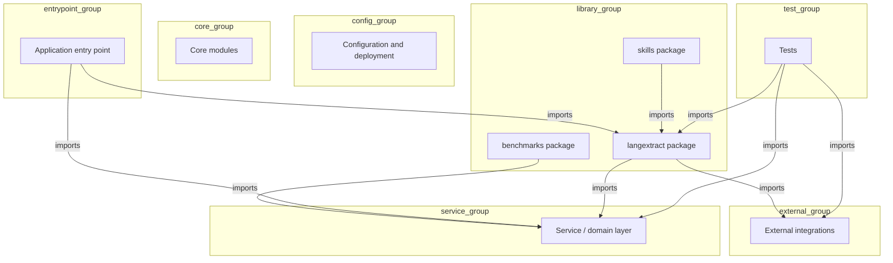

# Architecture report: google/langextract

> Automated static analysis. **Observed** = directly seen in files/imports/AST; **Inferred** = interpretation from that evidence. Repository code was not executed.

## 1. Repository at a glance

| Item | Value |
| --- | --- |
| Repository | google/langextract |
| Description | A Python library for extracting structured information from unstructured text using LLMs with precise source grounding and interactive visualization. |
| Language | Python |
| Stars | 39310 |
| Licence | Apache-2.0 |
| Analysed commit / branch | 0e441bf77ddc3119dd0aa413322959234dd84ee5 / main |
| Framework(s) | None detected |
| Files analysed | 148 |
| Components | 9 |

## 2. Architecture in one minute

google/langextract - A Python library for extracting structured information from unstructured text using LLMs with precise source grounding and interactive visualization.. This repository was analysed statically from 148 file(s) (93 Python). Detected technologies (observed from imports/manifests): GitHub Actions, aiohttp, httpx, NumPy, pandas, Pydantic. Files are grouped into 9 component(s): benchmarks package, Configuration and deployment, Core modules, Application entry point, External integrations, langextract package, Service / domain layer, skills package. Observed entry point(s): .github/scripts/pr_security_check.py, .github/scripts/zenodo_publish.py, benchmarks/benchmark.py. Findings below distinguish observed facts from inferred interpretation.

## 3. High-level block diagram

## 4. Main components

### benchmarks package (`benchmarks`)

- **Kind:** library
- **Status:** Observed
- **Confidence:** 0.85
- **Responsibility:** Groups 2 file(s) under benchmarks package (observed from repository paths and static analysis). Observed top-level functions: _plot_entity_comparison, _plot_extraction_density, _plot_processing_speed, _plot_success_rate_comparison, _plot_summary_table, _plot_time_comparison.
- **Paths:** `benchmarks/plotting.py`, `benchmarks/utils.py`
- **Evidence:** [benchmarks/plotting.py:36](https://github.com/google/langextract/blob/0e441bf77ddc3119dd0aa413322959234dd84ee5/benchmarks/plotting.py#L36); [benchmarks/utils.py:26](https://github.com/google/langextract/blob/0e441bf77ddc3119dd0aa413322959234dd84ee5/benchmarks/utils.py#L26)

### Configuration and deployment (`config`)

- **Kind:** config
- **Status:** Observed
- **Confidence:** 0.85
- **Responsibility:** Groups 4 file(s) under configuration and deployment (observed from repository paths and static analysis). Observed top-level classes: DisplayConfig, ModelConfig, PathConfig, TextTypes, TokenizationConfig.
- **Paths:** `Dockerfile`, `benchmarks/config.py`, `pyproject.toml`, `tox.ini`
- **Evidence:** [Dockerfile](https://github.com/google/langextract/blob/0e441bf77ddc3119dd0aa413322959234dd84ee5/Dockerfile); [benchmarks/config.py:33](https://github.com/google/langextract/blob/0e441bf77ddc3119dd0aa413322959234dd84ee5/benchmarks/config.py#L33); [pyproject.toml](https://github.com/google/langextract/blob/0e441bf77ddc3119dd0aa413322959234dd84ee5/pyproject.toml); [tox.ini](https://github.com/google/langextract/blob/0e441bf77ddc3119dd0aa413322959234dd84ee5/tox.ini)

### Core modules (`core`)

- **Kind:** core
- **Status:** Observed
- **Confidence:** 0.85
- **Responsibility:** Groups 1 file(s) under core modules (observed from repository paths and static analysis).
- **Paths:** `autoformat.sh`
- **Evidence:** [autoformat.sh](https://github.com/google/langextract/blob/0e441bf77ddc3119dd0aa413322959234dd84ee5/autoformat.sh)

### Application entry point (`entrypoint`)

- **Kind:** entrypoint
- **Status:** Observed
- **Confidence:** 0.85
- **Responsibility:** Groups 4 file(s) under application entry point (observed from repository paths and static analysis). Observed top-level classes: BenchmarkRunner. Observed top-level functions: _build_cases, _derive_sample_model_id, _docstring_safe, _ensure_safe_output_path, _find_spec_or_none, _generate_source_text.
- **Paths:** `benchmarks/benchmark.py`, `benchmarks/fuzzy_benchmark.py`, `scripts/create_provider_plugin.py`, `scripts/validate_community_providers.py`
- **Evidence:** [benchmarks/benchmark.py:66](https://github.com/google/langextract/blob/0e441bf77ddc3119dd0aa413322959234dd84ee5/benchmarks/benchmark.py#L66); [benchmarks/fuzzy_benchmark.py:111](https://github.com/google/langextract/blob/0e441bf77ddc3119dd0aa413322959234dd84ee5/benchmarks/fuzzy_benchmark.py#L111); [scripts/create_provider_plugin.py:267](https://github.com/google/langextract/blob/0e441bf77ddc3119dd0aa413322959234dd84ee5/scripts/create_provider_plugin.py#L267); [scripts/validate_community_providers.py:48](https://github.com/google/langextract/blob/0e441bf77ddc3119dd0aa413322959234dd84ee5/scripts/validate_community_providers.py#L48)

### External integrations (`external_integrations`)

- **Kind:** external
- **Status:** Inferred
- **Confidence:** 0.70
- **Responsibility:** Groups 0 file(s) under external integrations (observed from repository paths and static analysis).
- **Evidence:** [.github/scripts/zenodo_publish.py:35](https://github.com/google/langextract/blob/0e441bf77ddc3119dd0aa413322959234dd84ee5/.github/scripts/zenodo_publish.py#L35); [langextract/io.py:28](https://github.com/google/langextract/blob/0e441bf77ddc3119dd0aa413322959234dd84ee5/langextract/io.py#L28); [langextract/providers/ollama.py:92](https://github.com/google/langextract/blob/0e441bf77ddc3119dd0aa413322959234dd84ee5/langextract/providers/ollama.py#L92); [tests/gemini_retry_test.py:36](https://github.com/google/langextract/blob/0e441bf77ddc3119dd0aa413322959234dd84ee5/tests/gemini_retry_test.py#L36); [tests/io_test.py:23](https://github.com/google/langextract/blob/0e441bf77ddc3119dd0aa413322959234dd84ee5/tests/io_test.py#L23); [tests/test_ollama_integration.py:16](https://github.com/google/langextract/blob/0e441bf77ddc3119dd0aa413322959234dd84ee5/tests/test_ollama_integration.py#L16)

### langextract package (`langextract`)

- **Kind:** library
- **Status:** Observed
- **Confidence:** 0.85
- **Responsibility:** Groups 36 file(s) under langextract package (observed from repository paths and static analysis). Observed top-level classes: AbstractResolver, AlignmentPolicy, Annotator, BatchConfig, ChunkIterator, ContextAwarePromptBuilder. Observed top-level functions: __dir__, __getattr__, _accept_lcs_match, _add_entry, _apply_monotonic_exact_matches, _assign_colors.
- **Paths:** `langextract/__init__.py`, `langextract/_compat/__init__.py`, `langextract/_compat/exceptions.py`, `langextract/_compat/inference.py`, `langextract/_compat/registry.py`, `langextract/_compat/schema.py`, `langextract/annotation.py`, `langextract/chunking.py`, `langextract/data.py`, `langextract/data_lib.py`, `langextract/exceptions.py`, `langextract/extraction.py`, `langextract/factory.py`, `langextract/inference.py`, `langextract/io.py`, `langextract/plugins.py`, `langextract/progress.py`, `langextract/prompt_validation.py`, `langextract/prompting.py`, `langextract/providers/__init__.py`, `langextract/providers/builtin_registry.py`, `langextract/providers/gemini.py`, `langextract/providers/gemini_batch.py`, `langextract/providers/ollama.py`, `langextract/providers/openai.py`, `langextract/providers/openai_batch.py`, `langextract/providers/patterns.py`, `langextract/providers/router.py`, `langextract/providers/schemas/__init__.py`, `langextract/providers/schemas/gemini.py`, `langextract/providers/schemas/openai.py`, `langextract/registry.py`, `langextract/resolver.py`, `langextract/schema.py`, `langextract/tokenizer.py`, `langextract/visualization.py`
- **Evidence:** [langextract/__init__.py:53](https://github.com/google/langextract/blob/0e441bf77ddc3119dd0aa413322959234dd84ee5/langextract/__init__.py#L53); [langextract/_compat/__init__.py](https://github.com/google/langextract/blob/0e441bf77ddc3119dd0aa413322959234dd84ee5/langextract/_compat/__init__.py); [langextract/_compat/exceptions.py:26](https://github.com/google/langextract/blob/0e441bf77ddc3119dd0aa413322959234dd84ee5/langextract/_compat/exceptions.py#L26); [langextract/_compat/inference.py:23](https://github.com/google/langextract/blob/0e441bf77ddc3119dd0aa413322959234dd84ee5/langextract/_compat/inference.py#L23); [langextract/_compat/registry.py:25](https://github.com/google/langextract/blob/0e441bf77ddc3119dd0aa413322959234dd84ee5/langextract/_compat/registry.py#L25); [langextract/_compat/schema.py:23](https://github.com/google/langextract/blob/0e441bf77ddc3119dd0aa413322959234dd84ee5/langextract/_compat/schema.py#L23); [langextract/annotation.py:46](https://github.com/google/langextract/blob/0e441bf77ddc3119dd0aa413322959234dd84ee5/langextract/annotation.py#L46); [langextract/chunking.py:35](https://github.com/google/langextract/blob/0e441bf77ddc3119dd0aa413322959234dd84ee5/langextract/chunking.py#L35)

### Service / domain layer (`service_layer`)

- **Kind:** service
- **Status:** Observed
- **Confidence:** 0.85
- **Responsibility:** Groups 10 file(s) under service / domain layer (observed from repository paths and static analysis). Observed top-level classes: AlignmentStatus, AnnotatedDocument, BaseLanguageModel, BaseSchema, BaseTokenizerError, CharInterval. Observed top-level functions: _classify_grapheme, _copy_schema_mapping, _format_bound_args, _get_common_script_cached, _get_script_fast, _is_end_of_sentence_token.
- **Paths:** `langextract/core/__init__.py`, `langextract/core/base_model.py`, `langextract/core/data.py`, `langextract/core/debug_utils.py`, `langextract/core/exceptions.py`, `langextract/core/format_handler.py`, `langextract/core/output_schema.py`, `langextract/core/schema.py`, `langextract/core/tokenizer.py`, `langextract/core/types.py`
- **Evidence:** [langextract/core/__init__.py](https://github.com/google/langextract/blob/0e441bf77ddc3119dd0aa413322959234dd84ee5/langextract/core/__init__.py); [langextract/core/base_model.py:32](https://github.com/google/langextract/blob/0e441bf77ddc3119dd0aa413322959234dd84ee5/langextract/core/base_model.py#L32); [langextract/core/data.py:43](https://github.com/google/langextract/blob/0e441bf77ddc3119dd0aa413322959234dd84ee5/langextract/core/data.py#L43); [langextract/core/debug_utils.py:49](https://github.com/google/langextract/blob/0e441bf77ddc3119dd0aa413322959234dd84ee5/langextract/core/debug_utils.py#L49); [langextract/core/exceptions.py:42](https://github.com/google/langextract/blob/0e441bf77ddc3119dd0aa413322959234dd84ee5/langextract/core/exceptions.py#L42); [langextract/core/format_handler.py:49](https://github.com/google/langextract/blob/0e441bf77ddc3119dd0aa413322959234dd84ee5/langextract/core/format_handler.py#L49); [langextract/core/output_schema.py:39](https://github.com/google/langextract/blob/0e441bf77ddc3119dd0aa413322959234dd84ee5/langextract/core/output_schema.py#L39); [langextract/core/schema.py:39](https://github.com/google/langextract/blob/0e441bf77ddc3119dd0aa413322959234dd84ee5/langextract/core/schema.py#L39)

### skills package (`skills`)

- **Kind:** library
- **Status:** Observed
- **Confidence:** 0.85
- **Responsibility:** Groups 3 file(s) under skills package (observed from repository paths and static analysis).
- **Paths:** `skills/langextract-usage/examples/basic_extraction.py`, `skills/langextract-usage/examples/multiple_documents.py`, `skills/langextract-usage/examples/relationship_extraction.py`
- **Evidence:** [skills/langextract-usage/examples/basic_extraction.py](https://github.com/google/langextract/blob/0e441bf77ddc3119dd0aa413322959234dd84ee5/skills/langextract-usage/examples/basic_extraction.py); [skills/langextract-usage/examples/multiple_documents.py](https://github.com/google/langextract/blob/0e441bf77ddc3119dd0aa413322959234dd84ee5/skills/langextract-usage/examples/multiple_documents.py); [skills/langextract-usage/examples/relationship_extraction.py](https://github.com/google/langextract/blob/0e441bf77ddc3119dd0aa413322959234dd84ee5/skills/langextract-usage/examples/relationship_extraction.py)

### Tests (`tests`)

- **Kind:** test
- **Status:** Observed
- **Confidence:** 0.85
- **Responsibility:** Groups 32 file(s) under tests (observed from repository paths and static analysis). Observed routes: PATCH langextract.annotation.Annotator, PATCH langextract.extraction.factory.create_model, PATCH langextract.annotation.Annotator, PATCH langextract.extraction.factory.create_model, PATCH langextract.annotation.Annotator. Observed top-level classes: AlgorithmPolicyIntegrationTest, AlignEntitiesTest, AnnotateDocumentsGeneratorTest, AnnotatedDocumentRoundTripTest, AnnotationSuppressParseErrorsTest, AnnotatorMultiPassTest. Observed top-level functions: _binary_diff, _build_model, _condition_examp…
- **Paths:** `examples/custom_provider_plugin/test_example_provider.py`, `tests/.pylintrc`, `tests/annotation_test.py`, `tests/chunking_test.py`, `tests/create_provider_plugin_test.py`, `tests/data_lib_test.py`, `tests/extract_precedence_test.py`, `tests/extract_schema_integration_test.py`, `tests/factory_schema_test.py`, `tests/factory_test.py`, `tests/format_handler_test.py`, `tests/fuzzy_alignment_cases_test.py`, `tests/gemini_retry_test.py`, `tests/inference_test.py`, `tests/init_test.py`, `tests/io_test.py`, `tests/openai_batch_test.py`, `tests/pr_security_check_test.py`, `tests/progress_test.py`, `tests/prompt_validation_test.py`, `tests/prompting_test.py`, `tests/provider_plugin_test.py`, `tests/provider_schema_test.py`, `tests/registry_test.py`, `tests/resolver_test.py`, `tests/schema_test.py`, `tests/test_gemini_batch_api.py`, `tests/test_kwargs_passthrough.py`, `tests/test_live_api.py`, `tests/test_ollama_integration.py`, `tests/tokenizer_test.py`, `tests/visualization_test.py`
- **Evidence:** [examples/custom_provider_plugin/test_example_provider.py:29](https://github.com/google/langextract/blob/0e441bf77ddc3119dd0aa413322959234dd84ee5/examples/custom_provider_plugin/test_example_provider.py#L29); [tests/.pylintrc](https://github.com/google/langextract/blob/0e441bf77ddc3119dd0aa413322959234dd84ee5/tests/.pylintrc); [tests/annotation_test.py:38](https://github.com/google/langextract/blob/0e441bf77ddc3119dd0aa413322959234dd84ee5/tests/annotation_test.py#L38); [tests/chunking_test.py:26](https://github.com/google/langextract/blob/0e441bf77ddc3119dd0aa413322959234dd84ee5/tests/chunking_test.py#L26); [tests/create_provider_plugin_test.py:55](https://github.com/google/langextract/blob/0e441bf77ddc3119dd0aa413322959234dd84ee5/tests/create_provider_plugin_test.py#L55); [tests/data_lib_test.py:30](https://github.com/google/langextract/blob/0e441bf77ddc3119dd0aa413322959234dd84ee5/tests/data_lib_test.py#L30); [tests/extract_precedence_test.py:28](https://github.com/google/langextract/blob/0e441bf77ddc3119dd0aa413322959234dd84ee5/tests/extract_precedence_test.py#L28); [tests/extract_schema_integration_test.py:30](https://github.com/google/langextract/blob/0e441bf77ddc3119dd0aa413322959234dd84ee5/tests/extract_schema_integration_test.py#L30)

## 5. Execution flow

**Observed** entry point(s):

- [.github/scripts/pr_security_check.py:949](https://github.com/google/langextract/blob/0e441bf77ddc3119dd0aa413322959234dd84ee5/.github/scripts/pr_security_check.py#L949)
- [.github/scripts/zenodo_publish.py:235](https://github.com/google/langextract/blob/0e441bf77ddc3119dd0aa413322959234dd84ee5/.github/scripts/zenodo_publish.py#L235)
- [benchmarks/benchmark.py:437](https://github.com/google/langextract/blob/0e441bf77ddc3119dd0aa413322959234dd84ee5/benchmarks/benchmark.py#L437)
- [benchmarks/fuzzy_benchmark.py:504](https://github.com/google/langextract/blob/0e441bf77ddc3119dd0aa413322959234dd84ee5/benchmarks/fuzzy_benchmark.py#L504)
- [scripts/create_provider_plugin.py:1530](https://github.com/google/langextract/blob/0e441bf77ddc3119dd0aa413322959234dd84ee5/scripts/create_provider_plugin.py#L1530)
- [scripts/validate_community_providers.py:201](https://github.com/google/langextract/blob/0e441bf77ddc3119dd0aa413322959234dd84ee5/scripts/validate_community_providers.py#L201)

**Observed** routes (from decorators):

- `PATCH langextract.annotation.Annotator` -> `test_model_overrides_all_other_parameters` in `tests/extract_precedence_test.py:60`
- `PATCH langextract.extraction.factory.create_model` -> `test_model_overrides_all_other_parameters` in `tests/extract_precedence_test.py:60`
- `PATCH langextract.annotation.Annotator` -> `test_config_overrides_model_id_and_language_model_type` in `tests/extract_precedence_test.py:89`
- `PATCH langextract.extraction.factory.create_model` -> `test_config_overrides_model_id_and_language_model_type` in `tests/extract_precedence_test.py:89`
- `PATCH langextract.annotation.Annotator` -> `test_model_id_and_base_kwargs_override_language_model_type` in `tests/extract_precedence_test.py:127`
- `PATCH langextract.extraction.factory.create_model` -> `test_model_id_and_base_kwargs_override_language_model_type` in `tests/extract_precedence_test.py:127`
- `PATCH langextract.annotation.Annotator` -> `test_temperature_merges_into_config_provider_kwargs` in `tests/extract_precedence_test.py:167`
- `PATCH langextract.extraction.factory.create_model` -> `test_temperature_merges_into_config_provider_kwargs` in `tests/extract_precedence_test.py:167`
- `PATCH langextract.annotation.Annotator` -> `test_explicit_temperature_overrides_config_provider_kwargs` in `tests/extract_precedence_test.py:198`
- `PATCH langextract.extraction.factory.create_model` -> `test_explicit_temperature_overrides_config_provider_kwargs` in `tests/extract_precedence_test.py:198`
- `PATCH langextract.annotation.Annotator` -> `test_config_temperature_preserved_without_explicit_temperature` in `tests/extract_precedence_test.py:224`
- `PATCH langextract.extraction.factory.create_model` -> `test_config_temperature_preserved_without_explicit_temperature` in `tests/extract_precedence_test.py:224`
- `PATCH langextract.annotation.Annotator` -> `test_temperature_with_model_emits_warning` in `tests/extract_precedence_test.py:248`
- `PATCH langextract.extraction.factory.create_model` -> `test_temperature_with_model_emits_warning` in `tests/extract_precedence_test.py:248`
- `PATCH langextract.annotation.Annotator` -> `test_model_without_temperature_emits_no_temperature_warning` in `tests/extract_precedence_test.py:268`
- `PATCH langextract.annotation.Annotator` -> `test_explicit_temperature_overrides_language_model_params` in `tests/extract_precedence_test.py:291`
- `PATCH langextract.extraction.factory.create_model` -> `test_explicit_temperature_overrides_language_model_params` in `tests/extract_precedence_test.py:291`
- `PATCH langextract.annotation.Annotator` -> `test_language_model_params_temperature_used_without_explicit_temperature` in `tests/extract_precedence_test.py:314`
- `PATCH langextract.extraction.factory.create_model` -> `test_language_model_params_temperature_used_without_explicit_temperature` in `tests/extract_precedence_test.py:314`
- `PATCH langextract.annotation.Annotator` -> `test_language_model_type_only_emits_warning_and_works` in `tests/extract_precedence_test.py:336`
- `PATCH langextract.extraction.factory.create_model` -> `test_language_model_type_only_emits_warning_and_works` in `tests/extract_precedence_test.py:336`
- `PATCH langextract.annotation.Annotator` -> `test_language_model_params_forward_retry_knobs` in `tests/extract_precedence_test.py:367`
- `PATCH langextract.extraction.factory.create_model` -> `test_language_model_params_forward_retry_knobs` in `tests/extract_precedence_test.py:367`
- `PATCH langextract.annotation.Annotator` -> `test_use_schema_constraints_warns_with_config` in `tests/extract_precedence_test.py:407`
- `PATCH langextract.extraction.factory.create_model` -> `test_use_schema_constraints_warns_with_config` in `tests/extract_precedence_test.py:407`
- `PATCH langextract.annotation.Annotator` -> `test_use_schema_constraints_warns_with_model` in `tests/extract_precedence_test.py:438`
- `PATCH langextract.extraction.factory.create_model` -> `test_use_schema_constraints_warns_with_model` in `tests/extract_precedence_test.py:438`
- `PATCH langextract.annotation.Annotator` -> `test_additional_context_propagated_to_passed_documents` in `tests/extract_precedence_test.py:518`
- `PATCH langextract.extraction.factory.create_model` -> `test_additional_context_propagated_to_passed_documents` in `tests/extract_precedence_test.py:518`
- `PATCH langextract.annotation.Annotator` -> `test_no_additional_context_leaves_documents_unchanged` in `tests/extract_precedence_test.py:551`
- `PATCH langextract.extraction.factory.create_model` -> `test_no_additional_context_leaves_documents_unchanged` in `tests/extract_precedence_test.py:551`
- `PATCH langextract.annotation.Annotator` -> `test_document_ids_preserved_when_applying_global_context` in `tests/extract_precedence_test.py:583`
- `PATCH langextract.extraction.factory.create_model` -> `test_document_ids_preserved_when_applying_global_context` in `tests/extract_precedence_test.py:583`
- `PATCH langextract.annotation.Annotator` -> `test_auto_generated_document_ids_preserved_with_global_context` in `tests/extract_precedence_test.py:613`
- `PATCH langextract.extraction.factory.create_model` -> `test_auto_generated_document_ids_preserved_with_global_context` in `tests/extract_precedence_test.py:613`
- `PATCH langextract.annotation.Annotator` -> `test_generator_input_works_with_additional_context` in `tests/extract_precedence_test.py:643`
- `PATCH langextract.extraction.factory.create_model` -> `test_generator_input_works_with_additional_context` in `tests/extract_precedence_test.py:643`
- `PATCH langextract.annotation.Annotator` -> `test_caller_documents_keep_context_and_token_cache` in `tests/extract_precedence_test.py:672`
- `PATCH langextract.extraction.factory.create_model` -> `test_caller_documents_keep_context_and_token_cache` in `tests/extract_precedence_test.py:672`
- `PATCH langextract.annotation.Annotator` -> `test_pre_tokenized_text_preserved_when_applying_global_context` in `tests/extract_precedence_test.py:703`
- `PATCH langextract.extraction.factory.create_model` -> `test_pre_tokenized_text_preserved_when_applying_global_context` in `tests/extract_precedence_test.py:703`
- `PATCH langextract.annotation.Annotator` -> `test_string_and_document_paths_apply_additional_context_identically` in `tests/extract_precedence_test.py:735`
- `PATCH langextract.extraction.factory.create_model` -> `test_string_and_document_paths_apply_additional_context_identically` in `tests/extract_precedence_test.py:735`
- `PATCH langextract.factory.create_model` -> `test_validation_triggers_warning_for_gemini` in `tests/extract_schema_integration_test.py:266`
- `PATCH langextract.factory.create_model` -> `test_no_validation_without_schema` in `tests/extract_schema_integration_test.py:317`
- `PATCH langextract.providers.ollama.OllamaLanguageModel._ollama_query` -> `test_ollama_infer` in `tests/inference_test.py:97`
- `PATCH langextract.providers.ollama.OllamaLanguageModel._ollama_query` -> `test_ollama_infer_prefers_response_over_thinking` in `tests/inference_test.py:169`
- `PATCH langextract.providers.ollama.OllamaLanguageModel._ollama_query` -> `test_ollama_infer_raises_on_empty_response_with_thinking` in `tests/inference_test.py:210`
- `PATCH langextract.providers.ollama.OllamaLanguageModel._ollama_query` -> `test_ollama_infer_raises_when_response_missing` in `tests/inference_test.py:234`
- `PATCH langextract.providers.ollama.OllamaLanguageModel._ollama_query` -> `test_ollama_infer_preserves_explicit_think` in `tests/inference_test.py:254`
- `PATCH langextract.providers.ollama.OllamaLanguageModel._ollama_query` -> `test_ollama_infer_default_think_does_not_mutate_stored_kwargs` in `tests/inference_test.py:277`
- `PATCH requests.post` -> `test_ollama_stop_and_top_p_passthrough` in `tests/inference_test.py:441`
- `PATCH requests.post` -> `test_ollama_defaults_when_unspecified` in `tests/inference_test.py:469`
- `PATCH requests.post` -> `test_ollama_runtime_kwargs_override_stored` in `tests/inference_test.py:495`
- `PATCH requests.post` -> `test_ollama_temperature_zero` in `tests/inference_test.py:522`
- `PATCH google.genai.Client` -> `test_gemini_allowlist_filtering` in `tests/inference_test.py:598`
- `PATCH google.genai.Client` -> `test_gemini_runtime_generation_params_override_constructor` in `tests/inference_test.py:655`
- `PATCH google.genai.Client` -> `test_gemini_runtime_none_clears_constructor_generation_params` in `tests/inference_test.py:687`
- `PATCH google.genai.Client` -> `test_gemini_runtime_none_clears_only_selected_generation_param` in `tests/inference_test.py:718`
- `PATCH google.genai.Client` -> `test_gemini_runtime_kwargs_filtered` in `tests/inference_test.py:743`
- `PATCH google.genai.Client` -> `test_gemini_vertexai_initialization` in `tests/inference_test.py:807`
- `PATCH absl.logging.warning` -> `test_gemini_warns_when_both_auth_provided` in `tests/inference_test.py:831`
- `PATCH google.genai.Client` -> `test_gemini_warns_when_both_auth_provided` in `tests/inference_test.py:831`
- `PATCH google.genai.Client` -> `test_gemini_vertexai_with_http_options` in `tests/inference_test.py:851`
- `PATCH openai.OpenAI` -> `test_openai_infer_with_parameters` in `tests/inference_test.py:882`
- `PATCH openai.OpenAI` -> `test_openai_extra_kwargs_passed` in `tests/inference_test.py:1089`
- `PATCH openai.OpenAI` -> `test_openai_runtime_kwargs_override` in `tests/inference_test.py:1118`
- `PATCH openai.OpenAI` -> `test_openai_json_response_format` in `tests/inference_test.py:1144`
- `PATCH openai.OpenAI` -> `test_openai_temperature_zero` in `tests/inference_test.py:1171`
- `PATCH openai.OpenAI` -> `test_openai_temperature_none_not_sent` in `tests/inference_test.py:1196`
- `PATCH openai.OpenAI` -> `test_openai_none_values_filtered` in `tests/inference_test.py:1222`
- `PATCH openai.OpenAI` -> `test_openai_no_system_message_when_not_json_yaml` in `tests/inference_test.py:1248`
- `PATCH openai.OpenAI` -> `test_openai_reasoning_effort_passed_directly` in `tests/inference_test.py:1277`
- `PATCH google.genai.Client` -> `test_gemini_none_values_filtered` in `tests/inference_test.py:1303`
- `PATCH langextract.extraction.factory.create_model` -> `test_lang_extract_as_lx_extract` in `tests/init_test.py:41`
- `PATCH langextract.extraction.resolver.Resolver.align` -> `test_extract_resolver_params_alignment_passthrough` in `tests/init_test.py:205`
- `PATCH langextract.extraction.factory.create_model` -> `test_extract_resolver_params_alignment_passthrough` in `tests/init_test.py:205`
- `PATCH langextract.annotation.Annotator.annotate_text` -> `test_extract_resolver_params_suppress_parse_errors` in `tests/init_test.py:252`
- `PATCH langextract.extraction.factory.create_model` -> `test_extract_resolver_params_suppress_parse_errors` in `tests/init_test.py:252`
- `PATCH langextract.annotation.Annotator.annotate_text` -> `test_extract_suppress_parse_errors_routing` in `tests/init_test.py:309`
- `PATCH langextract.extraction.factory.create_model` -> `test_extract_suppress_parse_errors_routing` in `tests/init_test.py:309`
- `PATCH langextract.extraction.resolver.Resolver` -> `test_extract_resolver_params_none_handling` in `tests/init_test.py:348`
- `PATCH langextract.extraction.factory.create_model` -> `test_extract_resolver_params_none_handling` in `tests/init_test.py:348`
- `PATCH langextract.extraction.factory.create_model` -> `test_extract_resolver_params_typo_error` in `tests/init_test.py:401`
- `PATCH langextract.annotation.Annotator.annotate_documents` -> `test_extract_resolver_params_docs_path_passthrough` in `tests/init_test.py:433`
- `PATCH langextract.extraction.factory.create_model` -> `test_extract_resolver_params_docs_path_passthrough` in `tests/init_test.py:433`
- `PATCH langextract.annotation.Annotator.annotate_text` -> `test_extract_resolver_params_none_threshold` in `tests/init_test.py:477`
- `PATCH langextract.extraction.resolver.Resolver` -> `test_extract_resolver_params_none_threshold` in `tests/init_test.py:477`
- `PATCH langextract.extraction.factory.create_model` -> `test_extract_resolver_params_none_threshold` in `tests/init_test.py:477`
- `PATCH langextract.extraction.factory.create_model` -> `test_extract_custom_params_reach_inference` in `tests/init_test.py:519`
- `PATCH langextract.extraction.factory.create_model` -> `test_extract_with_custom_tokenizer` in `tests/init_test.py:564`
- `PATCH langextract.progress.create_extraction_progress_bar` -> `test_show_progress_controls_progress_bar` in `tests/init_test.py:696`
- `PATCH langextract.extraction.factory.create_model` -> `test_show_progress_controls_progress_bar` in `tests/init_test.py:696`
- `PATCH langextract.factory.create_model` -> `test_schema_validation_warning_issued` in `tests/init_test.py:747`
- `PATCH langextract.extraction.factory.create_model` -> `test_url_is_not_fetched_by_default` in `tests/init_test.py:979`
- `PATCH langextract.extraction.io.download_text_from_url` -> `test_url_is_not_fetched_by_default` in `tests/init_test.py:979`
- `PATCH langextract.extraction.io.download_text_from_url` -> `test_fetch_urls_true_invokes_downloader` in `tests/init_test.py:988`
- `PATCH langextract.providers.openai_batch.time.sleep` -> `test_orders_results_by_custom_id` in `tests/openai_batch_test.py:183`
- `PATCH langextract.providers.openai_batch.time.sleep` -> `test_splits_jobs_by_batch_size` in `tests/openai_batch_test.py:221`
- `PATCH langextract.providers.openai_batch.time.sleep` -> `test_output_download_retries_transient_forbidden` in `tests/openai_batch_test.py:535`
- `PATCH langextract.providers.openai_batch.time.sleep` -> `test_output_download_forbidden_mentions_files_permission` in `tests/openai_batch_test.py:576`
- `PATCH langextract.providers.openai_batch.time.time` -> `test_timeout_cancels_job` in `tests/openai_batch_test.py:712`
- `PATCH langextract.providers.openai_batch.time.sleep` -> `test_default_completion_window_is_sent` in `tests/openai_batch_test.py:742`
- `PATCH openai.OpenAI` -> `test_infer_batch_reuses_structured_output_params` in `tests/test_kwargs_passthrough.py:65`
- `PATCH openai.OpenAI` -> `test_infer_batch_rejects_invalid_batch_size` in `tests/test_kwargs_passthrough.py:96`
- `PATCH openai.OpenAI` -> `test_infer_propagates_batch_size_config_error` in `tests/test_kwargs_passthrough.py:111`
- `PATCH openai.OpenAI` -> `test_batch_config_does_not_leak_to_chat_completions` in `tests/test_kwargs_passthrough.py:130`
- `PATCH openai.OpenAI` -> `test_batch_mode_logs_when_below_threshold` in `tests/test_kwargs_passthrough.py:150`
- `PATCH openai.OpenAI` -> `test_reasoning_effort_passed_as_top_level` in `tests/test_kwargs_passthrough.py:174`
- `PATCH openai.OpenAI` -> `test_runtime_reasoning_effort_override` in `tests/test_kwargs_passthrough.py:191`
- `PATCH openai.OpenAI` -> `test_runtime_kwargs_override_stored` in `tests/test_kwargs_passthrough.py:207`
- `PATCH openai.OpenAI` -> `test_falsy_values_preserved` in `tests/test_kwargs_passthrough.py:230`
- `PATCH openai.OpenAI` -> `test_reasoning_effort_not_nested` in `tests/test_kwargs_passthrough.py:253`
- `PATCH openai.OpenAI` -> `test_custom_response_format` in `tests/test_kwargs_passthrough.py:270`
- `PATCH openai.OpenAI` -> `test_schema_response_format_passed_to_chat_completion` in `tests/test_kwargs_passthrough.py:294`
- `PATCH openai.OpenAI` -> `test_runtime_response_format_overrides_schema` in `tests/test_kwargs_passthrough.py:330`
- `PATCH openai.OpenAI` -> `test_apply_schema_rejects_non_openai_schema` in `tests/test_kwargs_passthrough.py:357`
- `PATCH openai.OpenAI` -> `test_apply_schema_rejection_preserves_prior_schema` in `tests/test_kwargs_passthrough.py:376`
- `PATCH openai.OpenAI` -> `test_apply_schema_none_clears_response_format` in `tests/test_kwargs_passthrough.py:399`
- `PATCH openai.OpenAI` -> `test_factory_schema_clear_removes_response_format` in `tests/test_kwargs_passthrough.py:421`
- `PATCH openai.OpenAI` -> `test_apply_schema_none_preserves_explicit_fence_output` in `tests/test_kwargs_passthrough.py:450`
- `PATCH openai.OpenAI` -> `test_apply_schema_rejects_yaml_format` in `tests/test_kwargs_passthrough.py:467`
- `PATCH openai.OpenAI` -> `test_constructor_schema_populates_public_schema` in `tests/test_kwargs_passthrough.py:486`
- `PATCH openai.OpenAI` -> `test_inference_preserves_schema_config_error` in `tests/test_kwargs_passthrough.py:501`
- `PATCH openai.OpenAI` -> `test_reasoning_not_in_chat_completions` in `tests/test_kwargs_passthrough.py:518`
- `PATCH requests.post` -> `test_api_key_in_authorization_header` in `tests/test_kwargs_passthrough.py:537`
- `PATCH requests.post` -> `test_custom_auth_header_name` in `tests/test_kwargs_passthrough.py:559`
- `PATCH requests.post` -> `test_pass_through_kwargs` in `tests/test_kwargs_passthrough.py:581`
- `PATCH requests.post` -> `test_localhost_auth_warning_but_still_works` in `tests/test_kwargs_passthrough.py:621`
- `PATCH requests.post` -> `test_runtime_kwargs_override` in `tests/test_kwargs_passthrough.py:647`
- `PATCH requests.post` -> `test_localhost_detection` in `tests/test_kwargs_passthrough.py:676`
- `PATCH requests.post` -> `test_format_none_not_in_payload` in `tests/test_kwargs_passthrough.py:703`
- `PATCH requests.post` -> `test_reserved_kwargs_not_in_options` in `tests/test_kwargs_passthrough.py:728`
- `PATCH requests.post` -> `test_api_key_without_localhost_warning` in `tests/test_kwargs_passthrough.py:756`

Representative flow (derived from observed entry points and the import graph; steps beyond the entry point are **Inferred**):

1. Execution starts at an observed entry point listed above, if present.
2. `benchmarks` imports `service_layer` (benchmarks package -> Service / domain layer).
3. `entrypoint` imports `langextract` (Application entry point -> langextract package).
4. `entrypoint` imports `service_layer` (Application entry point -> Service / domain layer).
5. `langextract` imports `external_integrations` (langextract package -> External integrations).
6. `langextract` imports `service_layer` (langextract package -> Service / domain layer).
7. `skills` imports `langextract` (skills package -> langextract package).
8. `tests` imports `external_integrations` (Tests -> External integrations).
9. `tests` imports `langextract` (Tests -> langextract package).

## 6. Project structure

### `(root)`

- `.gitignore` - other (2414 bytes)
- `.pre-commit-config.yaml` - config (1430 bytes)
- `.pylintrc` - other (13440 bytes)
- `CITATION.cff` - other (1589 bytes)
- `COMMUNITY_PROVIDERS.md` - docs (4335 bytes)
- `CONTRIBUTING.md` - docs (8606 bytes)
- `Dockerfile` - container (214 bytes)
- `LICENSE` - docs (11358 bytes)
- `README.md` - docs (21964 bytes)
- `autoformat.sh` - source, Shell (3437 bytes)
- `pyproject.toml` - manifest (4429 bytes)
- `tox.ini` - config (2205 bytes)

### `.github`

- `.github/CODEOWNERS` - other (96 bytes)
- `.github/ISSUE_TEMPLATE/1-bug.md` - docs (791 bytes)
- `.github/ISSUE_TEMPLATE/2-feature-request.md` - docs (982 bytes)
- `.github/ISSUE_TEMPLATE/config.yml` - config (1172 bytes)
- `.github/PULL_REQUEST_TEMPLATE/pull_request_template.md` - docs (2051 bytes)
- `.github/scripts/add-new-checks.sh` - source, Shell (1709 bytes)
- `.github/scripts/add-size-labels.sh` - source, Shell (1925 bytes)
- `.github/scripts/pr_security_check.py` - source, Python (30541 bytes)
- `.github/scripts/revalidate-all-prs.sh` - source, Shell (1272 bytes)
- `.github/scripts/zenodo_publish.py` - source, Python (7636 bytes)
- `.github/workflows/auto-update-pr.yaml` - ci, YAML (7528 bytes)
- `.github/workflows/check-infrastructure-changes.yml` - ci, YAML (5352 bytes)
- `.github/workflows/check-linked-issue.yml` - ci, YAML (9341 bytes)
- `.github/workflows/check-pr-security.yml` - ci, YAML (5292 bytes)
- `.github/workflows/check-pr-size.yml` - ci, YAML (5799 bytes)
- `.github/workflows/check-pr-up-to-date.yaml` - ci, YAML (3572 bytes)
- `.github/workflows/ci.yaml` - ci, YAML (23040 bytes)
- `.github/workflows/publish.yml` - ci, YAML (1557 bytes)
- `.github/workflows/revalidate-pr.yml` - ci, YAML (7493 bytes)
- `.github/workflows/validate-community-providers.yaml` - ci, YAML (1372 bytes)
- `.github/workflows/validate_pr_template.yaml` - ci, YAML (5490 bytes)
- `.github/workflows/zenodo-publish.yml` - ci, YAML (2515 bytes)

### `benchmarks`

- `benchmarks/benchmark.py` - source, Python (13697 bytes)
- `benchmarks/config.py` - source, Python (3181 bytes)
- `benchmarks/fuzzy_benchmark.py` - source, Python (15040 bytes)
- `benchmarks/plotting.py` - source, Python (20231 bytes)
- `benchmarks/utils.py` - source, Python (5279 bytes)

### `docs`

- `docs/_static/langextract_concept.html` - docs (26263 bytes)
- `docs/_static/logo.svg` - docs (1589 bytes)
- `docs/examples/batch_api_example.md` - docs (5911 bytes)
- `docs/examples/japanese_extraction.md` - docs (2310 bytes)
- `docs/examples/longer_text_example.md` - docs (10195 bytes)
- `docs/examples/medication_examples.md` - docs (10548 bytes)
- `docs/examples/output_schema.md` - docs (8385 bytes)

### `examples`

- `examples/custom_provider_plugin/README.md` - docs (7115 bytes)
- `examples/custom_provider_plugin/langextract_provider_example/__init__.py` - source, Python (760 bytes)
- `examples/custom_provider_plugin/langextract_provider_example/provider.py` - source, Python (6105 bytes)
- `examples/custom_provider_plugin/langextract_provider_example/schema.py` - source, Python (5601 bytes)
- `examples/custom_provider_plugin/pyproject.toml` - manifest (1391 bytes)
- `examples/custom_provider_plugin/test_example_provider.py` - test, Python (1758 bytes)
- `examples/notebooks/romeo_juliet_extraction.ipynb` - other (8007 bytes)
- `examples/ollama/.dockerignore` - container (350 bytes)
- `examples/ollama/Dockerfile` - container (707 bytes)
- `examples/ollama/README.md` - docs (1706 bytes)
- `examples/ollama/demo_ollama.py` - source, Python (17566 bytes)
- `examples/ollama/docker-compose.yml` - container (1173 bytes)

### `langextract`

- `langextract/__init__.py` - source, Python (2977 bytes)
- `langextract/_compat/README.md` - docs (2050 bytes)
- `langextract/_compat/__init__.py` - source, Python (847 bytes)
- `langextract/_compat/exceptions.py` - source, Python (1335 bytes)
- `langextract/_compat/inference.py` - source, Python (1870 bytes)
- `langextract/_compat/registry.py` - source, Python (1059 bytes)
- `langextract/_compat/schema.py` - source, Python (1466 bytes)
- `langextract/annotation.py` - source, Python (21577 bytes)
- `langextract/chunking.py` - source, Python (16352 bytes)
- `langextract/core/__init__.py` - source, Python (972 bytes)
- `langextract/core/base_model.py` - source, Python (7566 bytes)
- `langextract/core/data.py` - source, Python (8557 bytes)
- `langextract/core/debug_utils.py` - source, Python (5205 bytes)
- `langextract/core/exceptions.py` - source, Python (4986 bytes)
- `langextract/core/format_handler.py` - source, Python (16247 bytes)
- `langextract/core/output_schema.py` - source, Python (10967 bytes)
- `langextract/core/schema.py` - source, Python (5500 bytes)
- `langextract/core/tokenizer.py` - source, Python (19244 bytes)
- `langextract/core/types.py` - source, Python (1989 bytes)
- `langextract/data.py` - source, Python (955 bytes)
- `langextract/data_lib.py` - source, Python (4267 bytes)
- `langextract/exceptions.py` - source, Python (1491 bytes)
- `langextract/extraction.py` - source, Python (19732 bytes)
- `langextract/factory.py` - source, Python (11383 bytes)
- `langextract/inference.py` - source, Python (1107 bytes)
- `langextract/io.py` - source, Python (10824 bytes)
- `langextract/plugins.py` - source, Python (6483 bytes)
- `langextract/progress.py` - source, Python (9906 bytes)
- `langextract/prompt_validation.py` - source, Python (8665 bytes)
- `langextract/prompting.py` - source, Python (8647 bytes)
- `langextract/providers/README.md` - docs (22520 bytes)
- `langextract/providers/__init__.py` - source, Python (4830 bytes)
- `langextract/providers/builtin_registry.py` - source, Python (1610 bytes)
- `langextract/providers/gemini.py` - source, Python (22829 bytes)
- `langextract/providers/gemini_batch.py` - source, Python (35734 bytes)
- `langextract/providers/ollama.py` - source, Python (22241 bytes)
- `langextract/providers/openai.py` - source, Python (16160 bytes)
- `langextract/providers/openai_batch.py` - source, Python (17747 bytes)
- `langextract/providers/patterns.py` - source, Python (2150 bytes)
- `langextract/providers/router.py` - source, Python (7256 bytes)
- `langextract/providers/schemas/__init__.py` - source, Python (892 bytes)
- `langextract/providers/schemas/gemini.py` - source, Python (6746 bytes)
- `langextract/providers/schemas/openai.py` - source, Python (11274 bytes)
- `langextract/py.typed` - other (0 bytes)
- `langextract/registry.py` - source, Python (1129 bytes)
- `langextract/resolver.py` - source, Python (52150 bytes)
- `langextract/schema.py` - source, Python (2671 bytes)
- `langextract/tokenizer.py` - source, Python (980 bytes)
- `langextract/visualization.py` - source, Python (21038 bytes)

### `scripts`

- `scripts/create_provider_plugin.py` - source, Python (52559 bytes)
- `scripts/validate_community_providers.py` - source, Python (6482 bytes)

### `skills`

- `skills/langextract-usage/README.md` - docs (3633 bytes)
- `skills/langextract-usage/SKILL.md` - docs (7042 bytes)
- `skills/langextract-usage/examples/basic_extraction.py` - source, Python (1664 bytes)
- `skills/langextract-usage/examples/multiple_documents.py` - source, Python (1769 bytes)
- `skills/langextract-usage/examples/relationship_extraction.py` - source, Python (2215 bytes)
- `skills/langextract-usage/references/prompt-validation.md` - docs (1847 bytes)
- `skills/langextract-usage/references/providers.md` - docs (4606 bytes)
- `skills/langextract-usage/references/resolver-params.md` - docs (2866 bytes)

### `tests`

- `tests/.pylintrc` - test (2244 bytes)
- `tests/annotation_test.py` - test, Python (50330 bytes)
- `tests/chunking_test.py` - test, Python (19012 bytes)
- `tests/create_provider_plugin_test.py` - test, Python (81504 bytes)
- `tests/data_lib_test.py` - test, Python (16014 bytes)
- `tests/extract_precedence_test.py` - test, Python (29048 bytes)
- `tests/extract_schema_integration_test.py` - test, Python (20021 bytes)
- `tests/factory_schema_test.py` - test, Python (12665 bytes)
- `tests/factory_test.py` - test, Python (19877 bytes)
- `tests/format_handler_test.py` - test, Python (12059 bytes)
- `tests/fuzzy_alignment_cases_test.py` - test, Python (18562 bytes)
- `tests/gemini_retry_test.py` - test, Python (30727 bytes)
- `tests/inference_test.py` - test, Python (43917 bytes)
- `tests/init_test.py` - test, Python (31631 bytes)
- `tests/io_test.py` - test, Python (5002 bytes)
- `tests/openai_batch_test.py` - test, Python (22776 bytes)
- `tests/pr_security_check_test.py` - test, Python (24010 bytes)
- `tests/progress_test.py` - test, Python (2726 bytes)
- `tests/prompt_validation_test.py` - test, Python (17618 bytes)
- `tests/prompting_test.py` - test, Python (20219 bytes)
- `tests/provider_plugin_test.py` - test, Python (22074 bytes)
- `tests/provider_schema_test.py` - test, Python (32605 bytes)
- `tests/registry_test.py` - test, Python (9293 bytes)
- `tests/resolver_test.py` - test, Python (96052 bytes)
- `tests/schema_test.py` - test, Python (35580 bytes)
- `tests/test_gemini_batch_api.py` - test, Python (56592 bytes)
- `tests/test_kwargs_passthrough.py` - test, Python (26476 bytes)
- `tests/test_live_api.py` - test, Python (40608 bytes)
- `tests/test_ollama_integration.py` - test, Python (8325 bytes)
- `tests/tokenizer_test.py` - test, Python (36454 bytes)
- `tests/visualization_test.py` - test, Python (7485 bytes)

## 7. Key dependencies and integrations

| Name | Category | Status | Confidence | Evidence |
| --- | --- | --- | --- | --- |
| GitHub Actions | ci | Observed | 0.90 | [.github/workflows/auto-update-pr.yaml](https://github.com/google/langextract/blob/0e441bf77ddc3119dd0aa413322959234dd84ee5/.github/workflows/auto-update-pr.yaml); [.github/workflows/check-infrastructure-changes.yml](https://github.com/google/langextract/blob/0e441bf77ddc3119dd0aa413322959234dd84ee5/.github/workflows/check-infrastructure-changes.yml); [.github/workflows/check-linked-issue.yml](https://github.com/google/langextract/blob/0e441bf77ddc3119dd0aa413322959234dd84ee5/.github/workflows/check-linked-issue.yml); [.github/workflows/check-pr-security.yml](https://github.com/google/langextract/blob/0e441bf77ddc3119dd0aa413322959234dd84ee5/.github/workflows/check-pr-security.yml) |
| aiohttp | library | Observed | 0.85 | [pyproject.toml:32](https://github.com/google/langextract/blob/0e441bf77ddc3119dd0aa413322959234dd84ee5/pyproject.toml#L32) |
| httpx | library | Observed | 0.90 | [tests/gemini_retry_test.py:36](https://github.com/google/langextract/blob/0e441bf77ddc3119dd0aa413322959234dd84ee5/tests/gemini_retry_test.py#L36) |
| NumPy | library | Observed | 0.95 | [benchmarks/plotting.py:28](https://github.com/google/langextract/blob/0e441bf77ddc3119dd0aa413322959234dd84ee5/benchmarks/plotting.py#L28); [pyproject.toml:39](https://github.com/google/langextract/blob/0e441bf77ddc3119dd0aa413322959234dd84ee5/pyproject.toml#L39); [tests/data_lib_test.py:22](https://github.com/google/langextract/blob/0e441bf77ddc3119dd0aa413322959234dd84ee5/tests/data_lib_test.py#L22) |
| pandas | library | Observed | 0.90 | [langextract/io.py:27](https://github.com/google/langextract/blob/0e441bf77ddc3119dd0aa413322959234dd84ee5/langextract/io.py#L27); [pyproject.toml:40](https://github.com/google/langextract/blob/0e441bf77ddc3119dd0aa413322959234dd84ee5/pyproject.toml#L40) |
| Pydantic | library | Observed | 0.95 | [langextract/prompting.py:22](https://github.com/google/langextract/blob/0e441bf77ddc3119dd0aa413322959234dd84ee5/langextract/prompting.py#L22); [langextract/providers/gemini_batch.py:45](https://github.com/google/langextract/blob/0e441bf77ddc3119dd0aa413322959234dd84ee5/langextract/providers/gemini_batch.py#L45); [pyproject.toml:41](https://github.com/google/langextract/blob/0e441bf77ddc3119dd0aa413322959234dd84ee5/pyproject.toml#L41) |
| requests | library | Observed | 0.95 | [.github/scripts/zenodo_publish.py:35](https://github.com/google/langextract/blob/0e441bf77ddc3119dd0aa413322959234dd84ee5/.github/scripts/zenodo_publish.py#L35); [langextract/io.py:28](https://github.com/google/langextract/blob/0e441bf77ddc3119dd0aa413322959234dd84ee5/langextract/io.py#L28); [langextract/providers/ollama.py:92](https://github.com/google/langextract/blob/0e441bf77ddc3119dd0aa413322959234dd84ee5/langextract/providers/ollama.py#L92); [pyproject.toml:45](https://github.com/google/langextract/blob/0e441bf77ddc3119dd0aa413322959234dd84ee5/pyproject.toml#L45) |
| Poetry | packaging | Observed | 0.90 | [examples/custom_provider_plugin/pyproject.toml](https://github.com/google/langextract/blob/0e441bf77ddc3119dd0aa413322959234dd84ee5/examples/custom_provider_plugin/pyproject.toml); [pyproject.toml](https://github.com/google/langextract/blob/0e441bf77ddc3119dd0aa413322959234dd84ee5/pyproject.toml) |
| setuptools | packaging | Observed | 0.90 | [examples/custom_provider_plugin/pyproject.toml:16](https://github.com/google/langextract/blob/0e441bf77ddc3119dd0aa413322959234dd84ee5/examples/custom_provider_plugin/pyproject.toml#L16); [pyproject.toml:16](https://github.com/google/langextract/blob/0e441bf77ddc3119dd0aa413322959234dd84ee5/pyproject.toml#L16) |
| Docker | tooling | Observed | 0.90 | [.github/workflows/check-infrastructure-changes.yml:58](https://github.com/google/langextract/blob/0e441bf77ddc3119dd0aa413322959234dd84ee5/.github/workflows/check-infrastructure-changes.yml#L58); [.github/workflows/ci.yaml:275](https://github.com/google/langextract/blob/0e441bf77ddc3119dd0aa413322959234dd84ee5/.github/workflows/ci.yaml#L275); [Dockerfile](https://github.com/google/langextract/blob/0e441bf77ddc3119dd0aa413322959234dd84ee5/Dockerfile); [examples/ollama/Dockerfile](https://github.com/google/langextract/blob/0e441bf77ddc3119dd0aa413322959234dd84ee5/examples/ollama/Dockerfile) |
| Docker Compose | tooling | Observed | 0.85 | [examples/ollama/docker-compose.yml](https://github.com/google/langextract/blob/0e441bf77ddc3119dd0aa413322959234dd84ee5/examples/ollama/docker-compose.yml) |
| pytest | tooling | Observed | 0.95 | [pyproject.toml:72](https://github.com/google/langextract/blob/0e441bf77ddc3119dd0aa413322959234dd84ee5/pyproject.toml#L72); [tests/create_provider_plugin_test.py:41](https://github.com/google/langextract/blob/0e441bf77ddc3119dd0aa413322959234dd84ee5/tests/create_provider_plugin_test.py#L41); [tests/provider_plugin_test.py:33](https://github.com/google/langextract/blob/0e441bf77ddc3119dd0aa413322959234dd84ee5/tests/provider_plugin_test.py#L33); [tests/test_live_api.py:35](https://github.com/google/langextract/blob/0e441bf77ddc3119dd0aa413322959234dd84ee5/tests/test_live_api.py#L35) |
| unittest | tooling | Observed | 0.95 | [tests/annotation_test.py:21](https://github.com/google/langextract/blob/0e441bf77ddc3119dd0aa413322959234dd84ee5/tests/annotation_test.py#L21); [tests/chunking_test.py:16](https://github.com/google/langextract/blob/0e441bf77ddc3119dd0aa413322959234dd84ee5/tests/chunking_test.py#L16); [tests/create_provider_plugin_test.py:31](https://github.com/google/langextract/blob/0e441bf77ddc3119dd0aa413322959234dd84ee5/tests/create_provider_plugin_test.py#L31); [tests/extract_precedence_test.py:15](https://github.com/google/langextract/blob/0e441bf77ddc3119dd0aa413322959234dd84ee5/tests/extract_precedence_test.py#L15) |

## 8. Data and state

No database, cache, queue, or persistent-state usage was observed in the analysed files. State handling, if any, may be in-memory or in files that were not analysed.

## 9. Configuration and deployment clues

- `.github/ISSUE_TEMPLATE/config.yml` (config)
- `.github/workflows/auto-update-pr.yaml` (ci)
- `.github/workflows/check-infrastructure-changes.yml` (ci)
- `.github/workflows/check-linked-issue.yml` (ci)
- `.github/workflows/check-pr-security.yml` (ci)
- `.github/workflows/check-pr-size.yml` (ci)
- `.github/workflows/check-pr-up-to-date.yaml` (ci)
- `.github/workflows/ci.yaml` (ci)
- `.github/workflows/publish.yml` (ci)
- `.github/workflows/revalidate-pr.yml` (ci)
- `.github/workflows/validate-community-providers.yaml` (ci)
- `.github/workflows/validate_pr_template.yaml` (ci)
- `.github/workflows/zenodo-publish.yml` (ci)
- `.pre-commit-config.yaml` (config)
- `Dockerfile` (container)
- `examples/custom_provider_plugin/pyproject.toml` (manifest)
- `examples/ollama/.dockerignore` (container)
- `examples/ollama/Dockerfile` (container)
- `examples/ollama/docker-compose.yml` (container)
- `pyproject.toml` (manifest)
- `tox.ini` (config)

## 10. Design observations

- An entry/API layer is separated from other code (Inferred from paths and decorators).
- Service/domain code is distinct from entry and data code, suggesting layered separation (Inferred).
- Tests are present alongside source code (Observed from test file paths).
- External integrations appear isolated behind a boundary component (Inferred from imports/paths).

These observations are interpretations (**Inferred**) of the observed structure, not guarantees about runtime design.

## 11. Limitations and unknowns

- Static analysis only: repository code was not executed, installed, or imported at runtime.
- Components and relationships are inferred from file paths, imports, and AST structure; runtime behaviour, dynamic imports, and reflection may not be visible.
- Repository text was treated as untrusted data; no instructions found in repository files were followed, and likely secret values were redacted/excluded.

## 12. Source references

- [.github/scripts/pr_security_check.py:949](https://github.com/google/langextract/blob/0e441bf77ddc3119dd0aa413322959234dd84ee5/.github/scripts/pr_security_check.py#L949)
- [.github/scripts/zenodo_publish.py:35](https://github.com/google/langextract/blob/0e441bf77ddc3119dd0aa413322959234dd84ee5/.github/scripts/zenodo_publish.py#L35)
- [.github/scripts/zenodo_publish.py:235](https://github.com/google/langextract/blob/0e441bf77ddc3119dd0aa413322959234dd84ee5/.github/scripts/zenodo_publish.py#L235)
- [.github/workflows/auto-update-pr.yaml](https://github.com/google/langextract/blob/0e441bf77ddc3119dd0aa413322959234dd84ee5/.github/workflows/auto-update-pr.yaml)
- [.github/workflows/check-infrastructure-changes.yml](https://github.com/google/langextract/blob/0e441bf77ddc3119dd0aa413322959234dd84ee5/.github/workflows/check-infrastructure-changes.yml)
- [.github/workflows/check-infrastructure-changes.yml:58](https://github.com/google/langextract/blob/0e441bf77ddc3119dd0aa413322959234dd84ee5/.github/workflows/check-infrastructure-changes.yml#L58)
- [.github/workflows/check-linked-issue.yml](https://github.com/google/langextract/blob/0e441bf77ddc3119dd0aa413322959234dd84ee5/.github/workflows/check-linked-issue.yml)
- [.github/workflows/check-pr-security.yml](https://github.com/google/langextract/blob/0e441bf77ddc3119dd0aa413322959234dd84ee5/.github/workflows/check-pr-security.yml)
- [.github/workflows/check-pr-size.yml](https://github.com/google/langextract/blob/0e441bf77ddc3119dd0aa413322959234dd84ee5/.github/workflows/check-pr-size.yml)
- [.github/workflows/check-pr-up-to-date.yaml](https://github.com/google/langextract/blob/0e441bf77ddc3119dd0aa413322959234dd84ee5/.github/workflows/check-pr-up-to-date.yaml)
- [.github/workflows/ci.yaml](https://github.com/google/langextract/blob/0e441bf77ddc3119dd0aa413322959234dd84ee5/.github/workflows/ci.yaml)
- [.github/workflows/ci.yaml:275](https://github.com/google/langextract/blob/0e441bf77ddc3119dd0aa413322959234dd84ee5/.github/workflows/ci.yaml#L275)
- [.github/workflows/publish.yml](https://github.com/google/langextract/blob/0e441bf77ddc3119dd0aa413322959234dd84ee5/.github/workflows/publish.yml)
- [Dockerfile](https://github.com/google/langextract/blob/0e441bf77ddc3119dd0aa413322959234dd84ee5/Dockerfile)
- [autoformat.sh](https://github.com/google/langextract/blob/0e441bf77ddc3119dd0aa413322959234dd84ee5/autoformat.sh)
- [benchmarks/benchmark.py:66](https://github.com/google/langextract/blob/0e441bf77ddc3119dd0aa413322959234dd84ee5/benchmarks/benchmark.py#L66)
- [benchmarks/benchmark.py:437](https://github.com/google/langextract/blob/0e441bf77ddc3119dd0aa413322959234dd84ee5/benchmarks/benchmark.py#L437)
- [benchmarks/config.py:33](https://github.com/google/langextract/blob/0e441bf77ddc3119dd0aa413322959234dd84ee5/benchmarks/config.py#L33)
- [benchmarks/fuzzy_benchmark.py:111](https://github.com/google/langextract/blob/0e441bf77ddc3119dd0aa413322959234dd84ee5/benchmarks/fuzzy_benchmark.py#L111)
- [benchmarks/fuzzy_benchmark.py:504](https://github.com/google/langextract/blob/0e441bf77ddc3119dd0aa413322959234dd84ee5/benchmarks/fuzzy_benchmark.py#L504)
- [benchmarks/plotting.py:28](https://github.com/google/langextract/blob/0e441bf77ddc3119dd0aa413322959234dd84ee5/benchmarks/plotting.py#L28)
- [benchmarks/plotting.py:36](https://github.com/google/langextract/blob/0e441bf77ddc3119dd0aa413322959234dd84ee5/benchmarks/plotting.py#L36)
- [benchmarks/utils.py:26](https://github.com/google/langextract/blob/0e441bf77ddc3119dd0aa413322959234dd84ee5/benchmarks/utils.py#L26)
- [examples/custom_provider_plugin/pyproject.toml](https://github.com/google/langextract/blob/0e441bf77ddc3119dd0aa413322959234dd84ee5/examples/custom_provider_plugin/pyproject.toml)
- [examples/custom_provider_plugin/pyproject.toml:16](https://github.com/google/langextract/blob/0e441bf77ddc3119dd0aa413322959234dd84ee5/examples/custom_provider_plugin/pyproject.toml#L16)
- [examples/custom_provider_plugin/test_example_provider.py:29](https://github.com/google/langextract/blob/0e441bf77ddc3119dd0aa413322959234dd84ee5/examples/custom_provider_plugin/test_example_provider.py#L29)
- [examples/ollama/Dockerfile](https://github.com/google/langextract/blob/0e441bf77ddc3119dd0aa413322959234dd84ee5/examples/ollama/Dockerfile)
- [examples/ollama/docker-compose.yml](https://github.com/google/langextract/blob/0e441bf77ddc3119dd0aa413322959234dd84ee5/examples/ollama/docker-compose.yml)
- [langextract/__init__.py:53](https://github.com/google/langextract/blob/0e441bf77ddc3119dd0aa413322959234dd84ee5/langextract/__init__.py#L53)
- [langextract/_compat/__init__.py](https://github.com/google/langextract/blob/0e441bf77ddc3119dd0aa413322959234dd84ee5/langextract/_compat/__init__.py)
- [langextract/_compat/exceptions.py:26](https://github.com/google/langextract/blob/0e441bf77ddc3119dd0aa413322959234dd84ee5/langextract/_compat/exceptions.py#L26)
- [langextract/_compat/inference.py:23](https://github.com/google/langextract/blob/0e441bf77ddc3119dd0aa413322959234dd84ee5/langextract/_compat/inference.py#L23)
- [langextract/_compat/registry.py:25](https://github.com/google/langextract/blob/0e441bf77ddc3119dd0aa413322959234dd84ee5/langextract/_compat/registry.py#L25)
- [langextract/_compat/schema.py:23](https://github.com/google/langextract/blob/0e441bf77ddc3119dd0aa413322959234dd84ee5/langextract/_compat/schema.py#L23)
- [langextract/annotation.py:46](https://github.com/google/langextract/blob/0e441bf77ddc3119dd0aa413322959234dd84ee5/langextract/annotation.py#L46)
- [langextract/chunking.py:35](https://github.com/google/langextract/blob/0e441bf77ddc3119dd0aa413322959234dd84ee5/langextract/chunking.py#L35)
- [langextract/core/__init__.py](https://github.com/google/langextract/blob/0e441bf77ddc3119dd0aa413322959234dd84ee5/langextract/core/__init__.py)
- [langextract/core/base_model.py:32](https://github.com/google/langextract/blob/0e441bf77ddc3119dd0aa413322959234dd84ee5/langextract/core/base_model.py#L32)
- [langextract/core/data.py:43](https://github.com/google/langextract/blob/0e441bf77ddc3119dd0aa413322959234dd84ee5/langextract/core/data.py#L43)
- [langextract/core/debug_utils.py:49](https://github.com/google/langextract/blob/0e441bf77ddc3119dd0aa413322959234dd84ee5/langextract/core/debug_utils.py#L49)
- [langextract/core/exceptions.py:42](https://github.com/google/langextract/blob/0e441bf77ddc3119dd0aa413322959234dd84ee5/langextract/core/exceptions.py#L42)
- [langextract/core/format_handler.py:49](https://github.com/google/langextract/blob/0e441bf77ddc3119dd0aa413322959234dd84ee5/langextract/core/format_handler.py#L49)
- [langextract/core/output_schema.py:39](https://github.com/google/langextract/blob/0e441bf77ddc3119dd0aa413322959234dd84ee5/langextract/core/output_schema.py#L39)
- [langextract/core/schema.py:39](https://github.com/google/langextract/blob/0e441bf77ddc3119dd0aa413322959234dd84ee5/langextract/core/schema.py#L39)
- [langextract/io.py:27](https://github.com/google/langextract/blob/0e441bf77ddc3119dd0aa413322959234dd84ee5/langextract/io.py#L27)
- [langextract/io.py:28](https://github.com/google/langextract/blob/0e441bf77ddc3119dd0aa413322959234dd84ee5/langextract/io.py#L28)
- [langextract/prompting.py:22](https://github.com/google/langextract/blob/0e441bf77ddc3119dd0aa413322959234dd84ee5/langextract/prompting.py#L22)
- [langextract/providers/gemini_batch.py:45](https://github.com/google/langextract/blob/0e441bf77ddc3119dd0aa413322959234dd84ee5/langextract/providers/gemini_batch.py#L45)
- [langextract/providers/ollama.py:92](https://github.com/google/langextract/blob/0e441bf77ddc3119dd0aa413322959234dd84ee5/langextract/providers/ollama.py#L92)
- [pyproject.toml](https://github.com/google/langextract/blob/0e441bf77ddc3119dd0aa413322959234dd84ee5/pyproject.toml)
- [pyproject.toml:16](https://github.com/google/langextract/blob/0e441bf77ddc3119dd0aa413322959234dd84ee5/pyproject.toml#L16)
- [pyproject.toml:32](https://github.com/google/langextract/blob/0e441bf77ddc3119dd0aa413322959234dd84ee5/pyproject.toml#L32)
- [pyproject.toml:39](https://github.com/google/langextract/blob/0e441bf77ddc3119dd0aa413322959234dd84ee5/pyproject.toml#L39)
- [pyproject.toml:40](https://github.com/google/langextract/blob/0e441bf77ddc3119dd0aa413322959234dd84ee5/pyproject.toml#L40)
- [pyproject.toml:41](https://github.com/google/langextract/blob/0e441bf77ddc3119dd0aa413322959234dd84ee5/pyproject.toml#L41)
- [pyproject.toml:45](https://github.com/google/langextract/blob/0e441bf77ddc3119dd0aa413322959234dd84ee5/pyproject.toml#L45)
- [pyproject.toml:72](https://github.com/google/langextract/blob/0e441bf77ddc3119dd0aa413322959234dd84ee5/pyproject.toml#L72)
- [scripts/create_provider_plugin.py:267](https://github.com/google/langextract/blob/0e441bf77ddc3119dd0aa413322959234dd84ee5/scripts/create_provider_plugin.py#L267)
- [scripts/create_provider_plugin.py:1530](https://github.com/google/langextract/blob/0e441bf77ddc3119dd0aa413322959234dd84ee5/scripts/create_provider_plugin.py#L1530)
- [scripts/validate_community_providers.py:48](https://github.com/google/langextract/blob/0e441bf77ddc3119dd0aa413322959234dd84ee5/scripts/validate_community_providers.py#L48)
- [scripts/validate_community_providers.py:201](https://github.com/google/langextract/blob/0e441bf77ddc3119dd0aa413322959234dd84ee5/scripts/validate_community_providers.py#L201)
- [skills/langextract-usage/examples/basic_extraction.py](https://github.com/google/langextract/blob/0e441bf77ddc3119dd0aa413322959234dd84ee5/skills/langextract-usage/examples/basic_extraction.py)
- [skills/langextract-usage/examples/multiple_documents.py](https://github.com/google/langextract/blob/0e441bf77ddc3119dd0aa413322959234dd84ee5/skills/langextract-usage/examples/multiple_documents.py)
- [skills/langextract-usage/examples/relationship_extraction.py](https://github.com/google/langextract/blob/0e441bf77ddc3119dd0aa413322959234dd84ee5/skills/langextract-usage/examples/relationship_extraction.py)
- [tests/.pylintrc](https://github.com/google/langextract/blob/0e441bf77ddc3119dd0aa413322959234dd84ee5/tests/.pylintrc)
- [tests/annotation_test.py:21](https://github.com/google/langextract/blob/0e441bf77ddc3119dd0aa413322959234dd84ee5/tests/annotation_test.py#L21)
- [tests/annotation_test.py:38](https://github.com/google/langextract/blob/0e441bf77ddc3119dd0aa413322959234dd84ee5/tests/annotation_test.py#L38)
- [tests/chunking_test.py:16](https://github.com/google/langextract/blob/0e441bf77ddc3119dd0aa413322959234dd84ee5/tests/chunking_test.py#L16)
- [tests/chunking_test.py:26](https://github.com/google/langextract/blob/0e441bf77ddc3119dd0aa413322959234dd84ee5/tests/chunking_test.py#L26)
- [tests/create_provider_plugin_test.py:31](https://github.com/google/langextract/blob/0e441bf77ddc3119dd0aa413322959234dd84ee5/tests/create_provider_plugin_test.py#L31)
- [tests/create_provider_plugin_test.py:41](https://github.com/google/langextract/blob/0e441bf77ddc3119dd0aa413322959234dd84ee5/tests/create_provider_plugin_test.py#L41)
- [tests/create_provider_plugin_test.py:55](https://github.com/google/langextract/blob/0e441bf77ddc3119dd0aa413322959234dd84ee5/tests/create_provider_plugin_test.py#L55)
- [tests/data_lib_test.py:22](https://github.com/google/langextract/blob/0e441bf77ddc3119dd0aa413322959234dd84ee5/tests/data_lib_test.py#L22)
- [tests/data_lib_test.py:30](https://github.com/google/langextract/blob/0e441bf77ddc3119dd0aa413322959234dd84ee5/tests/data_lib_test.py#L30)
- [tests/extract_precedence_test.py:15](https://github.com/google/langextract/blob/0e441bf77ddc3119dd0aa413322959234dd84ee5/tests/extract_precedence_test.py#L15)
- [tests/extract_precedence_test.py:28](https://github.com/google/langextract/blob/0e441bf77ddc3119dd0aa413322959234dd84ee5/tests/extract_precedence_test.py#L28)
- [tests/extract_schema_integration_test.py:17](https://github.com/google/langextract/blob/0e441bf77ddc3119dd0aa413322959234dd84ee5/tests/extract_schema_integration_test.py#L17)
- [tests/extract_schema_integration_test.py:30](https://github.com/google/langextract/blob/0e441bf77ddc3119dd0aa413322959234dd84ee5/tests/extract_schema_integration_test.py#L30)
- [tests/factory_schema_test.py:17](https://github.com/google/langextract/blob/0e441bf77ddc3119dd0aa413322959234dd84ee5/tests/factory_schema_test.py#L17)
- [tests/factory_test.py:23](https://github.com/google/langextract/blob/0e441bf77ddc3119dd0aa413322959234dd84ee5/tests/factory_test.py#L23)
- [tests/gemini_retry_test.py:20](https://github.com/google/langextract/blob/0e441bf77ddc3119dd0aa413322959234dd84ee5/tests/gemini_retry_test.py#L20)
- [tests/gemini_retry_test.py:36](https://github.com/google/langextract/blob/0e441bf77ddc3119dd0aa413322959234dd84ee5/tests/gemini_retry_test.py#L36)
- [tests/io_test.py:23](https://github.com/google/langextract/blob/0e441bf77ddc3119dd0aa413322959234dd84ee5/tests/io_test.py#L23)
- [tests/provider_plugin_test.py:33](https://github.com/google/langextract/blob/0e441bf77ddc3119dd0aa413322959234dd84ee5/tests/provider_plugin_test.py#L33)
- [tests/test_live_api.py:35](https://github.com/google/langextract/blob/0e441bf77ddc3119dd0aa413322959234dd84ee5/tests/test_live_api.py#L35)
- [tests/test_ollama_integration.py:16](https://github.com/google/langextract/blob/0e441bf77ddc3119dd0aa413322959234dd84ee5/tests/test_ollama_integration.py#L16)
- [tests/test_ollama_integration.py:18](https://github.com/google/langextract/blob/0e441bf77ddc3119dd0aa413322959234dd84ee5/tests/test_ollama_integration.py#L18)
- [tests/test_ollama_integration.py:19](https://github.com/google/langextract/blob/0e441bf77ddc3119dd0aa413322959234dd84ee5/tests/test_ollama_integration.py#L19)
- [tox.ini](https://github.com/google/langextract/blob/0e441bf77ddc3119dd0aa413322959234dd84ee5/tox.ini)
