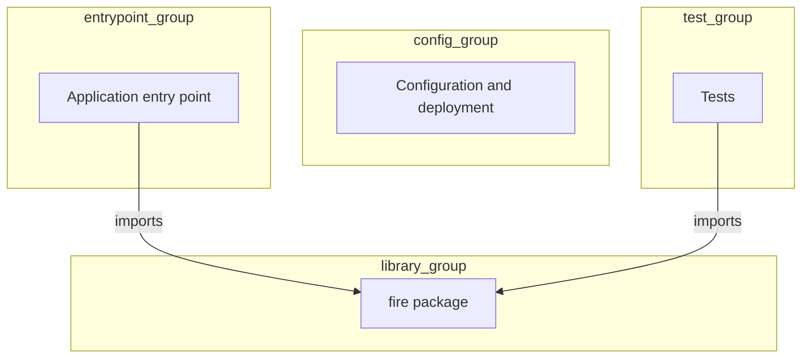

# Architecture report: google/python-fire

> Automated static analysis. **Observed** = directly seen in files/imports/AST; **Inferred** = interpretation from that evidence. Repository code was not executed.

## 1. Repository at a glance

| Item | Value |
| --- | --- |
| Repository | google/python-fire |
| Description | Python Fire is a library for automatically generating command line interfaces (CLIs) from absolutely any Python object. |
| Language | Python |
| Stars | 28225 |
| Licence | Other |
| Analysed commit / branch | 716bbc23d7eca949fdb682172283c8d18f742cb6 / master |
| Framework(s) | None detected |
| Files analysed | 79 |
| Components | 4 |

## 2. Architecture in one minute

google/python-fire - Python Fire is a library for automatically generating command line interfaces (CLIs) from absolutely any Python object.. This repository was analysed statically from 79 file(s) (61 Python). Detected technologies (observed from imports/manifests): GitHub Actions, Poetry, setuptools, pytest, unittest. Files are grouped into 4 component(s): Configuration and deployment, Application entry point, fire package, Tests. Observed entry point(s): fire/__main__.py, fire/completion_test.py, fire/core_test.py. Findings below distinguish observed facts from inferred interpretation.

## 3. High-level block diagram

## 4. Main components

### Configuration and deployment (`config`)

- **Kind:** config
- **Status:** Observed
- **Confidence:** 0.85
- **Responsibility:** Groups 2 file(s) under configuration and deployment (observed from repository paths and static analysis).
- **Paths:** `mkdocs.yml`, `pyproject.toml`
- **Evidence:** [mkdocs.yml](https://github.com/google/python-fire/blob/716bbc23d7eca949fdb682172283c8d18f742cb6/mkdocs.yml); [pyproject.toml](https://github.com/google/python-fire/blob/716bbc23d7eca949fdb682172283c8d18f742cb6/pyproject.toml)

### Application entry point (`entrypoint`)

- **Kind:** entrypoint
- **Status:** Observed
- **Confidence:** 0.85
- **Responsibility:** Groups 1 file(s) under application entry point (observed from repository paths and static analysis). Observed top-level functions: import_from_file_path, import_from_module_name, import_module, main.
- **Paths:** `fire/__main__.py`
- **Evidence:** [fire/__main__.py:42](https://github.com/google/python-fire/blob/716bbc23d7eca949fdb682172283c8d18f742cb6/fire/__main__.py#L42)

### fire package (`fire`)

- **Kind:** library
- **Status:** Observed
- **Confidence:** 0.85
- **Responsibility:** Groups 24 file(s) under fire package (observed from repository paths and static analysis). Observed top-level classes: ActionGroup, Architecture, ArgInfo, BaseTestCase, BoxLineCharacters, BoxLineCharactersAscii. Observed top-level functions: Bold, BoldUnderline, ChangeDirectory, CompletionScript, Completions, CreateParser.
- **Paths:** `fire/__init__.py`, `fire/completion.py`, `fire/console/__init__.py`, `fire/console/console_attr.py`, `fire/console/console_attr_os.py`, `fire/console/console_io.py`, `fire/console/console_pager.py`, `fire/console/encoding.py`, `fire/console/files.py`, `fire/console/platforms.py`, `fire/console/text.py`, `fire/core.py`, `fire/custom_descriptions.py`, `fire/decorators.py`, `fire/docstrings.py`, `fire/formatting.py`, `fire/formatting_windows.py`, `fire/helptext.py`, `fire/inspectutils.py`, `fire/interact.py`, `fire/parser.py`, `fire/testutils.py`, `fire/trace.py`, `fire/value_types.py`
- **Evidence:** [fire/__init__.py](https://github.com/google/python-fire/blob/716bbc23d7eca949fdb682172283c8d18f742cb6/fire/__init__.py); [fire/completion.py:28](https://github.com/google/python-fire/blob/716bbc23d7eca949fdb682172283c8d18f742cb6/fire/completion.py#L28); [fire/console/__init__.py](https://github.com/google/python-fire/blob/716bbc23d7eca949fdb682172283c8d18f742cb6/fire/console/__init__.py); [fire/console/console_attr.py:105](https://github.com/google/python-fire/blob/716bbc23d7eca949fdb682172283c8d18f742cb6/fire/console/console_attr.py#L105); [fire/console/console_attr_os.py:28](https://github.com/google/python-fire/blob/716bbc23d7eca949fdb682172283c8d18f742cb6/fire/console/console_attr_os.py#L28); [fire/console/console_io.py:29](https://github.com/google/python-fire/blob/716bbc23d7eca949fdb682172283c8d18f742cb6/fire/console/console_io.py#L29); [fire/console/console_pager.py:28](https://github.com/google/python-fire/blob/716bbc23d7eca949fdb682172283c8d18f742cb6/fire/console/console_pager.py#L28); [fire/console/encoding.py:26](https://github.com/google/python-fire/blob/716bbc23d7eca949fdb682172283c8d18f742cb6/fire/console/encoding.py#L26)

### Tests (`tests`)

- **Kind:** test
- **Status:** Observed
- **Confidence:** 0.85
- **Responsibility:** Groups 25 file(s) under tests (observed from repository paths and static analysis). Observed routes: PATCH fire.interact.Embed, PATCH fire.interact.Embed, PATCH fire.interact.Embed, PATCH fire.interact.Embed, PATCH (path not a literal). Observed top-level classes: Annotations, BinaryCanvas, BoolConverter, CallableWithKeywordArgument, CallableWithPositionalArgs, CapitalizedArgNames. Observed top-level functions: decorated_method, double, fn_with_code_in_docstring, fn_with_kwarg, fn_with_kwarg_and_defaults, fn_with_multiple_defaults.
- **Paths:** `examples/cipher/cipher_test.py`, `examples/diff/diff_test.py`, `examples/widget/collector_test.py`, `examples/widget/widget_test.py`, `fire/completion_test.py`, `fire/core_test.py`, `fire/custom_descriptions_test.py`, `fire/decorators_test.py`, `fire/docstrings_fuzz_test.py`, `fire/docstrings_test.py`, `fire/fire_import_test.py`, `fire/fire_test.py`, `fire/formatting_test.py`, `fire/helptext_test.py`, `fire/inspectutils_test.py`, `fire/interact_test.py`, `fire/main_test.py`, `fire/parser_fuzz_test.py`, `fire/parser_test.py`, `fire/test_components.py`, `fire/test_components_bin.py`, `fire/test_components_py3.py`, `fire/test_components_test.py`, `fire/testutils_test.py`, `fire/trace_test.py`
- **Evidence:** [examples/cipher/cipher_test.py:22](https://github.com/google/python-fire/blob/716bbc23d7eca949fdb682172283c8d18f742cb6/examples/cipher/cipher_test.py#L22); [examples/diff/diff_test.py:25](https://github.com/google/python-fire/blob/716bbc23d7eca949fdb682172283c8d18f742cb6/examples/diff/diff_test.py#L25); [examples/widget/collector_test.py:23](https://github.com/google/python-fire/blob/716bbc23d7eca949fdb682172283c8d18f742cb6/examples/widget/collector_test.py#L23); [examples/widget/widget_test.py:22](https://github.com/google/python-fire/blob/716bbc23d7eca949fdb682172283c8d18f742cb6/examples/widget/widget_test.py#L22); [fire/completion_test.py:22](https://github.com/google/python-fire/blob/716bbc23d7eca949fdb682172283c8d18f742cb6/fire/completion_test.py#L22); [fire/core_test.py:25](https://github.com/google/python-fire/blob/716bbc23d7eca949fdb682172283c8d18f742cb6/fire/core_test.py#L25); [fire/custom_descriptions_test.py:23](https://github.com/google/python-fire/blob/716bbc23d7eca949fdb682172283c8d18f742cb6/fire/custom_descriptions_test.py#L23); [fire/decorators_test.py:22](https://github.com/google/python-fire/blob/716bbc23d7eca949fdb682172283c8d18f742cb6/fire/decorators_test.py#L22)

## 5. Execution flow

**Observed** entry point(s):

- [fire/__main__.py:125](https://github.com/google/python-fire/blob/716bbc23d7eca949fdb682172283c8d18f742cb6/fire/__main__.py#L125)
- [fire/completion_test.py:187](https://github.com/google/python-fire/blob/716bbc23d7eca949fdb682172283c8d18f742cb6/fire/completion_test.py#L187)
- [fire/core_test.py:227](https://github.com/google/python-fire/blob/716bbc23d7eca949fdb682172283c8d18f742cb6/fire/core_test.py#L227)
- [fire/custom_descriptions_test.py:68](https://github.com/google/python-fire/blob/716bbc23d7eca949fdb682172283c8d18f742cb6/fire/custom_descriptions_test.py#L68)
- [fire/decorators_test.py:169](https://github.com/google/python-fire/blob/716bbc23d7eca949fdb682172283c8d18f742cb6/fire/decorators_test.py#L169)
- [fire/docstrings_fuzz_test.py:35](https://github.com/google/python-fire/blob/716bbc23d7eca949fdb682172283c8d18f742cb6/fire/docstrings_fuzz_test.py#L35)
- [fire/docstrings_test.py:360](https://github.com/google/python-fire/blob/716bbc23d7eca949fdb682172283c8d18f742cb6/fire/docstrings_test.py#L360)
- [fire/fire_import_test.py:39](https://github.com/google/python-fire/blob/716bbc23d7eca949fdb682172283c8d18f742cb6/fire/fire_import_test.py#L39)
- [fire/fire_test.py:720](https://github.com/google/python-fire/blob/716bbc23d7eca949fdb682172283c8d18f742cb6/fire/fire_test.py#L720)
- [fire/formatting_test.py:77](https://github.com/google/python-fire/blob/716bbc23d7eca949fdb682172283c8d18f742cb6/fire/formatting_test.py#L77)
- [fire/helptext_test.py:595](https://github.com/google/python-fire/blob/716bbc23d7eca949fdb682172283c8d18f742cb6/fire/helptext_test.py#L595)
- [fire/inspectutils_test.py:129](https://github.com/google/python-fire/blob/716bbc23d7eca949fdb682172283c8d18f742cb6/fire/inspectutils_test.py#L129)

**Observed** routes (from decorators):

- `PATCH fire.interact.Embed` -> `testInteractiveMode` in `fire/core_test.py:39`
- `PATCH fire.interact.Embed` -> `testInteractiveModeFullArgument` in `fire/core_test.py:46`
- `PATCH fire.interact.Embed` -> `testInteractiveModeVariables` in `fire/core_test.py:51`
- `PATCH fire.interact.Embed` -> `testInteractiveModeVariablesWithName` in `fire/core_test.py:61`
- `PATCH ` -> `testInteract` in `fire/interact_test.py:33`
- `PATCH ` -> `testInteractVariables` in `fire/interact_test.py:39`

Representative flow (derived from observed entry points and the import graph; steps beyond the entry point are **Inferred**):

1. Execution starts at an observed entry point listed above, if present.
2. `entrypoint` imports `fire` (Application entry point -> fire package).
3. `tests` imports `fire` (Tests -> fire package).

## 6. Project structure

### `(root)`

- `.gitignore` - other (1172 bytes)
- `CONTRIBUTING.md` - docs (2521 bytes)
- `LICENSE` - docs (573 bytes)
- `README.md` - docs (4049 bytes)
- `mkdocs.yml` - config (307 bytes)
- `pylintrc` - other (6494 bytes)
- `pyproject.toml` - manifest (1862 bytes)

### `.github`

- `.github/dependabot.yml` - config (749 bytes)
- `.github/scripts/build.sh` - source, Shell (1121 bytes)
- `.github/workflows/build.yml` - ci, YAML (909 bytes)

### `docs`

- `docs/api.md` - docs (3037 bytes)
- `docs/benefits.md` - docs (2700 bytes)
- `docs/guide.md` - docs (19863 bytes)
- `docs/index.md` - docs (4047 bytes)
- `docs/installation.md` - docs (333 bytes)
- `docs/troubleshooting.md` - docs (651 bytes)
- `docs/using-cli.md` - docs (9714 bytes)

### `examples`

- `examples/__init__.py` - source, Python (0 bytes)
- `examples/cipher/__init__.py` - source, Python (0 bytes)
- `examples/cipher/cipher.py` - source, Python (1668 bytes)
- `examples/cipher/cipher_test.py` - test, Python (1174 bytes)
- `examples/diff/__init__.py` - source, Python (0 bytes)
- `examples/diff/diff.py` - source, Python (3189 bytes)
- `examples/diff/diff_test.py` - test, Python (2676 bytes)
- `examples/diff/difffull.py` - source, Python (1757 bytes)
- `examples/identity/__init__.py` - source, Python (0 bytes)
- `examples/identity/identity.py` - source, Python (790 bytes)
- `examples/widget/__init__.py` - source, Python (0 bytes)
- `examples/widget/collector.py` - source, Python (1127 bytes)
- `examples/widget/collector_test.py` - test, Python (1190 bytes)
- `examples/widget/widget.py` - source, Python (976 bytes)
- `examples/widget/widget_test.py` - test, Python (1081 bytes)

### `fire`

- `fire/__init__.py` - source, Python (676 bytes)
- `fire/__main__.py` - source, Python (3788 bytes)
- `fire/completion.py` - source, Python (15992 bytes)
- `fire/completion_test.py` - test, Python (6266 bytes)
- `fire/console/README.md` - docs (228 bytes)
- `fire/console/__init__.py` - source, Python (0 bytes)
- `fire/console/console_attr.py` - source, Python (23573 bytes)
- `fire/console/console_attr_os.py` - source, Python (7458 bytes)
- `fire/console/console_io.py` - source, Python (4149 bytes)
- `fire/console/console_pager.py` - source, Python (9563 bytes)
- `fire/console/encoding.py` - source, Python (6040 bytes)
- `fire/console/files.py` - source, Python (4056 bytes)
- `fire/console/platforms.py` - source, Python (16487 bytes)
- `fire/console/text.py` - source, Python (2776 bytes)
- `fire/core.py` - source, Python (36731 bytes)
- `fire/core_test.py` - test, Python (9613 bytes)
- `fire/custom_descriptions.py` - source, Python (5247 bytes)
- `fire/custom_descriptions_test.py` - test, Python (2654 bytes)
- `fire/decorators.py` - source, Python (3561 bytes)
- `fire/decorators_test.py` - test, Python (5582 bytes)
- `fire/docstrings.py` - source, Python (25023 bytes)
- `fire/docstrings_fuzz_test.py` - test, Python (1100 bytes)
- `fire/docstrings_test.py` - test, Python (12284 bytes)
- `fire/fire_import_test.py` - test, Python (1107 bytes)
- `fire/fire_test.py` - test, Python (29218 bytes)
- `fire/formatting.py` - source, Python (2716 bytes)
- `fire/formatting_test.py` - test, Python (2647 bytes)
- `fire/formatting_windows.py` - source, Python (1984 bytes)
- `fire/helptext.py` - source, Python (27341 bytes)
- `fire/helptext_test.py` - test, Python (22705 bytes)
- `fire/inspectutils.py` - source, Python (11966 bytes)
- `fire/inspectutils_test.py` - test, Python (4997 bytes)
- `fire/interact.py` - source, Python (3036 bytes)
- `fire/interact_test.py` - test, Python (1436 bytes)
- `fire/main_test.py` - test, Python (3318 bytes)
- `fire/parser.py` - source, Python (4697 bytes)
- `fire/parser_fuzz_test.py` - test, Python (3041 bytes)
- `fire/parser_test.py` - test, Python (6379 bytes)
- `fire/test_components.py` - test, Python (11723 bytes)
- `fire/test_components_bin.py` - test, Python (807 bytes)
- `fire/test_components_py3.py` - test, Python (2394 bytes)
- `fire/test_components_test.py` - test, Python (1230 bytes)
- `fire/testutils.py` - source, Python (3450 bytes)
- `fire/testutils_test.py` - test, Python (1753 bytes)
- `fire/trace.py` - source, Python (10314 bytes)
- `fire/trace_test.py` - test, Python (5112 bytes)
- `fire/value_types.py` - source, Python (2615 bytes)

## 7. Key dependencies and integrations

| Name | Category | Status | Confidence | Evidence |
| --- | --- | --- | --- | --- |
| GitHub Actions | ci | Observed | 0.85 | [.github/workflows/build.yml](https://github.com/google/python-fire/blob/716bbc23d7eca949fdb682172283c8d18f742cb6/.github/workflows/build.yml) |
| Poetry | packaging | Observed | 0.85 | [pyproject.toml](https://github.com/google/python-fire/blob/716bbc23d7eca949fdb682172283c8d18f742cb6/pyproject.toml) |
| setuptools | packaging | Observed | 0.90 | [pyproject.toml:2](https://github.com/google/python-fire/blob/716bbc23d7eca949fdb682172283c8d18f742cb6/pyproject.toml#L2) |
| pytest | tooling | Observed | 0.85 | [pyproject.toml:48](https://github.com/google/python-fire/blob/716bbc23d7eca949fdb682172283c8d18f742cb6/pyproject.toml#L48) |
| unittest | tooling | Observed | 0.95 | [fire/core_test.py:17](https://github.com/google/python-fire/blob/716bbc23d7eca949fdb682172283c8d18f742cb6/fire/core_test.py#L17); [fire/fire_import_test.py:18](https://github.com/google/python-fire/blob/716bbc23d7eca949fdb682172283c8d18f742cb6/fire/fire_import_test.py#L18); [fire/fire_test.py:19](https://github.com/google/python-fire/blob/716bbc23d7eca949fdb682172283c8d18f742cb6/fire/fire_test.py#L19); [fire/interact_test.py:17](https://github.com/google/python-fire/blob/716bbc23d7eca949fdb682172283c8d18f742cb6/fire/interact_test.py#L17) |

## 8. Data and state

No database, cache, queue, or persistent-state usage was observed in the analysed files. State handling, if any, may be in-memory or in files that were not analysed.

## 9. Configuration and deployment clues

- `.github/dependabot.yml` (config)
- `.github/workflows/build.yml` (ci)
- `mkdocs.yml` (config)
- `pyproject.toml` (manifest)

## 10. Design observations

- An entry/API layer is separated from other code (Inferred from paths and decorators).
- Tests are present alongside source code (Observed from test file paths).

These observations are interpretations (**Inferred**) of the observed structure, not guarantees about runtime design.

## 11. Limitations and unknowns

- Static analysis only: repository code was not executed, installed, or imported at runtime.
- Components and relationships are inferred from file paths, imports, and AST structure; runtime behaviour, dynamic imports, and reflection may not be visible.
- Repository text was treated as untrusted data; no instructions found in repository files were followed, and likely secret values were redacted/excluded.

## 12. Source references

- [.github/workflows/build.yml](https://github.com/google/python-fire/blob/716bbc23d7eca949fdb682172283c8d18f742cb6/.github/workflows/build.yml)
- [examples/cipher/cipher_test.py:22](https://github.com/google/python-fire/blob/716bbc23d7eca949fdb682172283c8d18f742cb6/examples/cipher/cipher_test.py#L22)
- [examples/diff/diff_test.py:25](https://github.com/google/python-fire/blob/716bbc23d7eca949fdb682172283c8d18f742cb6/examples/diff/diff_test.py#L25)
- [examples/widget/collector_test.py:23](https://github.com/google/python-fire/blob/716bbc23d7eca949fdb682172283c8d18f742cb6/examples/widget/collector_test.py#L23)
- [examples/widget/widget_test.py:22](https://github.com/google/python-fire/blob/716bbc23d7eca949fdb682172283c8d18f742cb6/examples/widget/widget_test.py#L22)
- [fire/__init__.py](https://github.com/google/python-fire/blob/716bbc23d7eca949fdb682172283c8d18f742cb6/fire/__init__.py)
- [fire/__main__.py:42](https://github.com/google/python-fire/blob/716bbc23d7eca949fdb682172283c8d18f742cb6/fire/__main__.py#L42)
- [fire/__main__.py:125](https://github.com/google/python-fire/blob/716bbc23d7eca949fdb682172283c8d18f742cb6/fire/__main__.py#L125)
- [fire/completion.py:28](https://github.com/google/python-fire/blob/716bbc23d7eca949fdb682172283c8d18f742cb6/fire/completion.py#L28)
- [fire/completion_test.py:22](https://github.com/google/python-fire/blob/716bbc23d7eca949fdb682172283c8d18f742cb6/fire/completion_test.py#L22)
- [fire/completion_test.py:187](https://github.com/google/python-fire/blob/716bbc23d7eca949fdb682172283c8d18f742cb6/fire/completion_test.py#L187)
- [fire/console/__init__.py](https://github.com/google/python-fire/blob/716bbc23d7eca949fdb682172283c8d18f742cb6/fire/console/__init__.py)
- [fire/console/console_attr.py:105](https://github.com/google/python-fire/blob/716bbc23d7eca949fdb682172283c8d18f742cb6/fire/console/console_attr.py#L105)
- [fire/console/console_attr_os.py:28](https://github.com/google/python-fire/blob/716bbc23d7eca949fdb682172283c8d18f742cb6/fire/console/console_attr_os.py#L28)
- [fire/console/console_io.py:29](https://github.com/google/python-fire/blob/716bbc23d7eca949fdb682172283c8d18f742cb6/fire/console/console_io.py#L29)
- [fire/console/console_pager.py:28](https://github.com/google/python-fire/blob/716bbc23d7eca949fdb682172283c8d18f742cb6/fire/console/console_pager.py#L28)
- [fire/console/encoding.py:26](https://github.com/google/python-fire/blob/716bbc23d7eca949fdb682172283c8d18f742cb6/fire/console/encoding.py#L26)
- [fire/core_test.py:17](https://github.com/google/python-fire/blob/716bbc23d7eca949fdb682172283c8d18f742cb6/fire/core_test.py#L17)
- [fire/core_test.py:25](https://github.com/google/python-fire/blob/716bbc23d7eca949fdb682172283c8d18f742cb6/fire/core_test.py#L25)
- [fire/core_test.py:227](https://github.com/google/python-fire/blob/716bbc23d7eca949fdb682172283c8d18f742cb6/fire/core_test.py#L227)
- [fire/custom_descriptions_test.py:23](https://github.com/google/python-fire/blob/716bbc23d7eca949fdb682172283c8d18f742cb6/fire/custom_descriptions_test.py#L23)
- [fire/custom_descriptions_test.py:68](https://github.com/google/python-fire/blob/716bbc23d7eca949fdb682172283c8d18f742cb6/fire/custom_descriptions_test.py#L68)
- [fire/decorators_test.py:22](https://github.com/google/python-fire/blob/716bbc23d7eca949fdb682172283c8d18f742cb6/fire/decorators_test.py#L22)
- [fire/decorators_test.py:169](https://github.com/google/python-fire/blob/716bbc23d7eca949fdb682172283c8d18f742cb6/fire/decorators_test.py#L169)
- [fire/docstrings_fuzz_test.py:35](https://github.com/google/python-fire/blob/716bbc23d7eca949fdb682172283c8d18f742cb6/fire/docstrings_fuzz_test.py#L35)
- [fire/docstrings_test.py:360](https://github.com/google/python-fire/blob/716bbc23d7eca949fdb682172283c8d18f742cb6/fire/docstrings_test.py#L360)
- [fire/fire_import_test.py:18](https://github.com/google/python-fire/blob/716bbc23d7eca949fdb682172283c8d18f742cb6/fire/fire_import_test.py#L18)
- [fire/fire_import_test.py:39](https://github.com/google/python-fire/blob/716bbc23d7eca949fdb682172283c8d18f742cb6/fire/fire_import_test.py#L39)
- [fire/fire_test.py:19](https://github.com/google/python-fire/blob/716bbc23d7eca949fdb682172283c8d18f742cb6/fire/fire_test.py#L19)
- [fire/fire_test.py:720](https://github.com/google/python-fire/blob/716bbc23d7eca949fdb682172283c8d18f742cb6/fire/fire_test.py#L720)
- [fire/formatting_test.py:77](https://github.com/google/python-fire/blob/716bbc23d7eca949fdb682172283c8d18f742cb6/fire/formatting_test.py#L77)
- [fire/helptext_test.py:595](https://github.com/google/python-fire/blob/716bbc23d7eca949fdb682172283c8d18f742cb6/fire/helptext_test.py#L595)
- [fire/inspectutils_test.py:129](https://github.com/google/python-fire/blob/716bbc23d7eca949fdb682172283c8d18f742cb6/fire/inspectutils_test.py#L129)
- [fire/interact_test.py:17](https://github.com/google/python-fire/blob/716bbc23d7eca949fdb682172283c8d18f742cb6/fire/interact_test.py#L17)
- [fire/testutils.py:22](https://github.com/google/python-fire/blob/716bbc23d7eca949fdb682172283c8d18f742cb6/fire/testutils.py#L22)
- [fire/testutils.py:23](https://github.com/google/python-fire/blob/716bbc23d7eca949fdb682172283c8d18f742cb6/fire/testutils.py#L23)
- [mkdocs.yml](https://github.com/google/python-fire/blob/716bbc23d7eca949fdb682172283c8d18f742cb6/mkdocs.yml)
- [pyproject.toml](https://github.com/google/python-fire/blob/716bbc23d7eca949fdb682172283c8d18f742cb6/pyproject.toml)
- [pyproject.toml:2](https://github.com/google/python-fire/blob/716bbc23d7eca949fdb682172283c8d18f742cb6/pyproject.toml#L2)
- [pyproject.toml:48](https://github.com/google/python-fire/blob/716bbc23d7eca949fdb682172283c8d18f742cb6/pyproject.toml#L48)
