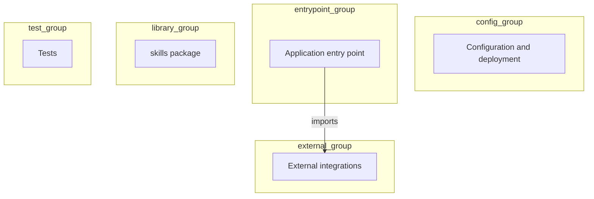

# Architecture report: google/skills

> Automated static analysis. **Observed** = directly seen in files/imports/AST; **Inferred** = interpretation from that evidence. Repository code was not executed.

## 1. Repository at a glance

| Item | Value |
| --- | --- |
| Repository | google/skills |
| Description | Agent Skills for Google products and technologies |
| Language | Python |
| Stars | 24235 |
| Licence | Apache-2.0 |
| Analysed commit / branch | e3c591afe426ea585e4c21799e5199d6d47cd1be / main |
| Framework(s) | None detected |
| Files analysed | 800 |
| Components | 5 |

## 2. Architecture in one minute

google/skills - Agent Skills for Google products and technologies. This repository was analysed statically from 800 file(s) (158 Python). Detected technologies (observed from imports/manifests): GitHub Actions, pandas, requests, unittest. Files are grouped into 5 component(s): Configuration and deployment, Application entry point, External integrations, skills package, Tests. Observed entry point(s): skills/cloud/agent-platform-alert-configuration/scripts/analyze_traffic.py, skills/cloud/agent-platform-alert-configuration/scripts/analyze_traffic_test.py, skills/cloud/agent-platform-alert-configuration/scripts/check_telemetry.py. Findings below distinguish observed facts from inferred interpretation.

## 3. High-level block diagram

## 4. Main components

### Configuration and deployment (`config`)

- **Kind:** config
- **Status:** Observed
- **Confidence:** 0.85
- **Responsibility:** Groups 58 file(s) under configuration and deployment (observed from repository paths and static analysis).
- **Paths:** `index.json`, `lychee.toml`, `plugins/cloud/google-cloud-developer/.claude-plugin/plugin.json`, `plugins/cloud/google-cloud-developer/.codex-plugin/plugin.json`, `plugins/cloud/google-cloud-developer/.mcp.json`, `plugins/cloud/google-cloud-developer/com.google.antigravity/mcp_config.json`, `plugins/cloud/google-cloud-developer/gemini-extension.json`, `plugins/cloud/google-cloud-developer/mcp.json`, `plugins/cloud/google-cloud-developer/mcp_config.json`, `plugins/cloud/google-cloud-developer/plugin.json`, `skills/cloud/agent-platform-alert-configuration/scripts/requirements.txt`, `skills/cloud/agent-platform-inference/scripts/requirements.txt`, `skills/cloud/agent-platform-skill-registry/scripts/requirements.txt`, `skills/cloud/agent-platform-tuning/references/requirements.txt`, `skills/cloud/apigee-agent-gateway-governance/assets/apigee-agent-gateway-governance.example.yaml`, `skills/cloud/apigee-agent-gateway-governance/assets/apigee-proxy-template.yaml`, `skills/cloud/apigee-agent-gateway-governance/assets/authz-extension.example.yaml`, `skills/cloud/apigee-agent-gateway-governance/assets/authz-policy.example.yaml`, `skills/cloud/apigee-agent-gateway-governance/assets/feature-identity.yaml`, `skills/cloud/apigee-agent-gateway-governance/assets/feature-model-armor.yaml`, `skills/cloud/apigee-agent-gateway-governance/assets/feature-normalize.yaml`, `skills/cloud/apigee-agent-gateway-governance/assets/feature-semantic-cache.yaml`, `skills/cloud/apigee-agent-gateway-governance/assets/feature-token-enforce.yaml`, `skills/cloud/apigee-agent-gateway-governance/assets/feature-token-metering.yaml`, `skills/cloud/assuredworkloads-frameworks-author/assets/locations.json`, `skills/cloud/assuredworkloads-frameworks-navigator/assets/locations.json`, `skills/cloud/bigquery-migration-sql-translator/assets/translation_config_examples/environment_example.yaml`, `skills/cloud/bigquery-migration-sql-translator/assets/translation_config_examples/experimental_input_formats_example.yaml`, `skills/cloud/bigquery-migration-sql-translator/assets/translation_config_examples/experimental_metadata_example.yaml`, `skills/cloud/bigquery-migration-sql-translator/assets/translation_config_examples/experimental_object_rewriter_example.yaml`, `skills/cloud/bigquery-migration-sql-translator/assets/translation_config_examples/experimental_optimizer_example.yaml`, `skills/cloud/bigquery-migration-sql-translator/assets/translation_config_examples/experimental_statement_rewriter_example.yaml`, `skills/cloud/bigquery-migration-sql-translator/assets/translation_config_examples/input_formats_example.yaml`, `skills/cloud/bigquery-migration-sql-translator/assets/translation_config_examples/metadata_example.yaml`, `skills/cloud/bigquery-migration-sql-translator/assets/translation_config_examples/object_rewriter_example.yaml`, `skills/cloud/bigquery-migration-sql-translator/assets/translation_config_examples/optimizer_example.yaml`, `skills/cloud/bigquery-migration-sql-translator/assets/translation_config_examples/statement_rewriter_example.yaml`, `skills/cloud/bigquery-migration-sql-translator/assets/translation_config_schemas/environment.json`, `skills/cloud/bigquery-migration-sql-translator/assets/translation_config_schemas/experimental_input_formats.json`, `skills/cloud/bigquery-migration-sql-translator/assets/translation_config_schemas/experimental_metadata.json`, `skills/cloud/bigquery-migration-sql-translator/assets/translation_config_schemas/experimental_object_rewriter.json`, `skills/cloud/bigquery-migration-sql-translator/assets/translation_config_schemas/experimental_optimizer.json`, `skills/cloud/bigquery-migration-sql-translator/assets/translation_config_schemas/experimental_statement_rewriter.json`, `skills/cloud/bigquery-migration-sql-translator/assets/translation_config_schemas/input_formats.json`, `skills/cloud/bigquery-migration-sql-translator/assets/translation_config_schemas/metadata.json`, `skills/cloud/bigquery-migration-sql-translator/assets/translation_config_schemas/object_rewriter.json`, `skills/cloud/bigquery-migration-sql-translator/assets/translation_config_schemas/optimizer.json`, `skills/cloud/bigquery-migration-sql-translator/assets/translation_config_schemas/statement_rewriter.json`, `skills/cloud/bigquery-migration-sql-translator/assets/translation_config_schemas/transpiler_config_spec.json`, `skills/cloud/bigtable-basics/assets/row_key_schema.yaml`, `skills/cloud/cloud-logging-finops/scripts/requirements.txt`, `skills/cloud/cloud-monitoring-alert-configuration/scripts/agent_platform/requirements.txt`, `skills/cloud/cloud-monitoring-chart-generation/scripts/requirements.txt`, `skills/cloud/cloud-trace-querying/assets/formatting/a2ui/single_span/display.a2ui.json`, `skills/cloud/cloud-trace-querying/assets/formatting/a2ui/trace_chart/display.a2ui.json`, `skills/cloud/cloud-trace-querying/assets/formatting/a2ui/trace_flow/display.a2ui.json`, `skills/cloud/cloud-trace-querying/assets/formatting/a2ui/traces_heat_map/display.a2ui.json`, `skills/cloud/cloud-trace-querying/scripts/requirements.txt`
- **Evidence:** [index.json](https://github.com/google/skills/blob/e3c591afe426ea585e4c21799e5199d6d47cd1be/index.json); [lychee.toml](https://github.com/google/skills/blob/e3c591afe426ea585e4c21799e5199d6d47cd1be/lychee.toml); [plugins/cloud/google-cloud-developer/.claude-plugin/plugin.json](https://github.com/google/skills/blob/e3c591afe426ea585e4c21799e5199d6d47cd1be/plugins/cloud/google-cloud-developer/.claude-plugin/plugin.json); [plugins/cloud/google-cloud-developer/.codex-plugin/plugin.json](https://github.com/google/skills/blob/e3c591afe426ea585e4c21799e5199d6d47cd1be/plugins/cloud/google-cloud-developer/.codex-plugin/plugin.json); [plugins/cloud/google-cloud-developer/.mcp.json](https://github.com/google/skills/blob/e3c591afe426ea585e4c21799e5199d6d47cd1be/plugins/cloud/google-cloud-developer/.mcp.json); [plugins/cloud/google-cloud-developer/com.google.antigravity/mcp_config.json](https://github.com/google/skills/blob/e3c591afe426ea585e4c21799e5199d6d47cd1be/plugins/cloud/google-cloud-developer/com.google.antigravity/mcp_config.json); [plugins/cloud/google-cloud-developer/gemini-extension.json](https://github.com/google/skills/blob/e3c591afe426ea585e4c21799e5199d6d47cd1be/plugins/cloud/google-cloud-developer/gemini-extension.json); [plugins/cloud/google-cloud-developer/mcp.json](https://github.com/google/skills/blob/e3c591afe426ea585e4c21799e5199d6d47cd1be/plugins/cloud/google-cloud-developer/mcp.json)

### Application entry point (`entrypoint`)

- **Kind:** entrypoint
- **Status:** Observed
- **Confidence:** 0.85
- **Responsibility:** Groups 78 file(s) under application entry point (observed from repository paths and static analysis). Observed top-level classes: AdbForwarder, CatalogMatchResult, CredentialsMissingError, DBResourcesStore, GcloudError, HCLScanner. Observed top-level functions: _apply_single_update_and_poll, _as_integer, _as_number, _browser_payload, _build_aliases, _build_source_prefixes.
- **Paths:** `skills/cloud/agent-platform-alert-configuration/scripts/analyze_traffic.py`, `skills/cloud/agent-platform-alert-configuration/scripts/check_telemetry.py`, `skills/cloud/agent-platform-alert-configuration/scripts/create_online_monitor.py`, `skills/cloud/agent-platform-alert-configuration/scripts/gather_agent_info.py`, `skills/cloud/agent-platform-alert-configuration/scripts/lint_syntax.py`, `skills/cloud/agent-platform-alert-configuration/scripts/list_log_scope_table_names.py`, `skills/cloud/agent-platform-alert-configuration/scripts/list_trace_scope_table_names.py`, `skills/cloud/agent-platform-alert-configuration/scripts/scan_duplicates.py`, `skills/cloud/agent-platform-autorater-customization/scripts/agreement.py`, `skills/cloud/agent-platform-autorater-customization/scripts/build_review_page.py`, `skills/cloud/agent-platform-autorater-customization/scripts/render_agent_data.py`, `skills/cloud/agent-platform-autorater-customization/scripts/run_metrics.py`, `skills/cloud/agent-platform-deploy/scripts/calculate_cost.py`, `skills/cloud/agent-platform-eval-flywheel/scripts/compare_results.py`, `skills/cloud/agent-platform-eval-flywheel/scripts/endpoint_evaluation.py`, `skills/cloud/agent-platform-eval-flywheel/scripts/inspect_results.py`, `skills/cloud/agent-platform-eval-flywheel/scripts/maas_evaluation.py`, `skills/cloud/agent-platform-eval-flywheel/scripts/parse_adk_traces.py`, `skills/cloud/agent-platform-eval-flywheel/scripts/render_html_report.py`, `skills/cloud/agent-platform-eval-flywheel/scripts/validate_dataset.py`, `skills/cloud/agent-platform-skill-registry/scripts/skill_registry_ops.py`, `skills/cloud/agent-platform-skill-registry/scripts/validate_env.py`, `skills/cloud/agent-platform-tuning/scripts/calculate_cost.py`, `skills/cloud/agent-platform-tuning/scripts/cancel_tuning_job.py`, `skills/cloud/agent-platform-tuning/scripts/list_models.py`, `skills/cloud/agent-platform-tuning/scripts/monitor_tuning_job.py`, `skills/cloud/agent-platform-tuning/scripts/prepare_dataset.py`, `skills/cloud/agent-platform-tuning/scripts/tune_open_model.py`, `skills/cloud/api-gateway-backend-security-and-rate-limiting/scripts/check_quota_metrics.py`, `skills/cloud/api-gateway-mcp-server/scripts/validate_mcp_openapi.py`, `skills/cloud/api-gateway-openapi-spec-authoring/scripts/validate_apigw_openapi.py`, `skills/cloud/api-gateway-troubleshooting/scripts/lint_openapi_for_gateway.py`, `skills/cloud/apigee-agent-gateway-governance/scripts/compile_check.py`, `skills/cloud/application-design-center-design-deploy/scripts/fetch_terraform_template.py`, `skills/cloud/application-design-center-design-deploy/scripts/list_terraform_templates.py`, `skills/cloud/assured-workloads-basics/scripts/diagnose_error.py`, `skills/cloud/assured-workloads-basics/scripts/manage_workload_updates.py`, `skills/cloud/assured-workloads-basics/scripts/restrict_allowed_resources.py`, `skills/cloud/assured-workloads-basics/scripts/validate_params.py`, `skills/cloud/assuredworkloads-environment-assessor/scripts/evaluate_control_rules.py`, `skills/cloud/assuredworkloads-environment-assessor/scripts/validate_workload_payload.py`, `skills/cloud/assuredworkloads-frameworks-navigator/scripts/db_output_match_analyzer.py`, `skills/cloud/assuredworkloads-frameworks-navigator/scripts/db_resources_loader.py`, `skills/cloud/assuredworkloads-frameworks-navigator/scripts/db_search.py`, `skills/cloud/bigquery-migration-data-loader/assets/bq_loader_template.py`, `skills/cloud/bigquery-migration-metadata-extractor/assets/extraction_stats_template.py`, `skills/cloud/bigquery-migration-sql-translator/assets/python_embedded_sql_migrator_template.py`, `skills/cloud/cloud-armor-crs-rule-upgrader/scripts/upgrade_policy.py`, `skills/cloud/cloud-databases-onboarding/scripts/database_onboarding_skill.py`, `skills/cloud/cloud-logging-finops/scripts/build_report.py`, `skills/cloud/cloud-logging-finops/scripts/collect_logging_data.py`, `skills/cloud/cloud-logging-finops/scripts/enable_log_analytics.py`, `skills/cloud/cloud-logging-finops/scripts/verify_claim.py`, `skills/cloud/cloud-monitoring-alert-configuration/scripts/agent_platform/analyze_traffic.py`, `skills/cloud/cloud-monitoring-alert-configuration/scripts/agent_platform/check_telemetry.py`, `skills/cloud/cloud-monitoring-alert-configuration/scripts/agent_platform/create_online_monitor.py`, `skills/cloud/cloud-monitoring-alert-configuration/scripts/agent_platform/gather_agent_info.py`, `skills/cloud/cloud-monitoring-alert-configuration/scripts/agent_platform/lint_syntax.py`, `skills/cloud/cloud-monitoring-alert-configuration/scripts/agent_platform/list_log_scope_table_names.py`, `skills/cloud/cloud-monitoring-alert-configuration/scripts/agent_platform/list_trace_scope_table_names.py`, `skills/cloud/cloud-monitoring-alert-configuration/scripts/agent_platform/scan_duplicates.py`, `skills/cloud/cloud-monitoring-alert-configuration/scripts/discover_metric_schema.py`, `skills/cloud/cloud-monitoring-alert-configuration/scripts/kubernetes/validate_config.py`, `skills/cloud/cloud-monitoring-alert-configuration/scripts/lint_promql.py`, `skills/cloud/cloud-monitoring-chart-generation/scripts/assemble_widget_proto.py`, `skills/cloud/cloud-monitoring-chart-generation/scripts/compute_labels.py`, `skills/cloud/cloud-monitoring-chart-generation/scripts/validate_chart.py`, `skills/cloud/cloud-monitoring-promql-query/scripts/validate_promql.py`, `skills/cloud/cloud-trace-querying/scripts/fetch_entire_trace/src/main.py`, `skills/cloud/cloud-trace-querying/scripts/fetch_related_logs/src/main.py`, `skills/cloud/cloud-trace-querying/scripts/fetch_trace_span/src/main.py`, `skills/cloud/cloud-trace-querying/scripts/generate_links/src/main.py`, `skills/cloud/cloud-trace-querying/scripts/get_trace_project/src/main.py`, `skills/cloud/cloud-trace-querying/scripts/run_python_with_deps/src/cleanup_env.py`, `skills/cloud/cloud-trace-querying/scripts/run_python_with_deps/src/manage_venv.py`, `skills/cloud/cloud-trace-querying/scripts/search_traces/src/main.py`, `skills/cloud/dbt-sf-to-bq-translator/scripts/bulk_translate_via_gcloud.py`, `skills/cloud/developer-device-platform-basics/scripts/demo_adb_forwarder.py`
- **Evidence:** [skills/cloud/agent-platform-alert-configuration/scripts/analyze_traffic.py:64](https://github.com/google/skills/blob/e3c591afe426ea585e4c21799e5199d6d47cd1be/skills/cloud/agent-platform-alert-configuration/scripts/analyze_traffic.py#L64); [skills/cloud/agent-platform-alert-configuration/scripts/check_telemetry.py:29](https://github.com/google/skills/blob/e3c591afe426ea585e4c21799e5199d6d47cd1be/skills/cloud/agent-platform-alert-configuration/scripts/check_telemetry.py#L29); [skills/cloud/agent-platform-alert-configuration/scripts/create_online_monitor.py:34](https://github.com/google/skills/blob/e3c591afe426ea585e4c21799e5199d6d47cd1be/skills/cloud/agent-platform-alert-configuration/scripts/create_online_monitor.py#L34); [skills/cloud/agent-platform-alert-configuration/scripts/gather_agent_info.py:42](https://github.com/google/skills/blob/e3c591afe426ea585e4c21799e5199d6d47cd1be/skills/cloud/agent-platform-alert-configuration/scripts/gather_agent_info.py#L42); [skills/cloud/agent-platform-alert-configuration/scripts/lint_syntax.py:22](https://github.com/google/skills/blob/e3c591afe426ea585e4c21799e5199d6d47cd1be/skills/cloud/agent-platform-alert-configuration/scripts/lint_syntax.py#L22); [skills/cloud/agent-platform-alert-configuration/scripts/list_log_scope_table_names.py:30](https://github.com/google/skills/blob/e3c591afe426ea585e4c21799e5199d6d47cd1be/skills/cloud/agent-platform-alert-configuration/scripts/list_log_scope_table_names.py#L30); [skills/cloud/agent-platform-alert-configuration/scripts/list_trace_scope_table_names.py:31](https://github.com/google/skills/blob/e3c591afe426ea585e4c21799e5199d6d47cd1be/skills/cloud/agent-platform-alert-configuration/scripts/list_trace_scope_table_names.py#L31); [skills/cloud/agent-platform-alert-configuration/scripts/scan_duplicates.py:24](https://github.com/google/skills/blob/e3c591afe426ea585e4c21799e5199d6d47cd1be/skills/cloud/agent-platform-alert-configuration/scripts/scan_duplicates.py#L24)

### External integrations (`external_integrations`)

- **Kind:** external
- **Status:** Inferred
- **Confidence:** 0.70
- **Responsibility:** Groups 0 file(s) under external integrations (observed from repository paths and static analysis).
- **Evidence:** [skills/cloud/agent-platform-alert-configuration/scripts/list_log_scope_table_names.py:27](https://github.com/google/skills/blob/e3c591afe426ea585e4c21799e5199d6d47cd1be/skills/cloud/agent-platform-alert-configuration/scripts/list_log_scope_table_names.py#L27); [skills/cloud/agent-platform-alert-configuration/scripts/list_trace_scope_table_names.py:28](https://github.com/google/skills/blob/e3c591afe426ea585e4c21799e5199d6d47cd1be/skills/cloud/agent-platform-alert-configuration/scripts/list_trace_scope_table_names.py#L28); [skills/cloud/agent-platform-eval-flywheel/scripts/endpoint_evaluation.py:9](https://github.com/google/skills/blob/e3c591afe426ea585e4c21799e5199d6d47cd1be/skills/cloud/agent-platform-eval-flywheel/scripts/endpoint_evaluation.py#L9); [skills/cloud/agent-platform-skill-registry/scripts/skill_registry_ops.py:13](https://github.com/google/skills/blob/e3c591afe426ea585e4c21799e5199d6d47cd1be/skills/cloud/agent-platform-skill-registry/scripts/skill_registry_ops.py#L13); [skills/cloud/cloud-monitoring-alert-configuration/scripts/agent_platform/list_log_scope_table_names.py:27](https://github.com/google/skills/blob/e3c591afe426ea585e4c21799e5199d6d47cd1be/skills/cloud/cloud-monitoring-alert-configuration/scripts/agent_platform/list_log_scope_table_names.py#L27); [skills/cloud/cloud-monitoring-alert-configuration/scripts/agent_platform/list_trace_scope_table_names.py:28](https://github.com/google/skills/blob/e3c591afe426ea585e4c21799e5199d6d47cd1be/skills/cloud/cloud-monitoring-alert-configuration/scripts/agent_platform/list_trace_scope_table_names.py#L28)

### skills package (`skills`)

- **Kind:** library
- **Status:** Observed
- **Confidence:** 0.85
- **Responsibility:** Groups 63 file(s) under skills package (observed from repository paths and static analysis). Observed top-level classes: Action, Aggregation, BillingResult, ChartOptions, Claim, DataSet. Observed top-level functions: _action, _apportion_by_sku, _billing_from, _build_log_filter, _calibration_line, _candidates.
- **Paths:** `skills/cloud/agent-platform-alert-configuration/scripts/config_utils.py`, `skills/cloud/agent-platform-alert-configuration/scripts/mock_traffic_data.py`, `skills/cloud/agent-platform-deploy/scripts/config_gcloud_cli.sh`, `skills/cloud/agent-platform-inference/scripts/gemini_genai_sdk.py`, `skills/cloud/agent-platform-inference/scripts/gemini_openai_sdk.py`, `skills/cloud/agent-platform-inference/scripts/gemini_vertexai_sdk.py`, `skills/cloud/agent-platform-inference/scripts/openmaas_genai_sdk.py`, `skills/cloud/agent-platform-inference/scripts/openmaas_openai_sdk.py`, `skills/cloud/agent-platform-inference/scripts/openmaas_vertexai_sdk.py`, `skills/cloud/agent-platform-inference/scripts/verify_all.sh`, `skills/cloud/apigee-agent-gateway-governance/scripts/assess_integration.sh`, `skills/cloud/apigee-agent-gateway-governance/scripts/deploy_proxy.sh`, `skills/cloud/apigee-agent-gateway-governance/scripts/ensure_apigee_environment.sh`, `skills/cloud/apigee-agent-gateway-governance/scripts/ensure_gateway_connectivity.sh`, `skills/cloud/apigee-agent-gateway-governance/scripts/ensure_vector_search.sh`, `skills/cloud/apigee-agent-gateway-governance/scripts/read_debug_session.sh`, `skills/cloud/apigee-agent-gateway-governance/scripts/teardown_vector_search.sh`, `skills/cloud/cloud-logging-finops/scripts/actions.py`, `skills/cloud/cloud-logging-finops/scripts/aggregations.py`, `skills/cloud/cloud-logging-finops/scripts/analytics.py`, `skills/cloud/cloud-logging-finops/scripts/attribution.py`, `skills/cloud/cloud-logging-finops/scripts/billing.py`, `skills/cloud/cloud-logging-finops/scripts/constants.py`, `skills/cloud/cloud-logging-finops/scripts/exclusion_rules.py`, `skills/cloud/cloud-logging-finops/scripts/inventory.py`, `skills/cloud/cloud-logging-finops/scripts/messages.py`, `skills/cloud/cloud-logging-finops/scripts/monitoring.py`, `skills/cloud/cloud-logging-finops/scripts/output.py`, `skills/cloud/cloud-logging-finops/scripts/perf.py`, `skills/cloud/cloud-logging-finops/scripts/pricing.py`, `skills/cloud/cloud-logging-finops/scripts/provenance.py`, `skills/cloud/cloud-logging-finops/scripts/telemetry_integrity.py`, `skills/cloud/cloud-logging-finops/scripts/waste.py`, `skills/cloud/cloud-monitoring-alert-configuration/scripts/agent_platform/config_utils.py`, `skills/cloud/cloud-monitoring-alert-configuration/scripts/agent_platform/mock_traffic_data.py`, `skills/cloud/cloud-monitoring-chart-generation/scripts/textproto_util.py`, `skills/cloud/cloud-monitoring-notification-channels-configuration/scripts/verify_pubsub_topic.sh`, `skills/cloud/cloud-trace-querying/scripts/fetch_entire_trace/run.sh`, `skills/cloud/cloud-trace-querying/scripts/fetch_entire_trace/test.sh`, `skills/cloud/cloud-trace-querying/scripts/fetch_related_logs/run.sh`, `skills/cloud/cloud-trace-querying/scripts/fetch_related_logs/src/log_fetcher.py`, `skills/cloud/cloud-trace-querying/scripts/fetch_related_logs/src/observability_scopes.py`, `skills/cloud/cloud-trace-querying/scripts/fetch_related_logs/src/timestamp_utils.py`, `skills/cloud/cloud-trace-querying/scripts/fetch_related_logs/test.sh`, `skills/cloud/cloud-trace-querying/scripts/fetch_trace_span/run.sh`, `skills/cloud/cloud-trace-querying/scripts/fetch_trace_span/test.sh`, `skills/cloud/cloud-trace-querying/scripts/generate_links/run.sh`, `skills/cloud/cloud-trace-querying/scripts/generate_links/test.sh`, `skills/cloud/cloud-trace-querying/scripts/get_trace_project/run.sh`, `skills/cloud/cloud-trace-querying/scripts/get_trace_project/src/project_resolver.py`, `skills/cloud/cloud-trace-querying/scripts/get_trace_project/test.sh`, `skills/cloud/cloud-trace-querying/scripts/run_python_with_deps/run.sh`, `skills/cloud/cloud-trace-querying/scripts/run_python_with_deps/src/lock_manager.py`, `skills/cloud/cloud-trace-querying/scripts/run_python_with_deps/src/path_resolver.py`, `skills/cloud/cloud-trace-querying/scripts/run_python_with_deps/src/venv_cleaner.py`, `skills/cloud/cloud-trace-querying/scripts/run_python_with_deps/src/venv_executor.py`, `skills/cloud/cloud-trace-querying/scripts/run_python_with_deps/src/venv_setup.py`, `skills/cloud/cloud-trace-querying/scripts/run_python_with_deps/test.sh`, `skills/cloud/cloud-trace-querying/scripts/search_traces/run.sh`, `skills/cloud/cloud-trace-querying/scripts/search_traces/src/timestamp_utils.py`, `skills/cloud/cloud-trace-querying/scripts/search_traces/src/trace_searcher.py`, `skills/cloud/cloud-trace-querying/scripts/search_traces/test.sh`, `skills/cloud/dbt-sf-to-bq-translator/scripts/dbt_translator.py`
- **Evidence:** [skills/cloud/agent-platform-alert-configuration/scripts/config_utils.py:20](https://github.com/google/skills/blob/e3c591afe426ea585e4c21799e5199d6d47cd1be/skills/cloud/agent-platform-alert-configuration/scripts/config_utils.py#L20); [skills/cloud/agent-platform-alert-configuration/scripts/mock_traffic_data.py](https://github.com/google/skills/blob/e3c591afe426ea585e4c21799e5199d6d47cd1be/skills/cloud/agent-platform-alert-configuration/scripts/mock_traffic_data.py); [skills/cloud/agent-platform-deploy/scripts/config_gcloud_cli.sh](https://github.com/google/skills/blob/e3c591afe426ea585e4c21799e5199d6d47cd1be/skills/cloud/agent-platform-deploy/scripts/config_gcloud_cli.sh); [skills/cloud/agent-platform-inference/scripts/gemini_genai_sdk.py](https://github.com/google/skills/blob/e3c591afe426ea585e4c21799e5199d6d47cd1be/skills/cloud/agent-platform-inference/scripts/gemini_genai_sdk.py); [skills/cloud/agent-platform-inference/scripts/gemini_openai_sdk.py:8](https://github.com/google/skills/blob/e3c591afe426ea585e4c21799e5199d6d47cd1be/skills/cloud/agent-platform-inference/scripts/gemini_openai_sdk.py#L8); [skills/cloud/agent-platform-inference/scripts/gemini_vertexai_sdk.py](https://github.com/google/skills/blob/e3c591afe426ea585e4c21799e5199d6d47cd1be/skills/cloud/agent-platform-inference/scripts/gemini_vertexai_sdk.py); [skills/cloud/agent-platform-inference/scripts/openmaas_genai_sdk.py](https://github.com/google/skills/blob/e3c591afe426ea585e4c21799e5199d6d47cd1be/skills/cloud/agent-platform-inference/scripts/openmaas_genai_sdk.py); [skills/cloud/agent-platform-inference/scripts/openmaas_openai_sdk.py:8](https://github.com/google/skills/blob/e3c591afe426ea585e4c21799e5199d6d47cd1be/skills/cloud/agent-platform-inference/scripts/openmaas_openai_sdk.py#L8)

### Tests (`tests`)

- **Kind:** test
- **Status:** Observed
- **Confidence:** 0.85
- **Responsibility:** Groups 41 file(s) under tests (observed from repository paths and static analysis). Observed routes: PATCH sys.exit, PATCH builtins.print, PATCH google.cloud.monitoring_v3.MetricServiceClient, PATCH sys.exit, PATCH builtins.print. Observed top-level classes: AnalyzeTrafficTest, AssembleWidgetProtoTest, CheckTelemetryTest, ComputeLabelsTest, ConfigUtilsTest, CreateOnlineMonitorTest. Observed top-level functions: _cc, _cc_name, _completed, _fake_gcloud, _fw, _fw_name.
- **Paths:** `skills/cloud/agent-platform-alert-configuration/scripts/analyze_traffic_test.py`, `skills/cloud/agent-platform-alert-configuration/scripts/check_telemetry_test.py`, `skills/cloud/agent-platform-alert-configuration/scripts/config_utils_test.py`, `skills/cloud/agent-platform-alert-configuration/scripts/create_online_monitor_test.py`, `skills/cloud/agent-platform-alert-configuration/scripts/gather_agent_info_test.py`, `skills/cloud/agent-platform-alert-configuration/scripts/list_log_scope_table_names_test.py`, `skills/cloud/agent-platform-alert-configuration/scripts/list_trace_scope_table_names_test.py`, `skills/cloud/agent-platform-alert-configuration/scripts/scan_duplicates_test.py`, `skills/cloud/application-design-center-design-deploy/scripts/fetch_terraform_template_test.py`, `skills/cloud/application-design-center-design-deploy/scripts/list_terraform_templates_test.py`, `skills/cloud/assuredworkloads-frameworks-navigator/scripts/db_output_match_analyzer_test.py`, `skills/cloud/assuredworkloads-frameworks-navigator/scripts/db_resources_loader_test.py`, `skills/cloud/assuredworkloads-frameworks-navigator/scripts/db_search_test.py`, `skills/cloud/cloud-monitoring-alert-configuration/scripts/agent_platform/analyze_traffic_test.py`, `skills/cloud/cloud-monitoring-alert-configuration/scripts/agent_platform/check_telemetry_test.py`, `skills/cloud/cloud-monitoring-alert-configuration/scripts/agent_platform/config_utils_test.py`, `skills/cloud/cloud-monitoring-alert-configuration/scripts/agent_platform/create_online_monitor_test.py`, `skills/cloud/cloud-monitoring-alert-configuration/scripts/agent_platform/gather_agent_info_test.py`, `skills/cloud/cloud-monitoring-alert-configuration/scripts/agent_platform/list_log_scope_table_names_test.py`, `skills/cloud/cloud-monitoring-alert-configuration/scripts/agent_platform/list_trace_scope_table_names_test.py`, `skills/cloud/cloud-monitoring-alert-configuration/scripts/agent_platform/scan_duplicates_test.py`, `skills/cloud/cloud-monitoring-alert-configuration/scripts/discover_metric_schema_test.py`, `skills/cloud/cloud-monitoring-chart-generation/scripts/assemble_widget_proto_test.py`, `skills/cloud/cloud-monitoring-chart-generation/scripts/compute_labels_test.py`, `skills/cloud/cloud-monitoring-chart-generation/scripts/textproto_util_test.py`, `skills/cloud/cloud-monitoring-chart-generation/scripts/validate_chart_test.py`, `skills/cloud/cloud-monitoring-promql-query/scripts/validate_promql_test.py`, `skills/cloud/cloud-trace-querying/scripts/fetch_entire_trace/tests/main_test.py`, `skills/cloud/cloud-trace-querying/scripts/fetch_related_logs/tests/main_test.py`, `skills/cloud/cloud-trace-querying/scripts/fetch_related_logs/tests/timestamp_utils_test.py`, `skills/cloud/cloud-trace-querying/scripts/fetch_trace_span/tests/main_test.py`, `skills/cloud/cloud-trace-querying/scripts/generate_links/tests/main_test.py`, `skills/cloud/cloud-trace-querying/scripts/get_trace_project/tests/integration_test.py`, `skills/cloud/cloud-trace-querying/scripts/get_trace_project/tests/project_resolver_test.py`, `skills/cloud/cloud-trace-querying/scripts/run_python_with_deps/tests/cleanup_env_test.py`, `skills/cloud/cloud-trace-querying/scripts/run_python_with_deps/tests/lock_manager_test.py`, `skills/cloud/cloud-trace-querying/scripts/run_python_with_deps/tests/path_resolver_test.py`, `skills/cloud/cloud-trace-querying/scripts/run_python_with_deps/tests/venv_setup_test.py`, `skills/cloud/cloud-trace-querying/scripts/search_traces/tests/main_test.py`, `skills/cloud/cloud-trace-querying/scripts/search_traces/tests/timestamp_utils_test.py`, `skills/cloud/cloud-trace-querying/scripts/search_traces/tests/trace_searcher_test.py`
- **Evidence:** [skills/cloud/agent-platform-alert-configuration/scripts/analyze_traffic_test.py:32](https://github.com/google/skills/blob/e3c591afe426ea585e4c21799e5199d6d47cd1be/skills/cloud/agent-platform-alert-configuration/scripts/analyze_traffic_test.py#L32); [skills/cloud/agent-platform-alert-configuration/scripts/check_telemetry_test.py:23](https://github.com/google/skills/blob/e3c591afe426ea585e4c21799e5199d6d47cd1be/skills/cloud/agent-platform-alert-configuration/scripts/check_telemetry_test.py#L23); [skills/cloud/agent-platform-alert-configuration/scripts/config_utils_test.py:18](https://github.com/google/skills/blob/e3c591afe426ea585e4c21799e5199d6d47cd1be/skills/cloud/agent-platform-alert-configuration/scripts/config_utils_test.py#L18); [skills/cloud/agent-platform-alert-configuration/scripts/create_online_monitor_test.py:24](https://github.com/google/skills/blob/e3c591afe426ea585e4c21799e5199d6d47cd1be/skills/cloud/agent-platform-alert-configuration/scripts/create_online_monitor_test.py#L24); [skills/cloud/agent-platform-alert-configuration/scripts/gather_agent_info_test.py:36](https://github.com/google/skills/blob/e3c591afe426ea585e4c21799e5199d6d47cd1be/skills/cloud/agent-platform-alert-configuration/scripts/gather_agent_info_test.py#L36); [skills/cloud/agent-platform-alert-configuration/scripts/list_log_scope_table_names_test.py:28](https://github.com/google/skills/blob/e3c591afe426ea585e4c21799e5199d6d47cd1be/skills/cloud/agent-platform-alert-configuration/scripts/list_log_scope_table_names_test.py#L28); [skills/cloud/agent-platform-alert-configuration/scripts/list_trace_scope_table_names_test.py:28](https://github.com/google/skills/blob/e3c591afe426ea585e4c21799e5199d6d47cd1be/skills/cloud/agent-platform-alert-configuration/scripts/list_trace_scope_table_names_test.py#L28); [skills/cloud/agent-platform-alert-configuration/scripts/scan_duplicates_test.py:22](https://github.com/google/skills/blob/e3c591afe426ea585e4c21799e5199d6d47cd1be/skills/cloud/agent-platform-alert-configuration/scripts/scan_duplicates_test.py#L22)

## 5. Execution flow

**Observed** entry point(s):

- [skills/cloud/agent-platform-alert-configuration/scripts/analyze_traffic.py:404](https://github.com/google/skills/blob/e3c591afe426ea585e4c21799e5199d6d47cd1be/skills/cloud/agent-platform-alert-configuration/scripts/analyze_traffic.py#L404)
- [skills/cloud/agent-platform-alert-configuration/scripts/analyze_traffic_test.py:227](https://github.com/google/skills/blob/e3c591afe426ea585e4c21799e5199d6d47cd1be/skills/cloud/agent-platform-alert-configuration/scripts/analyze_traffic_test.py#L227)
- [skills/cloud/agent-platform-alert-configuration/scripts/check_telemetry.py:181](https://github.com/google/skills/blob/e3c591afe426ea585e4c21799e5199d6d47cd1be/skills/cloud/agent-platform-alert-configuration/scripts/check_telemetry.py#L181)
- [skills/cloud/agent-platform-alert-configuration/scripts/check_telemetry_test.py:153](https://github.com/google/skills/blob/e3c591afe426ea585e4c21799e5199d6d47cd1be/skills/cloud/agent-platform-alert-configuration/scripts/check_telemetry_test.py#L153)
- [skills/cloud/cloud-trace-querying/scripts/fetch_entire_trace/src/main.py:62](https://github.com/google/skills/blob/e3c591afe426ea585e4c21799e5199d6d47cd1be/skills/cloud/cloud-trace-querying/scripts/fetch_entire_trace/src/main.py#L62)
- [skills/cloud/cloud-trace-querying/scripts/fetch_related_logs/src/main.py:84](https://github.com/google/skills/blob/e3c591afe426ea585e4c21799e5199d6d47cd1be/skills/cloud/cloud-trace-querying/scripts/fetch_related_logs/src/main.py#L84)
- [skills/cloud/cloud-trace-querying/scripts/fetch_trace_span/src/main.py:88](https://github.com/google/skills/blob/e3c591afe426ea585e4c21799e5199d6d47cd1be/skills/cloud/cloud-trace-querying/scripts/fetch_trace_span/src/main.py#L88)
- [skills/cloud/cloud-trace-querying/scripts/generate_links/src/main.py:53](https://github.com/google/skills/blob/e3c591afe426ea585e4c21799e5199d6d47cd1be/skills/cloud/cloud-trace-querying/scripts/generate_links/src/main.py#L53)
- [skills/cloud/cloud-trace-querying/scripts/get_trace_project/src/main.py:19](https://github.com/google/skills/blob/e3c591afe426ea585e4c21799e5199d6d47cd1be/skills/cloud/cloud-trace-querying/scripts/get_trace_project/src/main.py#L19)
- [skills/cloud/cloud-trace-querying/scripts/run_python_with_deps/src/cleanup_env.py:67](https://github.com/google/skills/blob/e3c591afe426ea585e4c21799e5199d6d47cd1be/skills/cloud/cloud-trace-querying/scripts/run_python_with_deps/src/cleanup_env.py#L67)
- [skills/cloud/cloud-trace-querying/scripts/run_python_with_deps/src/manage_venv.py:52](https://github.com/google/skills/blob/e3c591afe426ea585e4c21799e5199d6d47cd1be/skills/cloud/cloud-trace-querying/scripts/run_python_with_deps/src/manage_venv.py#L52)
- [skills/cloud/cloud-trace-querying/scripts/search_traces/src/main.py:75](https://github.com/google/skills/blob/e3c591afe426ea585e4c21799e5199d6d47cd1be/skills/cloud/cloud-trace-querying/scripts/search_traces/src/main.py#L75)

**Observed** routes (from decorators):

- `PATCH sys.exit` -> `test_main_live_query_request_count` in `skills/cloud/agent-platform-alert-configuration/scripts/analyze_traffic_test.py:104`
- `PATCH builtins.print` -> `test_main_live_query_request_count` in `skills/cloud/agent-platform-alert-configuration/scripts/analyze_traffic_test.py:104`
- `PATCH google.cloud.monitoring_v3.MetricServiceClient` -> `test_main_live_query_request_count` in `skills/cloud/agent-platform-alert-configuration/scripts/analyze_traffic_test.py:104`
- `PATCH sys.exit` -> `test_main_live_query_token_usage` in `skills/cloud/agent-platform-alert-configuration/scripts/analyze_traffic_test.py:160`
- `PATCH builtins.print` -> `test_main_live_query_token_usage` in `skills/cloud/agent-platform-alert-configuration/scripts/analyze_traffic_test.py:160`
- `PATCH google.cloud.monitoring_v3.MetricServiceClient` -> `test_main_live_query_token_usage` in `skills/cloud/agent-platform-alert-configuration/scripts/analyze_traffic_test.py:160`
- `PATCH check_telemetry.aiplatform_v1beta1.ReasoningEngineServiceClient` -> `test_check_agent_telemetry_enabled` in `skills/cloud/agent-platform-alert-configuration/scripts/check_telemetry_test.py:36`
- `PATCH check_telemetry.aiplatform_v1beta1.ReasoningEngineServiceClient` -> `test_check_agent_telemetry_disabled_missing_telemetry_toggle` in `skills/cloud/agent-platform-alert-configuration/scripts/check_telemetry_test.py:63`
- `PATCH check_telemetry.aiplatform_v1beta1.ReasoningEngineServiceClient` -> `test_check_agent_telemetry_disabled_missing_capture_toggle` in `skills/cloud/agent-platform-alert-configuration/scripts/check_telemetry_test.py:89`
- `PATCH check_telemetry.monitoring_v3` -> `test_check_token_usage_monitoring_namespaces_success` in `skills/cloud/agent-platform-alert-configuration/scripts/check_telemetry_test.py:111`
- `PATCH check_telemetry.monitoring_v3` -> `test_check_token_usage_monitoring_namespaces_missing_namespace_label` in `skills/cloud/agent-platform-alert-configuration/scripts/check_telemetry_test.py:139`
- `PATCH create_online_monitor.aiplatform_v1beta1.OnlineEvaluatorServiceClient` -> `test_create_agent_online_monitor_already_exists_noop` in `skills/cloud/agent-platform-alert-configuration/scripts/create_online_monitor_test.py:29`
- `PATCH create_online_monitor.aiplatform_v1beta1.OnlineEvaluatorServiceClient` -> `test_create_agent_online_monitor_not_exists_creates_new` in `skills/cloud/agent-platform-alert-configuration/scripts/create_online_monitor_test.py:71`
- `PATCH create_online_monitor.aiplatform_v1beta1.OnlineEvaluatorServiceClient` -> `test_create_agent_online_monitor_failure` in `skills/cloud/agent-platform-alert-configuration/scripts/create_online_monitor_test.py:135`
- `PATCH create_online_monitor.create_agent_online_monitor` -> `test_main_cli_parsing` in `skills/cloud/agent-platform-alert-configuration/scripts/create_online_monitor_test.py:152`
- `PATCH gather_agent_info.subprocess.run` -> `test_run_command_success` in `skills/cloud/agent-platform-alert-configuration/scripts/gather_agent_info_test.py:44`
- `PATCH gather_agent_info.subprocess.run` -> `test_run_command_failure` in `skills/cloud/agent-platform-alert-configuration/scripts/gather_agent_info_test.py:55`
- `PATCH gather_agent_info.aiplatform_v1beta1.ReasoningEngineServiceClient` -> `test_find_reasoning_engine_found` in `skills/cloud/agent-platform-alert-configuration/scripts/gather_agent_info_test.py:66`
- `PATCH gather_agent_info.aiplatform_v1beta1.ReasoningEngineServiceClient` -> `test_find_reasoning_engine_not_found` in `skills/cloud/agent-platform-alert-configuration/scripts/gather_agent_info_test.py:89`
- `PATCH gather_agent_info.aiplatform_v1beta1.ReasoningEngineServiceClient` -> `test_find_reasoning_engine_custom_regions` in `skills/cloud/agent-platform-alert-configuration/scripts/gather_agent_info_test.py:104`
- `PATCH gather_agent_info.run_command` -> `test_find_cloud_run_service_found` in `skills/cloud/agent-platform-alert-configuration/scripts/gather_agent_info_test.py:125`
- `PATCH gather_agent_info.run_command` -> `test_find_cloud_run_service_not_found` in `skills/cloud/agent-platform-alert-configuration/scripts/gather_agent_info_test.py:152`
- `PATCH gather_agent_info.run_command` -> `test_check_metric_scope` in `skills/cloud/agent-platform-alert-configuration/scripts/gather_agent_info_test.py:163`
- `PATCH gather_agent_info.run_command` -> `test_check_bq_datasets` in `skills/cloud/agent-platform-alert-configuration/scripts/gather_agent_info_test.py:171`
- `PATCH gather_agent_info.run_command` -> `test_get_notification_channels` in `skills/cloud/agent-platform-alert-configuration/scripts/gather_agent_info_test.py:183`
- `PATCH gather_agent_info.run_command` -> `test_check_telemetry_status` in `skills/cloud/agent-platform-alert-configuration/scripts/gather_agent_info_test.py:192`
- `PATCH gather_agent_info.os.path.exists` -> `test_check_telemetry_status` in `skills/cloud/agent-platform-alert-configuration/scripts/gather_agent_info_test.py:192`
- `PATCH gather_agent_info.aiplatform_v1beta1.OnlineEvaluatorServiceClient` -> `test_check_online_evaluators` in `skills/cloud/agent-platform-alert-configuration/scripts/gather_agent_info_test.py:204`
- `PATCH gather_agent_info.run_command` -> `test_derive_trace_table` in `skills/cloud/agent-platform-alert-configuration/scripts/gather_agent_info_test.py:227`
- `PATCH gather_agent_info.os.path.exists` -> `test_derive_trace_table` in `skills/cloud/agent-platform-alert-configuration/scripts/gather_agent_info_test.py:227`
- `PATCH gather_agent_info.run_command` -> `test_derive_log_table` in `skills/cloud/agent-platform-alert-configuration/scripts/gather_agent_info_test.py:235`
- `PATCH gather_agent_info.os.path.exists` -> `test_derive_log_table` in `skills/cloud/agent-platform-alert-configuration/scripts/gather_agent_info_test.py:235`
- `PATCH gather_agent_info.run_command` -> `test_find_agent_via_cais_reasoning_engine` in `skills/cloud/agent-platform-alert-configuration/scripts/gather_agent_info_test.py:242`
- `PATCH gather_agent_info.run_command` -> `test_find_agent_via_cais_cloud_run` in `skills/cloud/agent-platform-alert-configuration/scripts/gather_agent_info_test.py:268`
- `PATCH gather_agent_info.run_command` -> `test_find_agent_via_cais_not_found` in `skills/cloud/agent-platform-alert-configuration/scripts/gather_agent_info_test.py:290`
- `PATCH google.auth.default` -> `test_get_access_token_success` in `skills/cloud/agent-platform-alert-configuration/scripts/list_log_scope_table_names_test.py:32`
- `PATCH google.auth.transport.requests.Request` -> `test_get_access_token_success` in `skills/cloud/agent-platform-alert-configuration/scripts/list_log_scope_table_names_test.py:32`
- `PATCH requests.get` -> `test_list_log_buckets_names_success` in `skills/cloud/agent-platform-alert-configuration/scripts/list_log_scope_table_names_test.py:43`
- `PATCH requests.get` -> `test_list_log_buckets_names_failure` in `skills/cloud/agent-platform-alert-configuration/scripts/list_log_scope_table_names_test.py:72`
- `PATCH requests.get` -> `test_get_bucket_all_logs_views_found` in `skills/cloud/agent-platform-alert-configuration/scripts/list_log_scope_table_names_test.py:87`
- `PATCH requests.get` -> `test_get_bucket_all_logs_views_not_found` in `skills/cloud/agent-platform-alert-configuration/scripts/list_log_scope_table_names_test.py:121`
- `PATCH requests.get` -> `test_get_bucket_all_logs_views_error` in `skills/cloud/agent-platform-alert-configuration/scripts/list_log_scope_table_names_test.py:140`
- `PATCH list_log_scope_table_names.get_access_token` -> `test_main_success` in `skills/cloud/agent-platform-alert-configuration/scripts/list_log_scope_table_names_test.py:176`
- `PATCH list_log_scope_table_names.list_log_buckets_names` -> `test_main_success` in `skills/cloud/agent-platform-alert-configuration/scripts/list_log_scope_table_names_test.py:176`
- `PATCH list_log_scope_table_names.get_bucket_all_logs_views` -> `test_main_success` in `skills/cloud/agent-platform-alert-configuration/scripts/list_log_scope_table_names_test.py:176`
- `PATCH list_log_scope_table_names.get_access_token` -> `test_main_no_buckets` in `skills/cloud/agent-platform-alert-configuration/scripts/list_log_scope_table_names_test.py:210`
- `PATCH list_log_scope_table_names.list_log_buckets_names` -> `test_main_no_buckets` in `skills/cloud/agent-platform-alert-configuration/scripts/list_log_scope_table_names_test.py:210`
- `PATCH list_log_scope_table_names.get_access_token` -> `test_main_token_failure` in `skills/cloud/agent-platform-alert-configuration/scripts/list_log_scope_table_names_test.py:230`
- `PATCH google.auth.default` -> `test_get_access_token_success` in `skills/cloud/agent-platform-alert-configuration/scripts/list_trace_scope_table_names_test.py:32`
- `PATCH google.auth.transport.requests.Request` -> `test_get_access_token_success` in `skills/cloud/agent-platform-alert-configuration/scripts/list_trace_scope_table_names_test.py:32`
- `PATCH requests.get` -> `test_list_trace_scopes_success` in `skills/cloud/agent-platform-alert-configuration/scripts/list_trace_scope_table_names_test.py:43`
- `PATCH requests.get` -> `test_list_trace_scopes_failure` in `skills/cloud/agent-platform-alert-configuration/scripts/list_trace_scope_table_names_test.py:63`
- `PATCH requests.get` -> `test_get_bucket_location_found` in `skills/cloud/agent-platform-alert-configuration/scripts/list_trace_scope_table_names_test.py:78`
- `PATCH requests.get` -> `test_get_bucket_location_not_found` in `skills/cloud/agent-platform-alert-configuration/scripts/list_trace_scope_table_names_test.py:105`
- `PATCH requests.get` -> `test_get_bucket_location_error` in `skills/cloud/agent-platform-alert-configuration/scripts/list_trace_scope_table_names_test.py:122`
- `PATCH list_trace_scope_table_names.get_access_token` -> `test_main_success` in `skills/cloud/agent-platform-alert-configuration/scripts/list_trace_scope_table_names_test.py:141`
- `PATCH list_trace_scope_table_names.list_trace_scopes` -> `test_main_success` in `skills/cloud/agent-platform-alert-configuration/scripts/list_trace_scope_table_names_test.py:141`
- `PATCH list_trace_scope_table_names.get_bucket_location` -> `test_main_success` in `skills/cloud/agent-platform-alert-configuration/scripts/list_trace_scope_table_names_test.py:141`
- `PATCH list_trace_scope_table_names.get_access_token` -> `test_main_token_failure` in `skills/cloud/agent-platform-alert-configuration/scripts/list_trace_scope_table_names_test.py:171`
- `PATCH subprocess.run` -> `test_run_cmd_success` in `skills/cloud/application-design-center-design-deploy/scripts/fetch_terraform_template_test.py:11`
- `PATCH subprocess.run` -> `test_run_cmd_failure` in `skills/cloud/application-design-center-design-deploy/scripts/fetch_terraform_template_test.py:17`
- `PATCH subprocess.run` -> `test_run_gcloud_list_success` in `skills/cloud/application-design-center-design-deploy/scripts/list_terraform_templates_test.py:11`
- `PATCH subprocess.run` -> `test_run_gcloud_list_failure` in `skills/cloud/application-design-center-design-deploy/scripts/list_terraform_templates_test.py:23`
- `PATCH builtins.open` -> `test_search_permission_error` in `skills/cloud/assuredworkloads-frameworks-navigator/scripts/db_search_test.py:111`
- `PATCH sys.exit` -> `test_main_live_query_request_count` in `skills/cloud/cloud-monitoring-alert-configuration/scripts/agent_platform/analyze_traffic_test.py:105`
- `PATCH builtins.print` -> `test_main_live_query_request_count` in `skills/cloud/cloud-monitoring-alert-configuration/scripts/agent_platform/analyze_traffic_test.py:105`
- `PATCH google.cloud.monitoring_v3.MetricServiceClient` -> `test_main_live_query_request_count` in `skills/cloud/cloud-monitoring-alert-configuration/scripts/agent_platform/analyze_traffic_test.py:105`
- `PATCH sys.exit` -> `test_main_live_query_token_usage` in `skills/cloud/cloud-monitoring-alert-configuration/scripts/agent_platform/analyze_traffic_test.py:161`
- `PATCH builtins.print` -> `test_main_live_query_token_usage` in `skills/cloud/cloud-monitoring-alert-configuration/scripts/agent_platform/analyze_traffic_test.py:161`
- `PATCH google.cloud.monitoring_v3.MetricServiceClient` -> `test_main_live_query_token_usage` in `skills/cloud/cloud-monitoring-alert-configuration/scripts/agent_platform/analyze_traffic_test.py:161`
- `PATCH check_telemetry.aiplatform_v1beta1.ReasoningEngineServiceClient` -> `test_check_agent_telemetry_enabled` in `skills/cloud/cloud-monitoring-alert-configuration/scripts/agent_platform/check_telemetry_test.py:39`
- `PATCH check_telemetry.aiplatform_v1beta1.ReasoningEngineServiceClient` -> `test_check_agent_telemetry_disabled_missing_telemetry_toggle` in `skills/cloud/cloud-monitoring-alert-configuration/scripts/agent_platform/check_telemetry_test.py:66`
- `PATCH check_telemetry.aiplatform_v1beta1.ReasoningEngineServiceClient` -> `test_check_agent_telemetry_disabled_missing_capture_toggle` in `skills/cloud/cloud-monitoring-alert-configuration/scripts/agent_platform/check_telemetry_test.py:92`
- `PATCH check_telemetry.monitoring_v3` -> `test_check_token_usage_monitoring_namespaces_success` in `skills/cloud/cloud-monitoring-alert-configuration/scripts/agent_platform/check_telemetry_test.py:114`
- `PATCH check_telemetry.monitoring_v3` -> `test_check_token_usage_monitoring_namespaces_missing_namespace_label` in `skills/cloud/cloud-monitoring-alert-configuration/scripts/agent_platform/check_telemetry_test.py:142`
- `PATCH create_online_monitor.aiplatform_v1beta1.OnlineEvaluatorServiceClient` -> `test_create_agent_online_monitor_already_exists_noop` in `skills/cloud/cloud-monitoring-alert-configuration/scripts/agent_platform/create_online_monitor_test.py:31`
- `PATCH create_online_monitor.aiplatform_v1beta1.OnlineEvaluatorServiceClient` -> `test_create_agent_online_monitor_not_exists_creates_new` in `skills/cloud/cloud-monitoring-alert-configuration/scripts/agent_platform/create_online_monitor_test.py:73`
- `PATCH create_online_monitor.aiplatform_v1beta1.OnlineEvaluatorServiceClient` -> `test_create_agent_online_monitor_failure` in `skills/cloud/cloud-monitoring-alert-configuration/scripts/agent_platform/create_online_monitor_test.py:137`
- `PATCH create_online_monitor.create_agent_online_monitor` -> `test_main_cli_parsing` in `skills/cloud/cloud-monitoring-alert-configuration/scripts/agent_platform/create_online_monitor_test.py:154`
- `PATCH gather_agent_info.subprocess.run` -> `test_run_command_success` in `skills/cloud/cloud-monitoring-alert-configuration/scripts/agent_platform/gather_agent_info_test.py:45`
- `PATCH gather_agent_info.subprocess.run` -> `test_run_command_failure` in `skills/cloud/cloud-monitoring-alert-configuration/scripts/agent_platform/gather_agent_info_test.py:56`
- `PATCH gather_agent_info.aiplatform_v1beta1.ReasoningEngineServiceClient` -> `test_find_reasoning_engine_found` in `skills/cloud/cloud-monitoring-alert-configuration/scripts/agent_platform/gather_agent_info_test.py:67`
- `PATCH gather_agent_info.aiplatform_v1beta1.ReasoningEngineServiceClient` -> `test_find_reasoning_engine_not_found` in `skills/cloud/cloud-monitoring-alert-configuration/scripts/agent_platform/gather_agent_info_test.py:90`
- `PATCH gather_agent_info.aiplatform_v1beta1.ReasoningEngineServiceClient` -> `test_find_reasoning_engine_custom_regions` in `skills/cloud/cloud-monitoring-alert-configuration/scripts/agent_platform/gather_agent_info_test.py:105`
- `PATCH gather_agent_info.run_command` -> `test_find_cloud_run_service_found` in `skills/cloud/cloud-monitoring-alert-configuration/scripts/agent_platform/gather_agent_info_test.py:126`
- `PATCH gather_agent_info.run_command` -> `test_find_cloud_run_service_not_found` in `skills/cloud/cloud-monitoring-alert-configuration/scripts/agent_platform/gather_agent_info_test.py:153`
- `PATCH gather_agent_info.run_command` -> `test_check_metric_scope` in `skills/cloud/cloud-monitoring-alert-configuration/scripts/agent_platform/gather_agent_info_test.py:164`
- `PATCH gather_agent_info.run_command` -> `test_check_bq_datasets` in `skills/cloud/cloud-monitoring-alert-configuration/scripts/agent_platform/gather_agent_info_test.py:172`
- `PATCH gather_agent_info.run_command` -> `test_get_notification_channels` in `skills/cloud/cloud-monitoring-alert-configuration/scripts/agent_platform/gather_agent_info_test.py:184`
- `PATCH gather_agent_info.run_command` -> `test_check_telemetry_status` in `skills/cloud/cloud-monitoring-alert-configuration/scripts/agent_platform/gather_agent_info_test.py:193`
- `PATCH gather_agent_info.os.path.exists` -> `test_check_telemetry_status` in `skills/cloud/cloud-monitoring-alert-configuration/scripts/agent_platform/gather_agent_info_test.py:193`
- `PATCH gather_agent_info.aiplatform_v1beta1.OnlineEvaluatorServiceClient` -> `test_check_online_evaluators` in `skills/cloud/cloud-monitoring-alert-configuration/scripts/agent_platform/gather_agent_info_test.py:205`
- `PATCH gather_agent_info.run_command` -> `test_derive_trace_table` in `skills/cloud/cloud-monitoring-alert-configuration/scripts/agent_platform/gather_agent_info_test.py:228`
- `PATCH gather_agent_info.os.path.exists` -> `test_derive_trace_table` in `skills/cloud/cloud-monitoring-alert-configuration/scripts/agent_platform/gather_agent_info_test.py:228`
- `PATCH gather_agent_info.run_command` -> `test_derive_log_table` in `skills/cloud/cloud-monitoring-alert-configuration/scripts/agent_platform/gather_agent_info_test.py:236`
- `PATCH gather_agent_info.os.path.exists` -> `test_derive_log_table` in `skills/cloud/cloud-monitoring-alert-configuration/scripts/agent_platform/gather_agent_info_test.py:236`
- `PATCH gather_agent_info.run_command` -> `test_find_agent_via_cais_reasoning_engine` in `skills/cloud/cloud-monitoring-alert-configuration/scripts/agent_platform/gather_agent_info_test.py:243`
- `PATCH gather_agent_info.run_command` -> `test_find_agent_via_cais_cloud_run` in `skills/cloud/cloud-monitoring-alert-configuration/scripts/agent_platform/gather_agent_info_test.py:269`
- `PATCH gather_agent_info.run_command` -> `test_find_agent_via_cais_not_found` in `skills/cloud/cloud-monitoring-alert-configuration/scripts/agent_platform/gather_agent_info_test.py:291`
- `PATCH google.auth.default` -> `test_get_access_token_success` in `skills/cloud/cloud-monitoring-alert-configuration/scripts/agent_platform/list_log_scope_table_names_test.py:35`
- `PATCH google.auth.transport.requests.Request` -> `test_get_access_token_success` in `skills/cloud/cloud-monitoring-alert-configuration/scripts/agent_platform/list_log_scope_table_names_test.py:35`
- `PATCH requests.get` -> `test_list_log_buckets_names_success` in `skills/cloud/cloud-monitoring-alert-configuration/scripts/agent_platform/list_log_scope_table_names_test.py:46`
- `PATCH requests.get` -> `test_list_log_buckets_names_failure` in `skills/cloud/cloud-monitoring-alert-configuration/scripts/agent_platform/list_log_scope_table_names_test.py:75`
- `PATCH requests.get` -> `test_get_bucket_all_logs_views_found` in `skills/cloud/cloud-monitoring-alert-configuration/scripts/agent_platform/list_log_scope_table_names_test.py:90`
- `PATCH requests.get` -> `test_get_bucket_all_logs_views_not_found` in `skills/cloud/cloud-monitoring-alert-configuration/scripts/agent_platform/list_log_scope_table_names_test.py:124`
- `PATCH requests.get` -> `test_get_bucket_all_logs_views_error` in `skills/cloud/cloud-monitoring-alert-configuration/scripts/agent_platform/list_log_scope_table_names_test.py:143`
- `PATCH list_log_scope_table_names.get_access_token` -> `test_main_success` in `skills/cloud/cloud-monitoring-alert-configuration/scripts/agent_platform/list_log_scope_table_names_test.py:179`
- `PATCH list_log_scope_table_names.list_log_buckets_names` -> `test_main_success` in `skills/cloud/cloud-monitoring-alert-configuration/scripts/agent_platform/list_log_scope_table_names_test.py:179`
- `PATCH list_log_scope_table_names.get_bucket_all_logs_views` -> `test_main_success` in `skills/cloud/cloud-monitoring-alert-configuration/scripts/agent_platform/list_log_scope_table_names_test.py:179`
- `PATCH list_log_scope_table_names.get_access_token` -> `test_main_no_buckets` in `skills/cloud/cloud-monitoring-alert-configuration/scripts/agent_platform/list_log_scope_table_names_test.py:213`
- `PATCH list_log_scope_table_names.list_log_buckets_names` -> `test_main_no_buckets` in `skills/cloud/cloud-monitoring-alert-configuration/scripts/agent_platform/list_log_scope_table_names_test.py:213`
- `PATCH list_log_scope_table_names.get_access_token` -> `test_main_token_failure` in `skills/cloud/cloud-monitoring-alert-configuration/scripts/agent_platform/list_log_scope_table_names_test.py:233`
- `PATCH google.auth.default` -> `test_get_access_token_success` in `skills/cloud/cloud-monitoring-alert-configuration/scripts/agent_platform/list_trace_scope_table_names_test.py:35`
- `PATCH google.auth.transport.requests.Request` -> `test_get_access_token_success` in `skills/cloud/cloud-monitoring-alert-configuration/scripts/agent_platform/list_trace_scope_table_names_test.py:35`
- `PATCH requests.get` -> `test_list_trace_scopes_success` in `skills/cloud/cloud-monitoring-alert-configuration/scripts/agent_platform/list_trace_scope_table_names_test.py:46`
- `PATCH requests.get` -> `test_list_trace_scopes_failure` in `skills/cloud/cloud-monitoring-alert-configuration/scripts/agent_platform/list_trace_scope_table_names_test.py:66`
- `PATCH requests.get` -> `test_get_bucket_location_found` in `skills/cloud/cloud-monitoring-alert-configuration/scripts/agent_platform/list_trace_scope_table_names_test.py:81`
- `PATCH requests.get` -> `test_get_bucket_location_not_found` in `skills/cloud/cloud-monitoring-alert-configuration/scripts/agent_platform/list_trace_scope_table_names_test.py:108`
- `PATCH requests.get` -> `test_get_bucket_location_error` in `skills/cloud/cloud-monitoring-alert-configuration/scripts/agent_platform/list_trace_scope_table_names_test.py:125`
- `PATCH list_trace_scope_table_names.get_access_token` -> `test_main_success` in `skills/cloud/cloud-monitoring-alert-configuration/scripts/agent_platform/list_trace_scope_table_names_test.py:144`
- `PATCH list_trace_scope_table_names.list_trace_scopes` -> `test_main_success` in `skills/cloud/cloud-monitoring-alert-configuration/scripts/agent_platform/list_trace_scope_table_names_test.py:144`
- `PATCH list_trace_scope_table_names.get_bucket_location` -> `test_main_success` in `skills/cloud/cloud-monitoring-alert-configuration/scripts/agent_platform/list_trace_scope_table_names_test.py:144`
- `PATCH list_trace_scope_table_names.get_access_token` -> `test_main_token_failure` in `skills/cloud/cloud-monitoring-alert-configuration/scripts/agent_platform/list_trace_scope_table_names_test.py:174`
- `PATCH builtins.print` -> `test_main_cli_stdout` in `skills/cloud/cloud-trace-querying/scripts/fetch_entire_trace/tests/main_test.py:70`
- `PATCH sys.argv` -> `test_main_cli_stdout` in `skills/cloud/cloud-trace-querying/scripts/fetch_entire_trace/tests/main_test.py:70`
- `PATCH sys.argv` -> `test_main_cli_file_write` in `skills/cloud/cloud-trace-querying/scripts/fetch_entire_trace/tests/main_test.py:97`
- `PATCH builtins.open` -> `test_main_cli_file_write` in `skills/cloud/cloud-trace-querying/scripts/fetch_entire_trace/tests/main_test.py:97`
- `PATCH builtins.print` -> `test_main_cli_no_wrapper_tag` in `skills/cloud/cloud-trace-querying/scripts/fetch_entire_trace/tests/main_test.py:116`
- `PATCH sys.argv` -> `test_main_cli_no_wrapper_tag` in `skills/cloud/cloud-trace-querying/scripts/fetch_entire_trace/tests/main_test.py:116`
- `PATCH builtins.print` -> `test_main_cli_stdout` in `skills/cloud/cloud-trace-querying/scripts/fetch_related_logs/tests/main_test.py:265`
- `PATCH sys.argv` -> `test_main_cli_stdout` in `skills/cloud/cloud-trace-querying/scripts/fetch_related_logs/tests/main_test.py:265`
- `PATCH sys.argv` -> `test_main_cli_file_write` in `skills/cloud/cloud-trace-querying/scripts/fetch_related_logs/tests/main_test.py:295`
- `PATCH builtins.open` -> `test_main_cli_file_write` in `skills/cloud/cloud-trace-querying/scripts/fetch_related_logs/tests/main_test.py:295`
- `PATCH builtins.print` -> `test_main_cli_stdout` in `skills/cloud/cloud-trace-querying/scripts/fetch_trace_span/tests/main_test.py:120`
- `PATCH sys.argv` -> `test_main_cli_stdout` in `skills/cloud/cloud-trace-querying/scripts/fetch_trace_span/tests/main_test.py:120`
- `PATCH builtins.print` -> `test_main_cli_no_wrapper_tag` in `skills/cloud/cloud-trace-querying/scripts/fetch_trace_span/tests/main_test.py:149`
- `PATCH sys.argv` -> `test_main_cli_no_wrapper_tag` in `skills/cloud/cloud-trace-querying/scripts/fetch_trace_span/tests/main_test.py:149`
- `PATCH sys.argv` -> `test_main_cli_without_span` in `skills/cloud/cloud-trace-querying/scripts/generate_links/tests/main_test.py:50`
- `PATCH builtins.print` -> `test_main_cli_without_span` in `skills/cloud/cloud-trace-querying/scripts/generate_links/tests/main_test.py:50`
- `PATCH main.generate_links` -> `test_main_cli_without_span` in `skills/cloud/cloud-trace-querying/scripts/generate_links/tests/main_test.py:50`
- `PATCH sys.argv` -> `test_main_cli_with_span` in `skills/cloud/cloud-trace-querying/scripts/generate_links/tests/main_test.py:72`
- `PATCH builtins.print` -> `test_main_cli_with_span` in `skills/cloud/cloud-trace-querying/scripts/generate_links/tests/main_test.py:72`
- `PATCH main.generate_links` -> `test_main_cli_with_span` in `skills/cloud/cloud-trace-querying/scripts/generate_links/tests/main_test.py:72`
- `PATCH cleanup_env.os.listdir` -> `test_remove_empty_parents` in `skills/cloud/cloud-trace-querying/scripts/run_python_with_deps/tests/cleanup_env_test.py:25`
- `PATCH cleanup_env.pathlib.Path.rmdir` -> `test_remove_empty_parents` in `skills/cloud/cloud-trace-querying/scripts/run_python_with_deps/tests/cleanup_env_test.py:25`
- `PATCH cleanup_env.os.open` -> `test_clean_if_unused_success` in `skills/cloud/cloud-trace-querying/scripts/run_python_with_deps/tests/cleanup_env_test.py:42`
- `PATCH cleanup_env.os.close` -> `test_clean_if_unused_success` in `skills/cloud/cloud-trace-querying/scripts/run_python_with_deps/tests/cleanup_env_test.py:42`
- `PATCH cleanup_env.fcntl.flock` -> `test_clean_if_unused_success` in `skills/cloud/cloud-trace-querying/scripts/run_python_with_deps/tests/cleanup_env_test.py:42`
- `PATCH cleanup_env.shutil.rmtree` -> `test_clean_if_unused_success` in `skills/cloud/cloud-trace-querying/scripts/run_python_with_deps/tests/cleanup_env_test.py:42`
- `PATCH cleanup_env.os.open` -> `test_clean_if_unused_blocked_skips` in `skills/cloud/cloud-trace-querying/scripts/run_python_with_deps/tests/cleanup_env_test.py:61`
- `PATCH cleanup_env.fcntl.flock` -> `test_clean_if_unused_blocked_skips` in `skills/cloud/cloud-trace-querying/scripts/run_python_with_deps/tests/cleanup_env_test.py:61`
- `PATCH cleanup_env.shutil.rmtree` -> `test_clean_if_unused_blocked_skips` in `skills/cloud/cloud-trace-querying/scripts/run_python_with_deps/tests/cleanup_env_test.py:61`
- `PATCH lock_manager.os.open` -> `test_acquire_setup_lock` in `skills/cloud/cloud-trace-querying/scripts/run_python_with_deps/tests/lock_manager_test.py:26`
- `PATCH lock_manager.fcntl.flock` -> `test_acquire_setup_lock` in `skills/cloud/cloud-trace-querying/scripts/run_python_with_deps/tests/lock_manager_test.py:26`
- `PATCH lock_manager.os.close` -> `test_release_setup_lock` in `skills/cloud/cloud-trace-querying/scripts/run_python_with_deps/tests/lock_manager_test.py:37`
- `PATCH lock_manager.fcntl.flock` -> `test_release_setup_lock` in `skills/cloud/cloud-trace-querying/scripts/run_python_with_deps/tests/lock_manager_test.py:37`
- `PATCH lock_manager.os.open` -> `test_acquire_use_lock` in `skills/cloud/cloud-trace-querying/scripts/run_python_with_deps/tests/lock_manager_test.py:46`
- `PATCH lock_manager.fcntl.flock` -> `test_acquire_use_lock` in `skills/cloud/cloud-trace-querying/scripts/run_python_with_deps/tests/lock_manager_test.py:46`
- `PATCH lock_manager.os.set_inheritable` -> `test_acquire_use_lock` in `skills/cloud/cloud-trace-querying/scripts/run_python_with_deps/tests/lock_manager_test.py:46`
- `PATCH venv_setup.pathlib.Path.exists` -> `test_setup_venv_if_exists_does_nothing` in `skills/cloud/cloud-trace-querying/scripts/run_python_with_deps/tests/venv_setup_test.py:22`
- `PATCH venv_setup.pathlib.Path.exists` -> `test_setup_venv_initializes_missing` in `skills/cloud/cloud-trace-querying/scripts/run_python_with_deps/tests/venv_setup_test.py:34`
- `PATCH venv_setup.venv.create` -> `test_setup_venv_initializes_missing` in `skills/cloud/cloud-trace-querying/scripts/run_python_with_deps/tests/venv_setup_test.py:34`
- `PATCH venv_setup.subprocess.run` -> `test_setup_venv_initializes_missing` in `skills/cloud/cloud-trace-querying/scripts/run_python_with_deps/tests/venv_setup_test.py:34`
- `PATCH sys.argv` -> `test_main_success` in `skills/cloud/cloud-trace-querying/scripts/search_traces/tests/main_test.py:23`
- `PATCH main.search_traces` -> `test_main_success` in `skills/cloud/cloud-trace-querying/scripts/search_traces/tests/main_test.py:23`
- `PATCH sys.argv` -> `test_main_custom_examples_per_cluster` in `skills/cloud/cloud-trace-querying/scripts/search_traces/tests/main_test.py:50`
- `PATCH main.search_traces` -> `test_main_custom_examples_per_cluster` in `skills/cloud/cloud-trace-querying/scripts/search_traces/tests/main_test.py:50`
- `PATCH sys.argv` -> `test_main_error_propagation` in `skills/cloud/cloud-trace-querying/scripts/search_traces/tests/main_test.py:68`
- `PATCH main.search_traces` -> `test_main_error_propagation` in `skills/cloud/cloud-trace-querying/scripts/search_traces/tests/main_test.py:68`
- `PATCH sys.argv` -> `test_main_no_wrapper_tag` in `skills/cloud/cloud-trace-querying/scripts/search_traces/tests/main_test.py:85`
- `PATCH main.search_traces` -> `test_main_no_wrapper_tag` in `skills/cloud/cloud-trace-querying/scripts/search_traces/tests/main_test.py:85`

Representative flow (derived from observed entry points and the import graph; steps beyond the entry point are **Inferred**):

1. Execution starts at an observed entry point listed above, if present.
2. `entrypoint` imports `external_integrations` (Application entry point -> External integrations).

## 6. Project structure

### `(root)`

- `.gitignore` - other (808 bytes)
- `.gitmodules` - other (2638 bytes)
- `.lycheeignore` - other (359 bytes)
- `CONTRIBUTING.md` - docs (1350 bytes)
- `LICENSE` - docs (11358 bytes)
- `README.md` - docs (21660 bytes)
- `index.json` - config (139955 bytes)
- `lychee.toml` - config (656 bytes)

### `.agents`

- `.agents/plugins/marketplace.json` - config (7748 bytes)

### `.claude-plugin`

- `.claude-plugin/marketplace.json` - config (5496 bytes)

### `.github`

- `.github/workflows/link-checker.yml` - ci, YAML (10758 bytes)

### `plugins`

- `plugins/cloud/data-cloud/README.md` - docs (5265 bytes)
- `plugins/cloud/google-cloud-developer/.antigravity-plugin/README.md` - docs (6012 bytes)
- `plugins/cloud/google-cloud-developer/.claude-plugin/plugin.json` - config (394 bytes)
- `plugins/cloud/google-cloud-developer/.codex-plugin/README.md` - docs (7540 bytes)
- `plugins/cloud/google-cloud-developer/.codex-plugin/plugin.json` - config (1936 bytes)
- `plugins/cloud/google-cloud-developer/.mcp.json` - config (428 bytes)
- `plugins/cloud/google-cloud-developer/README.md` - docs (9264 bytes)
- `plugins/cloud/google-cloud-developer/com.google.antigravity/mcp_config.json` - config (108 bytes)
- `plugins/cloud/google-cloud-developer/gemini-extension.json` - config (659 bytes)
- `plugins/cloud/google-cloud-developer/mcp.json` - config (227 bytes)
- `plugins/cloud/google-cloud-developer/mcp_config.json` - config (314 bytes)
- `plugins/cloud/google-cloud-developer/plugin.json` - config (1184 bytes)
- `plugins/cloud/google-cloud-developer/rules/google-cloud-discovery.md` - docs (2417 bytes)
- `plugins/cloud/google-cloud-developer/skills/finding-google-skills/SKILL.md` - docs (6842 bytes)
- `plugins/cloud/google-cloud-developer/skills/gcloud/SKILL.md` - docs (15594 bytes)
- `plugins/cloud/google-cloud-developer/skills/gcloud/references/attribution.md` - docs (2518 bytes)
- `plugins/cloud/google-cloud-developer/skills/gcloud/references/cli-usage.md` - docs (4880 bytes)
- `plugins/cloud/google-cloud-developer/skills/gcloud/references/mcp-usage.md` - docs (7931 bytes)
- `plugins/cloud/google-cloud-developer/skills/google-cloud-recipe-auth/SKILL.md` - docs (12754 bytes)
- `plugins/cloud/google-cloud-developer/skills/google-cloud-recipe-auth/references/attribution.md` - docs (2005 bytes)
- `plugins/cloud/google-cloud-developer/skills/google-cloud-recipe-onboarding/SKILL.md` - docs (13098 bytes)
- `plugins/cloud/google-cloud-developer/skills/google-cloud-recipe-onboarding/references/attribution.md` - docs (1918 bytes)
- `plugins/cloud/google-cloud-developer/skills/retrieving-developer-knowledge/SKILL.md` - docs (8384 bytes)
- `plugins/cloud/google-cloud-developer/skills/retrieving-developer-knowledge/references/api-fallback.md` - docs (6611 bytes)
- `plugins/cloud/google-cloud-developer/skills/retrieving-developer-knowledge/references/attribution.md` - docs (1955 bytes)
- `plugins/cloud/google-cloud-developer/skills/retrieving-developer-knowledge/references/mcp-usage.md` - docs (1042 bytes)
- `plugins/cloud/google-cloud-developer/skills/retrieving-developer-knowledge/references/supported-domains.md` - docs (1719 bytes)

### `skills`

- `skills/ads/data-manager-api-audience-ingestion/SKILL.md` - docs (11339 bytes)
- `skills/ads/data-manager-api-audience-ingestion/references/create-audience.md` - docs (2107 bytes)
- `skills/ads/data-manager-api-audience-ingestion/references/formatting.md` - docs (633 bytes)
- `skills/ads/data-manager-api-event-ingestion/SKILL.md` - docs (11279 bytes)
- `skills/ads/data-manager-api-setup/SKILL.md` - docs (5743 bytes)
- `skills/ads/data-manager-api-setup/references/dotnet.md` - docs (336 bytes)
- `skills/ads/data-manager-api-setup/references/java.md` - docs (1554 bytes)
- `skills/ads/data-manager-api-setup/references/node.md` - docs (301 bytes)
- `skills/ads/data-manager-api-setup/references/partner-links.md` - docs (2036 bytes)
- `skills/ads/data-manager-api-setup/references/php.md` - docs (347 bytes)
- `skills/ads/data-manager-api-setup/references/python.md` - docs (300 bytes)
- `skills/ads/google-ads-api-account-diagnostics/SKILL.md` - docs (12616 bytes)
- `skills/ads/google-ads-api-mcp-setup/SKILL.md` - docs (24592 bytes)
- `skills/ads/google-ads-api-quickstart/SKILL.md` - docs (20071 bytes)
- `skills/ads/google-ads-api-quickstart/references/dotnet.md` - docs (4048 bytes)
- `skills/ads/google-ads-api-quickstart/references/java.md` - docs (8619 bytes)
- `skills/ads/google-ads-api-quickstart/references/perl.md` - docs (2915 bytes)
- `skills/ads/google-ads-api-quickstart/references/php.md` - docs (4147 bytes)
- `skills/ads/google-ads-api-quickstart/references/python.md` - docs (7762 bytes)
- `skills/ads/google-ads-api-quickstart/references/rest.md` - docs (5331 bytes)
- `skills/ads/google-ads-api-quickstart/references/ruby.md` - docs (3626 bytes)
- `skills/ads/google-mobile-ads-android-migrate-to-next-gen/SKILL.md` - docs (39588 bytes)
- `skills/ads/google-mobile-ads-banner/SKILL.md` - docs (1805 bytes)
- `skills/ads/google-mobile-ads-banner/references/android-banner.md` - docs (3025 bytes)
- `skills/ads/google-mobile-ads-banner/references/ios-banner.md` - docs (1786 bytes)
- `skills/ads/google-mobile-ads-banner/references/unity-banner.md` - docs (3204 bytes)
- `skills/ads/google-mobile-ads-get-started/SKILL.md` - docs (1063 bytes)
- `skills/ads/google-mobile-ads-get-started/references/android-get-started.md` - docs (2838 bytes)
- `skills/ads/google-mobile-ads-get-started/references/ios-get-started.md` - docs (9767 bytes)
- `skills/ads/google-mobile-ads-get-started/references/unity-get-started.md` - docs (2841 bytes)
- `skills/ads/google-mobile-ads-interstitial/SKILL.md` - docs (1120 bytes)
- `skills/ads/google-mobile-ads-interstitial/references/android-interstitial.md` - docs (2116 bytes)
- `skills/ads/google-mobile-ads-interstitial/references/ios-interstitial.md` - docs (1269 bytes)
- `skills/ads/google-mobile-ads-interstitial/references/unity-interstitial.md` - docs (3343 bytes)
- `skills/ads/google-mobile-ads-rewarded/SKILL.md` - docs (1134 bytes)
- `skills/ads/google-mobile-ads-rewarded/references/android-rewarded.md` - docs (2465 bytes)
- `skills/ads/google-mobile-ads-rewarded/references/ios-rewarded.md` - docs (1583 bytes)
- `skills/ads/google-mobile-ads-rewarded/references/unity-rewarded.md` - docs (3872 bytes)
- `skills/ads/google-mobile-ads-validate/SKILL.md` - docs (2410 bytes)
- `skills/ads/google-mobile-ads-validate/references/ad-preloading.md` - docs (2013 bytes)
- `skills/ads/google-mobile-ads-validate/references/ad-units.md` - docs (769 bytes)
- `skills/ads/google-mobile-ads-validate/references/application-id.md` - docs (1145 bytes)
- `skills/ads/google-mobile-ads-validate/references/google-skadnetwork-ids.md` - docs (5894 bytes)
- `skills/ads/google-mobile-ads-validate/references/mediation-adapter-compatibility.md` - docs (2095 bytes)
- `skills/ads/ima-dai-sdk/SKILL.md` - docs (1987 bytes)
- `skills/ads/ima-dai-sdk/references/android-ImaServerSideAdInsertionMediaSource-guide.md` - docs (8190 bytes)
- `skills/ads/ima-dai-sdk/references/cast-StreamManager-guide.md` - docs (4507 bytes)
- `skills/ads/ima-dai-sdk/references/ios-IMAStreamRequest-guide.md` - docs (5814 bytes)
- `skills/ads/ima-dai-sdk/references/roku-StreamManager-guide.md` - docs (7367 bytes)
- `skills/ads/ima-dai-sdk/references/web-StreamManager-guide.md` - docs (8131 bytes)
- `skills/ads/ima-sdk-client-side/SKILL.md` - docs (2189 bytes)
- `skills/ads/ima-sdk-client-side/references/ima-sdk-android-guide.md` - docs (5623 bytes)
- `skills/ads/ima-sdk-client-side/references/ima-sdk-ios-guide.md` - docs (8809 bytes)
- `skills/ads/ima-sdk-client-side/references/ima-sdk-tvos-guide.md` - docs (6056 bytes)
- `skills/ads/ima-sdk-client-side/references/ima-sdk-web-guide.md` - docs (8479 bytes)
- `skills/ads/ima-sdk-client-side/references/ima-sdk-web-iframe-mode.md` - docs (2884 bytes)
- `skills/ads/ima-sdk-client-side/references/ima-sdk-web-mobile-safari.md` - docs (514 bytes)
- `skills/analytics/google-analytics-admin-api-basics/SKILL.md` - docs (7736 bytes)
- `skills/analytics/google-analytics-admin-api-basics/references/dotnet.md` - docs (1727 bytes)
- `skills/analytics/google-analytics-admin-api-basics/references/go.md` - docs (1719 bytes)
- `skills/analytics/google-analytics-admin-api-basics/references/java.md` - docs (2175 bytes)
- `skills/analytics/google-analytics-admin-api-basics/references/nodejs.md` - docs (1552 bytes)
- `skills/analytics/google-analytics-admin-api-basics/references/php.md` - docs (1573 bytes)
- `skills/analytics/google-analytics-admin-api-basics/references/python.md` - docs (1728 bytes)
- `skills/analytics/google-analytics-admin-api-basics/references/ruby.md` - docs (1333 bytes)
- `skills/analytics/google-analytics-data-api-basics/SKILL.md` - docs (9614 bytes)
- `skills/analytics/google-analytics-data-api-basics/references/dotnet.md` - docs (2032 bytes)
- `skills/analytics/google-analytics-data-api-basics/references/go.md` - docs (1816 bytes)
- `skills/analytics/google-analytics-data-api-basics/references/java.md` - docs (2669 bytes)
- `skills/analytics/google-analytics-data-api-basics/references/nodejs.md` - docs (1603 bytes)
- `skills/analytics/google-analytics-data-api-basics/references/php.md` - docs (1753 bytes)
- `skills/analytics/google-analytics-data-api-basics/references/python.md` - docs (1953 bytes)
- `skills/analytics/google-analytics-data-api-basics/references/ruby.md` - docs (1687 bytes)
- `skills/cloud/agent-platform-access-audit/SKILL.md` - docs (12218 bytes)
- `skills/cloud/agent-platform-access-audit/references/attribution.md` - docs (1920 bytes)
- `skills/cloud/agent-platform-access-audit/references/audit-queries.md` - docs (18699 bytes)
- `skills/cloud/agent-platform-alert-configuration/SKILL.md` - docs (17179 bytes)
- `skills/cloud/agent-platform-alert-configuration/references/attribution.md` - docs (1950 bytes)
- `skills/cloud/agent-platform-alert-configuration/references/cost_alert_policies.md` - docs (9347 bytes)
- `skills/cloud/agent-platform-alert-configuration/references/has_historical_traffic_data.md` - docs (5629 bytes)
- `skills/cloud/agent-platform-alert-configuration/references/no_historical_traffic_data.md` - docs (3915 bytes)
- `skills/cloud/agent-platform-alert-configuration/references/quality_alert_policies.md` - docs (11940 bytes)
- `skills/cloud/agent-platform-alert-configuration/references/reliability_alert_policies.md` - docs (22008 bytes)
- `skills/cloud/agent-platform-alert-configuration/references/safety_alert_policies.md` - docs (6710 bytes)
- `skills/cloud/agent-platform-alert-configuration/references/security_alert_policies.md` - docs (6257 bytes)
- `skills/cloud/agent-platform-alert-configuration/references/telemetry_enablement.md` - docs (2524 bytes)
- `skills/cloud/agent-platform-alert-configuration/scripts/analyze_traffic.py` - source, Python (12627 bytes)
- `skills/cloud/agent-platform-alert-configuration/scripts/analyze_traffic_test.py` - test, Python (7840 bytes)
- `skills/cloud/agent-platform-alert-configuration/scripts/check_telemetry.py` - source, Python (5788 bytes)
- `skills/cloud/agent-platform-alert-configuration/scripts/check_telemetry_test.py` - test, Python (5381 bytes)
- `skills/cloud/agent-platform-alert-configuration/scripts/config_utils.py` - source, Python (9615 bytes)
- `skills/cloud/agent-platform-alert-configuration/scripts/config_utils_test.py` - test, Python (10325 bytes)
- `skills/cloud/agent-platform-alert-configuration/scripts/create_online_monitor.py` - source, Python (5855 bytes)
- `skills/cloud/agent-platform-alert-configuration/scripts/create_online_monitor_test.py` - test, Python (5733 bytes)
- `skills/cloud/agent-platform-alert-configuration/scripts/gather_agent_info.py` - source, Python (14730 bytes)
- `skills/cloud/agent-platform-alert-configuration/scripts/gather_agent_info_test.py` - test, Python (11075 bytes)
- `skills/cloud/agent-platform-alert-configuration/scripts/lint_syntax.py` - source, Python (1781 bytes)
- `skills/cloud/agent-platform-alert-configuration/scripts/list_log_scope_table_names.py` - source, Python (4852 bytes)
- `skills/cloud/agent-platform-alert-configuration/scripts/list_log_scope_table_names_test.py` - test, Python (8664 bytes)
- `skills/cloud/agent-platform-alert-configuration/scripts/list_trace_scope_table_names.py` - source, Python (4417 bytes)
- `skills/cloud/agent-platform-alert-configuration/scripts/list_trace_scope_table_names_test.py` - test, Python (6401 bytes)
- `skills/cloud/agent-platform-alert-configuration/scripts/mock_traffic_data.py` - source, Python (102844 bytes)
- `skills/cloud/agent-platform-alert-configuration/scripts/requirements.txt` - manifest (102 bytes)
- `skills/cloud/agent-platform-alert-configuration/scripts/scan_duplicates.py` - source, Python (3576 bytes)
- `skills/cloud/agent-platform-alert-configuration/scripts/scan_duplicates_test.py` - test, Python (3890 bytes)
- `skills/cloud/agent-platform-architecture/SKILL.md` - docs (14776 bytes)
- `skills/cloud/agent-platform-architecture/references/agent_gateway_and_act.md` - docs (15052 bytes)
- `skills/cloud/agent-platform-architecture/references/agent_runtime_and_identity.md` - docs (28482 bytes)
- `skills/cloud/agent-platform-architecture/references/attribution.md` - docs (1922 bytes)
- `skills/cloud/agent-platform-architecture/references/egress_routing_and_swp.md` - docs (22759 bytes)
- `skills/cloud/agent-platform-architecture/references/governance_security_policies.md` - docs (30895 bytes)
- `skills/cloud/agent-platform-architecture/references/ingress_patterns_and_rewrites.md` - docs (26114 bytes)
- `skills/cloud/agent-platform-architecture/references/registry_and_federation.md` - docs (20048 bytes)
- `skills/cloud/agent-platform-architecture/references/topologies_and_project_layouts.md` - docs (32389 bytes)
- `skills/cloud/agent-platform-autorater-customization/SKILL.md` - docs (14425 bytes)
- `skills/cloud/agent-platform-autorater-customization/references/attribution.md` - docs (1958 bytes)
- `skills/cloud/agent-platform-autorater-customization/references/converting_trajectories.md` - docs (1932 bytes)
- `skills/cloud/agent-platform-autorater-customization/references/metric_templates.md` - docs (24531 bytes)
- `skills/cloud/agent-platform-autorater-customization/references/multi_turn.md` - docs (2095 bytes)
- `skills/cloud/agent-platform-autorater-customization/references/noise_and_agreement.md` - docs (1272 bytes)
- `skills/cloud/agent-platform-autorater-customization/references/sdk_gotchas.md` - docs (2760 bytes)
- `skills/cloud/agent-platform-autorater-customization/references/writing_checks.md` - docs (1437 bytes)
- `skills/cloud/agent-platform-autorater-customization/scripts/agreement.py` - source, Python (7064 bytes)
- `skills/cloud/agent-platform-autorater-customization/scripts/build_review_page.py` - source, Python (10493 bytes)
- `skills/cloud/agent-platform-autorater-customization/scripts/render_agent_data.py` - source, Python (3374 bytes)
- `skills/cloud/agent-platform-autorater-customization/scripts/run_metrics.py` - source, Python (6328 bytes)
- `skills/cloud/agent-platform-deploy/SKILL.md` - docs (20753 bytes)
- `skills/cloud/agent-platform-deploy/references/attribution.md` - docs (1937 bytes)
- `skills/cloud/agent-platform-deploy/references/copy_deploy_guide.md` - docs (11246 bytes)
- `skills/cloud/agent-platform-deploy/references/region_availability.md` - docs (3625 bytes)
- `skills/cloud/agent-platform-deploy/references/troubleshooting.md` - docs (1013 bytes)
- `skills/cloud/agent-platform-deploy/references/undeploy_guide.md` - docs (2179 bytes)
- `skills/cloud/agent-platform-deploy/references/usage.md` - docs (367 bytes)
- `skills/cloud/agent-platform-deploy/scripts/calculate_cost.py` - source, Python (6664 bytes)
- `skills/cloud/agent-platform-deploy/scripts/config_gcloud_cli.sh` - source, Shell (1296 bytes)
- `skills/cloud/agent-platform-endpoint-management/SKILL.md` - docs (7098 bytes)
- `skills/cloud/agent-platform-endpoint-management/references/attribution.md` - docs (1980 bytes)
- `skills/cloud/agent-platform-eval-flywheel/SKILL.md` - docs (30929 bytes)
- `skills/cloud/agent-platform-eval-flywheel/references/attribution.md` - docs (1958 bytes)
- `skills/cloud/agent-platform-eval-flywheel/references/dataset_schema.md` - docs (11281 bytes)
- `skills/cloud/agent-platform-eval-flywheel/references/deployment.md` - docs (7244 bytes)
- `skills/cloud/agent-platform-eval-flywheel/references/failure_patterns.md` - docs (6356 bytes)
- `skills/cloud/agent-platform-eval-flywheel/references/metric_registry.md` - docs (16457 bytes)
- `skills/cloud/agent-platform-eval-flywheel/references/sdk_patterns.md` - docs (11460 bytes)
- `skills/cloud/agent-platform-eval-flywheel/scripts/compare_results.py` - source, Python (6328 bytes)
- `skills/cloud/agent-platform-eval-flywheel/scripts/endpoint_evaluation.py` - source, Python (5410 bytes)
- `skills/cloud/agent-platform-eval-flywheel/scripts/inspect_results.py` - source, Python (6824 bytes)
- `skills/cloud/agent-platform-eval-flywheel/scripts/maas_evaluation.py` - source, Python (2344 bytes)
- `skills/cloud/agent-platform-eval-flywheel/scripts/parse_adk_traces.py` - source, Python (8639 bytes)
- `skills/cloud/agent-platform-eval-flywheel/scripts/render_html_report.py` - source, Python (3768 bytes)
- `skills/cloud/agent-platform-eval-flywheel/scripts/validate_dataset.py` - source, Python (11205 bytes)
- `skills/cloud/agent-platform-inference/SKILL.md` - docs (38487 bytes)
- `skills/cloud/agent-platform-inference/references/attribution.md` - docs (1946 bytes)
- `skills/cloud/agent-platform-inference/scripts/gemini_genai_sdk.py` - source, Python (505 bytes)
- `skills/cloud/agent-platform-inference/scripts/gemini_openai_sdk.py` - source, Python (875 bytes)
- `skills/cloud/agent-platform-inference/scripts/gemini_vertexai_sdk.py` - source, Python (425 bytes)
- `skills/cloud/agent-platform-inference/scripts/openmaas_genai_sdk.py` - source, Python (607 bytes)
- `skills/cloud/agent-platform-inference/scripts/openmaas_openai_sdk.py` - source, Python (917 bytes)
- `skills/cloud/agent-platform-inference/scripts/openmaas_vertexai_sdk.py` - source, Python (527 bytes)
- `skills/cloud/agent-platform-inference/scripts/requirements.txt` - manifest (56 bytes)
- `skills/cloud/agent-platform-inference/scripts/verify_all.sh` - source, Shell (864 bytes)
- `skills/cloud/agent-platform-migrate-from-ai-studio/SKILL.md` - docs (14542 bytes)
- `skills/cloud/agent-platform-migrate-from-ai-studio/references/attribution.md` - docs (1959 bytes)
- `skills/cloud/agent-platform-model-registry/SKILL.md` - docs (10967 bytes)
- `skills/cloud/agent-platform-model-registry/references/attribution.md` - docs (1961 bytes)
- `skills/cloud/agent-platform-prompt-management/SKILL.md` - docs (10195 bytes)
- `skills/cloud/agent-platform-prompt-management/references/attribution.md` - docs (1970 bytes)
- `skills/cloud/agent-platform-prompt-management/references/create.md` - docs (2588 bytes)
- `skills/cloud/agent-platform-rag-engine-management/SKILL.md` - docs (10207 bytes)
- `skills/cloud/agent-platform-rag-engine-management/references/attribution.md` - docs (1986 bytes)
- `skills/cloud/agent-platform-skill-registry/SKILL.md` - docs (2796 bytes)
- `skills/cloud/agent-platform-skill-registry/references/attribution.md` - docs (1935 bytes)
- `skills/cloud/agent-platform-skill-registry/references/generate-skill.md` - docs (2612 bytes)
- `skills/cloud/agent-platform-skill-registry/references/manage-skills.md` - docs (2502 bytes)
- `skills/cloud/agent-platform-skill-registry/references/monitor-operations.md` - docs (619 bytes)
- `skills/cloud/agent-platform-skill-registry/references/query-skills.md` - docs (1562 bytes)
- `skills/cloud/agent-platform-skill-registry/scripts/requirements.txt` - manifest (83 bytes)
- `skills/cloud/agent-platform-skill-registry/scripts/skill_registry_ops.py` - source, Python (11073 bytes)
- `skills/cloud/agent-platform-skill-registry/scripts/validate_env.py` - source, Python (454 bytes)
- `skills/cloud/agent-platform-troubleshooting/SKILL.md` - docs (26792 bytes)
- `skills/cloud/agent-platform-troubleshooting/references/agent-gateway.md` - docs (56554 bytes)
- `skills/cloud/agent-platform-troubleshooting/references/agent-identity.md` - docs (34397 bytes)
- `skills/cloud/agent-platform-troubleshooting/references/agent-registry.md` - docs (50926 bytes)
- `skills/cloud/agent-platform-troubleshooting/references/attribution.md` - docs (1938 bytes)
- `skills/cloud/agent-platform-troubleshooting/references/field-manual.md` - docs (69938 bytes)
- `skills/cloud/agent-platform-troubleshooting/references/known-issues.md` - docs (89712 bytes)
- `skills/cloud/agent-platform-troubleshooting/references/policies.md` - docs (77022 bytes)
- `skills/cloud/agent-platform-tuning-management/SKILL.md` - docs (9568 bytes)
- `skills/cloud/agent-platform-tuning-management/references/attribution.md` - docs (1970 bytes)
- `skills/cloud/agent-platform-tuning/SKILL.md` - docs (42030 bytes)
- `skills/cloud/agent-platform-tuning/references/attribution.md` - docs (1937 bytes)
- `skills/cloud/agent-platform-tuning/references/data_prep.md` - docs (4107 bytes)
- `skills/cloud/agent-platform-tuning/references/hf_datasets.md` - docs (5442 bytes)
- `skills/cloud/agent-platform-tuning/references/models.md` - docs (10076 bytes)
- `skills/cloud/agent-platform-tuning/references/requirements.txt` - manifest (100 bytes)
- `skills/cloud/agent-platform-tuning/references/tuning_guide.md` - docs (2315 bytes)
- `skills/cloud/agent-platform-tuning/scripts/calculate_cost.py` - source, Python (13427 bytes)
- `skills/cloud/agent-platform-tuning/scripts/cancel_tuning_job.py` - source, Python (1130 bytes)
- `skills/cloud/agent-platform-tuning/scripts/list_models.py` - source, Python (1052 bytes)
- `skills/cloud/agent-platform-tuning/scripts/monitor_tuning_job.py` - source, Python (2308 bytes)
- `skills/cloud/agent-platform-tuning/scripts/prepare_dataset.py` - source, Python (11976 bytes)
- `skills/cloud/agent-platform-tuning/scripts/tune_open_model.py` - source, Python (4075 bytes)
- `skills/cloud/alloydb-basics/SKILL.md` - docs (7371 bytes)
- `skills/cloud/alloydb-basics/references/attribution.md` - docs (1882 bytes)
- `skills/cloud/alloydb-basics/references/cli-usage.md` - docs (3564 bytes)
- `skills/cloud/alloydb-basics/references/core-concepts.md` - docs (5540 bytes)
- `skills/cloud/alloydb-basics/references/iac-usage.md` - docs (3409 bytes)
- `skills/cloud/alloydb-basics/references/iam-security.md` - docs (4294 bytes)
- `skills/cloud/alloydb-basics/references/mcp-usage.md` - docs (1200 bytes)
- `skills/cloud/api-gateway-backend-security-and-rate-limiting/SKILL.md` - docs (11452 bytes)
- `skills/cloud/api-gateway-backend-security-and-rate-limiting/references/attribution.md` - docs (1986 bytes)
- `skills/cloud/api-gateway-backend-security-and-rate-limiting/references/backend-security.md` - docs (8016 bytes)
- `skills/cloud/api-gateway-backend-security-and-rate-limiting/references/client-authentication.md` - docs (9267 bytes)
- `skills/cloud/api-gateway-backend-security-and-rate-limiting/references/mcp-traffic-security.md` - docs (9690 bytes)
- `skills/cloud/api-gateway-backend-security-and-rate-limiting/references/quotas-and-rate-limiting.md` - docs (7704 bytes)
- `skills/cloud/api-gateway-backend-security-and-rate-limiting/scripts/check_quota_metrics.py` - source, Python (16093 bytes)
- `skills/cloud/api-gateway-mcp-server/SKILL.md` - docs (16694 bytes)
- `skills/cloud/api-gateway-mcp-server/references/adk-and-api-hub-discovery.md` - docs (6799 bytes)
- `skills/cloud/api-gateway-mcp-server/references/attribution.md` - docs (1906 bytes)
- `skills/cloud/api-gateway-mcp-server/references/mcp-limitations-and-troubleshooting.md` - docs (10984 bytes)
- `skills/cloud/api-gateway-mcp-server/references/openapi-agent-tool-optimizer.md` - docs (5595 bytes)
- `skills/cloud/api-gateway-mcp-server/references/openapi-v2-to-v3-mcp-migration.md` - docs (17615 bytes)
- `skills/cloud/api-gateway-mcp-server/scripts/validate_mcp_openapi.py` - source, Python (22552 bytes)
- `skills/cloud/api-gateway-openapi-spec-authoring/SKILL.md` - docs (14993 bytes)
- `skills/cloud/api-gateway-openapi-spec-authoring/references/api-config-errors.md` - docs (14475 bytes)
- `skills/cloud/api-gateway-openapi-spec-authoring/references/attribution.md` - docs (1942 bytes)
- `skills/cloud/api-gateway-openapi-spec-authoring/references/openapi-2-to-3-migration.md` - docs (16867 bytes)
- `skills/cloud/api-gateway-openapi-spec-authoring/references/openapi-3-extensions-and-limits.md` - docs (14544 bytes)
- `skills/cloud/api-gateway-openapi-spec-authoring/scripts/validate_apigw_openapi.py` - source, Python (59129 bytes)
- `skills/cloud/api-gateway-troubleshooting/SKILL.md` - docs (19611 bytes)
- `skills/cloud/api-gateway-troubleshooting/references/attribution.md` - docs (1925 bytes)
- `skills/cloud/api-gateway-troubleshooting/references/auth-errors.md` - docs (10489 bytes)
- `skills/cloud/api-gateway-troubleshooting/references/backend-routing-and-timeouts.md` - docs (7592 bytes)
- `skills/cloud/api-gateway-troubleshooting/references/config-deployment-errors.md` - docs (5059 bytes)
- `skills/cloud/api-gateway-troubleshooting/references/limits-and-escalation.md` - docs (4512 bytes)
- `skills/cloud/api-gateway-troubleshooting/references/networking-domains-tls.md` - docs (4913 bytes)
- `skills/cloud/api-gateway-troubleshooting/references/triage-and-logs.md` - docs (7833 bytes)
- `skills/cloud/api-gateway-troubleshooting/scripts/lint_openapi_for_gateway.py` - source, Python (25641 bytes)
- `skills/cloud/apigee-agent-gateway-governance/SKILL.md` - docs (26736 bytes)
- `skills/cloud/apigee-agent-gateway-governance/assets/apigee-agent-gateway-governance.example.yaml` - config (21328 bytes)
- `skills/cloud/apigee-agent-gateway-governance/assets/apigee-proxy-template.yaml` - config (9575 bytes)
- `skills/cloud/apigee-agent-gateway-governance/assets/authz-extension.example.yaml` - config (1729 bytes)
- `skills/cloud/apigee-agent-gateway-governance/assets/authz-policy.example.yaml` - config (2105 bytes)
- `skills/cloud/apigee-agent-gateway-governance/assets/feature-identity.yaml` - config (6150 bytes)
- `skills/cloud/apigee-agent-gateway-governance/assets/feature-model-armor.yaml` - config (3562 bytes)
- `skills/cloud/apigee-agent-gateway-governance/assets/feature-normalize.yaml` - config (4131 bytes)
- `skills/cloud/apigee-agent-gateway-governance/assets/feature-semantic-cache.yaml` - config (8109 bytes)
- `skills/cloud/apigee-agent-gateway-governance/assets/feature-token-enforce.yaml` - config (16726 bytes)
- `skills/cloud/apigee-agent-gateway-governance/assets/feature-token-metering.yaml` - config (15242 bytes)
- `skills/cloud/apigee-agent-gateway-governance/references/attribution.md` - docs (1945 bytes)
- `skills/cloud/apigee-agent-gateway-governance/references/gotchas.md` - docs (44755 bytes)
- `skills/cloud/apigee-agent-gateway-governance/references/modes.md` - docs (47566 bytes)
- `skills/cloud/apigee-agent-gateway-governance/references/networking-psc.md` - docs (10244 bytes)
- `skills/cloud/apigee-agent-gateway-governance/references/recipes.md` - docs (9640 bytes)
- `skills/cloud/apigee-agent-gateway-governance/references/setup.md` - docs (7365 bytes)
- `skills/cloud/apigee-agent-gateway-governance/references/verify.md` - docs (14693 bytes)
- `skills/cloud/apigee-agent-gateway-governance/scripts/assess_integration.sh` - source, Shell (36324 bytes)
- `skills/cloud/apigee-agent-gateway-governance/scripts/compile_check.py` - source, Python (10143 bytes)
- `skills/cloud/apigee-agent-gateway-governance/scripts/deploy_proxy.sh` - source, Shell (24261 bytes)
- `skills/cloud/apigee-agent-gateway-governance/scripts/ensure_apigee_environment.sh` - source, Shell (18249 bytes)
- `skills/cloud/apigee-agent-gateway-governance/scripts/ensure_gateway_connectivity.sh` - source, Shell (21665 bytes)
- `skills/cloud/apigee-agent-gateway-governance/scripts/ensure_vector_search.sh` - source, Shell (19407 bytes)
- `skills/cloud/apigee-agent-gateway-governance/scripts/read_debug_session.sh` - source, Shell (15845 bytes)
- `skills/cloud/apigee-agent-gateway-governance/scripts/teardown_vector_search.sh` - source, Shell (9242 bytes)
- `skills/cloud/application-design-center-design-deploy/SKILL.md` - docs (18104 bytes)
- `skills/cloud/application-design-center-design-deploy/references/adc_application_troubleshooting.md` - docs (6777 bytes)
- `skills/cloud/application-design-center-design-deploy/references/attribution.md` - docs (1957 bytes)
- `skills/cloud/application-design-center-design-deploy/references/design_guide.md` - docs (14601 bytes)
- `skills/cloud/application-design-center-design-deploy/references/error_analysis_guide.md` - docs (6749 bytes)
- `skills/cloud/application-design-center-design-deploy/references/generator_instructions.md` - docs (8582 bytes)
- `skills/cloud/application-design-center-design-deploy/references/planner_instructions.md` - docs (2770 bytes)
- `skills/cloud/application-design-center-design-deploy/references/raw_terraform_troubleshooting.md` - docs (4376 bytes)
- `skills/cloud/application-design-center-design-deploy/references/remediation_guide.md` - docs (4386 bytes)
- `skills/cloud/application-design-center-design-deploy/references/terraform_validator_instructions.md` - docs (2551 bytes)
- `skills/cloud/application-design-center-design-deploy/references/troubleshooting_guide.md` - docs (2651 bytes)
- `skills/cloud/application-design-center-design-deploy/scripts/fetch_terraform_template.py` - source, Python (10076 bytes)
- `skills/cloud/application-design-center-design-deploy/scripts/fetch_terraform_template_test.py` - test, Python (1411 bytes)
- `skills/cloud/application-design-center-design-deploy/scripts/list_terraform_templates.py` - source, Python (4125 bytes)
- `skills/cloud/application-design-center-design-deploy/scripts/list_terraform_templates_test.py` - test, Python (960 bytes)
- `skills/cloud/application-integration-authoring/SKILL.md` - docs (34511 bytes)
- `skills/cloud/application-integration-authoring/references/attribution.md` - docs (5091 bytes)
- `skills/cloud/application-integration-authoring/references/cicd-promotion.md` - docs (11653 bytes)
- `skills/cloud/application-integration-authoring/references/integration-version-json.md` - docs (14704 bytes)
- `skills/cloud/application-integration-authoring/references/rest-api-cheatsheet.md` - docs (19800 bytes)
- `skills/cloud/application-integration-authoring/references/tasks-and-gotchas.md` - docs (13302 bytes)
- `skills/cloud/application-integration-authoring/references/triggers-and-execution.md` - docs (15764 bytes)
- `skills/cloud/application-integration-basics/SKILL.md` - docs (23167 bytes)
- `skills/cloud/application-integration-basics/references/api-access.md` - docs (11800 bytes)
- `skills/cloud/application-integration-basics/references/attribution.md` - docs (5079 bytes)
- `skills/cloud/application-integration-basics/references/core-concepts.md` - docs (14082 bytes)
- `skills/cloud/application-integration-basics/references/iam-and-service-accounts.md` - docs (15161 bytes)
- `skills/cloud/application-integration-basics/references/limits.md` - docs (6414 bytes)
- `skills/cloud/application-integration-basics/references/provisioning-and-terraform.md` - docs (8467 bytes)
- `skills/cloud/application-integration-troubleshooting/SKILL.md` - docs (24229 bytes)
- `skills/cloud/application-integration-troubleshooting/references/attribution.md` - docs (5115 bytes)
- `skills/cloud/application-integration-troubleshooting/references/common-errors.md` - docs (17106 bytes)
- `skills/cloud/application-integration-troubleshooting/references/connectors-health.md` - docs (10619 bytes)
- `skills/cloud/application-integration-troubleshooting/references/execution-states.md` - docs (14724 bytes)
- `skills/cloud/application-integration-troubleshooting/references/logging-and-monitoring.md` - docs (10098 bytes)
- `skills/cloud/application-integration-troubleshooting/references/suspensions.md` - docs (10815 bytes)
- `skills/cloud/assured-workloads-basics/SKILL.md` - docs (19414 bytes)
- `skills/cloud/assured-workloads-basics/references/attribution.md` - docs (1807 bytes)
- `skills/cloud/assured-workloads-basics/references/regimes.md` - docs (13987 bytes)
- `skills/cloud/assured-workloads-basics/scripts/diagnose_error.py` - source, Python (16783 bytes)
- `skills/cloud/assured-workloads-basics/scripts/manage_workload_updates.py` - source, Python (26769 bytes)
- `skills/cloud/assured-workloads-basics/scripts/restrict_allowed_resources.py` - source, Python (14156 bytes)
- `skills/cloud/assured-workloads-basics/scripts/validate_params.py` - source, Python (57538 bytes)
- `skills/cloud/assuredworkloads-environment-assessor/SKILL.md` - docs (28655 bytes)
- `skills/cloud/assuredworkloads-environment-assessor/references/attribution.md` - docs (1959 bytes)
- `skills/cloud/assuredworkloads-environment-assessor/references/gcloud-commands.md` - docs (4652 bytes)
- `skills/cloud/assuredworkloads-environment-assessor/scripts/evaluate_control_rules.py` - source, Python (18624 bytes)
- `skills/cloud/assuredworkloads-environment-assessor/scripts/validate_workload_payload.py` - source, Python (11320 bytes)
- `skills/cloud/assuredworkloads-frameworks-author/SKILL.md` - docs (12325 bytes)
- `skills/cloud/assuredworkloads-frameworks-author/assets/locations.json` - config (3031 bytes)
- `skills/cloud/assuredworkloads-frameworks-author/references/attribution.md` - docs (1954 bytes)
- `skills/cloud/assuredworkloads-frameworks-author/references/gcloud-commands.md` - docs (3446 bytes)
- `skills/cloud/assuredworkloads-frameworks-navigator/SKILL.md` - docs (23748 bytes)
- `skills/cloud/assuredworkloads-frameworks-navigator/assets/locations.json` - config (3063 bytes)
- `skills/cloud/assuredworkloads-frameworks-navigator/references/attribution.md` - docs (1959 bytes)
- `skills/cloud/assuredworkloads-frameworks-navigator/references/gcloud-commands.md` - docs (2049 bytes)
- `skills/cloud/assuredworkloads-frameworks-navigator/scripts/db_output_match_analyzer.py` - source, Python (26771 bytes)
- `skills/cloud/assuredworkloads-frameworks-navigator/scripts/db_output_match_analyzer_test.py` - test, Python (39304 bytes)
- `skills/cloud/assuredworkloads-frameworks-navigator/scripts/db_resources_loader.py` - source, Python (11708 bytes)
- `skills/cloud/assuredworkloads-frameworks-navigator/scripts/db_resources_loader_test.py` - test, Python (27796 bytes)
- `skills/cloud/assuredworkloads-frameworks-navigator/scripts/db_search.py` - source, Python (1818 bytes)
- `skills/cloud/assuredworkloads-frameworks-navigator/scripts/db_search_test.py` - test, Python (3859 bytes)
- `skills/cloud/bigquery-ai-ml/SKILL.md` - docs (9019 bytes)
- `skills/cloud/bigquery-ai-ml/references/ai_agg.md` - docs (3621 bytes)
- `skills/cloud/bigquery-ai-ml/references/ai_causal_effect.md` - docs (11452 bytes)
- `skills/cloud/bigquery-ai-ml/references/ai_classify.md` - docs (3800 bytes)
- `skills/cloud/bigquery-ai-ml/references/ai_detect_anomalies.md` - docs (5103 bytes)
- `skills/cloud/bigquery-ai-ml/references/ai_evaluate.md` - docs (2228 bytes)
- `skills/cloud/bigquery-ai-ml/references/ai_forecast.md` - docs (11351 bytes)
- `skills/cloud/bigquery-ai-ml/references/ai_generate.md` - docs (3514 bytes)
- `skills/cloud/bigquery-ai-ml/references/ai_generate_embedding.md` - docs (2009 bytes)
- `skills/cloud/bigquery-ai-ml/references/ai_generate_table.md` - docs (3342 bytes)
- `skills/cloud/bigquery-ai-ml/references/ai_if.md` - docs (2051 bytes)
- `skills/cloud/bigquery-ai-ml/references/ai_key_drivers.md` - docs (4742 bytes)
- `skills/cloud/bigquery-ai-ml/references/ai_predict.md` - docs (8657 bytes)
- `skills/cloud/bigquery-ai-ml/references/ai_score.md` - docs (1922 bytes)
- `skills/cloud/bigquery-ai-ml/references/ai_search.md` - docs (3753 bytes)
- `skills/cloud/bigquery-ai-ml/references/ai_similarity.md` - docs (2812 bytes)
- `skills/cloud/bigquery-ai-ml/references/attribution.md` - docs (1882 bytes)
- `skills/cloud/bigquery-ai-ml/references/ml_contribution_analysis.md` - docs (4944 bytes)
- `skills/cloud/bigquery-ai-ml/references/ml_correlation.md` - docs (9115 bytes)
- `skills/cloud/bigquery-ai-ml/references/ml_describe_data.md` - docs (5246 bytes)
- `skills/cloud/bigquery-ai-ml/references/ml_detect_change_points.md` - docs (5650 bytes)
- `skills/cloud/bigquery-ai-ml/references/ml_seasonality.md` - docs (6783 bytes)
- `skills/cloud/bigquery-ai-ml/references/ml_trend.md` - docs (4161 bytes)
- `skills/cloud/bigquery-ai-ml/references/remote_models.md` - docs (1102 bytes)
- `skills/cloud/bigquery-ai-ml/references/vector_search.md` - docs (4147 bytes)
- `skills/cloud/bigquery-basics/SKILL.md` - docs (3452 bytes)
- `skills/cloud/bigquery-basics/references/attribution.md` - docs (1885 bytes)
- `skills/cloud/bigquery-basics/references/change-history.md` - docs (2532 bytes)
- `skills/cloud/bigquery-basics/references/cli-usage.md` - docs (2047 bytes)
- `skills/cloud/bigquery-basics/references/client-library-usage.md` - docs (2319 bytes)
- `skills/cloud/bigquery-basics/references/continuous-queries.md` - docs (3685 bytes)
- `skills/cloud/bigquery-basics/references/core-concepts.md` - docs (3401 bytes)
- `skills/cloud/bigquery-basics/references/iac-usage.md` - docs (1777 bytes)
- `skills/cloud/bigquery-basics/references/iam-security.md` - docs (1979 bytes)
- `skills/cloud/bigquery-basics/references/mcp-usage.md` - docs (2355 bytes)
- `skills/cloud/bigquery-bigframes/SKILL.md` - docs (5497 bytes)
- `skills/cloud/bigquery-bigframes/references/attribution.md` - docs (1894 bytes)
- `skills/cloud/bigquery-bigframes/references/linear_regression.md` - docs (1392 bytes)
- `skills/cloud/bigquery-bigframes/references/logistic_regression.md` - docs (1076 bytes)
- `skills/cloud/bigquery-migration-data-loader/SKILL.md` - docs (16318 bytes)
- `skills/cloud/bigquery-migration-data-loader/assets/bq_loader_template.py` - source, Python (45435 bytes)
- `skills/cloud/bigquery-migration-data-loader/references/attribution.md` - docs (1942 bytes)
- `skills/cloud/bigquery-migration-metadata-extractor/SKILL.md` - docs (30365 bytes)
- `skills/cloud/bigquery-migration-metadata-extractor/assets/extraction_stats_template.py` - source, Python (50785 bytes)
- `skills/cloud/bigquery-migration-metadata-extractor/references/attribution.md` - docs (1963 bytes)
- `skills/cloud/bigquery-migration-metadata-extractor/references/cloud_extraction.md` - docs (19955 bytes)
- `skills/cloud/bigquery-migration-metadata-extractor/references/extraction_stats_report.md` - docs (9930 bytes)
- `skills/cloud/bigquery-migration-metadata-extractor/references/local_extraction.md` - docs (9096 bytes)
- `skills/cloud/bigquery-migration-sql-translator/SKILL.md` - docs (16335 bytes)
- `skills/cloud/bigquery-migration-sql-translator/assets/python_embedded_sql_migrator_template.py` - source, Python (42785 bytes)
- `skills/cloud/bigquery-migration-sql-translator/assets/translation_config_examples/environment_example.yaml` - config (167 bytes)
- `skills/cloud/bigquery-migration-sql-translator/assets/translation_config_examples/experimental_input_formats_example.yaml` - config (213 bytes)
- `skills/cloud/bigquery-migration-sql-translator/assets/translation_config_examples/experimental_metadata_example.yaml` - config (147 bytes)
- `skills/cloud/bigquery-migration-sql-translator/assets/translation_config_examples/experimental_object_rewriter_example.yaml` - config (1541 bytes)
- `skills/cloud/bigquery-migration-sql-translator/assets/translation_config_examples/experimental_optimizer_example.yaml` - config (348 bytes)
- `skills/cloud/bigquery-migration-sql-translator/assets/translation_config_examples/experimental_statement_rewriter_example.yaml` - config (400 bytes)
- `skills/cloud/bigquery-migration-sql-translator/assets/translation_config_examples/input_formats_example.yaml` - config (200 bytes)
- `skills/cloud/bigquery-migration-sql-translator/assets/translation_config_examples/metadata_example.yaml` - config (168 bytes)
- `skills/cloud/bigquery-migration-sql-translator/assets/translation_config_examples/object_rewriter_example.yaml` - config (673 bytes)
- `skills/cloud/bigquery-migration-sql-translator/assets/translation_config_examples/optimizer_example.yaml` - config (335 bytes)
- `skills/cloud/bigquery-migration-sql-translator/assets/translation_config_examples/statement_rewriter_example.yaml` - config (387 bytes)
- `skills/cloud/bigquery-migration-sql-translator/assets/translation_config_schemas/environment.json` - config (498 bytes)
- `skills/cloud/bigquery-migration-sql-translator/assets/translation_config_schemas/experimental_input_formats.json` - config (976 bytes)
- `skills/cloud/bigquery-migration-sql-translator/assets/translation_config_schemas/experimental_metadata.json` - config (629 bytes)
- `skills/cloud/bigquery-migration-sql-translator/assets/translation_config_schemas/experimental_object_rewriter.json` - config (19961 bytes)
- `skills/cloud/bigquery-migration-sql-translator/assets/translation_config_schemas/experimental_optimizer.json` - config (635 bytes)
- `skills/cloud/bigquery-migration-sql-translator/assets/translation_config_schemas/experimental_statement_rewriter.json` - config (1292 bytes)
- `skills/cloud/bigquery-migration-sql-translator/assets/translation_config_schemas/input_formats.json` - config (963 bytes)
- `skills/cloud/bigquery-migration-sql-translator/assets/translation_config_schemas/metadata.json` - config (876 bytes)
- `skills/cloud/bigquery-migration-sql-translator/assets/translation_config_schemas/object_rewriter.json` - config (9376 bytes)
- `skills/cloud/bigquery-migration-sql-translator/assets/translation_config_schemas/optimizer.json` - config (622 bytes)
- `skills/cloud/bigquery-migration-sql-translator/assets/translation_config_schemas/statement_rewriter.json` - config (1279 bytes)
- `skills/cloud/bigquery-migration-sql-translator/assets/translation_config_schemas/transpiler_config_spec.json` - config (39803 bytes)
- `skills/cloud/bigquery-migration-sql-translator/references/attribution.md` - docs (1951 bytes)
- `skills/cloud/bigquery-migration-sql-translator/references/effect_compatibility.md` - docs (2346 bytes)
- `skills/cloud/bigquery-migration-sql-translator/references/effect_completeness.md` - docs (5225 bytes)
- `skills/cloud/bigquery-migration-sql-translator/references/effect_correctness.md` - docs (8819 bytes)
- `skills/cloud/bigquery-migration-sql-translator/references/mcp_config.md` - docs (10246 bytes)
- `skills/cloud/bigquery-migration-sql-translator/references/oracle_gotchas.md` - docs (3223 bytes)
- `skills/cloud/bigquery-migration-sql-translator/references/snowflake_gotchas.md` - docs (7591 bytes)
- `skills/cloud/bigquery-migration-sql-translator/references/teradata_gotchas.md` - docs (2474 bytes)
- `skills/cloud/bigquery-migration-sql-translator/references/translation_yaml_config.md` - docs (12629 bytes)
- `skills/cloud/bigquery-migration-validator/SKILL.md` - docs (17246 bytes)
- `skills/cloud/bigquery-migration-validator/references/attribution.md` - docs (1936 bytes)
- `skills/cloud/bigquery-migration-validator/references/cli.md` - docs (11597 bytes)
- `skills/cloud/bigquery-migration-validator/references/configuration.md` - docs (10197 bytes)
- `skills/cloud/bigquery-migration-validator/references/connections.md` - docs (5454 bytes)
- `skills/cloud/bigquery-migration-validator/references/dialect_mapping.md` - docs (3508 bytes)
- `skills/cloud/bigquery-migration-validator/references/investigation.md` - docs (13998 bytes)
- `skills/cloud/bigquery-migration-validator/references/performance_tuning.md` - docs (5714 bytes)
- `skills/cloud/bigquery-migration-validator/references/results.md` - docs (17243 bytes)
- `skills/cloud/bigquery-migration-validator/references/troubleshooting.md` - docs (5829 bytes)
- `skills/cloud/bigquery-observability/SKILL.md` - docs (14520 bytes)
- `skills/cloud/bigquery-observability/references/attribution.md` - docs (1906 bytes)
- `skills/cloud/bigquery-observability/references/capacity_and_configuration_queries.md` - docs (6788 bytes)
- `skills/cloud/bigquery-observability/references/compute_capacity_billable.md` - docs (6313 bytes)
- `skills/cloud/bigquery-observability/references/compute_ondemand_billable.md` - docs (5841 bytes)
- `skills/cloud/bigquery-observability/references/job_performance_queries.md` - docs (11364 bytes)
- `skills/cloud/bigquery-observability/references/resource_contention_queries.md` - docs (9569 bytes)
- `skills/cloud/bigquery-observability/references/schema_compute.md` - docs (41557 bytes)
- `skills/cloud/bigquery-observability/references/schema_others.md` - docs (31818 bytes)
- `skills/cloud/bigquery-observability/references/schema_storage.md` - docs (35123 bytes)
- `skills/cloud/bigquery-observability/references/storage_footprints.md` - docs (10313 bytes)
- `skills/cloud/bigquery-optimization/SKILL.md` - docs (9521 bytes)
- `skills/cloud/bigquery-optimization/references/attribution.md` - docs (1903 bytes)
- `skills/cloud/bigquery-optimization/references/bi_engine.md` - docs (7439 bytes)
- `skills/cloud/bigquery-optimization/references/capacity_planning_editions.md` - docs (7148 bytes)
- `skills/cloud/bigquery-optimization/references/materialized_views.md` - docs (5022 bytes)
- `skills/cloud/bigquery-optimization/references/search_indexes.md` - docs (4151 bytes)
- `skills/cloud/bigquery-optimization/references/sql_optimization.md` - docs (24066 bytes)
- `skills/cloud/bigquery-optimization/references/storage_billing_models.md` - docs (6381 bytes)
- `skills/cloud/bigquery-optimization/references/storage_lifecycle_management.md` - docs (2274 bytes)
- `skills/cloud/bigquery-optimization/references/table_partitioning_clustering.md` - docs (15714 bytes)
- `skills/cloud/bigquery-troubleshooting/SKILL.md` - docs (10586 bytes)
- `skills/cloud/bigquery-troubleshooting/references/attribution.md` - docs (1912 bytes)
- `skills/cloud/bigquery-troubleshooting/references/cost_compute_capacity.md` - docs (16625 bytes)
- `skills/cloud/bigquery-troubleshooting/references/cost_compute_ondemand.md` - docs (16453 bytes)
- `skills/cloud/bigquery-troubleshooting/references/cost_storage.md` - docs (18074 bytes)
- `skills/cloud/bigquery-troubleshooting/references/performance_config_changed.md` - docs (6212 bytes)
- `skills/cloud/bigquery-troubleshooting/references/performance_resource_contention.md` - docs (11257 bytes)
- `skills/cloud/bigquery-troubleshooting/references/query_plan_execution_graph.md` - docs (10225 bytes)
- `skills/cloud/bigquery-udfs/SKILL.md` - docs (19289 bytes)
- `skills/cloud/bigquery-udfs/references/attribution.md` - docs (1883 bytes)
- `skills/cloud/bigquery-udfs/references/iam-and-quotas.md` - docs (7363 bytes)
- `skills/cloud/bigquery-udfs/references/python-udfs.md` - docs (19619 bytes)
- `skills/cloud/bigquery-udfs/references/remote-functions.md` - docs (7153 bytes)
- `skills/cloud/bigquery-udfs/references/sql-and-js-udfs.md` - docs (6729 bytes)
- `skills/cloud/bigtable-basics/SKILL.md` - docs (5589 bytes)
- `skills/cloud/bigtable-basics/assets/row_key_schema.yaml` - config (205 bytes)
- `skills/cloud/bigtable-basics/references/attribution.md` - docs (1885 bytes)
- `skills/cloud/bigtable-basics/references/cli_data_access.md` - docs (1639 bytes)
- `skills/cloud/bigtable-basics/references/client_libraries.md` - docs (2364 bytes)
- `skills/cloud/bigtable-basics/references/dataplex.md` - docs (911 bytes)
- `skills/cloud/bigtable-basics/references/infrastructure_management.md` - docs (3444 bytes)
- `skills/cloud/bigtable-basics/references/schema_design.md` - docs (8136 bytes)
- `skills/cloud/bigtable-basics/references/sql_guide.md` - docs (7614 bytes)
- `skills/cloud/cloud-armor-crs-rule-upgrader/SKILL.md` - docs (19704 bytes)
- `skills/cloud/cloud-armor-crs-rule-upgrader/references/attribution.md` - docs (1935 bytes)
- `skills/cloud/cloud-armor-crs-rule-upgrader/references/contributing.md` - docs (4439 bytes)
- `skills/cloud/cloud-armor-crs-rule-upgrader/references/fine_tuning_and_cel.md` - docs (6813 bytes)
- `skills/cloud/cloud-armor-crs-rule-upgrader/references/gcloud_recipes.md` - docs (8435 bytes)
- `skills/cloud/cloud-armor-crs-rule-upgrader/references/ruleset_mappings.md` - docs (11934 bytes)
- `skills/cloud/cloud-armor-crs-rule-upgrader/scripts/upgrade_policy.py` - source, Python (35821 bytes)
- `skills/cloud/cloud-build-basics/SKILL.md` - docs (8603 bytes)
- `skills/cloud/cloud-build-basics/references/attribution.md` - docs (1894 bytes)
- `skills/cloud/cloud-build-basics/references/cb-create-trigger.md` - docs (11854 bytes)
- `skills/cloud/cloud-build-basics/references/cb-list-build-zero-state.md` - docs (7404 bytes)
- `skills/cloud/cloud-build-basics/references/cb-run-trigger.md` - docs (6061 bytes)
- `skills/cloud/cloud-databases-onboarding/SKILL.md` - docs (7102 bytes)
- `skills/cloud/cloud-databases-onboarding/references/attribution.md` - docs (1918 bytes)
- `skills/cloud/cloud-databases-onboarding/references/onboarding_prompts.md` - docs (12439 bytes)
- `skills/cloud/cloud-databases-onboarding/references/recommendation_matrix.txt` - docs (44529 bytes)
- `skills/cloud/cloud-databases-onboarding/references/selection_prompts.md` - docs (1041 bytes)
- `skills/cloud/cloud-databases-onboarding/scripts/database_onboarding_skill.py` - source, Python (6572 bytes)
- `skills/cloud/cloud-logging-configuration-basics/SKILL.md` - docs (14329 bytes)
- `skills/cloud/cloud-logging-configuration-basics/references/attribution.md` - docs (1942 bytes)
- `skills/cloud/cloud-logging-cross-project-configuration/SKILL.md` - docs (19556 bytes)
- `skills/cloud/cloud-logging-cross-project-configuration/references/attribution.md` - docs (1963 bytes)
- `skills/cloud/cloud-logging-finops/SKILL.md` - docs (20065 bytes)
- `skills/cloud/cloud-logging-finops/assets/report_template.html` - other (137733 bytes)
- `skills/cloud/cloud-logging-finops/references/attribution.md` - docs (1904 bytes)
- `skills/cloud/cloud-logging-finops/references/executive_summary_authoring.md` - docs (3930 bytes)
- `skills/cloud/cloud-logging-finops/scripts/actions.py` - source, Python (12723 bytes)
- `skills/cloud/cloud-logging-finops/scripts/aggregations.py` - source, Python (26008 bytes)
- `skills/cloud/cloud-logging-finops/scripts/analytics.py` - source, Python (26262 bytes)
- `skills/cloud/cloud-logging-finops/scripts/attribution.py` - source, Python (2383 bytes)
- `skills/cloud/cloud-logging-finops/scripts/billing.py` - source, Python (23141 bytes)
- `skills/cloud/cloud-logging-finops/scripts/build_report.py` - source, Python (15113 bytes)
- `skills/cloud/cloud-logging-finops/scripts/collect_logging_data.py` - source, Python (20417 bytes)
- `skills/cloud/cloud-logging-finops/scripts/constants.py` - source, Python (9364 bytes)
- `skills/cloud/cloud-logging-finops/scripts/enable_log_analytics.py` - source, Python (4256 bytes)
- `skills/cloud/cloud-logging-finops/scripts/exclusion_rules.py` - source, Python (12926 bytes)
- `skills/cloud/cloud-logging-finops/scripts/inventory.py` - source, Python (7253 bytes)
- `skills/cloud/cloud-logging-finops/scripts/messages.py` - source, Python (3488 bytes)
- `skills/cloud/cloud-logging-finops/scripts/monitoring.py` - source, Python (12950 bytes)
- `skills/cloud/cloud-logging-finops/scripts/output.py` - source, Python (6049 bytes)
- `skills/cloud/cloud-logging-finops/scripts/perf.py` - source, Python (1675 bytes)
- `skills/cloud/cloud-logging-finops/scripts/pricing.py` - source, Python (17605 bytes)
- `skills/cloud/cloud-logging-finops/scripts/provenance.py` - source, Python (57893 bytes)
- `skills/cloud/cloud-logging-finops/scripts/requirements.txt` - manifest (200 bytes)
- `skills/cloud/cloud-logging-finops/scripts/telemetry_integrity.py` - source, Python (7794 bytes)
- `skills/cloud/cloud-logging-finops/scripts/verify_claim.py` - source, Python (10483 bytes)
- `skills/cloud/cloud-logging-finops/scripts/waste.py` - source, Python (19562 bytes)
- `skills/cloud/cloud-logging-query-generation/SKILL.md` - docs (8145 bytes)
- `skills/cloud/cloud-logging-query-generation/references/api_reference.md` - docs (5195 bytes)
- `skills/cloud/cloud-logging-query-generation/references/attribution.md` - docs (1930 bytes)
- `skills/cloud/cloud-logging-query-generation/references/query_app_engine.md` - docs (2218 bytes)
- `skills/cloud/cloud-logging-query-generation/references/query_audit_logs.md` - docs (8439 bytes)
- `skills/cloud/cloud-logging-query-generation/references/query_bigquery.md` - docs (6326 bytes)
- `skills/cloud/cloud-logging-query-generation/references/query_cloud_functions.md` - docs (2028 bytes)
- `skills/cloud/cloud-logging-query-generation/references/query_cloud_observability.md` - docs (1385 bytes)
- `skills/cloud/cloud-logging-query-generation/references/query_cloud_run.md` - docs (1902 bytes)
- `skills/cloud/cloud-logging-query-generation/references/query_cloud_source_repositories.md` - docs (229 bytes)
- `skills/cloud/cloud-logging-query-generation/references/query_cloud_sql.md` - docs (2663 bytes)
- `skills/cloud/cloud-logging-query-generation/references/query_cloud_storage.md` - docs (1975 bytes)
- `skills/cloud/cloud-logging-query-generation/references/query_cloud_tasks.md` - docs (202 bytes)
- `skills/cloud/cloud-logging-query-generation/references/query_compute_engine.md` - docs (15839 bytes)
- `skills/cloud/cloud-logging-query-generation/references/query_dataflow.md` - docs (224 bytes)
- `skills/cloud/cloud-logging-query-generation/references/query_dataproc.md` - docs (235 bytes)
- `skills/cloud/cloud-logging-query-generation/references/query_deployment_manager.md` - docs (753 bytes)
- `skills/cloud/cloud-logging-query-generation/references/query_gke.md` - docs (24175 bytes)
- `skills/cloud/cloud-logging-query-generation/references/query_iam.md` - docs (5848 bytes)
- `skills/cloud/cloud-logging-query-generation/references/query_networking.md` - docs (7819 bytes)
- `skills/cloud/cloud-logging-query-generation/references/query_security.md` - docs (1416 bytes)
- `skills/cloud/cloud-logging-query-generation/references/query_service_usage.md` - docs (836 bytes)
- `skills/cloud/cloud-logging-query-generation/references/query_spanner.md` - docs (244 bytes)
- `skills/cloud/cloud-logging-query-generation/references/query_third_party.md` - docs (4219 bytes)
- `skills/cloud/cloud-monitoring-alert-configuration/SKILL.md` - docs (11314 bytes)
- `skills/cloud/cloud-monitoring-alert-configuration/references/agent_platform_cost_alert_policies.md` - docs (9915 bytes)
- `skills/cloud/cloud-monitoring-alert-configuration/references/agent_platform_has_historical_traffic_data.md` - docs (5905 bytes)
- `skills/cloud/cloud-monitoring-alert-configuration/references/agent_platform_no_historical_traffic_data.md` - docs (4170 bytes)
- `skills/cloud/cloud-monitoring-alert-configuration/references/agent_platform_quality_alert_policies.md` - docs (13153 bytes)
- `skills/cloud/cloud-monitoring-alert-configuration/references/agent_platform_reliability_alert_policies.md` - docs (29155 bytes)
- `skills/cloud/cloud-monitoring-alert-configuration/references/agent_platform_safety_alert_policies.md` - docs (7158 bytes)
- `skills/cloud/cloud-monitoring-alert-configuration/references/agent_platform_security_alert_policies.md` - docs (6924 bytes)
- `skills/cloud/cloud-monitoring-alert-configuration/references/agent_platform_telemetry_enablement.md` - docs (2662 bytes)
- `skills/cloud/cloud-monitoring-alert-configuration/references/attribution.md` - docs (1843 bytes)
- `skills/cloud/cloud-monitoring-alert-configuration/references/cloud_run_jobs.md` - docs (5473 bytes)
- `skills/cloud/cloud-monitoring-alert-configuration/references/cloud_run_services.md` - docs (38693 bytes)
- `skills/cloud/cloud-monitoring-alert-configuration/references/cloud_run_worker_pools.md` - docs (14020 bytes)
- `skills/cloud/cloud-monitoring-alert-configuration/references/compute_engine_alerts.md` - docs (41450 bytes)
- `skills/cloud/cloud-monitoring-alert-configuration/references/generic_alert_policies.md` - docs (19336 bytes)
- `skills/cloud/cloud-monitoring-alert-configuration/references/kubernetes_gke_configuration_prerequisites.md` - docs (13614 bytes)
- `skills/cloud/cloud-monitoring-alert-configuration/references/kubernetes_metrics_and_alerts_catalog.md` - docs (22561 bytes)
- `skills/cloud/cloud-monitoring-alert-configuration/references/kubernetes_promql_queries.md` - docs (18619 bytes)
- `skills/cloud/cloud-monitoring-alert-configuration/scripts/agent_platform/analyze_traffic.py` - source, Python (13135 bytes)
- `skills/cloud/cloud-monitoring-alert-configuration/scripts/agent_platform/analyze_traffic_test.py` - test, Python (7978 bytes)
- `skills/cloud/cloud-monitoring-alert-configuration/scripts/agent_platform/check_telemetry.py` - source, Python (5908 bytes)
- `skills/cloud/cloud-monitoring-alert-configuration/scripts/agent_platform/check_telemetry_test.py` - test, Python (5532 bytes)
- `skills/cloud/cloud-monitoring-alert-configuration/scripts/agent_platform/config_utils.py` - source, Python (9615 bytes)
- `skills/cloud/cloud-monitoring-alert-configuration/scripts/agent_platform/config_utils_test.py` - test, Python (10478 bytes)
- `skills/cloud/cloud-monitoring-alert-configuration/scripts/agent_platform/create_online_monitor.py` - source, Python (5975 bytes)
- `skills/cloud/cloud-monitoring-alert-configuration/scripts/agent_platform/create_online_monitor_test.py` - test, Python (5873 bytes)
- `skills/cloud/cloud-monitoring-alert-configuration/scripts/agent_platform/gather_agent_info.py` - source, Python (15156 bytes)
- `skills/cloud/cloud-monitoring-alert-configuration/scripts/agent_platform/gather_agent_info_test.py` - test, Python (11272 bytes)
- `skills/cloud/cloud-monitoring-alert-configuration/scripts/agent_platform/lint_syntax.py` - source, Python (1922 bytes)
- `skills/cloud/cloud-monitoring-alert-configuration/scripts/agent_platform/list_log_scope_table_names.py` - source, Python (4852 bytes)
- `skills/cloud/cloud-monitoring-alert-configuration/scripts/agent_platform/list_log_scope_table_names_test.py` - test, Python (8783 bytes)
- `skills/cloud/cloud-monitoring-alert-configuration/scripts/agent_platform/list_trace_scope_table_names.py` - source, Python (4417 bytes)
- `skills/cloud/cloud-monitoring-alert-configuration/scripts/agent_platform/list_trace_scope_table_names_test.py` - test, Python (6520 bytes)
- `skills/cloud/cloud-monitoring-alert-configuration/scripts/agent_platform/mock_traffic_data.py` - source, Python (102844 bytes)
- `skills/cloud/cloud-monitoring-alert-configuration/scripts/agent_platform/requirements.txt` - manifest (102 bytes)
- `skills/cloud/cloud-monitoring-alert-configuration/scripts/agent_platform/scan_duplicates.py` - source, Python (3752 bytes)
- `skills/cloud/cloud-monitoring-alert-configuration/scripts/agent_platform/scan_duplicates_test.py` - test, Python (4032 bytes)
- `skills/cloud/cloud-monitoring-alert-configuration/scripts/discover_metric_schema.py` - source, Python (13438 bytes)
- `skills/cloud/cloud-monitoring-alert-configuration/scripts/discover_metric_schema_test.py` - test, Python (10687 bytes)
- `skills/cloud/cloud-monitoring-alert-configuration/scripts/kubernetes/validate_config.py` - source, Python (9381 bytes)
- `skills/cloud/cloud-monitoring-alert-configuration/scripts/lint_promql.py` - source, Python (2528 bytes)
- `skills/cloud/cloud-monitoring-chart-generation/SKILL.md` - docs (11148 bytes)
- `skills/cloud/cloud-monitoring-chart-generation/references/attribution.md` - docs (1939 bytes)
- `skills/cloud/cloud-monitoring-chart-generation/scripts/assemble_widget_proto.py` - source, Python (8399 bytes)
- `skills/cloud/cloud-monitoring-chart-generation/scripts/assemble_widget_proto_test.py` - test, Python (1718 bytes)
- `skills/cloud/cloud-monitoring-chart-generation/scripts/compute_labels.py` - source, Python (12067 bytes)
- `skills/cloud/cloud-monitoring-chart-generation/scripts/compute_labels_test.py` - test, Python (7007 bytes)
- `skills/cloud/cloud-monitoring-chart-generation/scripts/requirements.txt` - manifest (157 bytes)
- `skills/cloud/cloud-monitoring-chart-generation/scripts/textproto_util.py` - source, Python (8146 bytes)
- `skills/cloud/cloud-monitoring-chart-generation/scripts/textproto_util_test.py` - test, Python (10260 bytes)
- `skills/cloud/cloud-monitoring-chart-generation/scripts/validate_chart.py` - source, Python (8308 bytes)
- `skills/cloud/cloud-monitoring-chart-generation/scripts/validate_chart_test.py` - test, Python (3096 bytes)
- `skills/cloud/cloud-monitoring-list-time-series-request/SKILL.md` - docs (11692 bytes)
- `skills/cloud/cloud-monitoring-list-time-series-request/references/attribution.md` - docs (1963 bytes)
- `skills/cloud/cloud-monitoring-list-time-series-request/references/basic_aggregations.md` - docs (10678 bytes)
- `skills/cloud/cloud-monitoring-metric-selection/SKILL.md` - docs (10120 bytes)
- `skills/cloud/cloud-monitoring-metric-selection/references/attribution.md` - docs (1939 bytes)
- `skills/cloud/cloud-monitoring-notification-channels-configuration/SKILL.md` - docs (15542 bytes)
- `skills/cloud/cloud-monitoring-notification-channels-configuration/assets/secret.tfvars` - other (205 bytes)
- `skills/cloud/cloud-monitoring-notification-channels-configuration/references/attribution.md` - docs (2004 bytes)
- `skills/cloud/cloud-monitoring-notification-channels-configuration/references/email.md` - docs (931 bytes)
- `skills/cloud/cloud-monitoring-notification-channels-configuration/references/pagerduty.md` - docs (3504 bytes)
- `skills/cloud/cloud-monitoring-notification-channels-configuration/references/pubsub.md` - docs (6254 bytes)
- `skills/cloud/cloud-monitoring-notification-channels-configuration/references/slack.md` - docs (1071 bytes)
- `skills/cloud/cloud-monitoring-notification-channels-configuration/references/sms.md` - docs (906 bytes)
- `skills/cloud/cloud-monitoring-notification-channels-configuration/references/webhook.md` - docs (3937 bytes)
- `skills/cloud/cloud-monitoring-notification-channels-configuration/scripts/verify_pubsub_topic.sh` - source, Shell (9056 bytes)
- `skills/cloud/cloud-monitoring-promql-query/SKILL.md` - docs (10806 bytes)
- `skills/cloud/cloud-monitoring-promql-query/references/attribution.md` - docs (1927 bytes)
- `skills/cloud/cloud-monitoring-promql-query/references/basic_aggregations.md` - docs (13064 bytes)
- `skills/cloud/cloud-monitoring-promql-query/references/promql_error_recovery.md` - docs (5218 bytes)
- `skills/cloud/cloud-monitoring-promql-query/scripts/validate_promql.py` - source, Python (7693 bytes)
- `skills/cloud/cloud-monitoring-promql-query/scripts/validate_promql_test.py` - test, Python (9798 bytes)
- `skills/cloud/cloud-network-insights/SKILL.md` - docs (14046 bytes)
- `skills/cloud/cloud-network-insights/references/attribution.md` - docs (1803 bytes)
- `skills/cloud/cloud-network-insights/references/monitoring-point-deployment.md` - docs (11965 bytes)
- `skills/cloud/cloud-network-insights/references/monitoring-policies.md` - docs (6457 bytes)
- `skills/cloud/cloud-operator-setup/SKILL.md` - docs (3414 bytes)
- `skills/cloud/cloud-operator-setup/references/attribution.md` - docs (1953 bytes)
- `skills/cloud/cloud-operator-share-context/SKILL.md` - docs (6306 bytes)
- `skills/cloud/cloud-operator-share-context/references/attribution.md` - docs (1977 bytes)
- `skills/cloud/cloud-operator/SKILL.md` - docs (15711 bytes)
- `skills/cloud/cloud-operator/references/attribution.md` - docs (1931 bytes)
- `skills/cloud/cloud-run-alert-configuration/SKILL.md` - docs (7449 bytes)
- `skills/cloud/cloud-run-alert-configuration/references/attribution.md` - docs (1927 bytes)
- `skills/cloud/cloud-run-alert-configuration/references/jobs.md` - docs (3332 bytes)
- `skills/cloud/cloud-run-alert-configuration/references/services.md` - docs (28636 bytes)
- `skills/cloud/cloud-run-alert-configuration/references/worker_pools.md` - docs (12326 bytes)
- `skills/cloud/cloud-run-basics/SKILL.md` - docs (16308 bytes)
- `skills/cloud/cloud-run-basics/references/attribution.md` - docs (1888 bytes)
- `skills/cloud/cloud-run-basics/references/cli-usage.md` - docs (2482 bytes)
- `skills/cloud/cloud-run-basics/references/client-library-usage.md` - docs (3470 bytes)
- `skills/cloud/cloud-run-basics/references/core-concepts.md` - docs (6709 bytes)
- `skills/cloud/cloud-run-basics/references/iac-usage.md` - docs (2020 bytes)
- `skills/cloud/cloud-run-basics/references/iam-security.md` - docs (5342 bytes)
- `skills/cloud/cloud-run-basics/references/mcp-usage.md` - docs (1907 bytes)
- `skills/cloud/cloud-run-basics/references/networking.md` - docs (5909 bytes)
- `skills/cloud/cloud-sql-basics/SKILL.md` - docs (4357 bytes)
- `skills/cloud/cloud-sql-basics/references/attribution.md` - docs (1888 bytes)
- `skills/cloud/cloud-sql-basics/references/cli-usage.md` - docs (3357 bytes)
- `skills/cloud/cloud-sql-basics/references/client-library-usage.md` - docs (2938 bytes)
- `skills/cloud/cloud-sql-basics/references/core-concepts.md` - docs (5556 bytes)
- `skills/cloud/cloud-sql-basics/references/dr-backups.md` - docs (7535 bytes)
- `skills/cloud/cloud-sql-basics/references/iac-usage.md` - docs (2773 bytes)
- `skills/cloud/cloud-sql-basics/references/iam-security.md` - docs (12946 bytes)
- `skills/cloud/cloud-sql-basics/references/mcp-usage.md` - docs (3282 bytes)
- `skills/cloud/cloud-trace-querying/SKILL.md` - docs (7328 bytes)
- `skills/cloud/cloud-trace-querying/assets/formatting/a2ui/single_span/display.a2ui.json` - config (1113 bytes)
- `skills/cloud/cloud-trace-querying/assets/formatting/a2ui/trace_chart/display.a2ui.json` - config (1133 bytes)
- `skills/cloud/cloud-trace-querying/assets/formatting/a2ui/trace_flow/display.a2ui.json` - config (767 bytes)
- `skills/cloud/cloud-trace-querying/assets/formatting/a2ui/traces_heat_map/display.a2ui.json` - config (1817 bytes)
- `skills/cloud/cloud-trace-querying/assets/formatting/ascii/single_span/display.txt` - docs (377 bytes)
- `skills/cloud/cloud-trace-querying/assets/formatting/ascii/trace_chart/display.txt` - docs (517 bytes)
- `skills/cloud/cloud-trace-querying/assets/formatting/ascii/trace_flow/display.txt` - docs (430 bytes)
- `skills/cloud/cloud-trace-querying/assets/formatting/ascii/traces_heat_map/display.txt` - docs (887 bytes)
- `skills/cloud/cloud-trace-querying/assets/queries/billing_errors/SCENARIO.md` - docs (1396 bytes)
- `skills/cloud/cloud-trace-querying/assets/queries/billing_errors/query.txt` - docs (73 bytes)
- `skills/cloud/cloud-trace-querying/assets/queries/checkout_latency/SCENARIO.md` - docs (416 bytes)
- `skills/cloud/cloud-trace-querying/assets/queries/checkout_latency/query.txt` - docs (47 bytes)
- `skills/cloud/cloud-trace-querying/assets/queries/customer_spans/SCENARIO.md` - docs (307 bytes)
- `skills/cloud/cloud-trace-querying/assets/queries/customer_spans/query.txt` - docs (24 bytes)
- `skills/cloud/cloud-trace-querying/assets/queries/prod_outliers/SCENARIO.md` - docs (979 bytes)
- `skills/cloud/cloud-trace-querying/assets/queries/prod_outliers/query.txt` - docs (51 bytes)
- `skills/cloud/cloud-trace-querying/assets/queries/slow_db/SCENARIO.md` - docs (440 bytes)
- `skills/cloud/cloud-trace-querying/assets/queries/slow_db/query.txt` - docs (35 bytes)
- `skills/cloud/cloud-trace-querying/references/api-limits.md` - docs (1595 bytes)
- `skills/cloud/cloud-trace-querying/references/attribution.md` - docs (1900 bytes)
- `skills/cloud/cloud-trace-querying/references/concepts-span.md` - docs (869 bytes)
- `skills/cloud/cloud-trace-querying/references/concepts-trace.md` - docs (1321 bytes)
- `skills/cloud/cloud-trace-querying/references/console-deep-links.md` - docs (1109 bytes)
- `skills/cloud/cloud-trace-querying/references/conventions-gcp-legacy.md` - docs (3496 bytes)
- `skills/cloud/cloud-trace-querying/references/conventions-gcp.md` - docs (2789 bytes)
- `skills/cloud/cloud-trace-querying/references/conventions-otel-genai.md` - docs (7017 bytes)
- `skills/cloud/cloud-trace-querying/references/conventions-otel-grpc.md` - docs (2416 bytes)
- `skills/cloud/cloud-trace-querying/references/conventions-otel-http.md` - docs (1906 bytes)
- `skills/cloud/cloud-trace-querying/references/conventions-otel.md` - docs (4254 bytes)
- `skills/cloud/cloud-trace-querying/references/conventions.md` - docs (2589 bytes)
- `skills/cloud/cloud-trace-querying/references/correlated-logs.md` - docs (2551 bytes)
- `skills/cloud/cloud-trace-querying/references/decision-tree.md` - docs (2150 bytes)
- `skills/cloud/cloud-trace-querying/references/filter-syntax.md` - docs (4092 bytes)
- `skills/cloud/cloud-trace-querying/references/index.md` - docs (2784 bytes)
- `skills/cloud/cloud-trace-querying/references/knowledge-overview.md` - docs (3241 bytes)
- `skills/cloud/cloud-trace-querying/references/logs-trace-correlation.md` - docs (1699 bytes)
- `skills/cloud/cloud-trace-querying/references/observability-scopes.md` - docs (3050 bytes)
- `skills/cloud/cloud-trace-querying/references/querying-mcp.md` - docs (2078 bytes)
- `skills/cloud/cloud-trace-querying/references/querying-observability-analytics.md` - docs (5002 bytes)
- `skills/cloud/cloud-trace-querying/references/troubleshoot-latency.md` - docs (2166 bytes)
- `skills/cloud/cloud-trace-querying/references/workflows-overview.md` - docs (881 bytes)
- `skills/cloud/cloud-trace-querying/scripts/fetch_entire_trace/run.sh` - source, Shell (231 bytes)
- `skills/cloud/cloud-trace-querying/scripts/fetch_entire_trace/src/main.py` - source, Python (1815 bytes)
- `skills/cloud/cloud-trace-querying/scripts/fetch_entire_trace/test.sh` - source, Shell (279 bytes)
- `skills/cloud/cloud-trace-querying/scripts/fetch_entire_trace/tests/main_test.py` - test, Python (3969 bytes)
- `skills/cloud/cloud-trace-querying/scripts/fetch_related_logs/run.sh` - source, Shell (231 bytes)
- `skills/cloud/cloud-trace-querying/scripts/fetch_related_logs/src/log_fetcher.py` - source, Python (7611 bytes)
- `skills/cloud/cloud-trace-querying/scripts/fetch_related_logs/src/main.py` - source, Python (2437 bytes)
- `skills/cloud/cloud-trace-querying/scripts/fetch_related_logs/src/observability_scopes.py` - source, Python (3029 bytes)
- `skills/cloud/cloud-trace-querying/scripts/fetch_related_logs/src/timestamp_utils.py` - source, Python (577 bytes)
- `skills/cloud/cloud-trace-querying/scripts/fetch_related_logs/test.sh` - source, Shell (422 bytes)
- `skills/cloud/cloud-trace-querying/scripts/fetch_related_logs/tests/main_test.py` - test, Python (10808 bytes)
- `skills/cloud/cloud-trace-querying/scripts/fetch_related_logs/tests/timestamp_utils_test.py` - test, Python (1125 bytes)
- `skills/cloud/cloud-trace-querying/scripts/fetch_trace_span/run.sh` - source, Shell (231 bytes)
- `skills/cloud/cloud-trace-querying/scripts/fetch_trace_span/src/main.py` - source, Python (2685 bytes)
- `skills/cloud/cloud-trace-querying/scripts/fetch_trace_span/test.sh` - source, Shell (279 bytes)
- `skills/cloud/cloud-trace-querying/scripts/fetch_trace_span/tests/main_test.py` - test, Python (5211 bytes)
- `skills/cloud/cloud-trace-querying/scripts/generate_links/run.sh` - source, Shell (138 bytes)
- `skills/cloud/cloud-trace-querying/scripts/generate_links/src/main.py` - source, Python (1706 bytes)
- `skills/cloud/cloud-trace-querying/scripts/generate_links/test.sh` - source, Shell (279 bytes)
- `skills/cloud/cloud-trace-querying/scripts/generate_links/tests/main_test.py` - test, Python (2812 bytes)
- `skills/cloud/cloud-trace-querying/scripts/get_trace_project/run.sh` - source, Shell (231 bytes)
- `skills/cloud/cloud-trace-querying/scripts/get_trace_project/src/main.py` - source, Python (402 bytes)
- `skills/cloud/cloud-trace-querying/scripts/get_trace_project/src/project_resolver.py` - source, Python (2097 bytes)
- `skills/cloud/cloud-trace-querying/scripts/get_trace_project/test.sh` - source, Shell (279 bytes)
- `skills/cloud/cloud-trace-querying/scripts/get_trace_project/tests/integration_test.py` - test, Python (2796 bytes)
- `skills/cloud/cloud-trace-querying/scripts/get_trace_project/tests/project_resolver_test.py` - test, Python (2833 bytes)
- `skills/cloud/cloud-trace-querying/scripts/requirements.txt` - manifest (92 bytes)
- `skills/cloud/cloud-trace-querying/scripts/run_python_with_deps/run.sh` - source, Shell (2003 bytes)
- `skills/cloud/cloud-trace-querying/scripts/run_python_with_deps/src/cleanup_env.py` - source, Python (2143 bytes)
- `skills/cloud/cloud-trace-querying/scripts/run_python_with_deps/src/lock_manager.py` - source, Python (2577 bytes)
- `skills/cloud/cloud-trace-querying/scripts/run_python_with_deps/src/manage_venv.py` - source, Python (1724 bytes)
- `skills/cloud/cloud-trace-querying/scripts/run_python_with_deps/src/path_resolver.py` - source, Python (3521 bytes)
- `skills/cloud/cloud-trace-querying/scripts/run_python_with_deps/src/venv_cleaner.py` - source, Python (800 bytes)
- `skills/cloud/cloud-trace-querying/scripts/run_python_with_deps/src/venv_executor.py` - source, Python (1192 bytes)
- `skills/cloud/cloud-trace-querying/scripts/run_python_with_deps/src/venv_setup.py` - source, Python (2140 bytes)
- `skills/cloud/cloud-trace-querying/scripts/run_python_with_deps/test.sh` - source, Shell (364 bytes)
- `skills/cloud/cloud-trace-querying/scripts/run_python_with_deps/tests/cleanup_env_test.py` - test, Python (2551 bytes)
- `skills/cloud/cloud-trace-querying/scripts/run_python_with_deps/tests/lock_manager_test.py` - test, Python (2065 bytes)
- `skills/cloud/cloud-trace-querying/scripts/run_python_with_deps/tests/path_resolver_test.py` - test, Python (5493 bytes)
- `skills/cloud/cloud-trace-querying/scripts/run_python_with_deps/tests/venv_setup_test.py` - test, Python (1845 bytes)
- `skills/cloud/cloud-trace-querying/scripts/search_traces/run.sh` - source, Shell (231 bytes)
- `skills/cloud/cloud-trace-querying/scripts/search_traces/src/main.py` - source, Python (2140 bytes)
- `skills/cloud/cloud-trace-querying/scripts/search_traces/src/timestamp_utils.py` - source, Python (1526 bytes)
- `skills/cloud/cloud-trace-querying/scripts/search_traces/src/trace_searcher.py` - source, Python (16347 bytes)
- `skills/cloud/cloud-trace-querying/scripts/search_traces/test.sh` - source, Shell (279 bytes)
- `skills/cloud/cloud-trace-querying/scripts/search_traces/tests/main_test.py` - test, Python (2794 bytes)
- `skills/cloud/cloud-trace-querying/scripts/search_traces/tests/timestamp_utils_test.py` - test, Python (1785 bytes)
- `skills/cloud/cloud-trace-querying/scripts/search_traces/tests/trace_searcher_test.py` - test, Python (17804 bytes)
- `skills/cloud/compute-future-reservations/SKILL.md` - docs (18577 bytes)
- `skills/cloud/compute-future-reservations/references/attribution.md` - docs (1816 bytes)
- `skills/cloud/compute-on-demand-reservations/SKILL.md` - docs (15616 bytes)
- `skills/cloud/compute-on-demand-reservations/references/attribution.md` - docs (1825 bytes)
- `skills/cloud/compute-spot-capacity-advice/SKILL.md` - docs (11417 bytes)
- `skills/cloud/compute-spot-capacity-advice/references/attribution.md` - docs (1819 bytes)
- `skills/cloud/compute-vm-creation/SKILL.md` - docs (32403 bytes)
- `skills/cloud/compute-vm-creation/references/attribution.md` - docs (1937 bytes)
- `skills/cloud/compute-vm-creation/references/templates.md` - docs (15693 bytes)
- `skills/cloud/datalineage-bigquery-asset-impact-analysis/SKILL.md` - docs (7178 bytes)
- `skills/cloud/datalineage-bigquery-asset-impact-analysis/references/attribution.md` - docs (1966 bytes)
- `skills/cloud/datalineage-bigquery-asset-impact-analysis/references/mcp-usage.md` - docs (1243 bytes)
- `skills/cloud/datalineage-summary/SKILL.md` - docs (7261 bytes)
- `skills/cloud/datalineage-summary/references/attribution.md` - docs (1897 bytes)
- `skills/cloud/datalineage-summary/references/mcp-usage.md` - docs (1259 bytes)
- `skills/cloud/dbt-sf-to-bq-translator/SKILL.md` - docs (15586 bytes)
- `skills/cloud/dbt-sf-to-bq-translator/references/attribution.md` - docs (1909 bytes)
- `skills/cloud/dbt-sf-to-bq-translator/references/dbt_migration_patterns.md` - docs (15192 bytes)
- `skills/cloud/dbt-sf-to-bq-translator/scripts/bulk_translate_via_gcloud.py` - source, Python (3139 bytes)
- `skills/cloud/dbt-sf-to-bq-translator/scripts/dbt_translator.py` - source, Python (86196 bytes)
- `skills/cloud/detection-engineering-coverage-evaluation/SKILL.md` - docs (13307 bytes)
- `skills/cloud/detection-engineering-coverage-evaluation/references/attribution.md` - docs (1971 bytes)
- `skills/cloud/developer-device-platform-basics/SKILL.md` - docs (10543 bytes)
- `skills/cloud/developer-device-platform-basics/references/attribution.md` - docs (1936 bytes)
- `skills/cloud/developer-device-platform-basics/references/cancel_session.md` - docs (314 bytes)
- `skills/cloud/developer-device-platform-basics/references/describe_device.md` - docs (388 bytes)
- `skills/cloud/developer-device-platform-basics/references/list_sessions.md` - docs (454 bytes)
- `skills/cloud/developer-device-platform-basics/references/reserve_device.md` - docs (663 bytes)
- `skills/cloud/developer-device-platform-basics/references/session_status.md` - docs (217 bytes)
- `skills/cloud/developer-device-platform-basics/references/start_adb_forwarder.md` - docs (2290 bytes)
- `skills/cloud/developer-device-platform-basics/references/update_session_expiration.md` - docs (439 bytes)
- `skills/cloud/developer-device-platform-basics/references/view_device.md` - docs (377 bytes)
- `skills/cloud/developer-device-platform-basics/scripts/demo_adb_forwarder.py` - source, Python (12376 bytes)

## 7. Key dependencies and integrations

| Name | Category | Status | Confidence | Evidence |
| --- | --- | --- | --- | --- |
| GitHub Actions | ci | Observed | 0.85 | [.github/workflows/link-checker.yml](https://github.com/google/skills/blob/e3c591afe426ea585e4c21799e5199d6d47cd1be/.github/workflows/link-checker.yml) |
| pandas | library | Observed | 0.95 | [skills/cloud/agent-platform-eval-flywheel/scripts/endpoint_evaluation.py:8](https://github.com/google/skills/blob/e3c591afe426ea585e4c21799e5199d6d47cd1be/skills/cloud/agent-platform-eval-flywheel/scripts/endpoint_evaluation.py#L8); [skills/cloud/agent-platform-eval-flywheel/scripts/maas_evaluation.py:5](https://github.com/google/skills/blob/e3c591afe426ea585e4c21799e5199d6d47cd1be/skills/cloud/agent-platform-eval-flywheel/scripts/maas_evaluation.py#L5) |
| requests | library | Observed | 0.95 | [skills/cloud/agent-platform-alert-configuration/scripts/list_log_scope_table_names.py:27](https://github.com/google/skills/blob/e3c591afe426ea585e4c21799e5199d6d47cd1be/skills/cloud/agent-platform-alert-configuration/scripts/list_log_scope_table_names.py#L27); [skills/cloud/agent-platform-alert-configuration/scripts/list_trace_scope_table_names.py:28](https://github.com/google/skills/blob/e3c591afe426ea585e4c21799e5199d6d47cd1be/skills/cloud/agent-platform-alert-configuration/scripts/list_trace_scope_table_names.py#L28); [skills/cloud/agent-platform-alert-configuration/scripts/requirements.txt:4](https://github.com/google/skills/blob/e3c591afe426ea585e4c21799e5199d6d47cd1be/skills/cloud/agent-platform-alert-configuration/scripts/requirements.txt#L4); [skills/cloud/agent-platform-eval-flywheel/scripts/endpoint_evaluation.py:9](https://github.com/google/skills/blob/e3c591afe426ea585e4c21799e5199d6d47cd1be/skills/cloud/agent-platform-eval-flywheel/scripts/endpoint_evaluation.py#L9) |
| unittest | tooling | Observed | 0.95 | [skills/cloud/agent-platform-alert-configuration/scripts/analyze_traffic_test.py:25](https://github.com/google/skills/blob/e3c591afe426ea585e4c21799e5199d6d47cd1be/skills/cloud/agent-platform-alert-configuration/scripts/analyze_traffic_test.py#L25); [skills/cloud/agent-platform-alert-configuration/scripts/analyze_traffic_test.py:26](https://github.com/google/skills/blob/e3c591afe426ea585e4c21799e5199d6d47cd1be/skills/cloud/agent-platform-alert-configuration/scripts/analyze_traffic_test.py#L26); [skills/cloud/agent-platform-alert-configuration/scripts/check_telemetry_test.py:17](https://github.com/google/skills/blob/e3c591afe426ea585e4c21799e5199d6d47cd1be/skills/cloud/agent-platform-alert-configuration/scripts/check_telemetry_test.py#L17); [skills/cloud/agent-platform-alert-configuration/scripts/check_telemetry_test.py:18](https://github.com/google/skills/blob/e3c591afe426ea585e4c21799e5199d6d47cd1be/skills/cloud/agent-platform-alert-configuration/scripts/check_telemetry_test.py#L18) |

## 8. Data and state

No database, cache, queue, or persistent-state usage was observed in the analysed files. State handling, if any, may be in-memory or in files that were not analysed.

## 9. Configuration and deployment clues

- `.agents/plugins/marketplace.json` (config)
- `.claude-plugin/marketplace.json` (config)
- `.github/workflows/link-checker.yml` (ci)
- `index.json` (config)
- `lychee.toml` (config)
- `plugins/cloud/google-cloud-developer/.claude-plugin/plugin.json` (config)
- `plugins/cloud/google-cloud-developer/.codex-plugin/plugin.json` (config)
- `plugins/cloud/google-cloud-developer/.mcp.json` (config)
- `plugins/cloud/google-cloud-developer/com.google.antigravity/mcp_config.json` (config)
- `plugins/cloud/google-cloud-developer/gemini-extension.json` (config)
- `plugins/cloud/google-cloud-developer/mcp.json` (config)
- `plugins/cloud/google-cloud-developer/mcp_config.json` (config)
- `plugins/cloud/google-cloud-developer/plugin.json` (config)
- `skills/cloud/agent-platform-alert-configuration/scripts/requirements.txt` (manifest)
- `skills/cloud/agent-platform-inference/scripts/requirements.txt` (manifest)
- `skills/cloud/agent-platform-skill-registry/scripts/requirements.txt` (manifest)
- `skills/cloud/agent-platform-tuning/references/requirements.txt` (manifest)
- `skills/cloud/apigee-agent-gateway-governance/assets/apigee-agent-gateway-governance.example.yaml` (config)
- `skills/cloud/apigee-agent-gateway-governance/assets/apigee-proxy-template.yaml` (config)
- `skills/cloud/apigee-agent-gateway-governance/assets/authz-extension.example.yaml` (config)
- `skills/cloud/apigee-agent-gateway-governance/assets/authz-policy.example.yaml` (config)
- `skills/cloud/apigee-agent-gateway-governance/assets/feature-identity.yaml` (config)
- `skills/cloud/apigee-agent-gateway-governance/assets/feature-model-armor.yaml` (config)
- `skills/cloud/apigee-agent-gateway-governance/assets/feature-normalize.yaml` (config)
- `skills/cloud/apigee-agent-gateway-governance/assets/feature-semantic-cache.yaml` (config)
- `skills/cloud/apigee-agent-gateway-governance/assets/feature-token-enforce.yaml` (config)
- `skills/cloud/apigee-agent-gateway-governance/assets/feature-token-metering.yaml` (config)
- `skills/cloud/assuredworkloads-frameworks-author/assets/locations.json` (config)
- `skills/cloud/assuredworkloads-frameworks-navigator/assets/locations.json` (config)
- `skills/cloud/bigquery-migration-sql-translator/assets/translation_config_examples/environment_example.yaml` (config)
- `skills/cloud/bigquery-migration-sql-translator/assets/translation_config_examples/experimental_input_formats_example.yaml` (config)
- `skills/cloud/bigquery-migration-sql-translator/assets/translation_config_examples/experimental_metadata_example.yaml` (config)
- `skills/cloud/bigquery-migration-sql-translator/assets/translation_config_examples/experimental_object_rewriter_example.yaml` (config)
- `skills/cloud/bigquery-migration-sql-translator/assets/translation_config_examples/experimental_optimizer_example.yaml` (config)
- `skills/cloud/bigquery-migration-sql-translator/assets/translation_config_examples/experimental_statement_rewriter_example.yaml` (config)
- `skills/cloud/bigquery-migration-sql-translator/assets/translation_config_examples/input_formats_example.yaml` (config)
- `skills/cloud/bigquery-migration-sql-translator/assets/translation_config_examples/metadata_example.yaml` (config)
- `skills/cloud/bigquery-migration-sql-translator/assets/translation_config_examples/object_rewriter_example.yaml` (config)
- `skills/cloud/bigquery-migration-sql-translator/assets/translation_config_examples/optimizer_example.yaml` (config)
- `skills/cloud/bigquery-migration-sql-translator/assets/translation_config_examples/statement_rewriter_example.yaml` (config)
- `skills/cloud/bigquery-migration-sql-translator/assets/translation_config_schemas/environment.json` (config)
- `skills/cloud/bigquery-migration-sql-translator/assets/translation_config_schemas/experimental_input_formats.json` (config)
- `skills/cloud/bigquery-migration-sql-translator/assets/translation_config_schemas/experimental_metadata.json` (config)
- `skills/cloud/bigquery-migration-sql-translator/assets/translation_config_schemas/experimental_object_rewriter.json` (config)
- `skills/cloud/bigquery-migration-sql-translator/assets/translation_config_schemas/experimental_optimizer.json` (config)
- `skills/cloud/bigquery-migration-sql-translator/assets/translation_config_schemas/experimental_statement_rewriter.json` (config)
- `skills/cloud/bigquery-migration-sql-translator/assets/translation_config_schemas/input_formats.json` (config)
- `skills/cloud/bigquery-migration-sql-translator/assets/translation_config_schemas/metadata.json` (config)
- `skills/cloud/bigquery-migration-sql-translator/assets/translation_config_schemas/object_rewriter.json` (config)
- `skills/cloud/bigquery-migration-sql-translator/assets/translation_config_schemas/optimizer.json` (config)
- `skills/cloud/bigquery-migration-sql-translator/assets/translation_config_schemas/statement_rewriter.json` (config)
- `skills/cloud/bigquery-migration-sql-translator/assets/translation_config_schemas/transpiler_config_spec.json` (config)
- `skills/cloud/bigtable-basics/assets/row_key_schema.yaml` (config)
- `skills/cloud/cloud-logging-finops/scripts/requirements.txt` (manifest)
- `skills/cloud/cloud-monitoring-alert-configuration/scripts/agent_platform/requirements.txt` (manifest)
- `skills/cloud/cloud-monitoring-chart-generation/scripts/requirements.txt` (manifest)
- `skills/cloud/cloud-trace-querying/assets/formatting/a2ui/single_span/display.a2ui.json` (config)
- `skills/cloud/cloud-trace-querying/assets/formatting/a2ui/trace_chart/display.a2ui.json` (config)
- `skills/cloud/cloud-trace-querying/assets/formatting/a2ui/trace_flow/display.a2ui.json` (config)
- `skills/cloud/cloud-trace-querying/assets/formatting/a2ui/traces_heat_map/display.a2ui.json` (config)
- `skills/cloud/cloud-trace-querying/scripts/requirements.txt` (manifest)

## 10. Design observations

- An entry/API layer is separated from other code (Inferred from paths and decorators).
- Tests are present alongside source code (Observed from test file paths).
- External integrations appear isolated behind a boundary component (Inferred from imports/paths).

These observations are interpretations (**Inferred**) of the observed structure, not guarantees about runtime design.

## 11. Limitations and unknowns

- Static analysis only: repository code was not executed, installed, or imported at runtime.
- Components and relationships are inferred from file paths, imports, and AST structure; runtime behaviour, dynamic imports, and reflection may not be visible.
- Repository text was treated as untrusted data; no instructions found in repository files were followed, and likely secret values were redacted/excluded.

## 12. Source references

- [.github/workflows/link-checker.yml](https://github.com/google/skills/blob/e3c591afe426ea585e4c21799e5199d6d47cd1be/.github/workflows/link-checker.yml)
- [index.json](https://github.com/google/skills/blob/e3c591afe426ea585e4c21799e5199d6d47cd1be/index.json)
- [lychee.toml](https://github.com/google/skills/blob/e3c591afe426ea585e4c21799e5199d6d47cd1be/lychee.toml)
- [plugins/cloud/google-cloud-developer/.claude-plugin/plugin.json](https://github.com/google/skills/blob/e3c591afe426ea585e4c21799e5199d6d47cd1be/plugins/cloud/google-cloud-developer/.claude-plugin/plugin.json)
- [plugins/cloud/google-cloud-developer/.codex-plugin/plugin.json](https://github.com/google/skills/blob/e3c591afe426ea585e4c21799e5199d6d47cd1be/plugins/cloud/google-cloud-developer/.codex-plugin/plugin.json)
- [plugins/cloud/google-cloud-developer/.mcp.json](https://github.com/google/skills/blob/e3c591afe426ea585e4c21799e5199d6d47cd1be/plugins/cloud/google-cloud-developer/.mcp.json)
- [plugins/cloud/google-cloud-developer/com.google.antigravity/mcp_config.json](https://github.com/google/skills/blob/e3c591afe426ea585e4c21799e5199d6d47cd1be/plugins/cloud/google-cloud-developer/com.google.antigravity/mcp_config.json)
- [plugins/cloud/google-cloud-developer/gemini-extension.json](https://github.com/google/skills/blob/e3c591afe426ea585e4c21799e5199d6d47cd1be/plugins/cloud/google-cloud-developer/gemini-extension.json)
- [plugins/cloud/google-cloud-developer/mcp.json](https://github.com/google/skills/blob/e3c591afe426ea585e4c21799e5199d6d47cd1be/plugins/cloud/google-cloud-developer/mcp.json)
- [skills/cloud/agent-platform-alert-configuration/scripts/analyze_traffic.py:64](https://github.com/google/skills/blob/e3c591afe426ea585e4c21799e5199d6d47cd1be/skills/cloud/agent-platform-alert-configuration/scripts/analyze_traffic.py#L64)
- [skills/cloud/agent-platform-alert-configuration/scripts/analyze_traffic.py:404](https://github.com/google/skills/blob/e3c591afe426ea585e4c21799e5199d6d47cd1be/skills/cloud/agent-platform-alert-configuration/scripts/analyze_traffic.py#L404)
- [skills/cloud/agent-platform-alert-configuration/scripts/analyze_traffic_test.py:25](https://github.com/google/skills/blob/e3c591afe426ea585e4c21799e5199d6d47cd1be/skills/cloud/agent-platform-alert-configuration/scripts/analyze_traffic_test.py#L25)
- [skills/cloud/agent-platform-alert-configuration/scripts/analyze_traffic_test.py:26](https://github.com/google/skills/blob/e3c591afe426ea585e4c21799e5199d6d47cd1be/skills/cloud/agent-platform-alert-configuration/scripts/analyze_traffic_test.py#L26)
- [skills/cloud/agent-platform-alert-configuration/scripts/analyze_traffic_test.py:32](https://github.com/google/skills/blob/e3c591afe426ea585e4c21799e5199d6d47cd1be/skills/cloud/agent-platform-alert-configuration/scripts/analyze_traffic_test.py#L32)
- [skills/cloud/agent-platform-alert-configuration/scripts/analyze_traffic_test.py:227](https://github.com/google/skills/blob/e3c591afe426ea585e4c21799e5199d6d47cd1be/skills/cloud/agent-platform-alert-configuration/scripts/analyze_traffic_test.py#L227)
- [skills/cloud/agent-platform-alert-configuration/scripts/check_telemetry.py:29](https://github.com/google/skills/blob/e3c591afe426ea585e4c21799e5199d6d47cd1be/skills/cloud/agent-platform-alert-configuration/scripts/check_telemetry.py#L29)
- [skills/cloud/agent-platform-alert-configuration/scripts/check_telemetry.py:181](https://github.com/google/skills/blob/e3c591afe426ea585e4c21799e5199d6d47cd1be/skills/cloud/agent-platform-alert-configuration/scripts/check_telemetry.py#L181)
- [skills/cloud/agent-platform-alert-configuration/scripts/check_telemetry_test.py:17](https://github.com/google/skills/blob/e3c591afe426ea585e4c21799e5199d6d47cd1be/skills/cloud/agent-platform-alert-configuration/scripts/check_telemetry_test.py#L17)
- [skills/cloud/agent-platform-alert-configuration/scripts/check_telemetry_test.py:18](https://github.com/google/skills/blob/e3c591afe426ea585e4c21799e5199d6d47cd1be/skills/cloud/agent-platform-alert-configuration/scripts/check_telemetry_test.py#L18)
- [skills/cloud/agent-platform-alert-configuration/scripts/check_telemetry_test.py:23](https://github.com/google/skills/blob/e3c591afe426ea585e4c21799e5199d6d47cd1be/skills/cloud/agent-platform-alert-configuration/scripts/check_telemetry_test.py#L23)
- [skills/cloud/agent-platform-alert-configuration/scripts/check_telemetry_test.py:153](https://github.com/google/skills/blob/e3c591afe426ea585e4c21799e5199d6d47cd1be/skills/cloud/agent-platform-alert-configuration/scripts/check_telemetry_test.py#L153)
- [skills/cloud/agent-platform-alert-configuration/scripts/config_utils.py:20](https://github.com/google/skills/blob/e3c591afe426ea585e4c21799e5199d6d47cd1be/skills/cloud/agent-platform-alert-configuration/scripts/config_utils.py#L20)
- [skills/cloud/agent-platform-alert-configuration/scripts/config_utils_test.py:15](https://github.com/google/skills/blob/e3c591afe426ea585e4c21799e5199d6d47cd1be/skills/cloud/agent-platform-alert-configuration/scripts/config_utils_test.py#L15)
- [skills/cloud/agent-platform-alert-configuration/scripts/config_utils_test.py:18](https://github.com/google/skills/blob/e3c591afe426ea585e4c21799e5199d6d47cd1be/skills/cloud/agent-platform-alert-configuration/scripts/config_utils_test.py#L18)
- [skills/cloud/agent-platform-alert-configuration/scripts/create_online_monitor.py:34](https://github.com/google/skills/blob/e3c591afe426ea585e4c21799e5199d6d47cd1be/skills/cloud/agent-platform-alert-configuration/scripts/create_online_monitor.py#L34)
- [skills/cloud/agent-platform-alert-configuration/scripts/create_online_monitor_test.py:18](https://github.com/google/skills/blob/e3c591afe426ea585e4c21799e5199d6d47cd1be/skills/cloud/agent-platform-alert-configuration/scripts/create_online_monitor_test.py#L18)
- [skills/cloud/agent-platform-alert-configuration/scripts/create_online_monitor_test.py:19](https://github.com/google/skills/blob/e3c591afe426ea585e4c21799e5199d6d47cd1be/skills/cloud/agent-platform-alert-configuration/scripts/create_online_monitor_test.py#L19)
- [skills/cloud/agent-platform-alert-configuration/scripts/create_online_monitor_test.py:24](https://github.com/google/skills/blob/e3c591afe426ea585e4c21799e5199d6d47cd1be/skills/cloud/agent-platform-alert-configuration/scripts/create_online_monitor_test.py#L24)
- [skills/cloud/agent-platform-alert-configuration/scripts/gather_agent_info.py:42](https://github.com/google/skills/blob/e3c591afe426ea585e4c21799e5199d6d47cd1be/skills/cloud/agent-platform-alert-configuration/scripts/gather_agent_info.py#L42)
- [skills/cloud/agent-platform-alert-configuration/scripts/gather_agent_info_test.py:20](https://github.com/google/skills/blob/e3c591afe426ea585e4c21799e5199d6d47cd1be/skills/cloud/agent-platform-alert-configuration/scripts/gather_agent_info_test.py#L20)
- [skills/cloud/agent-platform-alert-configuration/scripts/gather_agent_info_test.py:36](https://github.com/google/skills/blob/e3c591afe426ea585e4c21799e5199d6d47cd1be/skills/cloud/agent-platform-alert-configuration/scripts/gather_agent_info_test.py#L36)
- [skills/cloud/agent-platform-alert-configuration/scripts/lint_syntax.py:22](https://github.com/google/skills/blob/e3c591afe426ea585e4c21799e5199d6d47cd1be/skills/cloud/agent-platform-alert-configuration/scripts/lint_syntax.py#L22)
- [skills/cloud/agent-platform-alert-configuration/scripts/list_log_scope_table_names.py:27](https://github.com/google/skills/blob/e3c591afe426ea585e4c21799e5199d6d47cd1be/skills/cloud/agent-platform-alert-configuration/scripts/list_log_scope_table_names.py#L27)
- [skills/cloud/agent-platform-alert-configuration/scripts/list_log_scope_table_names.py:30](https://github.com/google/skills/blob/e3c591afe426ea585e4c21799e5199d6d47cd1be/skills/cloud/agent-platform-alert-configuration/scripts/list_log_scope_table_names.py#L30)
- [skills/cloud/agent-platform-alert-configuration/scripts/list_log_scope_table_names_test.py:28](https://github.com/google/skills/blob/e3c591afe426ea585e4c21799e5199d6d47cd1be/skills/cloud/agent-platform-alert-configuration/scripts/list_log_scope_table_names_test.py#L28)
- [skills/cloud/agent-platform-alert-configuration/scripts/list_trace_scope_table_names.py:28](https://github.com/google/skills/blob/e3c591afe426ea585e4c21799e5199d6d47cd1be/skills/cloud/agent-platform-alert-configuration/scripts/list_trace_scope_table_names.py#L28)
- [skills/cloud/agent-platform-alert-configuration/scripts/list_trace_scope_table_names.py:31](https://github.com/google/skills/blob/e3c591afe426ea585e4c21799e5199d6d47cd1be/skills/cloud/agent-platform-alert-configuration/scripts/list_trace_scope_table_names.py#L31)
- [skills/cloud/agent-platform-alert-configuration/scripts/list_trace_scope_table_names_test.py:28](https://github.com/google/skills/blob/e3c591afe426ea585e4c21799e5199d6d47cd1be/skills/cloud/agent-platform-alert-configuration/scripts/list_trace_scope_table_names_test.py#L28)
- [skills/cloud/agent-platform-alert-configuration/scripts/mock_traffic_data.py](https://github.com/google/skills/blob/e3c591afe426ea585e4c21799e5199d6d47cd1be/skills/cloud/agent-platform-alert-configuration/scripts/mock_traffic_data.py)
- [skills/cloud/agent-platform-alert-configuration/scripts/requirements.txt:4](https://github.com/google/skills/blob/e3c591afe426ea585e4c21799e5199d6d47cd1be/skills/cloud/agent-platform-alert-configuration/scripts/requirements.txt#L4)
- [skills/cloud/agent-platform-alert-configuration/scripts/scan_duplicates.py:24](https://github.com/google/skills/blob/e3c591afe426ea585e4c21799e5199d6d47cd1be/skills/cloud/agent-platform-alert-configuration/scripts/scan_duplicates.py#L24)
- [skills/cloud/agent-platform-alert-configuration/scripts/scan_duplicates_test.py:22](https://github.com/google/skills/blob/e3c591afe426ea585e4c21799e5199d6d47cd1be/skills/cloud/agent-platform-alert-configuration/scripts/scan_duplicates_test.py#L22)
- [skills/cloud/agent-platform-deploy/scripts/config_gcloud_cli.sh](https://github.com/google/skills/blob/e3c591afe426ea585e4c21799e5199d6d47cd1be/skills/cloud/agent-platform-deploy/scripts/config_gcloud_cli.sh)
- [skills/cloud/agent-platform-eval-flywheel/scripts/endpoint_evaluation.py:8](https://github.com/google/skills/blob/e3c591afe426ea585e4c21799e5199d6d47cd1be/skills/cloud/agent-platform-eval-flywheel/scripts/endpoint_evaluation.py#L8)
- [skills/cloud/agent-platform-eval-flywheel/scripts/endpoint_evaluation.py:9](https://github.com/google/skills/blob/e3c591afe426ea585e4c21799e5199d6d47cd1be/skills/cloud/agent-platform-eval-flywheel/scripts/endpoint_evaluation.py#L9)
- [skills/cloud/agent-platform-eval-flywheel/scripts/maas_evaluation.py:5](https://github.com/google/skills/blob/e3c591afe426ea585e4c21799e5199d6d47cd1be/skills/cloud/agent-platform-eval-flywheel/scripts/maas_evaluation.py#L5)
- [skills/cloud/agent-platform-inference/scripts/gemini_genai_sdk.py](https://github.com/google/skills/blob/e3c591afe426ea585e4c21799e5199d6d47cd1be/skills/cloud/agent-platform-inference/scripts/gemini_genai_sdk.py)
- [skills/cloud/agent-platform-inference/scripts/gemini_openai_sdk.py:8](https://github.com/google/skills/blob/e3c591afe426ea585e4c21799e5199d6d47cd1be/skills/cloud/agent-platform-inference/scripts/gemini_openai_sdk.py#L8)
- [skills/cloud/agent-platform-inference/scripts/gemini_vertexai_sdk.py](https://github.com/google/skills/blob/e3c591afe426ea585e4c21799e5199d6d47cd1be/skills/cloud/agent-platform-inference/scripts/gemini_vertexai_sdk.py)
- [skills/cloud/agent-platform-inference/scripts/openmaas_genai_sdk.py](https://github.com/google/skills/blob/e3c591afe426ea585e4c21799e5199d6d47cd1be/skills/cloud/agent-platform-inference/scripts/openmaas_genai_sdk.py)
- [skills/cloud/agent-platform-inference/scripts/openmaas_openai_sdk.py:8](https://github.com/google/skills/blob/e3c591afe426ea585e4c21799e5199d6d47cd1be/skills/cloud/agent-platform-inference/scripts/openmaas_openai_sdk.py#L8)
- [skills/cloud/agent-platform-skill-registry/scripts/requirements.txt:3](https://github.com/google/skills/blob/e3c591afe426ea585e4c21799e5199d6d47cd1be/skills/cloud/agent-platform-skill-registry/scripts/requirements.txt#L3)
- [skills/cloud/agent-platform-skill-registry/scripts/skill_registry_ops.py:13](https://github.com/google/skills/blob/e3c591afe426ea585e4c21799e5199d6d47cd1be/skills/cloud/agent-platform-skill-registry/scripts/skill_registry_ops.py#L13)
- [skills/cloud/cloud-monitoring-alert-configuration/scripts/agent_platform/list_log_scope_table_names.py:27](https://github.com/google/skills/blob/e3c591afe426ea585e4c21799e5199d6d47cd1be/skills/cloud/cloud-monitoring-alert-configuration/scripts/agent_platform/list_log_scope_table_names.py#L27)
- [skills/cloud/cloud-monitoring-alert-configuration/scripts/agent_platform/list_trace_scope_table_names.py:28](https://github.com/google/skills/blob/e3c591afe426ea585e4c21799e5199d6d47cd1be/skills/cloud/cloud-monitoring-alert-configuration/scripts/agent_platform/list_trace_scope_table_names.py#L28)
- [skills/cloud/cloud-trace-querying/scripts/fetch_entire_trace/src/main.py:62](https://github.com/google/skills/blob/e3c591afe426ea585e4c21799e5199d6d47cd1be/skills/cloud/cloud-trace-querying/scripts/fetch_entire_trace/src/main.py#L62)
- [skills/cloud/cloud-trace-querying/scripts/fetch_related_logs/src/main.py:84](https://github.com/google/skills/blob/e3c591afe426ea585e4c21799e5199d6d47cd1be/skills/cloud/cloud-trace-querying/scripts/fetch_related_logs/src/main.py#L84)
- [skills/cloud/cloud-trace-querying/scripts/fetch_trace_span/src/main.py:88](https://github.com/google/skills/blob/e3c591afe426ea585e4c21799e5199d6d47cd1be/skills/cloud/cloud-trace-querying/scripts/fetch_trace_span/src/main.py#L88)
- [skills/cloud/cloud-trace-querying/scripts/generate_links/src/main.py:53](https://github.com/google/skills/blob/e3c591afe426ea585e4c21799e5199d6d47cd1be/skills/cloud/cloud-trace-querying/scripts/generate_links/src/main.py#L53)
- [skills/cloud/cloud-trace-querying/scripts/get_trace_project/src/main.py:19](https://github.com/google/skills/blob/e3c591afe426ea585e4c21799e5199d6d47cd1be/skills/cloud/cloud-trace-querying/scripts/get_trace_project/src/main.py#L19)
- [skills/cloud/cloud-trace-querying/scripts/run_python_with_deps/src/cleanup_env.py:67](https://github.com/google/skills/blob/e3c591afe426ea585e4c21799e5199d6d47cd1be/skills/cloud/cloud-trace-querying/scripts/run_python_with_deps/src/cleanup_env.py#L67)
- [skills/cloud/cloud-trace-querying/scripts/run_python_with_deps/src/manage_venv.py:52](https://github.com/google/skills/blob/e3c591afe426ea585e4c21799e5199d6d47cd1be/skills/cloud/cloud-trace-querying/scripts/run_python_with_deps/src/manage_venv.py#L52)
- [skills/cloud/cloud-trace-querying/scripts/search_traces/src/main.py:75](https://github.com/google/skills/blob/e3c591afe426ea585e4c21799e5199d6d47cd1be/skills/cloud/cloud-trace-querying/scripts/search_traces/src/main.py#L75)
