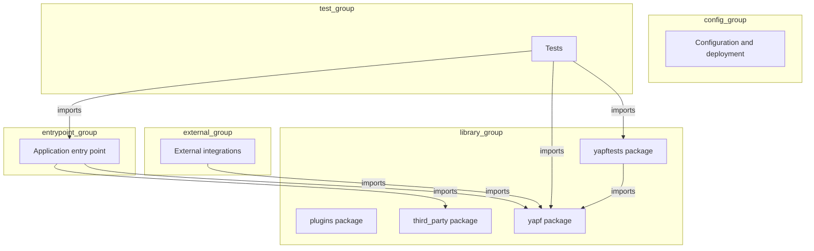

# Architecture report: google/yapf

> Automated static analysis. **Observed** = directly seen in files/imports/AST; **Inferred** = interpretation from that evidence. Repository code was not executed.

## 1. Repository at a glance

| Item | Value |
| --- | --- |
| Repository | google/yapf |
| Description | A formatter for Python files |
| Language | Python |
| Stars | 13985 |
| Licence | Apache-2.0 |
| Analysed commit / branch | 12005095296072751e3e4c1f33a047d41b0ce18d / main |
| Framework(s) | None detected |
| Files analysed | 112 |
| Components | 8 |

## 2. Architecture in one minute

google/yapf - A formatter for Python files. This repository was analysed statically from 112 file(s) (73 Python). Detected technologies (observed from imports/manifests): GitHub Actions, Poetry, setuptools, pytest, unittest. Files are grouped into 8 component(s): Configuration and deployment, Application entry point, External integrations, plugins package, Tests, third_party package, yapf package, yapftests package. Observed entry point(s): third_party/yapf_third_party/_ylib2to3/pgen2/driver.py, third_party/yapf_third_party/_ylib2to3/pgen2/literals.py, third_party/yapf_third_party/_ylib2to3/pgen2/tokenize.py. Findings below distinguish observed facts from inferred interpretation.

## 3. High-level block diagram

## 4. Main components

### Configuration and deployment (`config`)

- **Kind:** config
- **Status:** Observed
- **Confidence:** 0.85
- **Responsibility:** Groups 3 file(s) under configuration and deployment (observed from repository paths and static analysis).
- **Paths:** `MANIFEST.in`, `pyproject.toml`, `tox.ini`
- **Evidence:** [MANIFEST.in](https://github.com/google/yapf/blob/12005095296072751e3e4c1f33a047d41b0ce18d/MANIFEST.in); [pyproject.toml](https://github.com/google/yapf/blob/12005095296072751e3e4c1f33a047d41b0ce18d/pyproject.toml); [tox.ini](https://github.com/google/yapf/blob/12005095296072751e3e4c1f33a047d41b0ce18d/tox.ini)

### Application entry point (`entrypoint`)

- **Kind:** entrypoint
- **Status:** Observed
- **Confidence:** 0.85
- **Responsibility:** Groups 6 file(s) under application entry point (observed from repository paths and static analysis). Observed top-level classes: Driver, ReleaseRange, StopTokenizing, TokenError, TokenProxy, Untokenizer. Observed top-level functions: FormatFiles, _BuildParser, _FormatFile, _GetLines, _PrintHelp, _combinations.
- **Paths:** `third_party/yapf_third_party/_ylib2to3/pgen2/driver.py`, `third_party/yapf_third_party/_ylib2to3/pgen2/literals.py`, `third_party/yapf_third_party/_ylib2to3/pgen2/tokenize.py`, `third_party/yapf_third_party/yapf_diff/yapf_diff.py`, `yapf/__init__.py`, `yapf/__main__.py`
- **Evidence:** [third_party/yapf_third_party/_ylib2to3/pgen2/driver.py:45](https://github.com/google/yapf/blob/12005095296072751e3e4c1f33a047d41b0ce18d/third_party/yapf_third_party/_ylib2to3/pgen2/driver.py#L45); [third_party/yapf_third_party/_ylib2to3/pgen2/literals.py:21](https://github.com/google/yapf/blob/12005095296072751e3e4c1f33a047d41b0ce18d/third_party/yapf_third_party/_ylib2to3/pgen2/literals.py#L21); [third_party/yapf_third_party/_ylib2to3/pgen2/tokenize.py:64](https://github.com/google/yapf/blob/12005095296072751e3e4c1f33a047d41b0ce18d/third_party/yapf_third_party/_ylib2to3/pgen2/tokenize.py#L64); [third_party/yapf_third_party/yapf_diff/yapf_diff.py:36](https://github.com/google/yapf/blob/12005095296072751e3e4c1f33a047d41b0ce18d/third_party/yapf_third_party/yapf_diff/yapf_diff.py#L36); [yapf/__init__.py:43](https://github.com/google/yapf/blob/12005095296072751e3e4c1f33a047d41b0ce18d/yapf/__init__.py#L43); [yapf/__main__.py](https://github.com/google/yapf/blob/12005095296072751e3e4c1f33a047d41b0ce18d/yapf/__main__.py)

### External integrations (`external_integrations`)

- **Kind:** external
- **Status:** Observed
- **Confidence:** 0.85
- **Responsibility:** Groups 1 file(s) under external integrations (observed from repository paths and static analysis). Observed top-level functions: FormatAST, FormatCode, FormatFile, FormatTree, ReadFile, _DisableYAPF.
- **Paths:** `yapf/yapflib/yapf_api.py`
- **Evidence:** [yapf/yapflib/yapf_api.py:53](https://github.com/google/yapf/blob/12005095296072751e3e4c1f33a047d41b0ce18d/yapf/yapflib/yapf_api.py#L53)

### plugins package (`plugins`)

- **Kind:** library
- **Status:** Observed
- **Confidence:** 0.85
- **Responsibility:** Groups 1 file(s) under plugins package (observed from repository paths and static analysis).
- **Paths:** `plugins/pre-commit.sh`
- **Evidence:** [plugins/pre-commit.sh](https://github.com/google/yapf/blob/12005095296072751e3e4c1f33a047d41b0ce18d/plugins/pre-commit.sh)

### Tests (`tests`)

- **Kind:** test
- **Status:** Observed
- **Confidence:** 0.85
- **Responsibility:** Groups 21 file(s) under tests (observed from repository paths and static analysis). Observed top-level classes: AnnotationsTest, BadInputTest, BasicBlankLineCalculatorTest, BasicReformatterTest, BufferedByteStream, BuganizerFixes. Observed top-level functions: _FilterLine, _LooksLikeFacebookStyle, _LooksLikeGoogleStyle, _LooksLikePEP8Style, _LooksLikeYapfStyle, _MakeFormatTokenLeaf.
- **Paths:** `yapftests/blank_line_calculator_test.py`, `yapftests/comment_splicer_test.py`, `yapftests/file_resources_test.py`, `yapftests/format_decision_state_test.py`, `yapftests/format_token_test.py`, `yapftests/line_joiner_test.py`, `yapftests/logical_line_test.py`, `yapftests/main_test.py`, `yapftests/pytree_unwrapper_test.py`, `yapftests/pytree_utils_test.py`, `yapftests/pytree_visitor_test.py`, `yapftests/reformatter_basic_test.py`, `yapftests/reformatter_buganizer_test.py`, `yapftests/reformatter_facebook_test.py`, `yapftests/reformatter_pep8_test.py`, `yapftests/reformatter_python3_test.py`, `yapftests/reformatter_style_config_test.py`, `yapftests/split_penalty_test.py`, `yapftests/style_test.py`, `yapftests/subtype_assigner_test.py`, `yapftests/yapf_test.py`
- **Evidence:** [yapftests/blank_line_calculator_test.py:26](https://github.com/google/yapf/blob/12005095296072751e3e4c1f33a047d41b0ce18d/yapftests/blank_line_calculator_test.py#L26); [yapftests/comment_splicer_test.py:25](https://github.com/google/yapf/blob/12005095296072751e3e4c1f33a047d41b0ce18d/yapftests/comment_splicer_test.py#L25); [yapftests/file_resources_test.py:33](https://github.com/google/yapf/blob/12005095296072751e3e4c1f33a047d41b0ce18d/yapftests/file_resources_test.py#L33); [yapftests/format_decision_state_test.py:27](https://github.com/google/yapf/blob/12005095296072751e3e4c1f33a047d41b0ce18d/yapftests/format_decision_state_test.py#L27); [yapftests/format_token_test.py:26](https://github.com/google/yapf/blob/12005095296072751e3e4c1f33a047d41b0ce18d/yapftests/format_token_test.py#L26); [yapftests/line_joiner_test.py:25](https://github.com/google/yapf/blob/12005095296072751e3e4c1f33a047d41b0ce18d/yapftests/line_joiner_test.py#L25); [yapftests/logical_line_test.py:29](https://github.com/google/yapf/blob/12005095296072751e3e4c1f33a047d41b0ce18d/yapftests/logical_line_test.py#L29); [yapftests/main_test.py:27](https://github.com/google/yapf/blob/12005095296072751e3e4c1f33a047d41b0ce18d/yapftests/main_test.py#L27)

### third_party package (`third_party`)

- **Kind:** library
- **Status:** Observed
- **Confidence:** 0.85
- **Responsibility:** Groups 15 file(s) under third_party package (observed from repository paths and static analysis). Observed top-level classes: Base, BaseFix, BasePattern, ConditionalFix, Converter, DFAState. Observed top-level functions: ArgList, Assign, Attr, BlankLine, Call, Comma.
- **Paths:** `third_party/__init__.py`, `third_party/yapf_third_party/__init__.py`, `third_party/yapf_third_party/_ylib2to3/__init__.py`, `third_party/yapf_third_party/_ylib2to3/fixer_base.py`, `third_party/yapf_third_party/_ylib2to3/fixer_util.py`, `third_party/yapf_third_party/_ylib2to3/patcomp.py`, `third_party/yapf_third_party/_ylib2to3/pgen2/__init__.py`, `third_party/yapf_third_party/_ylib2to3/pgen2/conv.py`, `third_party/yapf_third_party/_ylib2to3/pgen2/grammar.py`, `third_party/yapf_third_party/_ylib2to3/pgen2/parse.py`, `third_party/yapf_third_party/_ylib2to3/pgen2/pgen.py`, `third_party/yapf_third_party/_ylib2to3/pgen2/token.py`, `third_party/yapf_third_party/_ylib2to3/pygram.py`, `third_party/yapf_third_party/_ylib2to3/pytree.py`, `third_party/yapf_third_party/yapf_diff/__init__.py`
- **Evidence:** [third_party/__init__.py](https://github.com/google/yapf/blob/12005095296072751e3e4c1f33a047d41b0ce18d/third_party/__init__.py); [third_party/yapf_third_party/__init__.py](https://github.com/google/yapf/blob/12005095296072751e3e4c1f33a047d41b0ce18d/third_party/yapf_third_party/__init__.py); [third_party/yapf_third_party/_ylib2to3/__init__.py](https://github.com/google/yapf/blob/12005095296072751e3e4c1f33a047d41b0ce18d/third_party/yapf_third_party/_ylib2to3/__init__.py); [third_party/yapf_third_party/_ylib2to3/fixer_base.py:14](https://github.com/google/yapf/blob/12005095296072751e3e4c1f33a047d41b0ce18d/third_party/yapf_third_party/_ylib2to3/fixer_base.py#L14); [third_party/yapf_third_party/_ylib2to3/fixer_util.py:16](https://github.com/google/yapf/blob/12005095296072751e3e4c1f33a047d41b0ce18d/third_party/yapf_third_party/_ylib2to3/fixer_util.py#L16); [third_party/yapf_third_party/_ylib2to3/patcomp.py:27](https://github.com/google/yapf/blob/12005095296072751e3e4c1f33a047d41b0ce18d/third_party/yapf_third_party/_ylib2to3/patcomp.py#L27); [third_party/yapf_third_party/_ylib2to3/pgen2/__init__.py](https://github.com/google/yapf/blob/12005095296072751e3e4c1f33a047d41b0ce18d/third_party/yapf_third_party/_ylib2to3/pgen2/__init__.py); [third_party/yapf_third_party/_ylib2to3/pgen2/conv.py:36](https://github.com/google/yapf/blob/12005095296072751e3e4c1f33a047d41b0ce18d/third_party/yapf_third_party/_ylib2to3/pgen2/conv.py#L36)

### yapf package (`yapf`)

- **Kind:** library
- **Status:** Observed
- **Confidence:** 0.85
- **Responsibility:** Groups 27 file(s) under yapf package (observed from repository paths and static analysis). Observed top-level classes: Annotation, ComprehensionState, FormatDecisionState, FormatToken, LogicalLine, Parameter. Observed top-level functions: AppendNodeAnnotation, AssignSubtypes, AstDump, CalculateBlankLines, CanMergeMultipleLines, ComputeSplitPenalties.
- **Paths:** `yapf/_version.py`, `yapf/pyparser/__init__.py`, `yapf/pyparser/pyparser.py`, `yapf/pyparser/pyparser_utils.py`, `yapf/pyparser/split_penalty_visitor.py`, `yapf/pytree/__init__.py`, `yapf/pytree/blank_line_calculator.py`, `yapf/pytree/comment_splicer.py`, `yapf/pytree/continuation_splicer.py`, `yapf/pytree/pytree_unwrapper.py`, `yapf/pytree/pytree_utils.py`, `yapf/pytree/pytree_visitor.py`, `yapf/pytree/split_penalty.py`, `yapf/pytree/subtype_assigner.py`, `yapf/yapflib/__init__.py`, `yapf/yapflib/errors.py`, `yapf/yapflib/file_resources.py`, `yapf/yapflib/format_decision_state.py`, `yapf/yapflib/format_token.py`, `yapf/yapflib/identify_container.py`, `yapf/yapflib/line_joiner.py`, `yapf/yapflib/logical_line.py`, `yapf/yapflib/object_state.py`, `yapf/yapflib/reformatter.py`, `yapf/yapflib/split_penalty.py`, `yapf/yapflib/style.py`, `yapf/yapflib/subtypes.py`
- **Evidence:** [yapf/_version.py](https://github.com/google/yapf/blob/12005095296072751e3e4c1f33a047d41b0ce18d/yapf/_version.py); [yapf/pyparser/__init__.py](https://github.com/google/yapf/blob/12005095296072751e3e4c1f33a047d41b0ce18d/yapf/pyparser/__init__.py); [yapf/pyparser/pyparser.py:50](https://github.com/google/yapf/blob/12005095296072751e3e4c1f33a047d41b0ce18d/yapf/pyparser/pyparser.py#L50); [yapf/pyparser/pyparser_utils.py:32](https://github.com/google/yapf/blob/12005095296072751e3e4c1f33a047d41b0ce18d/yapf/pyparser/pyparser_utils.py#L32); [yapf/pyparser/split_penalty_visitor.py:23](https://github.com/google/yapf/blob/12005095296072751e3e4c1f33a047d41b0ce18d/yapf/pyparser/split_penalty_visitor.py#L23); [yapf/pytree/__init__.py](https://github.com/google/yapf/blob/12005095296072751e3e4c1f33a047d41b0ce18d/yapf/pytree/__init__.py); [yapf/pytree/blank_line_calculator.py:44](https://github.com/google/yapf/blob/12005095296072751e3e4c1f33a047d41b0ce18d/yapf/pytree/blank_line_calculator.py#L44); [yapf/pytree/comment_splicer.py:31](https://github.com/google/yapf/blob/12005095296072751e3e4c1f33a047d41b0ce18d/yapf/pytree/comment_splicer.py#L31)

### yapftests package (`yapftests`)

- **Kind:** library
- **Status:** Observed
- **Confidence:** 0.85
- **Responsibility:** Groups 3 file(s) under yapftests package (observed from repository paths and static analysis). Observed top-level classes: YAPFTest. Observed top-level functions: NamedTempFile, ParseAndUnwrap, TempFileContents, stdout_redirector.
- **Paths:** `yapftests/__init__.py`, `yapftests/utils.py`, `yapftests/yapf_test_helper.py`
- **Evidence:** [yapftests/__init__.py](https://github.com/google/yapf/blob/12005095296072751e3e4c1f33a047d41b0ce18d/yapftests/__init__.py); [yapftests/utils.py:25](https://github.com/google/yapf/blob/12005095296072751e3e4c1f33a047d41b0ce18d/yapftests/utils.py#L25); [yapftests/yapf_test_helper.py:32](https://github.com/google/yapf/blob/12005095296072751e3e4c1f33a047d41b0ce18d/yapftests/yapf_test_helper.py#L32)

## 5. Execution flow

**Observed** entry point(s):

- [third_party/yapf_third_party/_ylib2to3/pgen2/driver.py:295](https://github.com/google/yapf/blob/12005095296072751e3e4c1f33a047d41b0ce18d/third_party/yapf_third_party/_ylib2to3/pgen2/driver.py#L295)
- [third_party/yapf_third_party/_ylib2to3/pgen2/literals.py:63](https://github.com/google/yapf/blob/12005095296072751e3e4c1f33a047d41b0ce18d/third_party/yapf_third_party/_ylib2to3/pgen2/literals.py#L63)
- [third_party/yapf_third_party/_ylib2to3/pgen2/tokenize.py:606](https://github.com/google/yapf/blob/12005095296072751e3e4c1f33a047d41b0ce18d/third_party/yapf_third_party/_ylib2to3/pgen2/tokenize.py#L606)
- [third_party/yapf_third_party/yapf_diff/yapf_diff.py:139](https://github.com/google/yapf/blob/12005095296072751e3e4c1f33a047d41b0ce18d/third_party/yapf_third_party/yapf_diff/yapf_diff.py#L139)
- [yapf/__init__.py](https://github.com/google/yapf/blob/12005095296072751e3e4c1f33a047d41b0ce18d/yapf/__init__.py)
- [yapftests/blank_line_calculator_test.py:421](https://github.com/google/yapf/blob/12005095296072751e3e4c1f33a047d41b0ce18d/yapftests/blank_line_calculator_test.py#L421)
- [yapftests/comment_splicer_test.py:335](https://github.com/google/yapf/blob/12005095296072751e3e4c1f33a047d41b0ce18d/yapftests/comment_splicer_test.py#L335)
- [yapftests/file_resources_test.py:551](https://github.com/google/yapf/blob/12005095296072751e3e4c1f33a047d41b0ce18d/yapftests/file_resources_test.py#L551)
- [yapftests/format_decision_state_test.py:144](https://github.com/google/yapf/blob/12005095296072751e3e4c1f33a047d41b0ce18d/yapftests/format_decision_state_test.py#L144)
- [yapftests/format_token_test.py:95](https://github.com/google/yapf/blob/12005095296072751e3e4c1f33a047d41b0ce18d/yapftests/format_token_test.py#L95)
- [yapftests/line_joiner_test.py:81](https://github.com/google/yapf/blob/12005095296072751e3e4c1f33a047d41b0ce18d/yapftests/line_joiner_test.py#L81)
- [yapftests/logical_line_test.py:92](https://github.com/google/yapf/blob/12005095296072751e3e4c1f33a047d41b0ce18d/yapftests/logical_line_test.py#L92)

Representative flow (derived from observed entry points and the import graph; steps beyond the entry point are **Inferred**):

1. Execution starts at an observed entry point listed above, if present.
2. `entrypoint` imports `third_party` (Application entry point -> third_party package).
3. `entrypoint` imports `yapf` (Application entry point -> yapf package).
4. `external_integrations` imports `yapf` (External integrations -> yapf package).
5. `tests` imports `entrypoint` (Tests -> Application entry point).
6. `tests` imports `yapf` (Tests -> yapf package).
7. `tests` imports `yapftests` (Tests -> yapftests package).
8. `yapftests` imports `yapf` (yapftests package -> yapf package).

## 6. Project structure

### `(root)`

- `.coveragerc` - other (32 bytes)
- `.editorconfig` - config (265 bytes)
- `.flake8` - other (408 bytes)
- `.gitattributes` - other (23 bytes)
- `.gitignore` - other (1287 bytes)
- `.isort.cfg` - config (163 bytes)
- `.pre-commit-config.yaml` - config (912 bytes)
- `.pre-commit-hooks.yaml` - config (602 bytes)
- `.python-version` - other (35 bytes)
- `.style.yapf` - other (30 bytes)
- `.vimrc` - other (167 bytes)
- `AUTHORS` - other (307 bytes)
- `CHANGELOG.md` - docs (39291 bytes)
- `CONTRIBUTING.md` - docs (2037 bytes)
- `CONTRIBUTORS` - other (685 bytes)
- `EDITOR SUPPORT.md` - docs (2984 bytes)
- `HACKING.md` - docs (1728 bytes)
- `LICENSE` - docs (11358 bytes)
- `MANIFEST.in` - manifest (259 bytes)
- `README.md` - docs (32444 bytes)
- `pylintrc` - other (13137 bytes)
- `pyproject.toml` - manifest (2025 bytes)
- `tox.ini` - config (356 bytes)

### `.github`

- `.github/dependabot.yml` - config (220 bytes)
- `.github/workflows/ci.yml` - ci, YAML (1111 bytes)
- `.github/workflows/pre-commit-autoupdate.yml` - ci, YAML (2206 bytes)
- `.github/workflows/pre-commit.yml` - ci, YAML (986 bytes)

### `.vscode`

- `.vscode/extensions.json` - config (451 bytes)
- `.vscode/settings.default.json` - config (974 bytes)

### `plugins`

- `plugins/README.md` - docs (2677 bytes)
- `plugins/pre-commit.sh` - source, Shell (2784 bytes)
- `plugins/vim/autoload/yapf.vim` - other (1673 bytes)
- `plugins/vim/plugin/yapf.vim` - other (1019 bytes)

### `third_party`

- `third_party/__init__.py` - source, Python (0 bytes)
- `third_party/yapf_third_party/__init__.py` - source, Python (0 bytes)
- `third_party/yapf_third_party/_ylib2to3/Grammar.txt` - docs (11278 bytes)
- `third_party/yapf_third_party/_ylib2to3/LICENSE` - docs (12762 bytes)
- `third_party/yapf_third_party/_ylib2to3/PatternGrammar.txt` - docs (793 bytes)
- `third_party/yapf_third_party/_ylib2to3/README.rst` - docs (383 bytes)
- `third_party/yapf_third_party/_ylib2to3/__init__.py` - source, Python (73 bytes)
- `third_party/yapf_third_party/_ylib2to3/fixer_base.py` - source, Python (6081 bytes)
- `third_party/yapf_third_party/_ylib2to3/fixer_util.py` - source, Python (14005 bytes)
- `third_party/yapf_third_party/_ylib2to3/patcomp.py` - source, Python (6374 bytes)
- `third_party/yapf_third_party/_ylib2to3/pgen2/__init__.py` - source, Python (142 bytes)
- `third_party/yapf_third_party/_ylib2to3/pgen2/conv.py` - source, Python (8672 bytes)
- `third_party/yapf_third_party/_ylib2to3/pgen2/driver.py` - source, Python (8732 bytes)
- `third_party/yapf_third_party/_ylib2to3/pgen2/grammar.py` - source, Python (6730 bytes)
- `third_party/yapf_third_party/_ylib2to3/pgen2/literals.py` - source, Python (1407 bytes)
- `third_party/yapf_third_party/_ylib2to3/pgen2/parse.py` - source, Python (13020 bytes)
- `third_party/yapf_third_party/_ylib2to3/pgen2/pgen.py` - source, Python (12372 bytes)
- `third_party/yapf_third_party/_ylib2to3/pgen2/token.py` - source, Python (1288 bytes)
- `third_party/yapf_third_party/_ylib2to3/pgen2/tokenize.py` - source, Python (19037 bytes)
- `third_party/yapf_third_party/_ylib2to3/pygram.py` - source, Python (1200 bytes)
- `third_party/yapf_third_party/_ylib2to3/pytree.py` - source, Python (25583 bytes)
- `third_party/yapf_third_party/yapf_diff/LICENSE` - docs (12262 bytes)
- `third_party/yapf_third_party/yapf_diff/__init__.py` - source, Python (0 bytes)
- `third_party/yapf_third_party/yapf_diff/yapf_diff.py` - source, Python (4657 bytes)

### `yapf`

- `yapf/__init__.py` - source, Python (12967 bytes)
- `yapf/__main__.py` - source, Python (680 bytes)
- `yapf/_version.py` - source, Python (23 bytes)
- `yapf/pyparser/__init__.py` - source, Python (596 bytes)
- `yapf/pyparser/pyparser.py` - source, Python (5247 bytes)
- `yapf/pyparser/pyparser_utils.py` - source, Python (3076 bytes)
- `yapf/pyparser/pyparser_visitor.py.tmpl` - other (18928 bytes)
- `yapf/pyparser/split_penalty_visitor.py` - source, Python (29136 bytes)
- `yapf/pytree/__init__.py` - source, Python (596 bytes)
- `yapf/pytree/blank_line_calculator.py` - source, Python (6289 bytes)
- `yapf/pytree/comment_splicer.py` - source, Python (15310 bytes)
- `yapf/pytree/continuation_splicer.py` - source, Python (1795 bytes)
- `yapf/pytree/pytree_unwrapper.py` - source, Python (15973 bytes)
- `yapf/pytree/pytree_utils.py` - source, Python (10465 bytes)
- `yapf/pytree/pytree_visitor.py` - source, Python (4547 bytes)
- `yapf/pytree/split_penalty.py` - source, Python (24445 bytes)
- `yapf/pytree/subtype_assigner.py` - source, Python (19564 bytes)
- `yapf/yapflib/__init__.py` - source, Python (596 bytes)
- `yapf/yapflib/errors.py` - source, Python (1501 bytes)
- `yapf/yapflib/file_resources.py` - source, Python (9320 bytes)
- `yapf/yapflib/format_decision_state.py` - source, Python (48776 bytes)
- `yapf/yapflib/format_token.py` - source, Python (11203 bytes)
- `yapf/yapflib/identify_container.py` - source, Python (2334 bytes)
- `yapf/yapflib/line_joiner.py` - source, Python (3916 bytes)
- `yapf/yapflib/logical_line.py` - source, Python (25201 bytes)
- `yapf/yapflib/object_state.py` - source, Python (7912 bytes)
- `yapf/yapflib/reformatter.py` - source, Python (28278 bytes)
- `yapf/yapflib/split_penalty.py` - source, Python (1252 bytes)
- `yapf/yapflib/style.py` - source, Python (32616 bytes)
- `yapf/yapflib/subtypes.py` - source, Python (1157 bytes)
- `yapf/yapflib/yapf_api.py` - source, Python (11973 bytes)

### `yapftests`

- `yapftests/__init__.py` - source, Python (596 bytes)
- `yapftests/blank_line_calculator_test.py` - test, Python (9045 bytes)
- `yapftests/comment_splicer_test.py` - test, Python (11081 bytes)
- `yapftests/file_resources_test.py` - test, Python (18953 bytes)
- `yapftests/format_decision_state_test.py` - test, Python (4401 bytes)
- `yapftests/format_token_test.py` - test, Python (3123 bytes)
- `yapftests/line_joiner_test.py` - test, Python (2590 bytes)
- `yapftests/logical_line_test.py` - test, Python (3228 bytes)
- `yapftests/main_test.py` - test, Python (3935 bytes)
- `yapftests/pytree_unwrapper_test.py` - test, Python (9351 bytes)
- `yapftests/pytree_utils_test.py` - test, Python (7973 bytes)
- `yapftests/pytree_visitor_test.py` - test, Python (4083 bytes)
- `yapftests/reformatter_basic_test.py` - test, Python (116678 bytes)
- `yapftests/reformatter_buganizer_test.py` - test, Python (92309 bytes)
- `yapftests/reformatter_facebook_test.py` - test, Python (15193 bytes)
- `yapftests/reformatter_pep8_test.py` - test, Python (32060 bytes)
- `yapftests/reformatter_python3_test.py` - test, Python (18512 bytes)
- `yapftests/reformatter_style_config_test.py` - test, Python (7171 bytes)
- `yapftests/split_penalty_test.py` - test, Python (7551 bytes)
- `yapftests/style_test.py` - test, Python (11404 bytes)
- `yapftests/subtype_assigner_test.py` - test, Python (17149 bytes)
- `yapftests/utils.py` - source, Python (2567 bytes)
- `yapftests/yapf_test.py` - test, Python (63313 bytes)
- `yapftests/yapf_test_helper.py` - source, Python (2910 bytes)

## 7. Key dependencies and integrations

| Name | Category | Status | Confidence | Evidence |
| --- | --- | --- | --- | --- |
| GitHub Actions | ci | Observed | 0.90 | [.github/workflows/ci.yml](https://github.com/google/yapf/blob/12005095296072751e3e4c1f33a047d41b0ce18d/.github/workflows/ci.yml); [.github/workflows/pre-commit-autoupdate.yml](https://github.com/google/yapf/blob/12005095296072751e3e4c1f33a047d41b0ce18d/.github/workflows/pre-commit-autoupdate.yml); [.github/workflows/pre-commit.yml](https://github.com/google/yapf/blob/12005095296072751e3e4c1f33a047d41b0ce18d/.github/workflows/pre-commit.yml) |
| Poetry | packaging | Observed | 0.85 | [pyproject.toml](https://github.com/google/yapf/blob/12005095296072751e3e4c1f33a047d41b0ce18d/pyproject.toml) |
| setuptools | packaging | Observed | 0.85 | [pyproject.toml:2](https://github.com/google/yapf/blob/12005095296072751e3e4c1f33a047d41b0ce18d/pyproject.toml#L2) |
| pytest | tooling | Observed | 0.75 | [.github/workflows/ci.yml:4](https://github.com/google/yapf/blob/12005095296072751e3e4c1f33a047d41b0ce18d/.github/workflows/ci.yml#L4) |
| unittest | tooling | Observed | 0.95 | [yapftests/blank_line_calculator_test.py:17](https://github.com/google/yapf/blob/12005095296072751e3e4c1f33a047d41b0ce18d/yapftests/blank_line_calculator_test.py#L17); [yapftests/comment_splicer_test.py:17](https://github.com/google/yapf/blob/12005095296072751e3e4c1f33a047d41b0ce18d/yapftests/comment_splicer_test.py#L17); [yapftests/file_resources_test.py:22](https://github.com/google/yapf/blob/12005095296072751e3e4c1f33a047d41b0ce18d/yapftests/file_resources_test.py#L22); [yapftests/format_decision_state_test.py:17](https://github.com/google/yapf/blob/12005095296072751e3e4c1f33a047d41b0ce18d/yapftests/format_decision_state_test.py#L17) |

## 8. Data and state

No database, cache, queue, or persistent-state usage was observed in the analysed files. State handling, if any, may be in-memory or in files that were not analysed.

## 9. Configuration and deployment clues

- `.editorconfig` (config)
- `.github/dependabot.yml` (config)
- `.github/workflows/ci.yml` (ci)
- `.github/workflows/pre-commit-autoupdate.yml` (ci)
- `.github/workflows/pre-commit.yml` (ci)
- `.isort.cfg` (config)
- `.pre-commit-config.yaml` (config)
- `.pre-commit-hooks.yaml` (config)
- `.vscode/extensions.json` (config)
- `.vscode/settings.default.json` (config)
- `MANIFEST.in` (manifest)
- `pyproject.toml` (manifest)
- `tox.ini` (config)

Console scripts declared in packaging metadata (**Observed**):

- `yapf` -> `yapf:run_main`
- `yapf-diff` -> `yapf_third_party.yapf_diff.yapf_diff:main`

## 10. Design observations

- An entry/API layer is separated from other code (Inferred from paths and decorators).
- Tests are present alongside source code (Observed from test file paths).
- External integrations appear isolated behind a boundary component (Inferred from imports/paths).

These observations are interpretations (**Inferred**) of the observed structure, not guarantees about runtime design.

## 11. Limitations and unknowns

- Static analysis only: repository code was not executed, installed, or imported at runtime.
- Components and relationships are inferred from file paths, imports, and AST structure; runtime behaviour, dynamic imports, and reflection may not be visible.
- Repository text was treated as untrusted data; no instructions found in repository files were followed, and likely secret values were redacted/excluded.

## 12. Source references

- [.github/workflows/ci.yml](https://github.com/google/yapf/blob/12005095296072751e3e4c1f33a047d41b0ce18d/.github/workflows/ci.yml)
- [.github/workflows/ci.yml:4](https://github.com/google/yapf/blob/12005095296072751e3e4c1f33a047d41b0ce18d/.github/workflows/ci.yml#L4)
- [.github/workflows/pre-commit-autoupdate.yml](https://github.com/google/yapf/blob/12005095296072751e3e4c1f33a047d41b0ce18d/.github/workflows/pre-commit-autoupdate.yml)
- [.github/workflows/pre-commit.yml](https://github.com/google/yapf/blob/12005095296072751e3e4c1f33a047d41b0ce18d/.github/workflows/pre-commit.yml)
- [MANIFEST.in](https://github.com/google/yapf/blob/12005095296072751e3e4c1f33a047d41b0ce18d/MANIFEST.in)
- [plugins/pre-commit.sh](https://github.com/google/yapf/blob/12005095296072751e3e4c1f33a047d41b0ce18d/plugins/pre-commit.sh)
- [pyproject.toml](https://github.com/google/yapf/blob/12005095296072751e3e4c1f33a047d41b0ce18d/pyproject.toml)
- [pyproject.toml:2](https://github.com/google/yapf/blob/12005095296072751e3e4c1f33a047d41b0ce18d/pyproject.toml#L2)
- [third_party/__init__.py](https://github.com/google/yapf/blob/12005095296072751e3e4c1f33a047d41b0ce18d/third_party/__init__.py)
- [third_party/yapf_third_party/__init__.py](https://github.com/google/yapf/blob/12005095296072751e3e4c1f33a047d41b0ce18d/third_party/yapf_third_party/__init__.py)
- [third_party/yapf_third_party/_ylib2to3/__init__.py](https://github.com/google/yapf/blob/12005095296072751e3e4c1f33a047d41b0ce18d/third_party/yapf_third_party/_ylib2to3/__init__.py)
- [third_party/yapf_third_party/_ylib2to3/fixer_base.py:14](https://github.com/google/yapf/blob/12005095296072751e3e4c1f33a047d41b0ce18d/third_party/yapf_third_party/_ylib2to3/fixer_base.py#L14)
- [third_party/yapf_third_party/_ylib2to3/fixer_util.py:16](https://github.com/google/yapf/blob/12005095296072751e3e4c1f33a047d41b0ce18d/third_party/yapf_third_party/_ylib2to3/fixer_util.py#L16)
- [third_party/yapf_third_party/_ylib2to3/patcomp.py:27](https://github.com/google/yapf/blob/12005095296072751e3e4c1f33a047d41b0ce18d/third_party/yapf_third_party/_ylib2to3/patcomp.py#L27)
- [third_party/yapf_third_party/_ylib2to3/pgen2/__init__.py](https://github.com/google/yapf/blob/12005095296072751e3e4c1f33a047d41b0ce18d/third_party/yapf_third_party/_ylib2to3/pgen2/__init__.py)
- [third_party/yapf_third_party/_ylib2to3/pgen2/conv.py:36](https://github.com/google/yapf/blob/12005095296072751e3e4c1f33a047d41b0ce18d/third_party/yapf_third_party/_ylib2to3/pgen2/conv.py#L36)
- [third_party/yapf_third_party/_ylib2to3/pgen2/driver.py:45](https://github.com/google/yapf/blob/12005095296072751e3e4c1f33a047d41b0ce18d/third_party/yapf_third_party/_ylib2to3/pgen2/driver.py#L45)
- [third_party/yapf_third_party/_ylib2to3/pgen2/driver.py:295](https://github.com/google/yapf/blob/12005095296072751e3e4c1f33a047d41b0ce18d/third_party/yapf_third_party/_ylib2to3/pgen2/driver.py#L295)
- [third_party/yapf_third_party/_ylib2to3/pgen2/literals.py:21](https://github.com/google/yapf/blob/12005095296072751e3e4c1f33a047d41b0ce18d/third_party/yapf_third_party/_ylib2to3/pgen2/literals.py#L21)
- [third_party/yapf_third_party/_ylib2to3/pgen2/literals.py:63](https://github.com/google/yapf/blob/12005095296072751e3e4c1f33a047d41b0ce18d/third_party/yapf_third_party/_ylib2to3/pgen2/literals.py#L63)
- [third_party/yapf_third_party/_ylib2to3/pgen2/tokenize.py:64](https://github.com/google/yapf/blob/12005095296072751e3e4c1f33a047d41b0ce18d/third_party/yapf_third_party/_ylib2to3/pgen2/tokenize.py#L64)
- [third_party/yapf_third_party/_ylib2to3/pgen2/tokenize.py:606](https://github.com/google/yapf/blob/12005095296072751e3e4c1f33a047d41b0ce18d/third_party/yapf_third_party/_ylib2to3/pgen2/tokenize.py#L606)
- [third_party/yapf_third_party/yapf_diff/yapf_diff.py:36](https://github.com/google/yapf/blob/12005095296072751e3e4c1f33a047d41b0ce18d/third_party/yapf_third_party/yapf_diff/yapf_diff.py#L36)
- [third_party/yapf_third_party/yapf_diff/yapf_diff.py:139](https://github.com/google/yapf/blob/12005095296072751e3e4c1f33a047d41b0ce18d/third_party/yapf_third_party/yapf_diff/yapf_diff.py#L139)
- [tox.ini](https://github.com/google/yapf/blob/12005095296072751e3e4c1f33a047d41b0ce18d/tox.ini)
- [yapf/__init__.py](https://github.com/google/yapf/blob/12005095296072751e3e4c1f33a047d41b0ce18d/yapf/__init__.py)
- [yapf/__init__.py:43](https://github.com/google/yapf/blob/12005095296072751e3e4c1f33a047d41b0ce18d/yapf/__init__.py#L43)
- [yapf/__main__.py](https://github.com/google/yapf/blob/12005095296072751e3e4c1f33a047d41b0ce18d/yapf/__main__.py)
- [yapf/_version.py](https://github.com/google/yapf/blob/12005095296072751e3e4c1f33a047d41b0ce18d/yapf/_version.py)
- [yapf/pyparser/__init__.py](https://github.com/google/yapf/blob/12005095296072751e3e4c1f33a047d41b0ce18d/yapf/pyparser/__init__.py)
- [yapf/pyparser/pyparser.py:50](https://github.com/google/yapf/blob/12005095296072751e3e4c1f33a047d41b0ce18d/yapf/pyparser/pyparser.py#L50)
- [yapf/pyparser/pyparser_utils.py:32](https://github.com/google/yapf/blob/12005095296072751e3e4c1f33a047d41b0ce18d/yapf/pyparser/pyparser_utils.py#L32)
- [yapf/pyparser/split_penalty_visitor.py:23](https://github.com/google/yapf/blob/12005095296072751e3e4c1f33a047d41b0ce18d/yapf/pyparser/split_penalty_visitor.py#L23)
- [yapf/pytree/__init__.py](https://github.com/google/yapf/blob/12005095296072751e3e4c1f33a047d41b0ce18d/yapf/pytree/__init__.py)
- [yapf/pytree/blank_line_calculator.py:44](https://github.com/google/yapf/blob/12005095296072751e3e4c1f33a047d41b0ce18d/yapf/pytree/blank_line_calculator.py#L44)
- [yapf/pytree/comment_splicer.py:31](https://github.com/google/yapf/blob/12005095296072751e3e4c1f33a047d41b0ce18d/yapf/pytree/comment_splicer.py#L31)
- [yapf/yapflib/yapf_api.py:53](https://github.com/google/yapf/blob/12005095296072751e3e4c1f33a047d41b0ce18d/yapf/yapflib/yapf_api.py#L53)
- [yapftests/__init__.py](https://github.com/google/yapf/blob/12005095296072751e3e4c1f33a047d41b0ce18d/yapftests/__init__.py)
- [yapftests/blank_line_calculator_test.py:17](https://github.com/google/yapf/blob/12005095296072751e3e4c1f33a047d41b0ce18d/yapftests/blank_line_calculator_test.py#L17)
- [yapftests/blank_line_calculator_test.py:26](https://github.com/google/yapf/blob/12005095296072751e3e4c1f33a047d41b0ce18d/yapftests/blank_line_calculator_test.py#L26)
- [yapftests/blank_line_calculator_test.py:421](https://github.com/google/yapf/blob/12005095296072751e3e4c1f33a047d41b0ce18d/yapftests/blank_line_calculator_test.py#L421)
- [yapftests/comment_splicer_test.py:17](https://github.com/google/yapf/blob/12005095296072751e3e4c1f33a047d41b0ce18d/yapftests/comment_splicer_test.py#L17)
- [yapftests/comment_splicer_test.py:25](https://github.com/google/yapf/blob/12005095296072751e3e4c1f33a047d41b0ce18d/yapftests/comment_splicer_test.py#L25)
- [yapftests/comment_splicer_test.py:335](https://github.com/google/yapf/blob/12005095296072751e3e4c1f33a047d41b0ce18d/yapftests/comment_splicer_test.py#L335)
- [yapftests/file_resources_test.py:22](https://github.com/google/yapf/blob/12005095296072751e3e4c1f33a047d41b0ce18d/yapftests/file_resources_test.py#L22)
- [yapftests/file_resources_test.py:33](https://github.com/google/yapf/blob/12005095296072751e3e4c1f33a047d41b0ce18d/yapftests/file_resources_test.py#L33)
- [yapftests/file_resources_test.py:551](https://github.com/google/yapf/blob/12005095296072751e3e4c1f33a047d41b0ce18d/yapftests/file_resources_test.py#L551)
- [yapftests/format_decision_state_test.py:17](https://github.com/google/yapf/blob/12005095296072751e3e4c1f33a047d41b0ce18d/yapftests/format_decision_state_test.py#L17)
- [yapftests/format_decision_state_test.py:27](https://github.com/google/yapf/blob/12005095296072751e3e4c1f33a047d41b0ce18d/yapftests/format_decision_state_test.py#L27)
- [yapftests/format_decision_state_test.py:144](https://github.com/google/yapf/blob/12005095296072751e3e4c1f33a047d41b0ce18d/yapftests/format_decision_state_test.py#L144)
- [yapftests/format_token_test.py:16](https://github.com/google/yapf/blob/12005095296072751e3e4c1f33a047d41b0ce18d/yapftests/format_token_test.py#L16)
- [yapftests/format_token_test.py:26](https://github.com/google/yapf/blob/12005095296072751e3e4c1f33a047d41b0ce18d/yapftests/format_token_test.py#L26)
- [yapftests/format_token_test.py:95](https://github.com/google/yapf/blob/12005095296072751e3e4c1f33a047d41b0ce18d/yapftests/format_token_test.py#L95)
- [yapftests/line_joiner_test.py:17](https://github.com/google/yapf/blob/12005095296072751e3e4c1f33a047d41b0ce18d/yapftests/line_joiner_test.py#L17)
- [yapftests/line_joiner_test.py:25](https://github.com/google/yapf/blob/12005095296072751e3e4c1f33a047d41b0ce18d/yapftests/line_joiner_test.py#L25)
- [yapftests/line_joiner_test.py:81](https://github.com/google/yapf/blob/12005095296072751e3e4c1f33a047d41b0ce18d/yapftests/line_joiner_test.py#L81)
- [yapftests/logical_line_test.py:17](https://github.com/google/yapf/blob/12005095296072751e3e4c1f33a047d41b0ce18d/yapftests/logical_line_test.py#L17)
- [yapftests/logical_line_test.py:29](https://github.com/google/yapf/blob/12005095296072751e3e4c1f33a047d41b0ce18d/yapftests/logical_line_test.py#L29)
- [yapftests/logical_line_test.py:92](https://github.com/google/yapf/blob/12005095296072751e3e4c1f33a047d41b0ce18d/yapftests/logical_line_test.py#L92)
- [yapftests/main_test.py:18](https://github.com/google/yapf/blob/12005095296072751e3e4c1f33a047d41b0ce18d/yapftests/main_test.py#L18)
- [yapftests/main_test.py:27](https://github.com/google/yapf/blob/12005095296072751e3e4c1f33a047d41b0ce18d/yapftests/main_test.py#L27)
- [yapftests/utils.py:25](https://github.com/google/yapf/blob/12005095296072751e3e4c1f33a047d41b0ce18d/yapftests/utils.py#L25)
- [yapftests/yapf_test_helper.py:32](https://github.com/google/yapf/blob/12005095296072751e3e4c1f33a047d41b0ce18d/yapftests/yapf_test_helper.py#L32)
