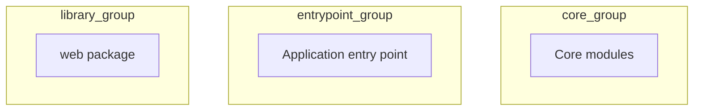

# Architecture report: gto76/python-cheatsheet

> Automated static analysis. **Observed** = directly seen in files/imports/AST; **Inferred** = interpretation from that evidence. Repository code was not executed.

## 1. Repository at a glance

| Item | Value |
| --- | --- |
| Repository | gto76/python-cheatsheet |
| Description | Comprehensive Python Cheatsheet |
| Language | Python |
| Stars | 38927 |
| Licence | Not detected |
| Analysed commit / branch | f2ace2d90ea2f153d7f47edc368586ce8f15d8d7 / main |
| Framework(s) | None detected |
| Files analysed | 37 |
| Components | 3 |

## 2. Architecture in one minute

gto76/python-cheatsheet - Comprehensive Python Cheatsheet. This repository was analysed statically from 37 file(s) (4 Python). Detected technologies (observed from imports/manifests): pandas. Files are grouped into 3 component(s): Core modules, Application entry point, web package. Observed entry point(s): pdf/create_index.py, pdf/remove_links.py, web/convert_table.py. Findings below distinguish observed facts from inferred interpretation.

## 3. High-level block diagram

## 4. Main components

### Core modules (`core`)

- **Kind:** core
- **Status:** Observed
- **Confidence:** 0.85
- **Responsibility:** Groups 1 file(s) under core modules (observed from repository paths and static analysis).
- **Paths:** `parse.js`
- **Evidence:** [parse.js](https://github.com/gto76/python-cheatsheet/blob/f2ace2d90ea2f153d7f47edc368586ce8f15d8d7/parse.js)

### Application entry point (`entrypoint`)

- **Kind:** entrypoint
- **Status:** Observed
- **Confidence:** 0.85
- **Responsibility:** Groups 4 file(s) under application entry point (observed from repository paths and static analysis). Observed top-level functions: convert_table, main, print_hhh, read_file, update_confirmed_cases, update_covid_deaths.
- **Paths:** `pdf/create_index.py`, `pdf/remove_links.py`, `web/convert_table.py`, `web/update_plots.py`
- **Evidence:** [pdf/create_index.py:15](https://github.com/gto76/python-cheatsheet/blob/f2ace2d90ea2f153d7f47edc368586ce8f15d8d7/pdf/create_index.py#L15); [pdf/remove_links.py:43](https://github.com/gto76/python-cheatsheet/blob/f2ace2d90ea2f153d7f47edc368586ce8f15d8d7/pdf/remove_links.py#L43); [web/convert_table.py:3](https://github.com/gto76/python-cheatsheet/blob/f2ace2d90ea2f153d7f47edc368586ce8f15d8d7/web/convert_table.py#L3); [web/update_plots.py:14](https://github.com/gto76/python-cheatsheet/blob/f2ace2d90ea2f153d7f47edc368586ce8f15d8d7/web/update_plots.py#L14)

### web package (`web`)

- **Kind:** library
- **Status:** Observed
- **Confidence:** 0.85
- **Responsibility:** Groups 2 file(s) under web package (observed from repository paths and static analysis).
- **Paths:** `web/covid_cases.js`, `web/script_2.js`
- **Evidence:** [web/covid_cases.js](https://github.com/gto76/python-cheatsheet/blob/f2ace2d90ea2f153d7f47edc368586ce8f15d8d7/web/covid_cases.js); [web/script_2.js](https://github.com/gto76/python-cheatsheet/blob/f2ace2d90ea2f153d7f47edc368586ce8f15d8d7/web/script_2.js)

## 5. Execution flow

**Observed** entry point(s):

- [pdf/create_index.py:50](https://github.com/gto76/python-cheatsheet/blob/f2ace2d90ea2f153d7f47edc368586ce8f15d8d7/pdf/create_index.py#L50)
- [pdf/remove_links.py:68](https://github.com/gto76/python-cheatsheet/blob/f2ace2d90ea2f153d7f47edc368586ce8f15d8d7/pdf/remove_links.py#L68)
- [web/convert_table.py:31](https://github.com/gto76/python-cheatsheet/blob/f2ace2d90ea2f153d7f47edc368586ce8f15d8d7/web/convert_table.py#L31)
- [web/update_plots.py:123](https://github.com/gto76/python-cheatsheet/blob/f2ace2d90ea2f153d7f47edc368586ce8f15d8d7/web/update_plots.py#L123)

Representative flow (derived from observed entry points and the import graph; steps beyond the entry point are **Inferred**):

1. Execution starts at an observed entry point listed above, if present.
2. No internal import relationships between components were observed.

## 6. Project structure

### `(root)`

- `README.md` - docs (150215 bytes)
- `parse.js` - source, JavaScript (87233 bytes)

### `pdf`

- `pdf/Acrobat/Chapter_1.xml` - other (602 bytes)
- `pdf/Acrobat/bottom_line.xml` - other (690 bytes)
- `pdf/Acrobat/chapter_2.xml` - other (596 bytes)
- `pdf/Acrobat/chapter_3.xml` - other (598 bytes)
- `pdf/Acrobat/chapter_4.xml` - other (599 bytes)
- `pdf/Acrobat/chapter_5.xml` - other (597 bytes)
- `pdf/Acrobat/chapter_6.xml` - other (601 bytes)
- `pdf/Acrobat/chapter_7.xml` - other (608 bytes)
- `pdf/Acrobat/chapter_8.xml` - other (609 bytes)
- `pdf/Acrobat/even_pages.xml` - other (629 bytes)
- `pdf/Acrobat/odd_pages.xml` - other (629 bytes)
- `pdf/README.md` - docs (5698 bytes)
- `pdf/create_index.py` - source, Python (1142 bytes)
- `pdf/index_for_pdf.html` - other (14606 bytes)
- `pdf/index_for_pdf_print.html` - other (5689 bytes)
- `pdf/popup.html` - other (1089 bytes)
- `pdf/remove_links.py` - source, Python (14314 bytes)

### `web`

- `web/OnlineWebFonts_COM_cb7eb796ae7de7195a34c485cacebad1/@font-face/Demo.html` - other (6993 bytes)
- `web/OnlineWebFonts_COM_cb7eb796ae7de7195a34c485cacebad1/License.txt` - docs (1521 bytes)
- `web/OnlineWebFonts_COM_cb7eb796ae7de7195a34c485cacebad1/Online_Web_Fonts.url` - other (188 bytes)
- `web/OnlineWebFonts_COM_d6ba633f6ea4cafe1a39ab736fe55e88/License.txt` - docs (1521 bytes)
- `web/OnlineWebFonts_COM_d6ba633f6ea4cafe1a39ab736fe55e88/Menlo Bold/@font-face/Demo.html` - other (6971 bytes)
- `web/OnlineWebFonts_COM_d6ba633f6ea4cafe1a39ab736fe55e88/Online_Web_Fonts.url` - other (188 bytes)
- `web/continents.csv` - data (12081 bytes)
- `web/convert_table.py` - source, Python (1360 bytes)
- `web/covid_cases.js` - source, JavaScript (173081 bytes)
- `web/faq.html` - other (5933 bytes)
- `web/script_2.js` - source, JavaScript (10034 bytes)
- `web/style.css` - other (7088 bytes)
- `web/style_dark.css` - other (6912 bytes)
- `web/style_dark1.css` - other (6945 bytes)
- `web/style_dark2.css` - other (6823 bytes)
- `web/style_dark3.css` - other (7073 bytes)
- `web/template.html` - other (4089 bytes)
- `web/update_plots.py` - source, Python (5177 bytes)

## 7. Key dependencies and integrations

| Name | Category | Status | Confidence | Evidence |
| --- | --- | --- | --- | --- |
| pandas | library | Observed | 0.90 | [web/update_plots.py:8](https://github.com/gto76/python-cheatsheet/blob/f2ace2d90ea2f153d7f47edc368586ce8f15d8d7/web/update_plots.py#L8) |

## 8. Data and state

No database, cache, queue, or persistent-state usage was observed in the analysed files. State handling, if any, may be in-memory or in files that were not analysed.

## 9. Configuration and deployment clues

No configuration, manifest, CI, or container files were observed.

## 10. Design observations

- An entry/API layer is separated from other code (Inferred from paths and decorators).

These observations are interpretations (**Inferred**) of the observed structure, not guarantees about runtime design.

## 11. Limitations and unknowns

- Static analysis only: repository code was not executed, installed, or imported at runtime.
- Components and relationships are inferred from file paths, imports, and AST structure; runtime behaviour, dynamic imports, and reflection may not be visible.
- 5 file(s) were skipped during inventory (5 x generated/minified file excluded).
- Repository text was treated as untrusted data; no instructions found in repository files were followed, and likely secret values were redacted/excluded.

## 12. Source references

- [parse.js](https://github.com/gto76/python-cheatsheet/blob/f2ace2d90ea2f153d7f47edc368586ce8f15d8d7/parse.js)
- [pdf/create_index.py:15](https://github.com/gto76/python-cheatsheet/blob/f2ace2d90ea2f153d7f47edc368586ce8f15d8d7/pdf/create_index.py#L15)
- [pdf/create_index.py:50](https://github.com/gto76/python-cheatsheet/blob/f2ace2d90ea2f153d7f47edc368586ce8f15d8d7/pdf/create_index.py#L50)
- [pdf/remove_links.py:43](https://github.com/gto76/python-cheatsheet/blob/f2ace2d90ea2f153d7f47edc368586ce8f15d8d7/pdf/remove_links.py#L43)
- [pdf/remove_links.py:68](https://github.com/gto76/python-cheatsheet/blob/f2ace2d90ea2f153d7f47edc368586ce8f15d8d7/pdf/remove_links.py#L68)
- [web/convert_table.py:3](https://github.com/gto76/python-cheatsheet/blob/f2ace2d90ea2f153d7f47edc368586ce8f15d8d7/web/convert_table.py#L3)
- [web/convert_table.py:31](https://github.com/gto76/python-cheatsheet/blob/f2ace2d90ea2f153d7f47edc368586ce8f15d8d7/web/convert_table.py#L31)
- [web/covid_cases.js](https://github.com/gto76/python-cheatsheet/blob/f2ace2d90ea2f153d7f47edc368586ce8f15d8d7/web/covid_cases.js)
- [web/script_2.js](https://github.com/gto76/python-cheatsheet/blob/f2ace2d90ea2f153d7f47edc368586ce8f15d8d7/web/script_2.js)
- [web/update_plots.py:8](https://github.com/gto76/python-cheatsheet/blob/f2ace2d90ea2f153d7f47edc368586ce8f15d8d7/web/update_plots.py#L8)
- [web/update_plots.py:14](https://github.com/gto76/python-cheatsheet/blob/f2ace2d90ea2f153d7f47edc368586ce8f15d8d7/web/update_plots.py#L14)
- [web/update_plots.py:123](https://github.com/gto76/python-cheatsheet/blob/f2ace2d90ea2f153d7f47edc368586ce8f15d8d7/web/update_plots.py#L123)
