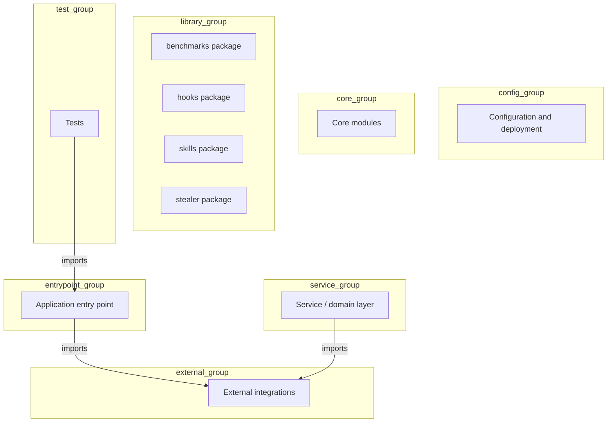

# Architecture report: guillaumemeyer/watermarks-remover

> Automated static analysis. **Observed** = directly seen in files/imports/AST; **Inferred** = interpretation from that evidence. Repository code was not executed.

## 1. Repository at a glance

| Item | Value |
| --- | --- |
| Repository | guillaumemeyer/watermarks-remover |
| Description | A privacy-first app that strips AI watermarks from content you own. |
| Language | Python |
| Stars | 27419 |
| Licence | MIT |
| Analysed commit / branch | 5a62be6338d2812372b1da440e55c82922f97d53 / main |
| Framework(s) | None detected |
| Files analysed | 295 |
| Components | 10 |

## 2. Architecture in one minute

guillaumemeyer/watermarks-remover - A privacy-first app that strips AI watermarks from content you own.. This repository was analysed statically from 295 file(s) (122 Python). Detected technologies (observed from imports/manifests): GitHub Actions, Redis, NumPy, Docker, Docker Compose, pytest. Files are grouped into 10 component(s): benchmarks package, Configuration and deployment, Core modules, Application entry point, External integrations, hooks package, Service / domain layer, skills package. Observed entry point(s): install_skill.py, service/scripts/audit_dir.py, service/scripts/audit_website.py. Findings below distinguish observed facts from inferred interpretation.

## 3. High-level block diagram

## 4. Main components

### benchmarks package (`benchmarks`)

- **Kind:** library
- **Status:** Observed
- **Confidence:** 0.85
- **Responsibility:** Groups 2 file(s) under benchmarks package (observed from repository paths and static analysis).
- **Paths:** `benchmarks/benchmark-full.sh`, `benchmarks/benchmark-smoke.sh`
- **Evidence:** [benchmarks/benchmark-full.sh](https://github.com/guillaumemeyer/watermarks-remover/blob/5a62be6338d2812372b1da440e55c82922f97d53/benchmarks/benchmark-full.sh); [benchmarks/benchmark-smoke.sh](https://github.com/guillaumemeyer/watermarks-remover/blob/5a62be6338d2812372b1da440e55c82922f97d53/benchmarks/benchmark-smoke.sh)

### Configuration and deployment (`config`)

- **Kind:** config
- **Status:** Observed
- **Confidence:** 0.85
- **Responsibility:** Groups 18 file(s) under configuration and deployment (observed from repository paths and static analysis).
- **Paths:** `benchmarks/providers/deepseek.json`, `compose.yaml`, `config/clean_strategy.json`, `hooks/hooks.json`, `pytest.ini`, `requirements-dev.txt`, `ruff.toml`, `service/.dockerignore`, `service/Dockerfile`, `service/Dockerfile.ctrlregen`, `service/Dockerfile.markdiffusion`, `service/Dockerfile.markllm`, `service/Dockerfile.synthid`, `service/scripts/requirements-ctrlregen.txt`, `service/scripts/requirements-markdiffusion.txt`, `service/scripts/requirements-markllm.txt`, `service/scripts/requirements-semantic.txt`, `service/scripts/requirements-synthid-scorer.txt`
- **Evidence:** [benchmarks/providers/deepseek.json](https://github.com/guillaumemeyer/watermarks-remover/blob/5a62be6338d2812372b1da440e55c82922f97d53/benchmarks/providers/deepseek.json); [compose.yaml](https://github.com/guillaumemeyer/watermarks-remover/blob/5a62be6338d2812372b1da440e55c82922f97d53/compose.yaml); [config/clean_strategy.json](https://github.com/guillaumemeyer/watermarks-remover/blob/5a62be6338d2812372b1da440e55c82922f97d53/config/clean_strategy.json); [hooks/hooks.json](https://github.com/guillaumemeyer/watermarks-remover/blob/5a62be6338d2812372b1da440e55c82922f97d53/hooks/hooks.json); [pytest.ini](https://github.com/guillaumemeyer/watermarks-remover/blob/5a62be6338d2812372b1da440e55c82922f97d53/pytest.ini); [requirements-dev.txt](https://github.com/guillaumemeyer/watermarks-remover/blob/5a62be6338d2812372b1da440e55c82922f97d53/requirements-dev.txt); [ruff.toml](https://github.com/guillaumemeyer/watermarks-remover/blob/5a62be6338d2812372b1da440e55c82922f97d53/ruff.toml); [service/.dockerignore](https://github.com/guillaumemeyer/watermarks-remover/blob/5a62be6338d2812372b1da440e55c82922f97d53/service/.dockerignore)

### Core modules (`core`)

- **Kind:** core
- **Status:** Observed
- **Confidence:** 0.85
- **Responsibility:** Groups 2 file(s) under core modules (observed from repository paths and static analysis).
- **Paths:** `compose-check.sh`, `install-skill.sh`
- **Evidence:** [compose-check.sh](https://github.com/guillaumemeyer/watermarks-remover/blob/5a62be6338d2812372b1da440e55c82922f97d53/compose-check.sh); [install-skill.sh](https://github.com/guillaumemeyer/watermarks-remover/blob/5a62be6338d2812372b1da440e55c82922f97d53/install-skill.sh)

### Application entry point (`entrypoint`)

- **Kind:** entrypoint
- **Status:** Observed
- **Confidence:** 0.85
- **Responsibility:** Groups 31 file(s) under application entry point (observed from repository paths and static analysis). Observed top-level classes: Benchmark, Handler, HumanLikeness, MarkLLMWorker, MarkerMatch, SemanticEmbedder. Observed top-level functions: _add_common, _apply_layer_b, _auc, _backend_configured, _backup_name, _base_url_is_loopback.
- **Paths:** `install_skill.py`, `service/scripts/audit_dir.py`, `service/scripts/audit_website.py`, `service/scripts/bench_deepseek_smoke.py`, `service/scripts/bench_synthid_text.py`, `service/scripts/check_staged.py`, `service/scripts/clean_audio.py`, `service/scripts/clean_ctrlregen.py`, `service/scripts/clean_file.py`, `service/scripts/clean_image.py`, `service/scripts/clean_staged.py`, `service/scripts/clean_text.py`, `service/scripts/clean_video.py`, `service/scripts/detect_gumbel.py`, `service/scripts/detect_text_watermark.py`, `service/scripts/hook_written_file.py`, `service/scripts/inspect_file.py`, `service/scripts/inspect_image.py`, `service/scripts/inspect_text.py`, `service/scripts/markdiffusion_harness.py`, `service/scripts/rewrite_text.py`, `service/scripts/score_stylometry.py`, `service/scripts/score_synthid.py`, `service/scripts/server.py`, `service/scripts/synthid_score_server.py`, `service/scripts/synthid_text_server.py`, `skills/clean-user-facing-text/scripts/clean_text.py`, `skills/clean-user-facing-text/scripts/inspect_text.py`, `skills/clean-user-facing-text/scripts/score_stylometry.py`, `stealer/download_prompts.py`, `stealer/steal.py`
- **Evidence:** [install_skill.py:60](https://github.com/guillaumemeyer/watermarks-remover/blob/5a62be6338d2812372b1da440e55c82922f97d53/install_skill.py#L60); [service/scripts/audit_dir.py:40](https://github.com/guillaumemeyer/watermarks-remover/blob/5a62be6338d2812372b1da440e55c82922f97d53/service/scripts/audit_dir.py#L40); [service/scripts/audit_website.py:67](https://github.com/guillaumemeyer/watermarks-remover/blob/5a62be6338d2812372b1da440e55c82922f97d53/service/scripts/audit_website.py#L67); [service/scripts/bench_deepseek_smoke.py:26](https://github.com/guillaumemeyer/watermarks-remover/blob/5a62be6338d2812372b1da440e55c82922f97d53/service/scripts/bench_deepseek_smoke.py#L26); [service/scripts/bench_synthid_text.py:80](https://github.com/guillaumemeyer/watermarks-remover/blob/5a62be6338d2812372b1da440e55c82922f97d53/service/scripts/bench_synthid_text.py#L80); [service/scripts/check_staged.py:27](https://github.com/guillaumemeyer/watermarks-remover/blob/5a62be6338d2812372b1da440e55c82922f97d53/service/scripts/check_staged.py#L27); [service/scripts/clean_audio.py:56](https://github.com/guillaumemeyer/watermarks-remover/blob/5a62be6338d2812372b1da440e55c82922f97d53/service/scripts/clean_audio.py#L56); [service/scripts/clean_ctrlregen.py:34](https://github.com/guillaumemeyer/watermarks-remover/blob/5a62be6338d2812372b1da440e55c82922f97d53/service/scripts/clean_ctrlregen.py#L34)

### External integrations (`external_integrations`)

- **Kind:** external
- **Status:** Inferred
- **Confidence:** 0.70
- **Responsibility:** Groups 0 file(s) under external integrations (observed from repository paths and static analysis).
- **Evidence:** [service/scripts/audit_website.py:17](https://github.com/guillaumemeyer/watermarks-remover/blob/5a62be6338d2812372b1da440e55c82922f97d53/service/scripts/audit_website.py#L17); [service/scripts/detect_text_watermark.py:30](https://github.com/guillaumemeyer/watermarks-remover/blob/5a62be6338d2812372b1da440e55c82922f97d53/service/scripts/detect_text_watermark.py#L30); [service/scripts/text_detectors.py:83](https://github.com/guillaumemeyer/watermarks-remover/blob/5a62be6338d2812372b1da440e55c82922f97d53/service/scripts/text_detectors.py#L83)

### hooks package (`hooks`)

- **Kind:** library
- **Status:** Observed
- **Confidence:** 0.85
- **Responsibility:** Groups 1 file(s) under hooks package (observed from repository paths and static analysis).
- **Paths:** `hooks/run_hook.js`
- **Evidence:** [hooks/run_hook.js](https://github.com/guillaumemeyer/watermarks-remover/blob/5a62be6338d2812372b1da440e55c82922f97d53/hooks/run_hook.js)

### Service / domain layer (`service_layer`)

- **Kind:** service
- **Status:** Observed
- **Confidence:** 0.85
- **Responsibility:** Groups 14 file(s) under service / domain layer (observed from repository paths and static analysis). Observed top-level classes: AVInspectReport, CharHit, ClaudeTextDetector, ContainerInspectReport, GumbelTextDetector, ImageInspectReport. Observed top-level functions: _add_attachment, _any_jpeg, _blank_xmp_packets, _blob_hits, _bmp_payload_extent, _bmp_trailing.
- **Paths:** `service/scripts/audit_lib.py`, `service/scripts/av_meta.py`, `service/scripts/common.py`, `service/scripts/container_meta.py`, `service/scripts/format_dispatch.py`, `service/scripts/humanize_pass.py`, `service/scripts/image_meta.py`, `service/scripts/setup_ctrlregen.sh`, `service/scripts/setup_markdiffusion.sh`, `service/scripts/setup_markllm.sh`, `service/scripts/setup_synthid.sh`, `service/scripts/text_detectors.py`, `service/scripts/text_unicode.py`, `service/scripts/text_watermark.py`
- **Evidence:** [service/scripts/audit_lib.py:22](https://github.com/guillaumemeyer/watermarks-remover/blob/5a62be6338d2812372b1da440e55c82922f97d53/service/scripts/audit_lib.py#L22); [service/scripts/av_meta.py:48](https://github.com/guillaumemeyer/watermarks-remover/blob/5a62be6338d2812372b1da440e55c82922f97d53/service/scripts/av_meta.py#L48); [service/scripts/common.py:34](https://github.com/guillaumemeyer/watermarks-remover/blob/5a62be6338d2812372b1da440e55c82922f97d53/service/scripts/common.py#L34); [service/scripts/container_meta.py:67](https://github.com/guillaumemeyer/watermarks-remover/blob/5a62be6338d2812372b1da440e55c82922f97d53/service/scripts/container_meta.py#L67); [service/scripts/format_dispatch.py:129](https://github.com/guillaumemeyer/watermarks-remover/blob/5a62be6338d2812372b1da440e55c82922f97d53/service/scripts/format_dispatch.py#L129); [service/scripts/humanize_pass.py:43](https://github.com/guillaumemeyer/watermarks-remover/blob/5a62be6338d2812372b1da440e55c82922f97d53/service/scripts/humanize_pass.py#L43); [service/scripts/image_meta.py:50](https://github.com/guillaumemeyer/watermarks-remover/blob/5a62be6338d2812372b1da440e55c82922f97d53/service/scripts/image_meta.py#L50); [service/scripts/setup_ctrlregen.sh](https://github.com/guillaumemeyer/watermarks-remover/blob/5a62be6338d2812372b1da440e55c82922f97d53/service/scripts/setup_ctrlregen.sh)

### skills package (`skills`)

- **Kind:** library
- **Status:** Observed
- **Confidence:** 0.85
- **Responsibility:** Groups 2 file(s) under skills package (observed from repository paths and static analysis). Observed top-level classes: CharHit, TextInspectReport. Observed top-level functions: _char_label, _configure_stdio, _decide, _default_file_mode, _hit_confidence, _is_cjk_ideograph.
- **Paths:** `skills/clean-user-facing-text/scripts/common.py`, `skills/clean-user-facing-text/scripts/text_unicode.py`
- **Evidence:** [skills/clean-user-facing-text/scripts/common.py:34](https://github.com/guillaumemeyer/watermarks-remover/blob/5a62be6338d2812372b1da440e55c82922f97d53/skills/clean-user-facing-text/scripts/common.py#L34); [skills/clean-user-facing-text/scripts/text_unicode.py:190](https://github.com/guillaumemeyer/watermarks-remover/blob/5a62be6338d2812372b1da440e55c82922f97d53/skills/clean-user-facing-text/scripts/text_unicode.py#L190)

### stealer package (`stealer`)

- **Kind:** library
- **Status:** Observed
- **Confidence:** 0.85
- **Responsibility:** Groups 3 file(s) under stealer package (observed from repository paths and static analysis). Observed top-level functions: _prob, apply_delta, build_scorer, context_key, count_ngrams, default_tokenize.
- **Paths:** `stealer/__init__.py`, `stealer/scorer.py`, `stealer/tokens.py`
- **Evidence:** [stealer/__init__.py](https://github.com/guillaumemeyer/watermarks-remover/blob/5a62be6338d2812372b1da440e55c82922f97d53/stealer/__init__.py); [stealer/scorer.py:17](https://github.com/guillaumemeyer/watermarks-remover/blob/5a62be6338d2812372b1da440e55c82922f97d53/stealer/scorer.py#L17); [stealer/tokens.py:12](https://github.com/guillaumemeyer/watermarks-remover/blob/5a62be6338d2812372b1da440e55c82922f97d53/stealer/tokens.py#L12)

### Tests (`tests`)

- **Kind:** test
- **Status:** Observed
- **Confidence:** 0.85
- **Responsibility:** Groups 82 file(s) under tests (observed from repository paths and static analysis). Observed top-level classes: TestSvgSecurityHardening, _Completed, _FakeBench, _FakeMarkLLM, _FakeOpener, _FakeResp. Observed top-level functions: _ai_pdf, _args, _assemble_pdf, _assert_completes_fast, _audio_codecs, _avif.
- **Paths:** `tests/conftest.py`, `tests/fixtures/sample_ai.html`, `tests/fixtures/sample_ai.md`, `tests/fixtures/sample_meta.svg`, `tests/fixtures/sample_watermarked.txt`, `tests/fixtures/stylometry_ai_sample.txt`, `tests/fixtures/stylometry_human_sample.txt`, `tests/test_ai_generator_hints.py`, `tests/test_audit.py`, `tests/test_audit_sarif_and_concurrency.py`, `tests/test_av_meta.py`, `tests/test_avif_heic.py`, `tests/test_backup_preserved.py`, `tests/test_bench_deepseek_smoke.py`, `tests/test_bench_synthid_text.py`, `tests/test_binary_guard.py`, `tests/test_c2patool_report.py`, `tests/test_capabilities_tooling.py`, `tests/test_child_console_windows.py`, `tests/test_clean_audio.py`, `tests/test_clean_file_clean_exit.py`, `tests/test_clean_file_quiet.py`, `tests/test_clean_image.py`, `tests/test_clean_options_normalize_spaces.py`, `tests/test_clean_strategy.py`, `tests/test_clean_text.py`, `tests/test_clean_video.py`, `tests/test_container_meta.py`, `tests/test_ctrlregen_clean.py`, `tests/test_detect_endpoint.py`, `tests/test_dockerfile_markllm_copies.py`, `tests/test_embedded_data_uris.py`, `tests/test_entity_encoded_watermarks.py`, `tests/test_epub.py`, `tests/test_format_dispatch.py`, `tests/test_frontmatter_false_positives.py`, `tests/test_frontmatter_multiline_values.py`, `tests/test_gumbel_detector.py`, `tests/test_hook_written_file.py`, `tests/test_http_server.py`, `tests/test_humanize_pass.py`, `tests/test_image_formats_bmp_gif_tiff.py`, `tests/test_inspect_file.py`, `tests/test_inspect_synthid_verdict.py`, `tests/test_install_skill.py`, `tests/test_isobmff_truncated_bytescan.py`, `tests/test_json_exit_code.py`, `tests/test_latex_meta.py`, `tests/test_lightweight_skill.py`, `tests/test_makefile_targets.py`, `tests/test_markdiffusion_harness.py`, `tests/test_markllm_detect.py`, `tests/test_markllm_schemes.py`, `tests/test_ooxml_xlsx_pptx.py`, `tests/test_pdf_attachments.py`, `tests/test_pdf_deep_images.py`, `tests/test_pdf_structural_rewrite.py`, `tests/test_plugin_manifest.py`, `tests/test_precommit_hooks.py`, `tests/test_prose_values_not_provenance.py`, `tests/test_relationship_xml_entities.py`, `tests/test_rewrite_text.py`, `tests/test_security_hardening.py`, `tests/test_single_quoted_attributes.py`, `tests/test_source_extension_coverage.py`, `tests/test_source_extensions_scanned.py`, `tests/test_space_confidence_parity.py`, `tests/test_stealer.py`, `tests/test_stylometry.py`, `tests/test_stylometry_empty_sentences.py`, `tests/test_svg_security_hardening.py`, `tests/test_synthid_score.py`, `tests/test_synthid_stdout_purity.py`, `tests/test_synthid_text_server.py`, `tests/test_text_detectors.py`, `tests/test_truncated_id3v2.py`, `tests/test_truncated_tail_preserved.py`, `tests/test_unscanned_file_accounting.py`, `tests/test_watermark_endpoint.py`, `tests/test_website_format_routing.py`, `tests/test_website_zip_container_routing.py`, `tests/test_zip_partial_evidence.py`
- **Evidence:** [tests/conftest.py:26](https://github.com/guillaumemeyer/watermarks-remover/blob/5a62be6338d2812372b1da440e55c82922f97d53/tests/conftest.py#L26); [tests/fixtures/sample_ai.html](https://github.com/guillaumemeyer/watermarks-remover/blob/5a62be6338d2812372b1da440e55c82922f97d53/tests/fixtures/sample_ai.html); [tests/fixtures/sample_ai.md](https://github.com/guillaumemeyer/watermarks-remover/blob/5a62be6338d2812372b1da440e55c82922f97d53/tests/fixtures/sample_ai.md); [tests/fixtures/sample_meta.svg](https://github.com/guillaumemeyer/watermarks-remover/blob/5a62be6338d2812372b1da440e55c82922f97d53/tests/fixtures/sample_meta.svg); [tests/fixtures/sample_watermarked.txt](https://github.com/guillaumemeyer/watermarks-remover/blob/5a62be6338d2812372b1da440e55c82922f97d53/tests/fixtures/sample_watermarked.txt); [tests/fixtures/stylometry_ai_sample.txt](https://github.com/guillaumemeyer/watermarks-remover/blob/5a62be6338d2812372b1da440e55c82922f97d53/tests/fixtures/stylometry_ai_sample.txt); [tests/fixtures/stylometry_human_sample.txt](https://github.com/guillaumemeyer/watermarks-remover/blob/5a62be6338d2812372b1da440e55c82922f97d53/tests/fixtures/stylometry_human_sample.txt); [tests/test_ai_generator_hints.py:39](https://github.com/guillaumemeyer/watermarks-remover/blob/5a62be6338d2812372b1da440e55c82922f97d53/tests/test_ai_generator_hints.py#L39)

## 5. Execution flow

**Observed** entry point(s):

- [install_skill.py:449](https://github.com/guillaumemeyer/watermarks-remover/blob/5a62be6338d2812372b1da440e55c82922f97d53/install_skill.py#L449)
- [service/scripts/audit_dir.py:167](https://github.com/guillaumemeyer/watermarks-remover/blob/5a62be6338d2812372b1da440e55c82922f97d53/service/scripts/audit_dir.py#L167)
- [service/scripts/audit_website.py:662](https://github.com/guillaumemeyer/watermarks-remover/blob/5a62be6338d2812372b1da440e55c82922f97d53/service/scripts/audit_website.py#L662)
- [service/scripts/bench_deepseek_smoke.py:214](https://github.com/guillaumemeyer/watermarks-remover/blob/5a62be6338d2812372b1da440e55c82922f97d53/service/scripts/bench_deepseek_smoke.py#L214)
- [service/scripts/bench_synthid_text.py:3827](https://github.com/guillaumemeyer/watermarks-remover/blob/5a62be6338d2812372b1da440e55c82922f97d53/service/scripts/bench_synthid_text.py#L3827)
- [service/scripts/check_staged.py:84](https://github.com/guillaumemeyer/watermarks-remover/blob/5a62be6338d2812372b1da440e55c82922f97d53/service/scripts/check_staged.py#L84)
- [service/scripts/clean_audio.py:310](https://github.com/guillaumemeyer/watermarks-remover/blob/5a62be6338d2812372b1da440e55c82922f97d53/service/scripts/clean_audio.py#L310)
- [service/scripts/clean_ctrlregen.py:211](https://github.com/guillaumemeyer/watermarks-remover/blob/5a62be6338d2812372b1da440e55c82922f97d53/service/scripts/clean_ctrlregen.py#L211)
- [service/scripts/clean_file.py:291](https://github.com/guillaumemeyer/watermarks-remover/blob/5a62be6338d2812372b1da440e55c82922f97d53/service/scripts/clean_file.py#L291)
- [service/scripts/clean_image.py:209](https://github.com/guillaumemeyer/watermarks-remover/blob/5a62be6338d2812372b1da440e55c82922f97d53/service/scripts/clean_image.py#L209)
- [service/scripts/clean_staged.py:186](https://github.com/guillaumemeyer/watermarks-remover/blob/5a62be6338d2812372b1da440e55c82922f97d53/service/scripts/clean_staged.py#L186)
- [service/scripts/clean_text.py:97](https://github.com/guillaumemeyer/watermarks-remover/blob/5a62be6338d2812372b1da440e55c82922f97d53/service/scripts/clean_text.py#L97)

Representative flow (derived from observed entry points and the import graph; steps beyond the entry point are **Inferred**):

1. Execution starts at an observed entry point listed above, if present.
2. `entrypoint` imports `external_integrations` (Application entry point -> External integrations).
3. `service_layer` imports `external_integrations` (Service / domain layer -> External integrations).
4. `tests` imports `entrypoint` (Tests -> Application entry point).

## 6. Project structure

### `(root)`

- `.coderabbit.yaml` - config (1962 bytes)
- `.dockerignore` - container (235 bytes)
- `.env.example` - config (3465 bytes)
- `.gitignore` - other (1031 bytes)
- `.pre-commit-hooks.yaml` - config (626 bytes)
- `CODE_OF_CONDUCT.md` - docs (5522 bytes)
- `CONTRIBUTING.md` - docs (3762 bytes)
- `LICENSE` - docs (1089 bytes)
- `Makefile` - other (6838 bytes)
- `README.md` - docs (102332 bytes)
- `SECURITY.md` - docs (2071 bytes)
- `compose-check.sh` - source, Shell (753 bytes)
- `compose.yaml` - container (6737 bytes)
- `install-skill.sh` - source, Shell (135 bytes)
- `install_skill.py` - source, Python (16547 bytes)
- `pytest.ini` - config (65 bytes)
- `requirements-dev.txt` - manifest (202 bytes)
- `ruff.toml` - config (1189 bytes)

### `.claude-plugin`

- `.claude-plugin/marketplace.json` - config (1288 bytes)
- `.claude-plugin/plugin.json` - config (1273 bytes)

### `.github`

- `.github/CODEOWNERS` - other (417 bytes)
- `.github/ISSUE_TEMPLATE/bug_report.md` - docs (1115 bytes)
- `.github/ISSUE_TEMPLATE/feature_request.md` - docs (516 bytes)
- `.github/ISSUE_TEMPLATE/release_suggestion.md` - docs (525 bytes)
- `.github/PULL_REQUEST_TEMPLATE.md` - docs (668 bytes)
- `.github/dependabot.yml` - config (1484 bytes)
- `.github/workflows/ci.yml` - ci, YAML (4366 bytes)
- `.github/workflows/codeql.yml` - ci, YAML (715 bytes)
- `.github/workflows/release-images.yml` - ci, YAML (2616 bytes)

### `benchmarks`

- `benchmarks/README.md` - docs (1043 bytes)
- `benchmarks/benchmark-full.sh` - source, Shell (1168 bytes)
- `benchmarks/benchmark-smoke.sh` - source, Shell (614 bytes)
- `benchmarks/corpus-large/beekeeping.txt` - docs (453 bytes)
- `benchmarks/corpus-large/bicycle-maintenance.txt` - docs (445 bytes)
- `benchmarks/corpus-large/birdwatching.txt` - docs (383 bytes)
- `benchmarks/corpus-large/bookbinding.txt` - docs (414 bytes)
- `benchmarks/corpus-large/budget-travel.txt` - docs (423 bytes)
- `benchmarks/corpus-large/car-maintenance.txt` - docs (469 bytes)
- `benchmarks/corpus-large/cheese-making.txt` - docs (398 bytes)
- `benchmarks/corpus-large/cloud-computing.txt` - docs (531 bytes)
- `benchmarks/corpus-large/coffee-brewing.txt` - docs (506 bytes)
- `benchmarks/corpus-large/dog-training.txt` - docs (431 bytes)
- `benchmarks/corpus-large/emergency-preparedness.txt` - docs (407 bytes)
- `benchmarks/corpus-large/film-photography.txt` - docs (444 bytes)
- `benchmarks/corpus-large/fish-keeping.txt` - docs (411 bytes)
- `benchmarks/corpus-large/hiking-checklist.txt` - docs (475 bytes)
- `benchmarks/corpus-large/home-internet-setup.txt` - docs (425 bytes)
- `benchmarks/corpus-large/home-pest-control.txt` - docs (395 bytes)
- `benchmarks/corpus-large/nutrition-myths.txt` - docs (527 bytes)
- `benchmarks/corpus-large/ocean-plastics.txt` - docs (440 bytes)
- `benchmarks/corpus-large/open-source-licenses.txt` - docs (528 bytes)
- `benchmarks/corpus-large/pottery-basics.txt` - docs (414 bytes)
- `benchmarks/corpus-large/remote-work.txt` - docs (400 bytes)
- `benchmarks/corpus-large/renewable-energy.txt` - docs (500 bytes)
- `benchmarks/corpus-large/sleep-hygiene.txt` - docs (435 bytes)
- `benchmarks/corpus-large/small-biz-finance.txt` - docs (493 bytes)
- `benchmarks/corpus-large/stargazing-basics.txt` - docs (390 bytes)
- `benchmarks/corpus-large/tomato-gardening.txt` - docs (421 bytes)
- `benchmarks/corpus-large/urban-commuting.txt` - docs (429 bytes)
- `benchmarks/corpus-large/venice-history.txt` - docs (531 bytes)
- `benchmarks/corpus-large/wildlife-photography.txt` - docs (453 bytes)
- `benchmarks/corpus-large/woodworking-safety.txt` - docs (403 bytes)
- `benchmarks/corpus-polish/01_chmura-obliczeniowa.txt` - docs (443 bytes)
- `benchmarks/corpus-polish/02_parzenie-kawy.txt` - docs (505 bytes)
- `benchmarks/corpus-polish/03_przygotowanie-do-wedrowki.txt` - docs (424 bytes)
- `benchmarks/corpus-polish/04_mity-zywieniowe.txt` - docs (521 bytes)
- `benchmarks/corpus-polish/05_licencje-otwartego-oprogramowania.txt` - docs (466 bytes)
- `benchmarks/corpus-polish/06_energia-odnawialna.txt` - docs (476 bytes)
- `benchmarks/corpus-polish/07_finanse-malej-firmy.txt` - docs (450 bytes)
- `benchmarks/corpus-polish/08_historia-wenecji.txt` - docs (506 bytes)
- `benchmarks/corpus-polish/09_brak-skladnika-w-piekarni.txt` - docs (446 bytes)
- `benchmarks/corpus-polish/10_naprawa-starej-kuchni.txt` - docs (429 bytes)
- `benchmarks/corpus-polish/11_zimowe-zapasy.txt` - docs (425 bytes)
- `benchmarks/corpus-polish/12_podroz-bez-bagazu.txt` - docs (422 bytes)
- `benchmarks/corpus-polish/13_opieka-nad-ogrodem.txt` - docs (480 bytes)
- `benchmarks/corpus-polish/14_pomoc-w-schronisku.txt` - docs (490 bytes)
- `benchmarks/corpus-polish/15_nauka-pracy-w-sklepie.txt` - docs (429 bytes)
- `benchmarks/corpus-polish/16_przygotowanie-szkolnego-festynu.txt` - docs (455 bytes)
- `benchmarks/corpus-polish/17_awaria-w-pensjonacie.txt` - docs (427 bytes)
- `benchmarks/corpus-polish/18_rodzinny-posilek.txt` - docs (433 bytes)
- `benchmarks/corpus-polish/19_pakowanie-przed-przeprowadzka.txt` - docs (406 bytes)
- `benchmarks/corpus-polish/20_zakup-roweru.txt` - docs (396 bytes)
- `benchmarks/corpus-polish/21_badanie-psa.txt` - docs (443 bytes)
- `benchmarks/corpus-polish/22_planowanie-podrozy.txt` - docs (439 bytes)
- `benchmarks/corpus-polish/23_poszukiwanie-turysty.txt` - docs (418 bytes)
- `benchmarks/corpus-polish/24_spacer-z-psem.txt` - docs (376 bytes)
- `benchmarks/corpus-polish/25_czyszczenie-starego-stolu.txt` - docs (405 bytes)
- `benchmarks/corpus-polish/26_podroz-na-wyspe.txt` - docs (390 bytes)
- `benchmarks/corpus-polish/27_wspolna-wystawa.txt` - docs (425 bytes)
- `benchmarks/corpus-polish/28_wyjazd-grupy-nad-jezioro.txt` - docs (430 bytes)
- `benchmarks/corpus-polish/29_rozmowa-o-przeprowadzce.txt` - docs (383 bytes)
- `benchmarks/corpus-polish/30_odnowienie-oranzerii.txt` - docs (372 bytes)
- `benchmarks/corpus-polish/31_rozmowa-o-osiedlu.txt` - docs (423 bytes)
- `benchmarks/corpus-polish/32_wspomnienie-o-wycieczce.txt` - docs (381 bytes)
- `benchmarks/corpus-polish/33_mieszkania-w-starej-kamienicy.txt` - docs (435 bytes)
- `benchmarks/corpus-polish/34_wystawcy-na-kiermaszu.txt` - docs (436 bytes)
- `benchmarks/corpus-polish/35_rodzenstwo-w-pracowni.txt` - docs (456 bytes)
- `benchmarks/corpus-polish/36_siedem-domkow-nad-jeziorem.txt` - docs (422 bytes)
- `benchmarks/corpus-polish/37_urzadzanie-nowego-mieszkania.txt` - docs (445 bytes)
- `benchmarks/corpus-polish/38_zimowy-poranek-w-schronisku.txt` - docs (447 bytes)
- `benchmarks/corpus-polish/39_poranna-rutyna.txt` - docs (397 bytes)
- `benchmarks/corpus-polish/40_wczorajsza-wyprawa.txt` - docs (446 bytes)
- `benchmarks/corpus-polish/41_przyszly-ogrod.txt` - docs (415 bytes)
- `benchmarks/corpus-polish/42_rozmowa-po-seansie.txt` - docs (432 bytes)
- `benchmarks/corpus-polish/43_wybor-filmu-i-biletow.txt` - docs (422 bytes)
- `benchmarks/corpus-polish/44_trudna-decyzja.txt` - docs (399 bytes)
- `benchmarks/corpus-polish/45_pierwszy-dzien-w-pracy.txt` - docs (397 bytes)
- `benchmarks/corpus-polish/46_zagubiona-pamiatka.txt` - docs (383 bytes)
- `benchmarks/corpus-polish/47_siostry-w-pensjonacie.txt` - docs (402 bytes)
- `benchmarks/corpus-polish/48_pierwsza-randka.txt` - docs (394 bytes)
- `benchmarks/corpus-polish/49_zaproszenie-na-spotkanie.txt` - docs (419 bytes)
- `benchmarks/corpus-polish/50_dziecko-i-dziewczynka.txt` - docs (400 bytes)
- `benchmarks/corpus-polish/README.md` - docs (18678 bytes)
- `benchmarks/corpus-polish/additional/A01_gorzka-herbata-w-kubku.txt` - docs (384 bytes)
- `benchmarks/corpus-polish/additional/A02_zmiana-organizacji-ruchu.txt` - docs (423 bytes)
- `benchmarks/corpus-polish/additional/A03_kontrola-instalacji.txt` - docs (482 bytes)
- `benchmarks/corpus-polish/excluded-numeric/X01_zaginione-dziecko-cyfry.txt` - docs (432 bytes)
- `benchmarks/corpus-polish/excluded-numeric/X02_zwierzeta-w-schronisku-cyfry.txt` - docs (417 bytes)
- `benchmarks/corpus-polish/excluded-numeric/X03_dostawa-do-ksiegarni-cyfry.txt` - docs (440 bytes)
- `benchmarks/corpus-polish/excluded-numeric/X04_grupa-wycieczkowa-cyfry.txt` - docs (454 bytes)
- `benchmarks/corpus/cloud-computing.txt` - docs (531 bytes)
- `benchmarks/corpus/coffee-brewing.txt` - docs (506 bytes)
- `benchmarks/corpus/hiking-checklist.txt` - docs (475 bytes)
- `benchmarks/corpus/nutrition-myths.txt` - docs (527 bytes)
- `benchmarks/corpus/open-source-licenses.txt` - docs (528 bytes)
- `benchmarks/corpus/renewable-energy.txt` - docs (500 bytes)
- `benchmarks/corpus/small-biz-finance.txt` - docs (493 bytes)
- `benchmarks/corpus/venice-history.txt` - docs (531 bytes)
- `benchmarks/providers/deepseek.json` - config (784 bytes)

### `config`

- `config/clean_strategy.json` - config (51 bytes)

### `docs`

- `docs/deepseek-benchmark.md` - docs (6059 bytes)
- `docs/frontmatter-scanning.md` - docs (3261 bytes)
- `docs/plans/ideas/deployment-docker-cli-api.md` - docs (4583 bytes)
- `docs/synthid-text-benchmark.md` - docs (21654 bytes)
- `docs/windows-autostart.md` - docs (1890 bytes)

### `hooks`

- `hooks/hooks.json` - config (455 bytes)
- `hooks/run_hook.js` - source, JavaScript (2983 bytes)

### `integrations`

- `integrations/cursor/clean-user-facing-text.mdc` - other (855 bytes)

### `service`

- `service/.dockerignore` - container (257 bytes)
- `service/Dockerfile` - container (2925 bytes)
- `service/Dockerfile.ctrlregen` - container (2803 bytes)
- `service/Dockerfile.markdiffusion` - container (2188 bytes)
- `service/Dockerfile.markllm` - container (3507 bytes)
- `service/Dockerfile.synthid` - container (2523 bytes)
- `service/scripts/audit_dir.py` - source, Python (5003 bytes)
- `service/scripts/audit_lib.py` - source, Python (13387 bytes)
- `service/scripts/audit_website.py` - source, Python (20308 bytes)
- `service/scripts/av_meta.py` - source, Python (21493 bytes)
- `service/scripts/bench_deepseek_smoke.py` - source, Python (9244 bytes)
- `service/scripts/bench_synthid_text.py` - source, Python (158769 bytes)
- `service/scripts/check_staged.py` - source, Python (3108 bytes)
- `service/scripts/clean_audio.py` - source, Python (10671 bytes)
- `service/scripts/clean_ctrlregen.py` - source, Python (6408 bytes)
- `service/scripts/clean_file.py` - source, Python (10931 bytes)
- `service/scripts/clean_image.py` - source, Python (7132 bytes)
- `service/scripts/clean_staged.py` - source, Python (7635 bytes)
- `service/scripts/clean_text.py` - source, Python (3109 bytes)
- `service/scripts/clean_video.py` - source, Python (17362 bytes)
- `service/scripts/common.py` - source, Python (21369 bytes)
- `service/scripts/container_meta.py` - source, Python (186250 bytes)
- `service/scripts/detect_gumbel.py` - source, Python (10812 bytes)
- `service/scripts/detect_text_watermark.py` - source, Python (23200 bytes)
- `service/scripts/format_dispatch.py` - source, Python (5036 bytes)
- `service/scripts/hook_written_file.py` - source, Python (10589 bytes)
- `service/scripts/humanize_pass.py` - source, Python (4138 bytes)
- `service/scripts/image_meta.py` - source, Python (86849 bytes)
- `service/scripts/inspect_file.py` - source, Python (4813 bytes)
- `service/scripts/inspect_image.py` - source, Python (2791 bytes)
- `service/scripts/inspect_text.py` - source, Python (4551 bytes)
- `service/scripts/markdiffusion_harness.py` - source, Python (18496 bytes)
- `service/scripts/requirements-ctrlregen.txt` - manifest (1552 bytes)
- `service/scripts/requirements-markdiffusion.txt` - manifest (455 bytes)
- `service/scripts/requirements-markllm.txt` - manifest (1489 bytes)
- `service/scripts/requirements-semantic.txt` - manifest (674 bytes)
- `service/scripts/requirements-synthid-scorer.txt` - manifest (754 bytes)
- `service/scripts/rewrite_text.py` - source, Python (56822 bytes)
- `service/scripts/score_stylometry.py` - source, Python (19955 bytes)
- `service/scripts/score_synthid.py` - source, Python (5647 bytes)
- `service/scripts/server.py` - source, Python (70584 bytes)
- `service/scripts/setup_ctrlregen.ps1` - other (10672 bytes)
- `service/scripts/setup_ctrlregen.sh` - source, Shell (4253 bytes)
- `service/scripts/setup_markdiffusion.sh` - source, Shell (4476 bytes)
- `service/scripts/setup_markllm.sh` - source, Shell (4180 bytes)
- `service/scripts/setup_synthid.ps1` - other (4608 bytes)
- `service/scripts/setup_synthid.sh` - source, Shell (4313 bytes)
- `service/scripts/synthid_score_server.py` - source, Python (6785 bytes)
- `service/scripts/synthid_text_server.py` - source, Python (12506 bytes)
- `service/scripts/text_detectors.py` - source, Python (15171 bytes)
- `service/scripts/text_unicode.py` - source, Python (25110 bytes)
- `service/scripts/text_watermark.py` - source, Python (18405 bytes)

### `skills`

- `skills/clean-user-facing-text/SKILL.md` - docs (13890 bytes)
- `skills/clean-user-facing-text/references/detectors.md` - docs (8308 bytes)
- `skills/clean-user-facing-text/references/responsible-use.md` - docs (536 bytes)
- `skills/clean-user-facing-text/references/watermark-notes.md` - docs (1271 bytes)
- `skills/clean-user-facing-text/references/writing-in-your-voice.md` - docs (2554 bytes)
- `skills/clean-user-facing-text/scripts/clean_text.py` - source, Python (3109 bytes)
- `skills/clean-user-facing-text/scripts/common.py` - source, Python (21369 bytes)
- `skills/clean-user-facing-text/scripts/inspect_text.py` - source, Python (4551 bytes)
- `skills/clean-user-facing-text/scripts/score_stylometry.py` - source, Python (19955 bytes)
- `skills/clean-user-facing-text/scripts/text_unicode.py` - source, Python (25110 bytes)
- `skills/remove-ai-marks/SKILL.md` - docs (19682 bytes)
- `skills/remove-ai-marks/references/ethics.md` - docs (1868 bytes)
- `skills/remove-ai-marks/references/how-claude-marks.md` - docs (1645 bytes)
- `skills/remove-ai-marks/references/mark-classes.md` - docs (4349 bytes)
- `skills/remove-ai-marks/references/markdiffusion.md` - docs (3635 bytes)
- `skills/remove-ai-marks/references/removal-matrix.md` - docs (7798 bytes)
- `skills/remove-ai-marks/references/vendor-notes.md` - docs (5883 bytes)

### `stealer`

- `stealer/README.md` - docs (7274 bytes)
- `stealer/__init__.py` - source, Python (918 bytes)
- `stealer/download_prompts.py` - source, Python (9205 bytes)
- `stealer/scorer.py` - source, Python (5127 bytes)
- `stealer/steal.py` - source, Python (9282 bytes)
- `stealer/tokens.py` - source, Python (1950 bytes)

### `tests`

- `tests/conftest.py` - test, Python (1510 bytes)
- `tests/fixtures/sample_ai.html` - test (360 bytes)
- `tests/fixtures/sample_ai.md` - test (132 bytes)
- `tests/fixtures/sample_meta.svg` - test (217 bytes)
- `tests/fixtures/sample_watermarked.txt` - test (49 bytes)
- `tests/fixtures/stylometry_ai_sample.txt` - test (781 bytes)
- `tests/fixtures/stylometry_human_sample.txt` - test (554 bytes)
- `tests/test_ai_generator_hints.py` - test, Python (6356 bytes)
- `tests/test_audit.py` - test, Python (14921 bytes)
- `tests/test_audit_sarif_and_concurrency.py` - test, Python (9816 bytes)
- `tests/test_av_meta.py` - test, Python (28730 bytes)
- `tests/test_avif_heic.py` - test, Python (5793 bytes)
- `tests/test_backup_preserved.py` - test, Python (1672 bytes)
- `tests/test_bench_deepseek_smoke.py` - test, Python (9430 bytes)
- `tests/test_bench_synthid_text.py` - test, Python (88137 bytes)
- `tests/test_binary_guard.py` - test, Python (10493 bytes)
- `tests/test_c2patool_report.py` - test, Python (7623 bytes)
- `tests/test_capabilities_tooling.py` - test, Python (1708 bytes)
- `tests/test_child_console_windows.py` - test, Python (6020 bytes)
- `tests/test_clean_audio.py` - test, Python (6391 bytes)
- `tests/test_clean_file_clean_exit.py` - test, Python (2920 bytes)
- `tests/test_clean_file_quiet.py` - test, Python (3905 bytes)
- `tests/test_clean_image.py` - test, Python (10376 bytes)
- `tests/test_clean_options_normalize_spaces.py` - test, Python (4575 bytes)
- `tests/test_clean_strategy.py` - test, Python (7519 bytes)
- `tests/test_clean_text.py` - test, Python (17869 bytes)
- `tests/test_clean_video.py` - test, Python (6882 bytes)
- `tests/test_container_meta.py` - test, Python (53020 bytes)
- `tests/test_ctrlregen_clean.py` - test, Python (8631 bytes)
- `tests/test_detect_endpoint.py` - test, Python (10062 bytes)
- `tests/test_dockerfile_markllm_copies.py` - test, Python (2152 bytes)
- `tests/test_embedded_data_uris.py` - test, Python (7710 bytes)
- `tests/test_entity_encoded_watermarks.py` - test, Python (4683 bytes)
- `tests/test_epub.py` - test, Python (9468 bytes)
- `tests/test_format_dispatch.py` - test, Python (2297 bytes)
- `tests/test_frontmatter_false_positives.py` - test, Python (3681 bytes)
- `tests/test_frontmatter_multiline_values.py` - test, Python (3685 bytes)
- `tests/test_gumbel_detector.py` - test, Python (14034 bytes)
- `tests/test_hook_written_file.py` - test, Python (11751 bytes)
- `tests/test_http_server.py` - test, Python (22669 bytes)
- `tests/test_humanize_pass.py` - test, Python (2880 bytes)
- `tests/test_image_formats_bmp_gif_tiff.py` - test, Python (13906 bytes)
- `tests/test_inspect_file.py` - test, Python (994 bytes)
- `tests/test_inspect_synthid_verdict.py` - test, Python (3429 bytes)
- `tests/test_install_skill.py` - test, Python (12136 bytes)
- `tests/test_isobmff_truncated_bytescan.py` - test, Python (7738 bytes)
- `tests/test_json_exit_code.py` - test, Python (3455 bytes)
- `tests/test_latex_meta.py` - test, Python (8649 bytes)
- `tests/test_lightweight_skill.py` - test, Python (8880 bytes)
- `tests/test_makefile_targets.py` - test, Python (4329 bytes)
- `tests/test_markdiffusion_harness.py` - test, Python (13339 bytes)
- `tests/test_markllm_detect.py` - test, Python (11785 bytes)
- `tests/test_markllm_schemes.py` - test, Python (2171 bytes)
- `tests/test_ooxml_xlsx_pptx.py` - test, Python (25365 bytes)
- `tests/test_pdf_attachments.py` - test, Python (11749 bytes)
- `tests/test_pdf_deep_images.py` - test, Python (23749 bytes)
- `tests/test_pdf_structural_rewrite.py` - test, Python (6291 bytes)
- `tests/test_plugin_manifest.py` - test, Python (6285 bytes)
- `tests/test_precommit_hooks.py` - test, Python (22387 bytes)
- `tests/test_prose_values_not_provenance.py` - test, Python (17563 bytes)
- `tests/test_relationship_xml_entities.py` - test, Python (5910 bytes)
- `tests/test_rewrite_text.py` - test, Python (35192 bytes)
- `tests/test_security_hardening.py` - test, Python (21221 bytes)
- `tests/test_single_quoted_attributes.py` - test, Python (4546 bytes)
- `tests/test_source_extension_coverage.py` - test, Python (5088 bytes)
- `tests/test_source_extensions_scanned.py` - test, Python (1700 bytes)
- `tests/test_space_confidence_parity.py` - test, Python (2228 bytes)
- `tests/test_stealer.py` - test, Python (8749 bytes)
- `tests/test_stylometry.py` - test, Python (7437 bytes)
- `tests/test_stylometry_empty_sentences.py` - test, Python (2226 bytes)
- `tests/test_svg_security_hardening.py` - test, Python (7908 bytes)
- `tests/test_synthid_score.py` - test, Python (9527 bytes)
- `tests/test_synthid_stdout_purity.py` - test, Python (2759 bytes)
- `tests/test_synthid_text_server.py` - test, Python (17196 bytes)
- `tests/test_text_detectors.py` - test, Python (10057 bytes)
- `tests/test_truncated_id3v2.py` - test, Python (2713 bytes)
- `tests/test_truncated_tail_preserved.py` - test, Python (3289 bytes)
- `tests/test_unscanned_file_accounting.py` - test, Python (4193 bytes)
- `tests/test_watermark_endpoint.py` - test, Python (20056 bytes)
- `tests/test_website_format_routing.py` - test, Python (3145 bytes)
- `tests/test_website_zip_container_routing.py` - test, Python (2679 bytes)
- `tests/test_zip_partial_evidence.py` - test, Python (4328 bytes)

## 7. Key dependencies and integrations

| Name | Category | Status | Confidence | Evidence |
| --- | --- | --- | --- | --- |
| GitHub Actions | ci | Observed | 0.90 | [.github/workflows/ci.yml](https://github.com/guillaumemeyer/watermarks-remover/blob/5a62be6338d2812372b1da440e55c82922f97d53/.github/workflows/ci.yml); [.github/workflows/codeql.yml](https://github.com/guillaumemeyer/watermarks-remover/blob/5a62be6338d2812372b1da440e55c82922f97d53/.github/workflows/codeql.yml); [.github/workflows/release-images.yml](https://github.com/guillaumemeyer/watermarks-remover/blob/5a62be6338d2812372b1da440e55c82922f97d53/.github/workflows/release-images.yml) |
| Redis | database | Observed | 0.80 | [compose.yaml:14](https://github.com/guillaumemeyer/watermarks-remover/blob/5a62be6338d2812372b1da440e55c82922f97d53/compose.yaml#L14) |
| NumPy | library | Observed | 0.90 | [service/scripts/markdiffusion_harness.py:174](https://github.com/guillaumemeyer/watermarks-remover/blob/5a62be6338d2812372b1da440e55c82922f97d53/service/scripts/markdiffusion_harness.py#L174); [service/scripts/requirements-markllm.txt:31](https://github.com/guillaumemeyer/watermarks-remover/blob/5a62be6338d2812372b1da440e55c82922f97d53/service/scripts/requirements-markllm.txt#L31); [service/scripts/requirements-synthid-scorer.txt:12](https://github.com/guillaumemeyer/watermarks-remover/blob/5a62be6338d2812372b1da440e55c82922f97d53/service/scripts/requirements-synthid-scorer.txt#L12) |
| Docker | tooling | Observed | 0.90 | [.github/workflows/ci.yml:81](https://github.com/guillaumemeyer/watermarks-remover/blob/5a62be6338d2812372b1da440e55c82922f97d53/.github/workflows/ci.yml#L81); [.github/workflows/release-images.yml:20](https://github.com/guillaumemeyer/watermarks-remover/blob/5a62be6338d2812372b1da440e55c82922f97d53/.github/workflows/release-images.yml#L20); [service/Dockerfile](https://github.com/guillaumemeyer/watermarks-remover/blob/5a62be6338d2812372b1da440e55c82922f97d53/service/Dockerfile); [service/Dockerfile.ctrlregen](https://github.com/guillaumemeyer/watermarks-remover/blob/5a62be6338d2812372b1da440e55c82922f97d53/service/Dockerfile.ctrlregen) |
| Docker Compose | tooling | Observed | 0.85 | [compose.yaml](https://github.com/guillaumemeyer/watermarks-remover/blob/5a62be6338d2812372b1da440e55c82922f97d53/compose.yaml) |
| pytest | tooling | Observed | 0.95 | [.github/workflows/ci.yml:27](https://github.com/guillaumemeyer/watermarks-remover/blob/5a62be6338d2812372b1da440e55c82922f97d53/.github/workflows/ci.yml#L27); [requirements-dev.txt:3](https://github.com/guillaumemeyer/watermarks-remover/blob/5a62be6338d2812372b1da440e55c82922f97d53/requirements-dev.txt#L3); [tests/conftest.py:16](https://github.com/guillaumemeyer/watermarks-remover/blob/5a62be6338d2812372b1da440e55c82922f97d53/tests/conftest.py#L16); [tests/test_ai_generator_hints.py:17](https://github.com/guillaumemeyer/watermarks-remover/blob/5a62be6338d2812372b1da440e55c82922f97d53/tests/test_ai_generator_hints.py#L17) |
| unittest | tooling | Observed | 0.95 | [tests/test_clean_image.py:202](https://github.com/guillaumemeyer/watermarks-remover/blob/5a62be6338d2812372b1da440e55c82922f97d53/tests/test_clean_image.py#L202); [tests/test_svg_security_hardening.py:2](https://github.com/guillaumemeyer/watermarks-remover/blob/5a62be6338d2812372b1da440e55c82922f97d53/tests/test_svg_security_hardening.py#L2) |

## 8. Data and state

- **Redis** (Observed, confidence 0.80) - evidence: [compose.yaml:14](https://github.com/guillaumemeyer/watermarks-remover/blob/5a62be6338d2812372b1da440e55c82922f97d53/compose.yaml#L14)

## 9. Configuration and deployment clues

- `.claude-plugin/marketplace.json` (config)
- `.claude-plugin/plugin.json` (config)
- `.coderabbit.yaml` (config)
- `.dockerignore` (container)
- `.env.example` (config)
- `.github/dependabot.yml` (config)
- `.github/workflows/ci.yml` (ci)
- `.github/workflows/codeql.yml` (ci)
- `.github/workflows/release-images.yml` (ci)
- `.pre-commit-hooks.yaml` (config)
- `benchmarks/providers/deepseek.json` (config)
- `compose.yaml` (container)
- `config/clean_strategy.json` (config)
- `hooks/hooks.json` (config)
- `pytest.ini` (config)
- `requirements-dev.txt` (manifest)
- `ruff.toml` (config)
- `service/.dockerignore` (container)
- `service/Dockerfile` (container)
- `service/Dockerfile.ctrlregen` (container)
- `service/Dockerfile.markdiffusion` (container)
- `service/Dockerfile.markllm` (container)
- `service/Dockerfile.synthid` (container)
- `service/scripts/requirements-ctrlregen.txt` (manifest)
- `service/scripts/requirements-markdiffusion.txt` (manifest)
- `service/scripts/requirements-markllm.txt` (manifest)
- `service/scripts/requirements-semantic.txt` (manifest)
- `service/scripts/requirements-synthid-scorer.txt` (manifest)

Environment variable *names* seen in example env files (values never recorded):

- `.env.example`: `HF_TOKEN`, `WATERMARKS_SERVER_API_KEY`

## 10. Design observations

- An entry/API layer is separated from other code (Inferred from paths and decorators).
- Service/domain code is distinct from entry and data code, suggesting layered separation (Inferred).
- Tests are present alongside source code (Observed from test file paths).
- External integrations appear isolated behind a boundary component (Inferred from imports/paths).

These observations are interpretations (**Inferred**) of the observed structure, not guarantees about runtime design.

## 11. Limitations and unknowns

- Static analysis only: repository code was not executed, installed, or imported at runtime.
- Components and relationships are inferred from file paths, imports, and AST structure; runtime behaviour, dynamic imports, and reflection may not be visible.
- Repository text was treated as untrusted data; no instructions found in repository files were followed, and likely secret values were redacted/excluded.

## 12. Source references

- [.github/workflows/ci.yml](https://github.com/guillaumemeyer/watermarks-remover/blob/5a62be6338d2812372b1da440e55c82922f97d53/.github/workflows/ci.yml)
- [.github/workflows/ci.yml:27](https://github.com/guillaumemeyer/watermarks-remover/blob/5a62be6338d2812372b1da440e55c82922f97d53/.github/workflows/ci.yml#L27)
- [.github/workflows/ci.yml:81](https://github.com/guillaumemeyer/watermarks-remover/blob/5a62be6338d2812372b1da440e55c82922f97d53/.github/workflows/ci.yml#L81)
- [.github/workflows/codeql.yml](https://github.com/guillaumemeyer/watermarks-remover/blob/5a62be6338d2812372b1da440e55c82922f97d53/.github/workflows/codeql.yml)
- [.github/workflows/release-images.yml](https://github.com/guillaumemeyer/watermarks-remover/blob/5a62be6338d2812372b1da440e55c82922f97d53/.github/workflows/release-images.yml)
- [.github/workflows/release-images.yml:20](https://github.com/guillaumemeyer/watermarks-remover/blob/5a62be6338d2812372b1da440e55c82922f97d53/.github/workflows/release-images.yml#L20)
- [benchmarks/benchmark-full.sh](https://github.com/guillaumemeyer/watermarks-remover/blob/5a62be6338d2812372b1da440e55c82922f97d53/benchmarks/benchmark-full.sh)
- [benchmarks/benchmark-smoke.sh](https://github.com/guillaumemeyer/watermarks-remover/blob/5a62be6338d2812372b1da440e55c82922f97d53/benchmarks/benchmark-smoke.sh)
- [benchmarks/providers/deepseek.json](https://github.com/guillaumemeyer/watermarks-remover/blob/5a62be6338d2812372b1da440e55c82922f97d53/benchmarks/providers/deepseek.json)
- [compose-check.sh](https://github.com/guillaumemeyer/watermarks-remover/blob/5a62be6338d2812372b1da440e55c82922f97d53/compose-check.sh)
- [compose.yaml](https://github.com/guillaumemeyer/watermarks-remover/blob/5a62be6338d2812372b1da440e55c82922f97d53/compose.yaml)
- [compose.yaml:14](https://github.com/guillaumemeyer/watermarks-remover/blob/5a62be6338d2812372b1da440e55c82922f97d53/compose.yaml#L14)
- [config/clean_strategy.json](https://github.com/guillaumemeyer/watermarks-remover/blob/5a62be6338d2812372b1da440e55c82922f97d53/config/clean_strategy.json)
- [hooks/hooks.json](https://github.com/guillaumemeyer/watermarks-remover/blob/5a62be6338d2812372b1da440e55c82922f97d53/hooks/hooks.json)
- [hooks/run_hook.js](https://github.com/guillaumemeyer/watermarks-remover/blob/5a62be6338d2812372b1da440e55c82922f97d53/hooks/run_hook.js)
- [install-skill.sh](https://github.com/guillaumemeyer/watermarks-remover/blob/5a62be6338d2812372b1da440e55c82922f97d53/install-skill.sh)
- [install_skill.py:60](https://github.com/guillaumemeyer/watermarks-remover/blob/5a62be6338d2812372b1da440e55c82922f97d53/install_skill.py#L60)
- [install_skill.py:449](https://github.com/guillaumemeyer/watermarks-remover/blob/5a62be6338d2812372b1da440e55c82922f97d53/install_skill.py#L449)
- [pytest.ini](https://github.com/guillaumemeyer/watermarks-remover/blob/5a62be6338d2812372b1da440e55c82922f97d53/pytest.ini)
- [requirements-dev.txt](https://github.com/guillaumemeyer/watermarks-remover/blob/5a62be6338d2812372b1da440e55c82922f97d53/requirements-dev.txt)
- [requirements-dev.txt:3](https://github.com/guillaumemeyer/watermarks-remover/blob/5a62be6338d2812372b1da440e55c82922f97d53/requirements-dev.txt#L3)
- [ruff.toml](https://github.com/guillaumemeyer/watermarks-remover/blob/5a62be6338d2812372b1da440e55c82922f97d53/ruff.toml)
- [service/.dockerignore](https://github.com/guillaumemeyer/watermarks-remover/blob/5a62be6338d2812372b1da440e55c82922f97d53/service/.dockerignore)
- [service/Dockerfile](https://github.com/guillaumemeyer/watermarks-remover/blob/5a62be6338d2812372b1da440e55c82922f97d53/service/Dockerfile)
- [service/Dockerfile.ctrlregen](https://github.com/guillaumemeyer/watermarks-remover/blob/5a62be6338d2812372b1da440e55c82922f97d53/service/Dockerfile.ctrlregen)
- [service/Dockerfile.markdiffusion](https://github.com/guillaumemeyer/watermarks-remover/blob/5a62be6338d2812372b1da440e55c82922f97d53/service/Dockerfile.markdiffusion)
- [service/Dockerfile.markllm](https://github.com/guillaumemeyer/watermarks-remover/blob/5a62be6338d2812372b1da440e55c82922f97d53/service/Dockerfile.markllm)
- [service/Dockerfile.synthid](https://github.com/guillaumemeyer/watermarks-remover/blob/5a62be6338d2812372b1da440e55c82922f97d53/service/Dockerfile.synthid)
- [service/scripts/audit_dir.py:40](https://github.com/guillaumemeyer/watermarks-remover/blob/5a62be6338d2812372b1da440e55c82922f97d53/service/scripts/audit_dir.py#L40)
- [service/scripts/audit_dir.py:167](https://github.com/guillaumemeyer/watermarks-remover/blob/5a62be6338d2812372b1da440e55c82922f97d53/service/scripts/audit_dir.py#L167)
- [service/scripts/audit_lib.py:22](https://github.com/guillaumemeyer/watermarks-remover/blob/5a62be6338d2812372b1da440e55c82922f97d53/service/scripts/audit_lib.py#L22)
- [service/scripts/audit_website.py:17](https://github.com/guillaumemeyer/watermarks-remover/blob/5a62be6338d2812372b1da440e55c82922f97d53/service/scripts/audit_website.py#L17)
- [service/scripts/audit_website.py:67](https://github.com/guillaumemeyer/watermarks-remover/blob/5a62be6338d2812372b1da440e55c82922f97d53/service/scripts/audit_website.py#L67)
- [service/scripts/audit_website.py:662](https://github.com/guillaumemeyer/watermarks-remover/blob/5a62be6338d2812372b1da440e55c82922f97d53/service/scripts/audit_website.py#L662)
- [service/scripts/av_meta.py:48](https://github.com/guillaumemeyer/watermarks-remover/blob/5a62be6338d2812372b1da440e55c82922f97d53/service/scripts/av_meta.py#L48)
- [service/scripts/bench_deepseek_smoke.py:26](https://github.com/guillaumemeyer/watermarks-remover/blob/5a62be6338d2812372b1da440e55c82922f97d53/service/scripts/bench_deepseek_smoke.py#L26)
- [service/scripts/bench_deepseek_smoke.py:214](https://github.com/guillaumemeyer/watermarks-remover/blob/5a62be6338d2812372b1da440e55c82922f97d53/service/scripts/bench_deepseek_smoke.py#L214)
- [service/scripts/bench_synthid_text.py:80](https://github.com/guillaumemeyer/watermarks-remover/blob/5a62be6338d2812372b1da440e55c82922f97d53/service/scripts/bench_synthid_text.py#L80)
- [service/scripts/bench_synthid_text.py:3827](https://github.com/guillaumemeyer/watermarks-remover/blob/5a62be6338d2812372b1da440e55c82922f97d53/service/scripts/bench_synthid_text.py#L3827)
- [service/scripts/check_staged.py:27](https://github.com/guillaumemeyer/watermarks-remover/blob/5a62be6338d2812372b1da440e55c82922f97d53/service/scripts/check_staged.py#L27)
- [service/scripts/check_staged.py:84](https://github.com/guillaumemeyer/watermarks-remover/blob/5a62be6338d2812372b1da440e55c82922f97d53/service/scripts/check_staged.py#L84)
- [service/scripts/clean_audio.py:56](https://github.com/guillaumemeyer/watermarks-remover/blob/5a62be6338d2812372b1da440e55c82922f97d53/service/scripts/clean_audio.py#L56)
- [service/scripts/clean_audio.py:310](https://github.com/guillaumemeyer/watermarks-remover/blob/5a62be6338d2812372b1da440e55c82922f97d53/service/scripts/clean_audio.py#L310)
- [service/scripts/clean_ctrlregen.py:34](https://github.com/guillaumemeyer/watermarks-remover/blob/5a62be6338d2812372b1da440e55c82922f97d53/service/scripts/clean_ctrlregen.py#L34)
- [service/scripts/clean_ctrlregen.py:211](https://github.com/guillaumemeyer/watermarks-remover/blob/5a62be6338d2812372b1da440e55c82922f97d53/service/scripts/clean_ctrlregen.py#L211)
- [service/scripts/clean_file.py:291](https://github.com/guillaumemeyer/watermarks-remover/blob/5a62be6338d2812372b1da440e55c82922f97d53/service/scripts/clean_file.py#L291)
- [service/scripts/clean_image.py:209](https://github.com/guillaumemeyer/watermarks-remover/blob/5a62be6338d2812372b1da440e55c82922f97d53/service/scripts/clean_image.py#L209)
- [service/scripts/clean_staged.py:186](https://github.com/guillaumemeyer/watermarks-remover/blob/5a62be6338d2812372b1da440e55c82922f97d53/service/scripts/clean_staged.py#L186)
- [service/scripts/clean_text.py:97](https://github.com/guillaumemeyer/watermarks-remover/blob/5a62be6338d2812372b1da440e55c82922f97d53/service/scripts/clean_text.py#L97)
- [service/scripts/common.py:34](https://github.com/guillaumemeyer/watermarks-remover/blob/5a62be6338d2812372b1da440e55c82922f97d53/service/scripts/common.py#L34)
- [service/scripts/container_meta.py:67](https://github.com/guillaumemeyer/watermarks-remover/blob/5a62be6338d2812372b1da440e55c82922f97d53/service/scripts/container_meta.py#L67)
- [service/scripts/detect_text_watermark.py:30](https://github.com/guillaumemeyer/watermarks-remover/blob/5a62be6338d2812372b1da440e55c82922f97d53/service/scripts/detect_text_watermark.py#L30)
- [service/scripts/format_dispatch.py:129](https://github.com/guillaumemeyer/watermarks-remover/blob/5a62be6338d2812372b1da440e55c82922f97d53/service/scripts/format_dispatch.py#L129)
- [service/scripts/humanize_pass.py:43](https://github.com/guillaumemeyer/watermarks-remover/blob/5a62be6338d2812372b1da440e55c82922f97d53/service/scripts/humanize_pass.py#L43)
- [service/scripts/image_meta.py:50](https://github.com/guillaumemeyer/watermarks-remover/blob/5a62be6338d2812372b1da440e55c82922f97d53/service/scripts/image_meta.py#L50)
- [service/scripts/markdiffusion_harness.py:174](https://github.com/guillaumemeyer/watermarks-remover/blob/5a62be6338d2812372b1da440e55c82922f97d53/service/scripts/markdiffusion_harness.py#L174)
- [service/scripts/requirements-markllm.txt:31](https://github.com/guillaumemeyer/watermarks-remover/blob/5a62be6338d2812372b1da440e55c82922f97d53/service/scripts/requirements-markllm.txt#L31)
- [service/scripts/requirements-synthid-scorer.txt:12](https://github.com/guillaumemeyer/watermarks-remover/blob/5a62be6338d2812372b1da440e55c82922f97d53/service/scripts/requirements-synthid-scorer.txt#L12)
- [service/scripts/setup_ctrlregen.sh](https://github.com/guillaumemeyer/watermarks-remover/blob/5a62be6338d2812372b1da440e55c82922f97d53/service/scripts/setup_ctrlregen.sh)
- [service/scripts/text_detectors.py:83](https://github.com/guillaumemeyer/watermarks-remover/blob/5a62be6338d2812372b1da440e55c82922f97d53/service/scripts/text_detectors.py#L83)
- [skills/clean-user-facing-text/scripts/common.py:34](https://github.com/guillaumemeyer/watermarks-remover/blob/5a62be6338d2812372b1da440e55c82922f97d53/skills/clean-user-facing-text/scripts/common.py#L34)
- [skills/clean-user-facing-text/scripts/text_unicode.py:190](https://github.com/guillaumemeyer/watermarks-remover/blob/5a62be6338d2812372b1da440e55c82922f97d53/skills/clean-user-facing-text/scripts/text_unicode.py#L190)
- [stealer/__init__.py](https://github.com/guillaumemeyer/watermarks-remover/blob/5a62be6338d2812372b1da440e55c82922f97d53/stealer/__init__.py)
- [stealer/scorer.py:17](https://github.com/guillaumemeyer/watermarks-remover/blob/5a62be6338d2812372b1da440e55c82922f97d53/stealer/scorer.py#L17)
- [stealer/tokens.py:12](https://github.com/guillaumemeyer/watermarks-remover/blob/5a62be6338d2812372b1da440e55c82922f97d53/stealer/tokens.py#L12)
- [tests/conftest.py:16](https://github.com/guillaumemeyer/watermarks-remover/blob/5a62be6338d2812372b1da440e55c82922f97d53/tests/conftest.py#L16)
- [tests/conftest.py:26](https://github.com/guillaumemeyer/watermarks-remover/blob/5a62be6338d2812372b1da440e55c82922f97d53/tests/conftest.py#L26)
- [tests/fixtures/sample_ai.html](https://github.com/guillaumemeyer/watermarks-remover/blob/5a62be6338d2812372b1da440e55c82922f97d53/tests/fixtures/sample_ai.html)
- [tests/fixtures/sample_ai.md](https://github.com/guillaumemeyer/watermarks-remover/blob/5a62be6338d2812372b1da440e55c82922f97d53/tests/fixtures/sample_ai.md)
- [tests/fixtures/sample_meta.svg](https://github.com/guillaumemeyer/watermarks-remover/blob/5a62be6338d2812372b1da440e55c82922f97d53/tests/fixtures/sample_meta.svg)
- [tests/fixtures/sample_watermarked.txt](https://github.com/guillaumemeyer/watermarks-remover/blob/5a62be6338d2812372b1da440e55c82922f97d53/tests/fixtures/sample_watermarked.txt)
- [tests/fixtures/stylometry_ai_sample.txt](https://github.com/guillaumemeyer/watermarks-remover/blob/5a62be6338d2812372b1da440e55c82922f97d53/tests/fixtures/stylometry_ai_sample.txt)
- [tests/fixtures/stylometry_human_sample.txt](https://github.com/guillaumemeyer/watermarks-remover/blob/5a62be6338d2812372b1da440e55c82922f97d53/tests/fixtures/stylometry_human_sample.txt)
- [tests/test_ai_generator_hints.py:17](https://github.com/guillaumemeyer/watermarks-remover/blob/5a62be6338d2812372b1da440e55c82922f97d53/tests/test_ai_generator_hints.py#L17)
- [tests/test_ai_generator_hints.py:39](https://github.com/guillaumemeyer/watermarks-remover/blob/5a62be6338d2812372b1da440e55c82922f97d53/tests/test_ai_generator_hints.py#L39)
- [tests/test_audit.py:11](https://github.com/guillaumemeyer/watermarks-remover/blob/5a62be6338d2812372b1da440e55c82922f97d53/tests/test_audit.py#L11)
- [tests/test_audit_sarif_and_concurrency.py:10](https://github.com/guillaumemeyer/watermarks-remover/blob/5a62be6338d2812372b1da440e55c82922f97d53/tests/test_audit_sarif_and_concurrency.py#L10)
- [tests/test_backup_preserved.py:47](https://github.com/guillaumemeyer/watermarks-remover/blob/5a62be6338d2812372b1da440e55c82922f97d53/tests/test_backup_preserved.py#L47)
- [tests/test_bench_deepseek_smoke.py:12](https://github.com/guillaumemeyer/watermarks-remover/blob/5a62be6338d2812372b1da440e55c82922f97d53/tests/test_bench_deepseek_smoke.py#L12)
- [tests/test_clean_image.py:202](https://github.com/guillaumemeyer/watermarks-remover/blob/5a62be6338d2812372b1da440e55c82922f97d53/tests/test_clean_image.py#L202)
- [tests/test_svg_security_hardening.py:2](https://github.com/guillaumemeyer/watermarks-remover/blob/5a62be6338d2812372b1da440e55c82922f97d53/tests/test_svg_security_hardening.py#L2)
