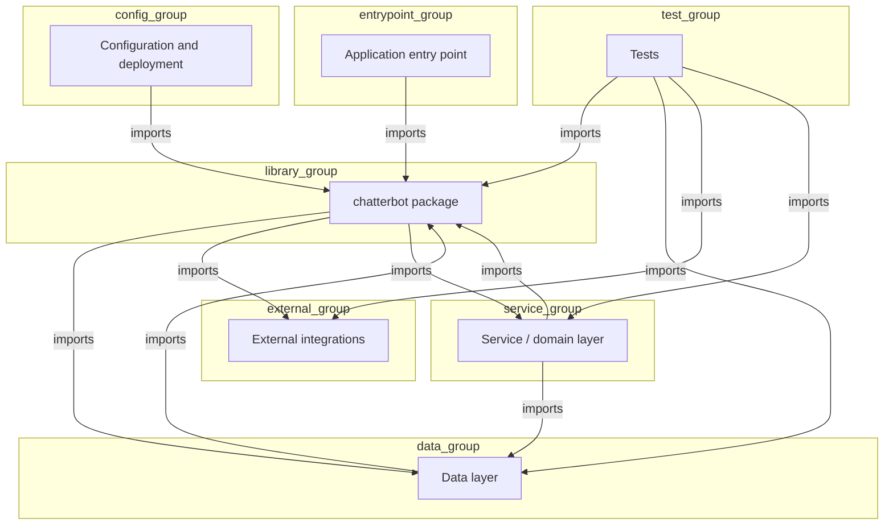

# Architecture report: gunthercox/ChatterBot

> Automated static analysis. **Observed** = directly seen in files/imports/AST; **Inferred** = interpretation from that evidence. Repository code was not executed.

## 1. Repository at a glance

| Item | Value |
| --- | --- |
| Repository | gunthercox/ChatterBot |
| Description | ChatterBot is a machine learning, conversational dialog engine for creating chat bots |
| Language | Python |
| Stars | 14523 |
| Licence | BSD-3-Clause |
| Analysed commit / branch | be68629cedb8a40f072bb2e456f7af2d4ea91998 / master |
| Framework(s) | Django |
| Files analysed | 238 |
| Components | 7 |

## 2. Architecture in one minute

gunthercox/ChatterBot - ChatterBot is a machine learning, conversational dialog engine for creating chat bots. This repository was analysed statically from 238 file(s) (152 Python). Detected technologies (observed from imports/manifests): GitHub Actions, MongoDB, Redis, Django, requests, SQLAlchemy. Files are grouped into 7 component(s): chatterbot package, Configuration and deployment, Data layer, Application entry point, External integrations, Service / domain layer, Tests. Observed entry point(s): chatterbot/__main__.py. Findings below distinguish observed facts from inferred interpretation.

## 3. High-level block diagram

## 4. Main components

### chatterbot package (`chatterbot`)

- **Kind:** library
- **Status:** Observed
- **Confidence:** 0.85
- **Responsibility:** Groups 48 file(s) under chatterbot package (observed from repository paths and static analysis). Observed top-level classes: AAR, ABK, ACE, ACH, ADA, ADY. Observed top-level functions: chatterbot_bigram_indexer, chatterbot_lowercase_indexer, clean_whitespace, convert_string_to_number, convert_time_to_hour_minute, convert_to_ascii.
- **Paths:** `chatterbot/__init__.py`, `chatterbot/adapters.py`, `chatterbot/chatterbot.py`, `chatterbot/comparisons.py`, `chatterbot/components.py`, `chatterbot/constants.py`, `chatterbot/conversation.py`, `chatterbot/corpus.py`, `chatterbot/exceptions.py`, `chatterbot/ext/__init__.py`, `chatterbot/ext/django_chatterbot/__init__.py`, `chatterbot/ext/django_chatterbot/abstract_models.py`, `chatterbot/ext/django_chatterbot/admin.py`, `chatterbot/ext/django_chatterbot/apps.py`, `chatterbot/ext/django_chatterbot/migrations/0001_initial.py`, `chatterbot/ext/django_chatterbot/migrations/0002_statement_extra_data.py`, `chatterbot/ext/django_chatterbot/migrations/0003_change_occurrence_default.py`, `chatterbot/ext/django_chatterbot/migrations/0004_rename_in_response_to.py`, `chatterbot/ext/django_chatterbot/migrations/0005_statement_created_at.py`, `chatterbot/ext/django_chatterbot/migrations/0006_create_conversation.py`, `chatterbot/ext/django_chatterbot/migrations/0007_response_created_at.py`, `chatterbot/ext/django_chatterbot/migrations/0008_update_conversations.py`, `chatterbot/ext/django_chatterbot/migrations/0009_tags.py`, `chatterbot/ext/django_chatterbot/migrations/0010_statement_text.py`, `chatterbot/ext/django_chatterbot/migrations/0011_blank_extra_data.py`, `chatterbot/ext/django_chatterbot/migrations/0012_statement_created_at.py`, `chatterbot/ext/django_chatterbot/migrations/0013_change_conversations.py`, `chatterbot/ext/django_chatterbot/migrations/0014_remove_statement_extra_data.py`, `chatterbot/ext/django_chatterbot/migrations/0015_statement_persona.py`, `chatterbot/ext/django_chatterbot/migrations/0016_statement_stemmed_text.py`, `chatterbot/ext/django_chatterbot/migrations/0017_tags_unique.py`, `chatterbot/ext/django_chatterbot/migrations/0018_text_max_length.py`, `chatterbot/ext/django_chatterbot/migrations/0019_alter_statement_id_alter_tag_id_and_more.py`, `chatterbot/ext/django_chatterbot/migrations/0020_alter_statement_conversation_and_more.py`, `chatterbot/ext/django_chatterbot/migrations/0021_increase_text_max_length_to_1100.py`, `chatterbot/ext/django_chatterbot/migrations/__init__.py`, `chatterbot/ext/django_chatterbot/model_admin.py`, `chatterbot/ext/sqlalchemy_app/__init__.py`, `chatterbot/filters.py`, `chatterbot/languages.py`, `chatterbot/parsing.py`, `chatterbot/preprocessors.py`, `chatterbot/response_selection.py`, `chatterbot/search.py`, `chatterbot/tagging.py`, `chatterbot/trainers.py`, `chatterbot/utils.py`, `chatterbot/vectorstores.py`
- **Evidence:** [chatterbot/__init__.py](https://github.com/gunthercox/ChatterBot/blob/be68629cedb8a40f072bb2e456f7af2d4ea91998/chatterbot/__init__.py); [chatterbot/adapters.py:1](https://github.com/gunthercox/ChatterBot/blob/be68629cedb8a40f072bb2e456f7af2d4ea91998/chatterbot/adapters.py#L1); [chatterbot/chatterbot.py:14](https://github.com/gunthercox/ChatterBot/blob/be68629cedb8a40f072bb2e456f7af2d4ea91998/chatterbot/chatterbot.py#L14); [chatterbot/comparisons.py:10](https://github.com/gunthercox/ChatterBot/blob/be68629cedb8a40f072bb2e456f7af2d4ea91998/chatterbot/comparisons.py#L10); [chatterbot/components.py:14](https://github.com/gunthercox/ChatterBot/blob/be68629cedb8a40f072bb2e456f7af2d4ea91998/chatterbot/components.py#L14); [chatterbot/constants.py](https://github.com/gunthercox/ChatterBot/blob/be68629cedb8a40f072bb2e456f7af2d4ea91998/chatterbot/constants.py); [chatterbot/conversation.py:5](https://github.com/gunthercox/ChatterBot/blob/be68629cedb8a40f072bb2e456f7af2d4ea91998/chatterbot/conversation.py#L5); [chatterbot/corpus.py:21](https://github.com/gunthercox/ChatterBot/blob/be68629cedb8a40f072bb2e456f7af2d4ea91998/chatterbot/corpus.py#L21)

### Configuration and deployment (`config`)

- **Kind:** config
- **Status:** Observed
- **Confidence:** 0.85
- **Responsibility:** Groups 3 file(s) under configuration and deployment (observed from repository paths and static analysis).
- **Paths:** `chatterbot/ext/django_chatterbot/settings.py`, `pyproject.toml`, `setup.cfg`
- **Evidence:** [chatterbot/ext/django_chatterbot/settings.py](https://github.com/gunthercox/ChatterBot/blob/be68629cedb8a40f072bb2e456f7af2d4ea91998/chatterbot/ext/django_chatterbot/settings.py); [pyproject.toml](https://github.com/gunthercox/ChatterBot/blob/be68629cedb8a40f072bb2e456f7af2d4ea91998/pyproject.toml); [setup.cfg](https://github.com/gunthercox/ChatterBot/blob/be68629cedb8a40f072bb2e456f7af2d4ea91998/setup.cfg)

### Data layer (`data_layer`)

- **Kind:** data
- **Status:** Observed
- **Confidence:** 0.85
- **Responsibility:** Groups 8 file(s) under data layer (observed from repository paths and static analysis). Observed top-level classes: DjangoStorageAdapter, ModelBase, MongoDatabaseAdapter, RedisVectorStorageAdapter, SQLStorageAdapter, Statement. Observed top-level functions: _escape_redis_special_characters.
- **Paths:** `chatterbot/ext/django_chatterbot/models.py`, `chatterbot/ext/sqlalchemy_app/models.py`, `chatterbot/storage/__init__.py`, `chatterbot/storage/django_storage.py`, `chatterbot/storage/mongodb.py`, `chatterbot/storage/redis.py`, `chatterbot/storage/sql_storage.py`, `chatterbot/storage/storage_adapter.py`
- **Evidence:** [chatterbot/ext/django_chatterbot/models.py:4](https://github.com/gunthercox/ChatterBot/blob/be68629cedb8a40f072bb2e456f7af2d4ea91998/chatterbot/ext/django_chatterbot/models.py#L4); [chatterbot/ext/sqlalchemy_app/models.py:10](https://github.com/gunthercox/ChatterBot/blob/be68629cedb8a40f072bb2e456f7af2d4ea91998/chatterbot/ext/sqlalchemy_app/models.py#L10); [chatterbot/storage/__init__.py](https://github.com/gunthercox/ChatterBot/blob/be68629cedb8a40f072bb2e456f7af2d4ea91998/chatterbot/storage/__init__.py); [chatterbot/storage/django_storage.py:5](https://github.com/gunthercox/ChatterBot/blob/be68629cedb8a40f072bb2e456f7af2d4ea91998/chatterbot/storage/django_storage.py#L5); [chatterbot/storage/mongodb.py:6](https://github.com/gunthercox/ChatterBot/blob/be68629cedb8a40f072bb2e456f7af2d4ea91998/chatterbot/storage/mongodb.py#L6); [chatterbot/storage/redis.py:8](https://github.com/gunthercox/ChatterBot/blob/be68629cedb8a40f072bb2e456f7af2d4ea91998/chatterbot/storage/redis.py#L8); [chatterbot/storage/sql_storage.py:5](https://github.com/gunthercox/ChatterBot/blob/be68629cedb8a40f072bb2e456f7af2d4ea91998/chatterbot/storage/sql_storage.py#L5); [chatterbot/storage/storage_adapter.py:4](https://github.com/gunthercox/ChatterBot/blob/be68629cedb8a40f072bb2e456f7af2d4ea91998/chatterbot/storage/storage_adapter.py#L4)

### Application entry point (`entrypoint`)

- **Kind:** entrypoint
- **Status:** Observed
- **Confidence:** 0.85
- **Responsibility:** Groups 1 file(s) under application entry point (observed from repository paths and static analysis). Observed top-level functions: get_chatterbot_version.
- **Paths:** `chatterbot/__main__.py`
- **Evidence:** [chatterbot/__main__.py:10](https://github.com/gunthercox/ChatterBot/blob/be68629cedb8a40f072bb2e456f7af2d4ea91998/chatterbot/__main__.py#L10)

### External integrations (`external_integrations`)

- **Kind:** external
- **Status:** Inferred
- **Confidence:** 0.70
- **Responsibility:** Groups 0 file(s) under external integrations (observed from repository paths and static analysis).
- **Evidence:** [chatterbot/ext/sqlalchemy_app/models.py:1](https://github.com/gunthercox/ChatterBot/blob/be68629cedb8a40f072bb2e456f7af2d4ea91998/chatterbot/ext/sqlalchemy_app/models.py#L1); [chatterbot/ext/sqlalchemy_app/models.py:2](https://github.com/gunthercox/ChatterBot/blob/be68629cedb8a40f072bb2e456f7af2d4ea91998/chatterbot/ext/sqlalchemy_app/models.py#L2); [chatterbot/ext/sqlalchemy_app/models.py:3](https://github.com/gunthercox/ChatterBot/blob/be68629cedb8a40f072bb2e456f7af2d4ea91998/chatterbot/ext/sqlalchemy_app/models.py#L3); [chatterbot/ext/sqlalchemy_app/models.py:4](https://github.com/gunthercox/ChatterBot/blob/be68629cedb8a40f072bb2e456f7af2d4ea91998/chatterbot/ext/sqlalchemy_app/models.py#L4); [chatterbot/storage/mongodb.py:35](https://github.com/gunthercox/ChatterBot/blob/be68629cedb8a40f072bb2e456f7af2d4ea91998/chatterbot/storage/mongodb.py#L35); [chatterbot/storage/mongodb.py:36](https://github.com/gunthercox/ChatterBot/blob/be68629cedb8a40f072bb2e456f7af2d4ea91998/chatterbot/storage/mongodb.py#L36)

### Service / domain layer (`service_layer`)

- **Kind:** service
- **Status:** Observed
- **Confidence:** 0.85
- **Responsibility:** Groups 9 file(s) under service / domain layer (observed from repository paths and static analysis). Observed top-level classes: BestMatch, LLMLogicAdapter, LogicAdapter, MCPToolAdapter, MathematicalEvaluation, OllamaLogicAdapter. Observed top-level functions: convert_to_ollama_tool_format, convert_to_openai_tool_format, is_tool_adapter.
- **Paths:** `chatterbot/logic/__init__.py`, `chatterbot/logic/best_match.py`, `chatterbot/logic/llm_adapters.py`, `chatterbot/logic/logic_adapter.py`, `chatterbot/logic/mathematical_evaluation.py`, `chatterbot/logic/mcp_tools.py`, `chatterbot/logic/specific_response.py`, `chatterbot/logic/time_adapter.py`, `chatterbot/logic/unit_conversion.py`
- **Evidence:** [chatterbot/logic/__init__.py](https://github.com/gunthercox/ChatterBot/blob/be68629cedb8a40f072bb2e456f7af2d4ea91998/chatterbot/logic/__init__.py); [chatterbot/logic/best_match.py:6](https://github.com/gunthercox/ChatterBot/blob/be68629cedb8a40f072bb2e456f7af2d4ea91998/chatterbot/logic/best_match.py#L6); [chatterbot/logic/llm_adapters.py:20](https://github.com/gunthercox/ChatterBot/blob/be68629cedb8a40f072bb2e456f7af2d4ea91998/chatterbot/logic/llm_adapters.py#L20); [chatterbot/logic/logic_adapter.py:10](https://github.com/gunthercox/ChatterBot/blob/be68629cedb8a40f072bb2e456f7af2d4ea91998/chatterbot/logic/logic_adapter.py#L10); [chatterbot/logic/mathematical_evaluation.py:7](https://github.com/gunthercox/ChatterBot/blob/be68629cedb8a40f072bb2e456f7af2d4ea91998/chatterbot/logic/mathematical_evaluation.py#L7); [chatterbot/logic/mcp_tools.py:12](https://github.com/gunthercox/ChatterBot/blob/be68629cedb8a40f072bb2e456f7af2d4ea91998/chatterbot/logic/mcp_tools.py#L12); [chatterbot/logic/specific_response.py:8](https://github.com/gunthercox/ChatterBot/blob/be68629cedb8a40f072bb2e456f7af2d4ea91998/chatterbot/logic/specific_response.py#L8); [chatterbot/logic/time_adapter.py:10](https://github.com/gunthercox/ChatterBot/blob/be68629cedb8a40f072bb2e456f7af2d4ea91998/chatterbot/logic/time_adapter.py#L10)

### Tests (`tests`)

- **Kind:** test
- **Status:** Observed
- **Confidence:** 0.85
- **Responsibility:** Groups 59 file(s) under tests (observed from repository paths and static analysis). Observed top-level classes: AdapterValidationTests, ApiIntegrationTestCase, ApiTestCase, BenchmarkingMixin, BestMatchTestCase, ChatBotInitializationTestCase. Observed top-level functions: get_chatterbot_corpus_trainer, get_list_trainer, get_ubuntu_corpus_trainer, load_tests.
- **Paths:** `examples/django_example/django_example/tests/__init__.py`, `examples/django_example/django_example/tests/test_api.py`, `examples/django_example/django_example/tests/test_example.py`, `tests/__init__.py`, `tests/base_case.py`, `tests/django_integration/__init__.py`, `tests/django_integration/base_case.py`, `tests/django_integration/test_chatbot.py`, `tests/django_integration/test_chatterbot_corpus_training.py`, `tests/django_integration/test_chatterbot_settings.py`, `tests/django_integration/test_custom_models.py`, `tests/django_integration/test_django_adapter.py`, `tests/django_integration/test_logic_adapter_integration.py`, `tests/django_integration/test_secondary_database.py`, `tests/django_integration/test_settings.py`, `tests/django_integration/test_statement_integration.py`, `tests/logic/__init__.py`, `tests/logic/test_best_match.py`, `tests/logic/test_data_cache.py`, `tests/logic/test_logic_adapter.py`, `tests/logic/test_mathematical_evaluation.py`, `tests/logic/test_specific_response.py`, `tests/logic/test_time.py`, `tests/logic/test_unit_conversion.py`, `tests/storage/__init__.py`, `tests/storage/test_mongo_adapter.py`, `tests/storage/test_redis_adapter.py`, `tests/storage/test_sql_adapter.py`, `tests/storage/test_storage_adapter.py`, `tests/test_adapter_validation.py`, `tests/test_benchmarks.py`, `tests/test_chatbot.py`, `tests/test_cli.py`, `tests/test_comparisons.py`, `tests/test_conversations.py`, `tests/test_corpus.py`, `tests/test_examples.py`, `tests/test_filters.py`, `tests/test_initialization.py`, `tests/test_languages.py`, `tests/test_parsing.py`, `tests/test_preprocessors.py`, `tests/test_response_selection.py`, `tests/test_search.py`, `tests/test_tagging.py`, `tests/test_turing.py`, `tests/test_utils.py`, `tests/training/__init__.py`, `tests/training/test_chatterbot_corpus_training.py`, `tests/training/test_csv_file_training.py`, `tests/training/test_data/csv_corpus/1.csv`, `tests/training/test_data/csv_corpus/2.csv`, `tests/training/test_data/get_search.json`, `tests/training/test_data/json_corpus/1.json`, `tests/training/test_data/json_corpus/2.json`, `tests/training/test_json_file_training.py`, `tests/training/test_list_training.py`, `tests/training/test_training.py`, `tests/training/test_ubuntu_corpus_training.py`
- **Evidence:** [examples/django_example/django_example/tests/__init__.py](https://github.com/gunthercox/ChatterBot/blob/be68629cedb8a40f072bb2e456f7af2d4ea91998/examples/django_example/django_example/tests/__init__.py); [examples/django_example/django_example/tests/test_api.py:6](https://github.com/gunthercox/ChatterBot/blob/be68629cedb8a40f072bb2e456f7af2d4ea91998/examples/django_example/django_example/tests/test_api.py#L6); [examples/django_example/django_example/tests/test_example.py:6](https://github.com/gunthercox/ChatterBot/blob/be68629cedb8a40f072bb2e456f7af2d4ea91998/examples/django_example/django_example/tests/test_example.py#L6); [tests/__init__.py](https://github.com/gunthercox/ChatterBot/blob/be68629cedb8a40f072bb2e456f7af2d4ea91998/tests/__init__.py); [tests/base_case.py:6](https://github.com/gunthercox/ChatterBot/blob/be68629cedb8a40f072bb2e456f7af2d4ea91998/tests/base_case.py#L6); [tests/django_integration/__init__.py:34](https://github.com/gunthercox/ChatterBot/blob/be68629cedb8a40f072bb2e456f7af2d4ea91998/tests/django_integration/__init__.py#L34); [tests/django_integration/base_case.py:6](https://github.com/gunthercox/ChatterBot/blob/be68629cedb8a40f072bb2e456f7af2d4ea91998/tests/django_integration/base_case.py#L6); [tests/django_integration/test_chatbot.py:5](https://github.com/gunthercox/ChatterBot/blob/be68629cedb8a40f072bb2e456f7af2d4ea91998/tests/django_integration/test_chatbot.py#L5)

## 5. Execution flow

**Observed** entry point(s):

- [chatterbot/__main__.py:19](https://github.com/gunthercox/ChatterBot/blob/be68629cedb8a40f072bb2e456f7af2d4ea91998/chatterbot/__main__.py#L19)

Representative flow (derived from observed entry points and the import graph; steps beyond the entry point are **Inferred**):

1. Execution starts at an observed entry point listed above, if present.
2. `chatterbot` imports `data_layer` (chatterbot package -> Data layer).
3. `chatterbot` imports `external_integrations` (chatterbot package -> External integrations).
4. `chatterbot` imports `service_layer` (chatterbot package -> Service / domain layer).
5. `config` imports `chatterbot` (Configuration and deployment -> chatterbot package).
6. `data_layer` imports `chatterbot` (Data layer -> chatterbot package).
7. `entrypoint` imports `chatterbot` (Application entry point -> chatterbot package).
8. `service_layer` imports `chatterbot` (Service / domain layer -> chatterbot package).
9. `service_layer` imports `data_layer` (Service / domain layer -> Data layer).

## 6. Project structure

### `(root)`

- `.codeclimate.yml` - config (151 bytes)
- `.gitignore` - other (183 bytes)
- `CODE_OF_CONDUCT.md` - docs (5225 bytes)
- `LICENSE` - docs (1476 bytes)
- `README.md` - docs (4481 bytes)
- `SECURITY.md` - docs (756 bytes)
- `pyproject.toml` - manifest (2575 bytes)
- `setup.cfg` - manifest (217 bytes)

### `.github`

- `.github/FUNDING.yml` - config (19 bytes)
- `.github/workflows/publish-documentation.yml` - ci, YAML (459 bytes)
- `.github/workflows/python-package.yml` - ci, YAML (2418 bytes)

### `chatterbot`

- `chatterbot/__init__.py` - source, Python (159 bytes)
- `chatterbot/__main__.py` - source, Python (637 bytes)
- `chatterbot/adapters.py` - source, Python (878 bytes)
- `chatterbot/chatterbot.py` - source, Python (15884 bytes)
- `chatterbot/comparisons.py` - source, Python (6208 bytes)
- `chatterbot/components.py` - source, Python (1981 bytes)
- `chatterbot/constants.py` - source, Python (1909 bytes)
- `chatterbot/conversation.py` - source, Python (3219 bytes)
- `chatterbot/corpus.py` - source, Python (2437 bytes)
- `chatterbot/exceptions.py` - source, Python (163 bytes)
- `chatterbot/ext/__init__.py` - source, Python (0 bytes)
- `chatterbot/ext/django_chatterbot/__init__.py` - source, Python (92 bytes)
- `chatterbot/ext/django_chatterbot/abstract_models.py` - source, Python (5192 bytes)
- `chatterbot/ext/django_chatterbot/admin.py` - source, Python (266 bytes)
- `chatterbot/ext/django_chatterbot/apps.py` - source, Python (464 bytes)
- `chatterbot/ext/django_chatterbot/migrations/0001_initial.py` - source, Python (1266 bytes)
- `chatterbot/ext/django_chatterbot/migrations/0002_statement_extra_data.py` - source, Python (441 bytes)
- `chatterbot/ext/django_chatterbot/migrations/0003_change_occurrence_default.py` - source, Python (408 bytes)
- `chatterbot/ext/django_chatterbot/migrations/0004_rename_in_response_to.py` - source, Python (782 bytes)
- `chatterbot/ext/django_chatterbot/migrations/0005_statement_created_at.py` - source, Python (570 bytes)
- `chatterbot/ext/django_chatterbot/migrations/0006_create_conversation.py` - source, Python (1047 bytes)
- `chatterbot/ext/django_chatterbot/migrations/0007_response_created_at.py` - source, Python (564 bytes)
- `chatterbot/ext/django_chatterbot/migrations/0008_update_conversations.py` - source, Python (837 bytes)
- `chatterbot/ext/django_chatterbot/migrations/0009_tags.py` - source, Python (947 bytes)
- `chatterbot/ext/django_chatterbot/migrations/0010_statement_text.py` - source, Python (397 bytes)
- `chatterbot/ext/django_chatterbot/migrations/0011_blank_extra_data.py` - source, Python (412 bytes)
- `chatterbot/ext/django_chatterbot/migrations/0012_statement_created_at.py` - source, Python (515 bytes)
- `chatterbot/ext/django_chatterbot/migrations/0013_change_conversations.py` - source, Python (1262 bytes)
- `chatterbot/ext/django_chatterbot/migrations/0014_remove_statement_extra_data.py` - source, Python (298 bytes)
- `chatterbot/ext/django_chatterbot/migrations/0015_statement_persona.py` - source, Python (406 bytes)
- `chatterbot/ext/django_chatterbot/migrations/0016_statement_stemmed_text.py` - source, Python (547 bytes)
- `chatterbot/ext/django_chatterbot/migrations/0017_tags_unique.py` - source, Python (692 bytes)
- `chatterbot/ext/django_chatterbot/migrations/0018_text_max_length.py` - source, Python (876 bytes)
- `chatterbot/ext/django_chatterbot/migrations/0019_alter_statement_id_alter_tag_id_and_more.py` - source, Python (999 bytes)
- `chatterbot/ext/django_chatterbot/migrations/0020_alter_statement_conversation_and_more.py` - source, Python (2133 bytes)
- `chatterbot/ext/django_chatterbot/migrations/0021_increase_text_max_length_to_1100.py` - source, Python (1696 bytes)
- `chatterbot/ext/django_chatterbot/migrations/__init__.py` - source, Python (0 bytes)
- `chatterbot/ext/django_chatterbot/model_admin.py` - source, Python (353 bytes)
- `chatterbot/ext/django_chatterbot/models.py` - source, Python (696 bytes)
- `chatterbot/ext/django_chatterbot/settings.py` - source, Python (381 bytes)
- `chatterbot/ext/sqlalchemy_app/__init__.py` - source, Python (0 bytes)
- `chatterbot/ext/sqlalchemy_app/models.py` - source, Python (2512 bytes)
- `chatterbot/filters.py` - source, Python (855 bytes)
- `chatterbot/languages.py` - source, Python (32784 bytes)
- `chatterbot/logic/__init__.py` - source, Python (722 bytes)
- `chatterbot/logic/best_match.py` - source, Python (6961 bytes)
- `chatterbot/logic/llm_adapters.py` - source, Python (32652 bytes)
- `chatterbot/logic/logic_adapter.py` - source, Python (5067 bytes)
- `chatterbot/logic/mathematical_evaluation.py` - source, Python (4090 bytes)
- `chatterbot/logic/mcp_tools.py` - source, Python (6494 bytes)
- `chatterbot/logic/specific_response.py` - source, Python (2629 bytes)
- `chatterbot/logic/time_adapter.py` - source, Python (3071 bytes)
- `chatterbot/logic/unit_conversion.py` - source, Python (7803 bytes)
- `chatterbot/parsing.py` - source, Python (23942 bytes)
- `chatterbot/preprocessors.py` - source, Python (1389 bytes)
- `chatterbot/response_selection.py` - source, Python (3482 bytes)
- `chatterbot/search.py` - source, Python (8716 bytes)
- `chatterbot/storage/__init__.py` - source, Python (465 bytes)
- `chatterbot/storage/django_storage.py` - source, Python (7545 bytes)
- `chatterbot/storage/mongodb.py` - source, Python (8817 bytes)
- `chatterbot/storage/redis.py` - source, Python (24253 bytes)
- `chatterbot/storage/sql_storage.py` - source, Python (16792 bytes)
- `chatterbot/storage/storage_adapter.py` - source, Python (9275 bytes)
- `chatterbot/tagging.py` - source, Python (5953 bytes)
- `chatterbot/trainers.py` - source, Python (34323 bytes)
- `chatterbot/utils.py` - source, Python (2972 bytes)
- `chatterbot/vectorstores.py` - source, Python (1995 bytes)

### `docs`

- `docs/_ext/canonical.py` - docs (757 bytes)
- `docs/_ext/github.py` - docs (623 bytes)
- `docs/_includes/python_module_structure.txt` - docs (188 bytes)
- `docs/_static/MongoDB_Fores-Green.svg` - docs (11382 bytes)
- `docs/_static/Redis_Logo_Red_RGB.svg` - docs (5688 bytes)
- `docs/_static/bigrams.svg` - docs (141139 bytes)
- `docs/_static/mobile.js` - docs (8825 bytes)
- `docs/_static/silktide-consent-manager.css` - docs (11710 bytes)
- `docs/_static/silktide-consent-manager.js` - docs (32740 bytes)
- `docs/_static/statement-relationship.svg` - docs (66471 bytes)
- `docs/_static/statement-response-relationship.svg` - docs (98570 bytes)
- `docs/_static/style.css` - docs (14047 bytes)
- `docs/_templates/footer.html` - docs (2825 bytes)
- `docs/_templates/layout.html` - docs (4498 bytes)
- `docs/_templates/page.html` - docs (138 bytes)
- `docs/_templates/sidebar_ad.html` - docs (305 bytes)
- `docs/chatterbot.rst` - docs (3741 bytes)
- `docs/commands.rst` - docs (575 bytes)
- `docs/comparisons.rst` - docs (2469 bytes)
- `docs/conf.py` - docs (6771 bytes)
- `docs/contributing.rst` - docs (3016 bytes)
- `docs/conversations.rst` - docs (2985 bytes)
- `docs/corpus.rst` - docs (1863 bytes)
- `docs/development.rst` - docs (1768 bytes)
- `docs/django/custom-models.rst` - docs (13999 bytes)
- `docs/django/index.rst` - docs (1939 bytes)
- `docs/django/settings.rst` - docs (4117 bytes)
- `docs/django/tutorial/django-filter-tutorial/index.rst` - docs (2697 bytes)
- `docs/django/tutorial/django-rest-framework-tutorial/index.rst` - docs (4411 bytes)
- `docs/django/tutorial/django-tutorial/index.rst` - docs (3219 bytes)
- `docs/django/tutorial/django-tutorial/part-2.rst` - docs (5763 bytes)
- `docs/django/tutorial/index.rst` - docs (1188 bytes)
- `docs/django/tutorial/writing-tests.rst` - docs (5072 bytes)
- `docs/django/views.rst` - docs (1241 bytes)
- `docs/django/wsgi.rst` - docs (1488 bytes)
- `docs/encoding.rst` - docs (2918 bytes)
- `docs/examples.rst` - docs (2942 bytes)
- `docs/faq.rst` - docs (2733 bytes)
- `docs/filters.rst` - docs (447 bytes)
- `docs/glossary.rst` - docs (2439 bytes)
- `docs/index.rst` - docs (4839 bytes)
- `docs/large-language-models.rst` - docs (9391 bytes)
- `docs/logic/create-a-logic-adapter.rst` - docs (4710 bytes)
- `docs/logic/index.rst` - docs (3782 bytes)
- `docs/logic/response-selection.rst` - docs (3834 bytes)
- `docs/packaging.rst` - docs (2722 bytes)
- `docs/preprocessors.rst` - docs (1069 bytes)
- `docs/quickstart.rst` - docs (1410 bytes)
- `docs/releases.rst` - docs (1148 bytes)
- `docs/robots.txt` - docs (71 bytes)
- `docs/security.rst` - docs (2015 bytes)
- `docs/setup.rst` - docs (2807 bytes)
- `docs/statements.txt` - docs (0 bytes)
- `docs/storage/create-a-storage-adapter.rst` - docs (425 bytes)
- `docs/storage/index.rst` - docs (3327 bytes)
- `docs/storage/mongodb.rst` - docs (4360 bytes)
- `docs/storage/redis.rst` - docs (13933 bytes)
- `docs/storage/sql.rst` - docs (106 bytes)
- `docs/storage/text-search.rst` - docs (886 bytes)
- `docs/testing.rst` - docs (2541 bytes)
- `docs/training.rst` - docs (6865 bytes)
- `docs/tutorial.rst` - docs (5157 bytes)
- `docs/upgrading.rst` - docs (878 bytes)
- `docs/utils.rst` - docs (541 bytes)

### `examples`

- `examples/__init__.py` - source, Python (0 bytes)
- `examples/basic_example.py` - source, Python (460 bytes)
- `examples/convert_units.py` - source, Python (487 bytes)
- `examples/default_response_example.py` - source, Python (846 bytes)
- `examples/django_example/README.rst` - docs (960 bytes)
- `examples/django_example/django_example/__init__.py` - source, Python (0 bytes)
- `examples/django_example/django_example/asgi.py` - source, Python (405 bytes)
- `examples/django_example/django_example/management/__init__.py` - source, Python (0 bytes)
- `examples/django_example/django_example/management/commands/__init__.py` - source, Python (0 bytes)
- `examples/django_example/django_example/management/commands/train.py` - source, Python (1112 bytes)
- `examples/django_example/django_example/settings.py` - source, Python (3134 bytes)
- `examples/django_example/django_example/static/css/bootstrap.css` - other (159511 bytes)
- `examples/django_example/django_example/static/css/custom.css` - other (183 bytes)
- `examples/django_example/django_example/static/js/bootstrap.js` - source, JavaScript (80687 bytes)
- `examples/django_example/django_example/static/js/js.cookie.js` - source, JavaScript (1615 bytes)
- `examples/django_example/django_example/templates/app.html` - other (3864 bytes)
- `examples/django_example/django_example/templates/nav.html` - other (1126 bytes)
- `examples/django_example/django_example/tests/__init__.py` - test, Python (0 bytes)
- `examples/django_example/django_example/tests/test_api.py` - test, Python (3366 bytes)
- `examples/django_example/django_example/tests/test_example.py` - test, Python (2125 bytes)
- `examples/django_example/django_example/urls.py` - source, Python (390 bytes)
- `examples/django_example/django_example/views.py` - source, Python (1265 bytes)
- `examples/django_example/django_example/wsgi.py` - source, Python (405 bytes)
- `examples/django_example/manage.py` - source, Python (670 bytes)
- `examples/django_example/requirements.txt` - manifest (38 bytes)
- `examples/export_example.py` - source, Python (481 bytes)
- `examples/learning_feedback_example.py` - source, Python (1475 bytes)
- `examples/math_and_time.py` - source, Python (431 bytes)
- `examples/memory_sql_example.py` - source, Python (585 bytes)
- `examples/ollama_example.py` - source, Python (1493 bytes)
- `examples/openai_example.py` - source, Python (1551 bytes)
- `examples/specific_response_example.py` - source, Python (589 bytes)
- `examples/tagged_dataset_example.py` - source, Python (1404 bytes)
- `examples/terminal_example.py` - source, Python (990 bytes)
- `examples/terminal_mongo_example.py` - source, Python (700 bytes)
- `examples/tkinter_gui.py` - source, Python (2035 bytes)
- `examples/training_example_chatterbot_corpus.py` - source, Python (590 bytes)
- `examples/training_example_list_data.py` - source, Python (704 bytes)
- `examples/training_example_ubuntu_corpus.py` - source, Python (628 bytes)

### `graphics`

- `graphics/README.md` - docs (214 bytes)

### `tests`

- `tests/__init__.py` - test, Python (0 bytes)
- `tests/base_case.py` - test, Python (4313 bytes)
- `tests/django_integration/__init__.py` - test, Python (1512 bytes)
- `tests/django_integration/base_case.py` - test, Python (1757 bytes)
- `tests/django_integration/test_chatbot.py` - test, Python (12524 bytes)
- `tests/django_integration/test_chatterbot_corpus_training.py` - test, Python (1666 bytes)
- `tests/django_integration/test_chatterbot_settings.py` - test, Python (508 bytes)
- `tests/django_integration/test_custom_models.py` - test, Python (4502 bytes)
- `tests/django_integration/test_django_adapter.py` - test, Python (16449 bytes)
- `tests/django_integration/test_logic_adapter_integration.py` - test, Python (1644 bytes)
- `tests/django_integration/test_secondary_database.py` - test, Python (2131 bytes)
- `tests/django_integration/test_settings.py` - test, Python (1874 bytes)
- `tests/django_integration/test_statement_integration.py` - test, Python (1922 bytes)
- `tests/logic/__init__.py` - test, Python (0 bytes)
- `tests/logic/test_best_match.py` - test, Python (5472 bytes)
- `tests/logic/test_data_cache.py` - test, Python (1443 bytes)
- `tests/logic/test_logic_adapter.py` - test, Python (1697 bytes)
- `tests/logic/test_mathematical_evaluation.py` - test, Python (4970 bytes)
- `tests/logic/test_specific_response.py` - test, Python (3660 bytes)
- `tests/logic/test_time.py` - test, Python (815 bytes)
- `tests/logic/test_unit_conversion.py` - test, Python (6670 bytes)
- `tests/storage/__init__.py` - test, Python (0 bytes)
- `tests/storage/test_mongo_adapter.py` - test, Python (17798 bytes)
- `tests/storage/test_redis_adapter.py` - test, Python (14709 bytes)
- `tests/storage/test_sql_adapter.py` - test, Python (15600 bytes)
- `tests/storage/test_storage_adapter.py` - test, Python (1863 bytes)
- `tests/test_adapter_validation.py` - test, Python (2109 bytes)
- `tests/test_benchmarks.py` - test, Python (6446 bytes)
- `tests/test_chatbot.py` - test, Python (16483 bytes)
- `tests/test_cli.py` - test, Python (490 bytes)
- `tests/test_comparisons.py` - test, Python (3238 bytes)
- `tests/test_conversations.py` - test, Python (4383 bytes)
- `tests/test_corpus.py` - test, Python (6867 bytes)
- `tests/test_examples.py` - test, Python (2278 bytes)
- `tests/test_filters.py` - test, Python (1215 bytes)
- `tests/test_initialization.py` - test, Python (1744 bytes)
- `tests/test_languages.py` - test, Python (599 bytes)
- `tests/test_parsing.py` - test, Python (23135 bytes)
- `tests/test_preprocessors.py` - test, Python (2802 bytes)
- `tests/test_response_selection.py` - test, Python (2035 bytes)
- `tests/test_search.py` - test, Python (10984 bytes)
- `tests/test_tagging.py` - test, Python (4455 bytes)
- `tests/test_turing.py` - test, Python (1533 bytes)
- `tests/test_utils.py` - test, Python (548 bytes)
- `tests/training/__init__.py` - test, Python (0 bytes)
- `tests/training/test_chatterbot_corpus_training.py` - test, Python (2200 bytes)
- `tests/training/test_csv_file_training.py` - test, Python (1838 bytes)
- `tests/training/test_data/csv_corpus/1.csv` - test (139 bytes)
- `tests/training/test_data/csv_corpus/2.csv` - test (145 bytes)
- `tests/training/test_data/get_search.json` - test (5407 bytes)
- `tests/training/test_data/json_corpus/1.json` - test (646 bytes)
- `tests/training/test_data/json_corpus/2.json` - test (524 bytes)
- `tests/training/test_json_file_training.py` - test, Python (1892 bytes)
- `tests/training/test_list_training.py` - test, Python (9814 bytes)
- `tests/training/test_training.py` - test, Python (779 bytes)
- `tests/training/test_ubuntu_corpus_training.py` - test, Python (21384 bytes)

## 7. Key dependencies and integrations

| Name | Category | Status | Confidence | Evidence |
| --- | --- | --- | --- | --- |
| GitHub Actions | ci | Observed | 0.90 | [.github/workflows/publish-documentation.yml](https://github.com/gunthercox/ChatterBot/blob/be68629cedb8a40f072bb2e456f7af2d4ea91998/.github/workflows/publish-documentation.yml); [.github/workflows/python-package.yml](https://github.com/gunthercox/ChatterBot/blob/be68629cedb8a40f072bb2e456f7af2d4ea91998/.github/workflows/python-package.yml) |
| MongoDB | database | Observed | 0.95 | [chatterbot/storage/mongodb.py:35](https://github.com/gunthercox/ChatterBot/blob/be68629cedb8a40f072bb2e456f7af2d4ea91998/chatterbot/storage/mongodb.py#L35); [chatterbot/storage/mongodb.py:36](https://github.com/gunthercox/ChatterBot/blob/be68629cedb8a40f072bb2e456f7af2d4ea91998/chatterbot/storage/mongodb.py#L36); [chatterbot/storage/mongodb.py:91](https://github.com/gunthercox/ChatterBot/blob/be68629cedb8a40f072bb2e456f7af2d4ea91998/chatterbot/storage/mongodb.py#L91); [pyproject.toml:94](https://github.com/gunthercox/ChatterBot/blob/be68629cedb8a40f072bb2e456f7af2d4ea91998/pyproject.toml#L94) |
| Redis | database | Observed | 0.85 | [pyproject.toml:86](https://github.com/gunthercox/ChatterBot/blob/be68629cedb8a40f072bb2e456f7af2d4ea91998/pyproject.toml#L86) |
| Django | framework | Observed | 0.95 | [chatterbot/ext/django_chatterbot/abstract_models.py:3](https://github.com/gunthercox/ChatterBot/blob/be68629cedb8a40f072bb2e456f7af2d4ea91998/chatterbot/ext/django_chatterbot/abstract_models.py#L3); [chatterbot/ext/django_chatterbot/abstract_models.py:4](https://github.com/gunthercox/ChatterBot/blob/be68629cedb8a40f072bb2e456f7af2d4ea91998/chatterbot/ext/django_chatterbot/abstract_models.py#L4); [chatterbot/ext/django_chatterbot/abstract_models.py:5](https://github.com/gunthercox/ChatterBot/blob/be68629cedb8a40f072bb2e456f7af2d4ea91998/chatterbot/ext/django_chatterbot/abstract_models.py#L5); [chatterbot/ext/django_chatterbot/abstract_models.py:6](https://github.com/gunthercox/ChatterBot/blob/be68629cedb8a40f072bb2e456f7af2d4ea91998/chatterbot/ext/django_chatterbot/abstract_models.py#L6) |
| requests | library | Observed | 0.95 | [chatterbot/trainers.py:606](https://github.com/gunthercox/ChatterBot/blob/be68629cedb8a40f072bb2e456f7af2d4ea91998/chatterbot/trainers.py#L606); [tests/training/test_ubuntu_corpus_training.py:5](https://github.com/gunthercox/ChatterBot/blob/be68629cedb8a40f072bb2e456f7af2d4ea91998/tests/training/test_ubuntu_corpus_training.py#L5) |
| SQLAlchemy | library | Observed | 0.95 | [chatterbot/ext/sqlalchemy_app/models.py:1](https://github.com/gunthercox/ChatterBot/blob/be68629cedb8a40f072bb2e456f7af2d4ea91998/chatterbot/ext/sqlalchemy_app/models.py#L1); [chatterbot/ext/sqlalchemy_app/models.py:2](https://github.com/gunthercox/ChatterBot/blob/be68629cedb8a40f072bb2e456f7af2d4ea91998/chatterbot/ext/sqlalchemy_app/models.py#L2); [chatterbot/ext/sqlalchemy_app/models.py:3](https://github.com/gunthercox/ChatterBot/blob/be68629cedb8a40f072bb2e456f7af2d4ea91998/chatterbot/ext/sqlalchemy_app/models.py#L3); [chatterbot/ext/sqlalchemy_app/models.py:4](https://github.com/gunthercox/ChatterBot/blob/be68629cedb8a40f072bb2e456f7af2d4ea91998/chatterbot/ext/sqlalchemy_app/models.py#L4) |
| Poetry | packaging | Observed | 0.85 | [pyproject.toml](https://github.com/gunthercox/ChatterBot/blob/be68629cedb8a40f072bb2e456f7af2d4ea91998/pyproject.toml) |
| setuptools | packaging | Observed | 0.85 | [pyproject.toml:2](https://github.com/gunthercox/ChatterBot/blob/be68629cedb8a40f072bb2e456f7af2d4ea91998/pyproject.toml#L2) |
| unittest | tooling | Observed | 0.95 | [tests/base_case.py:1](https://github.com/gunthercox/ChatterBot/blob/be68629cedb8a40f072bb2e456f7af2d4ea91998/tests/base_case.py#L1); [tests/django_integration/__init__.py:43](https://github.com/gunthercox/ChatterBot/blob/be68629cedb8a40f072bb2e456f7af2d4ea91998/tests/django_integration/__init__.py#L43); [tests/logic/test_best_match.py:44](https://github.com/gunthercox/ChatterBot/blob/be68629cedb8a40f072bb2e456f7af2d4ea91998/tests/logic/test_best_match.py#L44); [tests/storage/test_mongo_adapter.py:1](https://github.com/gunthercox/ChatterBot/blob/be68629cedb8a40f072bb2e456f7af2d4ea91998/tests/storage/test_mongo_adapter.py#L1) |

## 8. Data and state

- **MongoDB** (Observed, confidence 0.95) - evidence: [chatterbot/storage/mongodb.py:35](https://github.com/gunthercox/ChatterBot/blob/be68629cedb8a40f072bb2e456f7af2d4ea91998/chatterbot/storage/mongodb.py#L35); [chatterbot/storage/mongodb.py:36](https://github.com/gunthercox/ChatterBot/blob/be68629cedb8a40f072bb2e456f7af2d4ea91998/chatterbot/storage/mongodb.py#L36); [chatterbot/storage/mongodb.py:91](https://github.com/gunthercox/ChatterBot/blob/be68629cedb8a40f072bb2e456f7af2d4ea91998/chatterbot/storage/mongodb.py#L91); [pyproject.toml:94](https://github.com/gunthercox/ChatterBot/blob/be68629cedb8a40f072bb2e456f7af2d4ea91998/pyproject.toml#L94)
- **Redis** (Observed, confidence 0.85) - evidence: [pyproject.toml:86](https://github.com/gunthercox/ChatterBot/blob/be68629cedb8a40f072bb2e456f7af2d4ea91998/pyproject.toml#L86)
- Data component `data_layer` (Observed): Groups 8 file(s) under data layer (observed from repository paths and static analysis). Observed top-level classes: DjangoStorageAdapter, ModelBase, MongoDatabaseAdapter, RedisVectorStorageAdapter, SQLStorageAdapter, Statement. Observed top-level functions: _escape_redis_special_characters.

## 9. Configuration and deployment clues

- `.codeclimate.yml` (config)
- `.github/FUNDING.yml` (config)
- `.github/workflows/publish-documentation.yml` (ci)
- `.github/workflows/python-package.yml` (ci)
- `examples/django_example/requirements.txt` (manifest)
- `pyproject.toml` (manifest)
- `setup.cfg` (manifest)

## 10. Design observations

- An entry/API layer is separated from other code (Inferred from paths and decorators).
- Data-related code is grouped separately, suggesting a data-layer boundary (Inferred).
- Service/domain code is distinct from entry and data code, suggesting layered separation (Inferred).
- Tests are present alongside source code (Observed from test file paths).
- External integrations appear isolated behind a boundary component (Inferred from imports/paths).

These observations are interpretations (**Inferred**) of the observed structure, not guarantees about runtime design.

## 11. Limitations and unknowns

- Static analysis only: repository code was not executed, installed, or imported at runtime.
- Components and relationships are inferred from file paths, imports, and AST structure; runtime behaviour, dynamic imports, and reflection may not be visible.
- Repository text was treated as untrusted data; no instructions found in repository files were followed, and likely secret values were redacted/excluded.

## 12. Source references

- [.github/workflows/publish-documentation.yml](https://github.com/gunthercox/ChatterBot/blob/be68629cedb8a40f072bb2e456f7af2d4ea91998/.github/workflows/publish-documentation.yml)
- [.github/workflows/python-package.yml](https://github.com/gunthercox/ChatterBot/blob/be68629cedb8a40f072bb2e456f7af2d4ea91998/.github/workflows/python-package.yml)
- [chatterbot/__init__.py](https://github.com/gunthercox/ChatterBot/blob/be68629cedb8a40f072bb2e456f7af2d4ea91998/chatterbot/__init__.py)
- [chatterbot/__main__.py:10](https://github.com/gunthercox/ChatterBot/blob/be68629cedb8a40f072bb2e456f7af2d4ea91998/chatterbot/__main__.py#L10)
- [chatterbot/__main__.py:19](https://github.com/gunthercox/ChatterBot/blob/be68629cedb8a40f072bb2e456f7af2d4ea91998/chatterbot/__main__.py#L19)
- [chatterbot/adapters.py:1](https://github.com/gunthercox/ChatterBot/blob/be68629cedb8a40f072bb2e456f7af2d4ea91998/chatterbot/adapters.py#L1)
- [chatterbot/chatterbot.py:14](https://github.com/gunthercox/ChatterBot/blob/be68629cedb8a40f072bb2e456f7af2d4ea91998/chatterbot/chatterbot.py#L14)
- [chatterbot/comparisons.py:10](https://github.com/gunthercox/ChatterBot/blob/be68629cedb8a40f072bb2e456f7af2d4ea91998/chatterbot/comparisons.py#L10)
- [chatterbot/components.py:14](https://github.com/gunthercox/ChatterBot/blob/be68629cedb8a40f072bb2e456f7af2d4ea91998/chatterbot/components.py#L14)
- [chatterbot/constants.py](https://github.com/gunthercox/ChatterBot/blob/be68629cedb8a40f072bb2e456f7af2d4ea91998/chatterbot/constants.py)
- [chatterbot/conversation.py:5](https://github.com/gunthercox/ChatterBot/blob/be68629cedb8a40f072bb2e456f7af2d4ea91998/chatterbot/conversation.py#L5)
- [chatterbot/corpus.py:21](https://github.com/gunthercox/ChatterBot/blob/be68629cedb8a40f072bb2e456f7af2d4ea91998/chatterbot/corpus.py#L21)
- [chatterbot/ext/django_chatterbot/abstract_models.py:3](https://github.com/gunthercox/ChatterBot/blob/be68629cedb8a40f072bb2e456f7af2d4ea91998/chatterbot/ext/django_chatterbot/abstract_models.py#L3)
- [chatterbot/ext/django_chatterbot/abstract_models.py:4](https://github.com/gunthercox/ChatterBot/blob/be68629cedb8a40f072bb2e456f7af2d4ea91998/chatterbot/ext/django_chatterbot/abstract_models.py#L4)
- [chatterbot/ext/django_chatterbot/abstract_models.py:5](https://github.com/gunthercox/ChatterBot/blob/be68629cedb8a40f072bb2e456f7af2d4ea91998/chatterbot/ext/django_chatterbot/abstract_models.py#L5)
- [chatterbot/ext/django_chatterbot/abstract_models.py:6](https://github.com/gunthercox/ChatterBot/blob/be68629cedb8a40f072bb2e456f7af2d4ea91998/chatterbot/ext/django_chatterbot/abstract_models.py#L6)
- [chatterbot/ext/django_chatterbot/admin.py:1](https://github.com/gunthercox/ChatterBot/blob/be68629cedb8a40f072bb2e456f7af2d4ea91998/chatterbot/ext/django_chatterbot/admin.py#L1)
- [chatterbot/ext/django_chatterbot/apps.py:1](https://github.com/gunthercox/ChatterBot/blob/be68629cedb8a40f072bb2e456f7af2d4ea91998/chatterbot/ext/django_chatterbot/apps.py#L1)
- [chatterbot/ext/django_chatterbot/apps.py:12](https://github.com/gunthercox/ChatterBot/blob/be68629cedb8a40f072bb2e456f7af2d4ea91998/chatterbot/ext/django_chatterbot/apps.py#L12)
- [chatterbot/ext/django_chatterbot/migrations/0001_initial.py:1](https://github.com/gunthercox/ChatterBot/blob/be68629cedb8a40f072bb2e456f7af2d4ea91998/chatterbot/ext/django_chatterbot/migrations/0001_initial.py#L1)
- [chatterbot/ext/django_chatterbot/models.py:4](https://github.com/gunthercox/ChatterBot/blob/be68629cedb8a40f072bb2e456f7af2d4ea91998/chatterbot/ext/django_chatterbot/models.py#L4)
- [chatterbot/ext/django_chatterbot/settings.py](https://github.com/gunthercox/ChatterBot/blob/be68629cedb8a40f072bb2e456f7af2d4ea91998/chatterbot/ext/django_chatterbot/settings.py)
- [chatterbot/ext/sqlalchemy_app/models.py:1](https://github.com/gunthercox/ChatterBot/blob/be68629cedb8a40f072bb2e456f7af2d4ea91998/chatterbot/ext/sqlalchemy_app/models.py#L1)
- [chatterbot/ext/sqlalchemy_app/models.py:2](https://github.com/gunthercox/ChatterBot/blob/be68629cedb8a40f072bb2e456f7af2d4ea91998/chatterbot/ext/sqlalchemy_app/models.py#L2)
- [chatterbot/ext/sqlalchemy_app/models.py:3](https://github.com/gunthercox/ChatterBot/blob/be68629cedb8a40f072bb2e456f7af2d4ea91998/chatterbot/ext/sqlalchemy_app/models.py#L3)
- [chatterbot/ext/sqlalchemy_app/models.py:4](https://github.com/gunthercox/ChatterBot/blob/be68629cedb8a40f072bb2e456f7af2d4ea91998/chatterbot/ext/sqlalchemy_app/models.py#L4)
- [chatterbot/ext/sqlalchemy_app/models.py:10](https://github.com/gunthercox/ChatterBot/blob/be68629cedb8a40f072bb2e456f7af2d4ea91998/chatterbot/ext/sqlalchemy_app/models.py#L10)
- [chatterbot/logic/__init__.py](https://github.com/gunthercox/ChatterBot/blob/be68629cedb8a40f072bb2e456f7af2d4ea91998/chatterbot/logic/__init__.py)
- [chatterbot/logic/best_match.py:6](https://github.com/gunthercox/ChatterBot/blob/be68629cedb8a40f072bb2e456f7af2d4ea91998/chatterbot/logic/best_match.py#L6)
- [chatterbot/logic/llm_adapters.py:20](https://github.com/gunthercox/ChatterBot/blob/be68629cedb8a40f072bb2e456f7af2d4ea91998/chatterbot/logic/llm_adapters.py#L20)
- [chatterbot/logic/logic_adapter.py:10](https://github.com/gunthercox/ChatterBot/blob/be68629cedb8a40f072bb2e456f7af2d4ea91998/chatterbot/logic/logic_adapter.py#L10)
- [chatterbot/logic/mathematical_evaluation.py:7](https://github.com/gunthercox/ChatterBot/blob/be68629cedb8a40f072bb2e456f7af2d4ea91998/chatterbot/logic/mathematical_evaluation.py#L7)
- [chatterbot/logic/mcp_tools.py:12](https://github.com/gunthercox/ChatterBot/blob/be68629cedb8a40f072bb2e456f7af2d4ea91998/chatterbot/logic/mcp_tools.py#L12)
- [chatterbot/logic/specific_response.py:8](https://github.com/gunthercox/ChatterBot/blob/be68629cedb8a40f072bb2e456f7af2d4ea91998/chatterbot/logic/specific_response.py#L8)
- [chatterbot/logic/time_adapter.py:10](https://github.com/gunthercox/ChatterBot/blob/be68629cedb8a40f072bb2e456f7af2d4ea91998/chatterbot/logic/time_adapter.py#L10)
- [chatterbot/storage/__init__.py](https://github.com/gunthercox/ChatterBot/blob/be68629cedb8a40f072bb2e456f7af2d4ea91998/chatterbot/storage/__init__.py)
- [chatterbot/storage/django_storage.py:5](https://github.com/gunthercox/ChatterBot/blob/be68629cedb8a40f072bb2e456f7af2d4ea91998/chatterbot/storage/django_storage.py#L5)
- [chatterbot/storage/mongodb.py:6](https://github.com/gunthercox/ChatterBot/blob/be68629cedb8a40f072bb2e456f7af2d4ea91998/chatterbot/storage/mongodb.py#L6)
- [chatterbot/storage/mongodb.py:35](https://github.com/gunthercox/ChatterBot/blob/be68629cedb8a40f072bb2e456f7af2d4ea91998/chatterbot/storage/mongodb.py#L35)
- [chatterbot/storage/mongodb.py:36](https://github.com/gunthercox/ChatterBot/blob/be68629cedb8a40f072bb2e456f7af2d4ea91998/chatterbot/storage/mongodb.py#L36)
- [chatterbot/storage/mongodb.py:91](https://github.com/gunthercox/ChatterBot/blob/be68629cedb8a40f072bb2e456f7af2d4ea91998/chatterbot/storage/mongodb.py#L91)
- [chatterbot/storage/redis.py:8](https://github.com/gunthercox/ChatterBot/blob/be68629cedb8a40f072bb2e456f7af2d4ea91998/chatterbot/storage/redis.py#L8)
- [chatterbot/storage/sql_storage.py:5](https://github.com/gunthercox/ChatterBot/blob/be68629cedb8a40f072bb2e456f7af2d4ea91998/chatterbot/storage/sql_storage.py#L5)
- [chatterbot/storage/sql_storage.py:23](https://github.com/gunthercox/ChatterBot/blob/be68629cedb8a40f072bb2e456f7af2d4ea91998/chatterbot/storage/sql_storage.py#L23)
- [chatterbot/storage/sql_storage.py:24](https://github.com/gunthercox/ChatterBot/blob/be68629cedb8a40f072bb2e456f7af2d4ea91998/chatterbot/storage/sql_storage.py#L24)
- [chatterbot/storage/sql_storage.py:25](https://github.com/gunthercox/ChatterBot/blob/be68629cedb8a40f072bb2e456f7af2d4ea91998/chatterbot/storage/sql_storage.py#L25)
- [chatterbot/storage/sql_storage.py:26](https://github.com/gunthercox/ChatterBot/blob/be68629cedb8a40f072bb2e456f7af2d4ea91998/chatterbot/storage/sql_storage.py#L26)
- [chatterbot/storage/storage_adapter.py:4](https://github.com/gunthercox/ChatterBot/blob/be68629cedb8a40f072bb2e456f7af2d4ea91998/chatterbot/storage/storage_adapter.py#L4)
- [chatterbot/trainers.py:606](https://github.com/gunthercox/ChatterBot/blob/be68629cedb8a40f072bb2e456f7af2d4ea91998/chatterbot/trainers.py#L606)
- [examples/django_example/django_example/tests/__init__.py](https://github.com/gunthercox/ChatterBot/blob/be68629cedb8a40f072bb2e456f7af2d4ea91998/examples/django_example/django_example/tests/__init__.py)
- [examples/django_example/django_example/tests/test_api.py:6](https://github.com/gunthercox/ChatterBot/blob/be68629cedb8a40f072bb2e456f7af2d4ea91998/examples/django_example/django_example/tests/test_api.py#L6)
- [examples/django_example/django_example/tests/test_example.py:6](https://github.com/gunthercox/ChatterBot/blob/be68629cedb8a40f072bb2e456f7af2d4ea91998/examples/django_example/django_example/tests/test_example.py#L6)
- [pyproject.toml](https://github.com/gunthercox/ChatterBot/blob/be68629cedb8a40f072bb2e456f7af2d4ea91998/pyproject.toml)
- [pyproject.toml:2](https://github.com/gunthercox/ChatterBot/blob/be68629cedb8a40f072bb2e456f7af2d4ea91998/pyproject.toml#L2)
- [pyproject.toml:86](https://github.com/gunthercox/ChatterBot/blob/be68629cedb8a40f072bb2e456f7af2d4ea91998/pyproject.toml#L86)
- [pyproject.toml:94](https://github.com/gunthercox/ChatterBot/blob/be68629cedb8a40f072bb2e456f7af2d4ea91998/pyproject.toml#L94)
- [setup.cfg](https://github.com/gunthercox/ChatterBot/blob/be68629cedb8a40f072bb2e456f7af2d4ea91998/setup.cfg)
- [tests/__init__.py](https://github.com/gunthercox/ChatterBot/blob/be68629cedb8a40f072bb2e456f7af2d4ea91998/tests/__init__.py)
- [tests/base_case.py:1](https://github.com/gunthercox/ChatterBot/blob/be68629cedb8a40f072bb2e456f7af2d4ea91998/tests/base_case.py#L1)
- [tests/base_case.py:6](https://github.com/gunthercox/ChatterBot/blob/be68629cedb8a40f072bb2e456f7af2d4ea91998/tests/base_case.py#L6)
- [tests/base_case.py:111](https://github.com/gunthercox/ChatterBot/blob/be68629cedb8a40f072bb2e456f7af2d4ea91998/tests/base_case.py#L111)
- [tests/base_case.py:112](https://github.com/gunthercox/ChatterBot/blob/be68629cedb8a40f072bb2e456f7af2d4ea91998/tests/base_case.py#L112)
- [tests/django_integration/__init__.py:34](https://github.com/gunthercox/ChatterBot/blob/be68629cedb8a40f072bb2e456f7af2d4ea91998/tests/django_integration/__init__.py#L34)
- [tests/django_integration/__init__.py:43](https://github.com/gunthercox/ChatterBot/blob/be68629cedb8a40f072bb2e456f7af2d4ea91998/tests/django_integration/__init__.py#L43)
- [tests/django_integration/base_case.py:6](https://github.com/gunthercox/ChatterBot/blob/be68629cedb8a40f072bb2e456f7af2d4ea91998/tests/django_integration/base_case.py#L6)
- [tests/django_integration/test_chatbot.py:5](https://github.com/gunthercox/ChatterBot/blob/be68629cedb8a40f072bb2e456f7af2d4ea91998/tests/django_integration/test_chatbot.py#L5)
- [tests/logic/test_best_match.py:44](https://github.com/gunthercox/ChatterBot/blob/be68629cedb8a40f072bb2e456f7af2d4ea91998/tests/logic/test_best_match.py#L44)
- [tests/storage/test_mongo_adapter.py:1](https://github.com/gunthercox/ChatterBot/blob/be68629cedb8a40f072bb2e456f7af2d4ea91998/tests/storage/test_mongo_adapter.py#L1)
- [tests/storage/test_mongo_adapter.py:13](https://github.com/gunthercox/ChatterBot/blob/be68629cedb8a40f072bb2e456f7af2d4ea91998/tests/storage/test_mongo_adapter.py#L13)
- [tests/storage/test_mongo_adapter.py:14](https://github.com/gunthercox/ChatterBot/blob/be68629cedb8a40f072bb2e456f7af2d4ea91998/tests/storage/test_mongo_adapter.py#L14)
- [tests/storage/test_redis_adapter.py:2](https://github.com/gunthercox/ChatterBot/blob/be68629cedb8a40f072bb2e456f7af2d4ea91998/tests/storage/test_redis_adapter.py#L2)
- [tests/storage/test_redis_adapter.py:3](https://github.com/gunthercox/ChatterBot/blob/be68629cedb8a40f072bb2e456f7af2d4ea91998/tests/storage/test_redis_adapter.py#L3)
- [tests/storage/test_sql_adapter.py:1](https://github.com/gunthercox/ChatterBot/blob/be68629cedb8a40f072bb2e456f7af2d4ea91998/tests/storage/test_sql_adapter.py#L1)
- [tests/storage/test_storage_adapter.py:1](https://github.com/gunthercox/ChatterBot/blob/be68629cedb8a40f072bb2e456f7af2d4ea91998/tests/storage/test_storage_adapter.py#L1)
- [tests/training/test_ubuntu_corpus_training.py:5](https://github.com/gunthercox/ChatterBot/blob/be68629cedb8a40f072bb2e456f7af2d4ea91998/tests/training/test_ubuntu_corpus_training.py#L5)
