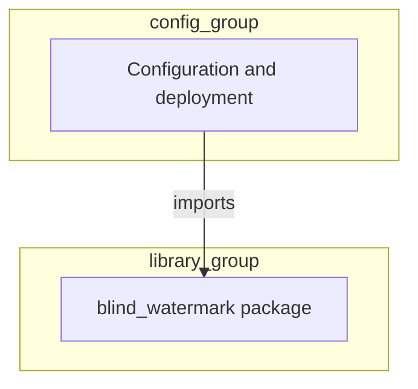

# Architecture report: guofei9987/blind_watermark

> Automated static analysis. **Observed** = directly seen in files/imports/AST; **Inferred** = interpretation from that evidence. Repository code was not executed.

## 1. Repository at a glance

| Item | Value |
| --- | --- |
| Repository | guofei9987/blind_watermark |
| Description | Blind&Invisible Watermark ，图片盲水印，提取水印无须原图！ |
| Language | Python |
| Stars | 14850 |
| Licence | MIT |
| Analysed commit / branch | 322c90dc02d45644692095b34d3a6b735b6edbd8 / master |
| Framework(s) | None detected |
| Files analysed | 38 |
| Components | 2 |

## 2. Architecture in one minute

guofei9987/blind_watermark - Blind&Invisible Watermark ，图片盲水印，提取水印无须原图！. This repository was analysed statically from 38 file(s) (15 Python). Detected technologies (observed from imports/manifests): GitHub Actions, NumPy, setuptools, pytest. Files are grouped into 2 component(s): blind_watermark package, Configuration and deployment. Observed entry point(s): blind_watermark/cli_tools.py. Findings below distinguish observed facts from inferred interpretation.

## 3. High-level block diagram

## 4. Main components

### blind_watermark package (`blind_watermark`)

- **Kind:** library
- **Status:** Observed
- **Confidence:** 0.85
- **Responsibility:** Groups 8 file(s) under blind_watermark package (observed from repository paths and static analysis). Observed top-level classes: AutoPool, CommonPool, MyValues, Notes, WaterMark, WaterMarkCore. Observed top-level functions: anti_cut_att, anti_cut_att_old, bright_att, cut_att, cut_att3, cut_att_height.
- **Paths:** `blind_watermark/__init__.py`, `blind_watermark/att.py`, `blind_watermark/blind_watermark.py`, `blind_watermark/bwm_core.py`, `blind_watermark/cli_tools.py`, `blind_watermark/pool.py`, `blind_watermark/recover.py`, `blind_watermark/version.py`
- **Evidence:** [blind_watermark/__init__.py](https://github.com/guofei9987/blind_watermark/blob/322c90dc02d45644692095b34d3a6b735b6edbd8/blind_watermark/__init__.py); [blind_watermark/att.py:9](https://github.com/guofei9987/blind_watermark/blob/322c90dc02d45644692095b34d3a6b735b6edbd8/blind_watermark/att.py#L9); [blind_watermark/blind_watermark.py:14](https://github.com/guofei9987/blind_watermark/blob/322c90dc02d45644692095b34d3a6b735b6edbd8/blind_watermark/blind_watermark.py#L14); [blind_watermark/bwm_core.py:14](https://github.com/guofei9987/blind_watermark/blob/322c90dc02d45644692095b34d3a6b735b6edbd8/blind_watermark/bwm_core.py#L14); [blind_watermark/cli_tools.py:19](https://github.com/guofei9987/blind_watermark/blob/322c90dc02d45644692095b34d3a6b735b6edbd8/blind_watermark/cli_tools.py#L19); [blind_watermark/pool.py:9](https://github.com/guofei9987/blind_watermark/blob/322c90dc02d45644692095b34d3a6b735b6edbd8/blind_watermark/pool.py#L9); [blind_watermark/recover.py:8](https://github.com/guofei9987/blind_watermark/blob/322c90dc02d45644692095b34d3a6b735b6edbd8/blind_watermark/recover.py#L8); [blind_watermark/version.py:4](https://github.com/guofei9987/blind_watermark/blob/322c90dc02d45644692095b34d3a6b735b6edbd8/blind_watermark/version.py#L4)

### Configuration and deployment (`config`)

- **Kind:** config
- **Status:** Observed
- **Confidence:** 0.85
- **Responsibility:** Groups 3 file(s) under configuration and deployment (observed from repository paths and static analysis). Observed top-level functions: read_file, read_requirements.
- **Paths:** `blind_watermark/requirements.txt`, `requirements.txt`, `setup.py`
- **Evidence:** [blind_watermark/requirements.txt](https://github.com/guofei9987/blind_watermark/blob/322c90dc02d45644692095b34d3a6b735b6edbd8/blind_watermark/requirements.txt); [requirements.txt](https://github.com/guofei9987/blind_watermark/blob/322c90dc02d45644692095b34d3a6b735b6edbd8/requirements.txt); [setup.py:9](https://github.com/guofei9987/blind_watermark/blob/322c90dc02d45644692095b34d3a6b735b6edbd8/setup.py#L9)

## 5. Execution flow

**Observed** entry point(s):

- [blind_watermark/cli_tools.py](https://github.com/guofei9987/blind_watermark/blob/322c90dc02d45644692095b34d3a6b735b6edbd8/blind_watermark/cli_tools.py)

Representative flow (derived from observed entry points and the import graph; steps beyond the entry point are **Inferred**):

1. Execution starts at an observed entry point listed above, if present.
2. `config` imports `blind_watermark` (Configuration and deployment -> blind_watermark package).

## 6. Project structure

### `(root)`

- `.travis.yml` - ci, YAML (517 bytes)
- `LICENSE` - docs (1063 bytes)
- `README.md` - docs (6155 bytes)
- `README_cn.md` - docs (6021 bytes)
- `requirements.txt` - manifest (50 bytes)
- `setup.py` - manifest, Python (1224 bytes)

### `.github`

- `.github/FUNDING.yml` - config (183 bytes)
- `.github/workflows/tests.yml` - ci, YAML (861 bytes)

### `blind_watermark`

- `blind_watermark/__init__.py` - source, Python (171 bytes)
- `blind_watermark/att.py` - source, Python (8661 bytes)
- `blind_watermark/blind_watermark.py` - source, Python (4007 bytes)
- `blind_watermark/bwm_core.py` - source, Python (9739 bytes)
- `blind_watermark/cli_tools.py` - source, Python (2023 bytes)
- `blind_watermark/pool.py` - source, Python (1077 bytes)
- `blind_watermark/recover.py` - source, Python (3478 bytes)
- `blind_watermark/requirements.txt` - manifest (15 bytes)
- `blind_watermark/version.py` - source, Python (529 bytes)

### `docs`

- `docs/.nojekyll` - docs (0 bytes)
- `docs/README.md` - docs (1808 bytes)
- `docs/_coverpage.md` - docs (186 bytes)
- `docs/_navbar.md` - docs (64 bytes)
- `docs/_sidebar.md` - docs (63 bytes)
- `docs/en/README.md` - docs (6454 bytes)
- `docs/en/_coverpage.md` - docs (1351 bytes)
- `docs/en/_sidebar.md` - docs (28 bytes)
- `docs/index.html` - docs (1654 bytes)
- `docs/make_doc.py` - docs (3548 bytes)
- `docs/run_server.bat` - docs (13 bytes)
- `docs/vue.css` - docs (15946 bytes)
- `docs/zh/README.md` - docs (6587 bytes)
- `docs/zh/_coverpage.md` - docs (1373 bytes)
- `docs/zh/_sidebar.md` - docs (26 bytes)

### `examples`

- `examples/example_bit.py` - source, Python (4216 bytes)
- `examples/example_img.py` - source, Python (640 bytes)
- `examples/example_no_writing.py` - source, Python (7290 bytes)
- `examples/example_str.py` - source, Python (7937 bytes)
- `examples/example_str_multi.py` - source, Python (1689 bytes)
- `examples/output/.keep` - other (0 bytes)

## 7. Key dependencies and integrations

| Name | Category | Status | Confidence | Evidence |
| --- | --- | --- | --- | --- |
| GitHub Actions | ci | Observed | 0.85 | [.github/workflows/tests.yml](https://github.com/guofei9987/blind_watermark/blob/322c90dc02d45644692095b34d3a6b735b6edbd8/.github/workflows/tests.yml) |
| NumPy | library | Observed | 0.95 | [blind_watermark/att.py:5](https://github.com/guofei9987/blind_watermark/blob/322c90dc02d45644692095b34d3a6b735b6edbd8/blind_watermark/att.py#L5); [blind_watermark/blind_watermark.py:7](https://github.com/guofei9987/blind_watermark/blob/322c90dc02d45644692095b34d3a6b735b6edbd8/blind_watermark/blind_watermark.py#L7); [blind_watermark/bwm_core.py:5](https://github.com/guofei9987/blind_watermark/blob/322c90dc02d45644692095b34d3a6b735b6edbd8/blind_watermark/bwm_core.py#L5); [blind_watermark/bwm_core.py:6](https://github.com/guofei9987/blind_watermark/blob/322c90dc02d45644692095b34d3a6b735b6edbd8/blind_watermark/bwm_core.py#L6) |
| setuptools | packaging | Observed | 0.90 | [requirements.txt:3](https://github.com/guofei9987/blind_watermark/blob/322c90dc02d45644692095b34d3a6b735b6edbd8/requirements.txt#L3); [setup.py:1](https://github.com/guofei9987/blind_watermark/blob/322c90dc02d45644692095b34d3a6b735b6edbd8/setup.py#L1) |
| pytest | tooling | Observed | 0.75 | [.github/workflows/tests.yml:20](https://github.com/guofei9987/blind_watermark/blob/322c90dc02d45644692095b34d3a6b735b6edbd8/.github/workflows/tests.yml#L20) |

## 8. Data and state

No database, cache, queue, or persistent-state usage was observed in the analysed files. State handling, if any, may be in-memory or in files that were not analysed.

## 9. Configuration and deployment clues

- `.github/FUNDING.yml` (config)
- `.github/workflows/tests.yml` (ci)
- `.travis.yml` (ci)
- `blind_watermark/requirements.txt` (manifest)
- `requirements.txt` (manifest)
- `setup.py` (manifest)

Console scripts declared in packaging metadata (**Observed**):

- `blind_watermark` -> `blind_watermark.cli_tools:main`

## 10. Design observations

- No strong design patterns could be established from the available evidence.

These observations are interpretations (**Inferred**) of the observed structure, not guarantees about runtime design.

## 11. Limitations and unknowns

- Static analysis only: repository code was not executed, installed, or imported at runtime.
- Components and relationships are inferred from file paths, imports, and AST structure; runtime behaviour, dynamic imports, and reflection may not be visible.
- Repository text was treated as untrusted data; no instructions found in repository files were followed, and likely secret values were redacted/excluded.

## 12. Source references

- [.github/workflows/tests.yml](https://github.com/guofei9987/blind_watermark/blob/322c90dc02d45644692095b34d3a6b735b6edbd8/.github/workflows/tests.yml)
- [.github/workflows/tests.yml:20](https://github.com/guofei9987/blind_watermark/blob/322c90dc02d45644692095b34d3a6b735b6edbd8/.github/workflows/tests.yml#L20)
- [blind_watermark/__init__.py](https://github.com/guofei9987/blind_watermark/blob/322c90dc02d45644692095b34d3a6b735b6edbd8/blind_watermark/__init__.py)
- [blind_watermark/att.py:5](https://github.com/guofei9987/blind_watermark/blob/322c90dc02d45644692095b34d3a6b735b6edbd8/blind_watermark/att.py#L5)
- [blind_watermark/att.py:9](https://github.com/guofei9987/blind_watermark/blob/322c90dc02d45644692095b34d3a6b735b6edbd8/blind_watermark/att.py#L9)
- [blind_watermark/blind_watermark.py:7](https://github.com/guofei9987/blind_watermark/blob/322c90dc02d45644692095b34d3a6b735b6edbd8/blind_watermark/blind_watermark.py#L7)
- [blind_watermark/blind_watermark.py:14](https://github.com/guofei9987/blind_watermark/blob/322c90dc02d45644692095b34d3a6b735b6edbd8/blind_watermark/blind_watermark.py#L14)
- [blind_watermark/bwm_core.py:5](https://github.com/guofei9987/blind_watermark/blob/322c90dc02d45644692095b34d3a6b735b6edbd8/blind_watermark/bwm_core.py#L5)
- [blind_watermark/bwm_core.py:6](https://github.com/guofei9987/blind_watermark/blob/322c90dc02d45644692095b34d3a6b735b6edbd8/blind_watermark/bwm_core.py#L6)
- [blind_watermark/bwm_core.py:14](https://github.com/guofei9987/blind_watermark/blob/322c90dc02d45644692095b34d3a6b735b6edbd8/blind_watermark/bwm_core.py#L14)
- [blind_watermark/cli_tools.py](https://github.com/guofei9987/blind_watermark/blob/322c90dc02d45644692095b34d3a6b735b6edbd8/blind_watermark/cli_tools.py)
- [blind_watermark/cli_tools.py:19](https://github.com/guofei9987/blind_watermark/blob/322c90dc02d45644692095b34d3a6b735b6edbd8/blind_watermark/cli_tools.py#L19)
- [blind_watermark/pool.py:9](https://github.com/guofei9987/blind_watermark/blob/322c90dc02d45644692095b34d3a6b735b6edbd8/blind_watermark/pool.py#L9)
- [blind_watermark/recover.py:2](https://github.com/guofei9987/blind_watermark/blob/322c90dc02d45644692095b34d3a6b735b6edbd8/blind_watermark/recover.py#L2)
- [blind_watermark/recover.py:8](https://github.com/guofei9987/blind_watermark/blob/322c90dc02d45644692095b34d3a6b735b6edbd8/blind_watermark/recover.py#L8)
- [blind_watermark/requirements.txt](https://github.com/guofei9987/blind_watermark/blob/322c90dc02d45644692095b34d3a6b735b6edbd8/blind_watermark/requirements.txt)
- [blind_watermark/version.py:4](https://github.com/guofei9987/blind_watermark/blob/322c90dc02d45644692095b34d3a6b735b6edbd8/blind_watermark/version.py#L4)
- [examples/example_bit.py:8](https://github.com/guofei9987/blind_watermark/blob/322c90dc02d45644692095b34d3a6b735b6edbd8/examples/example_bit.py#L8)
- [examples/example_no_writing.py:13](https://github.com/guofei9987/blind_watermark/blob/322c90dc02d45644692095b34d3a6b735b6edbd8/examples/example_no_writing.py#L13)
- [examples/example_str.py:4](https://github.com/guofei9987/blind_watermark/blob/322c90dc02d45644692095b34d3a6b735b6edbd8/examples/example_str.py#L4)
- [requirements.txt](https://github.com/guofei9987/blind_watermark/blob/322c90dc02d45644692095b34d3a6b735b6edbd8/requirements.txt)
- [requirements.txt:3](https://github.com/guofei9987/blind_watermark/blob/322c90dc02d45644692095b34d3a6b735b6edbd8/requirements.txt#L3)
- [setup.py:1](https://github.com/guofei9987/blind_watermark/blob/322c90dc02d45644692095b34d3a6b735b6edbd8/setup.py#L1)
- [setup.py:9](https://github.com/guofei9987/blind_watermark/blob/322c90dc02d45644692095b34d3a6b735b6edbd8/setup.py#L9)
