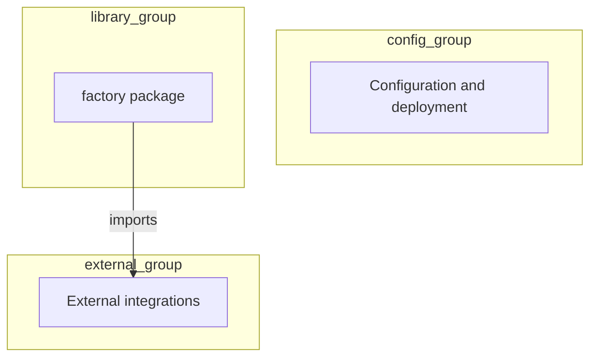

# Architecture report: h2y/Shadowrocket-ADBlock-Rules

> Automated static analysis. **Observed** = directly seen in files/imports/AST; **Inferred** = interpretation from that evidence. Repository code was not executed.

## 1. Repository at a glance

| Item | Value |
| --- | --- |
| Repository | h2y/Shadowrocket-ADBlock-Rules |
| Description | 提供多款 Shadowrocket 规则，带广告过滤功能。用于 iOS 未越狱设备选择性地自动翻墙。 |
| Language | Python |
| Stars | 16736 |
| Licence | Other |
| Analysed commit / branch | 1b691dc27ac483cfc0574c7559c6f9db9293c6f7 / master |
| Framework(s) | None detected |
| Files analysed | 38 |
| Components | 3 |

## 2. Architecture in one minute

h2y/Shadowrocket-ADBlock-Rules - 提供多款 Shadowrocket 规则，带广告过滤功能。用于 iOS 未越狱设备选择性地自动翻墙。. This repository was analysed statically from 38 file(s) (5 Python). Detected technologies (observed from imports/manifests): requests. Files are grouped into 3 component(s): Configuration and deployment, External integrations, factory package. Findings below distinguish observed facts from inferred interpretation.

## 3. High-level block diagram

## 4. Main components

### Configuration and deployment (`config`)

- **Kind:** config
- **Status:** Observed
- **Confidence:** 0.85
- **Responsibility:** Groups 1 file(s) under configuration and deployment (observed from repository paths and static analysis).
- **Paths:** `requirements.txt`
- **Evidence:** [requirements.txt](https://github.com/h2y/Shadowrocket-ADBlock-Rules/blob/1b691dc27ac483cfc0574c7559c6f9db9293c6f7/requirements.txt)

### External integrations (`external_integrations`)

- **Kind:** external
- **Status:** Inferred
- **Confidence:** 0.70
- **Responsibility:** Groups 0 file(s) under external integrations (observed from repository paths and static analysis).
- **Evidence:** [factory/ad.py:11](https://github.com/h2y/Shadowrocket-ADBlock-Rules/blob/1b691dc27ac483cfc0574c7559c6f9db9293c6f7/factory/ad.py#L11); [factory/chnroutes.py:6](https://github.com/h2y/Shadowrocket-ADBlock-Rules/blob/1b691dc27ac483cfc0574c7559c6f9db9293c6f7/factory/chnroutes.py#L6); [factory/gfwlist.py:10](https://github.com/h2y/Shadowrocket-ADBlock-Rules/blob/1b691dc27ac483cfc0574c7559c6f9db9293c6f7/factory/gfwlist.py#L10); [factory/top500.py:7](https://github.com/h2y/Shadowrocket-ADBlock-Rules/blob/1b691dc27ac483cfc0574c7559c6f9db9293c6f7/factory/top500.py#L7)

### factory package (`factory`)

- **Kind:** library
- **Status:** Observed
- **Confidence:** 0.85
- **Responsibility:** Groups 6 file(s) under factory package (observed from repository paths and static analysis). Observed top-level classes: DomainScaner, UrlScaner. Observed top-level functions: clear_format, fetchHTML, filtrate_rules, getRulesStringFromFile, get_rule.
- **Paths:** `factory/ad.py`, `factory/auto_build.sh`, `factory/build_confs.py`, `factory/chnroutes.py`, `factory/gfwlist.py`, `factory/top500.py`
- **Evidence:** [factory/ad.py](https://github.com/h2y/Shadowrocket-ADBlock-Rules/blob/1b691dc27ac483cfc0574c7559c6f9db9293c6f7/factory/ad.py); [factory/auto_build.sh](https://github.com/h2y/Shadowrocket-ADBlock-Rules/blob/1b691dc27ac483cfc0574c7559c6f9db9293c6f7/factory/auto_build.sh); [factory/build_confs.py:22](https://github.com/h2y/Shadowrocket-ADBlock-Rules/blob/1b691dc27ac483cfc0574c7559c6f9db9293c6f7/factory/build_confs.py#L22); [factory/chnroutes.py:16](https://github.com/h2y/Shadowrocket-ADBlock-Rules/blob/1b691dc27ac483cfc0574c7559c6f9db9293c6f7/factory/chnroutes.py#L16); [factory/gfwlist.py:20](https://github.com/h2y/Shadowrocket-ADBlock-Rules/blob/1b691dc27ac483cfc0574c7559c6f9db9293c6f7/factory/gfwlist.py#L20); [factory/top500.py:23](https://github.com/h2y/Shadowrocket-ADBlock-Rules/blob/1b691dc27ac483cfc0574c7559c6f9db9293c6f7/factory/top500.py#L23)

## 5. Execution flow

No entry point was observed; the startup flow below is therefore limited.

Representative flow (derived from observed entry points and the import graph; steps beyond the entry point are **Inferred**):

1. Execution starts at an observed entry point listed above, if present.
2. `factory` imports `external_integrations` (factory package -> External integrations).

## 6. Project structure

### `(root)`

- `.gitignore` - other (15 bytes)
- `LICENSE` - docs (264 bytes)
- `readme.md` - docs (10810 bytes)
- `requirements.txt` - manifest (29 bytes)
- `sr_backcn.conf` - other (835 bytes)
- `sr_cnip.conf` - other (840 bytes)
- `sr_top500_banlist.conf` - other (189499 bytes)
- `sr_top500_whitelist.conf` - other (15437 bytes)

### `factory`

- `factory/README.md` - docs (2059 bytes)
- `factory/ad.py` - source, Python (2587 bytes)
- `factory/auto_build.sh` - source, Shell (282 bytes)
- `factory/build_confs.py` - source, Python (2410 bytes)
- `factory/chnroutes.py` - source, Python (1013 bytes)
- `factory/gfwlist.py` - source, Python (2051 bytes)
- `factory/index.sh.bat` - other (66 bytes)
- `factory/manual_direct.txt` - docs (231 bytes)
- `factory/manual_gfwlist.txt` - docs (716 bytes)
- `factory/manual_proxy.txt` - docs (1704 bytes)
- `factory/manual_reject.txt` - docs (3455 bytes)
- `factory/resultant/gfw.list` - other (76483 bytes)
- `factory/resultant/gfw_unhandle.log` - other (1415 bytes)
- `factory/resultant/top500_direct.list` - other (3969 bytes)
- `factory/resultant/top500_proxy.list` - other (1323 bytes)
- `factory/template/sr_adb.txt` - docs (592 bytes)
- `factory/template/sr_backcn.txt` - docs (180 bytes)
- `factory/template/sr_backcn_ad.txt` - docs (204 bytes)
- `factory/template/sr_cnip.txt` - docs (185 bytes)
- `factory/template/sr_cnip_ad.txt` - docs (209 bytes)
- `factory/template/sr_direct_banad.txt` - docs (149 bytes)
- `factory/template/sr_foot.txt` - docs (98 bytes)
- `factory/template/sr_head.txt` - docs (552 bytes)
- `factory/template/sr_proxy_banad.txt` - docs (261 bytes)
- `factory/template/sr_top500_banlist.txt` - docs (149 bytes)
- `factory/template/sr_top500_banlist_ad.txt` - docs (172 bytes)
- `factory/template/sr_top500_whitelist.txt` - docs (479 bytes)
- `factory/template/sr_top500_whitelist_ad.txt` - docs (503 bytes)
- `factory/top500.py` - source, Python (3809 bytes)

### `figure`

- `figure/免费在线二维码生成器.url` - other (63 bytes)

## 7. Key dependencies and integrations

| Name | Category | Status | Confidence | Evidence |
| --- | --- | --- | --- | --- |
| requests | library | Observed | 0.95 | [factory/ad.py:11](https://github.com/h2y/Shadowrocket-ADBlock-Rules/blob/1b691dc27ac483cfc0574c7559c6f9db9293c6f7/factory/ad.py#L11); [factory/chnroutes.py:6](https://github.com/h2y/Shadowrocket-ADBlock-Rules/blob/1b691dc27ac483cfc0574c7559c6f9db9293c6f7/factory/chnroutes.py#L6); [factory/gfwlist.py:10](https://github.com/h2y/Shadowrocket-ADBlock-Rules/blob/1b691dc27ac483cfc0574c7559c6f9db9293c6f7/factory/gfwlist.py#L10); [factory/top500.py:7](https://github.com/h2y/Shadowrocket-ADBlock-Rules/blob/1b691dc27ac483cfc0574c7559c6f9db9293c6f7/factory/top500.py#L7) |

## 8. Data and state

No database, cache, queue, or persistent-state usage was observed in the analysed files. State handling, if any, may be in-memory or in files that were not analysed.

## 9. Configuration and deployment clues

- `requirements.txt` (manifest)

## 10. Design observations

- External integrations appear isolated behind a boundary component (Inferred from imports/paths).

These observations are interpretations (**Inferred**) of the observed structure, not guarantees about runtime design.

## 11. Limitations and unknowns

- Static analysis only: repository code was not executed, installed, or imported at runtime.
- Components and relationships are inferred from file paths, imports, and AST structure; runtime behaviour, dynamic imports, and reflection may not be visible.
- No clear application entry point was observed in the analysed files.
- Repository text was treated as untrusted data; no instructions found in repository files were followed, and likely secret values were redacted/excluded.
- The GitHub repository was marked archived at selection time.

## 12. Source references

- [factory/ad.py](https://github.com/h2y/Shadowrocket-ADBlock-Rules/blob/1b691dc27ac483cfc0574c7559c6f9db9293c6f7/factory/ad.py)
- [factory/ad.py:11](https://github.com/h2y/Shadowrocket-ADBlock-Rules/blob/1b691dc27ac483cfc0574c7559c6f9db9293c6f7/factory/ad.py#L11)
- [factory/auto_build.sh](https://github.com/h2y/Shadowrocket-ADBlock-Rules/blob/1b691dc27ac483cfc0574c7559c6f9db9293c6f7/factory/auto_build.sh)
- [factory/build_confs.py:22](https://github.com/h2y/Shadowrocket-ADBlock-Rules/blob/1b691dc27ac483cfc0574c7559c6f9db9293c6f7/factory/build_confs.py#L22)
- [factory/chnroutes.py:6](https://github.com/h2y/Shadowrocket-ADBlock-Rules/blob/1b691dc27ac483cfc0574c7559c6f9db9293c6f7/factory/chnroutes.py#L6)
- [factory/chnroutes.py:16](https://github.com/h2y/Shadowrocket-ADBlock-Rules/blob/1b691dc27ac483cfc0574c7559c6f9db9293c6f7/factory/chnroutes.py#L16)
- [factory/gfwlist.py:10](https://github.com/h2y/Shadowrocket-ADBlock-Rules/blob/1b691dc27ac483cfc0574c7559c6f9db9293c6f7/factory/gfwlist.py#L10)
- [factory/gfwlist.py:20](https://github.com/h2y/Shadowrocket-ADBlock-Rules/blob/1b691dc27ac483cfc0574c7559c6f9db9293c6f7/factory/gfwlist.py#L20)
- [factory/top500.py:7](https://github.com/h2y/Shadowrocket-ADBlock-Rules/blob/1b691dc27ac483cfc0574c7559c6f9db9293c6f7/factory/top500.py#L7)
- [factory/top500.py:23](https://github.com/h2y/Shadowrocket-ADBlock-Rules/blob/1b691dc27ac483cfc0574c7559c6f9db9293c6f7/factory/top500.py#L23)
- [requirements.txt](https://github.com/h2y/Shadowrocket-ADBlock-Rules/blob/1b691dc27ac483cfc0574c7559c6f9db9293c6f7/requirements.txt)
- [requirements.txt:2](https://github.com/h2y/Shadowrocket-ADBlock-Rules/blob/1b691dc27ac483cfc0574c7559c6f9db9293c6f7/requirements.txt#L2)
