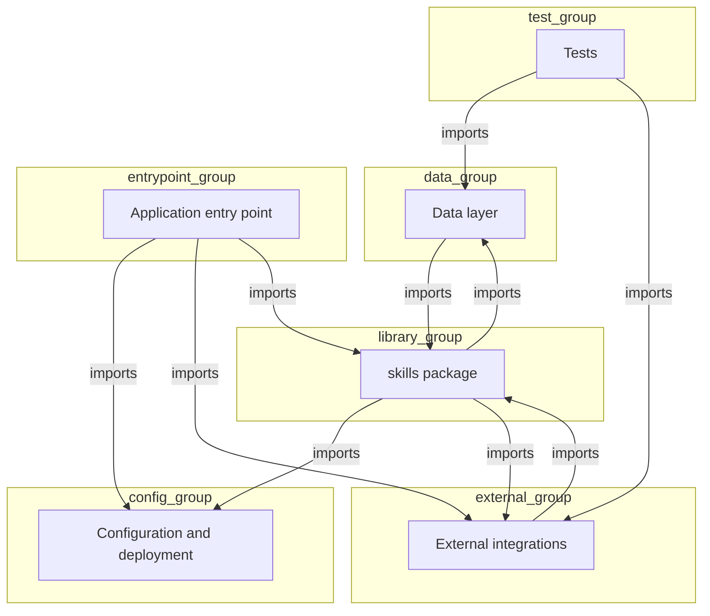

# Architecture report: handsomestWei/patent-disclosure-skill

> Automated static analysis. **Observed** = directly seen in files/imports/AST; **Inferred** = interpretation from that evidence. Repository code was not executed.

## 1. Repository at a glance

| Item | Value |
| --- | --- |
| Repository | handsomestWei/patent-disclosure-skill |
| Description | 中国专利.skill：专利点挖掘与交底书（发明/实用/外观）编写，通俗解读专利，嗅探政策动向，辅助审查答复。 |
| Language | Python |
| Stars | 13448 |
| Licence | MIT |
| Analysed commit / branch | b4bbec6f0a1c3c32a904faabeb249639c0b30d98 / main |
| Framework(s) | None detected |
| Files analysed | 513 |
| Components | 6 |

## 2. Architecture in one minute

handsomestWei/patent-disclosure-skill - 中国专利.skill：专利点挖掘与交底书（发明/实用/外观）编写，通俗解读专利，嗅探政策动向，辅助审查答复。. This repository was analysed statically from 513 file(s) (260 Python). Detected technologies (observed from imports/manifests): GitHub Actions, SQLite, NumPy, unittest. Files are grouped into 6 component(s): Configuration and deployment, Data layer, Application entry point, External integrations, skills package, Tests. Observed entry point(s): scripts/generate-star-history.py, skills/patent-application/tools/audit_claims.py, skills/patent-application/tools/check_design_views.py. Findings below distinguish observed facts from inferred interpretation.

## 3. High-level block diagram

## 4. Main components

### Configuration and deployment (`config`)

- **Kind:** config
- **Status:** Observed
- **Confidence:** 0.85
- **Responsibility:** Groups 58 file(s) under configuration and deployment (observed from repository paths and static analysis).
- **Paths:** `requirements.txt`, `skills/patent-application/references/promo_terms.yaml`, `skills/patent-application/references/schemas/application_figure_plan.schema.yaml`, `skills/patent-application/references/schemas/application_plan.schema.yaml`, `skills/patent-application/references/schemas/invention_figures.schema.yaml`, `skills/patent-application/references/schemas/numeral_register.schema.yaml`, `skills/patent-disclosure/references/formulas/paradigms.yaml`, `skills/patent-disclosure/references/patent_type_search.yaml`, `skills/patent-disclosure/references/schemas/appearance.schema.yaml`, `skills/patent-disclosure/references/schemas/decompose.schema.yaml`, `skills/patent-disclosure/references/schemas/design_around.schema.yaml`, `skills/patent-disclosure/references/schemas/design_lineart_brief.schema.yaml`, `skills/patent-disclosure/references/schemas/family_plan.schema.yaml`, `skills/patent-disclosure/references/schemas/figure_plan.schema.yaml`, `skills/patent-disclosure/references/schemas/formula_plan.schema.yaml`, `skills/patent-disclosure/references/schemas/matrix.schema.yaml`, `skills/patent-disclosure/references/schemas/scorecard.schema.yaml`, `skills/patent-disclosure/references/schemas/structure.schema.yaml`, `skills/patent-disclosure/references/schemas/structure_callout_anchors.schema.yaml`, `skills/patent-disclosure/references/schemas/structure_lineart_brief.schema.yaml`, `skills/patent-disclosure/references/schemas/structure_lineart_compose.schema.yaml`, `skills/patent-disclosure/references/scorecards/gbt42748_fence.yaml`, `skills/patent-disclosure/tools/crawl/cnipa_epub_wait.yaml`, `skills/patent-disclosure/tools/crawl/requirements-cnipa.txt`, `skills/patent-disclosure/tools/package.json`, `skills/patent-disclosure/tools/requirements-pdf.txt`, `skills/patent-disclosure/tools/requirements-step.txt`, `skills/patent-docket/config.yaml`, `skills/patent-docket/references/dispositions.yaml`, `skills/patent-docket/references/docket.schema.yaml`, `skills/patent-docket/references/phases.yaml`, `skills/patent-exam-policy/references/schemas/exam_policy_backlog.schema.yaml`, `skills/patent-exam-policy/references/sources.yaml`, `skills/patent-map/tools/ipc_scheme/config.py`, `skills/patent-map/tools/ipc_scheme/requirements.txt`, `skills/patent-map/tools/ipc_scheme/testdata/sample_ipcpub.json`, `skills/patent-map/tools/requirements.txt`, `skills/patent-oa/assets/obsidian/oa.base.yaml`, `skills/patent-oa/docs/embedding.config.yaml`, `skills/patent-oa/references/schemas/oa_case.schema.yaml`, `skills/patent-oa/tools/requirements-oa.txt`, `skills/patent-reader/assets/obsidian/glossary.base.yaml`, `skills/patent-reader/assets/obsidian/graph_color_groups.json`, `skills/patent-reader/assets/obsidian/patents.base.yaml`, `skills/patent-reader/references/clue_vocab.yaml`, `skills/patent-reader/references/ipc_application_hints.yaml`, `skills/patent-reader/references/patent_domain_rules.yaml`, `skills/patent-reader/references/patent_pdf_sources.yaml`, `skills/patent-reader/references/schemas/appearance.schema.yaml`, `skills/patent-reader/references/schemas/claim_features.schema.yaml`, `skills/patent-reader/references/schemas/structure.schema.yaml`, `skills/patent-reader/references/tech_effect_hints.yaml`, `skills/patent-reader/references/text_vocab.yaml`, `skills/patent-reader/tools/crawl/requirements-cnipa.txt`, `skills/patent-reader/tools/requirements.txt`, `skills/patent-search/config.yaml`, `skills/patent-search/references/patent_type_search.yaml`, `skills/patent-search/tools/requirements-cnipa.txt`
- **Evidence:** [requirements.txt](https://github.com/handsomestWei/patent-disclosure-skill/blob/b4bbec6f0a1c3c32a904faabeb249639c0b30d98/requirements.txt); [skills/patent-application/references/promo_terms.yaml](https://github.com/handsomestWei/patent-disclosure-skill/blob/b4bbec6f0a1c3c32a904faabeb249639c0b30d98/skills/patent-application/references/promo_terms.yaml); [skills/patent-application/references/schemas/application_figure_plan.schema.yaml](https://github.com/handsomestWei/patent-disclosure-skill/blob/b4bbec6f0a1c3c32a904faabeb249639c0b30d98/skills/patent-application/references/schemas/application_figure_plan.schema.yaml); [skills/patent-application/references/schemas/application_plan.schema.yaml](https://github.com/handsomestWei/patent-disclosure-skill/blob/b4bbec6f0a1c3c32a904faabeb249639c0b30d98/skills/patent-application/references/schemas/application_plan.schema.yaml); [skills/patent-application/references/schemas/invention_figures.schema.yaml](https://github.com/handsomestWei/patent-disclosure-skill/blob/b4bbec6f0a1c3c32a904faabeb249639c0b30d98/skills/patent-application/references/schemas/invention_figures.schema.yaml); [skills/patent-application/references/schemas/numeral_register.schema.yaml](https://github.com/handsomestWei/patent-disclosure-skill/blob/b4bbec6f0a1c3c32a904faabeb249639c0b30d98/skills/patent-application/references/schemas/numeral_register.schema.yaml); [skills/patent-disclosure/references/formulas/paradigms.yaml](https://github.com/handsomestWei/patent-disclosure-skill/blob/b4bbec6f0a1c3c32a904faabeb249639c0b30d98/skills/patent-disclosure/references/formulas/paradigms.yaml); [skills/patent-disclosure/references/patent_type_search.yaml](https://github.com/handsomestWei/patent-disclosure-skill/blob/b4bbec6f0a1c3c32a904faabeb249639c0b30d98/skills/patent-disclosure/references/patent_type_search.yaml)

### Data layer (`data_layer`)

- **Kind:** data
- **Status:** Observed
- **Confidence:** 0.85
- **Responsibility:** Groups 1 file(s) under data layer (observed from repository paths and static analysis). Observed top-level functions: _clue_link, _clue_stem, _conf_rank, _region_text, _table_wikilink, agent_fits_for.
- **Paths:** `skills/patent-reader/tools/vault/clues/model.py`
- **Evidence:** [skills/patent-reader/tools/vault/clues/model.py:11](https://github.com/handsomestWei/patent-disclosure-skill/blob/b4bbec6f0a1c3c32a904faabeb249639c0b30d98/skills/patent-reader/tools/vault/clues/model.py#L11)

### Application entry point (`entrypoint`)

- **Kind:** entrypoint
- **Status:** Observed
- **Confidence:** 0.85
- **Responsibility:** Groups 94 file(s) under application entry point (observed from repository paths and static analysis). Observed top-level classes: BareParenHit, EpubSearchHit, Finding, LatexDelimError, MapHandler, MapServer. Observed top-level functions: _abs_url, _abstract_plain, _add_block_equation, _add_body_paragraph, _add_code_block, _add_heading.
- **Paths:** `scripts/generate-star-history.py`, `skills/patent-application/tools/audit_claims.py`, `skills/patent-application/tools/check_design_views.py`, `skills/patent-application/tools/check_numeral_register.py`, `skills/patent-application/tools/check_support.py`, `skills/patent-application/tools/compose_application_figure.py`, `skills/patent-application/tools/emit_application_docx.py`, `skills/patent-application/tools/iteration_dialog_log.py`, `skills/patent-application/tools/latex_delimiters.py`, `skills/patent-application/tools/material_gate.py`, `skills/patent-application/tools/md_to_docx.py`, `skills/patent-application/tools/plan_figures.py`, `skills/patent-application/tools/render_invention_figures.py`, `skills/patent-chart/tools/emit_chart.py`, `skills/patent-chart/tools/write_intake.py`, `skills/patent-disclosure/tools/bootstrap_cad_venv.py`, `skills/patent-disclosure/tools/browser.py`, `skills/patent-disclosure/tools/cad_scan.py`, `skills/patent-disclosure/tools/cad_venv.py`, `skills/patent-disclosure/tools/check_design_views.py`, `skills/patent-disclosure/tools/check_formula_plan.py`, `skills/patent-disclosure/tools/check_source_parts.py`, `skills/patent-disclosure/tools/crawl/cnipa_epub_crawler.py`, `skills/patent-disclosure/tools/crawl/cnipa_epub_parse.py`, `skills/patent-disclosure/tools/crawl/cnipa_epub_search.py`, `skills/patent-disclosure/tools/design_lineart_gate.py`, `skills/patent-disclosure/tools/docx_to_md.py`, `skills/patent-disclosure/tools/fence/check_layout.py`, `skills/patent-disclosure/tools/fence/check_scorecard.py`, `skills/patent-disclosure/tools/formula_paradigms.py`, `skills/patent-disclosure/tools/gen_demo_snap_step.py`, `skills/patent-disclosure/tools/image_gen.py`, `skills/patent-disclosure/tools/iteration_dialog_log.py`, `skills/patent-disclosure/tools/latex_delimiters.py`, `skills/patent-disclosure/tools/math_render.py`, `skills/patent-disclosure/tools/md_to_docx.py`, `skills/patent-disclosure/tools/mermaid_render.py`, `skills/patent-disclosure/tools/patent_type.py`, `skills/patent-disclosure/tools/pdf_to_md.py`, `skills/patent-disclosure/tools/pptx_to_md.py`, `skills/patent-disclosure/tools/run_step_to_views.py`, `skills/patent-disclosure/tools/step_to_views.py`, `skills/patent-disclosure/tools/structure_callout_overlay.py`, `skills/patent-disclosure/tools/structure_lineart_compose.py`, `skills/patent-disclosure/tools/structure_lineart_gate.py`, `skills/patent-disclosure/tools/svg_screenshot.py`, `skills/patent-docket/tools/emit_tracker.py`, `skills/patent-docket/tools/init_docket.py`, `skills/patent-docket/tools/validate_docket.py`, `skills/patent-map/tools/ensure_model.py`, `skills/patent-map/tools/ipc_scheme/__main__.py`, `skills/patent-map/tools/ipc_scheme/build.py`, `skills/patent-map/tools/ipc_scheme/cli.py`, `skills/patent-map/tools/model_store.py`, `skills/patent-map/tools/serve_map.py`, `skills/patent-oa/tools/config.py`, `skills/patent-oa/tools/emit_chart.py`, `skills/patent-oa/tools/emit_opinion_docx.py`, `skills/patent-oa/tools/ingest_case.py`, `skills/patent-oa/tools/latex_delimiters.py`, `skills/patent-oa/tools/md_to_docx.py`, `skills/patent-oa/tools/pdf_text.py`, `skills/patent-oa/tools/rebuild_vectors.py`, `skills/patent-oa/tools/refresh_vault.py`, `skills/patent-oa/tools/search_cases.py`, `skills/patent-oa/tools/write_intake.py`, `skills/patent-reader/tools/analyze/build_claim_mermaid.py`, `skills/patent-reader/tools/analyze/build_context_anchor.py`, `skills/patent-reader/tools/analyze/lint_patent_note.py`, `skills/patent-reader/tools/analyze/validate_claim_features.py`, `skills/patent-reader/tools/analyze/validate_claim_tree.py`, `skills/patent-reader/tools/analyze/validate_public_clues.py`, `skills/patent-reader/tools/browser.py`, `skills/patent-reader/tools/crawl/cnipa_epub_crawler.py`, `skills/patent-reader/tools/crawl/cnipa_epub_parse.py`, `skills/patent-reader/tools/extract/extract_patent_figures.py`, `skills/patent-reader/tools/extract/extract_patent_text.py`, `skills/patent-reader/tools/extract/fetch_design_views.py`, `skills/patent-reader/tools/extract/fetch_gp_fulltext.py`, `skills/patent-reader/tools/extract/fetch_patent_pdf.py`, `skills/patent-reader/tools/patent_type.py`, `skills/patent-reader/tools/vault/build_patent_canvas.py`, `skills/patent-reader/tools/vault/check_obsidian_env.py`, `skills/patent-reader/tools/vault/link_patent_notes.py`, `skills/patent-reader/tools/vault/materialize_public_clues.py`, `skills/patent-reader/tools/vault/setup_obsidian_vault.py`, `skills/patent-reader/tools/vault/write_patent_obsidian_note.py`, `skills/patent-search/tools/browser.py`, `skills/patent-search/tools/cnipa_parse.py`, `skills/patent-search/tools/cnipa_search.py`, `skills/patent-search/tools/emit_covers_report.py`, `skills/patent-search/tools/emit_search_report.py`, `skills/patent-search/tools/gp_search.py`, `skills/patent-search/tools/patent_type.py`
- **Evidence:** [scripts/generate-star-history.py:26](https://github.com/handsomestWei/patent-disclosure-skill/blob/b4bbec6f0a1c3c32a904faabeb249639c0b30d98/scripts/generate-star-history.py#L26); [skills/patent-application/tools/audit_claims.py:37](https://github.com/handsomestWei/patent-disclosure-skill/blob/b4bbec6f0a1c3c32a904faabeb249639c0b30d98/skills/patent-application/tools/audit_claims.py#L37); [skills/patent-application/tools/check_design_views.py:22](https://github.com/handsomestWei/patent-disclosure-skill/blob/b4bbec6f0a1c3c32a904faabeb249639c0b30d98/skills/patent-application/tools/check_design_views.py#L22); [skills/patent-application/tools/check_numeral_register.py:30](https://github.com/handsomestWei/patent-disclosure-skill/blob/b4bbec6f0a1c3c32a904faabeb249639c0b30d98/skills/patent-application/tools/check_numeral_register.py#L30); [skills/patent-application/tools/check_support.py:36](https://github.com/handsomestWei/patent-disclosure-skill/blob/b4bbec6f0a1c3c32a904faabeb249639c0b30d98/skills/patent-application/tools/check_support.py#L36); [skills/patent-application/tools/compose_application_figure.py:28](https://github.com/handsomestWei/patent-disclosure-skill/blob/b4bbec6f0a1c3c32a904faabeb249639c0b30d98/skills/patent-application/tools/compose_application_figure.py#L28); [skills/patent-application/tools/emit_application_docx.py:27](https://github.com/handsomestWei/patent-disclosure-skill/blob/b4bbec6f0a1c3c32a904faabeb249639c0b30d98/skills/patent-application/tools/emit_application_docx.py#L27); [skills/patent-application/tools/iteration_dialog_log.py:21](https://github.com/handsomestWei/patent-disclosure-skill/blob/b4bbec6f0a1c3c32a904faabeb249639c0b30d98/skills/patent-application/tools/iteration_dialog_log.py#L21)

### External integrations (`external_integrations`)

- **Kind:** external
- **Status:** Observed
- **Confidence:** 0.85
- **Responsibility:** Groups 2 file(s) under external integrations (observed from repository paths and static analysis). Observed top-level functions: fetch_text, looks_blocked.
- **Paths:** `skills/patent-reader/tools/google_patents/client.py`, `skills/patent-search/tools/google_patents/client.py`
- **Evidence:** [skills/patent-reader/tools/google_patents/client.py:35](https://github.com/handsomestWei/patent-disclosure-skill/blob/b4bbec6f0a1c3c32a904faabeb249639c0b30d98/skills/patent-reader/tools/google_patents/client.py#L35); [skills/patent-search/tools/google_patents/client.py:35](https://github.com/handsomestWei/patent-disclosure-skill/blob/b4bbec6f0a1c3c32a904faabeb249639c0b30d98/skills/patent-search/tools/google_patents/client.py#L35)

### skills package (`skills`)

- **Kind:** library
- **Status:** Observed
- **Confidence:** 0.85
- **Responsibility:** Groups 107 file(s) under skills package (observed from repository paths and static analysis). Observed top-level classes: Claim, EmbedError, Embedder, EpubNavError, EpubSubmitError, GooglePatentsBadResponse. Observed top-level functions: _adapt_advanced_fields, _all, _append_children, _append_mathml, _apply_spans, _as_dict.
- **Paths:** `skills/patent-application/tools/__init__.py`, `skills/patent-application/tools/lexicon.py`, `skills/patent-application/tools/math_to_omml.py`, `skills/patent-application/tools/stdio_utf8.py`, `skills/patent-chart/tools/highlights.py`, `skills/patent-chart/tools/xlsx_minimal.py`, `skills/patent-disclosure/examples/example_batch_job_scheduler/knowledge/pkg/scheduler/heartbeat.go`, `skills/patent-disclosure/examples/example_batch_job_scheduler/knowledge/pkg/scheduler/reorder.go`, `skills/patent-disclosure/examples/example_batch_job_scheduler/knowledge/pkg/scheduler/scorer.go`, `skills/patent-disclosure/examples/example_batch_job_scheduler/knowledge/pkg/scheduler/types.go`, `skills/patent-disclosure/tools/cad_formats.py`, `skills/patent-disclosure/tools/crawl/cnipa_epub_nav.py`, `skills/patent-disclosure/tools/crawl/cnipa_epub_wait.py`, `skills/patent-disclosure/tools/fence/family_lib.py`, `skills/patent-disclosure/tools/fence/layout_lib.py`, `skills/patent-disclosure/tools/fence/scorecard_lib.py`, `skills/patent-disclosure/tools/formula_chem.py`, `skills/patent-disclosure/tools/formula_eval.py`, `skills/patent-disclosure/tools/formula_units.py`, `skills/patent-disclosure/tools/math_to_omml.py`, `skills/patent-disclosure/tools/stdio_utf8.py`, `skills/patent-disclosure/tools/structure_callout_layout.py`, `skills/patent-docket/tools/docket_config.py`, `skills/patent-docket/tools/docket_paths.py`, `skills/patent-docket/tools/docket_spec.py`, `skills/patent-docket/tools/stdio_utf8.py`, `skills/patent-map/tools/__init__.py`, `skills/patent-map/tools/embed_layout.py`, `skills/patent-map/tools/ipc_scheme/__init__.py`, `skills/patent-map/tools/ipc_scheme/download.py`, `skills/patent-map/tools/ipc_scheme/emit.py`, `skills/patent-map/tools/ipc_scheme/parse.py`, `skills/patent-map/tools/ipc_titles.py`, `skills/patent-map/tools/map_cache.py`, `skills/patent-map/tools/vault_index.py`, `skills/patent-map/web/js/app.js`, `skills/patent-map/web/js/camera.js`, `skills/patent-map/web/js/chrome.js`, `skills/patent-map/web/js/core.js`, `skills/patent-map/web/js/detail.js`, `skills/patent-map/web/js/layout.js`, `skills/patent-map/web/js/view-bubble.js`, `skills/patent-map/web/js/view-citation.js`, `skills/patent-map/web/js/view-dashboard.js`, `skills/patent-map/web/js/view-matrix.js`, `skills/patent-map/web/js/view-terrain.js`, `skills/patent-map/web/terrain3d.js`, `skills/patent-oa/tools/__init__.py`, `skills/patent-oa/tools/case_md.py`, `skills/patent-oa/tools/embed.py`, `skills/patent-oa/tools/highlights.py`, `skills/patent-oa/tools/redact.py`, `skills/patent-oa/tools/stdio_utf8.py`, `skills/patent-oa/tools/store.py`, `skills/patent-oa/tools/vault_layout.py`, `skills/patent-oa/tools/xlsx_minimal.py`, `skills/patent-reader/tools/__init__.py`, `skills/patent-reader/tools/analyze/__init__.py`, `skills/patent-reader/tools/analyze/claim_features.py`, `skills/patent-reader/tools/extract/__init__.py`, `skills/patent-reader/tools/extract/figure_extract.py`, `skills/patent-reader/tools/google_patents/__init__.py`, `skills/patent-reader/tools/google_patents/api.py`, `skills/patent-reader/tools/google_patents/detail.py`, `skills/patent-reader/tools/google_patents/errors.py`, `skills/patent-reader/tools/google_patents/html_text.py`, `skills/patent-reader/tools/google_patents/query.py`, `skills/patent-reader/tools/google_patents/results.py`, `skills/patent-reader/tools/shared/__init__.py`, `skills/patent-reader/tools/shared/biblio.py`, `skills/patent-reader/tools/shared/claims.py`, `skills/patent-reader/tools/shared/common.py`, `skills/patent-reader/tools/shared/obsidian_env.py`, `skills/patent-reader/tools/shared/paths.py`, `skills/patent-reader/tools/shared/rules.py`, `skills/patent-reader/tools/shared/text_vocab.py`, `skills/patent-reader/tools/stdio_utf8.py`, `skills/patent-reader/tools/vault/__init__.py`, `skills/patent-reader/tools/vault/clue_vault.py`, `skills/patent-reader/tools/vault/clues/__init__.py`, `skills/patent-reader/tools/vault/clues/annotate.py`, `skills/patent-reader/tools/vault/clues/matching.py`, `skills/patent-reader/tools/vault/clues/render.py`, `skills/patent-reader/tools/vault/clues/summary.py`, `skills/patent-reader/tools/vault/clues/vocab.py`, `skills/patent-reader/tools/vault/desc_paragraphs.py`, `skills/patent-reader/tools/vault/note_cites.py`, `skills/patent-reader/tools/vault/obsidian.py`, `skills/patent-reader/tools/vault/obsidian_bootstrap.py`, `skills/patent-reader/tools/vault/obsidian_canvas.py`, `skills/patent-reader/tools/vault/obsidian_claims.py`, `skills/patent-reader/tools/vault/obsidian_frontmatter.py`, `skills/patent-reader/tools/vault/obsidian_glossary.py`, `skills/patent-reader/tools/vault/obsidian_paths.py`, `skills/patent-reader/tools/vault/patent_link.py`, `skills/patent-reader/tools/vault/schema_vault.py`, `skills/patent-search/tools/cnipa_crawler.py`, `skills/patent-search/tools/derived_query.py`, `skills/patent-search/tools/google_patents/__init__.py`, `skills/patent-search/tools/google_patents/api.py`, `skills/patent-search/tools/google_patents/detail.py`, `skills/patent-search/tools/google_patents/errors.py`, `skills/patent-search/tools/google_patents/html_text.py`, `skills/patent-search/tools/google_patents/query.py`, `skills/patent-search/tools/google_patents/results.py`, `skills/patent-search/tools/search_config.py`, `skills/patent-search/tools/stdio_utf8.py`
- **Evidence:** [skills/patent-application/tools/__init__.py](https://github.com/handsomestWei/patent-disclosure-skill/blob/b4bbec6f0a1c3c32a904faabeb249639c0b30d98/skills/patent-application/tools/__init__.py); [skills/patent-application/tools/lexicon.py:13](https://github.com/handsomestWei/patent-disclosure-skill/blob/b4bbec6f0a1c3c32a904faabeb249639c0b30d98/skills/patent-application/tools/lexicon.py#L13); [skills/patent-application/tools/math_to_omml.py:48](https://github.com/handsomestWei/patent-disclosure-skill/blob/b4bbec6f0a1c3c32a904faabeb249639c0b30d98/skills/patent-application/tools/math_to_omml.py#L48); [skills/patent-application/tools/stdio_utf8.py:14](https://github.com/handsomestWei/patent-disclosure-skill/blob/b4bbec6f0a1c3c32a904faabeb249639c0b30d98/skills/patent-application/tools/stdio_utf8.py#L14); [skills/patent-chart/tools/highlights.py:29](https://github.com/handsomestWei/patent-disclosure-skill/blob/b4bbec6f0a1c3c32a904faabeb249639c0b30d98/skills/patent-chart/tools/highlights.py#L29); [skills/patent-chart/tools/xlsx_minimal.py:40](https://github.com/handsomestWei/patent-disclosure-skill/blob/b4bbec6f0a1c3c32a904faabeb249639c0b30d98/skills/patent-chart/tools/xlsx_minimal.py#L40); [skills/patent-disclosure/examples/example_batch_job_scheduler/knowledge/pkg/scheduler/heartbeat.go](https://github.com/handsomestWei/patent-disclosure-skill/blob/b4bbec6f0a1c3c32a904faabeb249639c0b30d98/skills/patent-disclosure/examples/example_batch_job_scheduler/knowledge/pkg/scheduler/heartbeat.go); [skills/patent-disclosure/examples/example_batch_job_scheduler/knowledge/pkg/scheduler/reorder.go](https://github.com/handsomestWei/patent-disclosure-skill/blob/b4bbec6f0a1c3c32a904faabeb249639c0b30d98/skills/patent-disclosure/examples/example_batch_job_scheduler/knowledge/pkg/scheduler/reorder.go)

### Tests (`tests`)

- **Kind:** test
- **Status:** Observed
- **Confidence:** 0.85
- **Responsibility:** Groups 82 file(s) under tests (observed from repository paths and static analysis). Observed top-level classes: AbstractFieldTests, AdvancedInventorSearchTests, AdvancedTypeFilterTests, ApplyTypeFilterTests, AuditClaimsTests, BackfillTests. Observed top-level functions: _anchor_for, _answers, _check_orphan_fids_dropped, _detail, _fixture, _fixture_page.
- **Paths:** `skills/patent-application/tests/test_audit_claims.py`, `skills/patent-application/tests/test_design_view_sync.py`, `skills/patent-application/tests/test_emit_application_docx.py`, `skills/patent-application/tests/test_invention_figures.py`, `skills/patent-application/tests/test_lexicon.py`, `skills/patent-application/tests/test_material_gate.py`, `skills/patent-application/tests/test_math_to_omml.py`, `skills/patent-application/tests/test_numeral_register.py`, `skills/patent-application/tests/test_plan_figures.py`, `skills/patent-application/tests/test_support_and_antecedent.py`, `skills/patent-chart/tests/test_emit_chart.py`, `skills/patent-chart/tests/test_highlights.py`, `skills/patent-chart/tests/test_write_intake.py`, `skills/patent-disclosure/tests/README.md`, `skills/patent-disclosure/tests/__init__.py`, `skills/patent-disclosure/tests/fixtures/cad/demo_snap_plate.step`, `skills/patent-disclosure/tests/fixtures/epub_item_ipc.html`, `skills/patent-disclosure/tests/fixtures/epub_item_loc.html`, `skills/patent-disclosure/tests/test_cad_step_scan.py`, `skills/patent-disclosure/tests/test_cad_venv.py`, `skills/patent-disclosure/tests/test_check_design_views.py`, `skills/patent-disclosure/tests/test_cnipa_class_codes.py`, `skills/patent-disclosure/tests/test_cnipa_epub_chain.py`, `skills/patent-disclosure/tests/test_cnipa_epub_crawler.py`, `skills/patent-disclosure/tests/test_cnipa_epub_wait.py`, `skills/patent-disclosure/tests/test_design_lineart_gate.py`, `skills/patent-disclosure/tests/test_fence.py`, `skills/patent-disclosure/tests/test_formula_eval.py`, `skills/patent-disclosure/tests/test_formula_paradigms.py`, `skills/patent-disclosure/tests/test_image_gen.py`, `skills/patent-disclosure/tests/test_latex_delimiters.py`, `skills/patent-disclosure/tests/test_math_omml.py`, `skills/patent-disclosure/tests/test_math_render.py`, `skills/patent-disclosure/tests/test_md_to_docx_list.py`, `skills/patent-disclosure/tests/test_md_to_docx_table.py`, `skills/patent-disclosure/tests/test_mermaid_browser.py`, `skills/patent-disclosure/tests/test_mermaid_step_labels.py`, `skills/patent-disclosure/tests/test_pdf_to_md.py`, `skills/patent-disclosure/tests/test_source_parts.py`, `skills/patent-disclosure/tests/test_stdio_utf8.py`, `skills/patent-disclosure/tests/test_structure_callout_layout.py`, `skills/patent-disclosure/tests/test_structure_callout_overlay.py`, `skills/patent-disclosure/tests/test_structure_lineart_compose.py`, `skills/patent-disclosure/tests/test_structure_lineart_gate.py`, `skills/patent-disclosure/tests/test_svg_screenshot.py`, `skills/patent-docket/tests/__init__.py`, `skills/patent-docket/tests/test_docket.py`, `skills/patent-map/tests/test_map.py`, `skills/patent-oa/tests/__init__.py`, `skills/patent-oa/tests/test_chart_tools_sync.py`, `skills/patent-oa/tests/test_oa_store.py`, `skills/patent-oa/tests/test_opinion_docx.py`, `skills/patent-reader/tests/__init__.py`, `skills/patent-reader/tests/fixtures/google_patents/detail_JP7371268B2.html`, `skills/patent-reader/tests/fixtures/google_patents/detail_US11450918B2.html`, `skills/patent-reader/tests/fixtures/google_patents/search.json`, `skills/patent-reader/tests/fixtures/patent_reader_sample.txt`, `skills/patent-reader/tests/test_biblio_extract.py`, `skills/patent-reader/tests/test_claim_features.py`, `skills/patent-reader/tests/test_clue_market.py`, `skills/patent-reader/tests/test_clue_vocab.py`, `skills/patent-reader/tests/test_desc_paragraphs.py`, `skills/patent-reader/tests/test_extract_patent_text.py`, `skills/patent-reader/tests/test_fetch_gp_fulltext.py`, `skills/patent-reader/tests/test_fetch_patent_pdf.py`, `skills/patent-reader/tests/test_google_patents.py`, `skills/patent-reader/tests/test_note_cites.py`, `skills/patent-reader/tests/test_patent_reader_debt_fixes.py`, `skills/patent-reader/tests/test_patent_reader_links.py`, `skills/patent-reader/tests/test_patent_reader_p0_p2.py`, `skills/patent-reader/tests/test_patent_reader_pipeline.py`, `skills/patent-reader/tests/test_schema_vault.py`, `skills/patent-reader/tests/test_text_vocab.py`, `skills/patent-search/tests/__init__.py`, `skills/patent-search/tests/fixtures/google_patents/detail_JP7371268B2.html`, `skills/patent-search/tests/fixtures/google_patents/detail_US11450918B2.html`, `skills/patent-search/tests/fixtures/google_patents/search.json`, `skills/patent-search/tests/test_cnipa_search.py`, `skills/patent-search/tests/test_emit_covers_report.py`, `skills/patent-search/tests/test_emit_search_report.py`, `skills/patent-search/tests/test_google_patents.py`, `skills/patent-search/tests/test_gp_search.py`
- **Evidence:** [skills/patent-application/tests/test_audit_claims.py:35](https://github.com/handsomestWei/patent-disclosure-skill/blob/b4bbec6f0a1c3c32a904faabeb249639c0b30d98/skills/patent-application/tests/test_audit_claims.py#L35); [skills/patent-application/tests/test_design_view_sync.py:17](https://github.com/handsomestWei/patent-disclosure-skill/blob/b4bbec6f0a1c3c32a904faabeb249639c0b30d98/skills/patent-application/tests/test_design_view_sync.py#L17); [skills/patent-application/tests/test_emit_application_docx.py:15](https://github.com/handsomestWei/patent-disclosure-skill/blob/b4bbec6f0a1c3c32a904faabeb249639c0b30d98/skills/patent-application/tests/test_emit_application_docx.py#L15); [skills/patent-application/tests/test_invention_figures.py:106](https://github.com/handsomestWei/patent-disclosure-skill/blob/b4bbec6f0a1c3c32a904faabeb249639c0b30d98/skills/patent-application/tests/test_invention_figures.py#L106); [skills/patent-application/tests/test_lexicon.py:16](https://github.com/handsomestWei/patent-disclosure-skill/blob/b4bbec6f0a1c3c32a904faabeb249639c0b30d98/skills/patent-application/tests/test_lexicon.py#L16); [skills/patent-application/tests/test_material_gate.py:16](https://github.com/handsomestWei/patent-disclosure-skill/blob/b4bbec6f0a1c3c32a904faabeb249639c0b30d98/skills/patent-application/tests/test_material_gate.py#L16); [skills/patent-application/tests/test_math_to_omml.py:15](https://github.com/handsomestWei/patent-disclosure-skill/blob/b4bbec6f0a1c3c32a904faabeb249639c0b30d98/skills/patent-application/tests/test_math_to_omml.py#L15); [skills/patent-application/tests/test_numeral_register.py:41](https://github.com/handsomestWei/patent-disclosure-skill/blob/b4bbec6f0a1c3c32a904faabeb249639c0b30d98/skills/patent-application/tests/test_numeral_register.py#L41)

## 5. Execution flow

**Observed** entry point(s):

- [scripts/generate-star-history.py:449](https://github.com/handsomestWei/patent-disclosure-skill/blob/b4bbec6f0a1c3c32a904faabeb249639c0b30d98/scripts/generate-star-history.py#L449)
- [skills/patent-application/tools/audit_claims.py:211](https://github.com/handsomestWei/patent-disclosure-skill/blob/b4bbec6f0a1c3c32a904faabeb249639c0b30d98/skills/patent-application/tools/audit_claims.py#L211)
- [skills/patent-application/tools/check_design_views.py:350](https://github.com/handsomestWei/patent-disclosure-skill/blob/b4bbec6f0a1c3c32a904faabeb249639c0b30d98/skills/patent-application/tools/check_design_views.py#L350)
- [skills/patent-application/tools/check_numeral_register.py:331](https://github.com/handsomestWei/patent-disclosure-skill/blob/b4bbec6f0a1c3c32a904faabeb249639c0b30d98/skills/patent-application/tools/check_numeral_register.py#L331)
- [skills/patent-application/tools/check_support.py:338](https://github.com/handsomestWei/patent-disclosure-skill/blob/b4bbec6f0a1c3c32a904faabeb249639c0b30d98/skills/patent-application/tools/check_support.py#L338)
- [skills/patent-application/tools/compose_application_figure.py:132](https://github.com/handsomestWei/patent-disclosure-skill/blob/b4bbec6f0a1c3c32a904faabeb249639c0b30d98/skills/patent-application/tools/compose_application_figure.py#L132)
- [skills/patent-application/tools/emit_application_docx.py:102](https://github.com/handsomestWei/patent-disclosure-skill/blob/b4bbec6f0a1c3c32a904faabeb249639c0b30d98/skills/patent-application/tools/emit_application_docx.py#L102)
- [skills/patent-application/tools/iteration_dialog_log.py:88](https://github.com/handsomestWei/patent-disclosure-skill/blob/b4bbec6f0a1c3c32a904faabeb249639c0b30d98/skills/patent-application/tools/iteration_dialog_log.py#L88)
- [skills/patent-application/tools/latex_delimiters.py:185](https://github.com/handsomestWei/patent-disclosure-skill/blob/b4bbec6f0a1c3c32a904faabeb249639c0b30d98/skills/patent-application/tools/latex_delimiters.py#L185)
- [skills/patent-application/tools/material_gate.py:299](https://github.com/handsomestWei/patent-disclosure-skill/blob/b4bbec6f0a1c3c32a904faabeb249639c0b30d98/skills/patent-application/tools/material_gate.py#L299)
- [skills/patent-application/tools/md_to_docx.py:1429](https://github.com/handsomestWei/patent-disclosure-skill/blob/b4bbec6f0a1c3c32a904faabeb249639c0b30d98/skills/patent-application/tools/md_to_docx.py#L1429)
- [skills/patent-application/tools/plan_figures.py:298](https://github.com/handsomestWei/patent-disclosure-skill/blob/b4bbec6f0a1c3c32a904faabeb249639c0b30d98/skills/patent-application/tools/plan_figures.py#L298)

Representative flow (derived from observed entry points and the import graph; steps beyond the entry point are **Inferred**):

1. Execution starts at an observed entry point listed above, if present.
2. `data_layer` imports `skills` (Data layer -> skills package).
3. `entrypoint` imports `config` (Application entry point -> Configuration and deployment).
4. `entrypoint` imports `external_integrations` (Application entry point -> External integrations).
5. `entrypoint` imports `skills` (Application entry point -> skills package).
6. `external_integrations` imports `skills` (External integrations -> skills package).
7. `skills` imports `config` (skills package -> Configuration and deployment).
8. `skills` imports `data_layer` (skills package -> Data layer).
9. `skills` imports `external_integrations` (skills package -> External integrations).

## 6. Project structure

### `(root)`

- `.gitignore` - other (1219 bytes)
- `INSTALL.md` - docs (14789 bytes)
- `LICENSE` - docs (1070 bytes)
- `README.md` - docs (10900 bytes)
- `SKILL.md` - docs (9516 bytes)
- `requirements.txt` - manifest (1138 bytes)

### `.github`

- `.github/workflows/update-star-history.yml` - ci, YAML (2840 bytes)

### `scripts`

- `scripts/generate-star-history.py` - source, Python (17189 bytes)

### `skills`

- `skills/patent-application/README.md` - docs (1617 bytes)
- `skills/patent-application/SKILL.md` - docs (2938 bytes)
- `skills/patent-application/prompts/claim_strategy.md` - docs (2069 bytes)
- `skills/patent-application/prompts/claims_builder.md` - docs (2170 bytes)
- `skills/patent-application/prompts/consistency.md` - docs (1857 bytes)
- `skills/patent-application/prompts/design_application.md` - docs (2576 bytes)
- `skills/patent-application/prompts/divisional.md` - docs (5061 bytes)
- `skills/patent-application/prompts/figure_plan.md` - docs (1528 bytes)
- `skills/patent-application/prompts/figures.md` - docs (3543 bytes)
- `skills/patent-application/prompts/guardrails.md` - docs (3736 bytes)
- `skills/patent-application/prompts/intake.md` - docs (1561 bytes)
- `skills/patent-application/prompts/issues.md` - docs (2453 bytes)
- `skills/patent-application/prompts/iteration.md` - docs (2075 bytes)
- `skills/patent-application/prompts/iteration_context.md` - docs (663 bytes)
- `skills/patent-application/prompts/material_gate.md` - docs (740 bytes)
- `skills/patent-application/prompts/numeral_register.md` - docs (972 bytes)
- `skills/patent-application/prompts/self_check.md` - docs (2770 bytes)
- `skills/patent-application/prompts/specification_builder.md` - docs (6993 bytes)
- `skills/patent-application/references/ai_implementation.md` - docs (2224 bytes)
- `skills/patent-application/references/design_view_cnipa.md` - docs (3499 bytes)
- `skills/patent-application/references/disclosure_to_spec_map.md` - docs (1941 bytes)
- `skills/patent-application/references/divisional_example_ai_security.md` - docs (1572 bytes)
- `skills/patent-application/references/promo_terms.yaml` - config (2465 bytes)
- `skills/patent-application/references/schemas/README.md` - docs (766 bytes)
- `skills/patent-application/references/schemas/application_figure_plan.schema.yaml` - config (1526 bytes)
- `skills/patent-application/references/schemas/application_plan.schema.yaml` - config (1978 bytes)
- `skills/patent-application/references/schemas/invention_figures.schema.yaml` - config (1974 bytes)
- `skills/patent-application/references/schemas/numeral_register.schema.yaml` - config (859 bytes)
- `skills/patent-application/tests/test_audit_claims.py` - test, Python (3072 bytes)
- `skills/patent-application/tests/test_design_view_sync.py` - test, Python (1035 bytes)
- `skills/patent-application/tests/test_emit_application_docx.py` - test, Python (1828 bytes)
- `skills/patent-application/tests/test_invention_figures.py` - test, Python (8769 bytes)
- `skills/patent-application/tests/test_lexicon.py` - test, Python (1478 bytes)
- `skills/patent-application/tests/test_material_gate.py` - test, Python (4259 bytes)
- `skills/patent-application/tests/test_math_to_omml.py` - test, Python (1215 bytes)
- `skills/patent-application/tests/test_numeral_register.py` - test, Python (3388 bytes)
- `skills/patent-application/tests/test_plan_figures.py` - test, Python (2345 bytes)
- `skills/patent-application/tests/test_support_and_antecedent.py` - test, Python (3971 bytes)
- `skills/patent-application/tools/README.md` - docs (2485 bytes)
- `skills/patent-application/tools/__init__.py` - source, Python (72 bytes)
- `skills/patent-application/tools/audit_claims.py` - source, Python (8012 bytes)
- `skills/patent-application/tools/check_design_views.py` - source, Python (12979 bytes)
- `skills/patent-application/tools/check_numeral_register.py` - source, Python (13045 bytes)
- `skills/patent-application/tools/check_support.py` - source, Python (12900 bytes)
- `skills/patent-application/tools/compose_application_figure.py` - source, Python (4882 bytes)
- `skills/patent-application/tools/emit_application_docx.py` - source, Python (3444 bytes)
- `skills/patent-application/tools/iteration_dialog_log.py` - source, Python (2660 bytes)
- `skills/patent-application/tools/latex_delimiters.py` - source, Python (6442 bytes)
- `skills/patent-application/tools/lexicon.py` - source, Python (1100 bytes)
- `skills/patent-application/tools/material_gate.py` - source, Python (10384 bytes)
- `skills/patent-application/tools/math_to_omml.py` - source, Python (9644 bytes)
- `skills/patent-application/tools/md_to_docx.py` - source, Python (45633 bytes)
- `skills/patent-application/tools/plan_figures.py` - source, Python (10677 bytes)
- `skills/patent-application/tools/render_invention_figures.py` - source, Python (23085 bytes)
- `skills/patent-application/tools/stdio_utf8.py` - source, Python (1394 bytes)
- `skills/patent-chart/README.md` - docs (1631 bytes)
- `skills/patent-chart/SKILL.md` - docs (2625 bytes)
- `skills/patent-chart/examples/example_cgm_implant_chart/README.md` - docs (1701 bytes)
- `skills/patent-chart/prompts/delivery_confirm.md` - docs (833 bytes)
- `skills/patent-chart/prompts/fill_chart.md` - docs (4488 bytes)
- `skills/patent-chart/prompts/guardrails.md` - docs (1972 bytes)
- `skills/patent-chart/prompts/intake.md` - docs (4379 bytes)
- `skills/patent-chart/references/handoff.md` - docs (1303 bytes)
- `skills/patent-chart/tests/test_emit_chart.py` - test, Python (18399 bytes)
- `skills/patent-chart/tests/test_highlights.py` - test, Python (3749 bytes)
- `skills/patent-chart/tests/test_write_intake.py` - test, Python (6640 bytes)
- `skills/patent-chart/tools/emit_chart.py` - source, Python (47465 bytes)
- `skills/patent-chart/tools/highlights.py` - source, Python (13314 bytes)
- `skills/patent-chart/tools/write_intake.py` - source, Python (9614 bytes)
- `skills/patent-chart/tools/xlsx_minimal.py` - source, Python (26008 bytes)
- `skills/patent-disclosure/README.md` - docs (2644 bytes)
- `skills/patent-disclosure/SKILL.md` - docs (3935 bytes)
- `skills/patent-disclosure/examples/README.md` - docs (668 bytes)
- `skills/patent-disclosure/examples/example_batch_job_scheduler/README.md` - docs (608 bytes)
- `skills/patent-disclosure/examples/example_batch_job_scheduler/knowledge/docs/README.md` - docs (1200 bytes)
- `skills/patent-disclosure/examples/example_batch_job_scheduler/knowledge/docs/architecture.md` - docs (2310 bytes)
- `skills/patent-disclosure/examples/example_batch_job_scheduler/knowledge/meeting_notes_intake_example.md` - docs (731 bytes)
- `skills/patent-disclosure/examples/example_batch_job_scheduler/knowledge/pkg/scheduler/heartbeat.go` - source, Go (553 bytes)
- `skills/patent-disclosure/examples/example_batch_job_scheduler/knowledge/pkg/scheduler/reorder.go` - source, Go (1404 bytes)
- `skills/patent-disclosure/examples/example_batch_job_scheduler/knowledge/pkg/scheduler/scorer.go` - source, Go (497 bytes)
- `skills/patent-disclosure/examples/example_batch_job_scheduler/knowledge/pkg/scheduler/types.go` - source, Go (866 bytes)
- `skills/patent-disclosure/examples/example_batch_job_scheduler/knowledge/tex/README.md` - docs (624 bytes)
- `skills/patent-disclosure/examples/example_batch_job_scheduler/knowledge/tex/macros.tex` - other (158 bytes)
- `skills/patent-disclosure/examples/example_batch_job_scheduler/knowledge/tex/main.tex` - other (180 bytes)
- `skills/patent-disclosure/examples/example_batch_job_scheduler/knowledge/tex/sections/method.tex` - other (685 bytes)
- `skills/patent-disclosure/examples/example_design_desk_lamp/README.md` - docs (3468 bytes)
- `skills/patent-disclosure/examples/example_design_desk_lamp/knowledge/docs/design_brief.md` - docs (785 bytes)
- `skills/patent-disclosure/examples/example_utility_model_ev_powertrain/README.md` - docs (3813 bytes)
- `skills/patent-disclosure/examples/example_utility_model_ev_powertrain/knowledge/docs/structure_brief.md` - docs (10484 bytes)
- `skills/patent-disclosure/prompts/correction_handler.md` - docs (4783 bytes)
- `skills/patent-disclosure/prompts/delivery_confirm.md` - docs (4137 bytes)
- `skills/patent-disclosure/prompts/design/disclosure_builder.md` - docs (5314 bytes)
- `skills/patent-disclosure/prompts/design/patent_points.md` - docs (3103 bytes)
- `skills/patent-disclosure/prompts/design/template_reference.md` - docs (2083 bytes)
- `skills/patent-disclosure/prompts/design_lineart_assist.md` - docs (5816 bytes)
- `skills/patent-disclosure/prompts/disclosure_preview.md` - docs (3404 bytes)
- `skills/patent-disclosure/prompts/disclosure_self_check.md` - docs (20937 bytes)
- `skills/patent-disclosure/prompts/fence/decompose.md` - docs (1224 bytes)
- `skills/patent-disclosure/prompts/fence/design_around.md` - docs (1536 bytes)
- `skills/patent-disclosure/prompts/fence/dispatch.md` - docs (2311 bytes)
- `skills/patent-disclosure/prompts/fence/guardrails.md` - docs (2440 bytes)
- `skills/patent-disclosure/prompts/fence/matrix.md` - docs (1518 bytes)
- `skills/patent-disclosure/prompts/fence/plan.md` - docs (5426 bytes)
- `skills/patent-disclosure/prompts/fence/score.md` - docs (5211 bytes)
- `skills/patent-disclosure/prompts/fill_appearance_schema.md` - docs (4611 bytes)
- `skills/patent-disclosure/prompts/fill_structure_schema.md` - docs (4457 bytes)
- `skills/patent-disclosure/prompts/image_gen.md` - docs (4995 bytes)
- `skills/patent-disclosure/prompts/intake.md` - docs (3041 bytes)
- `skills/patent-disclosure/prompts/invention/disclosure_builder.md` - docs (29685 bytes)
- `skills/patent-disclosure/prompts/invention/patent_points_analyzer.md` - docs (1885 bytes)
- `skills/patent-disclosure/prompts/invention/template_reference.md` - docs (17854 bytes)
- `skills/patent-disclosure/prompts/iteration_context.md` - docs (6230 bytes)
- `skills/patent-disclosure/prompts/merger.md` - docs (6155 bytes)
- `skills/patent-disclosure/prompts/prior_art_search.md` - docs (23364 bytes)
- `skills/patent-disclosure/prompts/project_scan.md` - docs (12370 bytes)
- `skills/patent-disclosure/prompts/structure_lineart_assist.md` - docs (8314 bytes)
- `skills/patent-disclosure/prompts/structure_lineart_compose.md` - docs (5490 bytes)
- `skills/patent-disclosure/prompts/tex_scan.md` - docs (3362 bytes)
- `skills/patent-disclosure/prompts/utility_model/disclosure_builder.md` - docs (6475 bytes)
- `skills/patent-disclosure/prompts/utility_model/patent_points.md` - docs (4066 bytes)
- `skills/patent-disclosure/prompts/utility_model/template_reference.md` - docs (2925 bytes)
- `skills/patent-disclosure/references/design_view_cnipa.md` - docs (3499 bytes)
- `skills/patent-disclosure/references/formulas/README.md` - docs (2936 bytes)
- `skills/patent-disclosure/references/formulas/paradigms.yaml` - config (10165 bytes)
- `skills/patent-disclosure/references/patent_type_search.yaml` - config (2913 bytes)
- `skills/patent-disclosure/references/schemas/README.md` - docs (2518 bytes)
- `skills/patent-disclosure/references/schemas/appearance.schema.yaml` - config (2882 bytes)
- `skills/patent-disclosure/references/schemas/decompose.schema.yaml` - config (217 bytes)
- `skills/patent-disclosure/references/schemas/design_around.schema.yaml` - config (337 bytes)
- `skills/patent-disclosure/references/schemas/design_lineart_brief.schema.yaml` - config (3159 bytes)
- `skills/patent-disclosure/references/schemas/family_plan.schema.yaml` - config (627 bytes)
- `skills/patent-disclosure/references/schemas/figure_plan.schema.yaml` - config (7991 bytes)
- `skills/patent-disclosure/references/schemas/formula_plan.schema.yaml` - config (4059 bytes)
- `skills/patent-disclosure/references/schemas/matrix.schema.yaml` - config (217 bytes)
- `skills/patent-disclosure/references/schemas/scorecard.schema.yaml` - config (619 bytes)
- `skills/patent-disclosure/references/schemas/structure.schema.yaml` - config (1448 bytes)
- `skills/patent-disclosure/references/schemas/structure_callout_anchors.schema.yaml` - config (2619 bytes)
- `skills/patent-disclosure/references/schemas/structure_lineart_brief.schema.yaml` - config (3872 bytes)
- `skills/patent-disclosure/references/schemas/structure_lineart_compose.schema.yaml` - config (2952 bytes)
- `skills/patent-disclosure/references/scorecards/README.md` - docs (1084 bytes)
- `skills/patent-disclosure/references/scorecards/gbt42748_fence.yaml` - config (6392 bytes)
- `skills/patent-disclosure/tests/README.md` - test (613 bytes)
- `skills/patent-disclosure/tests/__init__.py` - test, Python (4 bytes)
- `skills/patent-disclosure/tests/fixtures/cad/demo_snap_plate.step` - test (33300 bytes)
- `skills/patent-disclosure/tests/fixtures/epub_item_ipc.html` - test (288 bytes)
- `skills/patent-disclosure/tests/fixtures/epub_item_loc.html` - test (272 bytes)
- `skills/patent-disclosure/tests/test_cad_step_scan.py` - test, Python (4713 bytes)
- `skills/patent-disclosure/tests/test_cad_venv.py` - test, Python (5172 bytes)
- `skills/patent-disclosure/tests/test_check_design_views.py` - test, Python (3589 bytes)
- `skills/patent-disclosure/tests/test_cnipa_class_codes.py` - test, Python (7862 bytes)
- `skills/patent-disclosure/tests/test_cnipa_epub_chain.py` - test, Python (1685 bytes)
- `skills/patent-disclosure/tests/test_cnipa_epub_crawler.py` - test, Python (19594 bytes)
- `skills/patent-disclosure/tests/test_cnipa_epub_wait.py` - test, Python (2923 bytes)
- `skills/patent-disclosure/tests/test_design_lineart_gate.py` - test, Python (4641 bytes)
- `skills/patent-disclosure/tests/test_fence.py` - test, Python (6669 bytes)
- `skills/patent-disclosure/tests/test_formula_eval.py` - test, Python (5724 bytes)
- `skills/patent-disclosure/tests/test_formula_paradigms.py` - test, Python (6017 bytes)
- `skills/patent-disclosure/tests/test_image_gen.py` - test, Python (4999 bytes)
- `skills/patent-disclosure/tests/test_latex_delimiters.py` - test, Python (6885 bytes)
- `skills/patent-disclosure/tests/test_math_omml.py` - test, Python (12925 bytes)
- `skills/patent-disclosure/tests/test_math_render.py` - test, Python (3249 bytes)
- `skills/patent-disclosure/tests/test_md_to_docx_list.py` - test, Python (1704 bytes)
- `skills/patent-disclosure/tests/test_md_to_docx_table.py` - test, Python (1550 bytes)
- `skills/patent-disclosure/tests/test_mermaid_browser.py` - test, Python (3617 bytes)
- `skills/patent-disclosure/tests/test_mermaid_step_labels.py` - test, Python (2553 bytes)
- `skills/patent-disclosure/tests/test_pdf_to_md.py` - test, Python (4017 bytes)
- `skills/patent-disclosure/tests/test_source_parts.py` - test, Python (2117 bytes)
- `skills/patent-disclosure/tests/test_stdio_utf8.py` - test, Python (1691 bytes)
- `skills/patent-disclosure/tests/test_structure_callout_layout.py` - test, Python (3244 bytes)
- `skills/patent-disclosure/tests/test_structure_callout_overlay.py` - test, Python (5499 bytes)
- `skills/patent-disclosure/tests/test_structure_lineart_compose.py` - test, Python (7665 bytes)
- `skills/patent-disclosure/tests/test_structure_lineart_gate.py` - test, Python (6399 bytes)
- `skills/patent-disclosure/tests/test_svg_screenshot.py` - test, Python (2587 bytes)
- `skills/patent-disclosure/tools/README.md` - docs (24079 bytes)
- `skills/patent-disclosure/tools/bootstrap_cad_venv.py` - source, Python (6654 bytes)
- `skills/patent-disclosure/tools/browser.py` - source, Python (6459 bytes)
- `skills/patent-disclosure/tools/cad_formats.py` - source, Python (4543 bytes)
- `skills/patent-disclosure/tools/cad_scan.py` - source, Python (3080 bytes)
- `skills/patent-disclosure/tools/cad_venv.py` - source, Python (6428 bytes)
- `skills/patent-disclosure/tools/check_design_views.py` - source, Python (12979 bytes)
- `skills/patent-disclosure/tools/check_formula_plan.py` - source, Python (13359 bytes)
- `skills/patent-disclosure/tools/check_source_parts.py` - source, Python (8566 bytes)
- `skills/patent-disclosure/tools/crawl/cnipa_epub_crawler.py` - source, Python (36239 bytes)
- `skills/patent-disclosure/tools/crawl/cnipa_epub_nav.py` - source, Python (17093 bytes)
- `skills/patent-disclosure/tools/crawl/cnipa_epub_parse.py` - source, Python (19620 bytes)
- `skills/patent-disclosure/tools/crawl/cnipa_epub_search.py` - source, Python (9417 bytes)
- `skills/patent-disclosure/tools/crawl/cnipa_epub_wait.py` - source, Python (4273 bytes)
- `skills/patent-disclosure/tools/crawl/cnipa_epub_wait.yaml` - config (2508 bytes)
- `skills/patent-disclosure/tools/crawl/requirements-cnipa.txt` - manifest (260 bytes)
- `skills/patent-disclosure/tools/design_lineart_gate.py` - source, Python (9544 bytes)
- `skills/patent-disclosure/tools/docx_to_md.py` - source, Python (3834 bytes)
- `skills/patent-disclosure/tools/fence/README.md` - docs (1074 bytes)
- `skills/patent-disclosure/tools/fence/check_layout.py` - source, Python (2098 bytes)
- `skills/patent-disclosure/tools/fence/check_scorecard.py` - source, Python (2054 bytes)
- `skills/patent-disclosure/tools/fence/family_lib.py` - source, Python (3314 bytes)
- `skills/patent-disclosure/tools/fence/layout_lib.py` - source, Python (3550 bytes)
- `skills/patent-disclosure/tools/fence/scorecard_lib.py` - source, Python (5943 bytes)
- `skills/patent-disclosure/tools/formula_chem.py` - source, Python (6792 bytes)
- `skills/patent-disclosure/tools/formula_eval.py` - source, Python (8793 bytes)
- `skills/patent-disclosure/tools/formula_paradigms.py` - source, Python (6042 bytes)
- `skills/patent-disclosure/tools/formula_units.py` - source, Python (3706 bytes)
- `skills/patent-disclosure/tools/gen_demo_snap_step.py` - source, Python (5140 bytes)
- `skills/patent-disclosure/tools/image_gen.py` - source, Python (9795 bytes)
- `skills/patent-disclosure/tools/iteration_dialog_log.py` - source, Python (3230 bytes)
- `skills/patent-disclosure/tools/latex_delimiters.py` - source, Python (6313 bytes)
- `skills/patent-disclosure/tools/math_render.py` - source, Python (14502 bytes)
- `skills/patent-disclosure/tools/math_to_omml.py` - source, Python (9582 bytes)
- `skills/patent-disclosure/tools/md_to_docx.py` - source, Python (47138 bytes)
- `skills/patent-disclosure/tools/mermaid_render.py` - source, Python (21569 bytes)
- `skills/patent-disclosure/tools/package.json` - manifest (309 bytes)
- `skills/patent-disclosure/tools/patent_type.py` - source, Python (9373 bytes)
- `skills/patent-disclosure/tools/pdf_to_md.py` - source, Python (5039 bytes)
- `skills/patent-disclosure/tools/pptx_to_md.py` - source, Python (5039 bytes)
- `skills/patent-disclosure/tools/requirements-pdf.txt` - manifest (84 bytes)
- `skills/patent-disclosure/tools/requirements-step.txt` - manifest (325 bytes)
- `skills/patent-disclosure/tools/run_step_to_views.py` - source, Python (4077 bytes)
- `skills/patent-disclosure/tools/stdio_utf8.py` - source, Python (1394 bytes)
- `skills/patent-disclosure/tools/step_to_views.py` - source, Python (18415 bytes)
- `skills/patent-disclosure/tools/structure_callout_layout.py` - source, Python (16723 bytes)
- `skills/patent-disclosure/tools/structure_callout_overlay.py` - source, Python (17191 bytes)
- `skills/patent-disclosure/tools/structure_lineart_compose.py` - source, Python (24833 bytes)
- `skills/patent-disclosure/tools/structure_lineart_gate.py` - source, Python (15335 bytes)
- `skills/patent-disclosure/tools/svg_screenshot.py` - source, Python (12496 bytes)
- `skills/patent-docket/README.md` - docs (1474 bytes)
- `skills/patent-docket/SKILL.md` - docs (3470 bytes)
- `skills/patent-docket/assets/tracker_readme.md` - docs (312 bytes)
- `skills/patent-docket/config.yaml` - config (144 bytes)
- `skills/patent-docket/examples/README.md` - docs (194 bytes)
- `skills/patent-docket/prompts/ask_human.md` - docs (1086 bytes)
- `skills/patent-docket/prompts/bootstrap.md` - docs (1454 bytes)
- `skills/patent-docket/prompts/dispatch_application.md` - docs (1424 bytes)
- `skills/patent-docket/prompts/dispatch_disclosure.md` - docs (1398 bytes)
- `skills/patent-docket/prompts/emit_tracker.md` - docs (502 bytes)
- `skills/patent-docket/prompts/guardrails.md` - docs (1375 bytes)
- `skills/patent-docket/prompts/intake.md` - docs (2353 bytes)
- `skills/patent-docket/prompts/resume.md` - docs (985 bytes)
- `skills/patent-docket/prompts/round_close.md` - docs (1897 bytes)
- `skills/patent-docket/prompts/triage.md` - docs (1387 bytes)
- `skills/patent-docket/references/dispositions.yaml` - config (958 bytes)
- `skills/patent-docket/references/docket.schema.yaml` - config (692 bytes)
- `skills/patent-docket/references/handoff_contract.md` - docs (1162 bytes)
- `skills/patent-docket/references/issue_taxonomy.md` - docs (2608 bytes)
- `skills/patent-docket/references/max_rounds.md` - docs (1354 bytes)
- `skills/patent-docket/references/phase_machine.md` - docs (877 bytes)
- `skills/patent-docket/references/phases.yaml` - config (1953 bytes)
- `skills/patent-docket/tests/__init__.py` - test, Python (24 bytes)
- `skills/patent-docket/tests/test_docket.py` - test, Python (6870 bytes)
- `skills/patent-docket/tools/README.md` - docs (381 bytes)
- `skills/patent-docket/tools/docket_config.py` - source, Python (990 bytes)
- `skills/patent-docket/tools/docket_paths.py` - source, Python (1410 bytes)
- `skills/patent-docket/tools/docket_spec.py` - source, Python (1862 bytes)
- `skills/patent-docket/tools/emit_tracker.py` - source, Python (5288 bytes)
- `skills/patent-docket/tools/init_docket.py` - source, Python (4532 bytes)
- `skills/patent-docket/tools/stdio_utf8.py` - source, Python (1394 bytes)
- `skills/patent-docket/tools/validate_docket.py` - source, Python (6042 bytes)
- `skills/patent-exam-policy/README.md` - docs (1143 bytes)
- `skills/patent-exam-policy/SKILL.md` - docs (1800 bytes)
- `skills/patent-exam-policy/docs/archive.md` - docs (396 bytes)
- `skills/patent-exam-policy/prompts/apply_after_confirm.md` - docs (2315 bytes)
- `skills/patent-exam-policy/prompts/emit_backlog.md` - docs (7350 bytes)
- `skills/patent-exam-policy/prompts/guardrails.md` - docs (3490 bytes)
- `skills/patent-exam-policy/prompts/intake.md` - docs (1975 bytes)
- `skills/patent-exam-policy/prompts/research.md` - docs (6245 bytes)
- `skills/patent-exam-policy/prompts/soft_nudge.md` - docs (1740 bytes)
- `skills/patent-exam-policy/references/schemas/exam_policy_backlog.schema.yaml` - config (3794 bytes)
- `skills/patent-exam-policy/references/sources.yaml` - config (7388 bytes)
- `skills/patent-exam-policy/references/topic_prompt_map.md` - docs (4323 bytes)
- `skills/patent-map/README.md` - docs (1287 bytes)
- `skills/patent-map/SKILL.md` - docs (2007 bytes)
- `skills/patent-map/data/ipc_subclasses_2026.01.csv` - data (88101 bytes)
- `skills/patent-map/prompts/guardrails.md` - docs (2019 bytes)
- `skills/patent-map/prompts/intake.md` - docs (910 bytes)
- `skills/patent-map/tests/test_map.py` - test, Python (14431 bytes)
- `skills/patent-map/tools/__init__.py` - source, Python (0 bytes)
- `skills/patent-map/tools/embed_layout.py` - source, Python (7606 bytes)
- `skills/patent-map/tools/ensure_model.py` - source, Python (396 bytes)
- `skills/patent-map/tools/ipc_scheme/README.md` - docs (2253 bytes)
- `skills/patent-map/tools/ipc_scheme/__init__.py` - source, Python (67 bytes)
- `skills/patent-map/tools/ipc_scheme/__main__.py` - source, Python (79 bytes)
- `skills/patent-map/tools/ipc_scheme/build.py` - source, Python (429 bytes)
- `skills/patent-map/tools/ipc_scheme/cli.py` - source, Python (2031 bytes)
- `skills/patent-map/tools/ipc_scheme/config.py` - source, Python (2786 bytes)
- `skills/patent-map/tools/ipc_scheme/download.py` - source, Python (5838 bytes)
- `skills/patent-map/tools/ipc_scheme/emit.py` - source, Python (860 bytes)
- `skills/patent-map/tools/ipc_scheme/parse.py` - source, Python (5617 bytes)
- `skills/patent-map/tools/ipc_scheme/requirements.txt` - manifest (110 bytes)
- `skills/patent-map/tools/ipc_scheme/testdata/sample_en_scheme.xml` - other (756 bytes)
- `skills/patent-map/tools/ipc_scheme/testdata/sample_ipcpub.json` - config (122 bytes)
- `skills/patent-map/tools/ipc_titles.py` - source, Python (2085 bytes)
- `skills/patent-map/tools/map_cache.py` - source, Python (6087 bytes)
- `skills/patent-map/tools/model_store.py` - source, Python (15288 bytes)
- `skills/patent-map/tools/requirements.txt` - manifest (175 bytes)
- `skills/patent-map/tools/serve_map.py` - source, Python (6781 bytes)
- `skills/patent-map/tools/vault_index.py` - source, Python (15697 bytes)
- `skills/patent-map/web/index.html` - other (5146 bytes)
- `skills/patent-map/web/js/app.js` - source, JavaScript (1905 bytes)
- `skills/patent-map/web/js/camera.js` - source, JavaScript (8792 bytes)
- `skills/patent-map/web/js/chrome.js` - source, JavaScript (3331 bytes)
- `skills/patent-map/web/js/core.js` - source, JavaScript (6348 bytes)
- `skills/patent-map/web/js/detail.js` - source, JavaScript (5457 bytes)
- `skills/patent-map/web/js/layout.js` - source, JavaScript (6770 bytes)
- `skills/patent-map/web/js/view-bubble.js` - source, JavaScript (5853 bytes)
- `skills/patent-map/web/js/view-citation.js` - source, JavaScript (2733 bytes)
- `skills/patent-map/web/js/view-dashboard.js` - source, JavaScript (8318 bytes)
- `skills/patent-map/web/js/view-matrix.js` - source, JavaScript (12932 bytes)
- `skills/patent-map/web/js/view-terrain.js` - source, JavaScript (14313 bytes)
- `skills/patent-map/web/styles.css` - other (10708 bytes)
- `skills/patent-map/web/terrain3d.js` - source, JavaScript (10500 bytes)
- `skills/patent-oa/README.md` - docs (1161 bytes)
- `skills/patent-oa/SKILL.md` - docs (1873 bytes)
- `skills/patent-oa/assets/obsidian/oa.base.yaml` - config (1260 bytes)
- `skills/patent-oa/assets/opinion_statement.md` - docs (1111 bytes)
- `skills/patent-oa/docs/.gitignore` - docs (49 bytes)
- `skills/patent-oa/docs/embedding.config.yaml` - config (962 bytes)
- `skills/patent-oa/docs/vault.md` - docs (1253 bytes)
- `skills/patent-oa/examples/example_oa_response/README.md` - docs (1863 bytes)
- `skills/patent-oa/examples/example_oa_response/cases/history/hist-clarity-connector.md` - docs (1106 bytes)
- `skills/patent-oa/examples/example_oa_response/cases/history/hist-inventiveness-clamp.md` - docs (1347 bytes)
- `skills/patent-oa/examples/example_oa_response/pending/oa_notice_pending.md` - docs (1472 bytes)
- `skills/patent-oa/prompts/case_note_template.md` - docs (1568 bytes)
- `skills/patent-oa/prompts/configure_embedding.md` - docs (2428 bytes)
- `skills/patent-oa/prompts/guardrails.md` - docs (3088 bytes)
- `skills/patent-oa/prompts/ingest_case.md` - docs (2094 bytes)
- `skills/patent-oa/prompts/intake.md` - docs (1313 bytes)
- `skills/patent-oa/prompts/respond_office_action.md` - docs (8420 bytes)
- `skills/patent-oa/prompts/soft_nudge.md` - docs (1882 bytes)
- `skills/patent-oa/references/schemas/oa_case.schema.yaml` - config (2911 bytes)
- `skills/patent-oa/tests/__init__.py` - test, Python (24 bytes)
- `skills/patent-oa/tests/test_chart_tools_sync.py` - test, Python (983 bytes)
- `skills/patent-oa/tests/test_oa_store.py` - test, Python (16900 bytes)
- `skills/patent-oa/tests/test_opinion_docx.py` - test, Python (1987 bytes)
- `skills/patent-oa/tools/README.md` - docs (2696 bytes)
- `skills/patent-oa/tools/__init__.py` - source, Python (75 bytes)
- `skills/patent-oa/tools/case_md.py` - source, Python (2638 bytes)
- `skills/patent-oa/tools/config.py` - source, Python (31859 bytes)
- `skills/patent-oa/tools/embed.py` - source, Python (8169 bytes)
- `skills/patent-oa/tools/emit_chart.py` - source, Python (42046 bytes)
- `skills/patent-oa/tools/emit_opinion_docx.py` - source, Python (2488 bytes)
- `skills/patent-oa/tools/highlights.py` - source, Python (13314 bytes)
- `skills/patent-oa/tools/ingest_case.py` - source, Python (11900 bytes)
- `skills/patent-oa/tools/latex_delimiters.py` - source, Python (6567 bytes)
- `skills/patent-oa/tools/md_to_docx.py` - source, Python (45899 bytes)
- `skills/patent-oa/tools/pdf_text.py` - source, Python (5447 bytes)
- `skills/patent-oa/tools/rebuild_vectors.py` - source, Python (5451 bytes)
- `skills/patent-oa/tools/redact.py` - source, Python (1860 bytes)
- `skills/patent-oa/tools/refresh_vault.py` - source, Python (2644 bytes)
- `skills/patent-oa/tools/requirements-oa.txt` - manifest (386 bytes)
- `skills/patent-oa/tools/search_cases.py` - source, Python (7442 bytes)
- `skills/patent-oa/tools/stdio_utf8.py` - source, Python (1394 bytes)
- `skills/patent-oa/tools/store.py` - source, Python (13898 bytes)
- `skills/patent-oa/tools/vault_layout.py` - source, Python (24897 bytes)
- `skills/patent-oa/tools/write_intake.py` - source, Python (9614 bytes)
- `skills/patent-oa/tools/xlsx_minimal.py` - source, Python (26008 bytes)
- `skills/patent-reader/README.md` - docs (1834 bytes)
- `skills/patent-reader/SKILL.md` - docs (2425 bytes)
- `skills/patent-reader/assets/obsidian/README.md` - docs (578 bytes)
- `skills/patent-reader/assets/obsidian/_专利解读索引.template.md` - docs (1836 bytes)
- `skills/patent-reader/assets/obsidian/glossary.base.yaml` - config (542 bytes)
- `skills/patent-reader/assets/obsidian/graph_color_groups.json` - config (800 bytes)
- `skills/patent-reader/assets/obsidian/patent-reader.css` - other (1561 bytes)
- `skills/patent-reader/assets/obsidian/patents.base.yaml` - config (2534 bytes)
- `skills/patent-reader/assets/patent_note_template.md` - docs (3919 bytes)
- `skills/patent-reader/docs/obsidian-setup-guide.md` - docs (4783 bytes)
- `skills/patent-reader/examples/example_patent_reader/README.md` - docs (2844 bytes)
- `skills/patent-reader/prompts/fill_appearance_schema.md` - docs (1789 bytes)
- `skills/patent-reader/prompts/fill_structure_schema.md` - docs (1596 bytes)
- `skills/patent-reader/prompts/obsidian_ofm_companion.md` - docs (2332 bytes)
- `skills/patent-reader/prompts/obsidian_plugin_guide.md` - docs (1656 bytes)
- `skills/patent-reader/prompts/patent_plain_reader.md` - docs (27311 bytes)
- `skills/patent-reader/prompts/patent_reader_self_check.md` - docs (1735 bytes)
- `skills/patent-reader/prompts/type_hooks.md` - docs (1968 bytes)
- `skills/patent-reader/references/clue_vocab.yaml` - config (2374 bytes)
- `skills/patent-reader/references/ipc_application_hints.yaml` - config (3603 bytes)
- `skills/patent-reader/references/patent_domain_rules.yaml` - config (1030 bytes)
- `skills/patent-reader/references/patent_obsidian_format.md` - docs (8788 bytes)
- `skills/patent-reader/references/patent_pdf_sources.yaml` - config (4505 bytes)
- `skills/patent-reader/references/schemas/appearance.schema.yaml` - config (1992 bytes)
- `skills/patent-reader/references/schemas/claim_features.schema.yaml` - config (897 bytes)
- `skills/patent-reader/references/schemas/structure.schema.yaml` - config (1385 bytes)
- `skills/patent-reader/references/tech_effect_hints.yaml` - config (700 bytes)
- `skills/patent-reader/references/text_vocab.yaml` - config (1567 bytes)
- `skills/patent-reader/tests/__init__.py` - test, Python (4 bytes)
- `skills/patent-reader/tests/fixtures/google_patents/detail_JP7371268B2.html` - test (16825 bytes)
- `skills/patent-reader/tests/fixtures/google_patents/detail_US11450918B2.html` - test (15382 bytes)
- `skills/patent-reader/tests/fixtures/google_patents/search.json` - test (5817 bytes)
- `skills/patent-reader/tests/fixtures/patent_reader_sample.txt` - test (1083 bytes)
- `skills/patent-reader/tests/test_biblio_extract.py` - test, Python (1075 bytes)
- `skills/patent-reader/tests/test_claim_features.py` - test, Python (3525 bytes)
- `skills/patent-reader/tests/test_clue_market.py` - test, Python (4787 bytes)
- `skills/patent-reader/tests/test_clue_vocab.py` - test, Python (1578 bytes)
- `skills/patent-reader/tests/test_desc_paragraphs.py` - test, Python (4897 bytes)
- `skills/patent-reader/tests/test_extract_patent_text.py` - test, Python (1631 bytes)
- `skills/patent-reader/tests/test_fetch_gp_fulltext.py` - test, Python (7411 bytes)
- `skills/patent-reader/tests/test_fetch_patent_pdf.py` - test, Python (6069 bytes)
- `skills/patent-reader/tests/test_google_patents.py` - test, Python (11280 bytes)
- `skills/patent-reader/tests/test_note_cites.py` - test, Python (4437 bytes)
- `skills/patent-reader/tests/test_patent_reader_debt_fixes.py` - test, Python (38061 bytes)
- `skills/patent-reader/tests/test_patent_reader_links.py` - test, Python (5537 bytes)
- `skills/patent-reader/tests/test_patent_reader_p0_p2.py` - test, Python (4811 bytes)
- `skills/patent-reader/tests/test_patent_reader_pipeline.py` - test, Python (8434 bytes)
- `skills/patent-reader/tests/test_schema_vault.py` - test, Python (3060 bytes)
- `skills/patent-reader/tests/test_text_vocab.py` - test, Python (1464 bytes)
- `skills/patent-reader/tools/README.md` - docs (6543 bytes)
- `skills/patent-reader/tools/__init__.py` - source, Python (336 bytes)
- `skills/patent-reader/tools/analyze/__init__.py` - source, Python (28 bytes)
- `skills/patent-reader/tools/analyze/build_claim_mermaid.py` - source, Python (1592 bytes)
- `skills/patent-reader/tools/analyze/build_context_anchor.py` - source, Python (10059 bytes)
- `skills/patent-reader/tools/analyze/claim_features.py` - source, Python (7327 bytes)
- `skills/patent-reader/tools/analyze/lint_patent_note.py` - source, Python (10084 bytes)
- `skills/patent-reader/tools/analyze/validate_claim_features.py` - source, Python (2807 bytes)
- `skills/patent-reader/tools/analyze/validate_claim_tree.py` - source, Python (3965 bytes)
- `skills/patent-reader/tools/analyze/validate_public_clues.py` - source, Python (6777 bytes)
- `skills/patent-reader/tools/browser.py` - source, Python (6447 bytes)
- `skills/patent-reader/tools/crawl/cnipa_epub_crawler.py` - source, Python (17971 bytes)
- `skills/patent-reader/tools/crawl/cnipa_epub_parse.py` - source, Python (19545 bytes)
- `skills/patent-reader/tools/crawl/requirements-cnipa.txt` - manifest (248 bytes)
- `skills/patent-reader/tools/extract/__init__.py` - source, Python (28 bytes)
- `skills/patent-reader/tools/extract/extract_patent_figures.py` - source, Python (2921 bytes)
- `skills/patent-reader/tools/extract/extract_patent_text.py` - source, Python (14790 bytes)
- `skills/patent-reader/tools/extract/fetch_design_views.py` - source, Python (15851 bytes)
- `skills/patent-reader/tools/extract/fetch_gp_fulltext.py` - source, Python (11877 bytes)
- `skills/patent-reader/tools/extract/fetch_patent_pdf.py` - source, Python (16871 bytes)
- `skills/patent-reader/tools/extract/figure_extract.py` - source, Python (18754 bytes)
- `skills/patent-reader/tools/google_patents/__init__.py` - source, Python (1754 bytes)
- `skills/patent-reader/tools/google_patents/api.py` - source, Python (1679 bytes)
- `skills/patent-reader/tools/google_patents/client.py` - source, Python (2941 bytes)
- `skills/patent-reader/tools/google_patents/detail.py` - source, Python (11642 bytes)
- `skills/patent-reader/tools/google_patents/errors.py` - source, Python (1007 bytes)
- `skills/patent-reader/tools/google_patents/html_text.py` - source, Python (569 bytes)
- `skills/patent-reader/tools/google_patents/query.py` - source, Python (6142 bytes)
- `skills/patent-reader/tools/google_patents/results.py` - source, Python (3893 bytes)
- `skills/patent-reader/tools/patent_type.py` - source, Python (10983 bytes)
- `skills/patent-reader/tools/requirements.txt` - manifest (158 bytes)
- `skills/patent-reader/tools/shared/__init__.py` - source, Python (27 bytes)
- `skills/patent-reader/tools/shared/biblio.py` - source, Python (4324 bytes)
- `skills/patent-reader/tools/shared/claims.py` - source, Python (7691 bytes)
- `skills/patent-reader/tools/shared/common.py` - source, Python (1532 bytes)
- `skills/patent-reader/tools/shared/obsidian_env.py` - source, Python (11671 bytes)
- `skills/patent-reader/tools/shared/paths.py` - source, Python (889 bytes)
- `skills/patent-reader/tools/shared/rules.py` - source, Python (3330 bytes)
- `skills/patent-reader/tools/shared/text_vocab.py` - source, Python (1392 bytes)
- `skills/patent-reader/tools/stdio_utf8.py` - source, Python (1394 bytes)
- `skills/patent-reader/tools/vault/__init__.py` - source, Python (26 bytes)
- `skills/patent-reader/tools/vault/build_patent_canvas.py` - source, Python (6541 bytes)
- `skills/patent-reader/tools/vault/check_obsidian_env.py` - source, Python (6693 bytes)
- `skills/patent-reader/tools/vault/clue_vault.py` - source, Python (1708 bytes)
- `skills/patent-reader/tools/vault/clues/__init__.py` - source, Python (381 bytes)
- `skills/patent-reader/tools/vault/clues/annotate.py` - source, Python (18723 bytes)
- `skills/patent-reader/tools/vault/clues/matching.py` - source, Python (13354 bytes)
- `skills/patent-reader/tools/vault/clues/model.py` - source, Python (5301 bytes)
- `skills/patent-reader/tools/vault/clues/render.py` - source, Python (14178 bytes)
- `skills/patent-reader/tools/vault/clues/summary.py` - source, Python (10243 bytes)
- `skills/patent-reader/tools/vault/clues/vocab.py` - source, Python (1263 bytes)
- `skills/patent-reader/tools/vault/desc_paragraphs.py` - source, Python (13143 bytes)
- `skills/patent-reader/tools/vault/link_patent_notes.py` - source, Python (4393 bytes)
- `skills/patent-reader/tools/vault/materialize_public_clues.py` - source, Python (7581 bytes)
- `skills/patent-reader/tools/vault/note_cites.py` - source, Python (14334 bytes)
- `skills/patent-reader/tools/vault/obsidian.py` - source, Python (4350 bytes)
- `skills/patent-reader/tools/vault/obsidian_bootstrap.py` - source, Python (22037 bytes)
- `skills/patent-reader/tools/vault/obsidian_canvas.py` - source, Python (20165 bytes)
- `skills/patent-reader/tools/vault/obsidian_claims.py` - source, Python (14772 bytes)
- `skills/patent-reader/tools/vault/obsidian_frontmatter.py` - source, Python (10368 bytes)
- `skills/patent-reader/tools/vault/obsidian_glossary.py` - source, Python (16799 bytes)
- `skills/patent-reader/tools/vault/obsidian_paths.py` - source, Python (594 bytes)
- `skills/patent-reader/tools/vault/patent_link.py` - source, Python (28031 bytes)
- `skills/patent-reader/tools/vault/schema_vault.py` - source, Python (9504 bytes)
- `skills/patent-reader/tools/vault/setup_obsidian_vault.py` - source, Python (2793 bytes)
- `skills/patent-reader/tools/vault/write_patent_obsidian_note.py` - source, Python (47333 bytes)
- `skills/patent-search/README.md` - docs (2456 bytes)
- `skills/patent-search/SKILL.md` - docs (3708 bytes)
- `skills/patent-search/config.yaml` - config (1149 bytes)
- `skills/patent-search/prompts/covers_rank.md` - docs (1592 bytes)
- `skills/patent-search/prompts/derived_query.md` - docs (3842 bytes)
- `skills/patent-search/prompts/global_search.md` - docs (3329 bytes)
- `skills/patent-search/prompts/patent_search.md` - docs (6350 bytes)
- `skills/patent-search/references/patent_type_search.yaml` - config (961 bytes)
- `skills/patent-search/tests/__init__.py` - test, Python (24 bytes)
- `skills/patent-search/tests/fixtures/google_patents/detail_JP7371268B2.html` - test (16825 bytes)
- `skills/patent-search/tests/fixtures/google_patents/detail_US11450918B2.html` - test (15382 bytes)
- `skills/patent-search/tests/fixtures/google_patents/search.json` - test (5817 bytes)
- `skills/patent-search/tests/test_cnipa_search.py` - test, Python (33660 bytes)
- `skills/patent-search/tests/test_emit_covers_report.py` - test, Python (2684 bytes)
- `skills/patent-search/tests/test_emit_search_report.py` - test, Python (4785 bytes)
- `skills/patent-search/tests/test_google_patents.py` - test, Python (11280 bytes)
- `skills/patent-search/tests/test_gp_search.py` - test, Python (5096 bytes)
- `skills/patent-search/tools/browser.py` - source, Python (6435 bytes)
- `skills/patent-search/tools/cnipa_crawler.py` - source, Python (41810 bytes)
- `skills/patent-search/tools/cnipa_parse.py` - source, Python (21766 bytes)
- `skills/patent-search/tools/cnipa_search.py` - source, Python (14431 bytes)
- `skills/patent-search/tools/derived_query.py` - source, Python (3069 bytes)
- `skills/patent-search/tools/emit_covers_report.py` - source, Python (5358 bytes)
- `skills/patent-search/tools/emit_search_report.py` - source, Python (16487 bytes)
- `skills/patent-search/tools/google_patents/__init__.py` - source, Python (1754 bytes)
- `skills/patent-search/tools/google_patents/api.py` - source, Python (1679 bytes)
- `skills/patent-search/tools/google_patents/client.py` - source, Python (2941 bytes)
- `skills/patent-search/tools/google_patents/detail.py` - source, Python (11642 bytes)
- `skills/patent-search/tools/google_patents/errors.py` - source, Python (1007 bytes)
- `skills/patent-search/tools/google_patents/html_text.py` - source, Python (569 bytes)
- `skills/patent-search/tools/google_patents/query.py` - source, Python (6142 bytes)
- `skills/patent-search/tools/google_patents/results.py` - source, Python (3893 bytes)
- `skills/patent-search/tools/gp_search.py` - source, Python (8871 bytes)
- `skills/patent-search/tools/patent_type.py` - source, Python (9341 bytes)
- `skills/patent-search/tools/requirements-cnipa.txt` - manifest (230 bytes)
- `skills/patent-search/tools/search_config.py` - source, Python (3093 bytes)
- `skills/patent-search/tools/stdio_utf8.py` - source, Python (1394 bytes)

## 7. Key dependencies and integrations

| Name | Category | Status | Confidence | Evidence |
| --- | --- | --- | --- | --- |
| GitHub Actions | ci | Observed | 0.85 | [.github/workflows/update-star-history.yml](https://github.com/handsomestWei/patent-disclosure-skill/blob/b4bbec6f0a1c3c32a904faabeb249639c0b30d98/.github/workflows/update-star-history.yml) |
| SQLite | database | Observed | 0.95 | [skills/patent-map/tools/map_cache.py:7](https://github.com/handsomestWei/patent-disclosure-skill/blob/b4bbec6f0a1c3c32a904faabeb249639c0b30d98/skills/patent-map/tools/map_cache.py#L7); [skills/patent-oa/tests/test_oa_store.py:57](https://github.com/handsomestWei/patent-disclosure-skill/blob/b4bbec6f0a1c3c32a904faabeb249639c0b30d98/skills/patent-oa/tests/test_oa_store.py#L57); [skills/patent-oa/tests/test_oa_store.py:120](https://github.com/handsomestWei/patent-disclosure-skill/blob/b4bbec6f0a1c3c32a904faabeb249639c0b30d98/skills/patent-oa/tests/test_oa_store.py#L120); [skills/patent-oa/tools/store.py:6](https://github.com/handsomestWei/patent-disclosure-skill/blob/b4bbec6f0a1c3c32a904faabeb249639c0b30d98/skills/patent-oa/tools/store.py#L6) |
| NumPy | library | Observed | 0.95 | [skills/patent-map/tools/embed_layout.py:54](https://github.com/handsomestWei/patent-disclosure-skill/blob/b4bbec6f0a1c3c32a904faabeb249639c0b30d98/skills/patent-map/tools/embed_layout.py#L54); [skills/patent-map/tools/embed_layout.py:87](https://github.com/handsomestWei/patent-disclosure-skill/blob/b4bbec6f0a1c3c32a904faabeb249639c0b30d98/skills/patent-map/tools/embed_layout.py#L87); [skills/patent-oa/tests/test_oa_store.py:10](https://github.com/handsomestWei/patent-disclosure-skill/blob/b4bbec6f0a1c3c32a904faabeb249639c0b30d98/skills/patent-oa/tests/test_oa_store.py#L10); [skills/patent-oa/tools/embed.py:24](https://github.com/handsomestWei/patent-disclosure-skill/blob/b4bbec6f0a1c3c32a904faabeb249639c0b30d98/skills/patent-oa/tools/embed.py#L24) |
| unittest | tooling | Observed | 0.95 | [skills/patent-application/tests/test_audit_claims.py:5](https://github.com/handsomestWei/patent-disclosure-skill/blob/b4bbec6f0a1c3c32a904faabeb249639c0b30d98/skills/patent-application/tests/test_audit_claims.py#L5); [skills/patent-application/tests/test_design_view_sync.py:5](https://github.com/handsomestWei/patent-disclosure-skill/blob/b4bbec6f0a1c3c32a904faabeb249639c0b30d98/skills/patent-application/tests/test_design_view_sync.py#L5); [skills/patent-application/tests/test_emit_application_docx.py:5](https://github.com/handsomestWei/patent-disclosure-skill/blob/b4bbec6f0a1c3c32a904faabeb249639c0b30d98/skills/patent-application/tests/test_emit_application_docx.py#L5); [skills/patent-application/tests/test_invention_figures.py:5](https://github.com/handsomestWei/patent-disclosure-skill/blob/b4bbec6f0a1c3c32a904faabeb249639c0b30d98/skills/patent-application/tests/test_invention_figures.py#L5) |

## 8. Data and state

- **SQLite** (Observed, confidence 0.95) - evidence: [skills/patent-map/tools/map_cache.py:7](https://github.com/handsomestWei/patent-disclosure-skill/blob/b4bbec6f0a1c3c32a904faabeb249639c0b30d98/skills/patent-map/tools/map_cache.py#L7); [skills/patent-oa/tests/test_oa_store.py:57](https://github.com/handsomestWei/patent-disclosure-skill/blob/b4bbec6f0a1c3c32a904faabeb249639c0b30d98/skills/patent-oa/tests/test_oa_store.py#L57); [skills/patent-oa/tests/test_oa_store.py:120](https://github.com/handsomestWei/patent-disclosure-skill/blob/b4bbec6f0a1c3c32a904faabeb249639c0b30d98/skills/patent-oa/tests/test_oa_store.py#L120); [skills/patent-oa/tools/store.py:6](https://github.com/handsomestWei/patent-disclosure-skill/blob/b4bbec6f0a1c3c32a904faabeb249639c0b30d98/skills/patent-oa/tools/store.py#L6)
- Data component `data_layer` (Observed): Groups 1 file(s) under data layer (observed from repository paths and static analysis). Observed top-level functions: _clue_link, _clue_stem, _conf_rank, _region_text, _table_wikilink, agent_fits_for.

## 9. Configuration and deployment clues

- `.github/workflows/update-star-history.yml` (ci)
- `requirements.txt` (manifest)
- `skills/patent-application/references/promo_terms.yaml` (config)
- `skills/patent-application/references/schemas/application_figure_plan.schema.yaml` (config)
- `skills/patent-application/references/schemas/application_plan.schema.yaml` (config)
- `skills/patent-application/references/schemas/invention_figures.schema.yaml` (config)
- `skills/patent-application/references/schemas/numeral_register.schema.yaml` (config)
- `skills/patent-disclosure/references/formulas/paradigms.yaml` (config)
- `skills/patent-disclosure/references/patent_type_search.yaml` (config)
- `skills/patent-disclosure/references/schemas/appearance.schema.yaml` (config)
- `skills/patent-disclosure/references/schemas/decompose.schema.yaml` (config)
- `skills/patent-disclosure/references/schemas/design_around.schema.yaml` (config)
- `skills/patent-disclosure/references/schemas/design_lineart_brief.schema.yaml` (config)
- `skills/patent-disclosure/references/schemas/family_plan.schema.yaml` (config)
- `skills/patent-disclosure/references/schemas/figure_plan.schema.yaml` (config)
- `skills/patent-disclosure/references/schemas/formula_plan.schema.yaml` (config)
- `skills/patent-disclosure/references/schemas/matrix.schema.yaml` (config)
- `skills/patent-disclosure/references/schemas/scorecard.schema.yaml` (config)
- `skills/patent-disclosure/references/schemas/structure.schema.yaml` (config)
- `skills/patent-disclosure/references/schemas/structure_callout_anchors.schema.yaml` (config)
- `skills/patent-disclosure/references/schemas/structure_lineart_brief.schema.yaml` (config)
- `skills/patent-disclosure/references/schemas/structure_lineart_compose.schema.yaml` (config)
- `skills/patent-disclosure/references/scorecards/gbt42748_fence.yaml` (config)
- `skills/patent-disclosure/tools/crawl/cnipa_epub_wait.yaml` (config)
- `skills/patent-disclosure/tools/crawl/requirements-cnipa.txt` (manifest)
- `skills/patent-disclosure/tools/package.json` (manifest)
- `skills/patent-disclosure/tools/requirements-pdf.txt` (manifest)
- `skills/patent-disclosure/tools/requirements-step.txt` (manifest)
- `skills/patent-docket/config.yaml` (config)
- `skills/patent-docket/references/dispositions.yaml` (config)
- `skills/patent-docket/references/docket.schema.yaml` (config)
- `skills/patent-docket/references/phases.yaml` (config)
- `skills/patent-exam-policy/references/schemas/exam_policy_backlog.schema.yaml` (config)
- `skills/patent-exam-policy/references/sources.yaml` (config)
- `skills/patent-map/tools/ipc_scheme/requirements.txt` (manifest)
- `skills/patent-map/tools/ipc_scheme/testdata/sample_ipcpub.json` (config)
- `skills/patent-map/tools/requirements.txt` (manifest)
- `skills/patent-oa/assets/obsidian/oa.base.yaml` (config)
- `skills/patent-oa/docs/embedding.config.yaml` (config)
- `skills/patent-oa/references/schemas/oa_case.schema.yaml` (config)
- `skills/patent-oa/tools/requirements-oa.txt` (manifest)
- `skills/patent-reader/assets/obsidian/glossary.base.yaml` (config)
- `skills/patent-reader/assets/obsidian/graph_color_groups.json` (config)
- `skills/patent-reader/assets/obsidian/patents.base.yaml` (config)
- `skills/patent-reader/references/clue_vocab.yaml` (config)
- `skills/patent-reader/references/ipc_application_hints.yaml` (config)
- `skills/patent-reader/references/patent_domain_rules.yaml` (config)
- `skills/patent-reader/references/patent_pdf_sources.yaml` (config)
- `skills/patent-reader/references/schemas/appearance.schema.yaml` (config)
- `skills/patent-reader/references/schemas/claim_features.schema.yaml` (config)
- `skills/patent-reader/references/schemas/structure.schema.yaml` (config)
- `skills/patent-reader/references/tech_effect_hints.yaml` (config)
- `skills/patent-reader/references/text_vocab.yaml` (config)
- `skills/patent-reader/tools/crawl/requirements-cnipa.txt` (manifest)
- `skills/patent-reader/tools/requirements.txt` (manifest)
- `skills/patent-search/config.yaml` (config)
- `skills/patent-search/references/patent_type_search.yaml` (config)
- `skills/patent-search/tools/requirements-cnipa.txt` (manifest)

## 10. Design observations

- An entry/API layer is separated from other code (Inferred from paths and decorators).
- Data-related code is grouped separately, suggesting a data-layer boundary (Inferred).
- Tests are present alongside source code (Observed from test file paths).
- External integrations appear isolated behind a boundary component (Inferred from imports/paths).

These observations are interpretations (**Inferred**) of the observed structure, not guarantees about runtime design.

## 11. Limitations and unknowns

- Static analysis only: repository code was not executed, installed, or imported at runtime.
- Components and relationships are inferred from file paths, imports, and AST structure; runtime behaviour, dynamic imports, and reflection may not be visible.
- 4 file(s) were skipped during inventory (1 x lockfile excluded; 3 x vendored/generated directory excluded).
- File skills/patent-disclosure/tests/__init__.py could not be parsed as Python (possible SyntaxError) and was skipped for AST analysis.
- File skills/patent-reader/tests/__init__.py could not be parsed as Python (possible SyntaxError) and was skipped for AST analysis.
- File skills/patent-reader/tools/analyze/__init__.py could not be parsed as Python (possible SyntaxError) and was skipped for AST analysis.
- File skills/patent-reader/tools/extract/__init__.py could not be parsed as Python (possible SyntaxError) and was skipped for AST analysis.
- File skills/patent-reader/tools/shared/__init__.py could not be parsed as Python (possible SyntaxError) and was skipped for AST analysis.
- File skills/patent-reader/tools/vault/__init__.py could not be parsed as Python (possible SyntaxError) and was skipped for AST analysis.
- Repository text was treated as untrusted data; no instructions found in repository files were followed, and likely secret values were redacted/excluded.

## 12. Source references

- [.github/workflows/update-star-history.yml](https://github.com/handsomestWei/patent-disclosure-skill/blob/b4bbec6f0a1c3c32a904faabeb249639c0b30d98/.github/workflows/update-star-history.yml)
- [requirements.txt](https://github.com/handsomestWei/patent-disclosure-skill/blob/b4bbec6f0a1c3c32a904faabeb249639c0b30d98/requirements.txt)
- [scripts/generate-star-history.py:26](https://github.com/handsomestWei/patent-disclosure-skill/blob/b4bbec6f0a1c3c32a904faabeb249639c0b30d98/scripts/generate-star-history.py#L26)
- [scripts/generate-star-history.py:449](https://github.com/handsomestWei/patent-disclosure-skill/blob/b4bbec6f0a1c3c32a904faabeb249639c0b30d98/scripts/generate-star-history.py#L449)
- [skills/patent-application/references/promo_terms.yaml](https://github.com/handsomestWei/patent-disclosure-skill/blob/b4bbec6f0a1c3c32a904faabeb249639c0b30d98/skills/patent-application/references/promo_terms.yaml)
- [skills/patent-application/references/schemas/application_figure_plan.schema.yaml](https://github.com/handsomestWei/patent-disclosure-skill/blob/b4bbec6f0a1c3c32a904faabeb249639c0b30d98/skills/patent-application/references/schemas/application_figure_plan.schema.yaml)
- [skills/patent-application/references/schemas/application_plan.schema.yaml](https://github.com/handsomestWei/patent-disclosure-skill/blob/b4bbec6f0a1c3c32a904faabeb249639c0b30d98/skills/patent-application/references/schemas/application_plan.schema.yaml)
- [skills/patent-application/references/schemas/invention_figures.schema.yaml](https://github.com/handsomestWei/patent-disclosure-skill/blob/b4bbec6f0a1c3c32a904faabeb249639c0b30d98/skills/patent-application/references/schemas/invention_figures.schema.yaml)
- [skills/patent-application/references/schemas/numeral_register.schema.yaml](https://github.com/handsomestWei/patent-disclosure-skill/blob/b4bbec6f0a1c3c32a904faabeb249639c0b30d98/skills/patent-application/references/schemas/numeral_register.schema.yaml)
- [skills/patent-application/tests/test_audit_claims.py:5](https://github.com/handsomestWei/patent-disclosure-skill/blob/b4bbec6f0a1c3c32a904faabeb249639c0b30d98/skills/patent-application/tests/test_audit_claims.py#L5)
- [skills/patent-application/tests/test_audit_claims.py:35](https://github.com/handsomestWei/patent-disclosure-skill/blob/b4bbec6f0a1c3c32a904faabeb249639c0b30d98/skills/patent-application/tests/test_audit_claims.py#L35)
- [skills/patent-application/tests/test_design_view_sync.py:5](https://github.com/handsomestWei/patent-disclosure-skill/blob/b4bbec6f0a1c3c32a904faabeb249639c0b30d98/skills/patent-application/tests/test_design_view_sync.py#L5)
- [skills/patent-application/tests/test_design_view_sync.py:17](https://github.com/handsomestWei/patent-disclosure-skill/blob/b4bbec6f0a1c3c32a904faabeb249639c0b30d98/skills/patent-application/tests/test_design_view_sync.py#L17)
- [skills/patent-application/tests/test_emit_application_docx.py:5](https://github.com/handsomestWei/patent-disclosure-skill/blob/b4bbec6f0a1c3c32a904faabeb249639c0b30d98/skills/patent-application/tests/test_emit_application_docx.py#L5)
- [skills/patent-application/tests/test_emit_application_docx.py:15](https://github.com/handsomestWei/patent-disclosure-skill/blob/b4bbec6f0a1c3c32a904faabeb249639c0b30d98/skills/patent-application/tests/test_emit_application_docx.py#L15)
- [skills/patent-application/tests/test_invention_figures.py:5](https://github.com/handsomestWei/patent-disclosure-skill/blob/b4bbec6f0a1c3c32a904faabeb249639c0b30d98/skills/patent-application/tests/test_invention_figures.py#L5)
- [skills/patent-application/tests/test_invention_figures.py:106](https://github.com/handsomestWei/patent-disclosure-skill/blob/b4bbec6f0a1c3c32a904faabeb249639c0b30d98/skills/patent-application/tests/test_invention_figures.py#L106)
- [skills/patent-application/tests/test_lexicon.py:6](https://github.com/handsomestWei/patent-disclosure-skill/blob/b4bbec6f0a1c3c32a904faabeb249639c0b30d98/skills/patent-application/tests/test_lexicon.py#L6)
- [skills/patent-application/tests/test_lexicon.py:16](https://github.com/handsomestWei/patent-disclosure-skill/blob/b4bbec6f0a1c3c32a904faabeb249639c0b30d98/skills/patent-application/tests/test_lexicon.py#L16)
- [skills/patent-application/tests/test_material_gate.py:6](https://github.com/handsomestWei/patent-disclosure-skill/blob/b4bbec6f0a1c3c32a904faabeb249639c0b30d98/skills/patent-application/tests/test_material_gate.py#L6)
- [skills/patent-application/tests/test_material_gate.py:16](https://github.com/handsomestWei/patent-disclosure-skill/blob/b4bbec6f0a1c3c32a904faabeb249639c0b30d98/skills/patent-application/tests/test_material_gate.py#L16)
- [skills/patent-application/tests/test_math_to_omml.py:5](https://github.com/handsomestWei/patent-disclosure-skill/blob/b4bbec6f0a1c3c32a904faabeb249639c0b30d98/skills/patent-application/tests/test_math_to_omml.py#L5)
- [skills/patent-application/tests/test_math_to_omml.py:15](https://github.com/handsomestWei/patent-disclosure-skill/blob/b4bbec6f0a1c3c32a904faabeb249639c0b30d98/skills/patent-application/tests/test_math_to_omml.py#L15)
- [skills/patent-application/tests/test_numeral_register.py:5](https://github.com/handsomestWei/patent-disclosure-skill/blob/b4bbec6f0a1c3c32a904faabeb249639c0b30d98/skills/patent-application/tests/test_numeral_register.py#L5)
- [skills/patent-application/tests/test_numeral_register.py:41](https://github.com/handsomestWei/patent-disclosure-skill/blob/b4bbec6f0a1c3c32a904faabeb249639c0b30d98/skills/patent-application/tests/test_numeral_register.py#L41)
- [skills/patent-application/tools/__init__.py](https://github.com/handsomestWei/patent-disclosure-skill/blob/b4bbec6f0a1c3c32a904faabeb249639c0b30d98/skills/patent-application/tools/__init__.py)
- [skills/patent-application/tools/audit_claims.py:37](https://github.com/handsomestWei/patent-disclosure-skill/blob/b4bbec6f0a1c3c32a904faabeb249639c0b30d98/skills/patent-application/tools/audit_claims.py#L37)
- [skills/patent-application/tools/audit_claims.py:211](https://github.com/handsomestWei/patent-disclosure-skill/blob/b4bbec6f0a1c3c32a904faabeb249639c0b30d98/skills/patent-application/tools/audit_claims.py#L211)
- [skills/patent-application/tools/check_design_views.py:22](https://github.com/handsomestWei/patent-disclosure-skill/blob/b4bbec6f0a1c3c32a904faabeb249639c0b30d98/skills/patent-application/tools/check_design_views.py#L22)
- [skills/patent-application/tools/check_design_views.py:350](https://github.com/handsomestWei/patent-disclosure-skill/blob/b4bbec6f0a1c3c32a904faabeb249639c0b30d98/skills/patent-application/tools/check_design_views.py#L350)
- [skills/patent-application/tools/check_numeral_register.py:30](https://github.com/handsomestWei/patent-disclosure-skill/blob/b4bbec6f0a1c3c32a904faabeb249639c0b30d98/skills/patent-application/tools/check_numeral_register.py#L30)
- [skills/patent-application/tools/check_numeral_register.py:331](https://github.com/handsomestWei/patent-disclosure-skill/blob/b4bbec6f0a1c3c32a904faabeb249639c0b30d98/skills/patent-application/tools/check_numeral_register.py#L331)
- [skills/patent-application/tools/check_support.py:36](https://github.com/handsomestWei/patent-disclosure-skill/blob/b4bbec6f0a1c3c32a904faabeb249639c0b30d98/skills/patent-application/tools/check_support.py#L36)
- [skills/patent-application/tools/check_support.py:338](https://github.com/handsomestWei/patent-disclosure-skill/blob/b4bbec6f0a1c3c32a904faabeb249639c0b30d98/skills/patent-application/tools/check_support.py#L338)
- [skills/patent-application/tools/compose_application_figure.py:28](https://github.com/handsomestWei/patent-disclosure-skill/blob/b4bbec6f0a1c3c32a904faabeb249639c0b30d98/skills/patent-application/tools/compose_application_figure.py#L28)
- [skills/patent-application/tools/compose_application_figure.py:132](https://github.com/handsomestWei/patent-disclosure-skill/blob/b4bbec6f0a1c3c32a904faabeb249639c0b30d98/skills/patent-application/tools/compose_application_figure.py#L132)
- [skills/patent-application/tools/emit_application_docx.py:27](https://github.com/handsomestWei/patent-disclosure-skill/blob/b4bbec6f0a1c3c32a904faabeb249639c0b30d98/skills/patent-application/tools/emit_application_docx.py#L27)
- [skills/patent-application/tools/emit_application_docx.py:102](https://github.com/handsomestWei/patent-disclosure-skill/blob/b4bbec6f0a1c3c32a904faabeb249639c0b30d98/skills/patent-application/tools/emit_application_docx.py#L102)
- [skills/patent-application/tools/iteration_dialog_log.py:21](https://github.com/handsomestWei/patent-disclosure-skill/blob/b4bbec6f0a1c3c32a904faabeb249639c0b30d98/skills/patent-application/tools/iteration_dialog_log.py#L21)
- [skills/patent-application/tools/iteration_dialog_log.py:88](https://github.com/handsomestWei/patent-disclosure-skill/blob/b4bbec6f0a1c3c32a904faabeb249639c0b30d98/skills/patent-application/tools/iteration_dialog_log.py#L88)
- [skills/patent-application/tools/latex_delimiters.py:185](https://github.com/handsomestWei/patent-disclosure-skill/blob/b4bbec6f0a1c3c32a904faabeb249639c0b30d98/skills/patent-application/tools/latex_delimiters.py#L185)
- [skills/patent-application/tools/lexicon.py:13](https://github.com/handsomestWei/patent-disclosure-skill/blob/b4bbec6f0a1c3c32a904faabeb249639c0b30d98/skills/patent-application/tools/lexicon.py#L13)
- [skills/patent-application/tools/material_gate.py:299](https://github.com/handsomestWei/patent-disclosure-skill/blob/b4bbec6f0a1c3c32a904faabeb249639c0b30d98/skills/patent-application/tools/material_gate.py#L299)
- [skills/patent-application/tools/math_to_omml.py:48](https://github.com/handsomestWei/patent-disclosure-skill/blob/b4bbec6f0a1c3c32a904faabeb249639c0b30d98/skills/patent-application/tools/math_to_omml.py#L48)
- [skills/patent-application/tools/md_to_docx.py:1429](https://github.com/handsomestWei/patent-disclosure-skill/blob/b4bbec6f0a1c3c32a904faabeb249639c0b30d98/skills/patent-application/tools/md_to_docx.py#L1429)
- [skills/patent-application/tools/plan_figures.py:298](https://github.com/handsomestWei/patent-disclosure-skill/blob/b4bbec6f0a1c3c32a904faabeb249639c0b30d98/skills/patent-application/tools/plan_figures.py#L298)
- [skills/patent-application/tools/stdio_utf8.py:14](https://github.com/handsomestWei/patent-disclosure-skill/blob/b4bbec6f0a1c3c32a904faabeb249639c0b30d98/skills/patent-application/tools/stdio_utf8.py#L14)
- [skills/patent-chart/tools/highlights.py:29](https://github.com/handsomestWei/patent-disclosure-skill/blob/b4bbec6f0a1c3c32a904faabeb249639c0b30d98/skills/patent-chart/tools/highlights.py#L29)
- [skills/patent-chart/tools/xlsx_minimal.py:40](https://github.com/handsomestWei/patent-disclosure-skill/blob/b4bbec6f0a1c3c32a904faabeb249639c0b30d98/skills/patent-chart/tools/xlsx_minimal.py#L40)
- [skills/patent-disclosure/examples/example_batch_job_scheduler/knowledge/pkg/scheduler/heartbeat.go](https://github.com/handsomestWei/patent-disclosure-skill/blob/b4bbec6f0a1c3c32a904faabeb249639c0b30d98/skills/patent-disclosure/examples/example_batch_job_scheduler/knowledge/pkg/scheduler/heartbeat.go)
- [skills/patent-disclosure/examples/example_batch_job_scheduler/knowledge/pkg/scheduler/reorder.go](https://github.com/handsomestWei/patent-disclosure-skill/blob/b4bbec6f0a1c3c32a904faabeb249639c0b30d98/skills/patent-disclosure/examples/example_batch_job_scheduler/knowledge/pkg/scheduler/reorder.go)
- [skills/patent-disclosure/references/formulas/paradigms.yaml](https://github.com/handsomestWei/patent-disclosure-skill/blob/b4bbec6f0a1c3c32a904faabeb249639c0b30d98/skills/patent-disclosure/references/formulas/paradigms.yaml)
- [skills/patent-disclosure/references/patent_type_search.yaml](https://github.com/handsomestWei/patent-disclosure-skill/blob/b4bbec6f0a1c3c32a904faabeb249639c0b30d98/skills/patent-disclosure/references/patent_type_search.yaml)
- [skills/patent-map/tools/embed_layout.py:54](https://github.com/handsomestWei/patent-disclosure-skill/blob/b4bbec6f0a1c3c32a904faabeb249639c0b30d98/skills/patent-map/tools/embed_layout.py#L54)
- [skills/patent-map/tools/embed_layout.py:87](https://github.com/handsomestWei/patent-disclosure-skill/blob/b4bbec6f0a1c3c32a904faabeb249639c0b30d98/skills/patent-map/tools/embed_layout.py#L87)
- [skills/patent-map/tools/map_cache.py:7](https://github.com/handsomestWei/patent-disclosure-skill/blob/b4bbec6f0a1c3c32a904faabeb249639c0b30d98/skills/patent-map/tools/map_cache.py#L7)
- [skills/patent-oa/tests/test_oa_store.py:10](https://github.com/handsomestWei/patent-disclosure-skill/blob/b4bbec6f0a1c3c32a904faabeb249639c0b30d98/skills/patent-oa/tests/test_oa_store.py#L10)
- [skills/patent-oa/tests/test_oa_store.py:57](https://github.com/handsomestWei/patent-disclosure-skill/blob/b4bbec6f0a1c3c32a904faabeb249639c0b30d98/skills/patent-oa/tests/test_oa_store.py#L57)
- [skills/patent-oa/tests/test_oa_store.py:120](https://github.com/handsomestWei/patent-disclosure-skill/blob/b4bbec6f0a1c3c32a904faabeb249639c0b30d98/skills/patent-oa/tests/test_oa_store.py#L120)
- [skills/patent-oa/tools/embed.py:24](https://github.com/handsomestWei/patent-disclosure-skill/blob/b4bbec6f0a1c3c32a904faabeb249639c0b30d98/skills/patent-oa/tools/embed.py#L24)
- [skills/patent-oa/tools/requirements-oa.txt:4](https://github.com/handsomestWei/patent-disclosure-skill/blob/b4bbec6f0a1c3c32a904faabeb249639c0b30d98/skills/patent-oa/tools/requirements-oa.txt#L4)
- [skills/patent-oa/tools/store.py:6](https://github.com/handsomestWei/patent-disclosure-skill/blob/b4bbec6f0a1c3c32a904faabeb249639c0b30d98/skills/patent-oa/tools/store.py#L6)
- [skills/patent-oa/tools/store.py:15](https://github.com/handsomestWei/patent-disclosure-skill/blob/b4bbec6f0a1c3c32a904faabeb249639c0b30d98/skills/patent-oa/tools/store.py#L15)
- [skills/patent-reader/tools/google_patents/client.py:35](https://github.com/handsomestWei/patent-disclosure-skill/blob/b4bbec6f0a1c3c32a904faabeb249639c0b30d98/skills/patent-reader/tools/google_patents/client.py#L35)
- [skills/patent-reader/tools/vault/clues/model.py:11](https://github.com/handsomestWei/patent-disclosure-skill/blob/b4bbec6f0a1c3c32a904faabeb249639c0b30d98/skills/patent-reader/tools/vault/clues/model.py#L11)
- [skills/patent-search/tools/google_patents/client.py:35](https://github.com/handsomestWei/patent-disclosure-skill/blob/b4bbec6f0a1c3c32a904faabeb249639c0b30d98/skills/patent-search/tools/google_patents/client.py#L35)
