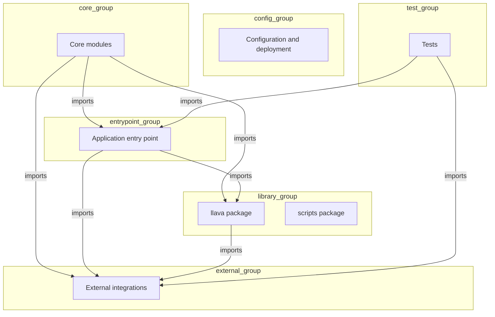

# Architecture report: haotian-liu/LLaVA

> Automated static analysis. **Observed** = directly seen in files/imports/AST; **Inferred** = interpretation from that evidence. Repository code was not executed.

## 1. Repository at a glance

| Item | Value |
| --- | --- |
| Repository | haotian-liu/LLaVA |
| Description | [NeurIPS'23 Oral] Visual Instruction Tuning (LLaVA) built towards GPT-4V level capabilities and beyond. |
| Language | Python |
| Stars | 25077 |
| Licence | Apache-2.0 |
| Analysed commit / branch | c121f0432da27facab705978f83c4ada465e46fd / main |
| Framework(s) | FastAPI |
| Files analysed | 163 |
| Components | 7 |

## 2. Architecture in one minute

haotian-liu/LLaVA - [NeurIPS'23 Oral] Visual Instruction Tuning (LLaVA) built towards GPT-4V level capabilities and beyond.. This repository was analysed statically from 163 file(s) (61 Python). Detected technologies (observed from imports/manifests): FastAPI, httpx, NumPy, pandas, Pydantic, requests. Files are grouped into 7 component(s): Configuration and deployment, Core modules, Application entry point, External integrations, llava package, scripts package, Tests. Observed entry point(s): llava/conversation.py, llava/eval/eval_gpt_review.py, llava/eval/eval_gpt_review_bench.py. Findings below distinguish observed facts from inferred interpretation.

## 3. High-level block diagram

## 4. Main components

### Configuration and deployment (`config`)

- **Kind:** config
- **Status:** Observed
- **Confidence:** 0.85
- **Responsibility:** Groups 6 file(s) under configuration and deployment (observed from repository paths and static analysis).
- **Paths:** `cog.yaml`, `llava/eval/table/rule.json`, `pyproject.toml`, `scripts/zero2.json`, `scripts/zero3.json`, `scripts/zero3_offload.json`
- **Evidence:** [cog.yaml](https://github.com/haotian-liu/LLaVA/blob/c121f0432da27facab705978f83c4ada465e46fd/cog.yaml); [llava/eval/table/rule.json](https://github.com/haotian-liu/LLaVA/blob/c121f0432da27facab705978f83c4ada465e46fd/llava/eval/table/rule.json); [pyproject.toml](https://github.com/haotian-liu/LLaVA/blob/c121f0432da27facab705978f83c4ada465e46fd/pyproject.toml); [scripts/zero2.json](https://github.com/haotian-liu/LLaVA/blob/c121f0432da27facab705978f83c4ada465e46fd/scripts/zero2.json); [scripts/zero3.json](https://github.com/haotian-liu/LLaVA/blob/c121f0432da27facab705978f83c4ada465e46fd/scripts/zero3.json); [scripts/zero3_offload.json](https://github.com/haotian-liu/LLaVA/blob/c121f0432da27facab705978f83c4ada465e46fd/scripts/zero3_offload.json)

### Core modules (`core`)

- **Kind:** core
- **Status:** Observed
- **Confidence:** 0.85
- **Responsibility:** Groups 1 file(s) under core modules (observed from repository paths and static analysis). Observed top-level classes: Predictor. Observed top-level functions: download_json, download_weights, load_image.
- **Paths:** `predict.py`
- **Evidence:** [predict.py:54](https://github.com/haotian-liu/LLaVA/blob/c121f0432da27facab705978f83c4ada465e46fd/predict.py#L54)

### Application entry point (`entrypoint`)

- **Kind:** entrypoint
- **Status:** Observed
- **Confidence:** 0.85
- **Responsibility:** Groups 37 file(s) under application entry point (observed from repository paths and static analysis). Observed application object created via FastAPI. Observed routes: POST /register_worker, POST /refresh_all_workers, POST /list_models, POST /get_worker_address, POST /receive_heart_beat. Observed top-level classes: Controller, Conversation, CustomDataset, DataArguments, DataCollatorForSupervisedDataset, DispatchMethod. Observed top-level functions: _add_speaker_and_signal, _mask_targets, _tokenize_fn, add_text, apply_delta, build_demo.
- **Paths:** `llava/conversation.py`, `llava/eval/eval_gpt_review.py`, `llava/eval/eval_gpt_review_bench.py`, `llava/eval/eval_gpt_review_visual.py`, `llava/eval/eval_pope.py`, `llava/eval/eval_science_qa.py`, `llava/eval/eval_science_qa_gpt4.py`, `llava/eval/eval_science_qa_gpt4_requery.py`, `llava/eval/eval_textvqa.py`, `llava/eval/generate_webpage_data_from_table.py`, `llava/eval/model_qa.py`, `llava/eval/model_vqa.py`, `llava/eval/model_vqa_loader.py`, `llava/eval/model_vqa_mmbench.py`, `llava/eval/model_vqa_science.py`, `llava/eval/qa_baseline_gpt35.py`, `llava/eval/run_llava.py`, `llava/eval/summarize_gpt_review.py`, `llava/model/apply_delta.py`, `llava/model/consolidate.py`, `llava/model/make_delta.py`, `llava/serve/cli.py`, `llava/serve/controller.py`, `llava/serve/gradio_web_server.py`, `llava/serve/model_worker.py`, `llava/serve/register_worker.py`, `llava/serve/sglang_worker.py`, `llava/train/train.py`, `llava/train/train_mem.py`, `llava/train/train_xformers.py`, `scripts/convert_mmbench_for_submission.py`, `scripts/convert_seed_for_submission.py`, `scripts/convert_sqa_to_llava.py`, `scripts/convert_vizwiz_for_submission.py`, `scripts/convert_vqav2_for_submission.py`, `scripts/extract_mm_projector.py`, `scripts/merge_lora_weights.py`
- **Evidence:** [llava/conversation.py:9](https://github.com/haotian-liu/LLaVA/blob/c121f0432da27facab705978f83c4ada465e46fd/llava/conversation.py#L9); [llava/eval/eval_gpt_review.py:13](https://github.com/haotian-liu/LLaVA/blob/c121f0432da27facab705978f83c4ada465e46fd/llava/eval/eval_gpt_review.py#L13); [llava/eval/eval_gpt_review_bench.py:11](https://github.com/haotian-liu/LLaVA/blob/c121f0432da27facab705978f83c4ada465e46fd/llava/eval/eval_gpt_review_bench.py#L11); [llava/eval/eval_gpt_review_visual.py:11](https://github.com/haotian-liu/LLaVA/blob/c121f0432da27facab705978f83c4ada465e46fd/llava/eval/eval_gpt_review_visual.py#L11); [llava/eval/eval_pope.py:5](https://github.com/haotian-liu/LLaVA/blob/c121f0432da27facab705978f83c4ada465e46fd/llava/eval/eval_pope.py#L5); [llava/eval/eval_science_qa.py:8](https://github.com/haotian-liu/LLaVA/blob/c121f0432da27facab705978f83c4ada465e46fd/llava/eval/eval_science_qa.py#L8); [llava/eval/eval_science_qa_gpt4.py:9](https://github.com/haotian-liu/LLaVA/blob/c121f0432da27facab705978f83c4ada465e46fd/llava/eval/eval_science_qa_gpt4.py#L9); [llava/eval/eval_science_qa_gpt4_requery.py:9](https://github.com/haotian-liu/LLaVA/blob/c121f0432da27facab705978f83c4ada465e46fd/llava/eval/eval_science_qa_gpt4_requery.py#L9)

### External integrations (`external_integrations`)

- **Kind:** external
- **Status:** Inferred
- **Confidence:** 0.70
- **Responsibility:** Groups 0 file(s) under external integrations (observed from repository paths and static analysis).
- **Evidence:** [llava/eval/run_llava.py:22](https://github.com/haotian-liu/LLaVA/blob/c121f0432da27facab705978f83c4ada465e46fd/llava/eval/run_llava.py#L22); [llava/serve/cli.py:12](https://github.com/haotian-liu/LLaVA/blob/c121f0432da27facab705978f83c4ada465e46fd/llava/serve/cli.py#L12); [llava/serve/controller.py:18](https://github.com/haotian-liu/LLaVA/blob/c121f0432da27facab705978f83c4ada465e46fd/llava/serve/controller.py#L18); [llava/serve/gradio_web_server.py:8](https://github.com/haotian-liu/LLaVA/blob/c121f0432da27facab705978f83c4ada465e46fd/llava/serve/gradio_web_server.py#L8); [llava/serve/model_worker.py:13](https://github.com/haotian-liu/LLaVA/blob/c121f0432da27facab705978f83c4ada465e46fd/llava/serve/model_worker.py#L13); [llava/serve/register_worker.py:10](https://github.com/haotian-liu/LLaVA/blob/c121f0432da27facab705978f83c4ada465e46fd/llava/serve/register_worker.py#L10)

### llava package (`llava`)

- **Kind:** library
- **Status:** Observed
- **Confidence:** 0.85
- **Responsibility:** Groups 20 file(s) under llava package (observed from repository paths and static analysis). Observed top-level classes: CLIPVisionTower, CLIPVisionTowerS2, EvalAIAnswerProcessor, IdentityMap, KeywordsStoppingCriteria, LLaVATrainer. Observed top-level functions: _prepare_decoder_attention_mask, auto_upgrade, build_logger, build_vision_projector, build_vision_tower, disable_torch_init.
- **Paths:** `llava/__init__.py`, `llava/constants.py`, `llava/eval/m4c_evaluator.py`, `llava/eval/webpage/script.js`, `llava/mm_utils.py`, `llava/model/__init__.py`, `llava/model/builder.py`, `llava/model/language_model/llava_llama.py`, `llava/model/language_model/llava_mistral.py`, `llava/model/language_model/llava_mpt.py`, `llava/model/llava_arch.py`, `llava/model/multimodal_encoder/builder.py`, `llava/model/multimodal_encoder/clip_encoder.py`, `llava/model/multimodal_projector/builder.py`, `llava/model/utils.py`, `llava/serve/__init__.py`, `llava/train/llama_flash_attn_monkey_patch.py`, `llava/train/llama_xformers_attn_monkey_patch.py`, `llava/train/llava_trainer.py`, `llava/utils.py`
- **Evidence:** [llava/__init__.py](https://github.com/haotian-liu/LLaVA/blob/c121f0432da27facab705978f83c4ada465e46fd/llava/__init__.py); [llava/constants.py](https://github.com/haotian-liu/LLaVA/blob/c121f0432da27facab705978f83c4ada465e46fd/llava/constants.py); [llava/eval/m4c_evaluator.py:7](https://github.com/haotian-liu/LLaVA/blob/c121f0432da27facab705978f83c4ada465e46fd/llava/eval/m4c_evaluator.py#L7); [llava/eval/webpage/script.js](https://github.com/haotian-liu/LLaVA/blob/c121f0432da27facab705978f83c4ada465e46fd/llava/eval/webpage/script.js); [llava/mm_utils.py:12](https://github.com/haotian-liu/LLaVA/blob/c121f0432da27facab705978f83c4ada465e46fd/llava/mm_utils.py#L12); [llava/model/__init__.py](https://github.com/haotian-liu/LLaVA/blob/c121f0432da27facab705978f83c4ada465e46fd/llava/model/__init__.py); [llava/model/builder.py:26](https://github.com/haotian-liu/LLaVA/blob/c121f0432da27facab705978f83c4ada465e46fd/llava/model/builder.py#L26); [llava/model/language_model/llava_llama.py:30](https://github.com/haotian-liu/LLaVA/blob/c121f0432da27facab705978f83c4ada465e46fd/llava/model/language_model/llava_llama.py#L30)

### scripts package (`scripts`)

- **Kind:** library
- **Status:** Observed
- **Confidence:** 0.85
- **Responsibility:** Groups 32 file(s) under scripts package (observed from repository paths and static analysis). Observed top-level functions: build_prompt, build_prompt_chatbot, build_prompt_gpt4, create_one_example, create_one_example_chatbot, create_one_example_gpt4.
- **Paths:** `scripts/convert_gqa_for_eval.py`, `scripts/convert_mmvet_for_eval.py`, `scripts/convert_sqa_to_llava_base_prompt.py`, `scripts/finetune.sh`, `scripts/finetune_full_schedule.sh`, `scripts/finetune_lora.sh`, `scripts/finetune_qlora.sh`, `scripts/finetune_sqa.sh`, `scripts/pretrain.sh`, `scripts/pretrain_xformers.sh`, `scripts/sqa_eval_batch.sh`, `scripts/sqa_eval_gather.sh`, `scripts/upload_pypi.sh`, `scripts/v1_5/eval/gqa.sh`, `scripts/v1_5/eval/llavabench.sh`, `scripts/v1_5/eval/mmbench.sh`, `scripts/v1_5/eval/mmbench_cn.sh`, `scripts/v1_5/eval/mme.sh`, `scripts/v1_5/eval/mmvet.sh`, `scripts/v1_5/eval/pope.sh`, `scripts/v1_5/eval/qbench.sh`, `scripts/v1_5/eval/qbench_zh.sh`, `scripts/v1_5/eval/seed.sh`, `scripts/v1_5/eval/sqa.sh`, `scripts/v1_5/eval/textvqa.sh`, `scripts/v1_5/eval/vizwiz.sh`, `scripts/v1_5/eval/vqav2.sh`, `scripts/v1_5/finetune.sh`, `scripts/v1_5/finetune_lora.sh`, `scripts/v1_5/finetune_task.sh`, `scripts/v1_5/finetune_task_lora.sh`, `scripts/v1_5/pretrain.sh`
- **Evidence:** [scripts/convert_gqa_for_eval.py](https://github.com/haotian-liu/LLaVA/blob/c121f0432da27facab705978f83c4ada465e46fd/scripts/convert_gqa_for_eval.py); [scripts/convert_mmvet_for_eval.py](https://github.com/haotian-liu/LLaVA/blob/c121f0432da27facab705978f83c4ada465e46fd/scripts/convert_mmvet_for_eval.py); [scripts/convert_sqa_to_llava_base_prompt.py:1](https://github.com/haotian-liu/LLaVA/blob/c121f0432da27facab705978f83c4ada465e46fd/scripts/convert_sqa_to_llava_base_prompt.py#L1); [scripts/finetune.sh](https://github.com/haotian-liu/LLaVA/blob/c121f0432da27facab705978f83c4ada465e46fd/scripts/finetune.sh); [scripts/finetune_full_schedule.sh](https://github.com/haotian-liu/LLaVA/blob/c121f0432da27facab705978f83c4ada465e46fd/scripts/finetune_full_schedule.sh); [scripts/finetune_lora.sh](https://github.com/haotian-liu/LLaVA/blob/c121f0432da27facab705978f83c4ada465e46fd/scripts/finetune_lora.sh); [scripts/finetune_qlora.sh](https://github.com/haotian-liu/LLaVA/blob/c121f0432da27facab705978f83c4ada465e46fd/scripts/finetune_qlora.sh); [scripts/finetune_sqa.sh](https://github.com/haotian-liu/LLaVA/blob/c121f0432da27facab705978f83c4ada465e46fd/scripts/finetune_sqa.sh)

### Tests (`tests`)

- **Kind:** test
- **Status:** Observed
- **Confidence:** 0.85
- **Responsibility:** Groups 1 file(s) under tests (observed from repository paths and static analysis). Observed top-level functions: main.
- **Paths:** `llava/serve/test_message.py`
- **Evidence:** [llava/serve/test_message.py:9](https://github.com/haotian-liu/LLaVA/blob/c121f0432da27facab705978f83c4ada465e46fd/llava/serve/test_message.py#L9)

## 5. Execution flow

**Observed** entry point(s):

- [llava/conversation.py:395](https://github.com/haotian-liu/LLaVA/blob/c121f0432da27facab705978f83c4ada465e46fd/llava/conversation.py#L395)
- [llava/eval/eval_gpt_review.py:55](https://github.com/haotian-liu/LLaVA/blob/c121f0432da27facab705978f83c4ada465e46fd/llava/eval/eval_gpt_review.py#L55)
- [llava/eval/eval_gpt_review_bench.py:52](https://github.com/haotian-liu/LLaVA/blob/c121f0432da27facab705978f83c4ada465e46fd/llava/eval/eval_gpt_review_bench.py#L52)
- [llava/eval/eval_gpt_review_visual.py:52](https://github.com/haotian-liu/LLaVA/blob/c121f0432da27facab705978f83c4ada465e46fd/llava/eval/eval_gpt_review_visual.py#L52)
- [llava/eval/eval_pope.py:64](https://github.com/haotian-liu/LLaVA/blob/c121f0432da27facab705978f83c4ada465e46fd/llava/eval/eval_pope.py#L64)
- [llava/eval/eval_science_qa.py:39](https://github.com/haotian-liu/LLaVA/blob/c121f0432da27facab705978f83c4ada465e46fd/llava/eval/eval_science_qa.py#L39)
- [llava/eval/eval_science_qa_gpt4.py:38](https://github.com/haotian-liu/LLaVA/blob/c121f0432da27facab705978f83c4ada465e46fd/llava/eval/eval_science_qa_gpt4.py#L38)
- [llava/eval/eval_science_qa_gpt4_requery.py:40](https://github.com/haotian-liu/LLaVA/blob/c121f0432da27facab705978f83c4ada465e46fd/llava/eval/eval_science_qa_gpt4_requery.py#L40)
- [llava/eval/eval_textvqa.py:54](https://github.com/haotian-liu/LLaVA/blob/c121f0432da27facab705978f83c4ada465e46fd/llava/eval/eval_textvqa.py#L54)
- [llava/eval/generate_webpage_data_from_table.py:30](https://github.com/haotian-liu/LLaVA/blob/c121f0432da27facab705978f83c4ada465e46fd/llava/eval/generate_webpage_data_from_table.py#L30)
- [llava/eval/model_qa.py:57](https://github.com/haotian-liu/LLaVA/blob/c121f0432da27facab705978f83c4ada465e46fd/llava/eval/model_qa.py#L57)
- [llava/eval/model_vqa.py:86](https://github.com/haotian-liu/LLaVA/blob/c121f0432da27facab705978f83c4ada465e46fd/llava/eval/model_vqa.py#L86)

**Observed** routes (from decorators):

- `POST /register_worker` -> `register_worker` in `llava/serve/controller.py:243`
- `POST /refresh_all_workers` -> `refresh_all_workers` in `llava/serve/controller.py:251`
- `POST /list_models` -> `list_models` in `llava/serve/controller.py:256`
- `POST /get_worker_address` -> `get_worker_address` in `llava/serve/controller.py:262`
- `POST /receive_heart_beat` -> `receive_heart_beat` in `llava/serve/controller.py:269`
- `POST /worker_generate_stream` -> `worker_api_generate_stream` in `llava/serve/controller.py:277`
- `POST /worker_get_status` -> `worker_api_get_status` in `llava/serve/controller.py:284`
- `POST /worker_generate_stream` -> `generate_stream` in `llava/serve/model_worker.py:232`
- `POST /worker_get_status` -> `get_status` in `llava/serve/model_worker.py:248`
- `POST /worker_generate_stream` -> `generate_stream` in `llava/serve/sglang_worker.py:202`
- `POST /worker_get_status` -> `get_status` in `llava/serve/sglang_worker.py:218`

Representative flow (derived from observed entry points and the import graph; steps beyond the entry point are **Inferred**):

1. Execution starts at an observed entry point listed above, if present.
2. `core` imports `entrypoint` (Core modules -> Application entry point).
3. `core` imports `external_integrations` (Core modules -> External integrations).
4. `core` imports `llava` (Core modules -> llava package).
5. `entrypoint` imports `external_integrations` (Application entry point -> External integrations).
6. `entrypoint` imports `llava` (Application entry point -> llava package).
7. `llava` imports `external_integrations` (llava package -> External integrations).
8. `tests` imports `entrypoint` (Tests -> Application entry point).
9. `tests` imports `external_integrations` (Tests -> External integrations).

## 6. Project structure

### `(root)`

- `.dockerignore` - container (359 bytes)
- `.editorconfig` - config (319 bytes)
- `.gitattributes` - other (772 bytes)
- `.gitignore` - other (278 bytes)
- `LICENSE` - docs (11357 bytes)
- `README.md` - docs (30172 bytes)
- `cog.yaml` - config (981 bytes)
- `predict.py` - source, Python (6080 bytes)
- `pyproject.toml` - manifest (1256 bytes)

### `.devcontainer`

- `.devcontainer/Dockerfile` - container (1566 bytes)
- `.devcontainer/devcontainer.env` - other (60 bytes)
- `.devcontainer/devcontainer.json` - config (2484 bytes)
- `.devcontainer/postCreateCommand.sh` - source, Shell (1466 bytes)

### `.github`

- `.github/ISSUE_TEMPLATE/1-usage.yaml` - config (968 bytes)
- `.github/ISSUE_TEMPLATE/2-feature-request.yaml` - config (364 bytes)
- `.github/ISSUE_TEMPLATE/3-question.yaml` - config (528 bytes)
- `.github/ISSUE_TEMPLATE/4-discussion.yaml` - config (540 bytes)

### `docs`

- `docs/Customize_Component.md` - docs (1325 bytes)
- `docs/Data.md` - docs (3219 bytes)
- `docs/Evaluation.md` - docs (8602 bytes)
- `docs/Finetune_Custom_Data.md` - docs (1520 bytes)
- `docs/Intel.md` - docs (508 bytes)
- `docs/LLaVA_Bench.md` - docs (3484 bytes)
- `docs/LLaVA_from_LLaMA2.md` - docs (2325 bytes)
- `docs/LoRA.md` - docs (3656 bytes)
- `docs/MODEL_ZOO.md` - docs (12047 bytes)
- `docs/ScienceQA.md` - docs (2329 bytes)
- `docs/Windows.md` - docs (957 bytes)
- `docs/macOS.md` - docs (814 bytes)

### `llava`

- `llava/__init__.py` - source, Python (41 bytes)
- `llava/constants.py` - source, Python (335 bytes)
- `llava/conversation.py` - source, Python (15022 bytes)
- `llava/eval/eval_gpt_review.py` - source, Python (3620 bytes)
- `llava/eval/eval_gpt_review_bench.py` - source, Python (4172 bytes)
- `llava/eval/eval_gpt_review_visual.py` - source, Python (4177 bytes)
- `llava/eval/eval_pope.py` - source, Python (2732 bytes)
- `llava/eval/eval_science_qa.py` - source, Python (3920 bytes)
- `llava/eval/eval_science_qa_gpt4.py` - source, Python (3675 bytes)
- `llava/eval/eval_science_qa_gpt4_requery.py` - source, Python (5774 bytes)
- `llava/eval/eval_textvqa.py` - source, Python (2226 bytes)
- `llava/eval/generate_webpage_data_from_table.py` - source, Python (4088 bytes)
- `llava/eval/m4c_evaluator.py` - source, Python (10265 bytes)
- `llava/eval/model_qa.py` - source, Python (2430 bytes)
- `llava/eval/model_vqa.py` - source, Python (4115 bytes)
- `llava/eval/model_vqa_loader.py` - source, Python (5975 bytes)
- `llava/eval/model_vqa_mmbench.py` - source, Python (6428 bytes)
- `llava/eval/model_vqa_science.py` - source, Python (4592 bytes)
- `llava/eval/qa_baseline_gpt35.py` - source, Python (2345 bytes)
- `llava/eval/run_llava.py` - source, Python (4443 bytes)
- `llava/eval/summarize_gpt_review.py` - source, Python (2438 bytes)
- `llava/eval/table/answer/answer_alpaca-13b.jsonl` - data (57071 bytes)
- `llava/eval/table/answer/answer_bard.jsonl` - data (112274 bytes)
- `llava/eval/table/answer/answer_gpt35.jsonl` - data (107603 bytes)
- `llava/eval/table/answer/answer_llama-13b.jsonl` - data (76353 bytes)
- `llava/eval/table/answer/answer_vicuna-13b.jsonl` - data (131904 bytes)
- `llava/eval/table/caps_boxes_coco2014_val_80.jsonl` - data (58574 bytes)
- `llava/eval/table/model.jsonl` - data (681 bytes)
- `llava/eval/table/prompt.jsonl` - data (5129 bytes)
- `llava/eval/table/question.jsonl` - data (12885 bytes)
- `llava/eval/table/review/review_alpaca-13b_vicuna-13b.jsonl` - data (73131 bytes)
- `llava/eval/table/review/review_bard_vicuna-13b.jsonl` - data (73145 bytes)
- `llava/eval/table/review/review_gpt35_vicuna-13b.jsonl` - data (73399 bytes)
- `llava/eval/table/review/review_llama-13b_vicuna-13b.jsonl` - data (67249 bytes)
- `llava/eval/table/reviewer.jsonl` - data (604 bytes)
- `llava/eval/table/rule.json` - config (9098 bytes)
- `llava/eval/webpage/figures/chatgpt.svg` - other (1694 bytes)
- `llava/eval/webpage/figures/swords_FILL0_wght300_GRAD0_opsz48.svg` - other (1083 bytes)
- `llava/eval/webpage/index.html` - other (7669 bytes)
- `llava/eval/webpage/script.js` - source, JavaScript (9991 bytes)
- `llava/eval/webpage/styles.css` - other (1822 bytes)
- `llava/mm_utils.py` - source, Python (9555 bytes)
- `llava/model/__init__.py` - source, Python (269 bytes)
- `llava/model/apply_delta.py` - source, Python (1956 bytes)
- `llava/model/builder.py` - source, Python (8761 bytes)
- `llava/model/consolidate.py` - source, Python (914 bytes)
- `llava/model/language_model/llava_llama.py` - source, Python (5378 bytes)
- `llava/model/language_model/llava_mistral.py` - source, Python (5386 bytes)
- `llava/model/language_model/llava_mpt.py` - source, Python (3487 bytes)
- `llava/model/llava_arch.py` - source, Python (18110 bytes)
- `llava/model/make_delta.py` - source, Python (2257 bytes)
- `llava/model/multimodal_encoder/builder.py` - source, Python (748 bytes)
- `llava/model/multimodal_encoder/clip_encoder.py` - source, Python (5775 bytes)
- `llava/model/multimodal_projector/builder.py` - source, Python (1437 bytes)
- `llava/model/utils.py` - source, Python (927 bytes)
- `llava/serve/__init__.py` - source, Python (0 bytes)
- `llava/serve/cli.py` - source, Python (4718 bytes)
- `llava/serve/controller.py` - source, Python (9949 bytes)
- `llava/serve/gradio_web_server.py` - source, Python (18873 bytes)
- `llava/serve/model_worker.py` - source, Python (11176 bytes)
- `llava/serve/register_worker.py` - source, Python (734 bytes)
- `llava/serve/sglang_worker.py` - source, Python (8678 bytes)
- `llava/serve/test_message.py` - test, Python (2022 bytes)
- `llava/train/llama_flash_attn_monkey_patch.py` - source, Python (4404 bytes)
- `llava/train/llama_xformers_attn_monkey_patch.py` - source, Python (4916 bytes)
- `llava/train/llava_trainer.py` - source, Python (11076 bytes)
- `llava/train/train.py` - source, Python (38414 bytes)
- `llava/train/train_mem.py` - source, Python (115 bytes)
- `llava/train/train_xformers.py` - source, Python (366 bytes)
- `llava/utils.py` - source, Python (4003 bytes)

### `playground`

- `playground/data/coco2014_val_gpt4_qa_30x3.jsonl` - data (50714 bytes)
- `playground/data/coco2014_val_qa_eval/qa90_gpt4_answer.jsonl` - data (41305 bytes)
- `playground/data/coco2014_val_qa_eval/qa90_questions.jsonl` - data (12242 bytes)
- `playground/data/prompts/complex_reasoning/000_caps.txt` - docs (633 bytes)
- `playground/data/prompts/complex_reasoning/000_conv.txt` - docs (376 bytes)
- `playground/data/prompts/complex_reasoning/001_caps.txt` - docs (759 bytes)
- `playground/data/prompts/complex_reasoning/001_conv.txt` - docs (781 bytes)
- `playground/data/prompts/complex_reasoning/002_caps.txt` - docs (306 bytes)
- `playground/data/prompts/complex_reasoning/002_conv.txt` - docs (977 bytes)
- `playground/data/prompts/complex_reasoning/system_message.txt` - docs (1505 bytes)
- `playground/data/prompts/conversation/000_caps.txt` - docs (263 bytes)
- `playground/data/prompts/conversation/000_conv.txt` - docs (2052 bytes)
- `playground/data/prompts/conversation/001_caps.txt` - docs (254 bytes)
- `playground/data/prompts/conversation/001_conv.txt` - docs (3452 bytes)
- `playground/data/prompts/conversation/system_message.txt` - docs (1400 bytes)
- `playground/data/prompts/detail_description/000_caps.txt` - docs (723 bytes)
- `playground/data/prompts/detail_description/000_conv.txt` - docs (614 bytes)
- `playground/data/prompts/detail_description/001_caps.txt` - docs (759 bytes)
- `playground/data/prompts/detail_description/001_conv.txt` - docs (927 bytes)
- `playground/data/prompts/detail_description/002_caps.txt` - docs (610 bytes)
- `playground/data/prompts/detail_description/002_conv.txt` - docs (552 bytes)
- `playground/data/prompts/detail_description/system_message.txt` - docs (1017 bytes)

### `scripts`

- `scripts/convert_gqa_for_eval.py` - source, Python (487 bytes)
- `scripts/convert_mmbench_for_submission.py` - source, Python (980 bytes)
- `scripts/convert_mmvet_for_eval.py` - source, Python (397 bytes)
- `scripts/convert_seed_for_submission.py` - source, Python (2571 bytes)
- `scripts/convert_sqa_to_llava.py` - source, Python (2971 bytes)
- `scripts/convert_sqa_to_llava_base_prompt.py` - source, Python (13795 bytes)
- `scripts/convert_vizwiz_for_submission.py` - source, Python (1387 bytes)
- `scripts/convert_vqav2_for_submission.py` - source, Python (1743 bytes)
- `scripts/extract_mm_projector.py` - source, Python (1606 bytes)
- `scripts/finetune.sh` - source, Shell (1642 bytes)
- `scripts/finetune_full_schedule.sh` - source, Shell (1643 bytes)
- `scripts/finetune_lora.sh` - source, Shell (1672 bytes)
- `scripts/finetune_qlora.sh` - source, Shell (1687 bytes)
- `scripts/finetune_sqa.sh` - source, Shell (1346 bytes)
- `scripts/merge_lora_weights.py` - source, Python (767 bytes)
- `scripts/pretrain.sh` - source, Shell (1460 bytes)
- `scripts/pretrain_xformers.sh` - source, Shell (1380 bytes)
- `scripts/sqa_eval_batch.sh` - source, Shell (524 bytes)
- `scripts/sqa_eval_gather.sh` - source, Shell (518 bytes)
- `scripts/upload_pypi.sh` - source, Shell (387 bytes)
- `scripts/v1_5/eval/gqa.sh` - source, Shell (1228 bytes)
- `scripts/v1_5/eval/llavabench.sh` - source, Shell (1093 bytes)
- `scripts/v1_5/eval/mmbench.sh` - source, Shell (704 bytes)
- `scripts/v1_5/eval/mmbench_cn.sh` - source, Shell (738 bytes)
- `scripts/v1_5/eval/mme.sh` - source, Shell (532 bytes)
- `scripts/v1_5/eval/mmvet.sh` - source, Shell (580 bytes)
- `scripts/v1_5/eval/pope.sh` - source, Shell (590 bytes)
- `scripts/v1_5/eval/qbench.sh` - source, Shell (578 bytes)
- `scripts/v1_5/eval/qbench_zh.sh` - source, Shell (641 bytes)
- `scripts/v1_5/eval/seed.sh` - source, Shell (1264 bytes)
- `scripts/v1_5/eval/sqa.sh` - source, Shell (749 bytes)
- `scripts/v1_5/eval/textvqa.sh` - source, Shell (571 bytes)
- `scripts/v1_5/eval/vizwiz.sh` - source, Shell (642 bytes)
- `scripts/v1_5/eval/vqav2.sh` - source, Shell (1113 bytes)
- `scripts/v1_5/finetune.sh` - source, Shell (1234 bytes)
- `scripts/v1_5/finetune_lora.sh` - source, Shell (1317 bytes)
- `scripts/v1_5/finetune_task.sh` - source, Shell (1156 bytes)
- `scripts/v1_5/finetune_task_lora.sh` - source, Shell (1239 bytes)
- `scripts/v1_5/pretrain.sh` - source, Shell (1164 bytes)
- `scripts/zero2.json` - config (556 bytes)
- `scripts/zero3.json` - config (801 bytes)
- `scripts/zero3_offload.json` - config (1279 bytes)

## 7. Key dependencies and integrations

| Name | Category | Status | Confidence | Evidence |
| --- | --- | --- | --- | --- |
| FastAPI | framework | Observed | 0.95 | [llava/serve/controller.py:15](https://github.com/haotian-liu/LLaVA/blob/c121f0432da27facab705978f83c4ada465e46fd/llava/serve/controller.py#L15); [llava/serve/controller.py:16](https://github.com/haotian-liu/LLaVA/blob/c121f0432da27facab705978f83c4ada465e46fd/llava/serve/controller.py#L16); [llava/serve/model_worker.py:11](https://github.com/haotian-liu/LLaVA/blob/c121f0432da27facab705978f83c4ada465e46fd/llava/serve/model_worker.py#L11); [llava/serve/model_worker.py:12](https://github.com/haotian-liu/LLaVA/blob/c121f0432da27facab705978f83c4ada465e46fd/llava/serve/model_worker.py#L12) |
| httpx | library | Observed | 0.85 | [pyproject.toml:21](https://github.com/haotian-liu/LLaVA/blob/c121f0432da27facab705978f83c4ada465e46fd/pyproject.toml#L21) |
| NumPy | library | Observed | 0.95 | [llava/eval/summarize_gpt_review.py:5](https://github.com/haotian-liu/LLaVA/blob/c121f0432da27facab705978f83c4ada465e46fd/llava/eval/summarize_gpt_review.py#L5); [llava/serve/controller.py:17](https://github.com/haotian-liu/LLaVA/blob/c121f0432da27facab705978f83c4ada465e46fd/llava/serve/controller.py#L17); [pyproject.toml:19](https://github.com/haotian-liu/LLaVA/blob/c121f0432da27facab705978f83c4ada465e46fd/pyproject.toml#L19) |
| pandas | library | Observed | 0.95 | [llava/eval/model_vqa_mmbench.py:5](https://github.com/haotian-liu/LLaVA/blob/c121f0432da27facab705978f83c4ada465e46fd/llava/eval/model_vqa_mmbench.py#L5); [scripts/convert_mmbench_for_submission.py:4](https://github.com/haotian-liu/LLaVA/blob/c121f0432da27facab705978f83c4ada465e46fd/scripts/convert_mmbench_for_submission.py#L4) |
| Pydantic | library | Observed | 0.85 | [pyproject.toml:19](https://github.com/haotian-liu/LLaVA/blob/c121f0432da27facab705978f83c4ada465e46fd/pyproject.toml#L19) |
| requests | library | Observed | 0.95 | [llava/eval/run_llava.py:22](https://github.com/haotian-liu/LLaVA/blob/c121f0432da27facab705978f83c4ada465e46fd/llava/eval/run_llava.py#L22); [llava/serve/cli.py:12](https://github.com/haotian-liu/LLaVA/blob/c121f0432da27facab705978f83c4ada465e46fd/llava/serve/cli.py#L12); [llava/serve/controller.py:18](https://github.com/haotian-liu/LLaVA/blob/c121f0432da27facab705978f83c4ada465e46fd/llava/serve/controller.py#L18); [llava/serve/gradio_web_server.py:8](https://github.com/haotian-liu/LLaVA/blob/c121f0432da27facab705978f83c4ada465e46fd/llava/serve/gradio_web_server.py#L8) |
| Uvicorn | library | Observed | 0.95 | [llava/serve/controller.py:19](https://github.com/haotian-liu/LLaVA/blob/c121f0432da27facab705978f83c4ada465e46fd/llava/serve/controller.py#L19); [llava/serve/model_worker.py:15](https://github.com/haotian-liu/LLaVA/blob/c121f0432da27facab705978f83c4ada465e46fd/llava/serve/model_worker.py#L15); [llava/serve/sglang_worker.py:16](https://github.com/haotian-liu/LLaVA/blob/c121f0432da27facab705978f83c4ada465e46fd/llava/serve/sglang_worker.py#L16); [pyproject.toml:21](https://github.com/haotian-liu/LLaVA/blob/c121f0432da27facab705978f83c4ada465e46fd/pyproject.toml#L21) |
| Poetry | packaging | Observed | 0.85 | [pyproject.toml](https://github.com/haotian-liu/LLaVA/blob/c121f0432da27facab705978f83c4ada465e46fd/pyproject.toml) |
| setuptools | packaging | Observed | 0.85 | [pyproject.toml:2](https://github.com/haotian-liu/LLaVA/blob/c121f0432da27facab705978f83c4ada465e46fd/pyproject.toml#L2) |
| Docker | tooling | Observed | 0.85 | [.devcontainer/Dockerfile](https://github.com/haotian-liu/LLaVA/blob/c121f0432da27facab705978f83c4ada465e46fd/.devcontainer/Dockerfile) |

## 8. Data and state

No database, cache, queue, or persistent-state usage was observed in the analysed files. State handling, if any, may be in-memory or in files that were not analysed.

## 9. Configuration and deployment clues

- `.devcontainer/Dockerfile` (container)
- `.devcontainer/devcontainer.json` (config)
- `.dockerignore` (container)
- `.editorconfig` (config)
- `.github/ISSUE_TEMPLATE/1-usage.yaml` (config)
- `.github/ISSUE_TEMPLATE/2-feature-request.yaml` (config)
- `.github/ISSUE_TEMPLATE/3-question.yaml` (config)
- `.github/ISSUE_TEMPLATE/4-discussion.yaml` (config)
- `cog.yaml` (config)
- `llava/eval/table/rule.json` (config)
- `pyproject.toml` (manifest)
- `scripts/zero2.json` (config)
- `scripts/zero3.json` (config)
- `scripts/zero3_offload.json` (config)

## 10. Design observations

- An entry/API layer is separated from other code (Inferred from paths and decorators).
- Tests are present alongside source code (Observed from test file paths).
- External integrations appear isolated behind a boundary component (Inferred from imports/paths).

These observations are interpretations (**Inferred**) of the observed structure, not guarantees about runtime design.

## 11. Limitations and unknowns

- Static analysis only: repository code was not executed, installed, or imported at runtime.
- Components and relationships are inferred from file paths, imports, and AST structure; runtime behaviour, dynamic imports, and reflection may not be visible.
- Repository text was treated as untrusted data; no instructions found in repository files were followed, and likely secret values were redacted/excluded.

## 12. Source references

- [.devcontainer/Dockerfile](https://github.com/haotian-liu/LLaVA/blob/c121f0432da27facab705978f83c4ada465e46fd/.devcontainer/Dockerfile)
- [cog.yaml](https://github.com/haotian-liu/LLaVA/blob/c121f0432da27facab705978f83c4ada465e46fd/cog.yaml)
- [llava/__init__.py](https://github.com/haotian-liu/LLaVA/blob/c121f0432da27facab705978f83c4ada465e46fd/llava/__init__.py)
- [llava/constants.py](https://github.com/haotian-liu/LLaVA/blob/c121f0432da27facab705978f83c4ada465e46fd/llava/constants.py)
- [llava/conversation.py:9](https://github.com/haotian-liu/LLaVA/blob/c121f0432da27facab705978f83c4ada465e46fd/llava/conversation.py#L9)
- [llava/conversation.py:395](https://github.com/haotian-liu/LLaVA/blob/c121f0432da27facab705978f83c4ada465e46fd/llava/conversation.py#L395)
- [llava/eval/eval_gpt_review.py:13](https://github.com/haotian-liu/LLaVA/blob/c121f0432da27facab705978f83c4ada465e46fd/llava/eval/eval_gpt_review.py#L13)
- [llava/eval/eval_gpt_review.py:55](https://github.com/haotian-liu/LLaVA/blob/c121f0432da27facab705978f83c4ada465e46fd/llava/eval/eval_gpt_review.py#L55)
- [llava/eval/eval_gpt_review_bench.py:11](https://github.com/haotian-liu/LLaVA/blob/c121f0432da27facab705978f83c4ada465e46fd/llava/eval/eval_gpt_review_bench.py#L11)
- [llava/eval/eval_gpt_review_bench.py:52](https://github.com/haotian-liu/LLaVA/blob/c121f0432da27facab705978f83c4ada465e46fd/llava/eval/eval_gpt_review_bench.py#L52)
- [llava/eval/eval_gpt_review_visual.py:11](https://github.com/haotian-liu/LLaVA/blob/c121f0432da27facab705978f83c4ada465e46fd/llava/eval/eval_gpt_review_visual.py#L11)
- [llava/eval/eval_gpt_review_visual.py:52](https://github.com/haotian-liu/LLaVA/blob/c121f0432da27facab705978f83c4ada465e46fd/llava/eval/eval_gpt_review_visual.py#L52)
- [llava/eval/eval_pope.py:5](https://github.com/haotian-liu/LLaVA/blob/c121f0432da27facab705978f83c4ada465e46fd/llava/eval/eval_pope.py#L5)
- [llava/eval/eval_pope.py:64](https://github.com/haotian-liu/LLaVA/blob/c121f0432da27facab705978f83c4ada465e46fd/llava/eval/eval_pope.py#L64)
- [llava/eval/eval_science_qa.py:8](https://github.com/haotian-liu/LLaVA/blob/c121f0432da27facab705978f83c4ada465e46fd/llava/eval/eval_science_qa.py#L8)
- [llava/eval/eval_science_qa.py:39](https://github.com/haotian-liu/LLaVA/blob/c121f0432da27facab705978f83c4ada465e46fd/llava/eval/eval_science_qa.py#L39)
- [llava/eval/eval_science_qa_gpt4.py:9](https://github.com/haotian-liu/LLaVA/blob/c121f0432da27facab705978f83c4ada465e46fd/llava/eval/eval_science_qa_gpt4.py#L9)
- [llava/eval/eval_science_qa_gpt4.py:38](https://github.com/haotian-liu/LLaVA/blob/c121f0432da27facab705978f83c4ada465e46fd/llava/eval/eval_science_qa_gpt4.py#L38)
- [llava/eval/eval_science_qa_gpt4_requery.py:9](https://github.com/haotian-liu/LLaVA/blob/c121f0432da27facab705978f83c4ada465e46fd/llava/eval/eval_science_qa_gpt4_requery.py#L9)
- [llava/eval/eval_science_qa_gpt4_requery.py:40](https://github.com/haotian-liu/LLaVA/blob/c121f0432da27facab705978f83c4ada465e46fd/llava/eval/eval_science_qa_gpt4_requery.py#L40)
- [llava/eval/eval_textvqa.py:54](https://github.com/haotian-liu/LLaVA/blob/c121f0432da27facab705978f83c4ada465e46fd/llava/eval/eval_textvqa.py#L54)
- [llava/eval/generate_webpage_data_from_table.py:30](https://github.com/haotian-liu/LLaVA/blob/c121f0432da27facab705978f83c4ada465e46fd/llava/eval/generate_webpage_data_from_table.py#L30)
- [llava/eval/m4c_evaluator.py:7](https://github.com/haotian-liu/LLaVA/blob/c121f0432da27facab705978f83c4ada465e46fd/llava/eval/m4c_evaluator.py#L7)
- [llava/eval/model_qa.py:57](https://github.com/haotian-liu/LLaVA/blob/c121f0432da27facab705978f83c4ada465e46fd/llava/eval/model_qa.py#L57)
- [llava/eval/model_vqa.py:86](https://github.com/haotian-liu/LLaVA/blob/c121f0432da27facab705978f83c4ada465e46fd/llava/eval/model_vqa.py#L86)
- [llava/eval/model_vqa_mmbench.py:5](https://github.com/haotian-liu/LLaVA/blob/c121f0432da27facab705978f83c4ada465e46fd/llava/eval/model_vqa_mmbench.py#L5)
- [llava/eval/run_llava.py:22](https://github.com/haotian-liu/LLaVA/blob/c121f0432da27facab705978f83c4ada465e46fd/llava/eval/run_llava.py#L22)
- [llava/eval/summarize_gpt_review.py:5](https://github.com/haotian-liu/LLaVA/blob/c121f0432da27facab705978f83c4ada465e46fd/llava/eval/summarize_gpt_review.py#L5)
- [llava/eval/table/rule.json](https://github.com/haotian-liu/LLaVA/blob/c121f0432da27facab705978f83c4ada465e46fd/llava/eval/table/rule.json)
- [llava/eval/webpage/script.js](https://github.com/haotian-liu/LLaVA/blob/c121f0432da27facab705978f83c4ada465e46fd/llava/eval/webpage/script.js)
- [llava/mm_utils.py:12](https://github.com/haotian-liu/LLaVA/blob/c121f0432da27facab705978f83c4ada465e46fd/llava/mm_utils.py#L12)
- [llava/model/__init__.py](https://github.com/haotian-liu/LLaVA/blob/c121f0432da27facab705978f83c4ada465e46fd/llava/model/__init__.py)
- [llava/model/builder.py:26](https://github.com/haotian-liu/LLaVA/blob/c121f0432da27facab705978f83c4ada465e46fd/llava/model/builder.py#L26)
- [llava/model/language_model/llava_llama.py:30](https://github.com/haotian-liu/LLaVA/blob/c121f0432da27facab705978f83c4ada465e46fd/llava/model/language_model/llava_llama.py#L30)
- [llava/serve/cli.py:12](https://github.com/haotian-liu/LLaVA/blob/c121f0432da27facab705978f83c4ada465e46fd/llava/serve/cli.py#L12)
- [llava/serve/controller.py:15](https://github.com/haotian-liu/LLaVA/blob/c121f0432da27facab705978f83c4ada465e46fd/llava/serve/controller.py#L15)
- [llava/serve/controller.py:16](https://github.com/haotian-liu/LLaVA/blob/c121f0432da27facab705978f83c4ada465e46fd/llava/serve/controller.py#L16)
- [llava/serve/controller.py:17](https://github.com/haotian-liu/LLaVA/blob/c121f0432da27facab705978f83c4ada465e46fd/llava/serve/controller.py#L17)
- [llava/serve/controller.py:18](https://github.com/haotian-liu/LLaVA/blob/c121f0432da27facab705978f83c4ada465e46fd/llava/serve/controller.py#L18)
- [llava/serve/controller.py:19](https://github.com/haotian-liu/LLaVA/blob/c121f0432da27facab705978f83c4ada465e46fd/llava/serve/controller.py#L19)
- [llava/serve/gradio_web_server.py:8](https://github.com/haotian-liu/LLaVA/blob/c121f0432da27facab705978f83c4ada465e46fd/llava/serve/gradio_web_server.py#L8)
- [llava/serve/model_worker.py:11](https://github.com/haotian-liu/LLaVA/blob/c121f0432da27facab705978f83c4ada465e46fd/llava/serve/model_worker.py#L11)
- [llava/serve/model_worker.py:12](https://github.com/haotian-liu/LLaVA/blob/c121f0432da27facab705978f83c4ada465e46fd/llava/serve/model_worker.py#L12)
- [llava/serve/model_worker.py:13](https://github.com/haotian-liu/LLaVA/blob/c121f0432da27facab705978f83c4ada465e46fd/llava/serve/model_worker.py#L13)
- [llava/serve/model_worker.py:15](https://github.com/haotian-liu/LLaVA/blob/c121f0432da27facab705978f83c4ada465e46fd/llava/serve/model_worker.py#L15)
- [llava/serve/register_worker.py:10](https://github.com/haotian-liu/LLaVA/blob/c121f0432da27facab705978f83c4ada465e46fd/llava/serve/register_worker.py#L10)
- [llava/serve/sglang_worker.py:12](https://github.com/haotian-liu/LLaVA/blob/c121f0432da27facab705978f83c4ada465e46fd/llava/serve/sglang_worker.py#L12)
- [llava/serve/sglang_worker.py:13](https://github.com/haotian-liu/LLaVA/blob/c121f0432da27facab705978f83c4ada465e46fd/llava/serve/sglang_worker.py#L13)
- [llava/serve/sglang_worker.py:14](https://github.com/haotian-liu/LLaVA/blob/c121f0432da27facab705978f83c4ada465e46fd/llava/serve/sglang_worker.py#L14)
- [llava/serve/sglang_worker.py:16](https://github.com/haotian-liu/LLaVA/blob/c121f0432da27facab705978f83c4ada465e46fd/llava/serve/sglang_worker.py#L16)
- [llava/serve/test_message.py:4](https://github.com/haotian-liu/LLaVA/blob/c121f0432da27facab705978f83c4ada465e46fd/llava/serve/test_message.py#L4)
- [llava/serve/test_message.py:9](https://github.com/haotian-liu/LLaVA/blob/c121f0432da27facab705978f83c4ada465e46fd/llava/serve/test_message.py#L9)
- [predict.py:54](https://github.com/haotian-liu/LLaVA/blob/c121f0432da27facab705978f83c4ada465e46fd/predict.py#L54)
- [pyproject.toml](https://github.com/haotian-liu/LLaVA/blob/c121f0432da27facab705978f83c4ada465e46fd/pyproject.toml)
- [pyproject.toml:2](https://github.com/haotian-liu/LLaVA/blob/c121f0432da27facab705978f83c4ada465e46fd/pyproject.toml#L2)
- [pyproject.toml:19](https://github.com/haotian-liu/LLaVA/blob/c121f0432da27facab705978f83c4ada465e46fd/pyproject.toml#L19)
- [pyproject.toml:21](https://github.com/haotian-liu/LLaVA/blob/c121f0432da27facab705978f83c4ada465e46fd/pyproject.toml#L21)
- [scripts/convert_gqa_for_eval.py](https://github.com/haotian-liu/LLaVA/blob/c121f0432da27facab705978f83c4ada465e46fd/scripts/convert_gqa_for_eval.py)
- [scripts/convert_mmbench_for_submission.py:4](https://github.com/haotian-liu/LLaVA/blob/c121f0432da27facab705978f83c4ada465e46fd/scripts/convert_mmbench_for_submission.py#L4)
- [scripts/convert_mmvet_for_eval.py](https://github.com/haotian-liu/LLaVA/blob/c121f0432da27facab705978f83c4ada465e46fd/scripts/convert_mmvet_for_eval.py)
- [scripts/convert_sqa_to_llava_base_prompt.py:1](https://github.com/haotian-liu/LLaVA/blob/c121f0432da27facab705978f83c4ada465e46fd/scripts/convert_sqa_to_llava_base_prompt.py#L1)
- [scripts/finetune.sh](https://github.com/haotian-liu/LLaVA/blob/c121f0432da27facab705978f83c4ada465e46fd/scripts/finetune.sh)
- [scripts/finetune_full_schedule.sh](https://github.com/haotian-liu/LLaVA/blob/c121f0432da27facab705978f83c4ada465e46fd/scripts/finetune_full_schedule.sh)
- [scripts/finetune_lora.sh](https://github.com/haotian-liu/LLaVA/blob/c121f0432da27facab705978f83c4ada465e46fd/scripts/finetune_lora.sh)
- [scripts/finetune_qlora.sh](https://github.com/haotian-liu/LLaVA/blob/c121f0432da27facab705978f83c4ada465e46fd/scripts/finetune_qlora.sh)
- [scripts/finetune_sqa.sh](https://github.com/haotian-liu/LLaVA/blob/c121f0432da27facab705978f83c4ada465e46fd/scripts/finetune_sqa.sh)
- [scripts/zero2.json](https://github.com/haotian-liu/LLaVA/blob/c121f0432da27facab705978f83c4ada465e46fd/scripts/zero2.json)
- [scripts/zero3.json](https://github.com/haotian-liu/LLaVA/blob/c121f0432da27facab705978f83c4ada465e46fd/scripts/zero3.json)
- [scripts/zero3_offload.json](https://github.com/haotian-liu/LLaVA/blob/c121f0432da27facab705978f83c4ada465e46fd/scripts/zero3_offload.json)
