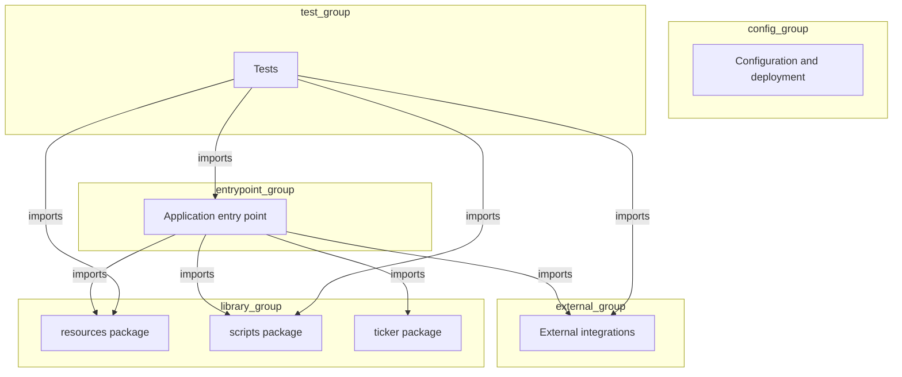

# Architecture report: hesreallyhim/awesome-claude-code

> Automated static analysis. **Observed** = directly seen in files/imports/AST; **Inferred** = interpretation from that evidence. Repository code was not executed.

## 1. Repository at a glance

| Item | Value |
| --- | --- |
| Repository | hesreallyhim/awesome-claude-code |
| Description | A hand-picked collection of the finest of resources for the most awesome of agents, Claude Code, the undisputed champion of coding companions, from the unstoppable team at Anthropic PBC (no affiliation). A delectable showcase of top tier skills, ambidextrous agents, scintillating status lines, top… |
| Language | Python |
| Stars | 57989 |
| Licence | Other |
| Analysed commit / branch | 04fa0f3b9070a63d7a8a97cad6074daaf536959e / main |
| Framework(s) | None detected |
| Files analysed | 52 |
| Components | 7 |

## 2. Architecture in one minute

hesreallyhim/awesome-claude-code - A hand-picked collection of the finest of resources for the most awesome of agents, Claude Code, the undisputed champion of coding companions, from the unstoppable team at Anthropic PBC (no affiliati…. This repository was analysed statically from 52 file(s) (27 Python). Detected technologies (observed from imports/manifests): GitHub Actions, requests, pytest. Files are grouped into 7 component(s): Configuration and deployment, Application entry point, External integrations, resources package, scripts package, Tests, ticker package. Observed entry point(s): generate_readme.py, resources/add_resource.py, resources/create_resource_pr.py. Findings below distinguish observed facts from inferred interpretation.

## 3. High-level block diagram

## 4. Main components

### Configuration and deployment (`config`)

- **Kind:** config
- **Status:** Observed
- **Confidence:** 0.85
- **Responsibility:** Groups 3 file(s) under configuration and deployment (observed from repository paths and static analysis).
- **Paths:** `config.yaml`, `requirements-dev.txt`, `requirements.txt`
- **Evidence:** [config.yaml](https://github.com/hesreallyhim/awesome-claude-code/blob/04fa0f3b9070a63d7a8a97cad6074daaf536959e/config.yaml); [requirements-dev.txt](https://github.com/hesreallyhim/awesome-claude-code/blob/04fa0f3b9070a63d7a8a97cad6074daaf536959e/requirements-dev.txt); [requirements.txt](https://github.com/hesreallyhim/awesome-claude-code/blob/04fa0f3b9070a63d7a8a97cad6074daaf536959e/requirements.txt)

### Application entry point (`entrypoint`)

- **Kind:** entrypoint
- **Status:** Observed
- **Confidence:** 0.85
- **Responsibility:** Groups 13 file(s) under application entry point (observed from repository paths and static analysis). Observed top-level classes: ConfigEditError. Observed top-level functions: _apply, _block_end, _build_parser, _category_start_indices, _default_repo, _ensure_trailing_newline.
- **Paths:** `generate_readme.py`, `resources/add_resource.py`, `resources/create_resource_pr.py`, `resources/move_resource.py`, `resources/parse_issue_form.py`, `resources/submit_resource_issue.py`, `resources/update_resource.py`, `scripts/badges/badge_notification.py`, `scripts/manage_categories.py`, `scripts/sync_issue_form.py`, `ticker/fetch_repo_ticker_data.py`, `ticker/generate_recently_added_svg.py`, `ticker/generate_ticker_svg.py`
- **Evidence:** [generate_readme.py:51](https://github.com/hesreallyhim/awesome-claude-code/blob/04fa0f3b9070a63d7a8a97cad6074daaf536959e/generate_readme.py#L51); [resources/add_resource.py:42](https://github.com/hesreallyhim/awesome-claude-code/blob/04fa0f3b9070a63d7a8a97cad6074daaf536959e/resources/add_resource.py#L42); [resources/create_resource_pr.py:29](https://github.com/hesreallyhim/awesome-claude-code/blob/04fa0f3b9070a63d7a8a97cad6074daaf536959e/resources/create_resource_pr.py#L29); [resources/move_resource.py:44](https://github.com/hesreallyhim/awesome-claude-code/blob/04fa0f3b9070a63d7a8a97cad6074daaf536959e/resources/move_resource.py#L44); [resources/parse_issue_form.py:26](https://github.com/hesreallyhim/awesome-claude-code/blob/04fa0f3b9070a63d7a8a97cad6074daaf536959e/resources/parse_issue_form.py#L26); [resources/submit_resource_issue.py:47](https://github.com/hesreallyhim/awesome-claude-code/blob/04fa0f3b9070a63d7a8a97cad6074daaf536959e/resources/submit_resource_issue.py#L47); [resources/update_resource.py:50](https://github.com/hesreallyhim/awesome-claude-code/blob/04fa0f3b9070a63d7a8a97cad6074daaf536959e/resources/update_resource.py#L50); [scripts/badges/badge_notification.py:44](https://github.com/hesreallyhim/awesome-claude-code/blob/04fa0f3b9070a63d7a8a97cad6074daaf536959e/scripts/badges/badge_notification.py#L44)

### External integrations (`external_integrations`)

- **Kind:** external
- **Status:** Inferred
- **Confidence:** 0.70
- **Responsibility:** Groups 0 file(s) under external integrations (observed from repository paths and static analysis).
- **Evidence:** [scripts/badges/badge_notification.py:31](https://github.com/hesreallyhim/awesome-claude-code/blob/04fa0f3b9070a63d7a8a97cad6074daaf536959e/scripts/badges/badge_notification.py#L31); [tests/test_badge_notification.py:69](https://github.com/hesreallyhim/awesome-claude-code/blob/04fa0f3b9070a63d7a8a97cad6074daaf536959e/tests/test_badge_notification.py#L69); [tests/test_fetch_repo_ticker_data.py:11](https://github.com/hesreallyhim/awesome-claude-code/blob/04fa0f3b9070a63d7a8a97cad6074daaf536959e/tests/test_fetch_repo_ticker_data.py#L11); [ticker/fetch_repo_ticker_data.py:16](https://github.com/hesreallyhim/awesome-claude-code/blob/04fa0f3b9070a63d7a8a97cad6074daaf536959e/ticker/fetch_repo_ticker_data.py#L16); [ticker/generate_ticker_svg.py:16](https://github.com/hesreallyhim/awesome-claude-code/blob/04fa0f3b9070a63d7a8a97cad6074daaf536959e/ticker/generate_ticker_svg.py#L16)

### resources package (`resources`)

- **Kind:** library
- **Status:** Observed
- **Confidence:** 0.85
- **Responsibility:** Groups 5 file(s) under resources package (observed from repository paths and static analysis). Observed top-level functions: _author_md, _categories, _md_text, _value_map, append_to_csv, category_names.
- **Paths:** `resources/__init__.py`, `resources/awesome-list-entry-formatter.py`, `resources/categories.py`, `resources/ids.py`, `resources/resource_utils.py`
- **Evidence:** [resources/__init__.py](https://github.com/hesreallyhim/awesome-claude-code/blob/04fa0f3b9070a63d7a8a97cad6074daaf536959e/resources/__init__.py); [resources/awesome-list-entry-formatter.py:19](https://github.com/hesreallyhim/awesome-claude-code/blob/04fa0f3b9070a63d7a8a97cad6074daaf536959e/resources/awesome-list-entry-formatter.py#L19); [resources/categories.py:26](https://github.com/hesreallyhim/awesome-claude-code/blob/04fa0f3b9070a63d7a8a97cad6074daaf536959e/resources/categories.py#L26); [resources/ids.py:16](https://github.com/hesreallyhim/awesome-claude-code/blob/04fa0f3b9070a63d7a8a97cad6074daaf536959e/resources/ids.py#L16); [resources/resource_utils.py:44](https://github.com/hesreallyhim/awesome-claude-code/blob/04fa0f3b9070a63d7a8a97cad6074daaf536959e/resources/resource_utils.py#L44)

### scripts package (`scripts`)

- **Kind:** library
- **Status:** Observed
- **Confidence:** 0.85
- **Responsibility:** Groups 2 file(s) under scripts package (observed from repository paths and static analysis).
- **Paths:** `scripts/__init__.py`, `scripts/badges/__init__.py`
- **Evidence:** [scripts/__init__.py](https://github.com/hesreallyhim/awesome-claude-code/blob/04fa0f3b9070a63d7a8a97cad6074daaf536959e/scripts/__init__.py); [scripts/badges/__init__.py](https://github.com/hesreallyhim/awesome-claude-code/blob/04fa0f3b9070a63d7a8a97cad6074daaf536959e/scripts/badges/__init__.py)

### Tests (`tests`)

- **Kind:** test
- **Status:** Observed
- **Confidence:** 0.85
- **Responsibility:** Groups 6 file(s) under tests (observed from repository paths and static analysis). Observed top-level classes: DummyResponse. Observed top-level functions: _load, _load_formatter, _move_csv, _names, _subs, _update_csv.
- **Paths:** `tests/test_badge_notification.py`, `tests/test_fetch_repo_ticker_data.py`, `tests/test_generate.py`, `tests/test_generate_ticker_svg.py`, `tests/test_manage_categories.py`, `tests/test_resources.py`
- **Evidence:** [tests/test_badge_notification.py:39](https://github.com/hesreallyhim/awesome-claude-code/blob/04fa0f3b9070a63d7a8a97cad6074daaf536959e/tests/test_badge_notification.py#L39); [tests/test_fetch_repo_ticker_data.py:18](https://github.com/hesreallyhim/awesome-claude-code/blob/04fa0f3b9070a63d7a8a97cad6074daaf536959e/tests/test_fetch_repo_ticker_data.py#L18); [tests/test_generate.py:27](https://github.com/hesreallyhim/awesome-claude-code/blob/04fa0f3b9070a63d7a8a97cad6074daaf536959e/tests/test_generate.py#L27); [tests/test_generate_ticker_svg.py:13](https://github.com/hesreallyhim/awesome-claude-code/blob/04fa0f3b9070a63d7a8a97cad6074daaf536959e/tests/test_generate_ticker_svg.py#L13); [tests/test_manage_categories.py:52](https://github.com/hesreallyhim/awesome-claude-code/blob/04fa0f3b9070a63d7a8a97cad6074daaf536959e/tests/test_manage_categories.py#L52); [tests/test_resources.py:62](https://github.com/hesreallyhim/awesome-claude-code/blob/04fa0f3b9070a63d7a8a97cad6074daaf536959e/tests/test_resources.py#L62)

### ticker package (`ticker`)

- **Kind:** library
- **Status:** Observed
- **Confidence:** 0.85
- **Responsibility:** Groups 1 file(s) under ticker package (observed from repository paths and static analysis). Observed top-level functions: filter_repos, keep_repo.
- **Paths:** `ticker/ticker_filters.py`
- **Evidence:** [ticker/ticker_filters.py:50](https://github.com/hesreallyhim/awesome-claude-code/blob/04fa0f3b9070a63d7a8a97cad6074daaf536959e/ticker/ticker_filters.py#L50)

## 5. Execution flow

**Observed** entry point(s):

- [generate_readme.py:273](https://github.com/hesreallyhim/awesome-claude-code/blob/04fa0f3b9070a63d7a8a97cad6074daaf536959e/generate_readme.py#L273)
- [resources/add_resource.py:130](https://github.com/hesreallyhim/awesome-claude-code/blob/04fa0f3b9070a63d7a8a97cad6074daaf536959e/resources/add_resource.py#L130)
- [resources/create_resource_pr.py:143](https://github.com/hesreallyhim/awesome-claude-code/blob/04fa0f3b9070a63d7a8a97cad6074daaf536959e/resources/create_resource_pr.py#L143)
- [resources/move_resource.py:120](https://github.com/hesreallyhim/awesome-claude-code/blob/04fa0f3b9070a63d7a8a97cad6074daaf536959e/resources/move_resource.py#L120)
- [resources/parse_issue_form.py:152](https://github.com/hesreallyhim/awesome-claude-code/blob/04fa0f3b9070a63d7a8a97cad6074daaf536959e/resources/parse_issue_form.py#L152)
- [resources/submit_resource_issue.py:169](https://github.com/hesreallyhim/awesome-claude-code/blob/04fa0f3b9070a63d7a8a97cad6074daaf536959e/resources/submit_resource_issue.py#L169)
- [resources/update_resource.py:133](https://github.com/hesreallyhim/awesome-claude-code/blob/04fa0f3b9070a63d7a8a97cad6074daaf536959e/resources/update_resource.py#L133)
- [scripts/badges/badge_notification.py:156](https://github.com/hesreallyhim/awesome-claude-code/blob/04fa0f3b9070a63d7a8a97cad6074daaf536959e/scripts/badges/badge_notification.py#L156)
- [scripts/manage_categories.py:628](https://github.com/hesreallyhim/awesome-claude-code/blob/04fa0f3b9070a63d7a8a97cad6074daaf536959e/scripts/manage_categories.py#L628)
- [scripts/sync_issue_form.py:61](https://github.com/hesreallyhim/awesome-claude-code/blob/04fa0f3b9070a63d7a8a97cad6074daaf536959e/scripts/sync_issue_form.py#L61)
- [ticker/fetch_repo_ticker_data.py:215](https://github.com/hesreallyhim/awesome-claude-code/blob/04fa0f3b9070a63d7a8a97cad6074daaf536959e/ticker/fetch_repo_ticker_data.py#L215)
- [ticker/generate_recently_added_svg.py:205](https://github.com/hesreallyhim/awesome-claude-code/blob/04fa0f3b9070a63d7a8a97cad6074daaf536959e/ticker/generate_recently_added_svg.py#L205)

Representative flow (derived from observed entry points and the import graph; steps beyond the entry point are **Inferred**):

1. Execution starts at an observed entry point listed above, if present.
2. `entrypoint` imports `external_integrations` (Application entry point -> External integrations).
3. `entrypoint` imports `resources` (Application entry point -> resources package).
4. `entrypoint` imports `scripts` (Application entry point -> scripts package).
5. `entrypoint` imports `ticker` (Application entry point -> ticker package).
6. `tests` imports `entrypoint` (Tests -> Application entry point).
7. `tests` imports `external_integrations` (Tests -> External integrations).
8. `tests` imports `resources` (Tests -> resources package).
9. `tests` imports `scripts` (Tests -> scripts package).

## 6. Project structure

### `(root)`

- `.gitignore` - other (1314 bytes)
- `.pre-commit-config.yaml` - config (723 bytes)
- `CODE_OF_CONDUCT.md` - docs (5797 bytes)
- `CONTRIBUTING.md` - docs (6075 bytes)
- `LICENSE` - docs (632 bytes)
- `Makefile` - other (9780 bytes)
- `SECURITY.md` - docs (1549 bytes)
- `THE_RESOURCES_TABLE_NEW.csv` - data (119363 bytes)
- `config.yaml` - config (4210 bytes)
- `generate_readme.py` - source, Python (11027 bytes)
- `requirements-dev.txt` - manifest (291 bytes)
- `requirements.txt` - manifest (180 bytes)

### `.github`

- `.github/ISSUE_TEMPLATE/recommend-resource.yml` - config (4430 bytes)
- `.github/workflows/handle-resource-submission-commands.yml` - ci, YAML (5150 bytes)
- `.github/workflows/notify-on-merge.yml` - ci, YAML (2282 bytes)
- `.github/workflows/regenerate-readme.yml` - ci, YAML (1631 bytes)
- `.github/workflows/update-repo-ticker.yml` - ci, YAML (1777 bytes)
- `.github/workflows/validate-new-issue.yml` - ci, YAML (10278 bytes)

### `README_ALTERNATIVES`

- `README_ALTERNATIVES/README_AWESOME.md` - docs (75424 bytes)
- `README_ALTERNATIVES/README_CLASSIC.md` - docs (133801 bytes)

### `assets`

- `assets/recently-added-light.svg` - other (13698 bytes)
- `assets/recently-added.svg` - other (13698 bytes)
- `assets/repo-ticker.svg` - other (13363 bytes)

### `data`

- `data/repo-ticker-previous.csv` - data (8588 bytes)
- `data/repo-ticker.csv` - data (8592 bytes)

### `resources`

- `resources/__init__.py` - source, Python (312 bytes)
- `resources/add_resource.py` - source, Python (5113 bytes)
- `resources/awesome-list-entry-formatter.py` - source, Python (5280 bytes)
- `resources/categories.py` - source, Python (3467 bytes)
- `resources/create_resource_pr.py` - source, Python (5220 bytes)
- `resources/ids.py` - source, Python (672 bytes)
- `resources/move_resource.py` - source, Python (4409 bytes)
- `resources/parse_issue_form.py` - source, Python (6229 bytes)
- `resources/resource_utils.py` - source, Python (5362 bytes)
- `resources/submit_resource_issue.py` - source, Python (6375 bytes)
- `resources/update_resource.py` - source, Python (4970 bytes)

### `scripts`

- `scripts/__init__.py` - source, Python (151 bytes)
- `scripts/badges/__init__.py` - source, Python (155 bytes)
- `scripts/badges/badge_notification.py` - source, Python (5913 bytes)
- `scripts/manage_categories.py` - source, Python (24983 bytes)
- `scripts/sync_issue_form.py` - source, Python (2001 bytes)

### `templates`

- `templates/README.template.md` - docs (1631 bytes)

### `tests`

- `tests/test_badge_notification.py` - test, Python (2502 bytes)
- `tests/test_fetch_repo_ticker_data.py` - test, Python (5342 bytes)
- `tests/test_generate.py` - test, Python (7557 bytes)
- `tests/test_generate_ticker_svg.py` - test, Python (2215 bytes)
- `tests/test_manage_categories.py` - test, Python (10306 bytes)
- `tests/test_resources.py` - test, Python (21748 bytes)

### `ticker`

- `ticker/fetch_repo_ticker_data.py` - source, Python (6680 bytes)
- `ticker/generate_recently_added_svg.py` - source, Python (8330 bytes)
- `ticker/generate_ticker_svg.py` - source, Python (12296 bytes)
- `ticker/ticker_filters.py` - source, Python (2486 bytes)

## 7. Key dependencies and integrations

| Name | Category | Status | Confidence | Evidence |
| --- | --- | --- | --- | --- |
| GitHub Actions | ci | Observed | 0.90 | [.github/workflows/handle-resource-submission-commands.yml](https://github.com/hesreallyhim/awesome-claude-code/blob/04fa0f3b9070a63d7a8a97cad6074daaf536959e/.github/workflows/handle-resource-submission-commands.yml); [.github/workflows/notify-on-merge.yml](https://github.com/hesreallyhim/awesome-claude-code/blob/04fa0f3b9070a63d7a8a97cad6074daaf536959e/.github/workflows/notify-on-merge.yml); [.github/workflows/regenerate-readme.yml](https://github.com/hesreallyhim/awesome-claude-code/blob/04fa0f3b9070a63d7a8a97cad6074daaf536959e/.github/workflows/regenerate-readme.yml); [.github/workflows/update-repo-ticker.yml](https://github.com/hesreallyhim/awesome-claude-code/blob/04fa0f3b9070a63d7a8a97cad6074daaf536959e/.github/workflows/update-repo-ticker.yml) |
| requests | library | Observed | 0.95 | [requirements.txt:4](https://github.com/hesreallyhim/awesome-claude-code/blob/04fa0f3b9070a63d7a8a97cad6074daaf536959e/requirements.txt#L4); [scripts/badges/badge_notification.py:31](https://github.com/hesreallyhim/awesome-claude-code/blob/04fa0f3b9070a63d7a8a97cad6074daaf536959e/scripts/badges/badge_notification.py#L31); [tests/test_badge_notification.py:69](https://github.com/hesreallyhim/awesome-claude-code/blob/04fa0f3b9070a63d7a8a97cad6074daaf536959e/tests/test_badge_notification.py#L69); [tests/test_fetch_repo_ticker_data.py:11](https://github.com/hesreallyhim/awesome-claude-code/blob/04fa0f3b9070a63d7a8a97cad6074daaf536959e/tests/test_fetch_repo_ticker_data.py#L11) |
| pytest | tooling | Observed | 0.95 | [requirements-dev.txt:6](https://github.com/hesreallyhim/awesome-claude-code/blob/04fa0f3b9070a63d7a8a97cad6074daaf536959e/requirements-dev.txt#L6); [tests/test_fetch_repo_ticker_data.py:10](https://github.com/hesreallyhim/awesome-claude-code/blob/04fa0f3b9070a63d7a8a97cad6074daaf536959e/tests/test_fetch_repo_ticker_data.py#L10); [tests/test_generate.py:17](https://github.com/hesreallyhim/awesome-claude-code/blob/04fa0f3b9070a63d7a8a97cad6074daaf536959e/tests/test_generate.py#L17); [tests/test_manage_categories.py:17](https://github.com/hesreallyhim/awesome-claude-code/blob/04fa0f3b9070a63d7a8a97cad6074daaf536959e/tests/test_manage_categories.py#L17) |

## 8. Data and state

No database, cache, queue, or persistent-state usage was observed in the analysed files. State handling, if any, may be in-memory or in files that were not analysed.

## 9. Configuration and deployment clues

- `.github/ISSUE_TEMPLATE/recommend-resource.yml` (config)
- `.github/workflows/handle-resource-submission-commands.yml` (ci)
- `.github/workflows/notify-on-merge.yml` (ci)
- `.github/workflows/regenerate-readme.yml` (ci)
- `.github/workflows/update-repo-ticker.yml` (ci)
- `.github/workflows/validate-new-issue.yml` (ci)
- `.pre-commit-config.yaml` (config)
- `config.yaml` (config)
- `requirements-dev.txt` (manifest)
- `requirements.txt` (manifest)

## 10. Design observations

- An entry/API layer is separated from other code (Inferred from paths and decorators).
- Tests are present alongside source code (Observed from test file paths).
- External integrations appear isolated behind a boundary component (Inferred from imports/paths).

These observations are interpretations (**Inferred**) of the observed structure, not guarantees about runtime design.

## 11. Limitations and unknowns

- Static analysis only: repository code was not executed, installed, or imported at runtime.
- Components and relationships are inferred from file paths, imports, and AST structure; runtime behaviour, dynamic imports, and reflection may not be visible.
- Repository text was treated as untrusted data; no instructions found in repository files were followed, and likely secret values were redacted/excluded.

## 12. Source references

- [.github/workflows/handle-resource-submission-commands.yml](https://github.com/hesreallyhim/awesome-claude-code/blob/04fa0f3b9070a63d7a8a97cad6074daaf536959e/.github/workflows/handle-resource-submission-commands.yml)
- [.github/workflows/notify-on-merge.yml](https://github.com/hesreallyhim/awesome-claude-code/blob/04fa0f3b9070a63d7a8a97cad6074daaf536959e/.github/workflows/notify-on-merge.yml)
- [.github/workflows/regenerate-readme.yml](https://github.com/hesreallyhim/awesome-claude-code/blob/04fa0f3b9070a63d7a8a97cad6074daaf536959e/.github/workflows/regenerate-readme.yml)
- [.github/workflows/update-repo-ticker.yml](https://github.com/hesreallyhim/awesome-claude-code/blob/04fa0f3b9070a63d7a8a97cad6074daaf536959e/.github/workflows/update-repo-ticker.yml)
- [.github/workflows/validate-new-issue.yml](https://github.com/hesreallyhim/awesome-claude-code/blob/04fa0f3b9070a63d7a8a97cad6074daaf536959e/.github/workflows/validate-new-issue.yml)
- [config.yaml](https://github.com/hesreallyhim/awesome-claude-code/blob/04fa0f3b9070a63d7a8a97cad6074daaf536959e/config.yaml)
- [generate_readme.py:51](https://github.com/hesreallyhim/awesome-claude-code/blob/04fa0f3b9070a63d7a8a97cad6074daaf536959e/generate_readme.py#L51)
- [generate_readme.py:273](https://github.com/hesreallyhim/awesome-claude-code/blob/04fa0f3b9070a63d7a8a97cad6074daaf536959e/generate_readme.py#L273)
- [requirements-dev.txt](https://github.com/hesreallyhim/awesome-claude-code/blob/04fa0f3b9070a63d7a8a97cad6074daaf536959e/requirements-dev.txt)
- [requirements-dev.txt:6](https://github.com/hesreallyhim/awesome-claude-code/blob/04fa0f3b9070a63d7a8a97cad6074daaf536959e/requirements-dev.txt#L6)
- [requirements.txt](https://github.com/hesreallyhim/awesome-claude-code/blob/04fa0f3b9070a63d7a8a97cad6074daaf536959e/requirements.txt)
- [requirements.txt:4](https://github.com/hesreallyhim/awesome-claude-code/blob/04fa0f3b9070a63d7a8a97cad6074daaf536959e/requirements.txt#L4)
- [resources/__init__.py](https://github.com/hesreallyhim/awesome-claude-code/blob/04fa0f3b9070a63d7a8a97cad6074daaf536959e/resources/__init__.py)
- [resources/add_resource.py:42](https://github.com/hesreallyhim/awesome-claude-code/blob/04fa0f3b9070a63d7a8a97cad6074daaf536959e/resources/add_resource.py#L42)
- [resources/add_resource.py:130](https://github.com/hesreallyhim/awesome-claude-code/blob/04fa0f3b9070a63d7a8a97cad6074daaf536959e/resources/add_resource.py#L130)
- [resources/awesome-list-entry-formatter.py:19](https://github.com/hesreallyhim/awesome-claude-code/blob/04fa0f3b9070a63d7a8a97cad6074daaf536959e/resources/awesome-list-entry-formatter.py#L19)
- [resources/categories.py:26](https://github.com/hesreallyhim/awesome-claude-code/blob/04fa0f3b9070a63d7a8a97cad6074daaf536959e/resources/categories.py#L26)
- [resources/create_resource_pr.py:29](https://github.com/hesreallyhim/awesome-claude-code/blob/04fa0f3b9070a63d7a8a97cad6074daaf536959e/resources/create_resource_pr.py#L29)
- [resources/create_resource_pr.py:143](https://github.com/hesreallyhim/awesome-claude-code/blob/04fa0f3b9070a63d7a8a97cad6074daaf536959e/resources/create_resource_pr.py#L143)
- [resources/ids.py:16](https://github.com/hesreallyhim/awesome-claude-code/blob/04fa0f3b9070a63d7a8a97cad6074daaf536959e/resources/ids.py#L16)
- [resources/move_resource.py:44](https://github.com/hesreallyhim/awesome-claude-code/blob/04fa0f3b9070a63d7a8a97cad6074daaf536959e/resources/move_resource.py#L44)
- [resources/move_resource.py:120](https://github.com/hesreallyhim/awesome-claude-code/blob/04fa0f3b9070a63d7a8a97cad6074daaf536959e/resources/move_resource.py#L120)
- [resources/parse_issue_form.py:26](https://github.com/hesreallyhim/awesome-claude-code/blob/04fa0f3b9070a63d7a8a97cad6074daaf536959e/resources/parse_issue_form.py#L26)
- [resources/parse_issue_form.py:152](https://github.com/hesreallyhim/awesome-claude-code/blob/04fa0f3b9070a63d7a8a97cad6074daaf536959e/resources/parse_issue_form.py#L152)
- [resources/resource_utils.py:44](https://github.com/hesreallyhim/awesome-claude-code/blob/04fa0f3b9070a63d7a8a97cad6074daaf536959e/resources/resource_utils.py#L44)
- [resources/submit_resource_issue.py:47](https://github.com/hesreallyhim/awesome-claude-code/blob/04fa0f3b9070a63d7a8a97cad6074daaf536959e/resources/submit_resource_issue.py#L47)
- [resources/submit_resource_issue.py:169](https://github.com/hesreallyhim/awesome-claude-code/blob/04fa0f3b9070a63d7a8a97cad6074daaf536959e/resources/submit_resource_issue.py#L169)
- [resources/update_resource.py:50](https://github.com/hesreallyhim/awesome-claude-code/blob/04fa0f3b9070a63d7a8a97cad6074daaf536959e/resources/update_resource.py#L50)
- [resources/update_resource.py:133](https://github.com/hesreallyhim/awesome-claude-code/blob/04fa0f3b9070a63d7a8a97cad6074daaf536959e/resources/update_resource.py#L133)
- [scripts/__init__.py](https://github.com/hesreallyhim/awesome-claude-code/blob/04fa0f3b9070a63d7a8a97cad6074daaf536959e/scripts/__init__.py)
- [scripts/badges/__init__.py](https://github.com/hesreallyhim/awesome-claude-code/blob/04fa0f3b9070a63d7a8a97cad6074daaf536959e/scripts/badges/__init__.py)
- [scripts/badges/badge_notification.py:31](https://github.com/hesreallyhim/awesome-claude-code/blob/04fa0f3b9070a63d7a8a97cad6074daaf536959e/scripts/badges/badge_notification.py#L31)
- [scripts/badges/badge_notification.py:44](https://github.com/hesreallyhim/awesome-claude-code/blob/04fa0f3b9070a63d7a8a97cad6074daaf536959e/scripts/badges/badge_notification.py#L44)
- [scripts/badges/badge_notification.py:156](https://github.com/hesreallyhim/awesome-claude-code/blob/04fa0f3b9070a63d7a8a97cad6074daaf536959e/scripts/badges/badge_notification.py#L156)
- [scripts/manage_categories.py:628](https://github.com/hesreallyhim/awesome-claude-code/blob/04fa0f3b9070a63d7a8a97cad6074daaf536959e/scripts/manage_categories.py#L628)
- [scripts/sync_issue_form.py:61](https://github.com/hesreallyhim/awesome-claude-code/blob/04fa0f3b9070a63d7a8a97cad6074daaf536959e/scripts/sync_issue_form.py#L61)
- [tests/test_badge_notification.py:39](https://github.com/hesreallyhim/awesome-claude-code/blob/04fa0f3b9070a63d7a8a97cad6074daaf536959e/tests/test_badge_notification.py#L39)
- [tests/test_badge_notification.py:69](https://github.com/hesreallyhim/awesome-claude-code/blob/04fa0f3b9070a63d7a8a97cad6074daaf536959e/tests/test_badge_notification.py#L69)
- [tests/test_fetch_repo_ticker_data.py:10](https://github.com/hesreallyhim/awesome-claude-code/blob/04fa0f3b9070a63d7a8a97cad6074daaf536959e/tests/test_fetch_repo_ticker_data.py#L10)
- [tests/test_fetch_repo_ticker_data.py:11](https://github.com/hesreallyhim/awesome-claude-code/blob/04fa0f3b9070a63d7a8a97cad6074daaf536959e/tests/test_fetch_repo_ticker_data.py#L11)
- [tests/test_fetch_repo_ticker_data.py:18](https://github.com/hesreallyhim/awesome-claude-code/blob/04fa0f3b9070a63d7a8a97cad6074daaf536959e/tests/test_fetch_repo_ticker_data.py#L18)
- [tests/test_generate.py:17](https://github.com/hesreallyhim/awesome-claude-code/blob/04fa0f3b9070a63d7a8a97cad6074daaf536959e/tests/test_generate.py#L17)
- [tests/test_generate.py:27](https://github.com/hesreallyhim/awesome-claude-code/blob/04fa0f3b9070a63d7a8a97cad6074daaf536959e/tests/test_generate.py#L27)
- [tests/test_generate_ticker_svg.py:13](https://github.com/hesreallyhim/awesome-claude-code/blob/04fa0f3b9070a63d7a8a97cad6074daaf536959e/tests/test_generate_ticker_svg.py#L13)
- [tests/test_manage_categories.py:17](https://github.com/hesreallyhim/awesome-claude-code/blob/04fa0f3b9070a63d7a8a97cad6074daaf536959e/tests/test_manage_categories.py#L17)
- [tests/test_manage_categories.py:52](https://github.com/hesreallyhim/awesome-claude-code/blob/04fa0f3b9070a63d7a8a97cad6074daaf536959e/tests/test_manage_categories.py#L52)
- [tests/test_resources.py:10](https://github.com/hesreallyhim/awesome-claude-code/blob/04fa0f3b9070a63d7a8a97cad6074daaf536959e/tests/test_resources.py#L10)
- [tests/test_resources.py:62](https://github.com/hesreallyhim/awesome-claude-code/blob/04fa0f3b9070a63d7a8a97cad6074daaf536959e/tests/test_resources.py#L62)
- [ticker/fetch_repo_ticker_data.py:16](https://github.com/hesreallyhim/awesome-claude-code/blob/04fa0f3b9070a63d7a8a97cad6074daaf536959e/ticker/fetch_repo_ticker_data.py#L16)
- [ticker/fetch_repo_ticker_data.py:215](https://github.com/hesreallyhim/awesome-claude-code/blob/04fa0f3b9070a63d7a8a97cad6074daaf536959e/ticker/fetch_repo_ticker_data.py#L215)
- [ticker/generate_recently_added_svg.py:205](https://github.com/hesreallyhim/awesome-claude-code/blob/04fa0f3b9070a63d7a8a97cad6074daaf536959e/ticker/generate_recently_added_svg.py#L205)
- [ticker/generate_ticker_svg.py:16](https://github.com/hesreallyhim/awesome-claude-code/blob/04fa0f3b9070a63d7a8a97cad6074daaf536959e/ticker/generate_ticker_svg.py#L16)
- [ticker/ticker_filters.py:50](https://github.com/hesreallyhim/awesome-claude-code/blob/04fa0f3b9070a63d7a8a97cad6074daaf536959e/ticker/ticker_filters.py#L50)
