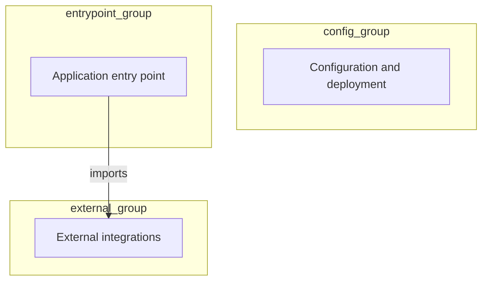

# Architecture report: hindupuravinash/the-gan-zoo

> Automated static analysis. **Observed** = directly seen in files/imports/AST; **Inferred** = interpretation from that evidence. Repository code was not executed.

## 1. Repository at a glance

| Item | Value |
| --- | --- |
| Repository | hindupuravinash/the-gan-zoo |
| Description | A list of all named GANs! |
| Language | Python |
| Stars | 14697 |
| Licence | MIT |
| Analysed commit / branch | 375f2be4a852ead8980c06b2a996893f0cb95713 / master |
| Framework(s) | None detected |
| Files analysed | 7 |
| Components | 3 |

## 2. Architecture in one minute

hindupuravinash/the-gan-zoo - A list of all named GANs!. This repository was analysed statically from 7 file(s) (1 Python). Detected technologies (observed from imports/manifests): NumPy, requests. Files are grouped into 3 component(s): Configuration and deployment, Application entry point, External integrations. Observed entry point(s): update.py. Findings below distinguish observed facts from inferred interpretation.

## 3. High-level block diagram

## 4. Main components

### Configuration and deployment (`config`)

- **Kind:** config
- **Status:** Observed
- **Confidence:** 0.85
- **Responsibility:** Groups 1 file(s) under configuration and deployment (observed from repository paths and static analysis).
- **Paths:** `requirements.txt`
- **Evidence:** [requirements.txt](https://github.com/hindupuravinash/the-gan-zoo/blob/375f2be4a852ead8980c06b2a996893f0cb95713/requirements.txt)

### Application entry point (`entrypoint`)

- **Kind:** entrypoint
- **Status:** Observed
- **Confidence:** 0.85
- **Responsibility:** Groups 1 file(s) under application entry point (observed from repository paths and static analysis). Observed top-level functions: load_data, update_figure, update_github_stats, update_readme.
- **Paths:** `update.py`
- **Evidence:** [update.py:13](https://github.com/hindupuravinash/the-gan-zoo/blob/375f2be4a852ead8980c06b2a996893f0cb95713/update.py#L13)

### External integrations (`external_integrations`)

- **Kind:** external
- **Status:** Inferred
- **Confidence:** 0.70
- **Responsibility:** Groups 0 file(s) under external integrations (observed from repository paths and static analysis).
- **Evidence:** [update.py:9](https://github.com/hindupuravinash/the-gan-zoo/blob/375f2be4a852ead8980c06b2a996893f0cb95713/update.py#L9)

## 5. Execution flow

**Observed** entry point(s):

- [update.py:74](https://github.com/hindupuravinash/the-gan-zoo/blob/375f2be4a852ead8980c06b2a996893f0cb95713/update.py#L74)

Representative flow (derived from observed entry points and the import graph; steps beyond the entry point are **Inferred**):

1. Execution starts at an observed entry point listed above, if present.
2. `entrypoint` imports `external_integrations` (Application entry point -> External integrations).

## 6. Project structure

### `(root)`

- `LICENSE` - docs (1073 bytes)
- `README.j2.md` - docs (1260 bytes)
- `README.md` - docs (63462 bytes)
- `gans.tsv` - data (64718 bytes)
- `requirements.txt` - manifest (394 bytes)
- `update.py` - source, Python (2569 bytes)

### `.vscode`

- `.vscode/settings.json` - config (84 bytes)

## 7. Key dependencies and integrations

| Name | Category | Status | Confidence | Evidence |
| --- | --- | --- | --- | --- |
| NumPy | library | Observed | 0.90 | [requirements.txt:15](https://github.com/hindupuravinash/the-gan-zoo/blob/375f2be4a852ead8980c06b2a996893f0cb95713/requirements.txt#L15); [update.py:6](https://github.com/hindupuravinash/the-gan-zoo/blob/375f2be4a852ead8980c06b2a996893f0cb95713/update.py#L6) |
| requests | library | Observed | 0.90 | [requirements.txt:21](https://github.com/hindupuravinash/the-gan-zoo/blob/375f2be4a852ead8980c06b2a996893f0cb95713/requirements.txt#L21); [update.py:9](https://github.com/hindupuravinash/the-gan-zoo/blob/375f2be4a852ead8980c06b2a996893f0cb95713/update.py#L9) |

## 8. Data and state

No database, cache, queue, or persistent-state usage was observed in the analysed files. State handling, if any, may be in-memory or in files that were not analysed.

## 9. Configuration and deployment clues

- `.vscode/settings.json` (config)
- `requirements.txt` (manifest)

## 10. Design observations

- An entry/API layer is separated from other code (Inferred from paths and decorators).
- External integrations appear isolated behind a boundary component (Inferred from imports/paths).

These observations are interpretations (**Inferred**) of the observed structure, not guarantees about runtime design.

## 11. Limitations and unknowns

- Static analysis only: repository code was not executed, installed, or imported at runtime.
- Components and relationships are inferred from file paths, imports, and AST structure; runtime behaviour, dynamic imports, and reflection may not be visible.
- Repository text was treated as untrusted data; no instructions found in repository files were followed, and likely secret values were redacted/excluded.

## 12. Source references

- [requirements.txt](https://github.com/hindupuravinash/the-gan-zoo/blob/375f2be4a852ead8980c06b2a996893f0cb95713/requirements.txt)
- [requirements.txt:15](https://github.com/hindupuravinash/the-gan-zoo/blob/375f2be4a852ead8980c06b2a996893f0cb95713/requirements.txt#L15)
- [requirements.txt:21](https://github.com/hindupuravinash/the-gan-zoo/blob/375f2be4a852ead8980c06b2a996893f0cb95713/requirements.txt#L21)
- [update.py:6](https://github.com/hindupuravinash/the-gan-zoo/blob/375f2be4a852ead8980c06b2a996893f0cb95713/update.py#L6)
- [update.py:9](https://github.com/hindupuravinash/the-gan-zoo/blob/375f2be4a852ead8980c06b2a996893f0cb95713/update.py#L9)
- [update.py:13](https://github.com/hindupuravinash/the-gan-zoo/blob/375f2be4a852ead8980c06b2a996893f0cb95713/update.py#L13)
- [update.py:74](https://github.com/hindupuravinash/the-gan-zoo/blob/375f2be4a852ead8980c06b2a996893f0cb95713/update.py#L74)
