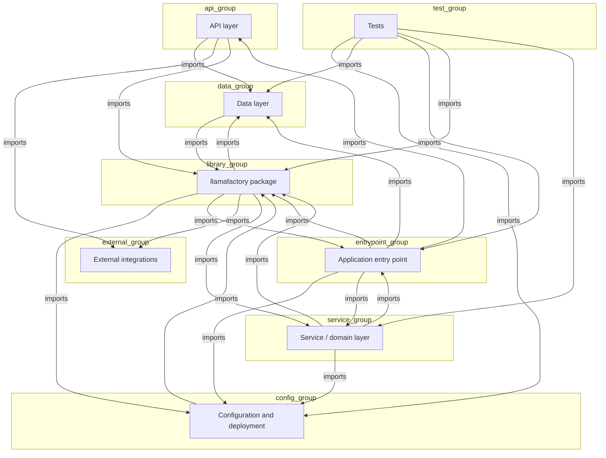

# Architecture report: hiyouga/LlamaFactory

> Automated static analysis. **Observed** = directly seen in files/imports/AST; **Inferred** = interpretation from that evidence. Repository code was not executed.

## 1. Repository at a glance

| Item | Value |
| --- | --- |
| Repository | hiyouga/LlamaFactory |
| Description | Unified Efficient Fine-Tuning of 100+ LLMs & VLMs (ACL 2024) |
| Language | Python |
| Stars | 76042 |
| Licence | Apache-2.0 |
| Analysed commit / branch | 5f1f6ad537e69216e0604671223cc1eeecbb7ba6 / main |
| Framework(s) | FastAPI |
| Files analysed | 606 |
| Components | 8 |

## 2. Architecture in one minute

hiyouga/LlamaFactory - Unified Efficient Fine-Tuning of 100+ LLMs & VLMs (ACL 2024). This repository was analysed statically from 606 file(s) (319 Python). Detected technologies (observed from imports/manifests): GitHub Actions, FastAPI, NumPy, pandas, Pydantic, requests. Files are grouped into 8 component(s): API layer, Configuration and deployment, Data layer, Application entry point, External integrations, llamafactory package, Service / domain layer, Tests. Observed entry point(s): src/api.py, src/llamafactory/api/app.py, src/llamafactory/cli.py. Findings below distinguish observed facts from inferred interpretation.

## 3. High-level block diagram

## 4. Main components

### API layer (`api_layer`)

- **Kind:** api
- **Status:** Observed
- **Confidence:** 0.85
- **Responsibility:** Groups 4 file(s) under api layer (observed from repository paths and static analysis). Observed top-level classes: ChatCompletionMessage, ChatCompletionRequest, ChatCompletionResponse, ChatCompletionResponseChoice, ChatCompletionResponseUsage, ChatCompletionStreamResponse. Observed top-level functions: _create_stream_chat_completion_chunk, _process_request, check_lfi_path, check_ssrf_url, create_chat_completion_response, create_score_evaluation_response.
- **Paths:** `src/llamafactory/api/__init__.py`, `src/llamafactory/api/chat.py`, `src/llamafactory/api/common.py`, `src/llamafactory/api/protocol.py`
- **Evidence:** [src/llamafactory/api/__init__.py](https://github.com/hiyouga/LlamaFactory/blob/5f1f6ad537e69216e0604671223cc1eeecbb7ba6/src/llamafactory/api/__init__.py); [src/llamafactory/api/chat.py:73](https://github.com/hiyouga/LlamaFactory/blob/5f1f6ad537e69216e0604671223cc1eeecbb7ba6/src/llamafactory/api/chat.py#L73); [src/llamafactory/api/common.py:38](https://github.com/hiyouga/LlamaFactory/blob/5f1f6ad537e69216e0604671223cc1eeecbb7ba6/src/llamafactory/api/common.py#L38); [src/llamafactory/api/protocol.py:23](https://github.com/hiyouga/LlamaFactory/blob/5f1f6ad537e69216e0604671223cc1eeecbb7ba6/src/llamafactory/api/protocol.py#L23)

### Configuration and deployment (`config`)

- **Kind:** config
- **Status:** Observed
- **Confidence:** 0.85
- **Responsibility:** Groups 28 file(s) under configuration and deployment (observed from repository paths and static analysis). Observed top-level classes: BatchingStrategy, DataArguments, ModelArguments, ModelClass, PluginConfig, SampleArguments. Observed top-level functions: _convert_str_dict, get_plugin_config.
- **Paths:** `MANIFEST.in`, `data/dataset_info.json`, `data/identity.json`, `data/mllm_audio_demo.json`, `data/mllm_demo.json`, `data/mllm_video_audio_demo.json`, `data/mllm_video_demo.json`, `data/v1_dpo_demo.yaml`, `data/v1_multimodal_demo.yaml`, `data/v1_sft_demo.yaml`, `docker/docker-cuda/Dockerfile`, `docker/docker-cuda/Dockerfile.base`, `docker/docker-cuda/Dockerfile.mbridge`, `docker/docker-cuda/Dockerfile.megatron`, `docker/docker-cuda/docker-compose.yml`, `docker/docker-npu/Dockerfile`, `docker/docker-npu/docker-compose.yml`, `docker/docker-rocm/Dockerfile`, `docker/docker-rocm/docker-compose.yml`, `docker/docker-xpu/Dockerfile`, `docker/docker-xpu/docker-compose.yml`, `pyproject.toml`, `src/llamafactory/v1/config/__init__.py`, `src/llamafactory/v1/config/arg_utils.py`, `src/llamafactory/v1/config/data_args.py`, `src/llamafactory/v1/config/model_args.py`, `src/llamafactory/v1/config/sample_args.py`, `src/llamafactory/v1/config/training_args.py`
- **Evidence:** [MANIFEST.in](https://github.com/hiyouga/LlamaFactory/blob/5f1f6ad537e69216e0604671223cc1eeecbb7ba6/MANIFEST.in); [data/dataset_info.json](https://github.com/hiyouga/LlamaFactory/blob/5f1f6ad537e69216e0604671223cc1eeecbb7ba6/data/dataset_info.json); [data/identity.json](https://github.com/hiyouga/LlamaFactory/blob/5f1f6ad537e69216e0604671223cc1eeecbb7ba6/data/identity.json); [data/mllm_audio_demo.json](https://github.com/hiyouga/LlamaFactory/blob/5f1f6ad537e69216e0604671223cc1eeecbb7ba6/data/mllm_audio_demo.json); [data/mllm_demo.json](https://github.com/hiyouga/LlamaFactory/blob/5f1f6ad537e69216e0604671223cc1eeecbb7ba6/data/mllm_demo.json); [data/mllm_video_audio_demo.json](https://github.com/hiyouga/LlamaFactory/blob/5f1f6ad537e69216e0604671223cc1eeecbb7ba6/data/mllm_video_audio_demo.json); [data/mllm_video_demo.json](https://github.com/hiyouga/LlamaFactory/blob/5f1f6ad537e69216e0604671223cc1eeecbb7ba6/data/mllm_video_demo.json); [data/v1_dpo_demo.yaml](https://github.com/hiyouga/LlamaFactory/blob/5f1f6ad537e69216e0604671223cc1eeecbb7ba6/data/v1_dpo_demo.yaml)

### Data layer (`data_layer`)

- **Kind:** data
- **Status:** Observed
- **Confidence:** 0.85
- **Responsibility:** Groups 17 file(s) under data layer (observed from repository paths and static analysis). Observed top-level classes: AlpacaDatasetConverter, BasePlugin, DatasetAttr, DatasetConverter, DatasetModule, DatasetProcessor. Observed top-level functions: _check_video_is_nested_images, _get_dataset_processor, _get_gemma3_token_type_ids, _get_merged_dataset, _get_paligemma_token_type_ids, _get_preprocessed_dataset.
- **Paths:** `src/llamafactory/data/__init__.py`, `src/llamafactory/data/collator.py`, `src/llamafactory/data/converter.py`, `src/llamafactory/data/data_utils.py`, `src/llamafactory/data/formatter.py`, `src/llamafactory/data/loader.py`, `src/llamafactory/data/mm_plugin.py`, `src/llamafactory/data/parser.py`, `src/llamafactory/data/processor/__init__.py`, `src/llamafactory/data/processor/feedback.py`, `src/llamafactory/data/processor/pairwise.py`, `src/llamafactory/data/processor/pretrain.py`, `src/llamafactory/data/processor/processor_utils.py`, `src/llamafactory/data/processor/supervised.py`, `src/llamafactory/data/processor/unsupervised.py`, `src/llamafactory/data/template.py`, `src/llamafactory/data/tool_utils.py`
- **Evidence:** [src/llamafactory/data/__init__.py](https://github.com/hiyouga/LlamaFactory/blob/5f1f6ad537e69216e0604671223cc1eeecbb7ba6/src/llamafactory/data/__init__.py); [src/llamafactory/data/collator.py:43](https://github.com/hiyouga/LlamaFactory/blob/5f1f6ad537e69216e0604671223cc1eeecbb7ba6/src/llamafactory/data/collator.py#L43); [src/llamafactory/data/converter.py:39](https://github.com/hiyouga/LlamaFactory/blob/5f1f6ad537e69216e0604671223cc1eeecbb7ba6/src/llamafactory/data/converter.py#L39); [src/llamafactory/data/data_utils.py:38](https://github.com/hiyouga/LlamaFactory/blob/5f1f6ad537e69216e0604671223cc1eeecbb7ba6/src/llamafactory/data/data_utils.py#L38); [src/llamafactory/data/formatter.py:27](https://github.com/hiyouga/LlamaFactory/blob/5f1f6ad537e69216e0604671223cc1eeecbb7ba6/src/llamafactory/data/formatter.py#L27); [src/llamafactory/data/loader.py:51](https://github.com/hiyouga/LlamaFactory/blob/5f1f6ad537e69216e0604671223cc1eeecbb7ba6/src/llamafactory/data/loader.py#L51); [src/llamafactory/data/mm_plugin.py:91](https://github.com/hiyouga/LlamaFactory/blob/5f1f6ad537e69216e0604671223cc1eeecbb7ba6/src/llamafactory/data/mm_plugin.py#L91); [src/llamafactory/data/parser.py:27](https://github.com/hiyouga/LlamaFactory/blob/5f1f6ad537e69216e0604671223cc1eeecbb7ba6/src/llamafactory/data/parser.py#L27)

### Application entry point (`entrypoint`)

- **Kind:** entrypoint
- **Status:** Observed
- **Confidence:** 0.85
- **Responsibility:** Groups 35 file(s) under application entry point (observed from repository paths and static analysis). Observed application object created via FastAPI. Observed top-level classes: BatchGenerator, DPOTrainer, DataEngine, Dim, DistributedInterface, DistributedStrategy. Observed top-level functions: _collate_micro_batch, _init_score_head, _inject_dummy_into_collated, _mp_fn, _need_video_kwargs, _validate_dpo_dataset_format.
- **Paths:** `scripts/bench_qwen.py`, `scripts/convert_ckpt/llamafy_baichuan2.py`, `scripts/convert_ckpt/llamafy_qwen.py`, `scripts/convert_ckpt/tiny_llama4.py`, `scripts/convert_ckpt/tiny_qwen3.py`, `scripts/dcp2hf.py`, `scripts/eval_bleu_rouge.py`, `scripts/hf2dcp.py`, `scripts/llama_pro.py`, `scripts/loftq_init.py`, `scripts/megatron_merge.py`, `scripts/pissa_init.py`, `scripts/qwen_omni_merge.py`, `scripts/stat_utils/cal_flops.py`, `scripts/stat_utils/cal_lr.py`, `scripts/stat_utils/cal_mfu.py`, `scripts/stat_utils/cal_ppl.py`, `scripts/stat_utils/length_cdf.py`, `scripts/vllm_infer.py`, `src/api.py`, `src/llamafactory/api/app.py`, `src/llamafactory/cli.py`, `src/llamafactory/launcher.py`, `src/llamafactory/v1/accelerator/interface.py`, `src/llamafactory/v1/config/arg_parser.py`, `src/llamafactory/v1/core/data_engine.py`, `src/llamafactory/v1/core/model_engine.py`, `src/llamafactory/v1/core/utils/batching.py`, `src/llamafactory/v1/launcher.py`, `src/llamafactory/v1/samplers/cli_sampler.py`, `src/llamafactory/v1/trainers/dpo_trainer.py`, `src/llamafactory/v1/trainers/rm_trainer.py`, `src/llamafactory/v1/trainers/sft_trainer.py`, `src/train.py`, `src/webui.py`
- **Evidence:** [scripts/bench_qwen.py:32](https://github.com/hiyouga/LlamaFactory/blob/5f1f6ad537e69216e0604671223cc1eeecbb7ba6/scripts/bench_qwen.py#L32); [scripts/convert_ckpt/llamafy_baichuan2.py:31](https://github.com/hiyouga/LlamaFactory/blob/5f1f6ad537e69216e0604671223cc1eeecbb7ba6/scripts/convert_ckpt/llamafy_baichuan2.py#L31); [scripts/convert_ckpt/llamafy_qwen.py:39](https://github.com/hiyouga/LlamaFactory/blob/5f1f6ad537e69216e0604671223cc1eeecbb7ba6/scripts/convert_ckpt/llamafy_qwen.py#L39); [scripts/convert_ckpt/tiny_llama4.py](https://github.com/hiyouga/LlamaFactory/blob/5f1f6ad537e69216e0604671223cc1eeecbb7ba6/scripts/convert_ckpt/tiny_llama4.py); [scripts/convert_ckpt/tiny_qwen3.py](https://github.com/hiyouga/LlamaFactory/blob/5f1f6ad537e69216e0604671223cc1eeecbb7ba6/scripts/convert_ckpt/tiny_qwen3.py); [scripts/dcp2hf.py:33](https://github.com/hiyouga/LlamaFactory/blob/5f1f6ad537e69216e0604671223cc1eeecbb7ba6/scripts/dcp2hf.py#L33); [scripts/eval_bleu_rouge.py:35](https://github.com/hiyouga/LlamaFactory/blob/5f1f6ad537e69216e0604671223cc1eeecbb7ba6/scripts/eval_bleu_rouge.py#L35); [scripts/hf2dcp.py:32](https://github.com/hiyouga/LlamaFactory/blob/5f1f6ad537e69216e0604671223cc1eeecbb7ba6/scripts/hf2dcp.py#L32)

### External integrations (`external_integrations`)

- **Kind:** external
- **Status:** Inferred
- **Confidence:** 0.70
- **Responsibility:** Groups 0 file(s) under external integrations (observed from repository paths and static analysis).
- **Evidence:** [src/llamafactory/api/chat.py:54](https://github.com/hiyouga/LlamaFactory/blob/5f1f6ad537e69216e0604671223cc1eeecbb7ba6/src/llamafactory/api/chat.py#L54); [src/llamafactory/api/common.py:18](https://github.com/hiyouga/LlamaFactory/blob/5f1f6ad537e69216e0604671223cc1eeecbb7ba6/src/llamafactory/api/common.py#L18); [src/llamafactory/chat/sglang_engine.py:21](https://github.com/hiyouga/LlamaFactory/blob/5f1f6ad537e69216e0604671223cc1eeecbb7ba6/src/llamafactory/chat/sglang_engine.py#L21); [src/llamafactory/extras/misc.py:21](https://github.com/hiyouga/LlamaFactory/blob/5f1f6ad537e69216e0604671223cc1eeecbb7ba6/src/llamafactory/extras/misc.py#L21); [src/llamafactory/train/ppo/ppo_utils.py:26](https://github.com/hiyouga/LlamaFactory/blob/5f1f6ad537e69216e0604671223cc1eeecbb7ba6/src/llamafactory/train/ppo/ppo_utils.py#L26); [src/llamafactory/v1/utils/env.py:16](https://github.com/hiyouga/LlamaFactory/blob/5f1f6ad537e69216e0604671223cc1eeecbb7ba6/src/llamafactory/v1/utils/env.py#L16)

### llamafactory package (`llamafactory`)

- **Kind:** library
- **Status:** Observed
- **Confidence:** 0.85
- **Responsibility:** Groups 180 file(s) under llamafactory package (observed from repository paths and static analysis). Observed top-level classes: AlpacaSample, ApolloArguments, AttentionFunction, AverageMeter, BAdamArgument, Backend. Observed top-level functions: _allreduce_sum_, _apply_auto_kernels, _apply_context_parallel_finetuning_requirements, _apply_extra_overrides, _apply_fusion_safety, _apply_llama_patch.
- **Paths:** `src/llamafactory/__init__.py`, `src/llamafactory/chat/__init__.py`, `src/llamafactory/chat/base_engine.py`, `src/llamafactory/chat/chat_model.py`, `src/llamafactory/chat/hf_engine.py`, `src/llamafactory/chat/sglang_engine.py`, `src/llamafactory/chat/vllm_engine.py`, `src/llamafactory/eval/__init__.py`, `src/llamafactory/eval/evaluator.py`, `src/llamafactory/eval/template.py`, `src/llamafactory/extras/__init__.py`, `src/llamafactory/extras/constants.py`, `src/llamafactory/extras/env.py`, `src/llamafactory/extras/logging.py`, `src/llamafactory/extras/misc.py`, `src/llamafactory/extras/packages.py`, `src/llamafactory/extras/ploting.py`, `src/llamafactory/hparams/__init__.py`, `src/llamafactory/hparams/data_args.py`, `src/llamafactory/hparams/evaluation_args.py`, `src/llamafactory/hparams/finetuning_args.py`, `src/llamafactory/hparams/generating_args.py`, `src/llamafactory/hparams/megatron_bridge_args.py`, `src/llamafactory/hparams/model_args.py`, `src/llamafactory/hparams/parser.py`, `src/llamafactory/hparams/training_args.py`, `src/llamafactory/model/__init__.py`, `src/llamafactory/model/adapter.py`, `src/llamafactory/model/loader.py`, `src/llamafactory/model/model_utils/__init__.py`, `src/llamafactory/model/model_utils/attention.py`, `src/llamafactory/model/model_utils/checkpointing.py`, `src/llamafactory/model/model_utils/embedding.py`, `src/llamafactory/model/model_utils/kv_cache.py`, `src/llamafactory/model/model_utils/liger_kernel.py`, `src/llamafactory/model/model_utils/longlora.py`, `src/llamafactory/model/model_utils/misc.py`, `src/llamafactory/model/model_utils/mod.py`, `src/llamafactory/model/model_utils/moe.py`, `src/llamafactory/model/model_utils/packing.py`, `src/llamafactory/model/model_utils/quantization.py`, `src/llamafactory/model/model_utils/rope.py`, `src/llamafactory/model/model_utils/unsloth.py`, `src/llamafactory/model/model_utils/valuehead.py`, `src/llamafactory/model/model_utils/visual.py`, `src/llamafactory/model/patcher.py`, `src/llamafactory/third_party/__init__.py`, `src/llamafactory/third_party/muon/__init__.py`, `src/llamafactory/third_party/muon/muon.py`, `src/llamafactory/third_party/triton/chunk_delta_h.py`, `src/llamafactory/third_party/triton/chunk_gated_delta_rule.py`, `src/llamafactory/third_party/triton/chunk_o.py`, `src/llamafactory/third_party/triton/chunk_scaled_dot_kkt.py`, `src/llamafactory/third_party/triton/cumsum.py`, `src/llamafactory/third_party/triton/solve_tril.py`, `src/llamafactory/third_party/triton/utils.py`, `src/llamafactory/third_party/triton/wy_fast.py`, `src/llamafactory/train/__init__.py`, `src/llamafactory/train/callbacks.py`, `src/llamafactory/train/dpo/__init__.py`, `src/llamafactory/train/dpo/trainer.py`, `src/llamafactory/train/dpo/workflow.py`, `src/llamafactory/train/fp8_utils.py`, `src/llamafactory/train/hyper_parallel/__init__.py`, `src/llamafactory/train/hyper_parallel/loader.py`, `src/llamafactory/train/hyper_parallel/model_registry.py`, `src/llamafactory/train/hyper_parallel/trainer.py`, `src/llamafactory/train/hyper_parallel/workflow.py`, `src/llamafactory/train/kto/__init__.py`, `src/llamafactory/train/kto/trainer.py`, `src/llamafactory/train/kto/workflow.py`, `src/llamafactory/train/mca/__init__.py`, `src/llamafactory/train/mca/trainer.py`, `src/llamafactory/train/mca/workflow.py`, `src/llamafactory/train/megatron_bridge/__init__.py`, `src/llamafactory/train/megatron_bridge/config_builder.py`, `src/llamafactory/train/megatron_bridge/dataset_export.py`, `src/llamafactory/train/megatron_bridge/workflow.py`, `src/llamafactory/train/ppo/__init__.py`, `src/llamafactory/train/ppo/ppo_utils.py`, `src/llamafactory/train/ppo/trainer.py`, `src/llamafactory/train/ppo/workflow.py`, `src/llamafactory/train/pt/__init__.py`, `src/llamafactory/train/pt/trainer.py`, `src/llamafactory/train/pt/workflow.py`, `src/llamafactory/train/rm/__init__.py`, `src/llamafactory/train/rm/metric.py`, `src/llamafactory/train/rm/trainer.py`, `src/llamafactory/train/rm/workflow.py`, `src/llamafactory/train/sft/__init__.py`, `src/llamafactory/train/sft/metric.py`, `src/llamafactory/train/sft/trainer.py`, `src/llamafactory/train/sft/workflow.py`, `src/llamafactory/train/trainer_utils.py`, `src/llamafactory/train/tuner.py`, `src/llamafactory/v1/__init__.py`, `src/llamafactory/v1/accelerator/__init__.py`, `src/llamafactory/v1/accelerator/helper.py`, `src/llamafactory/v1/accelerator/profiler.py`, `src/llamafactory/v1/plugins/__init__.py`, `src/llamafactory/v1/plugins/data_plugins/__init__.py`, `src/llamafactory/v1/plugins/data_plugins/converter.py`, `src/llamafactory/v1/plugins/data_plugins/loader.py`, `src/llamafactory/v1/plugins/model_plugins/__init__.py`, `src/llamafactory/v1/plugins/model_plugins/add_token.py`, `src/llamafactory/v1/plugins/model_plugins/chunk_loss.py`, `src/llamafactory/v1/plugins/model_plugins/deepspeed_utils.py`, `src/llamafactory/v1/plugins/model_plugins/initialization.py`, `src/llamafactory/v1/plugins/model_plugins/kernels/__init__.py`, `src/llamafactory/v1/plugins/model_plugins/kernels/base.py`, `src/llamafactory/v1/plugins/model_plugins/kernels/interface.py`, `src/llamafactory/v1/plugins/model_plugins/kernels/liger_kernel_ops.py`, `src/llamafactory/v1/plugins/model_plugins/kernels/ops/__init__.py`, `src/llamafactory/v1/plugins/model_plugins/kernels/ops/linear_attention/fla.py`, `src/llamafactory/v1/plugins/model_plugins/kernels/ops/mlp/__init__.py`, `src/llamafactory/v1/plugins/model_plugins/kernels/ops/mlp/cuda_fused_moe.py`, `src/llamafactory/v1/plugins/model_plugins/kernels/ops/mlp/npu_fused_moe.py`, `src/llamafactory/v1/plugins/model_plugins/kernels/ops/mlp/npu_swiglu.py`, `src/llamafactory/v1/plugins/model_plugins/kernels/ops/mlp/triton_grouped_gemm.py`, `src/llamafactory/v1/plugins/model_plugins/kernels/ops/rms_norm/__init__.py`, `src/llamafactory/v1/plugins/model_plugins/kernels/ops/rms_norm/npu_rms_norm.py`, `src/llamafactory/v1/plugins/model_plugins/kernels/ops/rms_norm/supa_rms_norm.py`, `src/llamafactory/v1/plugins/model_plugins/kernels/ops/rope/__init__.py`, `src/llamafactory/v1/plugins/model_plugins/kernels/ops/rope/npu_rope.py`, `src/llamafactory/v1/plugins/model_plugins/parallelization/batch.py`, `src/llamafactory/v1/plugins/model_plugins/parallelization/gdn_attention.py`, `src/llamafactory/v1/plugins/model_plugins/parallelization/hook.py`, `src/llamafactory/v1/plugins/model_plugins/parallelization/seq_comm.py`, `src/llamafactory/v1/plugins/model_plugins/parallelization/sequence_parallel.py`, `src/llamafactory/v1/plugins/model_plugins/parallelization/ulysses.py`, `src/llamafactory/v1/plugins/model_plugins/peft.py`, `src/llamafactory/v1/plugins/model_plugins/quantization.py`, `src/llamafactory/v1/plugins/sampler_plugins/__init__.py`, `src/llamafactory/v1/plugins/sampler_plugins/vllm.py`, `src/llamafactory/v1/plugins/trainer_plugins/__init__.py`, `src/llamafactory/v1/plugins/trainer_plugins/batching.py`, `src/llamafactory/v1/plugins/trainer_plugins/distributed/__init__.py`, `src/llamafactory/v1/plugins/trainer_plugins/distributed/base.py`, `src/llamafactory/v1/plugins/trainer_plugins/distributed/deepspeed.py`, `src/llamafactory/v1/plugins/trainer_plugins/distributed/fsdp2.py`, `src/llamafactory/v1/plugins/trainer_plugins/distributed/fsdpturbo.py`, `src/llamafactory/v1/plugins/trainer_plugins/distributed/interface.py`, `src/llamafactory/v1/plugins/trainer_plugins/lr_scheduler.py`, `src/llamafactory/v1/plugins/trainer_plugins/optimizers/__init__.py`, `src/llamafactory/v1/plugins/trainer_plugins/optimizers/muon_optimizer.py`, `src/llamafactory/v1/plugins/trainer_plugins/optimizers/optimizer.py`, `src/llamafactory/v1/trainers/__init__.py`, `src/llamafactory/v1/utils/__init__.py`, `src/llamafactory/v1/utils/callbacks/__init__.py`, `src/llamafactory/v1/utils/callbacks/logging_callback.py`, `src/llamafactory/v1/utils/callbacks/trainer_callback.py`, `src/llamafactory/v1/utils/constants.py`, `src/llamafactory/v1/utils/dtype.py`, `src/llamafactory/v1/utils/env.py`, `src/llamafactory/v1/utils/helper.py`, `src/llamafactory/v1/utils/logging.py`, `src/llamafactory/v1/utils/objects.py`, `src/llamafactory/v1/utils/packages.py`, `src/llamafactory/v1/utils/plugin.py`, `src/llamafactory/v1/utils/pytest.py`, `src/llamafactory/v1/utils/types.py`, `src/llamafactory/webui/__init__.py`, `src/llamafactory/webui/chatter.py`, `src/llamafactory/webui/common.py`, `src/llamafactory/webui/components/__init__.py`, `src/llamafactory/webui/components/chatbot.py`, `src/llamafactory/webui/components/data.py`, `src/llamafactory/webui/components/eval.py`, `src/llamafactory/webui/components/export.py`, `src/llamafactory/webui/components/footer.py`, `src/llamafactory/webui/components/infer.py`, `src/llamafactory/webui/components/top.py`, `src/llamafactory/webui/components/train.py`, `src/llamafactory/webui/control.py`, `src/llamafactory/webui/css.py`, `src/llamafactory/webui/engine.py`, `src/llamafactory/webui/interface.py`, `src/llamafactory/webui/locales.py`, `src/llamafactory/webui/manager.py`, `src/llamafactory/webui/runner.py`
- **Evidence:** [src/llamafactory/__init__.py](https://github.com/hiyouga/LlamaFactory/blob/5f1f6ad537e69216e0604671223cc1eeecbb7ba6/src/llamafactory/__init__.py); [src/llamafactory/chat/__init__.py](https://github.com/hiyouga/LlamaFactory/blob/5f1f6ad537e69216e0604671223cc1eeecbb7ba6/src/llamafactory/chat/__init__.py); [src/llamafactory/chat/base_engine.py:32](https://github.com/hiyouga/LlamaFactory/blob/5f1f6ad537e69216e0604671223cc1eeecbb7ba6/src/llamafactory/chat/base_engine.py#L32); [src/llamafactory/chat/chat_model.py:34](https://github.com/hiyouga/LlamaFactory/blob/5f1f6ad537e69216e0604671223cc1eeecbb7ba6/src/llamafactory/chat/chat_model.py#L34); [src/llamafactory/chat/hf_engine.py:44](https://github.com/hiyouga/LlamaFactory/blob/5f1f6ad537e69216e0604671223cc1eeecbb7ba6/src/llamafactory/chat/hf_engine.py#L44); [src/llamafactory/chat/sglang_engine.py:46](https://github.com/hiyouga/LlamaFactory/blob/5f1f6ad537e69216e0604671223cc1eeecbb7ba6/src/llamafactory/chat/sglang_engine.py#L46); [src/llamafactory/chat/vllm_engine.py:46](https://github.com/hiyouga/LlamaFactory/blob/5f1f6ad537e69216e0604671223cc1eeecbb7ba6/src/llamafactory/chat/vllm_engine.py#L46); [src/llamafactory/eval/__init__.py](https://github.com/hiyouga/LlamaFactory/blob/5f1f6ad537e69216e0604671223cc1eeecbb7ba6/src/llamafactory/eval/__init__.py)

### Service / domain layer (`service_layer`)

- **Kind:** service
- **Status:** Observed
- **Confidence:** 0.85
- **Responsibility:** Groups 12 file(s) under service / domain layer (observed from repository paths and static analysis). Observed top-level classes: BaseEngine, BaseSampler, BaseTrainer, HuggingFaceEngine, Renderer, TrainingCheckpointCoordinator. Observed top-level functions: _align_audio, _align_grid_media, _align_multimodal_on_truncation, _check_placeholder_counts, _count_media_in_messages, _escape_special.
- **Paths:** `src/llamafactory/v1/core/__init__.py`, `src/llamafactory/v1/core/base_sampler.py`, `src/llamafactory/v1/core/base_trainer.py`, `src/llamafactory/v1/core/rendering/__init__.py`, `src/llamafactory/v1/core/rendering/escape.py`, `src/llamafactory/v1/core/rendering/format.py`, `src/llamafactory/v1/core/rendering/rendering.py`, `src/llamafactory/v1/core/utils/__init__.py`, `src/llamafactory/v1/core/utils/callback.py`, `src/llamafactory/v1/core/utils/checkpoint.py`, `src/llamafactory/v1/core/utils/collation.py`, `src/llamafactory/v1/core/utils/inference_engine.py`
- **Evidence:** [src/llamafactory/v1/core/__init__.py](https://github.com/hiyouga/LlamaFactory/blob/5f1f6ad537e69216e0604671223cc1eeecbb7ba6/src/llamafactory/v1/core/__init__.py); [src/llamafactory/v1/core/base_sampler.py:23](https://github.com/hiyouga/LlamaFactory/blob/5f1f6ad537e69216e0604671223cc1eeecbb7ba6/src/llamafactory/v1/core/base_sampler.py#L23); [src/llamafactory/v1/core/base_trainer.py:56](https://github.com/hiyouga/LlamaFactory/blob/5f1f6ad537e69216e0604671223cc1eeecbb7ba6/src/llamafactory/v1/core/base_trainer.py#L56); [src/llamafactory/v1/core/rendering/__init__.py](https://github.com/hiyouga/LlamaFactory/blob/5f1f6ad537e69216e0604671223cc1eeecbb7ba6/src/llamafactory/v1/core/rendering/__init__.py); [src/llamafactory/v1/core/rendering/escape.py:27](https://github.com/hiyouga/LlamaFactory/blob/5f1f6ad537e69216e0604671223cc1eeecbb7ba6/src/llamafactory/v1/core/rendering/escape.py#L27); [src/llamafactory/v1/core/rendering/format.py:38](https://github.com/hiyouga/LlamaFactory/blob/5f1f6ad537e69216e0604671223cc1eeecbb7ba6/src/llamafactory/v1/core/rendering/format.py#L38); [src/llamafactory/v1/core/rendering/rendering.py:46](https://github.com/hiyouga/LlamaFactory/blob/5f1f6ad537e69216e0604671223cc1eeecbb7ba6/src/llamafactory/v1/core/rendering/rendering.py#L46); [src/llamafactory/v1/core/utils/__init__.py](https://github.com/hiyouga/LlamaFactory/blob/5f1f6ad537e69216e0604671223cc1eeecbb7ba6/src/llamafactory/v1/core/utils/__init__.py)

### Tests (`tests`)

- **Kind:** test
- **Status:** Observed
- **Confidence:** 0.85
- **Responsibility:** Groups 63 file(s) under tests (observed from repository paths and static analysis). Observed top-level classes: CharTokenizer, DataCollatorWithVerbose, FakeFusedExpertsModel, FakeLegacyExpert, FakeLegacyExpertsModel, Holder. Observed top-level functions: _all_reduce_tests, _apply_all_kernels, _apply_kernel, _assert_gradients_close, _audio_fragment, _check_plugin.
- **Paths:** `scripts/api_example/test_image.py`, `scripts/api_example/test_toolcall.py`, `src/llamafactory/train/test_utils.py`, `tests/check_license.py`, `tests/conftest.py`, `tests/data/processor/test_feedback.py`, `tests/data/processor/test_pairwise.py`, `tests/data/processor/test_processor_utils.py`, `tests/data/processor/test_supervised.py`, `tests/data/processor/test_unsupervised.py`, `tests/data/test_collator.py`, `tests/data/test_converter.py`, `tests/data/test_formatter.py`, `tests/data/test_loader.py`, `tests/data/test_mm_plugin.py`, `tests/data/test_moss_vl_plugin.py`, `tests/data/test_moss_vl_training_configs.py`, `tests/data/test_template.py`, `tests/e2e/test_chat.py`, `tests/e2e/test_sglang.py`, `tests/e2e/test_train.py`, `tests/eval/test_eval_template.py`, `tests/model/model_utils/test_add_tokens.py`, `tests/model/model_utils/test_attention.py`, `tests/model/model_utils/test_checkpointing.py`, `tests/model/model_utils/test_embedding.py`, `tests/model/model_utils/test_misc.py`, `tests/model/model_utils/test_packing.py`, `tests/model/model_utils/test_visual.py`, `tests/model/test_base.py`, `tests/model/test_freeze.py`, `tests/model/test_full.py`, `tests/model/test_lora.py`, `tests/model/test_pissa.py`, `tests/train/megatron_bridge/conftest.py`, `tests/train/megatron_bridge/test_config_builder.py`, `tests/train/megatron_bridge/test_dataset_export.py`, `tests/train/megatron_bridge/test_megatron_bridge_gpu.py`, `tests/train/megatron_bridge/test_model_support.py`, `tests/train/test_hyper_parallel.py`, `tests/train/test_sft_trainer.py`, `tests/version.txt`, `tests_v1/accelerator/test_interface.py`, `tests_v1/config/test_args_parser.py`, `tests_v1/conftest.py`, `tests_v1/core/rendering/test_rendering.py`, `tests_v1/core/test_data_engine.py`, `tests_v1/core/test_model_loader.py`, `tests_v1/core/utils/test_batching.py`, `tests_v1/plugins/data_plugins/test_converter.py`, `tests_v1/plugins/model_plugins/test_chunk_loss.py`, `tests_v1/plugins/model_plugins/test_init_plugin.py`, `tests_v1/plugins/model_plugins/test_kernel_plugin.py`, `tests_v1/plugins/model_plugins/test_peft.py`, `tests_v1/plugins/model_plugins/test_quantization_plugin.py`, `tests_v1/plugins/model_plugins/test_ulysses_cp.py`, `tests_v1/plugins/trainer_plugins/distributed/test_fsdp2.py`, `tests_v1/plugins/trainer_plugins/distributed/test_fsdp2_weight_convert.py`, `tests_v1/plugins/trainer_plugins/distributed/test_fsdpturbo_ep.py`, `tests_v1/sampler/test_cli_sampler.py`, `tests_v1/trainers/test_dpo_loss_precision.py`, `tests_v1/trainers/test_fsdp2_dpo_trainer.py`, `tests_v1/trainers/test_fsdp2_sft_trainer.py`
- **Evidence:** [scripts/api_example/test_image.py:24](https://github.com/hiyouga/LlamaFactory/blob/5f1f6ad537e69216e0604671223cc1eeecbb7ba6/scripts/api_example/test_image.py#L24); [scripts/api_example/test_toolcall.py:25](https://github.com/hiyouga/LlamaFactory/blob/5f1f6ad537e69216e0604671223cc1eeecbb7ba6/scripts/api_example/test_toolcall.py#L25); [src/llamafactory/train/test_utils.py:34](https://github.com/hiyouga/LlamaFactory/blob/5f1f6ad537e69216e0604671223cc1eeecbb7ba6/src/llamafactory/train/test_utils.py#L34); [tests/check_license.py:23](https://github.com/hiyouga/LlamaFactory/blob/5f1f6ad537e69216e0604671223cc1eeecbb7ba6/tests/check_license.py#L23); [tests/conftest.py:35](https://github.com/hiyouga/LlamaFactory/blob/5f1f6ad537e69216e0604671223cc1eeecbb7ba6/tests/conftest.py#L35); [tests/data/processor/test_feedback.py:48](https://github.com/hiyouga/LlamaFactory/blob/5f1f6ad537e69216e0604671223cc1eeecbb7ba6/tests/data/processor/test_feedback.py#L48); [tests/data/processor/test_pairwise.py:46](https://github.com/hiyouga/LlamaFactory/blob/5f1f6ad537e69216e0604671223cc1eeecbb7ba6/tests/data/processor/test_pairwise.py#L46); [tests/data/processor/test_processor_utils.py:34](https://github.com/hiyouga/LlamaFactory/blob/5f1f6ad537e69216e0604671223cc1eeecbb7ba6/tests/data/processor/test_processor_utils.py#L34)

## 5. Execution flow

**Observed** entry point(s):

- [src/api.py:32](https://github.com/hiyouga/LlamaFactory/blob/5f1f6ad537e69216e0604671223cc1eeecbb7ba6/src/api.py#L32)
- [src/llamafactory/api/app.py:71](https://github.com/hiyouga/LlamaFactory/blob/5f1f6ad537e69216e0604671223cc1eeecbb7ba6/src/llamafactory/api/app.py#L71)
- [src/llamafactory/cli.py](https://github.com/hiyouga/LlamaFactory/blob/5f1f6ad537e69216e0604671223cc1eeecbb7ba6/src/llamafactory/cli.py)
- [src/llamafactory/cli.py](https://github.com/hiyouga/LlamaFactory/blob/5f1f6ad537e69216e0604671223cc1eeecbb7ba6/src/llamafactory/cli.py)
- [src/llamafactory/launcher.py:182](https://github.com/hiyouga/LlamaFactory/blob/5f1f6ad537e69216e0604671223cc1eeecbb7ba6/src/llamafactory/launcher.py#L182)
- [src/llamafactory/v1/accelerator/interface.py:272](https://github.com/hiyouga/LlamaFactory/blob/5f1f6ad537e69216e0604671223cc1eeecbb7ba6/src/llamafactory/v1/accelerator/interface.py#L272)
- [src/llamafactory/v1/config/arg_parser.py:68](https://github.com/hiyouga/LlamaFactory/blob/5f1f6ad537e69216e0604671223cc1eeecbb7ba6/src/llamafactory/v1/config/arg_parser.py#L68)
- [src/llamafactory/v1/core/data_engine.py:215](https://github.com/hiyouga/LlamaFactory/blob/5f1f6ad537e69216e0604671223cc1eeecbb7ba6/src/llamafactory/v1/core/data_engine.py#L215)
- [src/llamafactory/v1/core/model_engine.py:242](https://github.com/hiyouga/LlamaFactory/blob/5f1f6ad537e69216e0604671223cc1eeecbb7ba6/src/llamafactory/v1/core/model_engine.py#L242)
- [src/llamafactory/v1/core/utils/batching.py:367](https://github.com/hiyouga/LlamaFactory/blob/5f1f6ad537e69216e0604671223cc1eeecbb7ba6/src/llamafactory/v1/core/utils/batching.py#L367)
- [src/llamafactory/v1/launcher.py:187](https://github.com/hiyouga/LlamaFactory/blob/5f1f6ad537e69216e0604671223cc1eeecbb7ba6/src/llamafactory/v1/launcher.py#L187)
- [src/llamafactory/v1/samplers/cli_sampler.py:124](https://github.com/hiyouga/LlamaFactory/blob/5f1f6ad537e69216e0604671223cc1eeecbb7ba6/src/llamafactory/v1/samplers/cli_sampler.py#L124)

Representative flow (derived from observed entry points and the import graph; steps beyond the entry point are **Inferred**):

1. Execution starts at an observed entry point listed above, if present.
2. `api_layer` imports `data_layer` (API layer -> Data layer).
3. `api_layer` imports `external_integrations` (API layer -> External integrations).
4. `api_layer` imports `llamafactory` (API layer -> llamafactory package).
5. `config` imports `llamafactory` (Configuration and deployment -> llamafactory package).
6. `data_layer` imports `llamafactory` (Data layer -> llamafactory package).
7. `entrypoint` imports `api_layer` (Application entry point -> API layer).
8. `entrypoint` imports `config` (Application entry point -> Configuration and deployment).
9. `entrypoint` imports `data_layer` (Application entry point -> Data layer).

## 6. Project structure

### `(root)`

- `.dockerignore` - container (132 bytes)
- `.gitattributes` - other (66 bytes)
- `.gitignore` - other (3306 bytes)
- `.pre-commit-config.yaml` - config (713 bytes)
- `CITATION.cff` - other (1378 bytes)
- `LICENSE` - docs (11324 bytes)
- `MANIFEST.in` - manifest (16 bytes)
- `Makefile` - other (842 bytes)
- `README.md` - docs (70602 bytes)
- `README_zh.md` - docs (69073 bytes)
- `pyproject.toml` - manifest (3382 bytes)

### `.agents`

- `.agents/skills/llamafactory-qwen38-sft/SKILL.md` - docs (4137 bytes)
- `.agents/skills/llamafactory-qwen38-sft/references/ascend-qlora.md` - docs (1532 bytes)
- `.agents/skills/llamafactory-qwen38-sft/references/serving.md` - docs (6876 bytes)
- `.agents/skills/llamafactory-qwen38-sft/references/setup.md` - docs (4993 bytes)
- `.agents/skills/llamafactory-qwen38-sft/references/training.md` - docs (4671 bytes)

### `.ai`

- `.ai/CLAUDE.md` - docs (3930 bytes)

### `.claude`

- `.claude/skills/llamafactory-qwen38-sft/SKILL.md` - docs (4137 bytes)
- `.claude/skills/llamafactory-qwen38-sft/references/ascend-qlora.md` - docs (1532 bytes)
- `.claude/skills/llamafactory-qwen38-sft/references/serving.md` - docs (6876 bytes)
- `.claude/skills/llamafactory-qwen38-sft/references/setup.md` - docs (4993 bytes)
- `.claude/skills/llamafactory-qwen38-sft/references/training.md` - docs (4671 bytes)
- `.claude/skills/llamafactory-sft/SKILL.md` - docs (34829 bytes)
- `.claude/skills/llamafactory-v1-docs/SKILL.md` - docs (4040 bytes)

### `.github`

- `.github/CODE_OF_CONDUCT.md` - docs (5233 bytes)
- `.github/CONTRIBUTING.md` - docs (2411 bytes)
- `.github/ISSUE_TEMPLATE/1-bug-report.yml` - config (2382 bytes)
- `.github/ISSUE_TEMPLATE/2-feature-request.yml` - config (1282 bytes)
- `.github/ISSUE_TEMPLATE/config.yml` - config (384 bytes)
- `.github/PULL_REQUEST_TEMPLATE.md` - docs (233 bytes)
- `.github/SECURITY.md` - docs (548 bytes)
- `.github/copilot-instructions.md` - docs (6059 bytes)
- `.github/instructions-v0.md` - docs (0 bytes)
- `.github/instructions-v1.md` - docs (0 bytes)
- `.github/workflows/docker.yml` - ci, YAML (2006 bytes)
- `.github/workflows/docker_npu.yml` - ci, YAML (4970 bytes)
- `.github/workflows/docs.yml` - ci, YAML (1947 bytes)
- `.github/workflows/label_issue.yml` - ci, YAML (830 bytes)
- `.github/workflows/publish.yml` - ci, YAML (651 bytes)
- `.github/workflows/tests.yml` - ci, YAML (2564 bytes)
- `.github/workflows/tests_cuda.yml` - ci, YAML (1736 bytes)
- `.github/workflows/tests_npu.yml` - ci, YAML (2524 bytes)

### `assets`

- `assets/sponsors/serpapi.svg` - other (6119 bytes)
- `assets/thirdparty/colab.svg` - other (2369 bytes)
- `assets/thirdparty/discord.svg` - other (2877 bytes)
- `assets/thirdparty/dsw.svg` - other (18894 bytes)
- `assets/thirdparty/lab4ai.svg` - other (40516 bytes)
- `assets/thirdparty/online.svg` - other (59691 bytes)

### `data`

- `data/README.md` - docs (13741 bytes)
- `data/README_zh.md` - docs (12971 bytes)
- `data/dataset_info.json` - config (17748 bytes)
- `data/identity.json` - config (20306 bytes)
- `data/mllm_audio_demo.json` - config (877 bytes)
- `data/mllm_demo.json` - config (3301 bytes)
- `data/mllm_video_audio_demo.json` - config (1071 bytes)
- `data/mllm_video_demo.json` - config (828 bytes)
- `data/v1_dpo_demo.jsonl` - data (29114 bytes)
- `data/v1_dpo_demo.yaml` - config (89 bytes)
- `data/v1_multimodal_demo.jsonl` - data (12928 bytes)
- `data/v1_multimodal_demo.yaml` - config (71 bytes)
- `data/v1_sft_demo.yaml` - config (170 bytes)

### `docker`

- `docker/docker-cuda/Dockerfile` - container (1742 bytes)
- `docker/docker-cuda/Dockerfile.base` - container (2269 bytes)
- `docker/docker-cuda/Dockerfile.mbridge` - container (3414 bytes)
- `docker/docker-cuda/Dockerfile.megatron` - container (2939 bytes)
- `docker/docker-cuda/README.md` - docs (3875 bytes)
- `docker/docker-cuda/docker-compose.yml` - container (541 bytes)
- `docker/docker-npu/Dockerfile` - container (1802 bytes)
- `docker/docker-npu/OVERVIEW.md` - docs (9218 bytes)
- `docker/docker-npu/OVERVIEW.zh.md` - docs (8656 bytes)
- `docker/docker-npu/docker-compose.yml` - container (2829 bytes)
- `docker/docker-npu/supported_tags.md` - docs (1123 bytes)
- `docker/docker-rocm/Dockerfile` - container (2014 bytes)
- `docker/docker-rocm/docker-compose.yml` - container (450 bytes)
- `docker/docker-xpu/Dockerfile` - container (4074 bytes)
- `docker/docker-xpu/README.md` - docs (10443 bytes)
- `docker/docker-xpu/docker-compose.yml` - container (2108 bytes)

### `docs`

- `docs/Makefile` - docs (632 bytes)
- `docs/_static/css/lang-switcher.css` - docs (1400 bytes)
- `docs/_static/css/tables.css` - docs (116 bytes)
- `docs/_static/js/switcher.js` - docs (3131 bytes)
- `docs/conf.py` - docs (659 bytes)
- `docs/en/advanced/custom-kernels/custom-kernels.md` - docs (115 bytes)
- `docs/en/advanced/custom-kernels/fused-operators.md` - docs (116 bytes)
- `docs/en/advanced/custom-kernels/triton.md` - docs (107 bytes)
- `docs/en/advanced/distributed/deepspeed.md` - docs (110 bytes)
- `docs/en/advanced/distributed/fsdp.md` - docs (105 bytes)
- `docs/en/advanced/distributed/fsdpturbo-ep-efsdp.md` - docs (13997 bytes)
- `docs/en/advanced/distributed/parallel-dp-tp-ep-sp-cp.md` - docs (130 bytes)
- `docs/en/advanced/ktransformers.md` - docs (3001 bytes)
- `docs/en/advanced/lora-and-quantization/lora.md` - docs (105 bytes)
- `docs/en/advanced/lora-and-quantization/quantization.md` - docs (113 bytes)
- `docs/en/conf.py` - docs (386 bytes)
- `docs/en/data-preparation/data-processing.md` - docs (116 bytes)
- `docs/en/dev-guide/core/data-engine.md` - docs (111 bytes)
- `docs/en/dev-guide/core/model-engine.md` - docs (112 bytes)
- `docs/en/dev-guide/core/trainer.md` - docs (108 bytes)
- `docs/en/dev-guide/plugins/data-plugins.md` - docs (113 bytes)
- `docs/en/dev-guide/plugins/model-plugins/initialization.md` - docs (115 bytes)
- `docs/en/dev-guide/plugins/model-plugins/kernels.md` - docs (108 bytes)
- `docs/en/dev-guide/plugins/model-plugins/rendering.md` - docs (110 bytes)
- `docs/en/getting-started.md` - docs (116 bytes)
- `docs/en/hyperparameters/data-argument.md` - docs (114 bytes)
- `docs/en/hyperparameters/model-argument.md` - docs (115 bytes)
- `docs/en/hyperparameters/sample-argument.md` - docs (116 bytes)
- `docs/en/hyperparameters/training-argument.md` - docs (118 bytes)
- `docs/en/index.rst` - docs (1316 bytes)
- `docs/en/inference/deploy.md` - docs (107 bytes)
- `docs/en/installation.md` - docs (113 bytes)
- `docs/en/llamaboard-web-ui.md` - docs (118 bytes)
- `docs/en/training/dpo.md` - docs (104 bytes)
- `docs/en/training/sft.md` - docs (104 bytes)
- `docs/make.bat` - docs (765 bytes)
- `docs/requirements.txt` - manifest (57 bytes)
- `docs/zh/conf.py` - docs (389 bytes)
- `docs/zh/configuration/data.md` - docs (2197 bytes)
- `docs/zh/configuration/index.md` - docs (1028 bytes)
- `docs/zh/configuration/inference.md` - docs (307 bytes)
- `docs/zh/configuration/model.md` - docs (5411 bytes)
- `docs/zh/configuration/training.md` - docs (5859 bytes)
- `docs/zh/developer-guide/architecture_overview.md` - docs (3928 bytes)
- `docs/zh/developer-guide/baseplugin_mechanism.md` - docs (6349 bytes)
- `docs/zh/developer-guide/core/base_sampler.md` - docs (3417 bytes)
- `docs/zh/developer-guide/core/base_trainer.md` - docs (3213 bytes)
- `docs/zh/developer-guide/core/batch_generator.md` - docs (2701 bytes)
- `docs/zh/developer-guide/core/callback.md` - docs (2097 bytes)
- `docs/zh/developer-guide/core/data_engine.md` - docs (2985 bytes)
- `docs/zh/developer-guide/core/index.md` - docs (999 bytes)
- `docs/zh/developer-guide/core/model_engine.md` - docs (2886 bytes)
- `docs/zh/developer-guide/core/renderer.md` - docs (3577 bytes)
- `docs/zh/developer-guide/index.md` - docs (746 bytes)
- `docs/zh/developer-guide/plugins/data_plugins.md` - docs (3164 bytes)
- `docs/zh/developer-guide/plugins/index.md` - docs (751 bytes)
- `docs/zh/developer-guide/plugins/kernel-acceleration/overview.md` - docs (2865 bytes)
- `docs/zh/developer-guide/plugins/model_plugins.md` - docs (3363 bytes)
- `docs/zh/developer-guide/plugins/trainer_plugins.md` - docs (3582 bytes)
- `docs/zh/feature-guide/batching.md` - docs (2242 bytes)
- `docs/zh/feature-guide/data_preparation.md` - docs (3349 bytes)
- `docs/zh/feature-guide/distributed_training.md` - docs (3701 bytes)
- `docs/zh/feature-guide/dpo.md` - docs (1746 bytes)
- `docs/zh/feature-guide/index.md` - docs (1092 bytes)
- `docs/zh/feature-guide/inference.md` - docs (2073 bytes)
- `docs/zh/feature-guide/kernel_acceleration.md` - docs (2471 bytes)
- `docs/zh/feature-guide/model_export.md` - docs (1701 bytes)
- `docs/zh/feature-guide/model_saving.md` - docs (2511 bytes)
- `docs/zh/feature-guide/optimizer.md` - docs (975 bytes)
- `docs/zh/feature-guide/rm.md` - docs (1154 bytes)
- `docs/zh/feature-guide/sft.md` - docs (3074 bytes)
- `docs/zh/index.rst` - docs (1005 bytes)
- `docs/zh/multi-backend/npu/index.md` - docs (4795 bytes)
- `docs/zh/quick_start.md` - docs (1496 bytes)

### `examples`

- `examples/README.md` - docs (7036 bytes)
- `examples/README_zh.md` - docs (6885 bytes)
- `examples/accelerate/fsdp2_config.yaml` - config (592 bytes)
- `examples/accelerate/fsdp2_config_qwen35.yaml` - config (607 bytes)
- `examples/accelerate/fsdp2_config_qwen35_moe.yaml` - config (613 bytes)
- `examples/accelerate/fsdp2_config_qwen38.yaml` - config (613 bytes)
- `examples/accelerate/fsdp_config.yaml` - config (707 bytes)
- `examples/accelerate/fsdp_config_multiple_nodes.yaml` - config (1323 bytes)
- `examples/accelerate/fsdp_config_offload.yaml` - config (743 bytes)
- `examples/ascend/qwen3_5_full_sft_fsdp2.yaml` - config (1074 bytes)
- `examples/ascend/qwen3_5moe_lora_sft_fsdp2.yaml` - config (1176 bytes)
- `examples/ascend/qwen3_8_full_sft_hyper_fsdp2.yaml` - config (1177 bytes)
- `examples/ascend/qwen3_full_sft_fsdp2.yaml` - config (990 bytes)
- `examples/ascend/qwen3moe_full_sft_fsdp.yaml` - config (1057 bytes)
- `examples/ascend/qwen3vlmoe_full_sft_fsdp2.yaml` - config (1126 bytes)
- `examples/ascend/qwen3vlmoe_lora_sft_fsdp.yaml` - config (972 bytes)
- `examples/deepspeed/ds_z0_config.json` - config (665 bytes)
- `examples/deepspeed/ds_z2_autotp_config.json` - config (835 bytes)
- `examples/deepspeed/ds_z2_config.json` - config (665 bytes)
- `examples/deepspeed/ds_z2_offload_config.json` - config (747 bytes)
- `examples/deepspeed/ds_z3_config.json` - config (789 bytes)
- `examples/deepspeed/ds_z3_fp8_config.json` - config (1110 bytes)
- `examples/deepspeed/ds_z3_offload_config.json` - config (949 bytes)
- `examples/extras/adam_mini/qwen2_full_sft.yaml` - config (849 bytes)
- `examples/extras/apollo/llama3_full_sft.yaml` - config (1052 bytes)
- `examples/extras/asft/llama2_full_asft.yaml` - config (889 bytes)
- `examples/extras/asft/qwen2_full_asft.yaml` - config (888 bytes)
- `examples/extras/badam/llama3_full_sft.yaml` - config (963 bytes)
- `examples/extras/dft/qwen2_full_sft.yaml` - config (848 bytes)
- `examples/extras/eaft/qwen25_05b_eaft_full.yaml` - config (753 bytes)
- `examples/extras/fp8/llama3_fp8_deepspeed_sft.yaml` - config (1175 bytes)
- `examples/extras/fp8/llama3_fp8_fsdp_sft.yaml` - config (1268 bytes)
- `examples/extras/fsdp_qlora/llama3_lora_sft.yaml` - config (891 bytes)
- `examples/extras/fsdp_qlora/train.sh` - source, Shell (222 bytes)
- `examples/extras/galore/llama3_full_sft.yaml` - config (1024 bytes)
- `examples/extras/llama_pro/expand.sh` - source, Shell (165 bytes)
- `examples/extras/llama_pro/llama3_freeze_sft.yaml` - config (911 bytes)
- `examples/extras/loraplus/llama3_lora_sft.yaml` - config (895 bytes)
- `examples/extras/mod/llama3_full_sft.yaml` - config (901 bytes)
- `examples/extras/multi_tokens/tokens_cfg.yaml` - config (1083 bytes)
- `examples/extras/muon/qwen2_full_sft.yaml` - config (844 bytes)
- `examples/extras/nlg_eval/llama3_lora_predict.yaml` - config (745 bytes)
- `examples/extras/oft/llama3_oft_sft.yaml` - config (934 bytes)
- `examples/extras/oft/qwen2_5vl_oft_sft.yaml` - config (985 bytes)
- `examples/extras/pissa/init.sh` - source, Shell (147 bytes)
- `examples/extras/pissa/llama3_lora_sft.yaml` - config (923 bytes)
- `examples/extras/qoft/llama3_oft_sft_awq.yaml` - config (878 bytes)
- `examples/extras/qoft/llama3_oft_sft_bnb_npu.yaml` - config (946 bytes)
- `examples/extras/qoft/llama3_oft_sft_gptq.yaml` - config (879 bytes)
- `examples/inference/mossvl.yaml` - config (264 bytes)
- `examples/inference/qwen3.yaml` - config (178 bytes)
- `examples/inference/qwen3_full_sft.yaml` - config (174 bytes)
- `examples/inference/qwen3_lora_sft.yaml` - config (224 bytes)
- `examples/inference/qwen3vl.yaml` - config (179 bytes)
- `examples/ktransformers/accelerate/fsdp2_kt_bf16.yaml` - config (449 bytes)
- `examples/ktransformers/accelerate/fsdp2_kt_int4.yaml` - config (449 bytes)
- `examples/ktransformers/accelerate/fsdp2_kt_int8.yaml` - config (449 bytes)
- `examples/ktransformers/accelerate/fsdp2_kt_int8_1gpu.yaml` - config (448 bytes)
- `examples/ktransformers/accelerate/fsdp2_kt_int8_8gpu.yaml` - config (449 bytes)
- `examples/ktransformers/train_lora/deepseek_v2_lora_sft_kt.yaml` - config (1054 bytes)
- `examples/ktransformers/train_lora/deepseek_v3_int8_lora_sft_kt.yaml` - config (1112 bytes)
- `examples/ktransformers/train_lora/deepseek_v3_lora_sft_kt.yaml` - config (1183 bytes)
- `examples/ktransformers/train_lora/qwen3_5moe_lora_sft_kt.yaml` - config (1211 bytes)
- `examples/ktransformers/train_lora/qwen3moe_lora_sft_kt.yaml` - config (1102 bytes)
- `examples/ktransformers/train_lora/qwen3vlmoe_lora_sft_kt.yaml` - config (966 bytes)
- `examples/megatron/qwen2_vl_full.yaml` - config (656 bytes)
- `examples/megatron/qwen3_moe_full.yaml` - config (862 bytes)
- `examples/megatron_bridge/llama3_sft.yaml` - config (1823 bytes)
- `examples/merge_lora/mossvl_lora_sft.yaml` - config (460 bytes)
- `examples/merge_lora/qwen3_full_sft.yaml` - config (235 bytes)
- `examples/merge_lora/qwen3_gptq.yaml` - config (308 bytes)
- `examples/merge_lora/qwen3_lora_sft.yaml` - config (370 bytes)
- `examples/merge_lora/qwen3vl_lora_sft.yaml` - config (377 bytes)
- `examples/train_full/mossvl_full_sft.yaml` - config (1313 bytes)
- `examples/train_full/qwen3_full_sft.yaml` - config (995 bytes)
- `examples/train_full/qwen3vl_full_sft.yaml` - config (1047 bytes)
- `examples/train_lora/mossvl_lora_sft.yaml` - config (1188 bytes)
- `examples/train_lora/qwen3_lora_dpo.yaml` - config (967 bytes)
- `examples/train_lora/qwen3_lora_kto.yaml` - config (827 bytes)
- `examples/train_lora/qwen3_lora_pretrain.yaml` - config (864 bytes)
- `examples/train_lora/qwen3_lora_reward.yaml` - config (894 bytes)
- `examples/train_lora/qwen3_lora_sft.sh` - source, Shell (873 bytes)
- `examples/train_lora/qwen3_lora_sft.yaml` - config (907 bytes)
- `examples/train_lora/qwen3_lora_sft_ds3.yaml` - config (1025 bytes)
- `examples/train_lora/qwen3_lora_sft_ray.yaml` - config (1178 bytes)
- `examples/train_lora/qwen3_preprocess.yaml` - config (436 bytes)
- `examples/train_lora/qwen3vl_lora_dpo.yaml` - config (987 bytes)
- `examples/train_lora/qwen3vl_lora_sft.yaml` - config (965 bytes)
- `examples/train_qlora/llama3_lora_sft_aqlm.yaml` - config (865 bytes)
- `examples/train_qlora/llama3_lora_sft_awq.yaml` - config (853 bytes)
- `examples/train_qlora/llama3_lora_sft_gptq.yaml` - config (854 bytes)
- `examples/train_qlora/qwen3_lora_sft_bnb_npu.yaml` - config (919 bytes)
- `examples/train_qlora/qwen3_lora_sft_otfq.yaml` - config (983 bytes)
- `examples/v1/train_batching_strategy/train_full_fsdp2_batching_normal.yaml` - config (417 bytes)
- `examples/v1/train_batching_strategy/train_full_fsdp2_dynamic_batching.yaml` - config (427 bytes)
- `examples/v1/train_batching_strategy/train_full_fsdp2_dynamic_padding_free.yaml` - config (460 bytes)
- `examples/v1/train_batching_strategy/train_full_fsdp2_padding_free.yaml` - config (452 bytes)
- `examples/v1/train_freeze/train_freeze_sft.yaml` - config (641 bytes)
- `examples/v1/train_full/train_full_chunk_loss.yaml` - config (479 bytes)
- `examples/v1/train_full/train_full_deepspeed.yaml` - config (334 bytes)
- `examples/v1/train_full/train_full_fsdp2.yaml` - config (390 bytes)
- `examples/v1/train_full/train_full_liger_kernel.yaml` - config (398 bytes)
- `examples/v1/train_full/train_full_multimodal_ulysses_cp.yaml` - config (411 bytes)
- `examples/v1/train_full/train_full_muon.yaml` - config (417 bytes)
- `examples/v1/train_full/train_full_qwen3_moe_fsdpturbo_ep_fsdp.yaml` - config (546 bytes)
- `examples/v1/train_full/train_full_ulysses_cp.yaml` - config (365 bytes)
- `examples/v1/train_full/train_multimodal.yaml` - config (364 bytes)
- `examples/v1/train_lora/export_lora.yaml` - config (161 bytes)
- `examples/v1/train_lora/train_lora_dpo.yaml` - config (475 bytes)
- `examples/v1/train_lora/train_lora_sft.yaml` - config (475 bytes)
- `examples/v1/train_lora/train_lora_sft_rank0.yaml` - config (522 bytes)
- `examples/v1/train_qlora/quantization.yaml` - config (704 bytes)

### `requirements`

- `requirements/adam-mini.txt` - docs (10 bytes)
- `requirements/apollo.txt` - docs (13 bytes)
- `requirements/aqlm.txt` - docs (17 bytes)
- `requirements/badam.txt` - docs (13 bytes)
- `requirements/bitsandbytes.txt` - docs (21 bytes)
- `requirements/deepspeed.txt` - docs (27 bytes)
- `requirements/dev.txt` - docs (29 bytes)
- `requirements/eetq.txt` - docs (5 bytes)
- `requirements/fp8-te.txt` - docs (54 bytes)
- `requirements/fp8.txt` - docs (34 bytes)
- `requirements/fsdpturbo.txt` - docs (165 bytes)
- `requirements/galore.txt` - docs (13 bytes)
- `requirements/gptq.txt` - docs (33 bytes)
- `requirements/hqq.txt` - docs (4 bytes)
- `requirements/ktransformers.txt` - docs (19 bytes)
- `requirements/liger-kernel.txt` - docs (20 bytes)
- `requirements/metrics.txt` - docs (25 bytes)
- `requirements/minicpm-v.txt` - docs (109 bytes)
- `requirements/moss-vl.txt` - docs (46 bytes)
- `requirements/npu.txt` - docs (87 bytes)
- `requirements/openmind.txt` - docs (9 bytes)
- `requirements/sglang.txt` - docs (40 bytes)
- `requirements/swanlab.txt` - docs (8 bytes)
- `requirements/triton_ascend.txt` - docs (84 bytes)
- `requirements/vllm.txt` - docs (20 bytes)
- `requirements/xpu.txt` - docs (65 bytes)

### `scripts`

- `scripts/api_example/test_image.py` - test, Python (2318 bytes)
- `scripts/api_example/test_toolcall.py` - test, Python (3083 bytes)
- `scripts/bench_qwen.py` - source, Python (7100 bytes)
- `scripts/convert_ckpt/llamafy_baichuan2.py` - source, Python (4689 bytes)
- `scripts/convert_ckpt/llamafy_qwen.py` - source, Python (7506 bytes)
- `scripts/convert_ckpt/tiny_llama4.py` - source, Python (1412 bytes)
- `scripts/convert_ckpt/tiny_qwen3.py` - source, Python (1219 bytes)
- `scripts/dcp2hf.py` - source, Python (2703 bytes)
- `scripts/eval_bleu_rouge.py` - source, Python (2567 bytes)
- `scripts/hf2dcp.py` - source, Python (2040 bytes)
- `scripts/llama_pro.py` - source, Python (5392 bytes)
- `scripts/loftq_init.py` - source, Python (3321 bytes)
- `scripts/megatron_merge.py` - source, Python (4685 bytes)
- `scripts/pissa_init.py` - source, Python (3209 bytes)
- `scripts/qwen_omni_merge.py` - source, Python (6404 bytes)
- `scripts/stat_utils/cal_flops.py` - source, Python (1887 bytes)
- `scripts/stat_utils/cal_lr.py` - source, Python (3921 bytes)
- `scripts/stat_utils/cal_mfu.py` - source, Python (5782 bytes)
- `scripts/stat_utils/cal_ppl.py` - source, Python (5493 bytes)
- `scripts/stat_utils/length_cdf.py` - source, Python (2494 bytes)
- `scripts/vllm_infer.py` - source, Python (11514 bytes)

### `src`

- `src/api.py` - source, Python (1034 bytes)
- `src/llamafactory/__init__.py` - source, Python (1022 bytes)
- `src/llamafactory/api/__init__.py` - source, Python (0 bytes)
- `src/llamafactory/api/app.py` - source, Python (4452 bytes)
- `src/llamafactory/api/chat.py` - source, Python (11819 bytes)
- `src/llamafactory/api/common.py` - source, Python (3542 bytes)
- `src/llamafactory/api/protocol.py` - source, Python (3890 bytes)
- `src/llamafactory/chat/__init__.py` - source, Python (697 bytes)
- `src/llamafactory/chat/base_engine.py` - source, Python (3069 bytes)
- `src/llamafactory/chat/chat_model.py` - source, Python (7499 bytes)
- `src/llamafactory/chat/hf_engine.py` - source, Python (16809 bytes)
- `src/llamafactory/chat/sglang_engine.py` - source, Python (12873 bytes)
- `src/llamafactory/chat/vllm_engine.py` - source, Python (11963 bytes)
- `src/llamafactory/cli.py` - source, Python (884 bytes)
- `src/llamafactory/data/__init__.py` - source, Python (1204 bytes)
- `src/llamafactory/data/collator.py` - source, Python (30702 bytes)
- `src/llamafactory/data/converter.py` - source, Python (17966 bytes)
- `src/llamafactory/data/data_utils.py` - source, Python (7403 bytes)
- `src/llamafactory/data/formatter.py` - source, Python (5793 bytes)
- `src/llamafactory/data/loader.py` - source, Python (13990 bytes)
- `src/llamafactory/data/mm_plugin.py` - source, Python (148738 bytes)
- `src/llamafactory/data/parser.py` - source, Python (5731 bytes)
- `src/llamafactory/data/processor/__init__.py` - source, Python (1160 bytes)
- `src/llamafactory/data/processor/feedback.py` - source, Python (6056 bytes)
- `src/llamafactory/data/processor/pairwise.py` - source, Python (5646 bytes)
- `src/llamafactory/data/processor/pretrain.py` - source, Python (2789 bytes)
- `src/llamafactory/data/processor/processor_utils.py` - source, Python (3123 bytes)
- `src/llamafactory/data/processor/supervised.py` - source, Python (12051 bytes)
- `src/llamafactory/data/processor/unsupervised.py` - source, Python (3879 bytes)
- `src/llamafactory/data/template.py` - source, Python (117116 bytes)
- `src/llamafactory/data/tool_utils.py` - source, Python (44842 bytes)
- `src/llamafactory/eval/__init__.py` - source, Python (0 bytes)
- `src/llamafactory/eval/evaluator.py` - source, Python (7362 bytes)
- `src/llamafactory/eval/template.py` - source, Python (2872 bytes)
- `src/llamafactory/extras/__init__.py` - source, Python (0 bytes)
- `src/llamafactory/extras/constants.py` - source, Python (131351 bytes)
- `src/llamafactory/extras/env.py` - source, Python (3435 bytes)
- `src/llamafactory/extras/logging.py` - source, Python (5263 bytes)
- `src/llamafactory/extras/misc.py` - source, Python (13466 bytes)
- `src/llamafactory/extras/packages.py` - source, Python (3915 bytes)
- `src/llamafactory/extras/ploting.py` - source, Python (3165 bytes)
- `src/llamafactory/hparams/__init__.py` - source, Python (1336 bytes)
- `src/llamafactory/hparams/data_args.py` - source, Python (8341 bytes)
- `src/llamafactory/hparams/evaluation_args.py` - source, Python (2026 bytes)
- `src/llamafactory/hparams/finetuning_args.py` - source, Python (24218 bytes)
- `src/llamafactory/hparams/generating_args.py` - source, Python (2975 bytes)
- `src/llamafactory/hparams/megatron_bridge_args.py` - source, Python (8307 bytes)
- `src/llamafactory/hparams/model_args.py` - source, Python (33005 bytes)
- `src/llamafactory/hparams/parser.py` - source, Python (31813 bytes)
- `src/llamafactory/hparams/training_args.py` - source, Python (5209 bytes)
- `src/llamafactory/launcher.py` - source, Python (6604 bytes)
- `src/llamafactory/model/__init__.py` - source, Python (976 bytes)
- `src/llamafactory/model/adapter.py` - source, Python (15805 bytes)
- `src/llamafactory/model/loader.py` - source, Python (10257 bytes)
- `src/llamafactory/model/model_utils/__init__.py` - source, Python (0 bytes)
- `src/llamafactory/model/model_utils/attention.py` - source, Python (6490 bytes)
- `src/llamafactory/model/model_utils/checkpointing.py` - source, Python (8702 bytes)
- `src/llamafactory/model/model_utils/embedding.py` - source, Python (16006 bytes)
- `src/llamafactory/model/model_utils/kv_cache.py` - source, Python (1527 bytes)
- `src/llamafactory/model/model_utils/liger_kernel.py` - source, Python (5649 bytes)
- `src/llamafactory/model/model_utils/longlora.py` - source, Python (16122 bytes)
- `src/llamafactory/model/model_utils/misc.py` - source, Python (3523 bytes)
- `src/llamafactory/model/model_utils/mod.py` - source, Python (1419 bytes)
- `src/llamafactory/model/model_utils/moe.py` - source, Python (10556 bytes)
- `src/llamafactory/model/model_utils/packing.py` - source, Python (3686 bytes)
- `src/llamafactory/model/model_utils/quantization.py` - source, Python (10584 bytes)
- `src/llamafactory/model/model_utils/rope.py` - source, Python (3376 bytes)
- `src/llamafactory/model/model_utils/unsloth.py` - source, Python (4010 bytes)
- `src/llamafactory/model/model_utils/valuehead.py` - source, Python (2775 bytes)
- `src/llamafactory/model/model_utils/visual.py` - source, Python (15138 bytes)
- `src/llamafactory/model/patcher.py` - source, Python (24771 bytes)
- `src/llamafactory/third_party/__init__.py` - source, Python (0 bytes)
- `src/llamafactory/third_party/muon/__init__.py` - source, Python (631 bytes)
- `src/llamafactory/third_party/muon/muon.py` - source, Python (9158 bytes)
- `src/llamafactory/third_party/triton/chunk_delta_h.py` - source, Python (23780 bytes)
- `src/llamafactory/third_party/triton/chunk_gated_delta_rule.py` - source, Python (12207 bytes)
- `src/llamafactory/third_party/triton/chunk_o.py` - source, Python (21340 bytes)
- `src/llamafactory/third_party/triton/chunk_scaled_dot_kkt.py` - source, Python (12341 bytes)
- `src/llamafactory/third_party/triton/cumsum.py` - source, Python (4893 bytes)
- `src/llamafactory/third_party/triton/solve_tril.py` - source, Python (10359 bytes)
- `src/llamafactory/third_party/triton/utils.py` - source, Python (12384 bytes)
- `src/llamafactory/third_party/triton/wy_fast.py` - source, Python (14061 bytes)
- `src/llamafactory/train/__init__.py` - source, Python (0 bytes)
- `src/llamafactory/train/callbacks.py` - source, Python (26204 bytes)
- `src/llamafactory/train/dpo/__init__.py` - source, Python (641 bytes)
- `src/llamafactory/train/dpo/trainer.py` - source, Python (15897 bytes)
- `src/llamafactory/train/dpo/workflow.py` - source, Python (4397 bytes)
- `src/llamafactory/train/fp8_utils.py` - source, Python (9020 bytes)
- `src/llamafactory/train/hyper_parallel/__init__.py` - source, Python (659 bytes)
- `src/llamafactory/train/hyper_parallel/loader.py` - source, Python (6403 bytes)
- `src/llamafactory/train/hyper_parallel/model_registry.py` - source, Python (4689 bytes)
- `src/llamafactory/train/hyper_parallel/trainer.py` - source, Python (26068 bytes)
- `src/llamafactory/train/hyper_parallel/workflow.py` - source, Python (12080 bytes)
- `src/llamafactory/train/kto/__init__.py` - source, Python (641 bytes)
- `src/llamafactory/train/kto/trainer.py` - source, Python (13935 bytes)
- `src/llamafactory/train/kto/workflow.py` - source, Python (3997 bytes)
- `src/llamafactory/train/mca/__init__.py` - source, Python (679 bytes)
- `src/llamafactory/train/mca/trainer.py` - source, Python (2834 bytes)
- `src/llamafactory/train/mca/workflow.py` - source, Python (13876 bytes)
- `src/llamafactory/train/megatron_bridge/__init__.py` - source, Python (659 bytes)
- `src/llamafactory/train/megatron_bridge/config_builder.py` - source, Python (26708 bytes)
- `src/llamafactory/train/megatron_bridge/dataset_export.py` - source, Python (11975 bytes)
- `src/llamafactory/train/megatron_bridge/workflow.py` - source, Python (13898 bytes)
- `src/llamafactory/train/ppo/__init__.py` - source, Python (641 bytes)
- `src/llamafactory/train/ppo/ppo_utils.py` - source, Python (3349 bytes)
- `src/llamafactory/train/ppo/trainer.py` - source, Python (23790 bytes)
- `src/llamafactory/train/ppo/workflow.py` - source, Python (3405 bytes)
- `src/llamafactory/train/pt/__init__.py` - source, Python (639 bytes)
- `src/llamafactory/train/pt/trainer.py` - source, Python (3691 bytes)
- `src/llamafactory/train/pt/workflow.py` - source, Python (3872 bytes)
- `src/llamafactory/train/rm/__init__.py` - source, Python (639 bytes)
- `src/llamafactory/train/rm/metric.py` - source, Python (1738 bytes)
- `src/llamafactory/train/rm/trainer.py` - source, Python (6381 bytes)
- `src/llamafactory/train/rm/workflow.py` - source, Python (4039 bytes)
- `src/llamafactory/train/sft/__init__.py` - source, Python (641 bytes)
- `src/llamafactory/train/sft/metric.py` - source, Python (4981 bytes)
- `src/llamafactory/train/sft/trainer.py` - source, Python (9834 bytes)
- `src/llamafactory/train/sft/workflow.py` - source, Python (7207 bytes)
- `src/llamafactory/train/test_utils.py` - test, Python (4795 bytes)
- `src/llamafactory/train/trainer_utils.py` - source, Python (38281 bytes)
- `src/llamafactory/train/tuner.py` - source, Python (15584 bytes)
- `src/llamafactory/v1/__init__.py` - source, Python (0 bytes)
- `src/llamafactory/v1/accelerator/__init__.py` - source, Python (0 bytes)
- `src/llamafactory/v1/accelerator/helper.py` - source, Python (7188 bytes)
- `src/llamafactory/v1/accelerator/interface.py` - source, Python (10008 bytes)
- `src/llamafactory/v1/accelerator/profiler.py` - source, Python (0 bytes)
- `src/llamafactory/v1/config/__init__.py` - source, Python (1140 bytes)
- `src/llamafactory/v1/config/arg_parser.py` - source, Python (3035 bytes)
- `src/llamafactory/v1/config/arg_utils.py` - source, Python (2805 bytes)
- `src/llamafactory/v1/config/data_args.py` - source, Python (918 bytes)
- `src/llamafactory/v1/config/model_args.py` - source, Python (2802 bytes)
- `src/llamafactory/v1/config/sample_args.py` - source, Python (983 bytes)
- `src/llamafactory/v1/config/training_args.py` - source, Python (7857 bytes)
- `src/llamafactory/v1/core/__init__.py` - source, Python (0 bytes)
- `src/llamafactory/v1/core/base_sampler.py` - source, Python (2081 bytes)
- `src/llamafactory/v1/core/base_trainer.py` - source, Python (17555 bytes)
- `src/llamafactory/v1/core/data_engine.py` - source, Python (9022 bytes)
- `src/llamafactory/v1/core/model_engine.py` - source, Python (9544 bytes)
- `src/llamafactory/v1/core/rendering/__init__.py` - source, Python (968 bytes)
- `src/llamafactory/v1/core/rendering/escape.py` - source, Python (4588 bytes)
- `src/llamafactory/v1/core/rendering/format.py` - source, Python (7161 bytes)
- `src/llamafactory/v1/core/rendering/rendering.py` - source, Python (15037 bytes)
- `src/llamafactory/v1/core/utils/__init__.py` - source, Python (0 bytes)
- `src/llamafactory/v1/core/utils/batching.py` - source, Python (16548 bytes)
- `src/llamafactory/v1/core/utils/callback.py` - source, Python (0 bytes)
- `src/llamafactory/v1/core/utils/checkpoint.py` - source, Python (12976 bytes)
- `src/llamafactory/v1/core/utils/collation.py` - source, Python (10547 bytes)
- `src/llamafactory/v1/core/utils/inference_engine.py` - source, Python (3776 bytes)
- `src/llamafactory/v1/launcher.py` - source, Python (6532 bytes)
- `src/llamafactory/v1/plugins/__init__.py` - source, Python (0 bytes)
- `src/llamafactory/v1/plugins/data_plugins/__init__.py` - source, Python (0 bytes)
- `src/llamafactory/v1/plugins/data_plugins/converter.py` - source, Python (10300 bytes)
- `src/llamafactory/v1/plugins/data_plugins/loader.py` - source, Python (3682 bytes)
- `src/llamafactory/v1/plugins/model_plugins/__init__.py` - source, Python (0 bytes)
- `src/llamafactory/v1/plugins/model_plugins/add_token.py` - source, Python (0 bytes)
- `src/llamafactory/v1/plugins/model_plugins/chunk_loss.py` - source, Python (8953 bytes)
- `src/llamafactory/v1/plugins/model_plugins/deepspeed_utils.py` - source, Python (5558 bytes)
- `src/llamafactory/v1/plugins/model_plugins/initialization.py` - source, Python (1343 bytes)
- `src/llamafactory/v1/plugins/model_plugins/kernels/__init__.py` - source, Python (0 bytes)
- `src/llamafactory/v1/plugins/model_plugins/kernels/base.py` - source, Python (1533 bytes)
- `src/llamafactory/v1/plugins/model_plugins/kernels/interface.py` - source, Python (3037 bytes)
- `src/llamafactory/v1/plugins/model_plugins/kernels/liger_kernel_ops.py` - source, Python (5653 bytes)
- `src/llamafactory/v1/plugins/model_plugins/kernels/ops/__init__.py` - source, Python (0 bytes)
- `src/llamafactory/v1/plugins/model_plugins/kernels/ops/linear_attention/fla.py` - source, Python (4520 bytes)
- `src/llamafactory/v1/plugins/model_plugins/kernels/ops/mlp/__init__.py` - source, Python (0 bytes)
- `src/llamafactory/v1/plugins/model_plugins/kernels/ops/mlp/cuda_fused_moe.py` - source, Python (15322 bytes)
- `src/llamafactory/v1/plugins/model_plugins/kernels/ops/mlp/npu_fused_moe.py` - source, Python (17655 bytes)
- `src/llamafactory/v1/plugins/model_plugins/kernels/ops/mlp/npu_swiglu.py` - source, Python (4540 bytes)
- `src/llamafactory/v1/plugins/model_plugins/kernels/ops/mlp/triton_grouped_gemm.py` - source, Python (13437 bytes)
- `src/llamafactory/v1/plugins/model_plugins/kernels/ops/rms_norm/__init__.py` - source, Python (0 bytes)
- `src/llamafactory/v1/plugins/model_plugins/kernels/ops/rms_norm/npu_rms_norm.py` - source, Python (7714 bytes)
- `src/llamafactory/v1/plugins/model_plugins/kernels/ops/rms_norm/supa_rms_norm.py` - source, Python (5588 bytes)
- `src/llamafactory/v1/plugins/model_plugins/kernels/ops/rope/__init__.py` - source, Python (0 bytes)
- `src/llamafactory/v1/plugins/model_plugins/kernels/ops/rope/npu_rope.py` - source, Python (6962 bytes)
- `src/llamafactory/v1/plugins/model_plugins/parallelization/batch.py` - source, Python (3949 bytes)
- `src/llamafactory/v1/plugins/model_plugins/parallelization/gdn_attention.py` - source, Python (10959 bytes)
- `src/llamafactory/v1/plugins/model_plugins/parallelization/hook.py` - source, Python (4883 bytes)
- `src/llamafactory/v1/plugins/model_plugins/parallelization/seq_comm.py` - source, Python (2085 bytes)
- `src/llamafactory/v1/plugins/model_plugins/parallelization/sequence_parallel.py` - source, Python (3490 bytes)
- `src/llamafactory/v1/plugins/model_plugins/parallelization/ulysses.py` - source, Python (11484 bytes)
- `src/llamafactory/v1/plugins/model_plugins/peft.py` - source, Python (13158 bytes)
- `src/llamafactory/v1/plugins/model_plugins/quantization.py` - source, Python (4865 bytes)
- `src/llamafactory/v1/plugins/sampler_plugins/__init__.py` - source, Python (0 bytes)
- `src/llamafactory/v1/plugins/sampler_plugins/vllm.py` - source, Python (0 bytes)
- `src/llamafactory/v1/plugins/trainer_plugins/__init__.py` - source, Python (0 bytes)
- `src/llamafactory/v1/plugins/trainer_plugins/batching.py` - source, Python (9849 bytes)
- `src/llamafactory/v1/plugins/trainer_plugins/distributed/__init__.py` - source, Python (0 bytes)
- `src/llamafactory/v1/plugins/trainer_plugins/distributed/base.py` - source, Python (1610 bytes)
- `src/llamafactory/v1/plugins/trainer_plugins/distributed/deepspeed.py` - source, Python (7293 bytes)
- `src/llamafactory/v1/plugins/trainer_plugins/distributed/fsdp2.py` - source, Python (31676 bytes)
- `src/llamafactory/v1/plugins/trainer_plugins/distributed/fsdpturbo.py` - source, Python (18571 bytes)
- `src/llamafactory/v1/plugins/trainer_plugins/distributed/interface.py` - source, Python (5552 bytes)
- `src/llamafactory/v1/plugins/trainer_plugins/lr_scheduler.py` - source, Python (674 bytes)
- `src/llamafactory/v1/plugins/trainer_plugins/optimizers/__init__.py` - source, Python (0 bytes)
- `src/llamafactory/v1/plugins/trainer_plugins/optimizers/muon_optimizer.py` - source, Python (12638 bytes)
- `src/llamafactory/v1/plugins/trainer_plugins/optimizers/optimizer.py` - source, Python (2994 bytes)
- `src/llamafactory/v1/samplers/cli_sampler.py` - source, Python (4316 bytes)
- `src/llamafactory/v1/trainers/__init__.py` - source, Python (0 bytes)
- `src/llamafactory/v1/trainers/dpo_trainer.py` - source, Python (19612 bytes)
- `src/llamafactory/v1/trainers/rm_trainer.py` - source, Python (7496 bytes)
- `src/llamafactory/v1/trainers/sft_trainer.py` - source, Python (3038 bytes)
- `src/llamafactory/v1/utils/__init__.py` - source, Python (0 bytes)
- `src/llamafactory/v1/utils/callbacks/__init__.py` - source, Python (815 bytes)
- `src/llamafactory/v1/utils/callbacks/logging_callback.py` - source, Python (2557 bytes)
- `src/llamafactory/v1/utils/callbacks/trainer_callback.py` - source, Python (5917 bytes)
- `src/llamafactory/v1/utils/constants.py` - source, Python (805 bytes)
- `src/llamafactory/v1/utils/dtype.py` - source, Python (3353 bytes)
- `src/llamafactory/v1/utils/env.py` - source, Python (1142 bytes)
- `src/llamafactory/v1/utils/helper.py` - source, Python (3328 bytes)
- `src/llamafactory/v1/utils/logging.py` - source, Python (4062 bytes)
- `src/llamafactory/v1/utils/objects.py` - source, Python (2514 bytes)
- `src/llamafactory/v1/utils/packages.py` - source, Python (2282 bytes)
- `src/llamafactory/v1/utils/plugin.py` - source, Python (3919 bytes)
- `src/llamafactory/v1/utils/pytest.py` - source, Python (1182 bytes)
- `src/llamafactory/v1/utils/types.py` - source, Python (6892 bytes)
- `src/llamafactory/webui/__init__.py` - source, Python (0 bytes)
- `src/llamafactory/webui/chatter.py` - source, Python (9228 bytes)
- `src/llamafactory/webui/common.py` - source, Python (9534 bytes)
- `src/llamafactory/webui/components/__init__.py` - source, Python (1004 bytes)
- `src/llamafactory/webui/components/chatbot.py` - source, Python (4791 bytes)
- `src/llamafactory/webui/components/data.py` - source, Python (4497 bytes)
- `src/llamafactory/webui/components/eval.py` - source, Python (3614 bytes)
- `src/llamafactory/webui/components/export.py` - source, Python (5768 bytes)
- `src/llamafactory/webui/components/footer.py` - source, Python (1457 bytes)
- `src/llamafactory/webui/components/infer.py` - source, Python (2568 bytes)
- `src/llamafactory/webui/components/top.py` - source, Python (3896 bytes)
- `src/llamafactory/webui/components/train.py` - source, Python (17916 bytes)
- `src/llamafactory/webui/control.py` - source, Python (8173 bytes)
- `src/llamafactory/webui/css.py` - source, Python (1660 bytes)
- `src/llamafactory/webui/engine.py` - source, Python (3601 bytes)
- `src/llamafactory/webui/interface.py` - source, Python (4104 bytes)
- `src/llamafactory/webui/locales.py` - source, Python (109938 bytes)
- `src/llamafactory/webui/manager.py` - source, Python (2602 bytes)
- `src/llamafactory/webui/runner.py` - source, Python (23627 bytes)
- `src/train.py` - source, Python (762 bytes)
- `src/webui.py` - source, Python (1158 bytes)

### `tests`

- `tests/check_license.py` - test, Python (1589 bytes)
- `tests/conftest.py` - test, Python (6873 bytes)
- `tests/data/processor/test_feedback.py` - test, Python (2532 bytes)
- `tests/data/processor/test_pairwise.py` - test, Python (3905 bytes)
- `tests/data/processor/test_processor_utils.py` - test, Python (1210 bytes)
- `tests/data/processor/test_supervised.py` - test, Python (5677 bytes)
- `tests/data/processor/test_unsupervised.py` - test, Python (2529 bytes)
- `tests/data/test_collator.py` - test, Python (13693 bytes)
- `tests/data/test_converter.py` - test, Python (2461 bytes)
- `tests/data/test_formatter.py` - test, Python (23490 bytes)
- `tests/data/test_loader.py` - test, Python (1977 bytes)
- `tests/data/test_mm_plugin.py` - test, Python (23006 bytes)
- `tests/data/test_moss_vl_plugin.py` - test, Python (21118 bytes)
- `tests/data/test_moss_vl_training_configs.py` - test, Python (1702 bytes)
- `tests/data/test_template.py` - test, Python (21590 bytes)
- `tests/e2e/test_chat.py` - test, Python (1429 bytes)
- `tests/e2e/test_sglang.py` - test, Python (2038 bytes)
- `tests/e2e/test_train.py` - test, Python (2252 bytes)
- `tests/eval/test_eval_template.py` - test, Python (3116 bytes)
- `tests/model/model_utils/test_add_tokens.py` - test, Python (1554 bytes)
- `tests/model/model_utils/test_attention.py` - test, Python (1956 bytes)
- `tests/model/model_utils/test_checkpointing.py` - test, Python (2466 bytes)
- `tests/model/model_utils/test_embedding.py` - test, Python (6114 bytes)
- `tests/model/model_utils/test_misc.py` - test, Python (1531 bytes)
- `tests/model/model_utils/test_packing.py` - test, Python (2141 bytes)
- `tests/model/model_utils/test_visual.py` - test, Python (10488 bytes)
- `tests/model/test_base.py` - test, Python (1407 bytes)
- `tests/model/test_freeze.py` - test, Python (2392 bytes)
- `tests/model/test_full.py` - test, Python (1646 bytes)
- `tests/model/test_lora.py` - test, Python (3709 bytes)
- `tests/model/test_pissa.py` - test, Python (2138 bytes)
- `tests/train/megatron_bridge/conftest.py` - test, Python (4066 bytes)
- `tests/train/megatron_bridge/test_config_builder.py` - test, Python (7660 bytes)
- `tests/train/megatron_bridge/test_dataset_export.py` - test, Python (3963 bytes)
- `tests/train/megatron_bridge/test_megatron_bridge_gpu.py` - test, Python (2348 bytes)
- `tests/train/megatron_bridge/test_model_support.py` - test, Python (2831 bytes)
- `tests/train/test_hyper_parallel.py` - test, Python (16660 bytes)
- `tests/train/test_sft_trainer.py` - test, Python (3343 bytes)
- `tests/version.txt` - test (54 bytes)

### `tests_v1`

- `tests_v1/accelerator/test_interface.py` - test, Python (2358 bytes)
- `tests_v1/config/test_args_parser.py` - test, Python (3208 bytes)
- `tests_v1/conftest.py` - test, Python (7072 bytes)
- `tests_v1/core/rendering/test_rendering.py` - test, Python (17867 bytes)
- `tests_v1/core/test_data_engine.py` - test, Python (1275 bytes)
- `tests_v1/core/test_model_loader.py` - test, Python (1812 bytes)
- `tests_v1/core/utils/test_batching.py` - test, Python (22718 bytes)
- `tests_v1/plugins/data_plugins/test_converter.py` - test, Python (10408 bytes)
- `tests_v1/plugins/model_plugins/test_chunk_loss.py` - test, Python (6368 bytes)
- `tests_v1/plugins/model_plugins/test_init_plugin.py` - test, Python (1810 bytes)
- `tests_v1/plugins/model_plugins/test_kernel_plugin.py` - test, Python (6220 bytes)
- `tests_v1/plugins/model_plugins/test_peft.py` - test, Python (5755 bytes)
- `tests_v1/plugins/model_plugins/test_quantization_plugin.py` - test, Python (1827 bytes)
- `tests_v1/plugins/model_plugins/test_ulysses_cp.py` - test, Python (9212 bytes)
- `tests_v1/plugins/trainer_plugins/distributed/test_fsdp2.py` - test, Python (7000 bytes)
- `tests_v1/plugins/trainer_plugins/distributed/test_fsdp2_weight_convert.py` - test, Python (5028 bytes)
- `tests_v1/plugins/trainer_plugins/distributed/test_fsdpturbo_ep.py` - test, Python (4326 bytes)
- `tests_v1/sampler/test_cli_sampler.py` - test, Python (1358 bytes)
- `tests_v1/trainers/test_dpo_loss_precision.py` - test, Python (10205 bytes)
- `tests_v1/trainers/test_fsdp2_dpo_trainer.py` - test, Python (2561 bytes)
- `tests_v1/trainers/test_fsdp2_sft_trainer.py` - test, Python (2558 bytes)

## 7. Key dependencies and integrations

| Name | Category | Status | Confidence | Evidence |
| --- | --- | --- | --- | --- |
| GitHub Actions | ci | Observed | 0.90 | [.github/workflows/docker.yml](https://github.com/hiyouga/LlamaFactory/blob/5f1f6ad537e69216e0604671223cc1eeecbb7ba6/.github/workflows/docker.yml); [.github/workflows/docker_npu.yml](https://github.com/hiyouga/LlamaFactory/blob/5f1f6ad537e69216e0604671223cc1eeecbb7ba6/.github/workflows/docker_npu.yml); [.github/workflows/docs.yml](https://github.com/hiyouga/LlamaFactory/blob/5f1f6ad537e69216e0604671223cc1eeecbb7ba6/.github/workflows/docs.yml); [.github/workflows/label_issue.yml](https://github.com/hiyouga/LlamaFactory/blob/5f1f6ad537e69216e0604671223cc1eeecbb7ba6/.github/workflows/label_issue.yml) |
| FastAPI | framework | Observed | 0.95 | [pyproject.toml:74](https://github.com/hiyouga/LlamaFactory/blob/5f1f6ad537e69216e0604671223cc1eeecbb7ba6/pyproject.toml#L74); [src/llamafactory/api/app.py:41](https://github.com/hiyouga/LlamaFactory/blob/5f1f6ad537e69216e0604671223cc1eeecbb7ba6/src/llamafactory/api/app.py#L41); [src/llamafactory/api/app.py:42](https://github.com/hiyouga/LlamaFactory/blob/5f1f6ad537e69216e0604671223cc1eeecbb7ba6/src/llamafactory/api/app.py#L42); [src/llamafactory/api/app.py:43](https://github.com/hiyouga/LlamaFactory/blob/5f1f6ad537e69216e0604671223cc1eeecbb7ba6/src/llamafactory/api/app.py#L43) |
| NumPy | library | Observed | 0.95 | [pyproject.toml:55](https://github.com/hiyouga/LlamaFactory/blob/5f1f6ad537e69216e0604671223cc1eeecbb7ba6/pyproject.toml#L55); [src/llamafactory/data/collator.py:23](https://github.com/hiyouga/LlamaFactory/blob/5f1f6ad537e69216e0604671223cc1eeecbb7ba6/src/llamafactory/data/collator.py#L23); [src/llamafactory/data/loader.py:18](https://github.com/hiyouga/LlamaFactory/blob/5f1f6ad537e69216e0604671223cc1eeecbb7ba6/src/llamafactory/data/loader.py#L18); [src/llamafactory/data/mm_plugin.py:28](https://github.com/hiyouga/LlamaFactory/blob/5f1f6ad537e69216e0604671223cc1eeecbb7ba6/src/llamafactory/data/mm_plugin.py#L28) |
| pandas | library | Observed | 0.85 | [pyproject.toml:56](https://github.com/hiyouga/LlamaFactory/blob/5f1f6ad537e69216e0604671223cc1eeecbb7ba6/pyproject.toml#L56) |
| Pydantic | library | Observed | 0.95 | [pyproject.toml:71](https://github.com/hiyouga/LlamaFactory/blob/5f1f6ad537e69216e0604671223cc1eeecbb7ba6/pyproject.toml#L71); [src/llamafactory/api/common.py:31](https://github.com/hiyouga/LlamaFactory/blob/5f1f6ad537e69216e0604671223cc1eeecbb7ba6/src/llamafactory/api/common.py#L31); [src/llamafactory/api/protocol.py:19](https://github.com/hiyouga/LlamaFactory/blob/5f1f6ad537e69216e0604671223cc1eeecbb7ba6/src/llamafactory/api/protocol.py#L19) |
| requests | library | Observed | 0.95 | [src/llamafactory/api/chat.py:54](https://github.com/hiyouga/LlamaFactory/blob/5f1f6ad537e69216e0604671223cc1eeecbb7ba6/src/llamafactory/api/chat.py#L54); [src/llamafactory/chat/sglang_engine.py:21](https://github.com/hiyouga/LlamaFactory/blob/5f1f6ad537e69216e0604671223cc1eeecbb7ba6/src/llamafactory/chat/sglang_engine.py#L21); [src/llamafactory/train/ppo/ppo_utils.py:26](https://github.com/hiyouga/LlamaFactory/blob/5f1f6ad537e69216e0604671223cc1eeecbb7ba6/src/llamafactory/train/ppo/ppo_utils.py#L26) |
| Uvicorn | library | Observed | 0.95 | [pyproject.toml:73](https://github.com/hiyouga/LlamaFactory/blob/5f1f6ad537e69216e0604671223cc1eeecbb7ba6/pyproject.toml#L73); [src/api.py:17](https://github.com/hiyouga/LlamaFactory/blob/5f1f6ad537e69216e0604671223cc1eeecbb7ba6/src/api.py#L17); [src/llamafactory/api/app.py:51](https://github.com/hiyouga/LlamaFactory/blob/5f1f6ad537e69216e0604671223cc1eeecbb7ba6/src/llamafactory/api/app.py#L51) |
| Poetry | packaging | Observed | 0.85 | [pyproject.toml](https://github.com/hiyouga/LlamaFactory/blob/5f1f6ad537e69216e0604671223cc1eeecbb7ba6/pyproject.toml) |
| Docker | tooling | Observed | 0.90 | [.github/workflows/docker.yml:1](https://github.com/hiyouga/LlamaFactory/blob/5f1f6ad537e69216e0604671223cc1eeecbb7ba6/.github/workflows/docker.yml#L1); [.github/workflows/docker_npu.yml:1](https://github.com/hiyouga/LlamaFactory/blob/5f1f6ad537e69216e0604671223cc1eeecbb7ba6/.github/workflows/docker_npu.yml#L1); [docker/docker-cuda/Dockerfile](https://github.com/hiyouga/LlamaFactory/blob/5f1f6ad537e69216e0604671223cc1eeecbb7ba6/docker/docker-cuda/Dockerfile); [docker/docker-cuda/Dockerfile.base](https://github.com/hiyouga/LlamaFactory/blob/5f1f6ad537e69216e0604671223cc1eeecbb7ba6/docker/docker-cuda/Dockerfile.base) |
| Docker Compose | tooling | Observed | 0.90 | [docker/docker-cuda/docker-compose.yml](https://github.com/hiyouga/LlamaFactory/blob/5f1f6ad537e69216e0604671223cc1eeecbb7ba6/docker/docker-cuda/docker-compose.yml); [docker/docker-npu/docker-compose.yml](https://github.com/hiyouga/LlamaFactory/blob/5f1f6ad537e69216e0604671223cc1eeecbb7ba6/docker/docker-npu/docker-compose.yml); [docker/docker-rocm/docker-compose.yml](https://github.com/hiyouga/LlamaFactory/blob/5f1f6ad537e69216e0604671223cc1eeecbb7ba6/docker/docker-rocm/docker-compose.yml); [docker/docker-xpu/docker-compose.yml](https://github.com/hiyouga/LlamaFactory/blob/5f1f6ad537e69216e0604671223cc1eeecbb7ba6/docker/docker-xpu/docker-compose.yml) |
| pytest | tooling | Observed | 0.95 | [.github/workflows/tests.yml:98](https://github.com/hiyouga/LlamaFactory/blob/5f1f6ad537e69216e0604671223cc1eeecbb7ba6/.github/workflows/tests.yml#L98); [.github/workflows/tests_cuda.yml:78](https://github.com/hiyouga/LlamaFactory/blob/5f1f6ad537e69216e0604671223cc1eeecbb7ba6/.github/workflows/tests_cuda.yml#L78); [.github/workflows/tests_npu.yml:94](https://github.com/hiyouga/LlamaFactory/blob/5f1f6ad537e69216e0604671223cc1eeecbb7ba6/.github/workflows/tests_npu.yml#L94); [tests/conftest.py:22](https://github.com/hiyouga/LlamaFactory/blob/5f1f6ad537e69216e0604671223cc1eeecbb7ba6/tests/conftest.py#L22) |
| unittest | tooling | Observed | 0.95 | [tests/train/megatron_bridge/conftest.py:19](https://github.com/hiyouga/LlamaFactory/blob/5f1f6ad537e69216e0604671223cc1eeecbb7ba6/tests/train/megatron_bridge/conftest.py#L19); [tests/train/megatron_bridge/test_model_support.py:16](https://github.com/hiyouga/LlamaFactory/blob/5f1f6ad537e69216e0604671223cc1eeecbb7ba6/tests/train/megatron_bridge/test_model_support.py#L16); [tests/train/test_hyper_parallel.py:18](https://github.com/hiyouga/LlamaFactory/blob/5f1f6ad537e69216e0604671223cc1eeecbb7ba6/tests/train/test_hyper_parallel.py#L18); [tests_v1/config/test_args_parser.py:17](https://github.com/hiyouga/LlamaFactory/blob/5f1f6ad537e69216e0604671223cc1eeecbb7ba6/tests_v1/config/test_args_parser.py#L17) |

## 8. Data and state

- Data component `data_layer` (Observed): Groups 17 file(s) under data layer (observed from repository paths and static analysis). Observed top-level classes: AlpacaDatasetConverter, BasePlugin, DatasetAttr, DatasetConverter, DatasetModule, DatasetProcessor. Observed top-level functions: _check_video_is_nested_images, _get_dataset_processo…

## 9. Configuration and deployment clues

- `.dockerignore` (container)
- `.github/ISSUE_TEMPLATE/1-bug-report.yml` (config)
- `.github/ISSUE_TEMPLATE/2-feature-request.yml` (config)
- `.github/ISSUE_TEMPLATE/config.yml` (config)
- `.github/workflows/docker.yml` (ci)
- `.github/workflows/docker_npu.yml` (ci)
- `.github/workflows/docs.yml` (ci)
- `.github/workflows/label_issue.yml` (ci)
- `.github/workflows/publish.yml` (ci)
- `.github/workflows/tests.yml` (ci)
- `.github/workflows/tests_cuda.yml` (ci)
- `.github/workflows/tests_npu.yml` (ci)
- `.pre-commit-config.yaml` (config)
- `MANIFEST.in` (manifest)
- `data/dataset_info.json` (config)
- `data/identity.json` (config)
- `data/mllm_audio_demo.json` (config)
- `data/mllm_demo.json` (config)
- `data/mllm_video_audio_demo.json` (config)
- `data/mllm_video_demo.json` (config)
- `data/v1_dpo_demo.yaml` (config)
- `data/v1_multimodal_demo.yaml` (config)
- `data/v1_sft_demo.yaml` (config)
- `docker/docker-cuda/Dockerfile` (container)
- `docker/docker-cuda/Dockerfile.base` (container)
- `docker/docker-cuda/Dockerfile.mbridge` (container)
- `docker/docker-cuda/Dockerfile.megatron` (container)
- `docker/docker-cuda/docker-compose.yml` (container)
- `docker/docker-npu/Dockerfile` (container)
- `docker/docker-npu/docker-compose.yml` (container)
- `docker/docker-rocm/Dockerfile` (container)
- `docker/docker-rocm/docker-compose.yml` (container)
- `docker/docker-xpu/Dockerfile` (container)
- `docker/docker-xpu/docker-compose.yml` (container)
- `docs/requirements.txt` (manifest)
- `examples/accelerate/fsdp2_config.yaml` (config)
- `examples/accelerate/fsdp2_config_qwen35.yaml` (config)
- `examples/accelerate/fsdp2_config_qwen35_moe.yaml` (config)
- `examples/accelerate/fsdp2_config_qwen38.yaml` (config)
- `examples/accelerate/fsdp_config.yaml` (config)
- `examples/accelerate/fsdp_config_multiple_nodes.yaml` (config)
- `examples/accelerate/fsdp_config_offload.yaml` (config)
- `examples/ascend/qwen3_5_full_sft_fsdp2.yaml` (config)
- `examples/ascend/qwen3_5moe_lora_sft_fsdp2.yaml` (config)
- `examples/ascend/qwen3_8_full_sft_hyper_fsdp2.yaml` (config)
- `examples/ascend/qwen3_full_sft_fsdp2.yaml` (config)
- `examples/ascend/qwen3moe_full_sft_fsdp.yaml` (config)
- `examples/ascend/qwen3vlmoe_full_sft_fsdp2.yaml` (config)
- `examples/ascend/qwen3vlmoe_lora_sft_fsdp.yaml` (config)
- `examples/deepspeed/ds_z0_config.json` (config)
- `examples/deepspeed/ds_z2_autotp_config.json` (config)
- `examples/deepspeed/ds_z2_config.json` (config)
- `examples/deepspeed/ds_z2_offload_config.json` (config)
- `examples/deepspeed/ds_z3_config.json` (config)
- `examples/deepspeed/ds_z3_fp8_config.json` (config)
- `examples/deepspeed/ds_z3_offload_config.json` (config)
- `examples/extras/adam_mini/qwen2_full_sft.yaml` (config)
- `examples/extras/apollo/llama3_full_sft.yaml` (config)
- `examples/extras/asft/llama2_full_asft.yaml` (config)
- `examples/extras/asft/qwen2_full_asft.yaml` (config)
- `examples/extras/badam/llama3_full_sft.yaml` (config)
- `examples/extras/dft/qwen2_full_sft.yaml` (config)
- `examples/extras/eaft/qwen25_05b_eaft_full.yaml` (config)
- `examples/extras/fp8/llama3_fp8_deepspeed_sft.yaml` (config)
- `examples/extras/fp8/llama3_fp8_fsdp_sft.yaml` (config)
- `examples/extras/fsdp_qlora/llama3_lora_sft.yaml` (config)
- `examples/extras/galore/llama3_full_sft.yaml` (config)
- `examples/extras/llama_pro/llama3_freeze_sft.yaml` (config)
- `examples/extras/loraplus/llama3_lora_sft.yaml` (config)
- `examples/extras/mod/llama3_full_sft.yaml` (config)
- `examples/extras/multi_tokens/tokens_cfg.yaml` (config)
- `examples/extras/muon/qwen2_full_sft.yaml` (config)
- `examples/extras/nlg_eval/llama3_lora_predict.yaml` (config)
- `examples/extras/oft/llama3_oft_sft.yaml` (config)
- `examples/extras/oft/qwen2_5vl_oft_sft.yaml` (config)
- `examples/extras/pissa/llama3_lora_sft.yaml` (config)
- `examples/extras/qoft/llama3_oft_sft_awq.yaml` (config)
- `examples/extras/qoft/llama3_oft_sft_bnb_npu.yaml` (config)
- `examples/extras/qoft/llama3_oft_sft_gptq.yaml` (config)
- `examples/inference/mossvl.yaml` (config)
- `examples/inference/qwen3.yaml` (config)
- `examples/inference/qwen3_full_sft.yaml` (config)
- `examples/inference/qwen3_lora_sft.yaml` (config)
- `examples/inference/qwen3vl.yaml` (config)
- `examples/ktransformers/accelerate/fsdp2_kt_bf16.yaml` (config)
- `examples/ktransformers/accelerate/fsdp2_kt_int4.yaml` (config)
- `examples/ktransformers/accelerate/fsdp2_kt_int8.yaml` (config)
- `examples/ktransformers/accelerate/fsdp2_kt_int8_1gpu.yaml` (config)
- `examples/ktransformers/accelerate/fsdp2_kt_int8_8gpu.yaml` (config)
- `examples/ktransformers/train_lora/deepseek_v2_lora_sft_kt.yaml` (config)
- `examples/ktransformers/train_lora/deepseek_v3_int8_lora_sft_kt.yaml` (config)
- `examples/ktransformers/train_lora/deepseek_v3_lora_sft_kt.yaml` (config)
- `examples/ktransformers/train_lora/qwen3_5moe_lora_sft_kt.yaml` (config)
- `examples/ktransformers/train_lora/qwen3moe_lora_sft_kt.yaml` (config)
- `examples/ktransformers/train_lora/qwen3vlmoe_lora_sft_kt.yaml` (config)
- `examples/megatron/qwen2_vl_full.yaml` (config)
- `examples/megatron/qwen3_moe_full.yaml` (config)
- `examples/megatron_bridge/llama3_sft.yaml` (config)
- `examples/merge_lora/mossvl_lora_sft.yaml` (config)
- `examples/merge_lora/qwen3_full_sft.yaml` (config)
- `examples/merge_lora/qwen3_gptq.yaml` (config)
- `examples/merge_lora/qwen3_lora_sft.yaml` (config)
- `examples/merge_lora/qwen3vl_lora_sft.yaml` (config)
- `examples/train_full/mossvl_full_sft.yaml` (config)
- `examples/train_full/qwen3_full_sft.yaml` (config)
- `examples/train_full/qwen3vl_full_sft.yaml` (config)
- `examples/train_lora/mossvl_lora_sft.yaml` (config)
- `examples/train_lora/qwen3_lora_dpo.yaml` (config)
- `examples/train_lora/qwen3_lora_kto.yaml` (config)
- `examples/train_lora/qwen3_lora_pretrain.yaml` (config)
- `examples/train_lora/qwen3_lora_reward.yaml` (config)
- `examples/train_lora/qwen3_lora_sft.yaml` (config)
- `examples/train_lora/qwen3_lora_sft_ds3.yaml` (config)
- `examples/train_lora/qwen3_lora_sft_ray.yaml` (config)
- `examples/train_lora/qwen3_preprocess.yaml` (config)
- `examples/train_lora/qwen3vl_lora_dpo.yaml` (config)
- `examples/train_lora/qwen3vl_lora_sft.yaml` (config)
- `examples/train_qlora/llama3_lora_sft_aqlm.yaml` (config)
- `examples/train_qlora/llama3_lora_sft_awq.yaml` (config)
- `examples/train_qlora/llama3_lora_sft_gptq.yaml` (config)
- `examples/train_qlora/qwen3_lora_sft_bnb_npu.yaml` (config)
- `examples/train_qlora/qwen3_lora_sft_otfq.yaml` (config)
- `examples/v1/train_batching_strategy/train_full_fsdp2_batching_normal.yaml` (config)
- `examples/v1/train_batching_strategy/train_full_fsdp2_dynamic_batching.yaml` (config)
- `examples/v1/train_batching_strategy/train_full_fsdp2_dynamic_padding_free.yaml` (config)
- `examples/v1/train_batching_strategy/train_full_fsdp2_padding_free.yaml` (config)
- `examples/v1/train_freeze/train_freeze_sft.yaml` (config)
- `examples/v1/train_full/train_full_chunk_loss.yaml` (config)
- `examples/v1/train_full/train_full_deepspeed.yaml` (config)
- `examples/v1/train_full/train_full_fsdp2.yaml` (config)
- `examples/v1/train_full/train_full_liger_kernel.yaml` (config)
- `examples/v1/train_full/train_full_multimodal_ulysses_cp.yaml` (config)
- `examples/v1/train_full/train_full_muon.yaml` (config)
- `examples/v1/train_full/train_full_qwen3_moe_fsdpturbo_ep_fsdp.yaml` (config)
- `examples/v1/train_full/train_full_ulysses_cp.yaml` (config)
- `examples/v1/train_full/train_multimodal.yaml` (config)
- `examples/v1/train_lora/export_lora.yaml` (config)
- `examples/v1/train_lora/train_lora_dpo.yaml` (config)
- `examples/v1/train_lora/train_lora_sft.yaml` (config)
- `examples/v1/train_lora/train_lora_sft_rank0.yaml` (config)
- `examples/v1/train_qlora/quantization.yaml` (config)
- `pyproject.toml` (manifest)

Console scripts declared in packaging metadata (**Observed**):

- `llamafactory-cli` -> `llamafactory.cli:main`
- `lmf` -> `llamafactory.cli:main`

## 10. Design observations

- An entry/API layer is separated from other code (Inferred from paths and decorators).
- Data-related code is grouped separately, suggesting a data-layer boundary (Inferred).
- Service/domain code is distinct from entry and data code, suggesting layered separation (Inferred).
- Tests are present alongside source code (Observed from test file paths).
- External integrations appear isolated behind a boundary component (Inferred from imports/paths).

These observations are interpretations (**Inferred**) of the observed structure, not guarantees about runtime design.

## 11. Limitations and unknowns

- Static analysis only: repository code was not executed, installed, or imported at runtime.
- Components and relationships are inferred from file paths, imports, and AST structure; runtime behaviour, dynamic imports, and reflection may not be visible.
- 1 file(s) were skipped during inventory (1 x likely secret file excluded).
- Repository text was treated as untrusted data; no instructions found in repository files were followed, and likely secret values were redacted/excluded.

## 12. Source references

- [.github/workflows/docker.yml](https://github.com/hiyouga/LlamaFactory/blob/5f1f6ad537e69216e0604671223cc1eeecbb7ba6/.github/workflows/docker.yml)
- [.github/workflows/docker.yml:1](https://github.com/hiyouga/LlamaFactory/blob/5f1f6ad537e69216e0604671223cc1eeecbb7ba6/.github/workflows/docker.yml#L1)
- [.github/workflows/docker_npu.yml](https://github.com/hiyouga/LlamaFactory/blob/5f1f6ad537e69216e0604671223cc1eeecbb7ba6/.github/workflows/docker_npu.yml)
- [.github/workflows/docker_npu.yml:1](https://github.com/hiyouga/LlamaFactory/blob/5f1f6ad537e69216e0604671223cc1eeecbb7ba6/.github/workflows/docker_npu.yml#L1)
- [.github/workflows/docs.yml](https://github.com/hiyouga/LlamaFactory/blob/5f1f6ad537e69216e0604671223cc1eeecbb7ba6/.github/workflows/docs.yml)
- [.github/workflows/label_issue.yml](https://github.com/hiyouga/LlamaFactory/blob/5f1f6ad537e69216e0604671223cc1eeecbb7ba6/.github/workflows/label_issue.yml)
- [.github/workflows/publish.yml](https://github.com/hiyouga/LlamaFactory/blob/5f1f6ad537e69216e0604671223cc1eeecbb7ba6/.github/workflows/publish.yml)
- [.github/workflows/tests.yml](https://github.com/hiyouga/LlamaFactory/blob/5f1f6ad537e69216e0604671223cc1eeecbb7ba6/.github/workflows/tests.yml)
- [.github/workflows/tests.yml:98](https://github.com/hiyouga/LlamaFactory/blob/5f1f6ad537e69216e0604671223cc1eeecbb7ba6/.github/workflows/tests.yml#L98)
- [.github/workflows/tests_cuda.yml](https://github.com/hiyouga/LlamaFactory/blob/5f1f6ad537e69216e0604671223cc1eeecbb7ba6/.github/workflows/tests_cuda.yml)
- [.github/workflows/tests_cuda.yml:78](https://github.com/hiyouga/LlamaFactory/blob/5f1f6ad537e69216e0604671223cc1eeecbb7ba6/.github/workflows/tests_cuda.yml#L78)
- [.github/workflows/tests_npu.yml](https://github.com/hiyouga/LlamaFactory/blob/5f1f6ad537e69216e0604671223cc1eeecbb7ba6/.github/workflows/tests_npu.yml)
- [.github/workflows/tests_npu.yml:94](https://github.com/hiyouga/LlamaFactory/blob/5f1f6ad537e69216e0604671223cc1eeecbb7ba6/.github/workflows/tests_npu.yml#L94)
- [MANIFEST.in](https://github.com/hiyouga/LlamaFactory/blob/5f1f6ad537e69216e0604671223cc1eeecbb7ba6/MANIFEST.in)
- [data/dataset_info.json](https://github.com/hiyouga/LlamaFactory/blob/5f1f6ad537e69216e0604671223cc1eeecbb7ba6/data/dataset_info.json)
- [data/identity.json](https://github.com/hiyouga/LlamaFactory/blob/5f1f6ad537e69216e0604671223cc1eeecbb7ba6/data/identity.json)
- [data/mllm_audio_demo.json](https://github.com/hiyouga/LlamaFactory/blob/5f1f6ad537e69216e0604671223cc1eeecbb7ba6/data/mllm_audio_demo.json)
- [data/mllm_demo.json](https://github.com/hiyouga/LlamaFactory/blob/5f1f6ad537e69216e0604671223cc1eeecbb7ba6/data/mllm_demo.json)
- [data/mllm_video_audio_demo.json](https://github.com/hiyouga/LlamaFactory/blob/5f1f6ad537e69216e0604671223cc1eeecbb7ba6/data/mllm_video_audio_demo.json)
- [data/mllm_video_demo.json](https://github.com/hiyouga/LlamaFactory/blob/5f1f6ad537e69216e0604671223cc1eeecbb7ba6/data/mllm_video_demo.json)
- [data/v1_dpo_demo.yaml](https://github.com/hiyouga/LlamaFactory/blob/5f1f6ad537e69216e0604671223cc1eeecbb7ba6/data/v1_dpo_demo.yaml)
- [docker/docker-cuda/Dockerfile](https://github.com/hiyouga/LlamaFactory/blob/5f1f6ad537e69216e0604671223cc1eeecbb7ba6/docker/docker-cuda/Dockerfile)
- [docker/docker-cuda/Dockerfile.base](https://github.com/hiyouga/LlamaFactory/blob/5f1f6ad537e69216e0604671223cc1eeecbb7ba6/docker/docker-cuda/Dockerfile.base)
- [docker/docker-cuda/Dockerfile.mbridge](https://github.com/hiyouga/LlamaFactory/blob/5f1f6ad537e69216e0604671223cc1eeecbb7ba6/docker/docker-cuda/Dockerfile.mbridge)
- [docker/docker-cuda/Dockerfile.megatron](https://github.com/hiyouga/LlamaFactory/blob/5f1f6ad537e69216e0604671223cc1eeecbb7ba6/docker/docker-cuda/Dockerfile.megatron)
- [docker/docker-cuda/docker-compose.yml](https://github.com/hiyouga/LlamaFactory/blob/5f1f6ad537e69216e0604671223cc1eeecbb7ba6/docker/docker-cuda/docker-compose.yml)
- [docker/docker-npu/Dockerfile](https://github.com/hiyouga/LlamaFactory/blob/5f1f6ad537e69216e0604671223cc1eeecbb7ba6/docker/docker-npu/Dockerfile)
- [docker/docker-npu/docker-compose.yml](https://github.com/hiyouga/LlamaFactory/blob/5f1f6ad537e69216e0604671223cc1eeecbb7ba6/docker/docker-npu/docker-compose.yml)
- [docker/docker-rocm/Dockerfile](https://github.com/hiyouga/LlamaFactory/blob/5f1f6ad537e69216e0604671223cc1eeecbb7ba6/docker/docker-rocm/Dockerfile)
- [docker/docker-rocm/docker-compose.yml](https://github.com/hiyouga/LlamaFactory/blob/5f1f6ad537e69216e0604671223cc1eeecbb7ba6/docker/docker-rocm/docker-compose.yml)
- [docker/docker-xpu/docker-compose.yml](https://github.com/hiyouga/LlamaFactory/blob/5f1f6ad537e69216e0604671223cc1eeecbb7ba6/docker/docker-xpu/docker-compose.yml)
- [pyproject.toml](https://github.com/hiyouga/LlamaFactory/blob/5f1f6ad537e69216e0604671223cc1eeecbb7ba6/pyproject.toml)
- [pyproject.toml:55](https://github.com/hiyouga/LlamaFactory/blob/5f1f6ad537e69216e0604671223cc1eeecbb7ba6/pyproject.toml#L55)
- [pyproject.toml:56](https://github.com/hiyouga/LlamaFactory/blob/5f1f6ad537e69216e0604671223cc1eeecbb7ba6/pyproject.toml#L56)
- [pyproject.toml:71](https://github.com/hiyouga/LlamaFactory/blob/5f1f6ad537e69216e0604671223cc1eeecbb7ba6/pyproject.toml#L71)
- [pyproject.toml:73](https://github.com/hiyouga/LlamaFactory/blob/5f1f6ad537e69216e0604671223cc1eeecbb7ba6/pyproject.toml#L73)
- [pyproject.toml:74](https://github.com/hiyouga/LlamaFactory/blob/5f1f6ad537e69216e0604671223cc1eeecbb7ba6/pyproject.toml#L74)
- [scripts/api_example/test_image.py:24](https://github.com/hiyouga/LlamaFactory/blob/5f1f6ad537e69216e0604671223cc1eeecbb7ba6/scripts/api_example/test_image.py#L24)
- [scripts/api_example/test_toolcall.py:25](https://github.com/hiyouga/LlamaFactory/blob/5f1f6ad537e69216e0604671223cc1eeecbb7ba6/scripts/api_example/test_toolcall.py#L25)
- [scripts/bench_qwen.py:32](https://github.com/hiyouga/LlamaFactory/blob/5f1f6ad537e69216e0604671223cc1eeecbb7ba6/scripts/bench_qwen.py#L32)
- [scripts/convert_ckpt/llamafy_baichuan2.py:31](https://github.com/hiyouga/LlamaFactory/blob/5f1f6ad537e69216e0604671223cc1eeecbb7ba6/scripts/convert_ckpt/llamafy_baichuan2.py#L31)
- [scripts/convert_ckpt/llamafy_qwen.py:39](https://github.com/hiyouga/LlamaFactory/blob/5f1f6ad537e69216e0604671223cc1eeecbb7ba6/scripts/convert_ckpt/llamafy_qwen.py#L39)
- [scripts/convert_ckpt/tiny_llama4.py](https://github.com/hiyouga/LlamaFactory/blob/5f1f6ad537e69216e0604671223cc1eeecbb7ba6/scripts/convert_ckpt/tiny_llama4.py)
- [scripts/convert_ckpt/tiny_qwen3.py](https://github.com/hiyouga/LlamaFactory/blob/5f1f6ad537e69216e0604671223cc1eeecbb7ba6/scripts/convert_ckpt/tiny_qwen3.py)
- [scripts/dcp2hf.py:33](https://github.com/hiyouga/LlamaFactory/blob/5f1f6ad537e69216e0604671223cc1eeecbb7ba6/scripts/dcp2hf.py#L33)
- [scripts/eval_bleu_rouge.py:35](https://github.com/hiyouga/LlamaFactory/blob/5f1f6ad537e69216e0604671223cc1eeecbb7ba6/scripts/eval_bleu_rouge.py#L35)
- [scripts/hf2dcp.py:32](https://github.com/hiyouga/LlamaFactory/blob/5f1f6ad537e69216e0604671223cc1eeecbb7ba6/scripts/hf2dcp.py#L32)
- [src/api.py:17](https://github.com/hiyouga/LlamaFactory/blob/5f1f6ad537e69216e0604671223cc1eeecbb7ba6/src/api.py#L17)
- [src/api.py:32](https://github.com/hiyouga/LlamaFactory/blob/5f1f6ad537e69216e0604671223cc1eeecbb7ba6/src/api.py#L32)
- [src/llamafactory/__init__.py](https://github.com/hiyouga/LlamaFactory/blob/5f1f6ad537e69216e0604671223cc1eeecbb7ba6/src/llamafactory/__init__.py)
- [src/llamafactory/api/__init__.py](https://github.com/hiyouga/LlamaFactory/blob/5f1f6ad537e69216e0604671223cc1eeecbb7ba6/src/llamafactory/api/__init__.py)
- [src/llamafactory/api/app.py:41](https://github.com/hiyouga/LlamaFactory/blob/5f1f6ad537e69216e0604671223cc1eeecbb7ba6/src/llamafactory/api/app.py#L41)
- [src/llamafactory/api/app.py:42](https://github.com/hiyouga/LlamaFactory/blob/5f1f6ad537e69216e0604671223cc1eeecbb7ba6/src/llamafactory/api/app.py#L42)
- [src/llamafactory/api/app.py:43](https://github.com/hiyouga/LlamaFactory/blob/5f1f6ad537e69216e0604671223cc1eeecbb7ba6/src/llamafactory/api/app.py#L43)
- [src/llamafactory/api/app.py:51](https://github.com/hiyouga/LlamaFactory/blob/5f1f6ad537e69216e0604671223cc1eeecbb7ba6/src/llamafactory/api/app.py#L51)
- [src/llamafactory/api/app.py:71](https://github.com/hiyouga/LlamaFactory/blob/5f1f6ad537e69216e0604671223cc1eeecbb7ba6/src/llamafactory/api/app.py#L71)
- [src/llamafactory/api/chat.py:46](https://github.com/hiyouga/LlamaFactory/blob/5f1f6ad537e69216e0604671223cc1eeecbb7ba6/src/llamafactory/api/chat.py#L46)
- [src/llamafactory/api/chat.py:54](https://github.com/hiyouga/LlamaFactory/blob/5f1f6ad537e69216e0604671223cc1eeecbb7ba6/src/llamafactory/api/chat.py#L54)
- [src/llamafactory/api/chat.py:73](https://github.com/hiyouga/LlamaFactory/blob/5f1f6ad537e69216e0604671223cc1eeecbb7ba6/src/llamafactory/api/chat.py#L73)
- [src/llamafactory/api/common.py:18](https://github.com/hiyouga/LlamaFactory/blob/5f1f6ad537e69216e0604671223cc1eeecbb7ba6/src/llamafactory/api/common.py#L18)
- [src/llamafactory/api/common.py:27](https://github.com/hiyouga/LlamaFactory/blob/5f1f6ad537e69216e0604671223cc1eeecbb7ba6/src/llamafactory/api/common.py#L27)
- [src/llamafactory/api/common.py:31](https://github.com/hiyouga/LlamaFactory/blob/5f1f6ad537e69216e0604671223cc1eeecbb7ba6/src/llamafactory/api/common.py#L31)
- [src/llamafactory/api/common.py:38](https://github.com/hiyouga/LlamaFactory/blob/5f1f6ad537e69216e0604671223cc1eeecbb7ba6/src/llamafactory/api/common.py#L38)
- [src/llamafactory/api/protocol.py:19](https://github.com/hiyouga/LlamaFactory/blob/5f1f6ad537e69216e0604671223cc1eeecbb7ba6/src/llamafactory/api/protocol.py#L19)
- [src/llamafactory/api/protocol.py:23](https://github.com/hiyouga/LlamaFactory/blob/5f1f6ad537e69216e0604671223cc1eeecbb7ba6/src/llamafactory/api/protocol.py#L23)
- [src/llamafactory/chat/__init__.py](https://github.com/hiyouga/LlamaFactory/blob/5f1f6ad537e69216e0604671223cc1eeecbb7ba6/src/llamafactory/chat/__init__.py)
- [src/llamafactory/chat/base_engine.py:32](https://github.com/hiyouga/LlamaFactory/blob/5f1f6ad537e69216e0604671223cc1eeecbb7ba6/src/llamafactory/chat/base_engine.py#L32)
- [src/llamafactory/chat/chat_model.py:34](https://github.com/hiyouga/LlamaFactory/blob/5f1f6ad537e69216e0604671223cc1eeecbb7ba6/src/llamafactory/chat/chat_model.py#L34)
- [src/llamafactory/chat/hf_engine.py:44](https://github.com/hiyouga/LlamaFactory/blob/5f1f6ad537e69216e0604671223cc1eeecbb7ba6/src/llamafactory/chat/hf_engine.py#L44)
- [src/llamafactory/chat/sglang_engine.py:21](https://github.com/hiyouga/LlamaFactory/blob/5f1f6ad537e69216e0604671223cc1eeecbb7ba6/src/llamafactory/chat/sglang_engine.py#L21)
- [src/llamafactory/chat/sglang_engine.py:46](https://github.com/hiyouga/LlamaFactory/blob/5f1f6ad537e69216e0604671223cc1eeecbb7ba6/src/llamafactory/chat/sglang_engine.py#L46)
- [src/llamafactory/chat/vllm_engine.py:46](https://github.com/hiyouga/LlamaFactory/blob/5f1f6ad537e69216e0604671223cc1eeecbb7ba6/src/llamafactory/chat/vllm_engine.py#L46)
- [src/llamafactory/cli.py](https://github.com/hiyouga/LlamaFactory/blob/5f1f6ad537e69216e0604671223cc1eeecbb7ba6/src/llamafactory/cli.py)
- [src/llamafactory/data/__init__.py](https://github.com/hiyouga/LlamaFactory/blob/5f1f6ad537e69216e0604671223cc1eeecbb7ba6/src/llamafactory/data/__init__.py)
- [src/llamafactory/data/collator.py:23](https://github.com/hiyouga/LlamaFactory/blob/5f1f6ad537e69216e0604671223cc1eeecbb7ba6/src/llamafactory/data/collator.py#L23)
- [src/llamafactory/data/collator.py:43](https://github.com/hiyouga/LlamaFactory/blob/5f1f6ad537e69216e0604671223cc1eeecbb7ba6/src/llamafactory/data/collator.py#L43)
- [src/llamafactory/data/converter.py:39](https://github.com/hiyouga/LlamaFactory/blob/5f1f6ad537e69216e0604671223cc1eeecbb7ba6/src/llamafactory/data/converter.py#L39)
- [src/llamafactory/data/data_utils.py:38](https://github.com/hiyouga/LlamaFactory/blob/5f1f6ad537e69216e0604671223cc1eeecbb7ba6/src/llamafactory/data/data_utils.py#L38)
- [src/llamafactory/data/formatter.py:27](https://github.com/hiyouga/LlamaFactory/blob/5f1f6ad537e69216e0604671223cc1eeecbb7ba6/src/llamafactory/data/formatter.py#L27)
- [src/llamafactory/data/loader.py:18](https://github.com/hiyouga/LlamaFactory/blob/5f1f6ad537e69216e0604671223cc1eeecbb7ba6/src/llamafactory/data/loader.py#L18)
- [src/llamafactory/data/loader.py:51](https://github.com/hiyouga/LlamaFactory/blob/5f1f6ad537e69216e0604671223cc1eeecbb7ba6/src/llamafactory/data/loader.py#L51)
- [src/llamafactory/data/mm_plugin.py:28](https://github.com/hiyouga/LlamaFactory/blob/5f1f6ad537e69216e0604671223cc1eeecbb7ba6/src/llamafactory/data/mm_plugin.py#L28)
- [src/llamafactory/data/mm_plugin.py:54](https://github.com/hiyouga/LlamaFactory/blob/5f1f6ad537e69216e0604671223cc1eeecbb7ba6/src/llamafactory/data/mm_plugin.py#L54)
- [src/llamafactory/data/mm_plugin.py:91](https://github.com/hiyouga/LlamaFactory/blob/5f1f6ad537e69216e0604671223cc1eeecbb7ba6/src/llamafactory/data/mm_plugin.py#L91)
- [src/llamafactory/data/parser.py:27](https://github.com/hiyouga/LlamaFactory/blob/5f1f6ad537e69216e0604671223cc1eeecbb7ba6/src/llamafactory/data/parser.py#L27)
- [src/llamafactory/eval/__init__.py](https://github.com/hiyouga/LlamaFactory/blob/5f1f6ad537e69216e0604671223cc1eeecbb7ba6/src/llamafactory/eval/__init__.py)
- [src/llamafactory/eval/evaluator.py:44](https://github.com/hiyouga/LlamaFactory/blob/5f1f6ad537e69216e0604671223cc1eeecbb7ba6/src/llamafactory/eval/evaluator.py#L44)
- [src/llamafactory/eval/evaluator.py:58](https://github.com/hiyouga/LlamaFactory/blob/5f1f6ad537e69216e0604671223cc1eeecbb7ba6/src/llamafactory/eval/evaluator.py#L58)
- [src/llamafactory/extras/misc.py:21](https://github.com/hiyouga/LlamaFactory/blob/5f1f6ad537e69216e0604671223cc1eeecbb7ba6/src/llamafactory/extras/misc.py#L21)
- [src/llamafactory/extras/misc.py:66](https://github.com/hiyouga/LlamaFactory/blob/5f1f6ad537e69216e0604671223cc1eeecbb7ba6/src/llamafactory/extras/misc.py#L66)
- [src/llamafactory/launcher.py:182](https://github.com/hiyouga/LlamaFactory/blob/5f1f6ad537e69216e0604671223cc1eeecbb7ba6/src/llamafactory/launcher.py#L182)
- [src/llamafactory/train/ppo/ppo_utils.py:26](https://github.com/hiyouga/LlamaFactory/blob/5f1f6ad537e69216e0604671223cc1eeecbb7ba6/src/llamafactory/train/ppo/ppo_utils.py#L26)
- [src/llamafactory/train/test_utils.py:34](https://github.com/hiyouga/LlamaFactory/blob/5f1f6ad537e69216e0604671223cc1eeecbb7ba6/src/llamafactory/train/test_utils.py#L34)
- [src/llamafactory/v1/accelerator/interface.py:272](https://github.com/hiyouga/LlamaFactory/blob/5f1f6ad537e69216e0604671223cc1eeecbb7ba6/src/llamafactory/v1/accelerator/interface.py#L272)
- [src/llamafactory/v1/config/arg_parser.py:68](https://github.com/hiyouga/LlamaFactory/blob/5f1f6ad537e69216e0604671223cc1eeecbb7ba6/src/llamafactory/v1/config/arg_parser.py#L68)
- [src/llamafactory/v1/core/__init__.py](https://github.com/hiyouga/LlamaFactory/blob/5f1f6ad537e69216e0604671223cc1eeecbb7ba6/src/llamafactory/v1/core/__init__.py)
- [src/llamafactory/v1/core/base_sampler.py:23](https://github.com/hiyouga/LlamaFactory/blob/5f1f6ad537e69216e0604671223cc1eeecbb7ba6/src/llamafactory/v1/core/base_sampler.py#L23)
- [src/llamafactory/v1/core/base_trainer.py:56](https://github.com/hiyouga/LlamaFactory/blob/5f1f6ad537e69216e0604671223cc1eeecbb7ba6/src/llamafactory/v1/core/base_trainer.py#L56)
- [src/llamafactory/v1/core/data_engine.py:215](https://github.com/hiyouga/LlamaFactory/blob/5f1f6ad537e69216e0604671223cc1eeecbb7ba6/src/llamafactory/v1/core/data_engine.py#L215)
- [src/llamafactory/v1/core/model_engine.py:242](https://github.com/hiyouga/LlamaFactory/blob/5f1f6ad537e69216e0604671223cc1eeecbb7ba6/src/llamafactory/v1/core/model_engine.py#L242)
- [src/llamafactory/v1/core/rendering/__init__.py](https://github.com/hiyouga/LlamaFactory/blob/5f1f6ad537e69216e0604671223cc1eeecbb7ba6/src/llamafactory/v1/core/rendering/__init__.py)
- [src/llamafactory/v1/core/rendering/escape.py:27](https://github.com/hiyouga/LlamaFactory/blob/5f1f6ad537e69216e0604671223cc1eeecbb7ba6/src/llamafactory/v1/core/rendering/escape.py#L27)
- [src/llamafactory/v1/core/rendering/format.py:38](https://github.com/hiyouga/LlamaFactory/blob/5f1f6ad537e69216e0604671223cc1eeecbb7ba6/src/llamafactory/v1/core/rendering/format.py#L38)
- [src/llamafactory/v1/core/rendering/rendering.py:46](https://github.com/hiyouga/LlamaFactory/blob/5f1f6ad537e69216e0604671223cc1eeecbb7ba6/src/llamafactory/v1/core/rendering/rendering.py#L46)
- [src/llamafactory/v1/core/utils/__init__.py](https://github.com/hiyouga/LlamaFactory/blob/5f1f6ad537e69216e0604671223cc1eeecbb7ba6/src/llamafactory/v1/core/utils/__init__.py)
- [src/llamafactory/v1/core/utils/batching.py:367](https://github.com/hiyouga/LlamaFactory/blob/5f1f6ad537e69216e0604671223cc1eeecbb7ba6/src/llamafactory/v1/core/utils/batching.py#L367)
- [src/llamafactory/v1/launcher.py:187](https://github.com/hiyouga/LlamaFactory/blob/5f1f6ad537e69216e0604671223cc1eeecbb7ba6/src/llamafactory/v1/launcher.py#L187)
- [src/llamafactory/v1/samplers/cli_sampler.py:124](https://github.com/hiyouga/LlamaFactory/blob/5f1f6ad537e69216e0604671223cc1eeecbb7ba6/src/llamafactory/v1/samplers/cli_sampler.py#L124)
- [src/llamafactory/v1/utils/env.py:16](https://github.com/hiyouga/LlamaFactory/blob/5f1f6ad537e69216e0604671223cc1eeecbb7ba6/src/llamafactory/v1/utils/env.py#L16)
- [tests/check_license.py:23](https://github.com/hiyouga/LlamaFactory/blob/5f1f6ad537e69216e0604671223cc1eeecbb7ba6/tests/check_license.py#L23)
- [tests/conftest.py:22](https://github.com/hiyouga/LlamaFactory/blob/5f1f6ad537e69216e0604671223cc1eeecbb7ba6/tests/conftest.py#L22)
- [tests/conftest.py:25](https://github.com/hiyouga/LlamaFactory/blob/5f1f6ad537e69216e0604671223cc1eeecbb7ba6/tests/conftest.py#L25)
- [tests/conftest.py:35](https://github.com/hiyouga/LlamaFactory/blob/5f1f6ad537e69216e0604671223cc1eeecbb7ba6/tests/conftest.py#L35)
- [tests/data/processor/test_feedback.py:18](https://github.com/hiyouga/LlamaFactory/blob/5f1f6ad537e69216e0604671223cc1eeecbb7ba6/tests/data/processor/test_feedback.py#L18)
- [tests/data/processor/test_feedback.py:48](https://github.com/hiyouga/LlamaFactory/blob/5f1f6ad537e69216e0604671223cc1eeecbb7ba6/tests/data/processor/test_feedback.py#L48)
- [tests/data/processor/test_pairwise.py:18](https://github.com/hiyouga/LlamaFactory/blob/5f1f6ad537e69216e0604671223cc1eeecbb7ba6/tests/data/processor/test_pairwise.py#L18)
- [tests/data/processor/test_pairwise.py:46](https://github.com/hiyouga/LlamaFactory/blob/5f1f6ad537e69216e0604671223cc1eeecbb7ba6/tests/data/processor/test_pairwise.py#L46)
- [tests/data/processor/test_processor_utils.py:16](https://github.com/hiyouga/LlamaFactory/blob/5f1f6ad537e69216e0604671223cc1eeecbb7ba6/tests/data/processor/test_processor_utils.py#L16)
- [tests/data/processor/test_processor_utils.py:34](https://github.com/hiyouga/LlamaFactory/blob/5f1f6ad537e69216e0604671223cc1eeecbb7ba6/tests/data/processor/test_processor_utils.py#L34)
- [tests/train/megatron_bridge/conftest.py:19](https://github.com/hiyouga/LlamaFactory/blob/5f1f6ad537e69216e0604671223cc1eeecbb7ba6/tests/train/megatron_bridge/conftest.py#L19)
- [tests/train/megatron_bridge/test_model_support.py:16](https://github.com/hiyouga/LlamaFactory/blob/5f1f6ad537e69216e0604671223cc1eeecbb7ba6/tests/train/megatron_bridge/test_model_support.py#L16)
- [tests/train/test_hyper_parallel.py:18](https://github.com/hiyouga/LlamaFactory/blob/5f1f6ad537e69216e0604671223cc1eeecbb7ba6/tests/train/test_hyper_parallel.py#L18)
- [tests_v1/config/test_args_parser.py:17](https://github.com/hiyouga/LlamaFactory/blob/5f1f6ad537e69216e0604671223cc1eeecbb7ba6/tests_v1/config/test_args_parser.py#L17)
- [tests_v1/plugins/model_plugins/test_kernel_plugin.py:17](https://github.com/hiyouga/LlamaFactory/blob/5f1f6ad537e69216e0604671223cc1eeecbb7ba6/tests_v1/plugins/model_plugins/test_kernel_plugin.py#L17)
