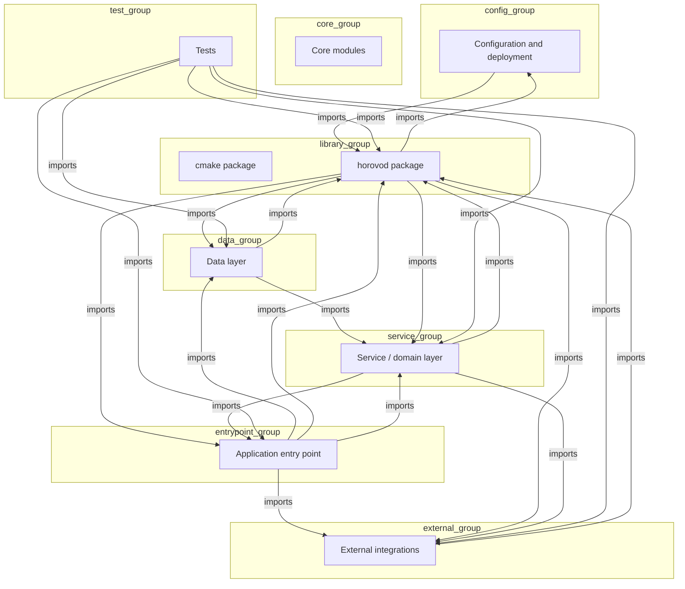

# Architecture report: horovod/horovod

> Automated static analysis. **Observed** = directly seen in files/imports/AST; **Inferred** = interpretation from that evidence. Repository code was not executed.

## 1. Repository at a glance

| Item | Value |
| --- | --- |
| Repository | horovod/horovod |
| Description | Distributed training framework for TensorFlow, Keras, PyTorch, and Apache MXNet. |
| Language | Python |
| Stars | 14674 |
| Licence | Other |
| Analysed commit / branch | 369fe98d228e40c374e21a65fb2028e2a78bd0dc / master |
| Framework(s) | None detected |
| Files analysed | 494 |
| Components | 9 |

## 2. Architecture in one minute

horovod/horovod - Distributed training framework for TensorFlow, Keras, PyTorch, and Apache MXNet.. This repository was analysed statically from 494 file(s) (257 Python). Detected technologies (observed from imports/manifests): GitHub Actions, NumPy, requests, setuptools, Docker, pytest. Files are grouped into 9 component(s): cmake package, Configuration and deployment, Core modules, Data layer, Application entry point, External integrations, horovod package, Service / domain layer. Observed entry point(s): .buildkite/get_changed_code_files.py, .github/gen-workflow-ci.py, .github/get-changed-code-files.py. Findings below distinguish observed facts from inferred interpretation.

## 3. High-level block diagram

## 4. Main components

### cmake package (`cmake`)

- **Kind:** library
- **Status:** Observed
- **Confidence:** 0.85
- **Responsibility:** Groups 1 file(s) under cmake package (observed from repository paths and static analysis). Observed top-level functions: get_nvcc_bin, get_nvcc_flags, is_mx_cuda, is_mx_dnn, is_mx_mkldnn, is_mx_onednn.
- **Paths:** `cmake/build_utils.py`
- **Evidence:** [cmake/build_utils.py:20](https://github.com/horovod/horovod/blob/369fe98d228e40c374e21a65fb2028e2a78bd0dc/cmake/build_utils.py#L20)

### Configuration and deployment (`config`)

- **Kind:** config
- **Status:** Observed
- **Confidence:** 0.85
- **Responsibility:** Groups 19 file(s) under configuration and deployment (observed from repository paths and static analysis). Observed top-level classes: BaseSettings, CMakeExtension, ElasticSettings, Settings, custom_build_ext. Observed top-level functions: get_cmake_bin, get_package_version, is_build_action.
- **Paths:** `Dockerfile.test.cpu`, `Dockerfile.test.gpu`, `MANIFEST.in`, `docker-compose.test.yml`, `docker/helm/Chart.yaml`, `docker/helm/templates/config.yaml`, `docker/helm/templates/job-service.yaml`, `docker/helm/templates/job.yaml`, `docker/helm/templates/statefulset-service.yaml`, `docker/helm/templates/statefulset.yaml`, `docker/helm/values.yaml`, `docker/horovod-cpu/Dockerfile`, `docker/horovod-nvtabular/Dockerfile`, `docker/horovod-ray/Dockerfile`, `docker/horovod/Dockerfile`, `horovod/runner/common/util/settings.py`, `horovod/runner/elastic/settings.py`, `setup.cfg`, `setup.py`
- **Evidence:** [Dockerfile.test.cpu](https://github.com/horovod/horovod/blob/369fe98d228e40c374e21a65fb2028e2a78bd0dc/Dockerfile.test.cpu); [Dockerfile.test.gpu](https://github.com/horovod/horovod/blob/369fe98d228e40c374e21a65fb2028e2a78bd0dc/Dockerfile.test.gpu); [MANIFEST.in](https://github.com/horovod/horovod/blob/369fe98d228e40c374e21a65fb2028e2a78bd0dc/MANIFEST.in); [docker-compose.test.yml](https://github.com/horovod/horovod/blob/369fe98d228e40c374e21a65fb2028e2a78bd0dc/docker-compose.test.yml); [docker/helm/Chart.yaml](https://github.com/horovod/horovod/blob/369fe98d228e40c374e21a65fb2028e2a78bd0dc/docker/helm/Chart.yaml); [docker/helm/templates/config.yaml](https://github.com/horovod/horovod/blob/369fe98d228e40c374e21a65fb2028e2a78bd0dc/docker/helm/templates/config.yaml); [docker/helm/templates/job-service.yaml](https://github.com/horovod/horovod/blob/369fe98d228e40c374e21a65fb2028e2a78bd0dc/docker/helm/templates/job-service.yaml); [docker/helm/templates/job.yaml](https://github.com/horovod/horovod/blob/369fe98d228e40c374e21a65fb2028e2a78bd0dc/docker/helm/templates/job.yaml)

### Core modules (`core`)

- **Kind:** core
- **Status:** Observed
- **Confidence:** 0.85
- **Responsibility:** Groups 1 file(s) under core modules (observed from repository paths and static analysis).
- **Paths:** `assert-package-versions.sh`
- **Evidence:** [assert-package-versions.sh](https://github.com/horovod/horovod/blob/369fe98d228e40c374e21a65fb2028e2a78bd0dc/assert-package-versions.sh)

### Data layer (`data_layer`)

- **Kind:** data
- **Status:** Observed
- **Confidence:** 0.85
- **Responsibility:** Groups 4 file(s) under data layer (observed from repository paths and static analysis). Observed top-level classes: AsyncDataLoaderMixin, BaseDataLoader, TfDataServiceConfig. Observed top-level functions: compute_worker_fn, send_to_data_service, tf_data_service.
- **Paths:** `horovod/data/__init__.py`, `horovod/data/data_loader_base.py`, `horovod/tensorflow/data/__init__.py`, `horovod/tensorflow/data/compute_service.py`
- **Evidence:** [horovod/data/__init__.py](https://github.com/horovod/horovod/blob/369fe98d228e40c374e21a65fb2028e2a78bd0dc/horovod/data/__init__.py); [horovod/data/data_loader_base.py:20](https://github.com/horovod/horovod/blob/369fe98d228e40c374e21a65fb2028e2a78bd0dc/horovod/data/data_loader_base.py#L20); [horovod/tensorflow/data/__init__.py](https://github.com/horovod/horovod/blob/369fe98d228e40c374e21a65fb2028e2a78bd0dc/horovod/tensorflow/data/__init__.py); [horovod/tensorflow/data/compute_service.py:34](https://github.com/horovod/horovod/blob/369fe98d228e40c374e21a65fb2028e2a78bd0dc/horovod/tensorflow/data/compute_service.py#L34)

### Application entry point (`entrypoint`)

- **Kind:** entrypoint
- **Status:** Observed
- **Confidence:** 0.85
- **Responsibility:** Groups 8 file(s) under application entry point (observed from repository paths and static analysis). Observed top-level functions: _check_all_hosts_ssh_successful, _is_elastic, _launch_job, _run, _run_elastic, _run_static.
- **Paths:** `horovod/runner/launch.py`, `horovod/runner/run_task.py`, `horovod/runner/task_fn.py`, `horovod/spark/driver/mpirun_rsh.py`, `horovod/spark/task/gloo_exec_fn.py`, `horovod/spark/task/mpirun_exec_fn.py`, `horovod/spark/tensorflow/compute_worker.py`, `horovod/tensorflow/data/compute_worker.py`
- **Evidence:** [horovod/runner/launch.py:58](https://github.com/horovod/horovod/blob/369fe98d228e40c374e21a65fb2028e2a78bd0dc/horovod/runner/launch.py#L58); [horovod/runner/run_task.py:22](https://github.com/horovod/horovod/blob/369fe98d228e40c374e21a65fb2028e2a78bd0dc/horovod/runner/run_task.py#L22); [horovod/runner/task_fn.py:23](https://github.com/horovod/horovod/blob/369fe98d228e40c374e21a65fb2028e2a78bd0dc/horovod/runner/task_fn.py#L23); [horovod/spark/driver/mpirun_rsh.py](https://github.com/horovod/horovod/blob/369fe98d228e40c374e21a65fb2028e2a78bd0dc/horovod/spark/driver/mpirun_rsh.py); [horovod/spark/task/gloo_exec_fn.py:22](https://github.com/horovod/horovod/blob/369fe98d228e40c374e21a65fb2028e2a78bd0dc/horovod/spark/task/gloo_exec_fn.py#L22); [horovod/spark/task/mpirun_exec_fn.py:23](https://github.com/horovod/horovod/blob/369fe98d228e40c374e21a65fb2028e2a78bd0dc/horovod/spark/task/mpirun_exec_fn.py#L23); [horovod/spark/tensorflow/compute_worker.py](https://github.com/horovod/horovod/blob/369fe98d228e40c374e21a65fb2028e2a78bd0dc/horovod/spark/tensorflow/compute_worker.py); [horovod/tensorflow/data/compute_worker.py:26](https://github.com/horovod/horovod/blob/369fe98d228e40c374e21a65fb2028e2a78bd0dc/horovod/tensorflow/data/compute_worker.py#L26)

### External integrations (`external_integrations`)

- **Kind:** external
- **Status:** Observed
- **Confidence:** 0.85
- **Responsibility:** Groups 1 file(s) under external integrations (observed from repository paths and static analysis). Observed top-level functions: put_data_into_kvstore, read_data_from_kvstore.
- **Paths:** `horovod/runner/http/http_client.py`
- **Evidence:** [horovod/runner/http/http_client.py:22](https://github.com/horovod/horovod/blob/369fe98d228e40c374e21a65fb2028e2a78bd0dc/horovod/runner/http/http_client.py#L22)

### horovod package (`horovod`)

- **Kind:** library
- **Status:** Observed
- **Confidence:** 0.85
- **Responsibility:** Groups 181 file(s) under horovod package (observed from repository paths and static analysis). Observed top-level classes: AbstractFilesystemStore, AckResponse, AckStreamResponse, Adapter, Backend, BaseHorovodWorker. Observed top-level functions: DistributedOptimizer, PartialDistributedOptimizer, RemoteTrainer, _add_arg_to_env, _allgather_async, _allgather_function_factory.
- **Paths:** `horovod/__init__.py`, `horovod/_keras/__init__.py`, `horovod/_keras/callbacks.py`, `horovod/_keras/elastic.py`, `horovod/common/__init__.py`, `horovod/common/basics.py`, `horovod/common/common.h`, `horovod/common/controller.h`, `horovod/common/elastic.py`, `horovod/common/exceptions.py`, `horovod/common/fusion_buffer_manager.h`, `horovod/common/global_state.h`, `horovod/common/gloo/gloo_context.h`, `horovod/common/gloo/gloo_controller.h`, `horovod/common/gloo/gloo_store.h`, `horovod/common/gloo/http_store.h`, `horovod/common/gloo/memory_store.h`, `horovod/common/group_table.h`, `horovod/common/half.h`, `horovod/common/hashes.h`, `horovod/common/logging.h`, `horovod/common/message.h`, `horovod/common/mpi/ddl_mpi_context_manager.h`, `horovod/common/mpi/mpi_context.h`, `horovod/common/mpi/mpi_controller.h`, `horovod/common/nvtx_op_range.h`, `horovod/common/operations.h`, `horovod/common/ops/adasum/adasum.h`, `horovod/common/ops/adasum/adasum_mpi.h`, `horovod/common/ops/adasum_gpu_operations.h`, `horovod/common/ops/adasum_mpi_operations.h`, `horovod/common/ops/ccl_operations.h`, `horovod/common/ops/collective_operations.h`, `horovod/common/ops/cuda/cuda_kernels.h`, `horovod/common/ops/ddl_operations.h`, `horovod/common/ops/gloo_operations.h`, `horovod/common/ops/gpu_operations.h`, `horovod/common/ops/mpi_gpu_operations.h`, `horovod/common/ops/mpi_operations.h`, `horovod/common/ops/nccl_operations.h`, `horovod/common/ops/operation_manager.h`, `horovod/common/ops/rocm/hip_kernels.h`, `horovod/common/optim/bayesian_optimization.h`, `horovod/common/optim/gaussian_process.h`, `horovod/common/parameter_manager.h`, `horovod/common/process_set.h`, `horovod/common/process_sets.py`, `horovod/common/response_cache.h`, `horovod/common/stall_inspector.h`, `horovod/common/tensor_queue.h`, `horovod/common/thread_pool.h`, `horovod/common/timeline.h`, `horovod/common/util.py`, `horovod/common/utils/env_parser.h`, `horovod/common/wire/message_generated.h`, `horovod/keras/__init__.py`, `horovod/keras/callbacks.py`, `horovod/keras/elastic.py`, `horovod/mxnet/__init__.py`, `horovod/mxnet/adapter.h`, `horovod/mxnet/compression.py`, `horovod/mxnet/cuda_util.h`, `horovod/mxnet/functions.py`, `horovod/mxnet/mpi_ops.h`, `horovod/mxnet/mpi_ops.py`, `horovod/mxnet/tensor_util.h`, `horovod/mxnet/util.h`, `horovod/ray/__init__.py`, `horovod/ray/adapter.py`, `horovod/ray/elastic.py`, `horovod/ray/elastic_v2.py`, `horovod/ray/ray_logger.py`, `horovod/ray/runner.py`, `horovod/ray/strategy.py`, `horovod/ray/utils.py`, `horovod/ray/worker.py`, `horovod/runner/__init__.py`, `horovod/runner/common/__init__.py`, `horovod/runner/common/util/__init__.py`, `horovod/runner/common/util/codec.py`, `horovod/runner/common/util/config_parser.py`, `horovod/runner/common/util/env.py`, `horovod/runner/common/util/host_hash.py`, `horovod/runner/common/util/hosts.py`, `horovod/runner/common/util/network.py`, `horovod/runner/common/util/safe_shell_exec.py`, `horovod/runner/common/util/secret.py`, `horovod/runner/common/util/timeout.py`, `horovod/runner/common/util/tiny_shell_exec.py`, `horovod/runner/driver/__init__.py`, `horovod/runner/elastic/__init__.py`, `horovod/runner/elastic/constants.py`, `horovod/runner/elastic/discovery.py`, `horovod/runner/elastic/driver.py`, `horovod/runner/elastic/registration.py`, `horovod/runner/elastic/rendezvous.py`, `horovod/runner/elastic/worker.py`, `horovod/runner/gloo_run.py`, `horovod/runner/http/__init__.py`, `horovod/runner/http/http_server.py`, `horovod/runner/js_run.py`, `horovod/runner/mpi_run.py`, `horovod/runner/task/__init__.py`, `horovod/runner/util/__init__.py`, `horovod/runner/util/cache.py`, `horovod/runner/util/lsf.py`, `horovod/runner/util/network.py`, `horovod/runner/util/remote.py`, `horovod/runner/util/streams.py`, `horovod/runner/util/threads.py`, `horovod/spark/__init__.py`, `horovod/spark/common/__init__.py`, `horovod/spark/common/_namedtuple_fix.py`, `horovod/spark/common/backend.py`, `horovod/spark/common/cache.py`, `horovod/spark/common/constants.py`, `horovod/spark/common/datamodule.py`, `horovod/spark/common/estimator.py`, `horovod/spark/common/params.py`, `horovod/spark/common/serialization.py`, `horovod/spark/common/store.py`, `horovod/spark/common/util.py`, `horovod/spark/conf.py`, `horovod/spark/data_loaders/__init__.py`, `horovod/spark/data_loaders/pytorch_data_loaders.py`, `horovod/spark/driver/__init__.py`, `horovod/spark/driver/host_discovery.py`, `horovod/spark/driver/job_id.py`, `horovod/spark/driver/rendezvous.py`, `horovod/spark/driver/rsh.py`, `horovod/spark/gloo_run.py`, `horovod/spark/keras/__init__.py`, `horovod/spark/keras/bare.py`, `horovod/spark/keras/datamodule.py`, `horovod/spark/keras/estimator.py`, `horovod/spark/keras/optimizer.py`, `horovod/spark/keras/remote.py`, `horovod/spark/keras/tensorflow.py`, `horovod/spark/keras/util.py`, `horovod/spark/lightning/__init__.py`, `horovod/spark/lightning/datamodule.py`, `horovod/spark/lightning/estimator.py`, `horovod/spark/lightning/legacy.py`, `horovod/spark/lightning/remote.py`, `horovod/spark/lightning/util.py`, `horovod/spark/mpi_run.py`, `horovod/spark/runner.py`, `horovod/spark/task/__init__.py`, `horovod/spark/task/task_info.py`, `horovod/spark/tensorflow/__init__.py`, `horovod/spark/torch/__init__.py`, `horovod/spark/torch/datamodule.py`, `horovod/spark/torch/estimator.py`, `horovod/spark/torch/remote.py`, `horovod/spark/torch/util.py`, `horovod/tensorflow/__init__.py`, `horovod/tensorflow/compression.py`, `horovod/tensorflow/custom_call_config_generated.h`, `horovod/tensorflow/elastic.py`, `horovod/tensorflow/functions.py`, `horovod/tensorflow/gradient_aggregation.py`, `horovod/tensorflow/gradient_aggregation_eager.py`, `horovod/tensorflow/keras/__init__.py`, `horovod/tensorflow/keras/callbacks.py`, `horovod/tensorflow/keras/elastic.py`, `horovod/tensorflow/mpi_ops.py`, `horovod/tensorflow/sync_batch_norm.py`, `horovod/tensorflow/util.py`, `horovod/torch/__init__.py`, `horovod/torch/adapter_v2.h`, `horovod/torch/compression.py`, `horovod/torch/cuda_util.h`, `horovod/torch/elastic/__init__.py`, `horovod/torch/elastic/sampler.py`, `horovod/torch/elastic/state.py`, `horovod/torch/functions.py`, `horovod/torch/handle_manager.h`, `horovod/torch/mpi_ops.py`, `horovod/torch/optimizer.py`, `horovod/torch/ready_event.h`, `horovod/torch/sync_batch_norm.py`
- **Evidence:** [horovod/__init__.py](https://github.com/horovod/horovod/blob/369fe98d228e40c374e21a65fb2028e2a78bd0dc/horovod/__init__.py); [horovod/_keras/__init__.py:30](https://github.com/horovod/horovod/blob/369fe98d228e40c374e21a65fb2028e2a78bd0dc/horovod/_keras/__init__.py#L30); [horovod/_keras/callbacks.py:23](https://github.com/horovod/horovod/blob/369fe98d228e40c374e21a65fb2028e2a78bd0dc/horovod/_keras/callbacks.py#L23); [horovod/_keras/elastic.py:17](https://github.com/horovod/horovod/blob/369fe98d228e40c374e21a65fb2028e2a78bd0dc/horovod/_keras/elastic.py#L17); [horovod/common/__init__.py](https://github.com/horovod/horovod/blob/369fe98d228e40c374e21a65fb2028e2a78bd0dc/horovod/common/__init__.py); [horovod/common/basics.py:21](https://github.com/horovod/horovod/blob/369fe98d228e40c374e21a65fb2028e2a78bd0dc/horovod/common/basics.py#L21); [horovod/common/common.h](https://github.com/horovod/horovod/blob/369fe98d228e40c374e21a65fb2028e2a78bd0dc/horovod/common/common.h); [horovod/common/controller.h](https://github.com/horovod/horovod/blob/369fe98d228e40c374e21a65fb2028e2a78bd0dc/horovod/common/controller.h)

### Service / domain layer (`service_layer`)

- **Kind:** service
- **Status:** Observed
- **Confidence:** 0.85
- **Responsibility:** Groups 9 file(s) under service / domain layer (observed from repository paths and static analysis). Observed top-level classes: AbortCommandRequest, AllTaskAddressesRequest, AllTaskAddressesResponse, BasicDriverClient, BasicDriverService, BasicTaskClient. Observed top-level functions: _actor_launch_task_servers, _driver_fn, _launch_task_servers, _run_probe, get_common_interfaces, get_local_interfaces.
- **Paths:** `horovod/ray/driver_service.py`, `horovod/runner/common/service/__init__.py`, `horovod/runner/common/service/compute_service.py`, `horovod/runner/common/service/driver_service.py`, `horovod/runner/common/service/task_service.py`, `horovod/runner/driver/driver_service.py`, `horovod/runner/task/task_service.py`, `horovod/spark/driver/driver_service.py`, `horovod/spark/task/task_service.py`
- **Evidence:** [horovod/ray/driver_service.py:5](https://github.com/horovod/horovod/blob/369fe98d228e40c374e21a65fb2028e2a78bd0dc/horovod/ray/driver_service.py#L5); [horovod/runner/common/service/__init__.py](https://github.com/horovod/horovod/blob/369fe98d228e40c374e21a65fb2028e2a78bd0dc/horovod/runner/common/service/__init__.py); [horovod/runner/common/service/compute_service.py:28](https://github.com/horovod/horovod/blob/369fe98d228e40c374e21a65fb2028e2a78bd0dc/horovod/runner/common/service/compute_service.py#L28); [horovod/runner/common/service/driver_service.py:21](https://github.com/horovod/horovod/blob/369fe98d228e40c374e21a65fb2028e2a78bd0dc/horovod/runner/common/service/driver_service.py#L21); [horovod/runner/common/service/task_service.py:27](https://github.com/horovod/horovod/blob/369fe98d228e40c374e21a65fb2028e2a78bd0dc/horovod/runner/common/service/task_service.py#L27); [horovod/runner/driver/driver_service.py:30](https://github.com/horovod/horovod/blob/369fe98d228e40c374e21a65fb2028e2a78bd0dc/horovod/runner/driver/driver_service.py#L30); [horovod/runner/task/task_service.py:19](https://github.com/horovod/horovod/blob/369fe98d228e40c374e21a65fb2028e2a78bd0dc/horovod/runner/task/task_service.py#L19); [horovod/spark/driver/driver_service.py:22](https://github.com/horovod/horovod/blob/369fe98d228e40c374e21a65fb2028e2a78bd0dc/horovod/spark/driver/driver_service.py#L22)

### Tests (`tests`)

- **Kind:** test
- **Status:** Observed
- **Confidence:** 0.85
- **Responsibility:** Groups 61 file(s) under tests (observed from repository paths and static analysis). Observed routes: PATCH horovod.runner.elastic.driver.DISCOVER_HOSTS_FREQUENCY_SECS, PATCH horovod.runner.gloo_run._get_min_start_hosts, PATCH horovod.runner.elastic.driver.DISCOVER_HOSTS_FREQUENCY_SECS, PATCH horovod.runner.gloo_run._get_min_start_hosts, PATCH horovod.runner.elastic.driver.DISCOVER_HOSTS_FREQUENCY_SECS. Observed top-level classes: BaseElasticSparkTests, BaseElasticTests, BaseTensorFlowTests, BuildKiteTests, CallbackBackend, CommonTests. Observed top-level functions: _create_training_function,…
- **Paths:** `test/conftest.py`, `test/integration/data/elastic_tensorflow2_main.py`, `test/integration/data/elastic_tensorflow_keras_main.py`, `test/integration/data/elastic_tensorflow_main.py`, `test/integration/data/elastic_torch_main.py`, `test/integration/elastic_common.py`, `test/integration/elastic_spark_common.py`, `test/integration/test_elastic_spark_tensorflow.py`, `test/integration/test_elastic_spark_tensorflow2.py`, `test/integration/test_elastic_spark_torch.py`, `test/integration/test_elastic_tensorflow.py`, `test/integration/test_elastic_tensorflow2.py`, `test/integration/test_elastic_tensorflow_keras.py`, `test/integration/test_elastic_torch.py`, `test/integration/test_interactiverun.py`, `test/integration/test_spark.py`, `test/integration/test_spark_keras.py`, `test/integration/test_spark_lightning.py`, `test/integration/test_spark_torch.py`, `test/integration/test_stall.py`, `test/integration/test_static_run.py`, `test/parallel/base_test_mxnet.py`, `test/parallel/base_test_tensorflow.py`, `test/parallel/test_adasum_pytorch.py`, `test/parallel/test_adasum_tensorflow.py`, `test/parallel/test_common.py`, `test/parallel/test_compute_worker.py`, `test/parallel/test_keras.py`, `test/parallel/test_mxnet1.py`, `test/parallel/test_mxnet2.py`, `test/parallel/test_process_sets_multi_comm.py`, `test/parallel/test_process_sets_static.py`, `test/parallel/test_tensorflow2_keras.py`, `test/parallel/test_tensorflow2_keras_process_sets.py`, `test/parallel/test_tensorflow_keras.py`, `test/parallel/test_tensorflow_process_sets.py`, `test/parallel/test_tensorflow_process_sets_dynamic.py`, `test/parallel/test_timeline.py`, `test/parallel/test_torch.py`, `test/parallel/test_xla.py`, `test/parallel/test_xla_process_sets.py`, `test/single/data/config.test.yaml`, `test/single/data/expected_buildkite_gpu_heads_pipeline.yaml`, `test/single/data/expected_buildkite_gpu_non_heads_pipeline.yaml`, `test/single/data/run_safe_shell_exec.py`, `test/single/data/sleep.py`, `test/single/test_buildkite.py`, `test/single/test_compute_service.py`, `test/single/test_elastic_discovery.py`, `test/single/test_elastic_driver.py`, `test/single/test_elastic_run.py`, `test/single/test_ray.py`, `test/single/test_ray_elastic.py`, `test/single/test_ray_elastic_v2.py`, `test/single/test_run.py`, `test/single/test_service.py`, `test/single/test_task_service.py`, `test/single/test_torch_elastic.py`, `test/single/test_util.py`, `test/utils/common.py`, `test/utils/spark_common.py`
- **Evidence:** [test/conftest.py](https://github.com/horovod/horovod/blob/369fe98d228e40c374e21a65fb2028e2a78bd0dc/test/conftest.py); [test/integration/data/elastic_tensorflow2_main.py:73](https://github.com/horovod/horovod/blob/369fe98d228e40c374e21a65fb2028e2a78bd0dc/test/integration/data/elastic_tensorflow2_main.py#L73); [test/integration/data/elastic_tensorflow_keras_main.py:82](https://github.com/horovod/horovod/blob/369fe98d228e40c374e21a65fb2028e2a78bd0dc/test/integration/data/elastic_tensorflow_keras_main.py#L82); [test/integration/data/elastic_tensorflow_main.py:80](https://github.com/horovod/horovod/blob/369fe98d228e40c374e21a65fb2028e2a78bd0dc/test/integration/data/elastic_tensorflow_main.py#L80); [test/integration/data/elastic_torch_main.py:73](https://github.com/horovod/horovod/blob/369fe98d228e40c374e21a65fb2028e2a78bd0dc/test/integration/data/elastic_torch_main.py#L73); [test/integration/elastic_common.py:42](https://github.com/horovod/horovod/blob/369fe98d228e40c374e21a65fb2028e2a78bd0dc/test/integration/elastic_common.py#L42); [test/integration/elastic_spark_common.py:42](https://github.com/horovod/horovod/blob/369fe98d228e40c374e21a65fb2028e2a78bd0dc/test/integration/elastic_spark_common.py#L42); [test/integration/test_elastic_spark_tensorflow.py:25](https://github.com/horovod/horovod/blob/369fe98d228e40c374e21a65fb2028e2a78bd0dc/test/integration/test_elastic_spark_tensorflow.py#L25)

## 5. Execution flow

**Observed** entry point(s):

- [.buildkite/get_changed_code_files.py:50](https://github.com/horovod/horovod/blob/369fe98d228e40c374e21a65fb2028e2a78bd0dc/.buildkite/get_changed_code_files.py#L50)
- [.github/gen-workflow-ci.py:835](https://github.com/horovod/horovod/blob/369fe98d228e40c374e21a65fb2028e2a78bd0dc/.github/gen-workflow-ci.py#L835)
- [.github/get-changed-code-files.py:50](https://github.com/horovod/horovod/blob/369fe98d228e40c374e21a65fb2028e2a78bd0dc/.github/get-changed-code-files.py#L50)
- [horovod/runner/launch.py](https://github.com/horovod/horovod/blob/369fe98d228e40c374e21a65fb2028e2a78bd0dc/horovod/runner/launch.py)
- [horovod/runner/run_task.py:34](https://github.com/horovod/horovod/blob/369fe98d228e40c374e21a65fb2028e2a78bd0dc/horovod/runner/run_task.py#L34)
- [horovod/runner/task_fn.py:56](https://github.com/horovod/horovod/blob/369fe98d228e40c374e21a65fb2028e2a78bd0dc/horovod/runner/task_fn.py#L56)
- [horovod/spark/driver/mpirun_rsh.py:23](https://github.com/horovod/horovod/blob/369fe98d228e40c374e21a65fb2028e2a78bd0dc/horovod/spark/driver/mpirun_rsh.py#L23)
- [horovod/spark/task/gloo_exec_fn.py:26](https://github.com/horovod/horovod/blob/369fe98d228e40c374e21a65fb2028e2a78bd0dc/horovod/spark/task/gloo_exec_fn.py#L26)
- [horovod/spark/task/mpirun_exec_fn.py:48](https://github.com/horovod/horovod/blob/369fe98d228e40c374e21a65fb2028e2a78bd0dc/horovod/spark/task/mpirun_exec_fn.py#L48)
- [horovod/spark/tensorflow/compute_worker.py:28](https://github.com/horovod/horovod/blob/369fe98d228e40c374e21a65fb2028e2a78bd0dc/horovod/spark/tensorflow/compute_worker.py#L28)
- [horovod/tensorflow/data/compute_worker.py:64](https://github.com/horovod/horovod/blob/369fe98d228e40c374e21a65fb2028e2a78bd0dc/horovod/tensorflow/data/compute_worker.py#L64)

**Observed** routes (from decorators):

- `PATCH horovod.runner.elastic.driver.DISCOVER_HOSTS_FREQUENCY_SECS` -> `test_hosts_added_and_removed` in `test/integration/elastic_common.py:128`
- `PATCH horovod.runner.gloo_run._get_min_start_hosts` -> `test_hosts_added_and_removed` in `test/integration/elastic_common.py:128`
- `PATCH horovod.runner.elastic.driver.DISCOVER_HOSTS_FREQUENCY_SECS` -> `test_single_rank_failure` in `test/integration/elastic_common.py:155`
- `PATCH horovod.runner.gloo_run._get_min_start_hosts` -> `test_single_rank_failure` in `test/integration/elastic_common.py:155`
- `PATCH horovod.runner.elastic.driver.DISCOVER_HOSTS_FREQUENCY_SECS` -> `test_fault_tolerance_without_scaling` in `test/integration/elastic_common.py:183`
- `PATCH horovod.runner.gloo_run._get_min_start_hosts` -> `test_fault_tolerance_without_scaling` in `test/integration/elastic_common.py:183`
- `PATCH horovod.runner.elastic.driver.DISCOVER_HOSTS_FREQUENCY_SECS` -> `test_all_ranks_failure` in `test/integration/elastic_common.py:209`
- `PATCH horovod.runner.gloo_run._get_min_start_hosts` -> `test_all_ranks_failure` in `test/integration/elastic_common.py:209`
- `PATCH horovod.runner.elastic.driver.DISCOVER_HOSTS_FREQUENCY_SECS` -> `test_all_hosts_blacklisted` in `test/integration/elastic_common.py:224`
- `PATCH horovod.runner.gloo_run._get_min_start_hosts` -> `test_all_hosts_blacklisted` in `test/integration/elastic_common.py:224`
- `PATCH horovod.runner.elastic.driver.ELASTIC_TIMEOUT_SECS` -> `test_min_hosts_timeout` in `test/integration/elastic_common.py:240`
- `PATCH horovod.runner.elastic.driver.DISCOVER_HOSTS_FREQUENCY_SECS` -> `test_min_hosts_timeout` in `test/integration/elastic_common.py:240`
- `PATCH horovod.runner.gloo_run._get_min_start_hosts` -> `test_min_hosts_timeout` in `test/integration/elastic_common.py:240`
- `PATCH horovod.runner.elastic.driver.ELASTIC_TIMEOUT_SECS` -> `test_reset_limit` in `test/integration/elastic_common.py:256`
- `PATCH horovod.runner.elastic.driver.DISCOVER_HOSTS_FREQUENCY_SECS` -> `test_reset_limit` in `test/integration/elastic_common.py:256`
- `PATCH horovod.runner.gloo_run._get_min_start_hosts` -> `test_reset_limit` in `test/integration/elastic_common.py:256`
- `PATCH horovod.runner.elastic.driver.DISCOVER_HOSTS_FREQUENCY_SECS` -> `test_resurrecting_blacklisted_hosts_exponential_backoff` in `test/integration/elastic_common.py:274`
- `PATCH horovod.runner.gloo_run._get_min_start_hosts` -> `test_resurrecting_blacklisted_hosts_exponential_backoff` in `test/integration/elastic_common.py:274`
- `PATCH horovod.runner.elastic.driver.DISCOVER_HOSTS_FREQUENCY_SECS` -> `test_happy_run` in `test/integration/elastic_spark_common.py:399`
- `PATCH horovod.runner.elastic.driver.DISCOVER_HOSTS_FREQUENCY_SECS` -> `test_fault_tolerance_hosts_added_and_removed` in `test/integration/elastic_spark_common.py:419`
- `PATCH horovod.runner.elastic.driver.DISCOVER_HOSTS_FREQUENCY_SECS` -> `test_fault_tolerance_unused_hosts_added_and_removed` in `test/integration/elastic_spark_common.py:477`
- `PATCH horovod.runner.elastic.driver.DISCOVER_HOSTS_FREQUENCY_SECS` -> `test_fault_tolerance_no_spark_blacklist` in `test/integration/elastic_spark_common.py:508`
- `PATCH horovod.runner.elastic.driver.DISCOVER_HOSTS_FREQUENCY_SECS` -> `test_fault_tolerance_spark_blacklist` in `test/integration/elastic_spark_common.py:544`
- `PATCH horovod.runner.elastic.driver.DISCOVER_HOSTS_FREQUENCY_SECS` -> `test_fault_tolerance_exception_single_rank` in `test/integration/elastic_spark_common.py:563`
- `PATCH horovod.runner.elastic.driver.DISCOVER_HOSTS_FREQUENCY_SECS` -> `test_fault_tolerance_exception_all_ranks` in `test/integration/elastic_spark_common.py:589`
- `PATCH horovod.runner.elastic.driver.DISCOVER_HOSTS_FREQUENCY_SECS` -> `test_fault_tolerance_exception_with_min_hosts_timeout` in `test/integration/elastic_spark_common.py:603`
- `PATCH horovod.runner.elastic.driver.DISCOVER_HOSTS_FREQUENCY_SECS` -> `test_fault_tolerance_all_hosts_lost` in `test/integration/elastic_spark_common.py:621`
- `PATCH horovod.runner.elastic.driver.DISCOVER_HOSTS_FREQUENCY_SECS` -> `test_auto_scale_up` in `test/integration/elastic_spark_common.py:638`
- `PATCH horovod.runner.gloo_run._get_min_start_hosts` -> `test_auto_scale_up` in `test/integration/elastic_spark_common.py:638`
- `PATCH horovod.runner.elastic.driver.DISCOVER_HOSTS_FREQUENCY_SECS` -> `test_auto_scale_down_by_discovery` in `test/integration/elastic_spark_common.py:664`
- `PATCH horovod.runner.elastic.driver.DISCOVER_HOSTS_FREQUENCY_SECS` -> `test_auto_scale_down_by_exception` in `test/integration/elastic_spark_common.py:692`
- `PATCH horovod.runner.elastic.driver.DISCOVER_HOSTS_FREQUENCY_SECS` -> `test_auto_scale_no_spark_black_list` in `test/integration/elastic_spark_common.py:721`
- `PATCH horovod.runner.elastic.driver.DISCOVER_HOSTS_FREQUENCY_SECS` -> `test_auto_scale_spark_blacklist` in `test/integration/elastic_spark_common.py:758`
- `PATCH horovod.runner.elastic.driver.DISCOVER_HOSTS_FREQUENCY_SECS` -> `test_all_hosts_blacklisted` in `test/integration/test_elastic_tensorflow.py:32`
- `PATCH horovod.runner.gloo_run._get_min_start_hosts` -> `test_all_hosts_blacklisted` in `test/integration/test_elastic_tensorflow.py:32`
- `PATCH horovod.runner.elastic.driver.ELASTIC_TIMEOUT_SECS` -> `test_min_hosts_timeout` in `test/integration/test_elastic_tensorflow.py:38`
- `PATCH horovod.runner.elastic.driver.DISCOVER_HOSTS_FREQUENCY_SECS` -> `test_min_hosts_timeout` in `test/integration/test_elastic_tensorflow.py:38`
- `PATCH horovod.runner.gloo_run._get_min_start_hosts` -> `test_min_hosts_timeout` in `test/integration/test_elastic_tensorflow.py:38`
- `PATCH horovod.runner.elastic.driver.DISCOVER_HOSTS_FREQUENCY_SECS` -> `test_all_hosts_blacklisted` in `test/integration/test_elastic_tensorflow2.py:33`
- `PATCH horovod.runner.gloo_run._get_min_start_hosts` -> `test_all_hosts_blacklisted` in `test/integration/test_elastic_tensorflow2.py:33`
- `PATCH horovod.runner.elastic.driver.ELASTIC_TIMEOUT_SECS` -> `test_min_hosts_timeout` in `test/integration/test_elastic_tensorflow2.py:39`
- `PATCH horovod.runner.elastic.driver.DISCOVER_HOSTS_FREQUENCY_SECS` -> `test_min_hosts_timeout` in `test/integration/test_elastic_tensorflow2.py:39`
- `PATCH horovod.runner.gloo_run._get_min_start_hosts` -> `test_min_hosts_timeout` in `test/integration/test_elastic_tensorflow2.py:39`
- `PATCH horovod.runner.elastic.driver.DISCOVER_HOSTS_FREQUENCY_SECS` -> `test_all_hosts_blacklisted` in `test/integration/test_elastic_tensorflow_keras.py:32`
- `PATCH horovod.runner.gloo_run._get_min_start_hosts` -> `test_all_hosts_blacklisted` in `test/integration/test_elastic_tensorflow_keras.py:32`
- `PATCH horovod.runner.elastic.driver.ELASTIC_TIMEOUT_SECS` -> `test_min_hosts_timeout` in `test/integration/test_elastic_tensorflow_keras.py:38`
- `PATCH horovod.runner.elastic.driver.DISCOVER_HOSTS_FREQUENCY_SECS` -> `test_min_hosts_timeout` in `test/integration/test_elastic_tensorflow_keras.py:38`
- `PATCH horovod.runner.gloo_run._get_min_start_hosts` -> `test_min_hosts_timeout` in `test/integration/test_elastic_tensorflow_keras.py:38`
- `PATCH horovod.runner.elastic.driver.DISCOVER_HOSTS_FREQUENCY_SECS` -> `test_all_hosts_blacklisted` in `test/integration/test_elastic_torch.py:33`
- `PATCH horovod.runner.gloo_run._get_min_start_hosts` -> `test_all_hosts_blacklisted` in `test/integration/test_elastic_torch.py:33`
- `PATCH horovod.runner.elastic.driver.ELASTIC_TIMEOUT_SECS` -> `test_min_hosts_timeout` in `test/integration/test_elastic_torch.py:39`
- `PATCH horovod.runner.elastic.driver.DISCOVER_HOSTS_FREQUENCY_SECS` -> `test_min_hosts_timeout` in `test/integration/test_elastic_torch.py:39`
- `PATCH horovod.runner.gloo_run._get_min_start_hosts` -> `test_min_hosts_timeout` in `test/integration/test_elastic_torch.py:39`
- `PATCH horovod.runner.elastic.driver.DISCOVER_HOSTS_FREQUENCY_SECS` -> `test_fault_tolerance_without_scaling` in `test/integration/test_elastic_torch.py:44`
- `PATCH horovod.runner.gloo_run._get_min_start_hosts` -> `test_fault_tolerance_without_scaling` in `test/integration/test_elastic_torch.py:44`
- `PATCH horovod.runner.elastic.driver.DISCOVER_HOSTS_FREQUENCY_SECS` -> `test_single_rank_failure` in `test/integration/test_elastic_torch.py:49`
- `PATCH horovod.runner.gloo_run._get_min_start_hosts` -> `test_single_rank_failure` in `test/integration/test_elastic_torch.py:49`
- `PATCH horovod.spark.common.store.HDFSStore._get_filesystem_fn` -> `test_sync_hdfs_store` in `test/integration/test_spark.py:1530`
- `PATCH horovod.spark.common.store.HDFSStore._get_filesystem_fn` -> `test_hdfs_store_parse_url` in `test/integration/test_spark.py:1569`
- `PATCH horovod.runner.common.util.safe_shell_exec.GRACEFUL_TERMINATION_TIME_S` -> `test_spark_task_service_abort_command` in `test/integration/test_spark.py:1675`
- `PATCH horovod.spark.common.store._DBFS_PREFIX_MAPPING` -> `test_dbfs_local_store` in `test/integration/test_spark.py:1726`
- `PATCH horovod.spark.keras.remote._pin_gpu_fn` -> `test_restore_from_checkpoint` in `test/integration/test_spark_keras.py:287`
- `PATCH horovod.spark.keras.util.TFKerasUtil.fit_fn` -> `test_restore_from_checkpoint` in `test/integration/test_spark_keras.py:287`
- `PATCH horovod.spark.keras.remote._pin_gpu_fn` -> `test_keras_direct_parquet_train` in `test/integration/test_spark_keras.py:334`
- `PATCH horovod.spark.keras.util.TFKerasUtil.fit_fn` -> `test_keras_direct_parquet_train` in `test/integration/test_spark_keras.py:334`
- `PATCH horovod.spark.keras.remote._pin_gpu_fn` -> `test_keras_model_checkpoint_callback` in `test/integration/test_spark_keras.py:381`
- `PATCH horovod.spark.keras.util.TFKerasUtil.fit_fn` -> `test_keras_model_checkpoint_callback` in `test/integration/test_spark_keras.py:381`
- `PATCH horovod.spark.keras.estimator.remote.RemoteTrainer` -> `test_model_serialization` in `test/integration/test_spark_keras.py:477`
- `PATCH horovod.runner.elastic.driver.DISCOVER_HOSTS_FREQUENCY_SECS` -> `test_rank_and_size_with_host_added` in `test/single/test_elastic_driver.py:120`
- `PATCH horovod.runner.elastic.driver.DISCOVER_HOSTS_FREQUENCY_SECS` -> `test_wait_for_available_slots` in `test/single/test_elastic_driver.py:168`
- `PATCH horovod.runner.elastic.driver.ElasticDriver.get_coordinator_info` -> `test_wait_for_available_slots` in `test/single/test_elastic_driver.py:168`
- `PATCH horovod.runner.elastic.driver.ElasticDriver.get_worker_client` -> `test_wait_for_available_slots` in `test/single/test_elastic_driver.py:168`
- `PATCH horovod.runner.elastic.driver.DISCOVER_HOSTS_FREQUENCY_SECS` -> `test_wait_for_min_hosts` in `test/single/test_elastic_driver.py:188`
- `PATCH horovod.runner.elastic.driver.DISCOVER_HOSTS_FREQUENCY_SECS` -> `test_worker_notification_manager` in `test/single/test_elastic_driver.py:292`
- `PATCH horovod.runner.elastic.driver.DISCOVER_HOSTS_FREQUENCY_SECS` -> `test_send_notifications_without_assignments` in `test/single/test_elastic_driver.py:375`
- `PATCH horovod.runner.elastic.driver.ElasticDriver.host_assignments` -> `test_send_notifications_without_assignments` in `test/single/test_elastic_driver.py:375`
- `PATCH horovod.runner.elastic.driver.ElasticDriver.get_coordinator_info` -> `test_send_notifications_without_assignments` in `test/single/test_elastic_driver.py:375`
- `PATCH horovod.runner.elastic.driver.ElasticDriver.get_worker_client` -> `test_send_notifications_without_assignments` in `test/single/test_elastic_driver.py:375`
- `PATCH horovod.runner.js_run.is_jsrun_installed` -> `test_js_run` in `test/single/test_run.py:1081`
- `PATCH horovod.runner.js_run.generate_jsrun_rankfile` -> `test_js_run` in `test/single/test_run.py:1081`
- `PATCH horovod.runner.util.lsf.LSFUtils.get_num_gpus` -> `test_js_run` in `test/single/test_run.py:1081`
- `PATCH horovod.runner.util.lsf.LSFUtils.get_num_cores` -> `test_js_run` in `test/single/test_run.py:1081`
- `PATCH horovod.runner.util.lsf.LSFUtils.get_num_gpus` -> `test_generate_jsrun_rankfile` in `test/single/test_run.py:1123`
- `PATCH horovod.runner.util.lsf.LSFUtils.get_num_cores` -> `test_generate_jsrun_rankfile` in `test/single/test_run.py:1123`
- `PATCH horovod.runner.util.lsf.LSFUtils.get_num_threads` -> `test_generate_jsrun_rankfile` in `test/single/test_run.py:1123`
- `PATCH horovod.runner.util.lsf.LSFUtils.using_lsf` -> `test_run_with_jsrun` in `test/single/test_run.py:1158`
- `PATCH horovod.runner.util.lsf.LSFUtils.get_compute_hosts` -> `test_run_with_jsrun` in `test/single/test_run.py:1158`
- `PATCH horovod.runner.util.lsf.LSFUtils.get_num_gpus` -> `test_run_with_jsrun` in `test/single/test_run.py:1158`
- `PATCH horovod.runner.util.network.filter_local_addresses` -> `test_run_with_jsrun` in `test/single/test_run.py:1158`
- `PATCH horovod.runner.launch._check_all_hosts_ssh_successful` -> `test_run_with_jsrun` in `test/single/test_run.py:1158`
- `PATCH horovod.runner.launch.run_controller` -> `test_run_with_jsrun` in `test/single/test_run.py:1158`

Representative flow (derived from observed entry points and the import graph; steps beyond the entry point are **Inferred**):

1. Execution starts at an observed entry point listed above, if present.
2. `config` imports `horovod` (Configuration and deployment -> horovod package).
3. `data_layer` imports `horovod` (Data layer -> horovod package).
4. `data_layer` imports `service_layer` (Data layer -> Service / domain layer).
5. `entrypoint` imports `data_layer` (Application entry point -> Data layer).
6. `entrypoint` imports `external_integrations` (Application entry point -> External integrations).
7. `entrypoint` imports `horovod` (Application entry point -> horovod package).
8. `entrypoint` imports `service_layer` (Application entry point -> Service / domain layer).
9. `external_integrations` imports `horovod` (External integrations -> horovod package).

## 6. Project structure

### `(root)`

- `.clang-format` - other (132 bytes)
- `.gitignore` - other (190 bytes)
- `.gitmodules` - other (2150 bytes)
- `.readthedocs.yaml` - config (1151 bytes)
- `CHANGELOG.md` - docs (38919 bytes)
- `CMakeLists.txt` - docs (17907 bytes)
- `CODE_OF_CONDUCT.md` - docs (363 bytes)
- `CONTRIBUTING.md` - docs (610 bytes)
- `Dockerfile.test.cpu` - container (16287 bytes)
- `Dockerfile.test.gpu` - container (14449 bytes)
- `GOVERNANCE.md` - docs (3729 bytes)
- `Jenkinsfile.ppc64le` - other (2833 bytes)
- `LICENSE` - docs (11964 bytes)
- `MANIFEST.in` - manifest (1258 bytes)
- `NOTICE` - docs (12890 bytes)
- `README.rst` - docs (16599 bytes)
- `SECURITY.md` - docs (267 bytes)
- `assert-package-versions.sh` - source, Shell (1377 bytes)
- `docker-compose.test.yml` - config (11850 bytes)
- `horovod.exp` - other (114 bytes)
- `horovod.lds` - other (174 bytes)
- `setup.cfg` - manifest (39 bytes)
- `setup.py` - manifest, Python (10951 bytes)

### `.buildkite`

- `.buildkite/gen-pipeline.sh` - source, Shell (26406 bytes)
- `.buildkite/get_changed_code_files.py` - source, Python (2140 bytes)

### `.github`

- `.github/ISSUE_TEMPLATE/bug_report.md` - docs (1062 bytes)
- `.github/ISSUE_TEMPLATE/feature_request.md` - docs (604 bytes)
- `.github/dependabot.yml` - config (206 bytes)
- `.github/gen-workflow-ci.py` - source, Python (48470 bytes)
- `.github/get-changed-code-files.py` - source, Python (2061 bytes)
- `.github/pull_request_template.md` - docs (707 bytes)
- `.github/requirements.txt` - manifest (21 bytes)
- `.github/timeout-and-retry.sh` - source, Shell (575 bytes)
- `.github/workflows/ci-results.yaml` - ci, YAML (13067 bytes)
- `.github/workflows/codeql-analysis.yml` - ci, YAML (6541 bytes)
- `.github/workflows/upload-pypi.yml` - ci, YAML (854 bytes)

### `cmake`

- `cmake/Modules/FindMxnet.cmake` - other (3859 bytes)
- `cmake/Modules/FindNCCL.cmake` - other (3433 bytes)
- `cmake/Modules/FindNVTX.cmake` - other (966 bytes)
- `cmake/Modules/FindPytorch.cmake` - other (3872 bytes)
- `cmake/Modules/FindROCM.cmake` - other (1177 bytes)
- `cmake/Modules/FindTensorflow.cmake` - other (2469 bytes)
- `cmake/Utilities.cmake` - other (4771 bytes)
- `cmake/build_utils.py` - source, Python (4991 bytes)
- `cmake/upstream/FindCUDAToolkit.cmake` - other (30149 bytes)

### `docker`

- `docker/README.md` - docs (2823 bytes)
- `docker/helm/Chart.yaml` - config (251 bytes)
- `docker/helm/README.md` - docs (4662 bytes)
- `docker/helm/templates/NOTES.txt` - docs (280 bytes)
- `docker/helm/templates/_helpers.tpl` - other (1045 bytes)
- `docker/helm/templates/config.yaml` - config (3361 bytes)
- `docker/helm/templates/job-service.yaml` - config (477 bytes)
- `docker/helm/templates/job.yaml` - config (3931 bytes)
- `docker/helm/templates/statefulset-service.yaml` - config (470 bytes)
- `docker/helm/templates/statefulset.yaml` - config (3356 bytes)
- `docker/helm/values.yaml` - config (969 bytes)
- `docker/horovod-cpu/Dockerfile` - container (3314 bytes)
- `docker/horovod-nvtabular/Dockerfile` - container (10036 bytes)
- `docker/horovod-ray/Dockerfile` - container (2789 bytes)
- `docker/horovod/Dockerfile` - container (4768 bytes)

### `docs`

- `docs/Makefile` - docs (583 bytes)
- `docs/_static/.empty` - docs (0 bytes)
- `docs/_static/custom.css` - docs (798 bytes)
- `docs/_templates/.empty` - docs (0 bytes)
- `docs/adasum_user_guide.rst` - docs (13828 bytes)
- `docs/adasum_user_guide_include.rst` - docs (142 bytes)
- `docs/api.rst` - docs (1526 bytes)
- `docs/autotune.rst` - docs (4213 bytes)
- `docs/autotune_include.rst` - docs (133 bytes)
- `docs/benchmarks.rst` - docs (3170 bytes)
- `docs/benchmarks_include.rst` - docs (135 bytes)
- `docs/concepts.rst` - docs (2509 bytes)
- `docs/concepts_include.rst` - docs (133 bytes)
- `docs/conda.rst` - docs (10794 bytes)
- `docs/conda_include.rst` - docs (129 bytes)
- `docs/conf.py` - docs (3120 bytes)
- `docs/contributors.rst` - docs (14406 bytes)
- `docs/contributors_include.rst` - docs (137 bytes)
- `docs/docker.rst` - docs (4092 bytes)
- `docs/docker_include.rst` - docs (131 bytes)
- `docs/elastic.rst` - docs (17180 bytes)
- `docs/elastic_include.rst` - docs (132 bytes)
- `docs/gpus.rst` - docs (4518 bytes)
- `docs/gpus_include.rst` - docs (129 bytes)
- `docs/hyperparameter_search.rst` - docs (14042 bytes)
- `docs/hyperparameter_search_include.rst` - docs (146 bytes)
- `docs/index.rst` - docs (7828 bytes)
- `docs/inference.rst` - docs (1128 bytes)
- `docs/inference_include.rst` - docs (134 bytes)
- `docs/install.rst` - docs (10484 bytes)
- `docs/install_include.rst` - docs (131 bytes)
- `docs/keras.rst` - docs (9009 bytes)
- `docs/lsf.rst` - docs (908 bytes)
- `docs/lsf_include.rst` - docs (128 bytes)
- `docs/make.bat` - docs (787 bytes)
- `docs/mocks.py` - docs (4820 bytes)
- `docs/mpi.rst` - docs (7852 bytes)
- `docs/mpi_include.rst` - docs (127 bytes)
- `docs/mxnet.rst` - docs (2243 bytes)
- `docs/oneccl.rst` - docs (3267 bytes)
- `docs/oneccl_include.rst` - docs (130 bytes)
- `docs/process_set.rst` - docs (4240 bytes)
- `docs/process_set_include.rst` - docs (135 bytes)
- `docs/pytorch.rst` - docs (4927 bytes)
- `docs/ray.rst` - docs (7271 bytes)
- `docs/ray_include.rst` - docs (128 bytes)
- `docs/requirements.txt` - manifest (73 bytes)
- `docs/running.rst` - docs (3654 bytes)
- `docs/running_include.rst` - docs (132 bytes)
- `docs/spark.rst` - docs (16400 bytes)
- `docs/spark_include.rst` - docs (130 bytes)
- `docs/summary.rst` - docs (16170 bytes)
- `docs/summary.rst.patch` - docs (176 bytes)
- `docs/summary_include.rst` - docs (151 bytes)
- `docs/tensor-fusion.rst` - docs (1634 bytes)
- `docs/tensor-fusion_include.rst` - docs (138 bytes)
- `docs/tensorflow.rst` - docs (13442 bytes)
- `docs/timeline.rst` - docs (3409 bytes)
- `docs/timeline_include.rst` - docs (133 bytes)
- `docs/troubleshooting.rst` - docs (17998 bytes)
- `docs/troubleshooting_include.rst` - docs (140 bytes)
- `docs/xla.rst` - docs (1464 bytes)

### `examples`

- `examples/adasum/adasum_bench.ipynb` - other (1446 bytes)
- `examples/adasum/adasum_small_model.py` - source, Python (2817 bytes)
- `examples/elastic/pytorch/pytorch_imagenet_resnet50_elastic.py` - source, Python (14038 bytes)
- `examples/elastic/pytorch/pytorch_mnist_elastic.py` - source, Python (7753 bytes)
- `examples/elastic/pytorch/pytorch_synthetic_benchmark_elastic.py` - source, Python (4803 bytes)
- `examples/elastic/tensorflow/tensorflow_keras_mnist_elastic.py` - source, Python (4221 bytes)
- `examples/elastic/tensorflow2/tensorflow2_keras_mnist_elastic.py` - source, Python (4385 bytes)
- `examples/elastic/tensorflow2/tensorflow2_mnist_elastic.py` - source, Python (4444 bytes)
- `examples/elastic/tensorflow2/tensorflow2_synthetic_benchmark_elastic.py` - source, Python (5316 bytes)
- `examples/keras/keras_imagenet_resnet50.py` - source, Python (8846 bytes)
- `examples/keras/keras_mnist.py` - source, Python (3211 bytes)
- `examples/keras/keras_mnist_advanced.py` - source, Python (5556 bytes)
- `examples/mxnet/mxnet2_mnist.py` - source, Python (7415 bytes)
- `examples/mxnet/mxnet_imagenet_resnet50.py` - source, Python (18703 bytes)
- `examples/mxnet/mxnet_mnist.py` - source, Python (7462 bytes)
- `examples/pytorch/pytorch_imagenet_resnet50.py` - source, Python (12546 bytes)
- `examples/pytorch/pytorch_lightning_mnist.py` - source, Python (8075 bytes)
- `examples/pytorch/pytorch_mnist.py` - source, Python (11415 bytes)
- `examples/pytorch/pytorch_synthetic_benchmark.py` - source, Python (4065 bytes)
- `examples/ray/basic_ray_elastic.py` - source, Python (11187 bytes)
- `examples/ray/pytorch_ray_elastic.py` - source, Python (8789 bytes)
- `examples/ray/tensorflow2_mnist_ray.py` - source, Python (4012 bytes)
- `examples/spark/keras/get_gpu_resources.sh` - source, Shell (1754 bytes)
- `examples/spark/keras/keras_spark3_rossmann.py` - source, Python (27721 bytes)
- `examples/spark/keras/keras_spark3_rossmann.py.patch` - other (3599 bytes)
- `examples/spark/keras/keras_spark_mnist.py` - source, Python (5678 bytes)
- `examples/spark/keras/keras_spark_rossmann_estimator.py` - source, Python (18561 bytes)
- `examples/spark/keras/keras_spark_rossmann_run.py` - source, Python (25510 bytes)
- `examples/spark/pytorch/pytorch_lightning_spark_mnist.py` - source, Python (10812 bytes)
- `examples/spark/pytorch/pytorch_lightning_spark_mnist_legacy.py` - source, Python (5818 bytes)
- `examples/spark/pytorch/pytorch_spark_mnist.py` - source, Python (5649 bytes)
- `examples/spark/tensorflow2/tensorflow2_mnist_data_service.py` - source, Python (3620 bytes)
- `examples/tensorflow/tensorflow_keras_mnist.py` - source, Python (3323 bytes)
- `examples/tensorflow/tensorflow_mnist.py` - source, Python (7414 bytes)
- `examples/tensorflow/tensorflow_mnist_eager.py` - source, Python (3365 bytes)
- `examples/tensorflow/tensorflow_mnist_estimator.py` - source, Python (8097 bytes)
- `examples/tensorflow/tensorflow_synthetic_benchmark.py` - source, Python (4417 bytes)
- `examples/tensorflow/tensorflow_word2vec.py` - source, Python (9529 bytes)
- `examples/tensorflow2/tensorflow2_keras_mnist.py` - source, Python (4491 bytes)
- `examples/tensorflow2/tensorflow2_keras_synthetic_benchmark.py` - source, Python (5132 bytes)
- `examples/tensorflow2/tensorflow2_mnist.py` - source, Python (4153 bytes)
- `examples/tensorflow2/tensorflow2_mnist_data_service.py` - source, Python (3644 bytes)
- `examples/tensorflow2/tensorflow2_mnist_data_service_train_fn_compute_side_dispatcher.py` - source, Python (3923 bytes)
- `examples/tensorflow2/tensorflow2_mnist_data_service_train_fn_training_side_dispatcher.py` - source, Python (4398 bytes)
- `examples/tensorflow2/tensorflow2_synthetic_benchmark.py` - source, Python (4990 bytes)

### `horovod`

- `horovod/__init__.py` - source, Python (55 bytes)
- `horovod/_keras/__init__.py` - source, Python (13969 bytes)
- `horovod/_keras/callbacks.py` - source, Python (9628 bytes)
- `horovod/_keras/elastic.py` - source, Python (3264 bytes)
- `horovod/common/__init__.py` - source, Python (0 bytes)
- `horovod/common/basics.py` - source, Python (21989 bytes)
- `horovod/common/common.cc` - other (5528 bytes)
- `horovod/common/common.h` - source, C/C++ (14497 bytes)
- `horovod/common/controller.cc` - other (43957 bytes)
- `horovod/common/controller.h` - source, C/C++ (9013 bytes)
- `horovod/common/elastic.py` - source, Python (6618 bytes)
- `horovod/common/exceptions.py` - source, Python (2069 bytes)
- `horovod/common/fusion_buffer_manager.cc` - other (1895 bytes)
- `horovod/common/fusion_buffer_manager.h` - source, C/C++ (2317 bytes)
- `horovod/common/global_state.h` - source, C/C++ (4353 bytes)
- `horovod/common/gloo/gloo_context.cc` - other (14919 bytes)
- `horovod/common/gloo/gloo_context.h` - source, C/C++ (2746 bytes)
- `horovod/common/gloo/gloo_controller.cc` - other (10018 bytes)
- `horovod/common/gloo/gloo_controller.h` - source, C/C++ (3110 bytes)
- `horovod/common/gloo/gloo_store.h` - source, C/C++ (1040 bytes)
- `horovod/common/gloo/http_store.cc` - other (4527 bytes)
- `horovod/common/gloo/http_store.h` - source, C/C++ (2770 bytes)
- `horovod/common/gloo/memory_store.cc` - other (2373 bytes)
- `horovod/common/gloo/memory_store.h` - source, C/C++ (1480 bytes)
- `horovod/common/group_table.cc` - other (2410 bytes)
- `horovod/common/group_table.h` - source, C/C++ (1822 bytes)
- `horovod/common/half.cc` - other (4647 bytes)
- `horovod/common/half.h` - source, C/C++ (4777 bytes)
- `horovod/common/hashes.h` - source, C/C++ (2784 bytes)
- `horovod/common/logging.cc` - other (2920 bytes)
- `horovod/common/logging.h` - source, C/C++ (1482 bytes)
- `horovod/common/message.cc` - other (18493 bytes)
- `horovod/common/message.h` - source, C/C++ (7801 bytes)
- `horovod/common/mpi/ddl_mpi_context_manager.cc` - other (1072 bytes)
- `horovod/common/mpi/ddl_mpi_context_manager.h` - source, C/C++ (1641 bytes)
- `horovod/common/mpi/mpi_context.cc` - other (9393 bytes)
- `horovod/common/mpi/mpi_context.h` - source, C/C++ (3914 bytes)
- `horovod/common/mpi/mpi_controller.cc` - other (10216 bytes)
- `horovod/common/mpi/mpi_controller.h` - source, C/C++ (2824 bytes)
- `horovod/common/nvtx_op_range.cc` - other (938 bytes)
- `horovod/common/nvtx_op_range.h` - source, C/C++ (2440 bytes)
- `horovod/common/operations.cc` - other (72860 bytes)
- `horovod/common/operations.h` - source, C/C++ (11754 bytes)
- `horovod/common/ops/adasum/adasum.h` - source, C/C++ (22518 bytes)
- `horovod/common/ops/adasum/adasum_mpi.cc` - other (5165 bytes)
- `horovod/common/ops/adasum/adasum_mpi.h` - source, C/C++ (2187 bytes)
- `horovod/common/ops/adasum_gpu_operations.cc` - other (14349 bytes)
- `horovod/common/ops/adasum_gpu_operations.h` - source, C/C++ (1872 bytes)
- `horovod/common/ops/adasum_mpi_operations.cc` - other (3722 bytes)
- `horovod/common/ops/adasum_mpi_operations.h` - source, C/C++ (1474 bytes)
- `horovod/common/ops/ccl_operations.cc` - other (20491 bytes)
- `horovod/common/ops/ccl_operations.h` - source, C/C++ (4140 bytes)
- `horovod/common/ops/collective_operations.cc` - other (17251 bytes)
- `horovod/common/ops/collective_operations.h` - source, C/C++ (12418 bytes)
- `horovod/common/ops/cuda/CMakeLists.txt` - docs (1176 bytes)
- `horovod/common/ops/cuda/cuda_kernels.cu` - other (13734 bytes)
- `horovod/common/ops/cuda/cuda_kernels.h` - source, C/C++ (1774 bytes)
- `horovod/common/ops/cuda_operations.cc` - other (8783 bytes)
- `horovod/common/ops/ddl_operations.cc` - other (5564 bytes)
- `horovod/common/ops/ddl_operations.h` - source, C/C++ (1451 bytes)
- `horovod/common/ops/gloo_operations.cc` - other (18167 bytes)
- `horovod/common/ops/gloo_operations.h` - source, C/C++ (4524 bytes)
- `horovod/common/ops/gpu_context_impl.cc` - other (2895 bytes)
- `horovod/common/ops/gpu_operations.cc` - other (35355 bytes)
- `horovod/common/ops/gpu_operations.h` - source, C/C++ (11458 bytes)
- `horovod/common/ops/hip_operations.cc` - other (8442 bytes)
- `horovod/common/ops/mpi_gpu_operations.cc` - other (13979 bytes)
- `horovod/common/ops/mpi_gpu_operations.h` - source, C/C++ (2315 bytes)
- `horovod/common/ops/mpi_operations.cc` - other (21746 bytes)
- `horovod/common/ops/mpi_operations.h` - source, C/C++ (3749 bytes)
- `horovod/common/ops/nccl_operations.cc` - other (53650 bytes)
- `horovod/common/ops/nccl_operations.h` - source, C/C++ (11736 bytes)
- `horovod/common/ops/operation_manager.cc` - other (6433 bytes)
- `horovod/common/ops/operation_manager.h` - source, C/C++ (3477 bytes)
- `horovod/common/ops/rocm/CMakeLists.txt` - docs (1081 bytes)
- `horovod/common/ops/rocm/hip_kernels.cu` - other (13735 bytes)
- `horovod/common/ops/rocm/hip_kernels.h` - source, C/C++ (1773 bytes)
- `horovod/common/optim/bayesian_optimization.cc` - other (6920 bytes)
- `horovod/common/optim/bayesian_optimization.h` - source, C/C++ (4918 bytes)
- `horovod/common/optim/gaussian_process.cc` - other (6803 bytes)
- `horovod/common/optim/gaussian_process.h` - source, C/C++ (5298 bytes)
- `horovod/common/parameter_manager.cc` - other (17628 bytes)
- `horovod/common/parameter_manager.h` - source, C/C++ (8162 bytes)
- `horovod/common/process_set.cc` - other (13894 bytes)
- `horovod/common/process_set.h` - source, C/C++ (4987 bytes)
- `horovod/common/process_sets.py` - source, Python (6589 bytes)
- `horovod/common/response_cache.cc` - other (17913 bytes)
- `horovod/common/response_cache.h` - source, C/C++ (4757 bytes)
- `horovod/common/stall_inspector.cc` - other (6333 bytes)
- `horovod/common/stall_inspector.h` - source, C/C++ (3694 bytes)
- `horovod/common/tensor_queue.cc` - other (7185 bytes)
- `horovod/common/tensor_queue.h` - source, C/C++ (2350 bytes)
- `horovod/common/thread_pool.cc` - other (1636 bytes)
- `horovod/common/thread_pool.h` - source, C/C++ (1258 bytes)
- `horovod/common/timeline.cc` - other (21810 bytes)
- `horovod/common/timeline.h` - source, C/C++ (6059 bytes)
- `horovod/common/util.py` - source, Python (9219 bytes)
- `horovod/common/utils/env_parser.cc` - other (5358 bytes)
- `horovod/common/utils/env_parser.h` - source, C/C++ (1590 bytes)
- `horovod/common/wire/message.fbs` - other (4081 bytes)
- `horovod/common/wire/message_generated.h` - source, C/C++ (24812 bytes)
- `horovod/data/__init__.py` - source, Python (781 bytes)
- `horovod/data/data_loader_base.py` - source, Python (6186 bytes)
- `horovod/keras/__init__.py` - source, Python (13811 bytes)
- `horovod/keras/callbacks.py` - source, Python (7992 bytes)
- `horovod/keras/elastic.py` - source, Python (3302 bytes)
- `horovod/mxnet/CMakeLists.txt` - docs (2230 bytes)
- `horovod/mxnet/__init__.py` - source, Python (14450 bytes)
- `horovod/mxnet/adapter.cc` - other (4794 bytes)
- `horovod/mxnet/adapter.h` - source, C/C++ (2510 bytes)
- `horovod/mxnet/compression.py` - source, Python (2437 bytes)
- `horovod/mxnet/cuda_util.cc` - other (2663 bytes)
- `horovod/mxnet/cuda_util.h` - source, C/C++ (1014 bytes)
- `horovod/mxnet/functions.py` - source, Python (3105 bytes)
- `horovod/mxnet/mpi_ops.cc` - other (34001 bytes)
- `horovod/mxnet/mpi_ops.h` - source, C/C++ (6428 bytes)
- `horovod/mxnet/mpi_ops.py` - source, Python (29335 bytes)
- `horovod/mxnet/tensor_util.cc` - other (4659 bytes)
- `horovod/mxnet/tensor_util.h` - source, C/C++ (1992 bytes)
- `horovod/mxnet/util.h` - source, C/C++ (1420 bytes)
- `horovod/ray/__init__.py` - source, Python (180 bytes)
- `horovod/ray/adapter.py` - source, Python (5106 bytes)
- `horovod/ray/driver_service.py` - source, Python (2367 bytes)
- `horovod/ray/elastic.py` - source, Python (18962 bytes)
- `horovod/ray/elastic_v2.py` - source, Python (21865 bytes)
- `horovod/ray/ray_logger.py` - source, Python (881 bytes)
- `horovod/ray/runner.py` - source, Python (26624 bytes)
- `horovod/ray/strategy.py` - source, Python (9135 bytes)
- `horovod/ray/utils.py` - source, Python (3297 bytes)
- `horovod/ray/worker.py` - source, Python (2222 bytes)
- `horovod/runner/__init__.py` - source, Python (11027 bytes)
- `horovod/runner/common/__init__.py` - source, Python (0 bytes)
- `horovod/runner/common/service/__init__.py` - source, Python (0 bytes)
- `horovod/runner/common/service/compute_service.py` - source, Python (10370 bytes)
- `horovod/runner/common/service/driver_service.py` - source, Python (8296 bytes)
- `horovod/runner/common/service/task_service.py` - source, Python (13972 bytes)
- `horovod/runner/common/util/__init__.py` - source, Python (0 bytes)
- `horovod/runner/common/util/codec.py` - source, Python (1061 bytes)
- `horovod/runner/common/util/config_parser.py` - source, Python (9449 bytes)
- `horovod/runner/common/util/env.py` - source, Python (1966 bytes)
- `horovod/runner/common/util/host_hash.py` - source, Python (1907 bytes)
- `horovod/runner/common/util/hosts.py` - source, Python (5363 bytes)
- `horovod/runner/common/util/network.py` - source, Python (12039 bytes)
- `horovod/runner/common/util/safe_shell_exec.py` - source, Python (9805 bytes)
- `horovod/runner/common/util/secret.py` - source, Python (1134 bytes)
- `horovod/runner/common/util/settings.py` - source, Python (3384 bytes)
- `horovod/runner/common/util/timeout.py` - source, Python (1562 bytes)
- `horovod/runner/common/util/tiny_shell_exec.py` - source, Python (1401 bytes)
- `horovod/runner/driver/__init__.py` - source, Python (0 bytes)
- `horovod/runner/driver/driver_service.py` - source, Python (11152 bytes)
- `horovod/runner/elastic/__init__.py` - source, Python (0 bytes)
- `horovod/runner/elastic/constants.py` - source, Python (807 bytes)
- `horovod/runner/elastic/discovery.py` - source, Python (10788 bytes)
- `horovod/runner/elastic/driver.py` - source, Python (13375 bytes)
- `horovod/runner/elastic/registration.py` - source, Python (7409 bytes)
- `horovod/runner/elastic/rendezvous.py` - source, Python (2276 bytes)
- `horovod/runner/elastic/settings.py` - source, Python (2310 bytes)
- `horovod/runner/elastic/worker.py` - source, Python (4614 bytes)
- `horovod/runner/gloo_run.py` - source, Python (15124 bytes)
- `horovod/runner/http/__init__.py` - source, Python (0 bytes)
- `horovod/runner/http/http_client.py` - source, Python (1796 bytes)
- `horovod/runner/http/http_server.py` - source, Python (8709 bytes)
- `horovod/runner/js_run.py` - source, Python (5929 bytes)
- `horovod/runner/launch.py` - source, Python (46576 bytes)
- `horovod/runner/mpi_run.py` - source, Python (10211 bytes)
- `horovod/runner/run_task.py` - source, Python (1414 bytes)
- `horovod/runner/task/__init__.py` - source, Python (0 bytes)
- `horovod/runner/task/task_service.py` - source, Python (2824 bytes)
- `horovod/runner/task_fn.py` - source, Python (2799 bytes)
- `horovod/runner/util/__init__.py` - source, Python (0 bytes)
- `horovod/runner/util/cache.py` - source, Python (4373 bytes)
- `horovod/runner/util/lsf.py` - source, Python (4494 bytes)
- `horovod/runner/util/network.py` - source, Python (3233 bytes)
- `horovod/runner/util/remote.py` - source, Python (1521 bytes)
- `horovod/runner/util/streams.py` - source, Python (2299 bytes)
- `horovod/runner/util/threads.py` - source, Python (5686 bytes)
- `horovod/spark/__init__.py` - source, Python (772 bytes)
- `horovod/spark/common/__init__.py` - source, Python (0 bytes)
- `horovod/spark/common/_namedtuple_fix.py` - source, Python (954 bytes)
- `horovod/spark/common/backend.py` - source, Python (3407 bytes)
- `horovod/spark/common/cache.py` - source, Python (3393 bytes)
- `horovod/spark/common/constants.py` - source, Python (1062 bytes)
- `horovod/spark/common/datamodule.py` - source, Python (2503 bytes)
- `horovod/spark/common/estimator.py` - source, Python (4947 bytes)
- `horovod/spark/common/params.py` - source, Python (20742 bytes)
- `horovod/spark/common/serialization.py` - source, Python (3510 bytes)
- `horovod/spark/common/store.py` - source, Python (23567 bytes)
- `horovod/spark/common/util.py` - source, Python (32804 bytes)
- `horovod/spark/conf.py` - source, Python (5222 bytes)
- `horovod/spark/data_loaders/__init__.py` - source, Python (804 bytes)
- `horovod/spark/data_loaders/pytorch_data_loaders.py` - source, Python (6263 bytes)
- `horovod/spark/driver/__init__.py` - source, Python (0 bytes)
- `horovod/spark/driver/driver_service.py` - source, Python (8817 bytes)
- `horovod/spark/driver/host_discovery.py` - source, Python (1379 bytes)
- `horovod/spark/driver/job_id.py` - source, Python (847 bytes)
- `horovod/spark/driver/mpirun_rsh.py` - source, Python (2232 bytes)
- `horovod/spark/driver/rendezvous.py` - source, Python (1552 bytes)
- `horovod/spark/driver/rsh.py` - source, Python (3794 bytes)
- `horovod/spark/gloo_run.py` - source, Python (4510 bytes)
- `horovod/spark/keras/__init__.py` - source, Python (877 bytes)
- `horovod/spark/keras/bare.py` - source, Python (5492 bytes)
- `horovod/spark/keras/datamodule.py` - source, Python (8904 bytes)
- `horovod/spark/keras/estimator.py` - source, Python (24241 bytes)
- `horovod/spark/keras/optimizer.py` - source, Python (2360 bytes)
- `horovod/spark/keras/remote.py` - source, Python (15653 bytes)
- `horovod/spark/keras/tensorflow.py` - source, Python (5370 bytes)
- `horovod/spark/keras/util.py` - source, Python (11367 bytes)
- `horovod/spark/lightning/__init__.py` - source, Python (808 bytes)
- `horovod/spark/lightning/datamodule.py` - source, Python (10223 bytes)
- `horovod/spark/lightning/estimator.py` - source, Python (31599 bytes)
- `horovod/spark/lightning/legacy.py` - source, Python (5578 bytes)
- `horovod/spark/lightning/remote.py` - source, Python (15437 bytes)
- `horovod/spark/lightning/util.py` - source, Python (3021 bytes)
- `horovod/spark/mpi_run.py` - source, Python (2624 bytes)
- `horovod/spark/runner.py` - source, Python (21711 bytes)
- `horovod/spark/task/__init__.py` - source, Python (2546 bytes)
- `horovod/spark/task/gloo_exec_fn.py` - source, Python (1130 bytes)
- `horovod/spark/task/mpirun_exec_fn.py` - source, Python (2054 bytes)
- `horovod/spark/task/task_info.py` - source, Python (986 bytes)
- `horovod/spark/task/task_service.py` - source, Python (5949 bytes)
- `horovod/spark/tensorflow/__init__.py` - source, Python (0 bytes)
- `horovod/spark/tensorflow/compute_worker.py` - source, Python (2958 bytes)
- `horovod/spark/torch/__init__.py` - source, Python (800 bytes)
- `horovod/spark/torch/datamodule.py` - source, Python (9651 bytes)
- `horovod/spark/torch/estimator.py` - source, Python (23472 bytes)
- `horovod/spark/torch/remote.py` - source, Python (26762 bytes)
- `horovod/spark/torch/util.py` - source, Python (3021 bytes)
- `horovod/tensorflow/CMakeLists.txt` - docs (3638 bytes)
- `horovod/tensorflow/__init__.py` - source, Python (63989 bytes)
- `horovod/tensorflow/compression.py` - source, Python (2448 bytes)
- `horovod/tensorflow/custom_call_config.fbs` - other (1299 bytes)
- `horovod/tensorflow/custom_call_config_generated.h` - source, C/C++ (8696 bytes)
- `horovod/tensorflow/data/__init__.py` - source, Python (0 bytes)
- `horovod/tensorflow/data/compute_service.py` - source, Python (8710 bytes)
- `horovod/tensorflow/data/compute_worker.py` - source, Python (3233 bytes)
- `horovod/tensorflow/elastic.py` - source, Python (8640 bytes)
- `horovod/tensorflow/functions.py` - source, Python (8305 bytes)
- `horovod/tensorflow/gradient_aggregation.py` - source, Python (14910 bytes)
- `horovod/tensorflow/gradient_aggregation_eager.py` - source, Python (9199 bytes)
- `horovod/tensorflow/keras/__init__.py` - source, Python (11911 bytes)
- `horovod/tensorflow/keras/callbacks.py` - source, Python (8255 bytes)
- `horovod/tensorflow/keras/elastic.py` - source, Python (3337 bytes)
- `horovod/tensorflow/mpi_ops.cc` - other (69944 bytes)
- `horovod/tensorflow/mpi_ops.py` - source, Python (28280 bytes)
- `horovod/tensorflow/sync_batch_norm.py` - source, Python (2800 bytes)
- `horovod/tensorflow/util.py` - source, Python (1488 bytes)
- `horovod/tensorflow/xla_mpi_ops.cc` - other (22159 bytes)
- `horovod/torch/CMakeLists.txt` - docs (4694 bytes)
- `horovod/torch/__init__.py` - source, Python (3290 bytes)
- `horovod/torch/adapter_v2.cc` - other (6712 bytes)
- `horovod/torch/adapter_v2.h` - source, C/C++ (2701 bytes)
- `horovod/torch/compression.py` - source, Python (2432 bytes)
- `horovod/torch/cuda_util.cc` - other (2691 bytes)
- `horovod/torch/cuda_util.h` - source, C/C++ (978 bytes)
- `horovod/torch/elastic/__init__.py` - source, Python (2207 bytes)
- `horovod/torch/elastic/sampler.py` - source, Python (4380 bytes)
- `horovod/torch/elastic/state.py` - source, Python (5363 bytes)
- `horovod/torch/functions.py` - source, Python (10659 bytes)
- `horovod/torch/handle_manager.cc` - other (1971 bytes)
- `horovod/torch/handle_manager.h` - source, C/C++ (1384 bytes)
- `horovod/torch/mpi_ops.py` - source, Python (59548 bytes)
- `horovod/torch/mpi_ops_v2.cc` - other (58989 bytes)
- `horovod/torch/optimizer.py` - source, Python (27553 bytes)
- `horovod/torch/ready_event.cc` - other (2673 bytes)
- `horovod/torch/ready_event.h` - source, C/C++ (1370 bytes)
- `horovod/torch/sync_batch_norm.py` - source, Python (8814 bytes)

### `test`

- `test/conftest.py` - test, Python (88 bytes)
- `test/integration/data/elastic_tensorflow2_main.py` - test, Python (5869 bytes)
- `test/integration/data/elastic_tensorflow_keras_main.py` - test, Python (6540 bytes)
- `test/integration/data/elastic_tensorflow_main.py` - test, Python (5833 bytes)
- `test/integration/data/elastic_torch_main.py` - test, Python (5873 bytes)
- `test/integration/elastic_common.py` - test, Python (12953 bytes)
- `test/integration/elastic_spark_common.py` - test, Python (34321 bytes)
- `test/integration/test_elastic_spark_tensorflow.py` - test, Python (1482 bytes)
- `test/integration/test_elastic_spark_tensorflow2.py` - test, Python (1485 bytes)
- `test/integration/test_elastic_spark_torch.py` - test, Python (1166 bytes)
- `test/integration/test_elastic_tensorflow.py` - test, Python (1854 bytes)
- `test/integration/test_elastic_tensorflow2.py` - test, Python (1858 bytes)
- `test/integration/test_elastic_tensorflow_keras.py` - test, Python (1870 bytes)
- `test/integration/test_elastic_torch.py` - test, Python (2506 bytes)
- `test/integration/test_interactiverun.py` - test, Python (3585 bytes)
- `test/integration/test_spark.py` - test, Python (87568 bytes)
- `test/integration/test_spark_keras.py` - test, Python (27216 bytes)
- `test/integration/test_spark_lightning.py` - test, Python (44615 bytes)
- `test/integration/test_spark_torch.py` - test, Python (24135 bytes)
- `test/integration/test_stall.py` - test, Python (571 bytes)
- `test/integration/test_static_run.py` - test, Python (9908 bytes)
- `test/parallel/base_test_mxnet.py` - test, Python (99127 bytes)
- `test/parallel/base_test_tensorflow.py` - test, Python (3493 bytes)
- `test/parallel/test_adasum_pytorch.py` - test, Python (7403 bytes)
- `test/parallel/test_adasum_tensorflow.py` - test, Python (7012 bytes)
- `test/parallel/test_common.py` - test, Python (2615 bytes)
- `test/parallel/test_compute_worker.py` - test, Python (13521 bytes)
- `test/parallel/test_keras.py` - test, Python (11890 bytes)
- `test/parallel/test_mxnet1.py` - test, Python (3636 bytes)
- `test/parallel/test_mxnet2.py` - test, Python (6208 bytes)
- `test/parallel/test_process_sets_multi_comm.py` - test, Python (4589 bytes)
- `test/parallel/test_process_sets_static.py` - test, Python (3145 bytes)
- `test/parallel/test_tensorflow2_keras.py` - test, Python (26590 bytes)
- `test/parallel/test_tensorflow2_keras_process_sets.py` - test, Python (3758 bytes)
- `test/parallel/test_tensorflow_keras.py` - test, Python (16479 bytes)
- `test/parallel/test_tensorflow_process_sets.py` - test, Python (62269 bytes)
- `test/parallel/test_tensorflow_process_sets_dynamic.py` - test, Python (5080 bytes)
- `test/parallel/test_timeline.py` - test, Python (2046 bytes)
- `test/parallel/test_torch.py` - test, Python (194648 bytes)
- `test/parallel/test_xla.py` - test, Python (13960 bytes)
- `test/parallel/test_xla_process_sets.py` - test, Python (5712 bytes)
- `test/single/data/config.test.yaml` - test (642 bytes)
- `test/single/data/expected_buildkite_gpu_heads_pipeline.yaml` - test (15059 bytes)
- `test/single/data/expected_buildkite_gpu_non_heads_pipeline.yaml` - test (60909 bytes)
- `test/single/data/run_safe_shell_exec.py` - test, Python (1275 bytes)
- `test/single/data/sleep.py` - test, Python (337 bytes)
- `test/single/test_buildkite.py` - test, Python (9445 bytes)
- `test/single/test_compute_service.py` - test, Python (10427 bytes)
- `test/single/test_elastic_discovery.py` - test, Python (2121 bytes)
- `test/single/test_elastic_driver.py` - test, Python (21522 bytes)
- `test/single/test_elastic_run.py` - test, Python (1986 bytes)
- `test/single/test_ray.py` - test, Python (14685 bytes)
- `test/single/test_ray_elastic.py` - test, Python (14850 bytes)
- `test/single/test_ray_elastic_v2.py` - test, Python (14097 bytes)
- `test/single/test_run.py` - test, Python (53059 bytes)
- `test/single/test_service.py` - test, Python (7701 bytes)
- `test/single/test_task_service.py` - test, Python (9238 bytes)
- `test/single/test_torch_elastic.py` - test, Python (5976 bytes)
- `test/single/test_util.py` - test, Python (4542 bytes)
- `test/utils/common.py` - test, Python (7487 bytes)
- `test/utils/spark_common.py` - test, Python (10670 bytes)

## 7. Key dependencies and integrations

| Name | Category | Status | Confidence | Evidence |
| --- | --- | --- | --- | --- |
| GitHub Actions | ci | Observed | 0.90 | [.github/workflows/ci-results.yaml](https://github.com/horovod/horovod/blob/369fe98d228e40c374e21a65fb2028e2a78bd0dc/.github/workflows/ci-results.yaml); [.github/workflows/codeql-analysis.yml](https://github.com/horovod/horovod/blob/369fe98d228e40c374e21a65fb2028e2a78bd0dc/.github/workflows/codeql-analysis.yml); [.github/workflows/upload-pypi.yml](https://github.com/horovod/horovod/blob/369fe98d228e40c374e21a65fb2028e2a78bd0dc/.github/workflows/upload-pypi.yml) |
| NumPy | library | Observed | 0.95 | [examples/adasum/adasum_small_model.py:4](https://github.com/horovod/horovod/blob/369fe98d228e40c374e21a65fb2028e2a78bd0dc/examples/adasum/adasum_small_model.py#L4); [examples/elastic/pytorch/pytorch_synthetic_benchmark_elastic.py:9](https://github.com/horovod/horovod/blob/369fe98d228e40c374e21a65fb2028e2a78bd0dc/examples/elastic/pytorch/pytorch_synthetic_benchmark_elastic.py#L9); [examples/elastic/tensorflow2/tensorflow2_synthetic_benchmark_elastic.py:17](https://github.com/horovod/horovod/blob/369fe98d228e40c374e21a65fb2028e2a78bd0dc/examples/elastic/tensorflow2/tensorflow2_synthetic_benchmark_elastic.py#L17); [examples/mxnet/mxnet_imagenet_resnet50.py:27](https://github.com/horovod/horovod/blob/369fe98d228e40c374e21a65fb2028e2a78bd0dc/examples/mxnet/mxnet_imagenet_resnet50.py#L27) |
| requests | library | Observed | 0.95 | [.buildkite/get_changed_code_files.py:7](https://github.com/horovod/horovod/blob/369fe98d228e40c374e21a65fb2028e2a78bd0dc/.buildkite/get_changed_code_files.py#L7); [.github/get-changed-code-files.py:7](https://github.com/horovod/horovod/blob/369fe98d228e40c374e21a65fb2028e2a78bd0dc/.github/get-changed-code-files.py#L7); [.github/requirements.txt:2](https://github.com/horovod/horovod/blob/369fe98d228e40c374e21a65fb2028e2a78bd0dc/.github/requirements.txt#L2) |
| setuptools | packaging | Observed | 0.95 | [setup.py:28](https://github.com/horovod/horovod/blob/369fe98d228e40c374e21a65fb2028e2a78bd0dc/setup.py#L28); [setup.py:29](https://github.com/horovod/horovod/blob/369fe98d228e40c374e21a65fb2028e2a78bd0dc/setup.py#L29) |
| Docker | tooling | Observed | 0.90 | [.github/workflows/codeql-analysis.yml:109](https://github.com/horovod/horovod/blob/369fe98d228e40c374e21a65fb2028e2a78bd0dc/.github/workflows/codeql-analysis.yml#L109); [Dockerfile.test.cpu](https://github.com/horovod/horovod/blob/369fe98d228e40c374e21a65fb2028e2a78bd0dc/Dockerfile.test.cpu); [Dockerfile.test.gpu](https://github.com/horovod/horovod/blob/369fe98d228e40c374e21a65fb2028e2a78bd0dc/Dockerfile.test.gpu); [docker/horovod-cpu/Dockerfile](https://github.com/horovod/horovod/blob/369fe98d228e40c374e21a65fb2028e2a78bd0dc/docker/horovod-cpu/Dockerfile) |
| pytest | tooling | Observed | 0.95 | [setup.py:203](https://github.com/horovod/horovod/blob/369fe98d228e40c374e21a65fb2028e2a78bd0dc/setup.py#L203); [test/integration/elastic_common.py:23](https://github.com/horovod/horovod/blob/369fe98d228e40c374e21a65fb2028e2a78bd0dc/test/integration/elastic_common.py#L23); [test/integration/elastic_spark_common.py:30](https://github.com/horovod/horovod/blob/369fe98d228e40c374e21a65fb2028e2a78bd0dc/test/integration/elastic_spark_common.py#L30); [test/integration/test_interactiverun.py:21](https://github.com/horovod/horovod/blob/369fe98d228e40c374e21a65fb2028e2a78bd0dc/test/integration/test_interactiverun.py#L21) |
| unittest | tooling | Observed | 0.95 | [docs/mocks.py:17](https://github.com/horovod/horovod/blob/369fe98d228e40c374e21a65fb2028e2a78bd0dc/docs/mocks.py#L17); [test/integration/elastic_spark_common.py:31](https://github.com/horovod/horovod/blob/369fe98d228e40c374e21a65fb2028e2a78bd0dc/test/integration/elastic_spark_common.py#L31); [test/integration/test_elastic_tensorflow.py:18](https://github.com/horovod/horovod/blob/369fe98d228e40c374e21a65fb2028e2a78bd0dc/test/integration/test_elastic_tensorflow.py#L18); [test/integration/test_elastic_tensorflow2.py:17](https://github.com/horovod/horovod/blob/369fe98d228e40c374e21a65fb2028e2a78bd0dc/test/integration/test_elastic_tensorflow2.py#L17) |

## 8. Data and state

- Data component `data_layer` (Observed): Groups 4 file(s) under data layer (observed from repository paths and static analysis). Observed top-level classes: AsyncDataLoaderMixin, BaseDataLoader, TfDataServiceConfig. Observed top-level functions: compute_worker_fn, send_to_data_service, tf_data_service.

## 9. Configuration and deployment clues

- `.github/dependabot.yml` (config)
- `.github/requirements.txt` (manifest)
- `.github/workflows/ci-results.yaml` (ci)
- `.github/workflows/codeql-analysis.yml` (ci)
- `.github/workflows/upload-pypi.yml` (ci)
- `.readthedocs.yaml` (config)
- `Dockerfile.test.cpu` (container)
- `Dockerfile.test.gpu` (container)
- `MANIFEST.in` (manifest)
- `docker-compose.test.yml` (config)
- `docker/helm/Chart.yaml` (config)
- `docker/helm/templates/config.yaml` (config)
- `docker/helm/templates/job-service.yaml` (config)
- `docker/helm/templates/job.yaml` (config)
- `docker/helm/templates/statefulset-service.yaml` (config)
- `docker/helm/templates/statefulset.yaml` (config)
- `docker/helm/values.yaml` (config)
- `docker/horovod-cpu/Dockerfile` (container)
- `docker/horovod-nvtabular/Dockerfile` (container)
- `docker/horovod-ray/Dockerfile` (container)
- `docker/horovod/Dockerfile` (container)
- `docs/requirements.txt` (manifest)
- `setup.cfg` (manifest)
- `setup.py` (manifest)

Console scripts declared in packaging metadata (**Observed**):

- `horovodrun` -> `horovod.runner.launch:run_commandline`

## 10. Design observations

- An entry/API layer is separated from other code (Inferred from paths and decorators).
- Data-related code is grouped separately, suggesting a data-layer boundary (Inferred).
- Service/domain code is distinct from entry and data code, suggesting layered separation (Inferred).
- Tests are present alongside source code (Observed from test file paths).
- External integrations appear isolated behind a boundary component (Inferred from imports/paths).

These observations are interpretations (**Inferred**) of the observed structure, not guarantees about runtime design.

## 11. Limitations and unknowns

- Static analysis only: repository code was not executed, installed, or imported at runtime.
- Components and relationships are inferred from file paths, imports, and AST structure; runtime behaviour, dynamic imports, and reflection may not be visible.
- 1 file(s) were skipped during inventory (1 x likely secret file excluded).
- Repository text was treated as untrusted data; no instructions found in repository files were followed, and likely secret values were redacted/excluded.
- The GitHub repository was marked archived at selection time.

## 12. Source references

- [.buildkite/get_changed_code_files.py:7](https://github.com/horovod/horovod/blob/369fe98d228e40c374e21a65fb2028e2a78bd0dc/.buildkite/get_changed_code_files.py#L7)
- [.buildkite/get_changed_code_files.py:50](https://github.com/horovod/horovod/blob/369fe98d228e40c374e21a65fb2028e2a78bd0dc/.buildkite/get_changed_code_files.py#L50)
- [.github/gen-workflow-ci.py:835](https://github.com/horovod/horovod/blob/369fe98d228e40c374e21a65fb2028e2a78bd0dc/.github/gen-workflow-ci.py#L835)
- [.github/get-changed-code-files.py:7](https://github.com/horovod/horovod/blob/369fe98d228e40c374e21a65fb2028e2a78bd0dc/.github/get-changed-code-files.py#L7)
- [.github/get-changed-code-files.py:50](https://github.com/horovod/horovod/blob/369fe98d228e40c374e21a65fb2028e2a78bd0dc/.github/get-changed-code-files.py#L50)
- [.github/requirements.txt:2](https://github.com/horovod/horovod/blob/369fe98d228e40c374e21a65fb2028e2a78bd0dc/.github/requirements.txt#L2)
- [.github/workflows/ci-results.yaml](https://github.com/horovod/horovod/blob/369fe98d228e40c374e21a65fb2028e2a78bd0dc/.github/workflows/ci-results.yaml)
- [.github/workflows/codeql-analysis.yml](https://github.com/horovod/horovod/blob/369fe98d228e40c374e21a65fb2028e2a78bd0dc/.github/workflows/codeql-analysis.yml)
- [.github/workflows/codeql-analysis.yml:109](https://github.com/horovod/horovod/blob/369fe98d228e40c374e21a65fb2028e2a78bd0dc/.github/workflows/codeql-analysis.yml#L109)
- [.github/workflows/upload-pypi.yml](https://github.com/horovod/horovod/blob/369fe98d228e40c374e21a65fb2028e2a78bd0dc/.github/workflows/upload-pypi.yml)
- [Dockerfile.test.cpu](https://github.com/horovod/horovod/blob/369fe98d228e40c374e21a65fb2028e2a78bd0dc/Dockerfile.test.cpu)
- [Dockerfile.test.gpu](https://github.com/horovod/horovod/blob/369fe98d228e40c374e21a65fb2028e2a78bd0dc/Dockerfile.test.gpu)
- [MANIFEST.in](https://github.com/horovod/horovod/blob/369fe98d228e40c374e21a65fb2028e2a78bd0dc/MANIFEST.in)
- [assert-package-versions.sh](https://github.com/horovod/horovod/blob/369fe98d228e40c374e21a65fb2028e2a78bd0dc/assert-package-versions.sh)
- [cmake/build_utils.py:20](https://github.com/horovod/horovod/blob/369fe98d228e40c374e21a65fb2028e2a78bd0dc/cmake/build_utils.py#L20)
- [docker-compose.test.yml](https://github.com/horovod/horovod/blob/369fe98d228e40c374e21a65fb2028e2a78bd0dc/docker-compose.test.yml)
- [docker/helm/Chart.yaml](https://github.com/horovod/horovod/blob/369fe98d228e40c374e21a65fb2028e2a78bd0dc/docker/helm/Chart.yaml)
- [docker/helm/templates/config.yaml](https://github.com/horovod/horovod/blob/369fe98d228e40c374e21a65fb2028e2a78bd0dc/docker/helm/templates/config.yaml)
- [docker/helm/templates/job-service.yaml](https://github.com/horovod/horovod/blob/369fe98d228e40c374e21a65fb2028e2a78bd0dc/docker/helm/templates/job-service.yaml)
- [docker/helm/templates/job.yaml](https://github.com/horovod/horovod/blob/369fe98d228e40c374e21a65fb2028e2a78bd0dc/docker/helm/templates/job.yaml)
- [docker/horovod-cpu/Dockerfile](https://github.com/horovod/horovod/blob/369fe98d228e40c374e21a65fb2028e2a78bd0dc/docker/horovod-cpu/Dockerfile)
- [docker/horovod-nvtabular/Dockerfile](https://github.com/horovod/horovod/blob/369fe98d228e40c374e21a65fb2028e2a78bd0dc/docker/horovod-nvtabular/Dockerfile)
- [docker/horovod-ray/Dockerfile](https://github.com/horovod/horovod/blob/369fe98d228e40c374e21a65fb2028e2a78bd0dc/docker/horovod-ray/Dockerfile)
- [docker/horovod/Dockerfile](https://github.com/horovod/horovod/blob/369fe98d228e40c374e21a65fb2028e2a78bd0dc/docker/horovod/Dockerfile)
- [docs/mocks.py:17](https://github.com/horovod/horovod/blob/369fe98d228e40c374e21a65fb2028e2a78bd0dc/docs/mocks.py#L17)
- [examples/adasum/adasum_small_model.py:4](https://github.com/horovod/horovod/blob/369fe98d228e40c374e21a65fb2028e2a78bd0dc/examples/adasum/adasum_small_model.py#L4)
- [examples/elastic/pytorch/pytorch_synthetic_benchmark_elastic.py:9](https://github.com/horovod/horovod/blob/369fe98d228e40c374e21a65fb2028e2a78bd0dc/examples/elastic/pytorch/pytorch_synthetic_benchmark_elastic.py#L9)
- [examples/elastic/tensorflow2/tensorflow2_synthetic_benchmark_elastic.py:17](https://github.com/horovod/horovod/blob/369fe98d228e40c374e21a65fb2028e2a78bd0dc/examples/elastic/tensorflow2/tensorflow2_synthetic_benchmark_elastic.py#L17)
- [examples/mxnet/mxnet_imagenet_resnet50.py:27](https://github.com/horovod/horovod/blob/369fe98d228e40c374e21a65fb2028e2a78bd0dc/examples/mxnet/mxnet_imagenet_resnet50.py#L27)
- [examples/pytorch/pytorch_synthetic_benchmark.py:9](https://github.com/horovod/horovod/blob/369fe98d228e40c374e21a65fb2028e2a78bd0dc/examples/pytorch/pytorch_synthetic_benchmark.py#L9)
- [examples/ray/basic_ray_elastic.py:3](https://github.com/horovod/horovod/blob/369fe98d228e40c374e21a65fb2028e2a78bd0dc/examples/ray/basic_ray_elastic.py#L3)
- [examples/spark/keras/keras_spark_mnist.py:7](https://github.com/horovod/horovod/blob/369fe98d228e40c374e21a65fb2028e2a78bd0dc/examples/spark/keras/keras_spark_mnist.py#L7)
- [examples/spark/pytorch/pytorch_lightning_spark_mnist.py:7](https://github.com/horovod/horovod/blob/369fe98d228e40c374e21a65fb2028e2a78bd0dc/examples/spark/pytorch/pytorch_lightning_spark_mnist.py#L7)
- [horovod/__init__.py](https://github.com/horovod/horovod/blob/369fe98d228e40c374e21a65fb2028e2a78bd0dc/horovod/__init__.py)
- [horovod/_keras/__init__.py:30](https://github.com/horovod/horovod/blob/369fe98d228e40c374e21a65fb2028e2a78bd0dc/horovod/_keras/__init__.py#L30)
- [horovod/_keras/callbacks.py:23](https://github.com/horovod/horovod/blob/369fe98d228e40c374e21a65fb2028e2a78bd0dc/horovod/_keras/callbacks.py#L23)
- [horovod/_keras/elastic.py:17](https://github.com/horovod/horovod/blob/369fe98d228e40c374e21a65fb2028e2a78bd0dc/horovod/_keras/elastic.py#L17)
- [horovod/common/__init__.py](https://github.com/horovod/horovod/blob/369fe98d228e40c374e21a65fb2028e2a78bd0dc/horovod/common/__init__.py)
- [horovod/common/basics.py:21](https://github.com/horovod/horovod/blob/369fe98d228e40c374e21a65fb2028e2a78bd0dc/horovod/common/basics.py#L21)
- [horovod/common/common.h](https://github.com/horovod/horovod/blob/369fe98d228e40c374e21a65fb2028e2a78bd0dc/horovod/common/common.h)
- [horovod/common/controller.h](https://github.com/horovod/horovod/blob/369fe98d228e40c374e21a65fb2028e2a78bd0dc/horovod/common/controller.h)
- [horovod/data/__init__.py](https://github.com/horovod/horovod/blob/369fe98d228e40c374e21a65fb2028e2a78bd0dc/horovod/data/__init__.py)
- [horovod/data/data_loader_base.py:20](https://github.com/horovod/horovod/blob/369fe98d228e40c374e21a65fb2028e2a78bd0dc/horovod/data/data_loader_base.py#L20)
- [horovod/ray/driver_service.py:5](https://github.com/horovod/horovod/blob/369fe98d228e40c374e21a65fb2028e2a78bd0dc/horovod/ray/driver_service.py#L5)
- [horovod/runner/common/service/__init__.py](https://github.com/horovod/horovod/blob/369fe98d228e40c374e21a65fb2028e2a78bd0dc/horovod/runner/common/service/__init__.py)
- [horovod/runner/common/service/compute_service.py:28](https://github.com/horovod/horovod/blob/369fe98d228e40c374e21a65fb2028e2a78bd0dc/horovod/runner/common/service/compute_service.py#L28)
- [horovod/runner/common/service/driver_service.py:21](https://github.com/horovod/horovod/blob/369fe98d228e40c374e21a65fb2028e2a78bd0dc/horovod/runner/common/service/driver_service.py#L21)
- [horovod/runner/common/service/task_service.py:27](https://github.com/horovod/horovod/blob/369fe98d228e40c374e21a65fb2028e2a78bd0dc/horovod/runner/common/service/task_service.py#L27)
- [horovod/runner/driver/driver_service.py:30](https://github.com/horovod/horovod/blob/369fe98d228e40c374e21a65fb2028e2a78bd0dc/horovod/runner/driver/driver_service.py#L30)
- [horovod/runner/http/http_client.py:22](https://github.com/horovod/horovod/blob/369fe98d228e40c374e21a65fb2028e2a78bd0dc/horovod/runner/http/http_client.py#L22)
- [horovod/runner/launch.py](https://github.com/horovod/horovod/blob/369fe98d228e40c374e21a65fb2028e2a78bd0dc/horovod/runner/launch.py)
- [horovod/runner/launch.py:58](https://github.com/horovod/horovod/blob/369fe98d228e40c374e21a65fb2028e2a78bd0dc/horovod/runner/launch.py#L58)
- [horovod/runner/run_task.py:22](https://github.com/horovod/horovod/blob/369fe98d228e40c374e21a65fb2028e2a78bd0dc/horovod/runner/run_task.py#L22)
- [horovod/runner/run_task.py:34](https://github.com/horovod/horovod/blob/369fe98d228e40c374e21a65fb2028e2a78bd0dc/horovod/runner/run_task.py#L34)
- [horovod/runner/task/task_service.py:19](https://github.com/horovod/horovod/blob/369fe98d228e40c374e21a65fb2028e2a78bd0dc/horovod/runner/task/task_service.py#L19)
- [horovod/runner/task_fn.py:23](https://github.com/horovod/horovod/blob/369fe98d228e40c374e21a65fb2028e2a78bd0dc/horovod/runner/task_fn.py#L23)
- [horovod/runner/task_fn.py:56](https://github.com/horovod/horovod/blob/369fe98d228e40c374e21a65fb2028e2a78bd0dc/horovod/runner/task_fn.py#L56)
- [horovod/spark/driver/driver_service.py:22](https://github.com/horovod/horovod/blob/369fe98d228e40c374e21a65fb2028e2a78bd0dc/horovod/spark/driver/driver_service.py#L22)
- [horovod/spark/driver/mpirun_rsh.py](https://github.com/horovod/horovod/blob/369fe98d228e40c374e21a65fb2028e2a78bd0dc/horovod/spark/driver/mpirun_rsh.py)
- [horovod/spark/driver/mpirun_rsh.py:23](https://github.com/horovod/horovod/blob/369fe98d228e40c374e21a65fb2028e2a78bd0dc/horovod/spark/driver/mpirun_rsh.py#L23)
- [horovod/spark/task/gloo_exec_fn.py:22](https://github.com/horovod/horovod/blob/369fe98d228e40c374e21a65fb2028e2a78bd0dc/horovod/spark/task/gloo_exec_fn.py#L22)
- [horovod/spark/task/gloo_exec_fn.py:26](https://github.com/horovod/horovod/blob/369fe98d228e40c374e21a65fb2028e2a78bd0dc/horovod/spark/task/gloo_exec_fn.py#L26)
- [horovod/spark/task/mpirun_exec_fn.py:23](https://github.com/horovod/horovod/blob/369fe98d228e40c374e21a65fb2028e2a78bd0dc/horovod/spark/task/mpirun_exec_fn.py#L23)
- [horovod/spark/task/mpirun_exec_fn.py:48](https://github.com/horovod/horovod/blob/369fe98d228e40c374e21a65fb2028e2a78bd0dc/horovod/spark/task/mpirun_exec_fn.py#L48)
- [horovod/spark/tensorflow/compute_worker.py](https://github.com/horovod/horovod/blob/369fe98d228e40c374e21a65fb2028e2a78bd0dc/horovod/spark/tensorflow/compute_worker.py)
- [horovod/spark/tensorflow/compute_worker.py:28](https://github.com/horovod/horovod/blob/369fe98d228e40c374e21a65fb2028e2a78bd0dc/horovod/spark/tensorflow/compute_worker.py#L28)
- [horovod/tensorflow/data/__init__.py](https://github.com/horovod/horovod/blob/369fe98d228e40c374e21a65fb2028e2a78bd0dc/horovod/tensorflow/data/__init__.py)
- [horovod/tensorflow/data/compute_service.py:34](https://github.com/horovod/horovod/blob/369fe98d228e40c374e21a65fb2028e2a78bd0dc/horovod/tensorflow/data/compute_service.py#L34)
- [horovod/tensorflow/data/compute_worker.py:26](https://github.com/horovod/horovod/blob/369fe98d228e40c374e21a65fb2028e2a78bd0dc/horovod/tensorflow/data/compute_worker.py#L26)
- [horovod/tensorflow/data/compute_worker.py:64](https://github.com/horovod/horovod/blob/369fe98d228e40c374e21a65fb2028e2a78bd0dc/horovod/tensorflow/data/compute_worker.py#L64)
- [setup.py:28](https://github.com/horovod/horovod/blob/369fe98d228e40c374e21a65fb2028e2a78bd0dc/setup.py#L28)
- [setup.py:29](https://github.com/horovod/horovod/blob/369fe98d228e40c374e21a65fb2028e2a78bd0dc/setup.py#L29)
- [setup.py:203](https://github.com/horovod/horovod/blob/369fe98d228e40c374e21a65fb2028e2a78bd0dc/setup.py#L203)
- [test/conftest.py](https://github.com/horovod/horovod/blob/369fe98d228e40c374e21a65fb2028e2a78bd0dc/test/conftest.py)
- [test/integration/data/elastic_tensorflow2_main.py:73](https://github.com/horovod/horovod/blob/369fe98d228e40c374e21a65fb2028e2a78bd0dc/test/integration/data/elastic_tensorflow2_main.py#L73)
- [test/integration/data/elastic_tensorflow_keras_main.py:82](https://github.com/horovod/horovod/blob/369fe98d228e40c374e21a65fb2028e2a78bd0dc/test/integration/data/elastic_tensorflow_keras_main.py#L82)
- [test/integration/data/elastic_tensorflow_main.py:80](https://github.com/horovod/horovod/blob/369fe98d228e40c374e21a65fb2028e2a78bd0dc/test/integration/data/elastic_tensorflow_main.py#L80)
- [test/integration/data/elastic_torch_main.py:73](https://github.com/horovod/horovod/blob/369fe98d228e40c374e21a65fb2028e2a78bd0dc/test/integration/data/elastic_torch_main.py#L73)
- [test/integration/elastic_common.py:23](https://github.com/horovod/horovod/blob/369fe98d228e40c374e21a65fb2028e2a78bd0dc/test/integration/elastic_common.py#L23)
- [test/integration/elastic_common.py:42](https://github.com/horovod/horovod/blob/369fe98d228e40c374e21a65fb2028e2a78bd0dc/test/integration/elastic_common.py#L42)
- [test/integration/elastic_spark_common.py:30](https://github.com/horovod/horovod/blob/369fe98d228e40c374e21a65fb2028e2a78bd0dc/test/integration/elastic_spark_common.py#L30)
- [test/integration/elastic_spark_common.py:31](https://github.com/horovod/horovod/blob/369fe98d228e40c374e21a65fb2028e2a78bd0dc/test/integration/elastic_spark_common.py#L31)
- [test/integration/elastic_spark_common.py:42](https://github.com/horovod/horovod/blob/369fe98d228e40c374e21a65fb2028e2a78bd0dc/test/integration/elastic_spark_common.py#L42)
- [test/integration/test_elastic_spark_tensorflow.py:25](https://github.com/horovod/horovod/blob/369fe98d228e40c374e21a65fb2028e2a78bd0dc/test/integration/test_elastic_spark_tensorflow.py#L25)
- [test/integration/test_elastic_tensorflow.py:18](https://github.com/horovod/horovod/blob/369fe98d228e40c374e21a65fb2028e2a78bd0dc/test/integration/test_elastic_tensorflow.py#L18)
- [test/integration/test_elastic_tensorflow2.py:17](https://github.com/horovod/horovod/blob/369fe98d228e40c374e21a65fb2028e2a78bd0dc/test/integration/test_elastic_tensorflow2.py#L17)
- [test/integration/test_elastic_tensorflow_keras.py:18](https://github.com/horovod/horovod/blob/369fe98d228e40c374e21a65fb2028e2a78bd0dc/test/integration/test_elastic_tensorflow_keras.py#L18)
- [test/integration/test_elastic_torch.py:17](https://github.com/horovod/horovod/blob/369fe98d228e40c374e21a65fb2028e2a78bd0dc/test/integration/test_elastic_torch.py#L17)
- [test/integration/test_interactiverun.py:18](https://github.com/horovod/horovod/blob/369fe98d228e40c374e21a65fb2028e2a78bd0dc/test/integration/test_interactiverun.py#L18)
- [test/integration/test_interactiverun.py:21](https://github.com/horovod/horovod/blob/369fe98d228e40c374e21a65fb2028e2a78bd0dc/test/integration/test_interactiverun.py#L21)
- [test/integration/test_spark.py:31](https://github.com/horovod/horovod/blob/369fe98d228e40c374e21a65fb2028e2a78bd0dc/test/integration/test_spark.py#L31)
- [test/integration/test_spark.py:38](https://github.com/horovod/horovod/blob/369fe98d228e40c374e21a65fb2028e2a78bd0dc/test/integration/test_spark.py#L38)
- [test/integration/test_spark_keras.py:27](https://github.com/horovod/horovod/blob/369fe98d228e40c374e21a65fb2028e2a78bd0dc/test/integration/test_spark_keras.py#L27)
- [test/integration/test_spark_lightning.py:24](https://github.com/horovod/horovod/blob/369fe98d228e40c374e21a65fb2028e2a78bd0dc/test/integration/test_spark_lightning.py#L24)
- [test/integration/test_spark_torch.py:18](https://github.com/horovod/horovod/blob/369fe98d228e40c374e21a65fb2028e2a78bd0dc/test/integration/test_spark_torch.py#L18)
