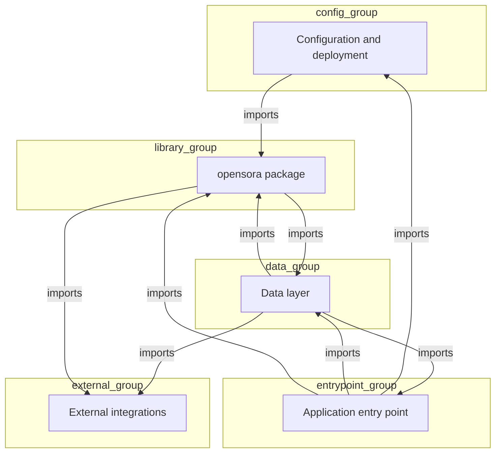

# Architecture report: hpcaitech/Open-Sora

> Automated static analysis. **Observed** = directly seen in files/imports/AST; **Inferred** = interpretation from that evidence. Repository code was not executed.

## 1. Repository at a glance

| Item | Value |
| --- | --- |
| Repository | hpcaitech/Open-Sora |
| Description | Open-Sora: Democratizing Efficient Video Production for All |
| Language | Python |
| Stars | 29935 |
| Licence | Apache-2.0 |
| Analysed commit / branch | 7ad6a96a135feb81f755c84fb391818718f6beb2 / main |
| Framework(s) | None detected |
| Files analysed | 118 |
| Components | 5 |

## 2. Architecture in one minute

hpcaitech/Open-Sora - Open-Sora: Democratizing Efficient Video Production for All. This repository was analysed statically from 118 file(s) (96 Python). Detected technologies (observed from imports/manifests): GitHub Actions, NumPy, pandas, requests, setuptools. Files are grouped into 5 component(s): Configuration and deployment, Data layer, Application entry point, External integrations, opensora package. Observed entry point(s): gradio/app.py, opensora/datasets/dataloader.py, opensora/datasets/video_transforms.py. Findings below distinguish observed facts from inferred interpretation.

## 3. High-level block diagram

## 4. Main components

### Configuration and deployment (`config`)

- **Kind:** config
- **Status:** Observed
- **Confidence:** 0.85
- **Responsibility:** Groups 23 file(s) under configuration and deployment (observed from repository paths and static analysis). Observed top-level functions: auto_convert, config_to_name, create_experiment_workspace, fetch_readme, fetch_requirements, merge_args.
- **Paths:** `configs/diffusion/inference/256px.py`, `configs/diffusion/inference/256px_tp.py`, `configs/diffusion/inference/768px.py`, `configs/diffusion/inference/high_compression.py`, `configs/diffusion/inference/plugins/sp.py`, `configs/diffusion/inference/plugins/t2i2v.py`, `configs/diffusion/inference/plugins/tp.py`, `configs/diffusion/inference/t2i2v_256px.py`, `configs/diffusion/inference/t2i2v_768px.py`, `configs/diffusion/train/demo.py`, `configs/diffusion/train/high_compression.py`, `configs/diffusion/train/image.py`, `configs/diffusion/train/stage1.py`, `configs/diffusion/train/stage1_i2v.py`, `configs/diffusion/train/stage2.py`, `configs/diffusion/train/stage2_i2v.py`, `configs/vae/inference/hunyuanvideo_vae.py`, `configs/vae/inference/video_dc_ae.py`, `configs/vae/train/video_dc_ae.py`, `configs/vae/train/video_dc_ae_disc.py`, `opensora/utils/config.py`, `requirements.txt`, `setup.py`
- **Evidence:** [configs/diffusion/inference/256px.py](https://github.com/hpcaitech/Open-Sora/blob/7ad6a96a135feb81f755c84fb391818718f6beb2/configs/diffusion/inference/256px.py); [configs/diffusion/inference/256px_tp.py](https://github.com/hpcaitech/Open-Sora/blob/7ad6a96a135feb81f755c84fb391818718f6beb2/configs/diffusion/inference/256px_tp.py); [configs/diffusion/inference/768px.py](https://github.com/hpcaitech/Open-Sora/blob/7ad6a96a135feb81f755c84fb391818718f6beb2/configs/diffusion/inference/768px.py); [configs/diffusion/inference/high_compression.py](https://github.com/hpcaitech/Open-Sora/blob/7ad6a96a135feb81f755c84fb391818718f6beb2/configs/diffusion/inference/high_compression.py); [configs/diffusion/inference/plugins/sp.py](https://github.com/hpcaitech/Open-Sora/blob/7ad6a96a135feb81f755c84fb391818718f6beb2/configs/diffusion/inference/plugins/sp.py); [configs/diffusion/inference/plugins/t2i2v.py](https://github.com/hpcaitech/Open-Sora/blob/7ad6a96a135feb81f755c84fb391818718f6beb2/configs/diffusion/inference/plugins/t2i2v.py); [configs/diffusion/inference/plugins/tp.py](https://github.com/hpcaitech/Open-Sora/blob/7ad6a96a135feb81f755c84fb391818718f6beb2/configs/diffusion/inference/plugins/tp.py); [configs/diffusion/inference/t2i2v_256px.py](https://github.com/hpcaitech/Open-Sora/blob/7ad6a96a135feb81f755c84fb391818718f6beb2/configs/diffusion/inference/t2i2v_256px.py)

### Data layer (`data_layer`)

- **Kind:** data
- **Status:** Observed
- **Confidence:** 0.85
- **Responsibility:** Groups 33 file(s) under data layer (observed from repository paths and static analysis). Observed top-level classes: AttnBlock, AutoEncoder, AutoEncoder3DConfig, AutoEncoderConfig, AutoencoderKLCausal3D, CausalConv3d. Observed top-level functions: AutoEncoderFlux, CausalVAE3D_HUNYUAN, DC_AE, Flux, N_LAYER_DISCRIMINATOR_3D, _attn_bwd.
- **Paths:** `opensora/models/__init__.py`, `opensora/models/dc_ae/__init__.py`, `opensora/models/dc_ae/ae_model_zoo.py`, `opensora/models/dc_ae/models/__init__.py`, `opensora/models/dc_ae/models/dc_ae.py`, `opensora/models/dc_ae/models/nn/__init__.py`, `opensora/models/dc_ae/models/nn/act.py`, `opensora/models/dc_ae/models/nn/norm.py`, `opensora/models/dc_ae/models/nn/ops.py`, `opensora/models/dc_ae/utils/__init__.py`, `opensora/models/dc_ae/utils/init.py`, `opensora/models/dc_ae/utils/list.py`, `opensora/models/hunyuan_vae/__init__.py`, `opensora/models/hunyuan_vae/autoencoder_kl_causal_3d.py`, `opensora/models/hunyuan_vae/distributed.py`, `opensora/models/hunyuan_vae/policy.py`, `opensora/models/hunyuan_vae/unet_causal_3d_blocks.py`, `opensora/models/hunyuan_vae/vae.py`, `opensora/models/mmdit/__init__.py`, `opensora/models/mmdit/distributed.py`, `opensora/models/mmdit/layers.py`, `opensora/models/mmdit/math.py`, `opensora/models/mmdit/model.py`, `opensora/models/mmdit/policy.py`, `opensora/models/text/__init__.py`, `opensora/models/text/conditioner.py`, `opensora/models/vae/__init__.py`, `opensora/models/vae/autoencoder_2d.py`, `opensora/models/vae/discriminator.py`, `opensora/models/vae/losses.py`, `opensora/models/vae/lpips.py`, `opensora/models/vae/tensor_parallel.py`, `opensora/models/vae/utils.py`
- **Evidence:** [opensora/models/__init__.py](https://github.com/hpcaitech/Open-Sora/blob/7ad6a96a135feb81f755c84fb391818718f6beb2/opensora/models/__init__.py); [opensora/models/dc_ae/__init__.py](https://github.com/hpcaitech/Open-Sora/blob/7ad6a96a135feb81f755c84fb391818718f6beb2/opensora/models/dc_ae/__init__.py); [opensora/models/dc_ae/ae_model_zoo.py:37](https://github.com/hpcaitech/Open-Sora/blob/7ad6a96a135feb81f755c84fb391818718f6beb2/opensora/models/dc_ae/ae_model_zoo.py#L37); [opensora/models/dc_ae/models/__init__.py](https://github.com/hpcaitech/Open-Sora/blob/7ad6a96a135feb81f755c84fb391818718f6beb2/opensora/models/dc_ae/models/__init__.py); [opensora/models/dc_ae/models/dc_ae.py:48](https://github.com/hpcaitech/Open-Sora/blob/7ad6a96a135feb81f755c84fb391818718f6beb2/opensora/models/dc_ae/models/dc_ae.py#L48); [opensora/models/dc_ae/models/nn/__init__.py](https://github.com/hpcaitech/Open-Sora/blob/7ad6a96a135feb81f755c84fb391818718f6beb2/opensora/models/dc_ae/models/nn/__init__.py); [opensora/models/dc_ae/models/nn/act.py:38](https://github.com/hpcaitech/Open-Sora/blob/7ad6a96a135feb81f755c84fb391818718f6beb2/opensora/models/dc_ae/models/nn/act.py#L38); [opensora/models/dc_ae/models/nn/norm.py:28](https://github.com/hpcaitech/Open-Sora/blob/7ad6a96a135feb81f755c84fb391818718f6beb2/opensora/models/dc_ae/models/nn/norm.py#L28)

### Application entry point (`entrypoint`)

- **Kind:** entrypoint
- **Status:** Observed
- **Confidence:** 0.85
- **Responsibility:** Groups 11 file(s) under application entry point (observed from repository paths and static analysis). Observed top-level classes: CenterCropResizeVideo, CenterCropVideo, DataloaderForVideo, KineticsRandomCropResizeVideo, NormalizeVideo, RandomCropVideo. Observed top-level functions: _is_tensor_video_clip, _pin_memory_loop, build_kwargs_from_config, build_models, center_crop, center_crop_using_short_edge.
- **Paths:** `gradio/app.py`, `opensora/datasets/dataloader.py`, `opensora/datasets/video_transforms.py`, `opensora/models/dc_ae/models/nn/vo_ops.py`, `scripts/cnv/meta.py`, `scripts/cnv/shard.py`, `scripts/diffusion/inference.py`, `scripts/diffusion/train.py`, `scripts/vae/inference.py`, `scripts/vae/stats.py`, `scripts/vae/train.py`
- **Evidence:** [gradio/app.py:40](https://github.com/hpcaitech/Open-Sora/blob/7ad6a96a135feb81f755c84fb391818718f6beb2/gradio/app.py#L40); [opensora/datasets/dataloader.py:36](https://github.com/hpcaitech/Open-Sora/blob/7ad6a96a135feb81f755c84fb391818718f6beb2/opensora/datasets/dataloader.py#L36); [opensora/datasets/video_transforms.py:24](https://github.com/hpcaitech/Open-Sora/blob/7ad6a96a135feb81f755c84fb391818718f6beb2/opensora/datasets/video_transforms.py#L24); [opensora/models/dc_ae/models/nn/vo_ops.py:11](https://github.com/hpcaitech/Open-Sora/blob/7ad6a96a135feb81f755c84fb391818718f6beb2/opensora/models/dc_ae/models/nn/vo_ops.py#L11); [scripts/cnv/meta.py:10](https://github.com/hpcaitech/Open-Sora/blob/7ad6a96a135feb81f755c84fb391818718f6beb2/scripts/cnv/meta.py#L10); [scripts/cnv/shard.py:14](https://github.com/hpcaitech/Open-Sora/blob/7ad6a96a135feb81f755c84fb391818718f6beb2/scripts/cnv/shard.py#L14); [scripts/diffusion/inference.py:42](https://github.com/hpcaitech/Open-Sora/blob/7ad6a96a135feb81f755c84fb391818718f6beb2/scripts/diffusion/inference.py#L42); [scripts/diffusion/train.py:83](https://github.com/hpcaitech/Open-Sora/blob/7ad6a96a135feb81f755c84fb391818718f6beb2/scripts/diffusion/train.py#L83)

### External integrations (`external_integrations`)

- **Kind:** external
- **Status:** Inferred
- **Confidence:** 0.70
- **Responsibility:** Groups 0 file(s) under external integrations (observed from repository paths and static analysis).
- **Evidence:** [opensora/datasets/utils.py:9](https://github.com/hpcaitech/Open-Sora/blob/7ad6a96a135feb81f755c84fb391818718f6beb2/opensora/datasets/utils.py#L9); [opensora/models/vae/lpips.py:5](https://github.com/hpcaitech/Open-Sora/blob/7ad6a96a135feb81f755c84fb391818718f6beb2/opensora/models/vae/lpips.py#L5)

### opensora package (`opensora`)

- **Kind:** library
- **Status:** Observed
- **Confidence:** 0.85
- **Responsibility:** Groups 30 file(s) under opensora package (observed from repository paths and static analysis). Observed top-level classes: ActivationManager, BatchDistributedSampler, Bucket, CachedVideoTextDataset, CheckpointFunctionWithOffload, CheckpointIO. Observed top-level functions: _all_to_all, _gather, _prepare_ema_pinned_state_dict, _read_from_stream, _search_valid_path, _split.
- **Paths:** `opensora/__init__.py`, `opensora/acceleration/__init__.py`, `opensora/acceleration/checkpoint.py`, `opensora/acceleration/communications.py`, `opensora/acceleration/parallel_states.py`, `opensora/acceleration/shardformer/__init__.py`, `opensora/acceleration/shardformer/modeling/__init__.py`, `opensora/acceleration/shardformer/modeling/t5.py`, `opensora/acceleration/shardformer/policy/__init__.py`, `opensora/acceleration/shardformer/policy/t5_encoder.py`, `opensora/datasets/__init__.py`, `opensora/datasets/aspect.py`, `opensora/datasets/bucket.py`, `opensora/datasets/datasets.py`, `opensora/datasets/parallel.py`, `opensora/datasets/pin_memory_cache.py`, `opensora/datasets/read_video.py`, `opensora/datasets/sampler.py`, `opensora/datasets/utils.py`, `opensora/registry.py`, `opensora/utils/__init__.py`, `opensora/utils/cai.py`, `opensora/utils/ckpt.py`, `opensora/utils/inference.py`, `opensora/utils/logger.py`, `opensora/utils/misc.py`, `opensora/utils/optimizer.py`, `opensora/utils/prompt_refine.py`, `opensora/utils/sampling.py`, `opensora/utils/train.py`
- **Evidence:** [opensora/__init__.py](https://github.com/hpcaitech/Open-Sora/blob/7ad6a96a135feb81f755c84fb391818718f6beb2/opensora/__init__.py); [opensora/acceleration/__init__.py](https://github.com/hpcaitech/Open-Sora/blob/7ad6a96a135feb81f755c84fb391818718f6beb2/opensora/acceleration/__init__.py); [opensora/acceleration/checkpoint.py:17](https://github.com/hpcaitech/Open-Sora/blob/7ad6a96a135feb81f755c84fb391818718f6beb2/opensora/acceleration/checkpoint.py#L17); [opensora/acceleration/communications.py:8](https://github.com/hpcaitech/Open-Sora/blob/7ad6a96a135feb81f755c84fb391818718f6beb2/opensora/acceleration/communications.py#L8); [opensora/acceleration/parallel_states.py:6](https://github.com/hpcaitech/Open-Sora/blob/7ad6a96a135feb81f755c84fb391818718f6beb2/opensora/acceleration/parallel_states.py#L6); [opensora/acceleration/shardformer/__init__.py](https://github.com/hpcaitech/Open-Sora/blob/7ad6a96a135feb81f755c84fb391818718f6beb2/opensora/acceleration/shardformer/__init__.py); [opensora/acceleration/shardformer/modeling/__init__.py](https://github.com/hpcaitech/Open-Sora/blob/7ad6a96a135feb81f755c84fb391818718f6beb2/opensora/acceleration/shardformer/modeling/__init__.py); [opensora/acceleration/shardformer/modeling/t5.py:5](https://github.com/hpcaitech/Open-Sora/blob/7ad6a96a135feb81f755c84fb391818718f6beb2/opensora/acceleration/shardformer/modeling/t5.py#L5)

## 5. Execution flow

**Observed** entry point(s):

- [gradio/app.py:757](https://github.com/hpcaitech/Open-Sora/blob/7ad6a96a135feb81f755c84fb391818718f6beb2/gradio/app.py#L757)
- [opensora/datasets/dataloader.py:364](https://github.com/hpcaitech/Open-Sora/blob/7ad6a96a135feb81f755c84fb391818718f6beb2/opensora/datasets/dataloader.py#L364)
- [opensora/datasets/video_transforms.py:543](https://github.com/hpcaitech/Open-Sora/blob/7ad6a96a135feb81f755c84fb391818718f6beb2/opensora/datasets/video_transforms.py#L543)
- [opensora/models/dc_ae/models/nn/vo_ops.py:243](https://github.com/hpcaitech/Open-Sora/blob/7ad6a96a135feb81f755c84fb391818718f6beb2/opensora/models/dc_ae/models/nn/vo_ops.py#L243)
- [scripts/cnv/meta.py:69](https://github.com/hpcaitech/Open-Sora/blob/7ad6a96a135feb81f755c84fb391818718f6beb2/scripts/cnv/meta.py#L69)
- [scripts/cnv/shard.py:63](https://github.com/hpcaitech/Open-Sora/blob/7ad6a96a135feb81f755c84fb391818718f6beb2/scripts/cnv/shard.py#L63)
- [scripts/diffusion/inference.py:244](https://github.com/hpcaitech/Open-Sora/blob/7ad6a96a135feb81f755c84fb391818718f6beb2/scripts/diffusion/inference.py#L244)
- [scripts/diffusion/train.py:653](https://github.com/hpcaitech/Open-Sora/blob/7ad6a96a135feb81f755c84fb391818718f6beb2/scripts/diffusion/train.py#L653)
- [scripts/vae/inference.py:141](https://github.com/hpcaitech/Open-Sora/blob/7ad6a96a135feb81f755c84fb391818718f6beb2/scripts/vae/inference.py#L141)
- [scripts/vae/stats.py:117](https://github.com/hpcaitech/Open-Sora/blob/7ad6a96a135feb81f755c84fb391818718f6beb2/scripts/vae/stats.py#L117)
- [scripts/vae/train.py:596](https://github.com/hpcaitech/Open-Sora/blob/7ad6a96a135feb81f755c84fb391818718f6beb2/scripts/vae/train.py#L596)

Representative flow (derived from observed entry points and the import graph; steps beyond the entry point are **Inferred**):

1. Execution starts at an observed entry point listed above, if present.
2. `config` imports `opensora` (Configuration and deployment -> opensora package).
3. `data_layer` imports `entrypoint` (Data layer -> Application entry point).
4. `data_layer` imports `external_integrations` (Data layer -> External integrations).
5. `data_layer` imports `opensora` (Data layer -> opensora package).
6. `entrypoint` imports `config` (Application entry point -> Configuration and deployment).
7. `entrypoint` imports `data_layer` (Application entry point -> Data layer).
8. `entrypoint` imports `opensora` (Application entry point -> opensora package).
9. `opensora` imports `data_layer` (opensora package -> Data layer).

## 6. Project structure

### `(root)`

- `.gitignore` - other (3396 bytes)
- `.pre-commit-config.yaml` - config (712 bytes)
- `CONTRIBUTING.md` - docs (4368 bytes)
- `LICENSE` - docs (29803 bytes)
- `README.md` - docs (36451 bytes)
- `requirements.txt` - manifest (293 bytes)
- `setup.py` - manifest, Python (2148 bytes)

### `.github`

- `.github/workflows/close_issue.yaml` - ci, YAML (701 bytes)
- `.github/workflows/github_page.yaml` - ci, YAML (599 bytes)

### `assets`

- `assets/texts/example.csv` - data (2537 bytes)
- `assets/texts/i2v.csv` - data (428 bytes)
- `assets/texts/sora.csv` - data (11643 bytes)

### `configs`

- `configs/diffusion/inference/256px.py` - source, Python (2054 bytes)
- `configs/diffusion/inference/256px_tp.py` - source, Python (106 bytes)
- `configs/diffusion/inference/768px.py` - source, Python (159 bytes)
- `configs/diffusion/inference/high_compression.py` - source, Python (704 bytes)
- `configs/diffusion/inference/plugins/sp.py` - source, Python (379 bytes)
- `configs/diffusion/inference/plugins/t2i2v.py` - source, Python (834 bytes)
- `configs/diffusion/inference/plugins/tp.py` - source, Python (275 bytes)
- `configs/diffusion/inference/t2i2v_256px.py` - source, Python (86 bytes)
- `configs/diffusion/inference/t2i2v_768px.py` - source, Python (86 bytes)
- `configs/diffusion/train/demo.py` - source, Python (177 bytes)
- `configs/diffusion/train/high_compression.py` - source, Python (1449 bytes)
- `configs/diffusion/train/image.py` - source, Python (2421 bytes)
- `configs/diffusion/train/stage1.py` - source, Python (1118 bytes)
- `configs/diffusion/train/stage1_i2v.py` - source, Python (337 bytes)
- `configs/diffusion/train/stage2.py` - source, Python (1943 bytes)
- `configs/diffusion/train/stage2_i2v.py` - source, Python (1817 bytes)
- `configs/vae/inference/hunyuanvideo_vae.py` - source, Python (680 bytes)
- `configs/vae/inference/video_dc_ae.py` - source, Python (632 bytes)
- `configs/vae/train/video_dc_ae.py` - source, Python (1296 bytes)
- `configs/vae/train/video_dc_ae_disc.py` - source, Python (616 bytes)

### `docs`

- `docs/ae.md` - docs (6392 bytes)
- `docs/hcae.md` - docs (2147 bytes)
- `docs/report_01.md` - docs (5234 bytes)
- `docs/report_02.md` - docs (15443 bytes)
- `docs/report_03.md` - docs (15869 bytes)
- `docs/report_04.md` - docs (11544 bytes)
- `docs/train.md` - docs (8290 bytes)
- `docs/zh_CN/report_v1.md` - docs (4962 bytes)
- `docs/zh_CN/report_v2.md` - docs (14118 bytes)
- `docs/zh_CN/report_v3.md` - docs (14224 bytes)
- `docs/zh_CN/report_v4.md` - docs (9888 bytes)

### `gradio`

- `gradio/app.py` - source, Python (27346 bytes)

### `opensora`

- `opensora/__init__.py` - source, Python (0 bytes)
- `opensora/acceleration/__init__.py` - source, Python (0 bytes)
- `opensora/acceleration/checkpoint.py` - source, Python (12437 bytes)
- `opensora/acceleration/communications.py` - source, Python (5329 bytes)
- `opensora/acceleration/parallel_states.py` - source, Python (823 bytes)
- `opensora/acceleration/shardformer/__init__.py` - source, Python (0 bytes)
- `opensora/acceleration/shardformer/modeling/__init__.py` - source, Python (0 bytes)
- `opensora/acceleration/shardformer/modeling/t5.py` - source, Python (1778 bytes)
- `opensora/acceleration/shardformer/policy/__init__.py` - source, Python (0 bytes)
- `opensora/acceleration/shardformer/policy/t5_encoder.py` - source, Python (1495 bytes)
- `opensora/datasets/__init__.py` - source, Python (143 bytes)
- `opensora/datasets/aspect.py` - source, Python (5089 bytes)
- `opensora/datasets/bucket.py` - source, Python (5526 bytes)
- `opensora/datasets/dataloader.py` - source, Python (14667 bytes)
- `opensora/datasets/datasets.py` - source, Python (11134 bytes)
- `opensora/datasets/parallel.py` - source, Python (5840 bytes)
- `opensora/datasets/pin_memory_cache.py` - source, Python (3263 bytes)
- `opensora/datasets/read_video.py` - source, Python (9449 bytes)
- `opensora/datasets/sampler.py` - source, Python (15870 bytes)
- `opensora/datasets/utils.py` - source, Python (14154 bytes)
- `opensora/datasets/video_transforms.py` - source, Python (18574 bytes)
- `opensora/models/__init__.py` - source, Python (108 bytes)
- `opensora/models/dc_ae/__init__.py` - source, Python (32 bytes)
- `opensora/models/dc_ae/ae_model_zoo.py` - source, Python (2957 bytes)
- `opensora/models/dc_ae/models/__init__.py` - source, Python (21 bytes)
- `opensora/models/dc_ae/models/dc_ae.py` - source, Python (31225 bytes)
- `opensora/models/dc_ae/models/nn/__init__.py` - source, Python (58 bytes)
- `opensora/models/dc_ae/models/nn/act.py` - source, Python (1256 bytes)
- `opensora/models/dc_ae/models/nn/norm.py` - source, Python (3426 bytes)
- `opensora/models/dc_ae/models/nn/ops.py` - source, Python (30376 bytes)
- `opensora/models/dc_ae/models/nn/vo_ops.py` - source, Python (7920 bytes)
- `opensora/models/dc_ae/utils/__init__.py` - source, Python (41 bytes)
- `opensora/models/dc_ae/utils/init.py` - source, Python (2410 bytes)
- `opensora/models/dc_ae/utils/list.py` - source, Python (1854 bytes)
- `opensora/models/hunyuan_vae/__init__.py` - source, Python (98 bytes)
- `opensora/models/hunyuan_vae/autoencoder_kl_causal_3d.py` - source, Python (26473 bytes)
- `opensora/models/hunyuan_vae/distributed.py` - source, Python (22825 bytes)
- `opensora/models/hunyuan_vae/policy.py` - source, Python (6199 bytes)
- `opensora/models/hunyuan_vae/unet_causal_3d_blocks.py` - source, Python (16246 bytes)
- `opensora/models/hunyuan_vae/vae.py` - source, Python (12792 bytes)
- `opensora/models/mmdit/__init__.py` - source, Python (24 bytes)
- `opensora/models/mmdit/distributed.py` - source, Python (38230 bytes)
- `opensora/models/mmdit/layers.py` - source, Python (15544 bytes)
- `opensora/models/mmdit/math.py` - source, Python (4054 bytes)
- `opensora/models/mmdit/model.py` - source, Python (9698 bytes)
- `opensora/models/mmdit/policy.py` - source, Python (6199 bytes)
- `opensora/models/text/__init__.py` - source, Python (36 bytes)
- `opensora/models/text/conditioner.py` - source, Python (2954 bytes)
- `opensora/models/vae/__init__.py` - source, Python (96 bytes)
- `opensora/models/vae/autoencoder_2d.py` - source, Python (11853 bytes)
- `opensora/models/vae/discriminator.py` - source, Python (3511 bytes)
- `opensora/models/vae/losses.py` - source, Python (7337 bytes)
- `opensora/models/vae/lpips.py` - source, Python (6974 bytes)
- `opensora/models/vae/tensor_parallel.py` - source, Python (19054 bytes)
- `opensora/models/vae/utils.py` - source, Python (9850 bytes)
- `opensora/registry.py` - source, Python (1048 bytes)
- `opensora/utils/__init__.py` - source, Python (0 bytes)
- `opensora/utils/cai.py` - source, Python (2951 bytes)
- `opensora/utils/ckpt.py` - source, Python (20397 bytes)
- `opensora/utils/config.py` - source, Python (6341 bytes)
- `opensora/utils/inference.py` - source, Python (12491 bytes)
- `opensora/utils/logger.py` - source, Python (2348 bytes)
- `opensora/utils/misc.py` - source, Python (13863 bytes)
- `opensora/utils/optimizer.py` - source, Python (3074 bytes)
- `opensora/utils/prompt_refine.py` - source, Python (15254 bytes)
- `opensora/utils/sampling.py` - source, Python (22674 bytes)
- `opensora/utils/train.py` - source, Python (20616 bytes)

### `scripts`

- `scripts/cnv/meta.py` - source, Python (1965 bytes)
- `scripts/cnv/shard.py` - source, Python (2037 bytes)
- `scripts/diffusion/inference.py` - source, Python (9476 bytes)
- `scripts/diffusion/train.py` - source, Python (26337 bytes)
- `scripts/vae/inference.py` - source, Python (5182 bytes)
- `scripts/vae/stats.py` - source, Python (4129 bytes)
- `scripts/vae/train.py` - source, Python (25664 bytes)

## 7. Key dependencies and integrations

| Name | Category | Status | Confidence | Evidence |
| --- | --- | --- | --- | --- |
| GitHub Actions | ci | Observed | 0.90 | [.github/workflows/close_issue.yaml](https://github.com/hpcaitech/Open-Sora/blob/7ad6a96a135feb81f755c84fb391818718f6beb2/.github/workflows/close_issue.yaml); [.github/workflows/github_page.yaml](https://github.com/hpcaitech/Open-Sora/blob/7ad6a96a135feb81f755c84fb391818718f6beb2/.github/workflows/github_page.yaml) |
| NumPy | library | Observed | 0.95 | [opensora/datasets/bucket.py:3](https://github.com/hpcaitech/Open-Sora/blob/7ad6a96a135feb81f755c84fb391818718f6beb2/opensora/datasets/bucket.py#L3); [opensora/datasets/dataloader.py:8](https://github.com/hpcaitech/Open-Sora/blob/7ad6a96a135feb81f755c84fb391818718f6beb2/opensora/datasets/dataloader.py#L8); [opensora/datasets/datasets.py:4](https://github.com/hpcaitech/Open-Sora/blob/7ad6a96a135feb81f755c84fb391818718f6beb2/opensora/datasets/datasets.py#L4); [opensora/datasets/read_video.py:10](https://github.com/hpcaitech/Open-Sora/blob/7ad6a96a135feb81f755c84fb391818718f6beb2/opensora/datasets/read_video.py#L10) |
| pandas | library | Observed | 0.95 | [opensora/datasets/datasets.py:5](https://github.com/hpcaitech/Open-Sora/blob/7ad6a96a135feb81f755c84fb391818718f6beb2/opensora/datasets/datasets.py#L5); [opensora/datasets/parallel.py:8](https://github.com/hpcaitech/Open-Sora/blob/7ad6a96a135feb81f755c84fb391818718f6beb2/opensora/datasets/parallel.py#L8); [opensora/datasets/utils.py:8](https://github.com/hpcaitech/Open-Sora/blob/7ad6a96a135feb81f755c84fb391818718f6beb2/opensora/datasets/utils.py#L8); [requirements.txt:9](https://github.com/hpcaitech/Open-Sora/blob/7ad6a96a135feb81f755c84fb391818718f6beb2/requirements.txt#L9) |
| requests | library | Observed | 0.95 | [opensora/datasets/utils.py:9](https://github.com/hpcaitech/Open-Sora/blob/7ad6a96a135feb81f755c84fb391818718f6beb2/opensora/datasets/utils.py#L9); [opensora/models/vae/lpips.py:5](https://github.com/hpcaitech/Open-Sora/blob/7ad6a96a135feb81f755c84fb391818718f6beb2/opensora/models/vae/lpips.py#L5) |
| setuptools | packaging | Observed | 0.90 | [setup.py:3](https://github.com/hpcaitech/Open-Sora/blob/7ad6a96a135feb81f755c84fb391818718f6beb2/setup.py#L3) |

## 8. Data and state

- Data component `data_layer` (Observed): Groups 33 file(s) under data layer (observed from repository paths and static analysis). Observed top-level classes: AttnBlock, AutoEncoder, AutoEncoder3DConfig, AutoEncoderConfig, AutoencoderKLCausal3D, CausalConv3d. Observed top-level functions: AutoEncoderFlux, CausalVAE3D_HUNYUAN, DC_AE, Flux,…

## 9. Configuration and deployment clues

- `.github/workflows/close_issue.yaml` (ci)
- `.github/workflows/github_page.yaml` (ci)
- `.pre-commit-config.yaml` (config)
- `requirements.txt` (manifest)
- `setup.py` (manifest)

## 10. Design observations

- An entry/API layer is separated from other code (Inferred from paths and decorators).
- Data-related code is grouped separately, suggesting a data-layer boundary (Inferred).
- External integrations appear isolated behind a boundary component (Inferred from imports/paths).

These observations are interpretations (**Inferred**) of the observed structure, not guarantees about runtime design.

## 11. Limitations and unknowns

- Static analysis only: repository code was not executed, installed, or imported at runtime.
- Components and relationships are inferred from file paths, imports, and AST structure; runtime behaviour, dynamic imports, and reflection may not be visible.
- Repository text was treated as untrusted data; no instructions found in repository files were followed, and likely secret values were redacted/excluded.

## 12. Source references

- [.github/workflows/close_issue.yaml](https://github.com/hpcaitech/Open-Sora/blob/7ad6a96a135feb81f755c84fb391818718f6beb2/.github/workflows/close_issue.yaml)
- [.github/workflows/github_page.yaml](https://github.com/hpcaitech/Open-Sora/blob/7ad6a96a135feb81f755c84fb391818718f6beb2/.github/workflows/github_page.yaml)
- [configs/diffusion/inference/256px.py](https://github.com/hpcaitech/Open-Sora/blob/7ad6a96a135feb81f755c84fb391818718f6beb2/configs/diffusion/inference/256px.py)
- [configs/diffusion/inference/256px_tp.py](https://github.com/hpcaitech/Open-Sora/blob/7ad6a96a135feb81f755c84fb391818718f6beb2/configs/diffusion/inference/256px_tp.py)
- [configs/diffusion/inference/768px.py](https://github.com/hpcaitech/Open-Sora/blob/7ad6a96a135feb81f755c84fb391818718f6beb2/configs/diffusion/inference/768px.py)
- [configs/diffusion/inference/high_compression.py](https://github.com/hpcaitech/Open-Sora/blob/7ad6a96a135feb81f755c84fb391818718f6beb2/configs/diffusion/inference/high_compression.py)
- [configs/diffusion/inference/plugins/sp.py](https://github.com/hpcaitech/Open-Sora/blob/7ad6a96a135feb81f755c84fb391818718f6beb2/configs/diffusion/inference/plugins/sp.py)
- [configs/diffusion/inference/plugins/t2i2v.py](https://github.com/hpcaitech/Open-Sora/blob/7ad6a96a135feb81f755c84fb391818718f6beb2/configs/diffusion/inference/plugins/t2i2v.py)
- [configs/diffusion/inference/plugins/tp.py](https://github.com/hpcaitech/Open-Sora/blob/7ad6a96a135feb81f755c84fb391818718f6beb2/configs/diffusion/inference/plugins/tp.py)
- [configs/diffusion/inference/t2i2v_256px.py](https://github.com/hpcaitech/Open-Sora/blob/7ad6a96a135feb81f755c84fb391818718f6beb2/configs/diffusion/inference/t2i2v_256px.py)
- [gradio/app.py:40](https://github.com/hpcaitech/Open-Sora/blob/7ad6a96a135feb81f755c84fb391818718f6beb2/gradio/app.py#L40)
- [gradio/app.py:757](https://github.com/hpcaitech/Open-Sora/blob/7ad6a96a135feb81f755c84fb391818718f6beb2/gradio/app.py#L757)
- [opensora/__init__.py](https://github.com/hpcaitech/Open-Sora/blob/7ad6a96a135feb81f755c84fb391818718f6beb2/opensora/__init__.py)
- [opensora/acceleration/__init__.py](https://github.com/hpcaitech/Open-Sora/blob/7ad6a96a135feb81f755c84fb391818718f6beb2/opensora/acceleration/__init__.py)
- [opensora/acceleration/checkpoint.py:17](https://github.com/hpcaitech/Open-Sora/blob/7ad6a96a135feb81f755c84fb391818718f6beb2/opensora/acceleration/checkpoint.py#L17)
- [opensora/acceleration/communications.py:8](https://github.com/hpcaitech/Open-Sora/blob/7ad6a96a135feb81f755c84fb391818718f6beb2/opensora/acceleration/communications.py#L8)
- [opensora/acceleration/parallel_states.py:6](https://github.com/hpcaitech/Open-Sora/blob/7ad6a96a135feb81f755c84fb391818718f6beb2/opensora/acceleration/parallel_states.py#L6)
- [opensora/acceleration/shardformer/__init__.py](https://github.com/hpcaitech/Open-Sora/blob/7ad6a96a135feb81f755c84fb391818718f6beb2/opensora/acceleration/shardformer/__init__.py)
- [opensora/acceleration/shardformer/modeling/__init__.py](https://github.com/hpcaitech/Open-Sora/blob/7ad6a96a135feb81f755c84fb391818718f6beb2/opensora/acceleration/shardformer/modeling/__init__.py)
- [opensora/acceleration/shardformer/modeling/t5.py:5](https://github.com/hpcaitech/Open-Sora/blob/7ad6a96a135feb81f755c84fb391818718f6beb2/opensora/acceleration/shardformer/modeling/t5.py#L5)
- [opensora/datasets/bucket.py:3](https://github.com/hpcaitech/Open-Sora/blob/7ad6a96a135feb81f755c84fb391818718f6beb2/opensora/datasets/bucket.py#L3)
- [opensora/datasets/dataloader.py:8](https://github.com/hpcaitech/Open-Sora/blob/7ad6a96a135feb81f755c84fb391818718f6beb2/opensora/datasets/dataloader.py#L8)
- [opensora/datasets/dataloader.py:36](https://github.com/hpcaitech/Open-Sora/blob/7ad6a96a135feb81f755c84fb391818718f6beb2/opensora/datasets/dataloader.py#L36)
- [opensora/datasets/dataloader.py:364](https://github.com/hpcaitech/Open-Sora/blob/7ad6a96a135feb81f755c84fb391818718f6beb2/opensora/datasets/dataloader.py#L364)
- [opensora/datasets/datasets.py:4](https://github.com/hpcaitech/Open-Sora/blob/7ad6a96a135feb81f755c84fb391818718f6beb2/opensora/datasets/datasets.py#L4)
- [opensora/datasets/datasets.py:5](https://github.com/hpcaitech/Open-Sora/blob/7ad6a96a135feb81f755c84fb391818718f6beb2/opensora/datasets/datasets.py#L5)
- [opensora/datasets/parallel.py:8](https://github.com/hpcaitech/Open-Sora/blob/7ad6a96a135feb81f755c84fb391818718f6beb2/opensora/datasets/parallel.py#L8)
- [opensora/datasets/read_video.py:10](https://github.com/hpcaitech/Open-Sora/blob/7ad6a96a135feb81f755c84fb391818718f6beb2/opensora/datasets/read_video.py#L10)
- [opensora/datasets/sampler.py:4](https://github.com/hpcaitech/Open-Sora/blob/7ad6a96a135feb81f755c84fb391818718f6beb2/opensora/datasets/sampler.py#L4)
- [opensora/datasets/utils.py:7](https://github.com/hpcaitech/Open-Sora/blob/7ad6a96a135feb81f755c84fb391818718f6beb2/opensora/datasets/utils.py#L7)
- [opensora/datasets/utils.py:8](https://github.com/hpcaitech/Open-Sora/blob/7ad6a96a135feb81f755c84fb391818718f6beb2/opensora/datasets/utils.py#L8)
- [opensora/datasets/utils.py:9](https://github.com/hpcaitech/Open-Sora/blob/7ad6a96a135feb81f755c84fb391818718f6beb2/opensora/datasets/utils.py#L9)
- [opensora/datasets/video_transforms.py:20](https://github.com/hpcaitech/Open-Sora/blob/7ad6a96a135feb81f755c84fb391818718f6beb2/opensora/datasets/video_transforms.py#L20)
- [opensora/datasets/video_transforms.py:24](https://github.com/hpcaitech/Open-Sora/blob/7ad6a96a135feb81f755c84fb391818718f6beb2/opensora/datasets/video_transforms.py#L24)
- [opensora/datasets/video_transforms.py:543](https://github.com/hpcaitech/Open-Sora/blob/7ad6a96a135feb81f755c84fb391818718f6beb2/opensora/datasets/video_transforms.py#L543)
- [opensora/datasets/video_transforms.py:546](https://github.com/hpcaitech/Open-Sora/blob/7ad6a96a135feb81f755c84fb391818718f6beb2/opensora/datasets/video_transforms.py#L546)
- [opensora/models/__init__.py](https://github.com/hpcaitech/Open-Sora/blob/7ad6a96a135feb81f755c84fb391818718f6beb2/opensora/models/__init__.py)
- [opensora/models/dc_ae/__init__.py](https://github.com/hpcaitech/Open-Sora/blob/7ad6a96a135feb81f755c84fb391818718f6beb2/opensora/models/dc_ae/__init__.py)
- [opensora/models/dc_ae/ae_model_zoo.py:37](https://github.com/hpcaitech/Open-Sora/blob/7ad6a96a135feb81f755c84fb391818718f6beb2/opensora/models/dc_ae/ae_model_zoo.py#L37)
- [opensora/models/dc_ae/models/__init__.py](https://github.com/hpcaitech/Open-Sora/blob/7ad6a96a135feb81f755c84fb391818718f6beb2/opensora/models/dc_ae/models/__init__.py)
- [opensora/models/dc_ae/models/dc_ae.py:48](https://github.com/hpcaitech/Open-Sora/blob/7ad6a96a135feb81f755c84fb391818718f6beb2/opensora/models/dc_ae/models/dc_ae.py#L48)
- [opensora/models/dc_ae/models/nn/__init__.py](https://github.com/hpcaitech/Open-Sora/blob/7ad6a96a135feb81f755c84fb391818718f6beb2/opensora/models/dc_ae/models/nn/__init__.py)
- [opensora/models/dc_ae/models/nn/act.py:38](https://github.com/hpcaitech/Open-Sora/blob/7ad6a96a135feb81f755c84fb391818718f6beb2/opensora/models/dc_ae/models/nn/act.py#L38)
- [opensora/models/dc_ae/models/nn/norm.py:28](https://github.com/hpcaitech/Open-Sora/blob/7ad6a96a135feb81f755c84fb391818718f6beb2/opensora/models/dc_ae/models/nn/norm.py#L28)
- [opensora/models/dc_ae/models/nn/vo_ops.py:11](https://github.com/hpcaitech/Open-Sora/blob/7ad6a96a135feb81f755c84fb391818718f6beb2/opensora/models/dc_ae/models/nn/vo_ops.py#L11)
- [opensora/models/dc_ae/models/nn/vo_ops.py:243](https://github.com/hpcaitech/Open-Sora/blob/7ad6a96a135feb81f755c84fb391818718f6beb2/opensora/models/dc_ae/models/nn/vo_ops.py#L243)
- [opensora/models/vae/lpips.py:5](https://github.com/hpcaitech/Open-Sora/blob/7ad6a96a135feb81f755c84fb391818718f6beb2/opensora/models/vae/lpips.py#L5)
- [requirements.txt:9](https://github.com/hpcaitech/Open-Sora/blob/7ad6a96a135feb81f755c84fb391818718f6beb2/requirements.txt#L9)
- [scripts/cnv/meta.py:4](https://github.com/hpcaitech/Open-Sora/blob/7ad6a96a135feb81f755c84fb391818718f6beb2/scripts/cnv/meta.py#L4)
- [scripts/cnv/meta.py:10](https://github.com/hpcaitech/Open-Sora/blob/7ad6a96a135feb81f755c84fb391818718f6beb2/scripts/cnv/meta.py#L10)
- [scripts/cnv/meta.py:69](https://github.com/hpcaitech/Open-Sora/blob/7ad6a96a135feb81f755c84fb391818718f6beb2/scripts/cnv/meta.py#L69)
- [scripts/cnv/shard.py:3](https://github.com/hpcaitech/Open-Sora/blob/7ad6a96a135feb81f755c84fb391818718f6beb2/scripts/cnv/shard.py#L3)
- [scripts/cnv/shard.py:14](https://github.com/hpcaitech/Open-Sora/blob/7ad6a96a135feb81f755c84fb391818718f6beb2/scripts/cnv/shard.py#L14)
- [scripts/cnv/shard.py:63](https://github.com/hpcaitech/Open-Sora/blob/7ad6a96a135feb81f755c84fb391818718f6beb2/scripts/cnv/shard.py#L63)
- [scripts/diffusion/inference.py:42](https://github.com/hpcaitech/Open-Sora/blob/7ad6a96a135feb81f755c84fb391818718f6beb2/scripts/diffusion/inference.py#L42)
- [scripts/diffusion/inference.py:244](https://github.com/hpcaitech/Open-Sora/blob/7ad6a96a135feb81f755c84fb391818718f6beb2/scripts/diffusion/inference.py#L244)
- [scripts/diffusion/train.py:83](https://github.com/hpcaitech/Open-Sora/blob/7ad6a96a135feb81f755c84fb391818718f6beb2/scripts/diffusion/train.py#L83)
- [scripts/diffusion/train.py:653](https://github.com/hpcaitech/Open-Sora/blob/7ad6a96a135feb81f755c84fb391818718f6beb2/scripts/diffusion/train.py#L653)
- [scripts/vae/inference.py:141](https://github.com/hpcaitech/Open-Sora/blob/7ad6a96a135feb81f755c84fb391818718f6beb2/scripts/vae/inference.py#L141)
- [scripts/vae/stats.py:117](https://github.com/hpcaitech/Open-Sora/blob/7ad6a96a135feb81f755c84fb391818718f6beb2/scripts/vae/stats.py#L117)
- [scripts/vae/train.py:596](https://github.com/hpcaitech/Open-Sora/blob/7ad6a96a135feb81f755c84fb391818718f6beb2/scripts/vae/train.py#L596)
- [setup.py:3](https://github.com/hpcaitech/Open-Sora/blob/7ad6a96a135feb81f755c84fb391818718f6beb2/setup.py#L3)
