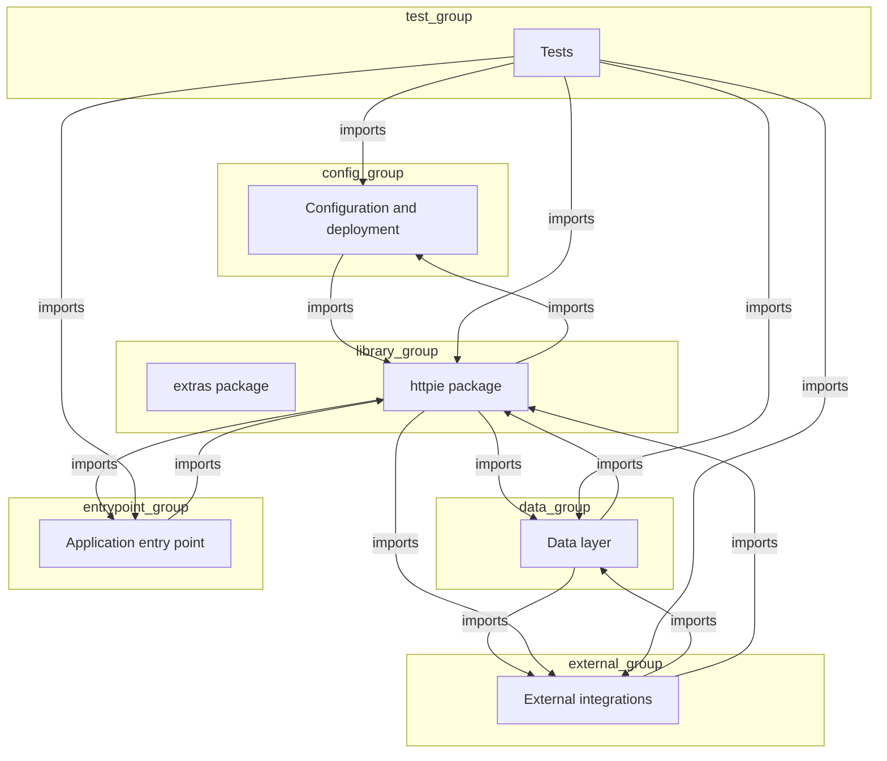

# Architecture report: httpie/cli

> Automated static analysis. **Observed** = directly seen in files/imports/AST; **Inferred** = interpretation from that evidence. Repository code was not executed.

## 1. Repository at a glance

| Item | Value |
| --- | --- |
| Repository | httpie/cli |
| Description | 🥧 HTTPie CLI  — modern, user-friendly command-line HTTP client for the API era. JSON support, colors, sessions, downloads, plugins & more. |
| Language | Python |
| Stars | 38715 |
| Licence | BSD-3-Clause |
| Analysed commit / branch | 5b604c37c6c67e18e7c3e9aee6c88a8c22b98345 / master |
| Framework(s) | None detected |
| Files analysed | 258 |
| Components | 7 |

## 2. Architecture in one minute

httpie/cli - 🥧 HTTPie CLI  — modern, user-friendly command-line HTTP client for the API era. JSON support, colors, sessions, downloads, plugins & more.. This repository was analysed statically from 258 file(s) (133 Python). Detected technologies (observed from imports/manifests): GitHub Actions, requests, setuptools, Docker, pytest, unittest. Files are grouped into 7 component(s): Configuration and deployment, Data layer, Application entry point, External integrations, extras package, httpie package, Tests. Observed entry point(s): extras/packaging/linux/build.py, extras/packaging/linux/scripts/http_cli.py, extras/packaging/linux/scripts/httpie_cli.py. Findings below distinguish observed facts from inferred interpretation.

## 3. High-level block diagram

## 4. Main components

### Configuration and deployment (`config`)

- **Kind:** config
- **Status:** Observed
- **Confidence:** 0.85
- **Responsibility:** Groups 7 file(s) under configuration and deployment (observed from repository paths and static analysis). Observed top-level classes: BaseConfigDict, Config, ConfigFileError. Observed top-level functions: get_default_config_dir, read_raw_config.
- **Paths:** `MANIFEST.in`, `extras/packaging/linux/Dockerfile`, `httpie/config.py`, `pytest.ini`, `setup.cfg`, `setup.py`, `snapcraft.yaml`
- **Evidence:** [MANIFEST.in](https://github.com/httpie/cli/blob/5b604c37c6c67e18e7c3e9aee6c88a8c22b98345/MANIFEST.in); [extras/packaging/linux/Dockerfile](https://github.com/httpie/cli/blob/5b604c37c6c67e18e7c3e9aee6c88a8c22b98345/extras/packaging/linux/Dockerfile); [httpie/config.py:20](https://github.com/httpie/cli/blob/5b604c37c6c67e18e7c3e9aee6c88a8c22b98345/httpie/config.py#L20); [pytest.ini](https://github.com/httpie/cli/blob/5b604c37c6c67e18e7c3e9aee6c88a8c22b98345/pytest.ini); [setup.cfg](https://github.com/httpie/cli/blob/5b604c37c6c67e18e7c3e9aee6c88a8c22b98345/setup.cfg); [setup.py](https://github.com/httpie/cli/blob/5b604c37c6c67e18e7c3e9aee6c88a8c22b98345/setup.py); [snapcraft.yaml](https://github.com/httpie/cli/blob/5b604c37c6c67e18e7c3e9aee6c88a8c22b98345/snapcraft.yaml)

### Data layer (`data_layer`)

- **Kind:** data
- **Status:** Observed
- **Confidence:** 0.85
- **Responsibility:** Groups 2 file(s) under data layer (observed from repository paths and static analysis). Observed top-level classes: HTTPMessage, HTTPRequest, HTTPResponse, OutputOptions, ProcessingOptions, RequestsMessageKind. Observed top-level functions: infer_requests_message_kind.
- **Paths:** `httpie/models.py`, `httpie/output/models.py`
- **Evidence:** [httpie/models.py:23](https://github.com/httpie/cli/blob/5b604c37c6c67e18e7c3e9aee6c88a8c22b98345/httpie/models.py#L23); [httpie/output/models.py:10](https://github.com/httpie/cli/blob/5b604c37c6c67e18e7c3e9aee6c88a8c22b98345/httpie/output/models.py#L10)

### Application entry point (`entrypoint`)

- **Kind:** entrypoint
- **Status:** Observed
- **Confidence:** 0.85
- **Responsibility:** Groups 10 file(s) under application entry point (observed from repository paths and static analysis). Observed application object created via Group. Observed top-level classes: Argument, BaseRunner, CommandRunner, Context, DownloadRunner, Environment. Observed top-level functions: _escape_and_dedent, build_binaries, build_packages, call, compare, drop_keys.
- **Paths:** `extras/packaging/linux/build.py`, `extras/packaging/linux/scripts/http_cli.py`, `extras/packaging/linux/scripts/httpie_cli.py`, `extras/profiling/benchmarks.py`, `extras/profiling/run.py`, `extras/scripts/generate_man_pages.py`, `httpie/__main__.py`, `httpie/cli/options.py`, `httpie/manager/__main__.py`, `httpie/manager/cli.py`
- **Evidence:** [extras/packaging/linux/build.py:23](https://github.com/httpie/cli/blob/5b604c37c6c67e18e7c3e9aee6c88a8c22b98345/extras/packaging/linux/build.py#L23); [extras/packaging/linux/scripts/http_cli.py](https://github.com/httpie/cli/blob/5b604c37c6c67e18e7c3e9aee6c88a8c22b98345/extras/packaging/linux/scripts/http_cli.py); [extras/packaging/linux/scripts/httpie_cli.py](https://github.com/httpie/cli/blob/5b604c37c6c67e18e7c3e9aee6c88a8c22b98345/extras/packaging/linux/scripts/httpie_cli.py); [extras/profiling/benchmarks.py:55](https://github.com/httpie/cli/blob/5b604c37c6c67e18e7c3e9aee6c88a8c22b98345/extras/profiling/benchmarks.py#L55); [extras/profiling/run.py:60](https://github.com/httpie/cli/blob/5b604c37c6c67e18e7c3e9aee6c88a8c22b98345/extras/profiling/run.py#L60); [extras/scripts/generate_man_pages.py:41](https://github.com/httpie/cli/blob/5b604c37c6c67e18e7c3e9aee6c88a8c22b98345/extras/scripts/generate_man_pages.py#L41); [httpie/__main__.py:6](https://github.com/httpie/cli/blob/5b604c37c6c67e18e7c3e9aee6c88a8c22b98345/httpie/__main__.py#L6); [httpie/cli/options.py:60](https://github.com/httpie/cli/blob/5b604c37c6c67e18e7c3e9aee6c88a8c22b98345/httpie/cli/options.py#L60)

### External integrations (`external_integrations`)

- **Kind:** external
- **Status:** Observed
- **Confidence:** 0.85
- **Responsibility:** Groups 1 file(s) under external integrations (observed from repository paths and static analysis). Observed top-level functions: apply_missing_repeated_headers, build_requests_session, collect_messages, dump_request, ensure_path_as_is, finalize_headers.
- **Paths:** `httpie/client.py`
- **Evidence:** [httpie/client.py:43](https://github.com/httpie/cli/blob/5b604c37c6c67e18e7c3e9aee6c88a8c22b98345/httpie/client.py#L43)

### extras package (`extras`)

- **Kind:** library
- **Status:** Observed
- **Confidence:** 0.85
- **Responsibility:** Groups 2 file(s) under extras package (observed from repository paths and static analysis). Observed top-level functions: hook.
- **Paths:** `extras/packaging/linux/get_release_artifacts.sh`, `extras/packaging/linux/scripts/hooks/hook-pip.py`
- **Evidence:** [extras/packaging/linux/get_release_artifacts.sh](https://github.com/httpie/cli/blob/5b604c37c6c67e18e7c3e9aee6c88a8c22b98345/extras/packaging/linux/get_release_artifacts.sh); [extras/packaging/linux/scripts/hooks/hook-pip.py:4](https://github.com/httpie/cli/blob/5b604c37c6c67e18e7c3e9aee6c88a8c22b98345/extras/packaging/linux/scripts/hooks/hook-pip.py#L4)

### httpie package (`httpie`)

- **Kind:** library
- **Status:** Observed
- **Confidence:** 0.85
- **Responsibility:** Groups 70 file(s) under httpie package (observed from repository paths and static analysis). Observed top-level classes: AuthCredentials, AuthCredentialsArgType, AuthPlugin, BaseDisplay, BaseHTTPieArgumentParser, BaseMultiDict. Observed top-level functions: _check_status, _discover_system_pip, _fetch_updates, _get_suppress_context, _get_update_status, _is_key_file_encrypted.
- **Paths:** `httpie/__init__.py`, `httpie/adapters.py`, `httpie/cli/__init__.py`, `httpie/cli/argparser.py`, `httpie/cli/argtypes.py`, `httpie/cli/constants.py`, `httpie/cli/definition.py`, `httpie/cli/dicts.py`, `httpie/cli/exceptions.py`, `httpie/cli/nested_json/__init__.py`, `httpie/cli/nested_json/errors.py`, `httpie/cli/nested_json/interpret.py`, `httpie/cli/nested_json/parse.py`, `httpie/cli/nested_json/tokens.py`, `httpie/cli/requestitems.py`, `httpie/cli/utils.py`, `httpie/compat.py`, `httpie/context.py`, `httpie/cookies.py`, `httpie/core.py`, `httpie/downloads.py`, `httpie/encoding.py`, `httpie/internal/__build_channel__.py`, `httpie/internal/__init__.py`, `httpie/internal/daemon_runner.py`, `httpie/internal/daemons.py`, `httpie/internal/update_warnings.py`, `httpie/legacy/__init__.py`, `httpie/legacy/v3_1_0_session_cookie_format.py`, `httpie/legacy/v3_2_0_session_header_format.py`, `httpie/manager/__init__.py`, `httpie/manager/compat.py`, `httpie/manager/core.py`, `httpie/manager/tasks/__init__.py`, `httpie/manager/tasks/check_updates.py`, `httpie/manager/tasks/export_args.py`, `httpie/manager/tasks/plugins.py`, `httpie/manager/tasks/sessions.py`, `httpie/output/__init__.py`, `httpie/output/formatters/__init__.py`, `httpie/output/formatters/colors.py`, `httpie/output/formatters/headers.py`, `httpie/output/formatters/json.py`, `httpie/output/formatters/xml.py`, `httpie/output/lexers/__init__.py`, `httpie/output/lexers/common.py`, `httpie/output/lexers/http.py`, `httpie/output/lexers/json.py`, `httpie/output/lexers/metadata.py`, `httpie/output/processing.py`, `httpie/output/streams.py`, `httpie/output/ui/__init__.py`, `httpie/output/ui/man_pages.py`, `httpie/output/ui/palette.py`, `httpie/output/ui/rich_help.py`, `httpie/output/ui/rich_palette.py`, `httpie/output/ui/rich_progress.py`, `httpie/output/ui/rich_utils.py`, `httpie/output/utils.py`, `httpie/output/writer.py`, `httpie/plugins/__init__.py`, `httpie/plugins/base.py`, `httpie/plugins/builtin.py`, `httpie/plugins/manager.py`, `httpie/plugins/registry.py`, `httpie/sessions.py`, `httpie/ssl_.py`, `httpie/status.py`, `httpie/uploads.py`, `httpie/utils.py`
- **Evidence:** [httpie/__init__.py](https://github.com/httpie/cli/blob/5b604c37c6c67e18e7c3e9aee6c88a8c22b98345/httpie/__init__.py); [httpie/adapters.py:5](https://github.com/httpie/cli/blob/5b604c37c6c67e18e7c3e9aee6c88a8c22b98345/httpie/adapters.py#L5); [httpie/cli/__init__.py](https://github.com/httpie/cli/blob/5b604c37c6c67e18e7c3e9aee6c88a8c22b98345/httpie/cli/__init__.py); [httpie/cli/argparser.py:32](https://github.com/httpie/cli/blob/5b604c37c6c67e18e7c3e9aee6c88a8c22b98345/httpie/cli/argparser.py#L32); [httpie/cli/argtypes.py:12](https://github.com/httpie/cli/blob/5b604c37c6c67e18e7c3e9aee6c88a8c22b98345/httpie/cli/argtypes.py#L12); [httpie/cli/constants.py:96](https://github.com/httpie/cli/blob/5b604c37c6c67e18e7c3e9aee6c88a8c22b98345/httpie/cli/constants.py#L96); [httpie/cli/definition.py:249](https://github.com/httpie/cli/blob/5b604c37c6c67e18e7c3e9aee6c88a8c22b98345/httpie/cli/definition.py#L249); [httpie/cli/dicts.py:6](https://github.com/httpie/cli/blob/5b604c37c6c67e18e7c3e9aee6c88a8c22b98345/httpie/cli/dicts.py#L6)

### Tests (`tests`)

- **Kind:** test
- **Status:** Observed
- **Confidence:** 0.85
- **Responsibility:** Groups 98 file(s) under tests (observed from repository paths and static analysis). Observed routes: PATCH httpie.cli.argtypes.AuthCredentials._getpass, PATCH httpie.cli.argtypes.AuthCredentials._getpass, PATCH httpie.downloads.get_filename_max_length, PATCH httpie.core.program, PATCH httpie.core.program. Observed top-level classes: BaseCLIResponse, BytesCLIResponse, CookieTestBase, Encoder, EntryPoint, ExitStatusError. Observed top-level functions: _http_server, _httpbin_with_chunked_support_available, _remote_httpbin_available, add_auth, assert_decompressed_equal, assert_output_does_not_mat…
- **Paths:** `tests/README.md`, `tests/__init__.py`, `tests/client_certs/client.crt`, `tests/conftest.py`, `tests/fixtures/.editorconfig`, `tests/fixtures/__init__.py`, `tests/fixtures/session_data/new/cookies_dict.json`, `tests/fixtures/session_data/new/cookies_dict_dev_version.json`, `tests/fixtures/session_data/new/cookies_dict_with_extras.json`, `tests/fixtures/session_data/new/empty_cookies_dict.json`, `tests/fixtures/session_data/new/empty_cookies_list.json`, `tests/fixtures/session_data/new/empty_headers_dict.json`, `tests/fixtures/session_data/new/empty_headers_list.json`, `tests/fixtures/session_data/new/headers_cookies_dict_mixed.json`, `tests/fixtures/session_data/new/headers_dict.json`, `tests/fixtures/session_data/new/headers_dict_extras.json`, `tests/fixtures/session_data/new/headers_list.json`, `tests/fixtures/session_data/old/cookies_dict.json`, `tests/fixtures/session_data/old/cookies_dict_dev_version.json`, `tests/fixtures/session_data/old/cookies_dict_with_extras.json`, `tests/fixtures/session_data/old/empty_cookies_dict.json`, `tests/fixtures/session_data/old/empty_cookies_list.json`, `tests/fixtures/session_data/old/empty_headers_dict.json`, `tests/fixtures/session_data/old/empty_headers_list.json`, `tests/fixtures/session_data/old/headers_cookies_dict_mixed.json`, `tests/fixtures/session_data/old/headers_dict.json`, `tests/fixtures/session_data/old/headers_dict_extras.json`, `tests/fixtures/session_data/old/headers_list.json`, `tests/fixtures/test.json`, `tests/fixtures/test.txt`, `tests/fixtures/test_with_dupe_keys.json`, `tests/fixtures/xmldata/invalid/cyclic.xml`, `tests/fixtures/xmldata/invalid/external.xml`, `tests/fixtures/xmldata/invalid/external_file.xml`, `tests/fixtures/xmldata/invalid/not-xml.xml`, `tests/fixtures/xmldata/invalid/quadratic.xml`, `tests/fixtures/xmldata/invalid/xalan_exec.xsl`, `tests/fixtures/xmldata/invalid/xalan_write.xsl`, `tests/fixtures/xmldata/invalid/xmlbomb.xml`, `tests/fixtures/xmldata/invalid/xmlbomb2.xml`, `tests/fixtures/xmldata/valid/custom-header.xml`, `tests/fixtures/xmldata/valid/custom-header_formatted.xml`, `tests/fixtures/xmldata/valid/dtd_formatted.xml`, `tests/fixtures/xmldata/valid/dtd_raw.xml`, `tests/fixtures/xmldata/valid/simple-ns_formatted.xml`, `tests/fixtures/xmldata/valid/simple-ns_raw.xml`, `tests/fixtures/xmldata/valid/simple-single-tag_formatted.xml`, `tests/fixtures/xmldata/valid/simple-single-tag_raw.xml`, `tests/fixtures/xmldata/valid/simple-standalone-no_formatted.xml`, `tests/fixtures/xmldata/valid/simple-standalone-no_raw.xml`, `tests/fixtures/xmldata/valid/simple-standalone-yes_formatted.xml`, `tests/fixtures/xmldata/valid/simple-standalone-yes_raw.xml`, `tests/fixtures/xmldata/valid/simple_formatted.xml`, `tests/fixtures/xmldata/valid/simple_raw.xml`, `tests/fixtures/xmldata/xhtml/xhtml_formatted.xml`, `tests/fixtures/xmldata/xhtml/xhtml_formatted_python_less_than_3.8.xml`, `tests/fixtures/xmldata/xhtml/xhtml_raw.xml`, `tests/test_auth.py`, `tests/test_auth_plugins.py`, `tests/test_binary.py`, `tests/test_cli.py`, `tests/test_cli_ui.py`, `tests/test_cli_utils.py`, `tests/test_compress.py`, `tests/test_config.py`, `tests/test_cookie.py`, `tests/test_cookie_on_redirects.py`, `tests/test_defaults.py`, `tests/test_downloads.py`, `tests/test_encoding.py`, `tests/test_errors.py`, `tests/test_exit_status.py`, `tests/test_httpie.py`, `tests/test_httpie_cli.py`, `tests/test_json.py`, `tests/test_meta.py`, `tests/test_offline.py`, `tests/test_output.py`, `tests/test_parser_schema.py`, `tests/test_plugins_cli.py`, `tests/test_redirects.py`, `tests/test_regressions.py`, `tests/test_sessions.py`, `tests/test_ssl.py`, `tests/test_stream.py`, `tests/test_tokens.py`, `tests/test_transport_plugin.py`, `tests/test_update_warnings.py`, `tests/test_uploads.py`, `tests/test_windows.py`, `tests/test_xml.py`, `tests/utils/__init__.py`, `tests/utils/http_server.py`, `tests/utils/matching/__init__.py`, `tests/utils/matching/parsing.py`, `tests/utils/matching/test_matching.py`, `tests/utils/matching/tokens.py`, `tests/utils/plugins_cli.py`
- **Evidence:** [tests/README.md](https://github.com/httpie/cli/blob/5b604c37c6c67e18e7c3e9aee6c88a8c22b98345/tests/README.md); [tests/__init__.py](https://github.com/httpie/cli/blob/5b604c37c6c67e18e7c3e9aee6c88a8c22b98345/tests/__init__.py); [tests/client_certs/client.crt](https://github.com/httpie/cli/blob/5b604c37c6c67e18e7c3e9aee6c88a8c22b98345/tests/client_certs/client.crt); [tests/conftest.py:30](https://github.com/httpie/cli/blob/5b604c37c6c67e18e7c3e9aee6c88a8c22b98345/tests/conftest.py#L30); [tests/fixtures/.editorconfig](https://github.com/httpie/cli/blob/5b604c37c6c67e18e7c3e9aee6c88a8c22b98345/tests/fixtures/.editorconfig); [tests/fixtures/__init__.py:11](https://github.com/httpie/cli/blob/5b604c37c6c67e18e7c3e9aee6c88a8c22b98345/tests/fixtures/__init__.py#L11); [tests/fixtures/session_data/new/cookies_dict.json](https://github.com/httpie/cli/blob/5b604c37c6c67e18e7c3e9aee6c88a8c22b98345/tests/fixtures/session_data/new/cookies_dict.json); [tests/fixtures/session_data/new/cookies_dict_dev_version.json](https://github.com/httpie/cli/blob/5b604c37c6c67e18e7c3e9aee6c88a8c22b98345/tests/fixtures/session_data/new/cookies_dict_dev_version.json)

## 5. Execution flow

**Observed** entry point(s):

- [extras/packaging/linux/build.py:108](https://github.com/httpie/cli/blob/5b604c37c6c67e18e7c3e9aee6c88a8c22b98345/extras/packaging/linux/build.py#L108)
- [extras/packaging/linux/scripts/http_cli.py:3](https://github.com/httpie/cli/blob/5b604c37c6c67e18e7c3e9aee6c88a8c22b98345/extras/packaging/linux/scripts/http_cli.py#L3)
- [extras/packaging/linux/scripts/httpie_cli.py:3](https://github.com/httpie/cli/blob/5b604c37c6c67e18e7c3e9aee6c88a8c22b98345/extras/packaging/linux/scripts/httpie_cli.py#L3)
- [extras/profiling/benchmarks.py:201](https://github.com/httpie/cli/blob/5b604c37c6c67e18e7c3e9aee6c88a8c22b98345/extras/profiling/benchmarks.py#L201)
- [extras/profiling/run.py:286](https://github.com/httpie/cli/blob/5b604c37c6c67e18e7c3e9aee6c88a8c22b98345/extras/profiling/run.py#L286)
- [extras/scripts/generate_man_pages.py:187](https://github.com/httpie/cli/blob/5b604c37c6c67e18e7c3e9aee6c88a8c22b98345/extras/scripts/generate_man_pages.py#L187)
- [httpie/__main__.py:17](https://github.com/httpie/cli/blob/5b604c37c6c67e18e7c3e9aee6c88a8c22b98345/httpie/__main__.py#L17)
- [httpie/cli/options.py:60](https://github.com/httpie/cli/blob/5b604c37c6c67e18e7c3e9aee6c88a8c22b98345/httpie/cli/options.py#L60)
- [httpie/manager/__main__.py:60](https://github.com/httpie/cli/blob/5b604c37c6c67e18e7c3e9aee6c88a8c22b98345/httpie/manager/__main__.py#L60)

**Observed** routes (from decorators):

- `PATCH httpie.cli.argtypes.AuthCredentials._getpass` -> `test_password_prompt` in `tests/test_auth.py:43`
- `PATCH httpie.cli.argtypes.AuthCredentials._getpass` -> `test_auth_plugin_prompt_password_false` in `tests/test_auth_plugins.py:110`
- `PATCH httpie.downloads.get_filename_max_length` -> `test_unique_filename` in `tests/test_downloads.py:102`
- `PATCH httpie.core.program` -> `test_error` in `tests/test_errors.py:13`
- `PATCH httpie.core.program` -> `test_error_traceback` in `tests/test_errors.py:28`
- `PATCH httpie.core.program` -> `test_error_custom_dns` in `tests/test_errors.py:41`
- `PATCH httpie.core.main` -> `test_main_entry_point_keyboard_interrupt` in `tests/test_httpie.py:24`
- `PATCH httpie.core.program` -> `test_quiet_on_python_warnings` in `tests/test_output.py:102`
- `PATCH httpie.cli.argtypes.AuthCredentials._getpass` -> `test_quiet_with_password_prompt` in `tests/test_output.py:124`
- `PATCH httpie.cli.argtypes.SSLCredentials._prompt_password` -> `test_password_protected_cert_prompt` in `tests/test_ssl.py:182`
- `PATCH httpie.cli.argtypes.SSLCredentials._prompt_password` -> `test_password_protected_cert_prompt_invalid` in `tests/test_ssl.py:191`

Representative flow (derived from observed entry points and the import graph; steps beyond the entry point are **Inferred**):

1. Execution starts at an observed entry point listed above, if present.
2. `config` imports `httpie` (Configuration and deployment -> httpie package).
3. `data_layer` imports `external_integrations` (Data layer -> External integrations).
4. `data_layer` imports `httpie` (Data layer -> httpie package).
5. `entrypoint` imports `httpie` (Application entry point -> httpie package).
6. `external_integrations` imports `data_layer` (External integrations -> Data layer).
7. `external_integrations` imports `httpie` (External integrations -> httpie package).
8. `httpie` imports `config` (httpie package -> Configuration and deployment).
9. `httpie` imports `data_layer` (httpie package -> Data layer).

## 6. Project structure

### `(root)`

- `.editorconfig` - config (246 bytes)
- `.gitignore` - other (2258 bytes)
- `.packit.yaml` - config (520 bytes)
- `AUTHORS.md` - docs (1785 bytes)
- `CHANGELOG.md` - docs (26536 bytes)
- `CODE_OF_CONDUCT.md` - docs (3334 bytes)
- `CONTRIBUTING.md` - docs (6809 bytes)
- `LICENSE` - docs (1534 bytes)
- `MANIFEST.in` - manifest (170 bytes)
- `Makefile` - other (6656 bytes)
- `README.md` - docs (4893 bytes)
- `SECURITY.md` - docs (589 bytes)
- `pytest.ini` - config (278 bytes)
- `setup.cfg` - manifest (2627 bytes)
- `setup.py` - manifest, Python (38 bytes)
- `snapcraft.yaml` - config (3118 bytes)

### `.github`

- `.github/ISSUE_TEMPLATE/bug_report.md` - docs (596 bytes)
- `.github/ISSUE_TEMPLATE/feature_request.md` - docs (409 bytes)
- `.github/ISSUE_TEMPLATE/other.md` - docs (201 bytes)
- `.github/dependabot.yml` - config (161 bytes)
- `.github/workflows/benchmark.yml` - ci, YAML (1429 bytes)
- `.github/workflows/code-style.yml` - ci, YAML (404 bytes)
- `.github/workflows/content.yml` - ci, YAML (585 bytes)
- `.github/workflows/coverage.yml` - ci, YAML (511 bytes)
- `.github/workflows/docs-check-markdown.yml` - ci, YAML (399 bytes)
- `.github/workflows/docs-deploy.yml` - ci, YAML (458 bytes)
- `.github/workflows/release-brew.yml` - ci, YAML (613 bytes)
- `.github/workflows/release-choco.yml` - ci, YAML (1945 bytes)
- `.github/workflows/release-linux-standalone.yml` - ci, YAML (2407 bytes)
- `.github/workflows/release-pypi.yml` - ci, YAML (701 bytes)
- `.github/workflows/release-snap.yml` - ci, YAML (1066 bytes)
- `.github/workflows/stale.yml` - ci, YAML (659 bytes)
- `.github/workflows/test-package-linux-snap.yml` - ci, YAML (697 bytes)
- `.github/workflows/test-package-mac-brew.yml` - ci, YAML (420 bytes)
- `.github/workflows/tests.yml` - ci, YAML (1362 bytes)

### `docs`

- `docs/README.md` - docs (84509 bytes)
- `docs/config.json` - config (73 bytes)
- `docs/contributors/README.md` - docs (168 bytes)
- `docs/contributors/fetch.py` - docs (8916 bytes)
- `docs/contributors/generate.py` - docs (1110 bytes)
- `docs/contributors/people.json` - config (14081 bytes)
- `docs/contributors/snippet.jinja2` - docs (536 bytes)
- `docs/httpie-logo.svg` - docs (3008 bytes)
- `docs/installation/README.md` - docs (317 bytes)
- `docs/installation/generate.py` - docs (2390 bytes)
- `docs/installation/installation.jinja2` - docs (886 bytes)
- `docs/installation/methods.yml` - config (5670 bytes)
- `docs/markdownlint.rb` - docs (1108 bytes)
- `docs/packaging/README.md` - docs (2852 bytes)
- `docs/packaging/brew/README.md` - docs (1530 bytes)
- `docs/packaging/brew/httpie.rb` - docs (4248 bytes)
- `docs/packaging/brew/update.sh` - docs (136 bytes)
- `docs/packaging/linux-arch/PKGBUILD` - docs (1575 bytes)
- `docs/packaging/linux-arch/README.md` - docs (1377 bytes)
- `docs/packaging/linux-centos/README.md` - docs (1672 bytes)
- `docs/packaging/linux-debian/README.md` - docs (2180 bytes)
- `docs/packaging/linux-fedora/README.md` - docs (2325 bytes)
- `docs/packaging/linux-fedora/httpie.spec.txt` - docs (9353 bytes)
- `docs/packaging/linux-fedora/update.sh` - docs (140 bytes)
- `docs/packaging/mac-ports/Portfile` - docs (2288 bytes)
- `docs/packaging/mac-ports/README.md` - docs (1556 bytes)
- `docs/packaging/snapcraft/README.md` - docs (1870 bytes)
- `docs/packaging/windows-chocolatey/README.md` - docs (1633 bytes)
- `docs/packaging/windows-chocolatey/httpie.nuspec` - docs (2348 bytes)
- `docs/packaging/windows-chocolatey/tools/chocolateyinstall.ps1` - docs (140 bytes)
- `docs/packaging/windows-chocolatey/tools/chocolateyuninstall.ps1` - docs (114 bytes)

### `extras`

- `extras/httpie-completion.bash` - other (745 bytes)
- `extras/httpie-completion.fish` - other (6468 bytes)
- `extras/man/http.1` - other (14651 bytes)
- `extras/man/httpie.1` - other (2352 bytes)
- `extras/man/https.1` - other (14654 bytes)
- `extras/packaging/linux/Dockerfile` - container (1148 bytes)
- `extras/packaging/linux/README.md` - docs (2963 bytes)
- `extras/packaging/linux/build.py` - source, Python (2767 bytes)
- `extras/packaging/linux/get_release_artifacts.sh` - source, Shell (471 bytes)
- `extras/packaging/linux/scripts/hooks/hook-pip.py` - source, Python (377 bytes)
- `extras/packaging/linux/scripts/http_cli.py` - source, Python (97 bytes)
- `extras/packaging/linux/scripts/httpie_cli.py` - source, Python (105 bytes)
- `extras/profiling/README.md` - docs (1545 bytes)
- `extras/profiling/benchmarks.py` - source, Python (5925 bytes)
- `extras/profiling/run.py` - source, Python (8613 bytes)
- `extras/scripts/generate_man_pages.py` - source, Python (6042 bytes)

### `httpie`

- `httpie/__init__.py` - source, Python (178 bytes)
- `httpie/__main__.py` - source, Python (394 bytes)
- `httpie/adapters.py` - source, Python (448 bytes)
- `httpie/cli/__init__.py` - source, Python (0 bytes)
- `httpie/cli/argparser.py` - source, Python (23136 bytes)
- `httpie/cli/argtypes.py` - source, Python (7991 bytes)
- `httpie/cli/constants.py` - source, Python (3246 bytes)
- `httpie/cli/definition.py` - source, Python (29143 bytes)
- `httpie/cli/dicts.py` - source, Python (2317 bytes)
- `httpie/cli/exceptions.py` - source, Python (38 bytes)
- `httpie/cli/nested_json/__init__.py` - source, Python (497 bytes)
- `httpie/cli/nested_json/errors.py` - source, Python (745 bytes)
- `httpie/cli/nested_json/interpret.py` - source, Python (4341 bytes)
- `httpie/cli/nested_json/parse.py` - source, Python (5431 bytes)
- `httpie/cli/nested_json/tokens.py` - source, Python (1912 bytes)
- `httpie/cli/options.py` - source, Python (7732 bytes)
- `httpie/cli/requestitems.py` - source, Python (7546 bytes)
- `httpie/cli/utils.py` - source, Python (2151 bytes)
- `httpie/client.py` - source, Python (13396 bytes)
- `httpie/compat.py` - source, Python (3847 bytes)
- `httpie/config.py` - source, Python (5005 bytes)
- `httpie/context.py` - source, Python (6739 bytes)
- `httpie/cookies.py` - source, Python (1069 bytes)
- `httpie/core.py` - source, Python (10450 bytes)
- `httpie/downloads.py` - source, Python (11802 bytes)
- `httpie/encoding.py` - source, Python (1385 bytes)
- `httpie/internal/__build_channel__.py` - source, Python (153 bytes)
- `httpie/internal/__init__.py` - source, Python (0 bytes)
- `httpie/internal/daemon_runner.py` - source, Python (1521 bytes)
- `httpie/internal/daemons.py` - source, Python (3403 bytes)
- `httpie/internal/update_warnings.py` - source, Python (5178 bytes)
- `httpie/legacy/__init__.py` - source, Python (0 bytes)
- `httpie/legacy/v3_1_0_session_cookie_format.py` - source, Python (2905 bytes)
- `httpie/legacy/v3_2_0_session_header_format.py` - source, Python (2078 bytes)
- `httpie/manager/__init__.py` - source, Python (0 bytes)
- `httpie/manager/__main__.py` - source, Python (1707 bytes)
- `httpie/manager/cli.py` - source, Python (5371 bytes)
- `httpie/manager/compat.py` - source, Python (2001 bytes)
- `httpie/manager/core.py` - source, Python (1142 bytes)
- `httpie/manager/tasks/__init__.py` - source, Python (384 bytes)
- `httpie/manager/tasks/check_updates.py` - source, Python (362 bytes)
- `httpie/manager/tasks/export_args.py` - source, Python (701 bytes)
- `httpie/manager/tasks/plugins.py` - source, Python (8526 bytes)
- `httpie/manager/tasks/sessions.py` - source, Python (2686 bytes)
- `httpie/models.py` - source, Python (6483 bytes)
- `httpie/output/__init__.py` - source, Python (0 bytes)
- `httpie/output/formatters/__init__.py` - source, Python (0 bytes)
- `httpie/output/formatters/colors.py` - source, Python (13002 bytes)
- `httpie/output/formatters/headers.py` - source, Python (552 bytes)
- `httpie/output/formatters/json.py` - source, Python (1123 bytes)
- `httpie/output/formatters/xml.py` - source, Python (2505 bytes)
- `httpie/output/lexers/__init__.py` - source, Python (0 bytes)
- `httpie/output/lexers/common.py` - source, Python (517 bytes)
- `httpie/output/lexers/http.py` - source, Python (3044 bytes)
- `httpie/output/lexers/json.py` - source, Python (851 bytes)
- `httpie/output/lexers/metadata.py` - source, Python (1672 bytes)
- `httpie/output/models.py` - source, Python (1400 bytes)
- `httpie/output/processing.py` - source, Python (1763 bytes)
- `httpie/output/streams.py` - source, Python (8155 bytes)
- `httpie/output/ui/__init__.py` - source, Python (0 bytes)
- `httpie/output/ui/man_pages.py` - source, Python (1305 bytes)
- `httpie/output/ui/palette.py` - source, Python (7226 bytes)
- `httpie/output/ui/rich_help.py` - source, Python (6565 bytes)
- `httpie/output/ui/rich_palette.py` - source, Python (2294 bytes)
- `httpie/output/ui/rich_progress.py` - source, Python (3980 bytes)
- `httpie/output/ui/rich_utils.py` - source, Python (973 bytes)
- `httpie/output/utils.py` - source, Python (1066 bytes)
- `httpie/output/writer.py` - source, Python (6515 bytes)
- `httpie/plugins/__init__.py` - source, Python (299 bytes)
- `httpie/plugins/base.py` - source, Python (4529 bytes)
- `httpie/plugins/builtin.py` - source, Python (2120 bytes)
- `httpie/plugins/manager.py` - source, Python (4049 bytes)
- `httpie/plugins/registry.py` - source, Python (560 bytes)
- `httpie/sessions.py` - source, Python (9705 bytes)
- `httpie/ssl_.py` - source, Python (3408 bytes)
- `httpie/status.py` - source, Python (987 bytes)
- `httpie/uploads.py` - source, Python (7744 bytes)
- `httpie/utils.py` - source, Python (9147 bytes)

### `tests`

- `tests/README.md` - test (147 bytes)
- `tests/__init__.py` - test, Python (0 bytes)
- `tests/client_certs/client.crt` - test (1939 bytes)
- `tests/conftest.py` - test, Python (2558 bytes)
- `tests/fixtures/.editorconfig` - test (109 bytes)
- `tests/fixtures/__init__.py` - test, Python (2091 bytes)
- `tests/fixtures/session_data/new/cookies_dict.json` - test (668 bytes)
- `tests/fixtures/session_data/new/cookies_dict_dev_version.json` - test (668 bytes)
- `tests/fixtures/session_data/new/cookies_dict_with_extras.json` - test (811 bytes)
- `tests/fixtures/session_data/new/empty_cookies_dict.json` - test (283 bytes)
- `tests/fixtures/session_data/new/empty_cookies_list.json` - test (283 bytes)
- `tests/fixtures/session_data/new/empty_headers_dict.json` - test (283 bytes)
- `tests/fixtures/session_data/new/empty_headers_list.json` - test (283 bytes)
- `tests/fixtures/session_data/new/headers_cookies_dict_mixed.json` - test (829 bytes)
- `tests/fixtures/session_data/new/headers_dict.json` - test (438 bytes)
- `tests/fixtures/session_data/new/headers_dict_extras.json` - test (803 bytes)
- `tests/fixtures/session_data/new/headers_list.json` - test (438 bytes)
- `tests/fixtures/session_data/old/cookies_dict.json` - test (558 bytes)
- `tests/fixtures/session_data/old/cookies_dict_dev_version.json` - test (563 bytes)
- `tests/fixtures/session_data/old/cookies_dict_with_extras.json` - test (701 bytes)
- `tests/fixtures/session_data/old/empty_cookies_dict.json` - test (277 bytes)
- `tests/fixtures/session_data/old/empty_cookies_list.json` - test (277 bytes)
- `tests/fixtures/session_data/old/empty_headers_dict.json` - test (277 bytes)
- `tests/fixtures/session_data/old/empty_headers_list.json` - test (277 bytes)
- `tests/fixtures/session_data/old/headers_cookies_dict_mixed.json` - test (613 bytes)
- `tests/fixtures/session_data/old/headers_dict.json` - test (326 bytes)
- `tests/fixtures/session_data/old/headers_dict_extras.json` - test (691 bytes)
- `tests/fixtures/session_data/old/headers_list.json` - test (438 bytes)
- `tests/fixtures/test.json` - test (168 bytes)
- `tests/fixtures/test.txt` - test (211 bytes)
- `tests/fixtures/test_with_dupe_keys.json` - test (36 bytes)
- `tests/fixtures/xmldata/invalid/cyclic.xml` - test (81 bytes)
- `tests/fixtures/xmldata/invalid/external.xml` - test (102 bytes)
- `tests/fixtures/xmldata/invalid/external_file.xml` - test (104 bytes)
- `tests/fixtures/xmldata/invalid/not-xml.xml` - test (11 bytes)
- `tests/fixtures/xmldata/invalid/quadratic.xml` - test (103050 bytes)
- `tests/fixtures/xmldata/invalid/xalan_exec.xsl` - test (875 bytes)
- `tests/fixtures/xmldata/invalid/xalan_write.xsl` - test (695 bytes)
- `tests/fixtures/xmldata/invalid/xmlbomb.xml` - test (183 bytes)
- `tests/fixtures/xmldata/invalid/xmlbomb2.xml` - test (88 bytes)
- `tests/fixtures/xmldata/valid/custom-header.xml` - test (179 bytes)
- `tests/fixtures/xmldata/valid/custom-header_formatted.xml` - test (177 bytes)
- `tests/fixtures/xmldata/valid/dtd_formatted.xml` - test (210 bytes)
- `tests/fixtures/xmldata/valid/dtd_raw.xml` - test (198 bytes)
- `tests/fixtures/xmldata/valid/simple-ns_formatted.xml` - test (152 bytes)
- `tests/fixtures/xmldata/valid/simple-ns_raw.xml` - test (137 bytes)
- `tests/fixtures/xmldata/valid/simple-single-tag_formatted.xml` - test (5 bytes)
- `tests/fixtures/xmldata/valid/simple-single-tag_raw.xml` - test (8 bytes)
- `tests/fixtures/xmldata/valid/simple-standalone-no_formatted.xml` - test (87 bytes)
- `tests/fixtures/xmldata/valid/simple-standalone-no_raw.xml` - test (86 bytes)
- `tests/fixtures/xmldata/valid/simple-standalone-yes_formatted.xml` - test (88 bytes)
- `tests/fixtures/xmldata/valid/simple-standalone-yes_raw.xml` - test (87 bytes)
- `tests/fixtures/xmldata/valid/simple_formatted.xml` - test (122 bytes)
- `tests/fixtures/xmldata/valid/simple_raw.xml` - test (108 bytes)
- `tests/fixtures/xmldata/xhtml/xhtml_formatted.xml` - test (986 bytes)
- `tests/fixtures/xmldata/xhtml/xhtml_formatted_python_less_than_3.8.xml` - test (986 bytes)
- `tests/fixtures/xmldata/xhtml/xhtml_raw.xml` - test (942 bytes)
- `tests/test_auth.py` - test, Python (5169 bytes)
- `tests/test_auth_plugins.py` - test, Python (3689 bytes)
- `tests/test_binary.py` - test, Python (1974 bytes)
- `tests/test_cli.py` - test, Python (14245 bytes)
- `tests/test_cli_ui.py` - test, Python (2025 bytes)
- `tests/test_cli_utils.py` - test, Python (2322 bytes)
- `tests/test_compress.py` - test, Python (3874 bytes)
- `tests/test_config.py` - test, Python (3765 bytes)
- `tests/test_cookie.py` - test, Python (1876 bytes)
- `tests/test_cookie_on_redirects.py` - test, Python (7232 bytes)
- `tests/test_defaults.py` - test, Python (4831 bytes)
- `tests/test_downloads.py` - test, Python (9735 bytes)
- `tests/test_encoding.py` - test, Python (6697 bytes)
- `tests/test_errors.py` - test, Python (2392 bytes)
- `tests/test_exit_status.py` - test, Python (2642 bytes)
- `tests/test_httpie.py` - test, Python (10381 bytes)
- `tests/test_httpie_cli.py` - test, Python (4403 bytes)
- `tests/test_json.py` - test, Python (18699 bytes)
- `tests/test_meta.py` - test, Python (570 bytes)
- `tests/test_offline.py` - test, Python (1979 bytes)
- `tests/test_output.py` - test, Python (20742 bytes)
- `tests/test_parser_schema.py` - test, Python (2085 bytes)
- `tests/test_plugins_cli.py` - test, Python (5784 bytes)
- `tests/test_redirects.py` - test, Python (3537 bytes)
- `tests/test_regressions.py` - test, Python (1142 bytes)
- `tests/test_sessions.py` - test, Python (27509 bytes)
- `tests/test_ssl.py` - test, Python (7354 bytes)
- `tests/test_stream.py` - test, Python (4507 bytes)
- `tests/test_tokens.py` - test, Python (3992 bytes)
- `tests/test_transport_plugin.py` - test, Python (1229 bytes)
- `tests/test_update_warnings.py` - test, Python (6637 bytes)
- `tests/test_uploads.py` - test, Python (12843 bytes)
- `tests/test_windows.py` - test, Python (948 bytes)
- `tests/test_xml.py` - test, Python (2869 bytes)
- `tests/utils/__init__.py` - test, Python (12993 bytes)
- `tests/utils/http_server.py` - test, Python (4482 bytes)
- `tests/utils/matching/__init__.py` - test, Python (1004 bytes)
- `tests/utils/matching/parsing.py` - test, Python (2596 bytes)
- `tests/utils/matching/test_matching.py` - test, Python (5827 bytes)
- `tests/utils/matching/tokens.py` - test, Python (1106 bytes)
- `tests/utils/plugins_cli.py` - test, Python (6572 bytes)

## 7. Key dependencies and integrations

| Name | Category | Status | Confidence | Evidence |
| --- | --- | --- | --- | --- |
| GitHub Actions | ci | Observed | 0.90 | [.github/workflows/benchmark.yml](https://github.com/httpie/cli/blob/5b604c37c6c67e18e7c3e9aee6c88a8c22b98345/.github/workflows/benchmark.yml); [.github/workflows/code-style.yml](https://github.com/httpie/cli/blob/5b604c37c6c67e18e7c3e9aee6c88a8c22b98345/.github/workflows/code-style.yml); [.github/workflows/content.yml](https://github.com/httpie/cli/blob/5b604c37c6c67e18e7c3e9aee6c88a8c22b98345/.github/workflows/content.yml); [.github/workflows/coverage.yml](https://github.com/httpie/cli/blob/5b604c37c6c67e18e7c3e9aee6c88a8c22b98345/.github/workflows/coverage.yml) |
| requests | library | Observed | 0.95 | [docs/contributors/fetch.py:17](https://github.com/httpie/cli/blob/5b604c37c6c67e18e7c3e9aee6c88a8c22b98345/docs/contributors/fetch.py#L17); [httpie/adapters.py:2](https://github.com/httpie/cli/blob/5b604c37c6c67e18e7c3e9aee6c88a8c22b98345/httpie/adapters.py#L2); [httpie/cli/argparser.py:10](https://github.com/httpie/cli/blob/5b604c37c6c67e18e7c3e9aee6c88a8c22b98345/httpie/cli/argparser.py#L10); [httpie/client.py:10](https://github.com/httpie/cli/blob/5b604c37c6c67e18e7c3e9aee6c88a8c22b98345/httpie/client.py#L10) |
| setuptools | packaging | Observed | 0.90 | [setup.cfg:57](https://github.com/httpie/cli/blob/5b604c37c6c67e18e7c3e9aee6c88a8c22b98345/setup.cfg#L57); [setup.py:1](https://github.com/httpie/cli/blob/5b604c37c6c67e18e7c3e9aee6c88a8c22b98345/setup.py#L1) |
| Docker | tooling | Observed | 0.85 | [extras/packaging/linux/Dockerfile](https://github.com/httpie/cli/blob/5b604c37c6c67e18e7c3e9aee6c88a8c22b98345/extras/packaging/linux/Dockerfile) |
| pytest | tooling | Observed | 0.95 | [.github/workflows/tests.yml:47](https://github.com/httpie/cli/blob/5b604c37c6c67e18e7c3e9aee6c88a8c22b98345/.github/workflows/tests.yml#L47); [setup.cfg:8](https://github.com/httpie/cli/blob/5b604c37c6c67e18e7c3e9aee6c88a8c22b98345/setup.cfg#L8); [tests/conftest.py:3](https://github.com/httpie/cli/blob/5b604c37c6c67e18e7c3e9aee6c88a8c22b98345/tests/conftest.py#L3); [tests/test_auth.py:3](https://github.com/httpie/cli/blob/5b604c37c6c67e18e7c3e9aee6c88a8c22b98345/tests/test_auth.py#L3) |
| unittest | tooling | Observed | 0.95 | [tests/test_auth.py:2](https://github.com/httpie/cli/blob/5b604c37c6c67e18e7c3e9aee6c88a8c22b98345/tests/test_auth.py#L2); [tests/test_auth_plugins.py:1](https://github.com/httpie/cli/blob/5b604c37c6c67e18e7c3e9aee6c88a8c22b98345/tests/test_auth_plugins.py#L1); [tests/test_cli_utils.py:3](https://github.com/httpie/cli/blob/5b604c37c6c67e18e7c3e9aee6c88a8c22b98345/tests/test_cli_utils.py#L3); [tests/test_downloads.py:5](https://github.com/httpie/cli/blob/5b604c37c6c67e18e7c3e9aee6c88a8c22b98345/tests/test_downloads.py#L5) |

## 8. Data and state

- Data component `data_layer` (Observed): Groups 2 file(s) under data layer (observed from repository paths and static analysis). Observed top-level classes: HTTPMessage, HTTPRequest, HTTPResponse, OutputOptions, ProcessingOptions, RequestsMessageKind. Observed top-level functions: infer_requests_message_kind.

## 9. Configuration and deployment clues

- `.editorconfig` (config)
- `.github/dependabot.yml` (config)
- `.github/workflows/benchmark.yml` (ci)
- `.github/workflows/code-style.yml` (ci)
- `.github/workflows/content.yml` (ci)
- `.github/workflows/coverage.yml` (ci)
- `.github/workflows/docs-check-markdown.yml` (ci)
- `.github/workflows/docs-deploy.yml` (ci)
- `.github/workflows/release-brew.yml` (ci)
- `.github/workflows/release-choco.yml` (ci)
- `.github/workflows/release-linux-standalone.yml` (ci)
- `.github/workflows/release-pypi.yml` (ci)
- `.github/workflows/release-snap.yml` (ci)
- `.github/workflows/stale.yml` (ci)
- `.github/workflows/test-package-linux-snap.yml` (ci)
- `.github/workflows/test-package-mac-brew.yml` (ci)
- `.github/workflows/tests.yml` (ci)
- `.packit.yaml` (config)
- `MANIFEST.in` (manifest)
- `docs/config.json` (config)
- `docs/contributors/people.json` (config)
- `docs/installation/methods.yml` (config)
- `extras/packaging/linux/Dockerfile` (container)
- `pytest.ini` (config)
- `setup.cfg` (manifest)
- `setup.py` (manifest)
- `snapcraft.yaml` (config)

## 10. Design observations

- An entry/API layer is separated from other code (Inferred from paths and decorators).
- Data-related code is grouped separately, suggesting a data-layer boundary (Inferred).
- Tests are present alongside source code (Observed from test file paths).
- External integrations appear isolated behind a boundary component (Inferred from imports/paths).

These observations are interpretations (**Inferred**) of the observed structure, not guarantees about runtime design.

## 11. Limitations and unknowns

- Static analysis only: repository code was not executed, installed, or imported at runtime.
- Components and relationships are inferred from file paths, imports, and AST structure; runtime behaviour, dynamic imports, and reflection may not be visible.
- 4 file(s) were skipped during inventory (4 x likely secret file excluded).
- Repository text was treated as untrusted data; no instructions found in repository files were followed, and likely secret values were redacted/excluded.

## 12. Source references

- [.github/workflows/benchmark.yml](https://github.com/httpie/cli/blob/5b604c37c6c67e18e7c3e9aee6c88a8c22b98345/.github/workflows/benchmark.yml)
- [.github/workflows/code-style.yml](https://github.com/httpie/cli/blob/5b604c37c6c67e18e7c3e9aee6c88a8c22b98345/.github/workflows/code-style.yml)
- [.github/workflows/content.yml](https://github.com/httpie/cli/blob/5b604c37c6c67e18e7c3e9aee6c88a8c22b98345/.github/workflows/content.yml)
- [.github/workflows/coverage.yml](https://github.com/httpie/cli/blob/5b604c37c6c67e18e7c3e9aee6c88a8c22b98345/.github/workflows/coverage.yml)
- [.github/workflows/docs-check-markdown.yml](https://github.com/httpie/cli/blob/5b604c37c6c67e18e7c3e9aee6c88a8c22b98345/.github/workflows/docs-check-markdown.yml)
- [.github/workflows/docs-deploy.yml](https://github.com/httpie/cli/blob/5b604c37c6c67e18e7c3e9aee6c88a8c22b98345/.github/workflows/docs-deploy.yml)
- [.github/workflows/release-brew.yml](https://github.com/httpie/cli/blob/5b604c37c6c67e18e7c3e9aee6c88a8c22b98345/.github/workflows/release-brew.yml)
- [.github/workflows/release-choco.yml](https://github.com/httpie/cli/blob/5b604c37c6c67e18e7c3e9aee6c88a8c22b98345/.github/workflows/release-choco.yml)
- [.github/workflows/tests.yml:47](https://github.com/httpie/cli/blob/5b604c37c6c67e18e7c3e9aee6c88a8c22b98345/.github/workflows/tests.yml#L47)
- [MANIFEST.in](https://github.com/httpie/cli/blob/5b604c37c6c67e18e7c3e9aee6c88a8c22b98345/MANIFEST.in)
- [docs/contributors/fetch.py:17](https://github.com/httpie/cli/blob/5b604c37c6c67e18e7c3e9aee6c88a8c22b98345/docs/contributors/fetch.py#L17)
- [extras/packaging/linux/Dockerfile](https://github.com/httpie/cli/blob/5b604c37c6c67e18e7c3e9aee6c88a8c22b98345/extras/packaging/linux/Dockerfile)
- [extras/packaging/linux/build.py:23](https://github.com/httpie/cli/blob/5b604c37c6c67e18e7c3e9aee6c88a8c22b98345/extras/packaging/linux/build.py#L23)
- [extras/packaging/linux/build.py:108](https://github.com/httpie/cli/blob/5b604c37c6c67e18e7c3e9aee6c88a8c22b98345/extras/packaging/linux/build.py#L108)
- [extras/packaging/linux/get_release_artifacts.sh](https://github.com/httpie/cli/blob/5b604c37c6c67e18e7c3e9aee6c88a8c22b98345/extras/packaging/linux/get_release_artifacts.sh)
- [extras/packaging/linux/scripts/hooks/hook-pip.py:4](https://github.com/httpie/cli/blob/5b604c37c6c67e18e7c3e9aee6c88a8c22b98345/extras/packaging/linux/scripts/hooks/hook-pip.py#L4)
- [extras/packaging/linux/scripts/http_cli.py](https://github.com/httpie/cli/blob/5b604c37c6c67e18e7c3e9aee6c88a8c22b98345/extras/packaging/linux/scripts/http_cli.py)
- [extras/packaging/linux/scripts/http_cli.py:3](https://github.com/httpie/cli/blob/5b604c37c6c67e18e7c3e9aee6c88a8c22b98345/extras/packaging/linux/scripts/http_cli.py#L3)
- [extras/packaging/linux/scripts/httpie_cli.py](https://github.com/httpie/cli/blob/5b604c37c6c67e18e7c3e9aee6c88a8c22b98345/extras/packaging/linux/scripts/httpie_cli.py)
- [extras/packaging/linux/scripts/httpie_cli.py:3](https://github.com/httpie/cli/blob/5b604c37c6c67e18e7c3e9aee6c88a8c22b98345/extras/packaging/linux/scripts/httpie_cli.py#L3)
- [extras/profiling/benchmarks.py:55](https://github.com/httpie/cli/blob/5b604c37c6c67e18e7c3e9aee6c88a8c22b98345/extras/profiling/benchmarks.py#L55)
- [extras/profiling/benchmarks.py:201](https://github.com/httpie/cli/blob/5b604c37c6c67e18e7c3e9aee6c88a8c22b98345/extras/profiling/benchmarks.py#L201)
- [extras/profiling/run.py:60](https://github.com/httpie/cli/blob/5b604c37c6c67e18e7c3e9aee6c88a8c22b98345/extras/profiling/run.py#L60)
- [extras/profiling/run.py:286](https://github.com/httpie/cli/blob/5b604c37c6c67e18e7c3e9aee6c88a8c22b98345/extras/profiling/run.py#L286)
- [extras/scripts/generate_man_pages.py:41](https://github.com/httpie/cli/blob/5b604c37c6c67e18e7c3e9aee6c88a8c22b98345/extras/scripts/generate_man_pages.py#L41)
- [extras/scripts/generate_man_pages.py:187](https://github.com/httpie/cli/blob/5b604c37c6c67e18e7c3e9aee6c88a8c22b98345/extras/scripts/generate_man_pages.py#L187)
- [httpie/__init__.py](https://github.com/httpie/cli/blob/5b604c37c6c67e18e7c3e9aee6c88a8c22b98345/httpie/__init__.py)
- [httpie/__main__.py:6](https://github.com/httpie/cli/blob/5b604c37c6c67e18e7c3e9aee6c88a8c22b98345/httpie/__main__.py#L6)
- [httpie/__main__.py:17](https://github.com/httpie/cli/blob/5b604c37c6c67e18e7c3e9aee6c88a8c22b98345/httpie/__main__.py#L17)
- [httpie/adapters.py:2](https://github.com/httpie/cli/blob/5b604c37c6c67e18e7c3e9aee6c88a8c22b98345/httpie/adapters.py#L2)
- [httpie/adapters.py:5](https://github.com/httpie/cli/blob/5b604c37c6c67e18e7c3e9aee6c88a8c22b98345/httpie/adapters.py#L5)
- [httpie/cli/__init__.py](https://github.com/httpie/cli/blob/5b604c37c6c67e18e7c3e9aee6c88a8c22b98345/httpie/cli/__init__.py)
- [httpie/cli/argparser.py:10](https://github.com/httpie/cli/blob/5b604c37c6c67e18e7c3e9aee6c88a8c22b98345/httpie/cli/argparser.py#L10)
- [httpie/cli/argparser.py:32](https://github.com/httpie/cli/blob/5b604c37c6c67e18e7c3e9aee6c88a8c22b98345/httpie/cli/argparser.py#L32)
- [httpie/cli/argtypes.py:12](https://github.com/httpie/cli/blob/5b604c37c6c67e18e7c3e9aee6c88a8c22b98345/httpie/cli/argtypes.py#L12)
- [httpie/cli/constants.py:96](https://github.com/httpie/cli/blob/5b604c37c6c67e18e7c3e9aee6c88a8c22b98345/httpie/cli/constants.py#L96)
- [httpie/cli/definition.py:249](https://github.com/httpie/cli/blob/5b604c37c6c67e18e7c3e9aee6c88a8c22b98345/httpie/cli/definition.py#L249)
- [httpie/cli/dicts.py:6](https://github.com/httpie/cli/blob/5b604c37c6c67e18e7c3e9aee6c88a8c22b98345/httpie/cli/dicts.py#L6)
- [httpie/cli/options.py:60](https://github.com/httpie/cli/blob/5b604c37c6c67e18e7c3e9aee6c88a8c22b98345/httpie/cli/options.py#L60)
- [httpie/client.py:10](https://github.com/httpie/cli/blob/5b604c37c6c67e18e7c3e9aee6c88a8c22b98345/httpie/client.py#L10)
- [httpie/client.py:43](https://github.com/httpie/cli/blob/5b604c37c6c67e18e7c3e9aee6c88a8c22b98345/httpie/client.py#L43)
- [httpie/config.py:20](https://github.com/httpie/cli/blob/5b604c37c6c67e18e7c3e9aee6c88a8c22b98345/httpie/config.py#L20)
- [httpie/core.py:8](https://github.com/httpie/cli/blob/5b604c37c6c67e18e7c3e9aee6c88a8c22b98345/httpie/core.py#L8)
- [httpie/core.py:10](https://github.com/httpie/cli/blob/5b604c37c6c67e18e7c3e9aee6c88a8c22b98345/httpie/core.py#L10)
- [httpie/downloads.py:13](https://github.com/httpie/cli/blob/5b604c37c6c67e18e7c3e9aee6c88a8c22b98345/httpie/downloads.py#L13)
- [httpie/internal/update_warnings.py:7](https://github.com/httpie/cli/blob/5b604c37c6c67e18e7c3e9aee6c88a8c22b98345/httpie/internal/update_warnings.py#L7)
- [httpie/manager/__main__.py:60](https://github.com/httpie/cli/blob/5b604c37c6c67e18e7c3e9aee6c88a8c22b98345/httpie/manager/__main__.py#L60)
- [httpie/models.py:23](https://github.com/httpie/cli/blob/5b604c37c6c67e18e7c3e9aee6c88a8c22b98345/httpie/models.py#L23)
- [httpie/output/models.py:10](https://github.com/httpie/cli/blob/5b604c37c6c67e18e7c3e9aee6c88a8c22b98345/httpie/output/models.py#L10)
- [pytest.ini](https://github.com/httpie/cli/blob/5b604c37c6c67e18e7c3e9aee6c88a8c22b98345/pytest.ini)
- [setup.cfg](https://github.com/httpie/cli/blob/5b604c37c6c67e18e7c3e9aee6c88a8c22b98345/setup.cfg)
- [setup.cfg:8](https://github.com/httpie/cli/blob/5b604c37c6c67e18e7c3e9aee6c88a8c22b98345/setup.cfg#L8)
- [setup.cfg:57](https://github.com/httpie/cli/blob/5b604c37c6c67e18e7c3e9aee6c88a8c22b98345/setup.cfg#L57)
- [setup.py](https://github.com/httpie/cli/blob/5b604c37c6c67e18e7c3e9aee6c88a8c22b98345/setup.py)
- [setup.py:1](https://github.com/httpie/cli/blob/5b604c37c6c67e18e7c3e9aee6c88a8c22b98345/setup.py#L1)
- [snapcraft.yaml](https://github.com/httpie/cli/blob/5b604c37c6c67e18e7c3e9aee6c88a8c22b98345/snapcraft.yaml)
- [tests/README.md](https://github.com/httpie/cli/blob/5b604c37c6c67e18e7c3e9aee6c88a8c22b98345/tests/README.md)
- [tests/__init__.py](https://github.com/httpie/cli/blob/5b604c37c6c67e18e7c3e9aee6c88a8c22b98345/tests/__init__.py)
- [tests/client_certs/client.crt](https://github.com/httpie/cli/blob/5b604c37c6c67e18e7c3e9aee6c88a8c22b98345/tests/client_certs/client.crt)
- [tests/conftest.py:3](https://github.com/httpie/cli/blob/5b604c37c6c67e18e7c3e9aee6c88a8c22b98345/tests/conftest.py#L3)
- [tests/conftest.py:30](https://github.com/httpie/cli/blob/5b604c37c6c67e18e7c3e9aee6c88a8c22b98345/tests/conftest.py#L30)
- [tests/fixtures/.editorconfig](https://github.com/httpie/cli/blob/5b604c37c6c67e18e7c3e9aee6c88a8c22b98345/tests/fixtures/.editorconfig)
- [tests/fixtures/__init__.py:11](https://github.com/httpie/cli/blob/5b604c37c6c67e18e7c3e9aee6c88a8c22b98345/tests/fixtures/__init__.py#L11)
- [tests/fixtures/session_data/new/cookies_dict.json](https://github.com/httpie/cli/blob/5b604c37c6c67e18e7c3e9aee6c88a8c22b98345/tests/fixtures/session_data/new/cookies_dict.json)
- [tests/fixtures/session_data/new/cookies_dict_dev_version.json](https://github.com/httpie/cli/blob/5b604c37c6c67e18e7c3e9aee6c88a8c22b98345/tests/fixtures/session_data/new/cookies_dict_dev_version.json)
- [tests/test_auth.py:2](https://github.com/httpie/cli/blob/5b604c37c6c67e18e7c3e9aee6c88a8c22b98345/tests/test_auth.py#L2)
- [tests/test_auth.py:3](https://github.com/httpie/cli/blob/5b604c37c6c67e18e7c3e9aee6c88a8c22b98345/tests/test_auth.py#L3)
- [tests/test_auth_plugins.py:1](https://github.com/httpie/cli/blob/5b604c37c6c67e18e7c3e9aee6c88a8c22b98345/tests/test_auth_plugins.py#L1)
- [tests/test_cli.py:4](https://github.com/httpie/cli/blob/5b604c37c6c67e18e7c3e9aee6c88a8c22b98345/tests/test_cli.py#L4)
- [tests/test_cli_ui.py:1](https://github.com/httpie/cli/blob/5b604c37c6c67e18e7c3e9aee6c88a8c22b98345/tests/test_cli_ui.py#L1)
- [tests/test_cli_utils.py:1](https://github.com/httpie/cli/blob/5b604c37c6c67e18e7c3e9aee6c88a8c22b98345/tests/test_cli_utils.py#L1)
- [tests/test_cli_utils.py:3](https://github.com/httpie/cli/blob/5b604c37c6c67e18e7c3e9aee6c88a8c22b98345/tests/test_cli_utils.py#L3)
- [tests/test_config.py:3](https://github.com/httpie/cli/blob/5b604c37c6c67e18e7c3e9aee6c88a8c22b98345/tests/test_config.py#L3)
- [tests/test_downloads.py:5](https://github.com/httpie/cli/blob/5b604c37c6c67e18e7c3e9aee6c88a8c22b98345/tests/test_downloads.py#L5)
- [tests/test_errors.py:3](https://github.com/httpie/cli/blob/5b604c37c6c67e18e7c3e9aee6c88a8c22b98345/tests/test_errors.py#L3)
- [tests/test_exit_status.py:1](https://github.com/httpie/cli/blob/5b604c37c6c67e18e7c3e9aee6c88a8c22b98345/tests/test_exit_status.py#L1)
- [tests/test_httpie.py:3](https://github.com/httpie/cli/blob/5b604c37c6c67e18e7c3e9aee6c88a8c22b98345/tests/test_httpie.py#L3)
- [tests/test_output.py:3](https://github.com/httpie/cli/blob/5b604c37c6c67e18e7c3e9aee6c88a8c22b98345/tests/test_output.py#L3)
