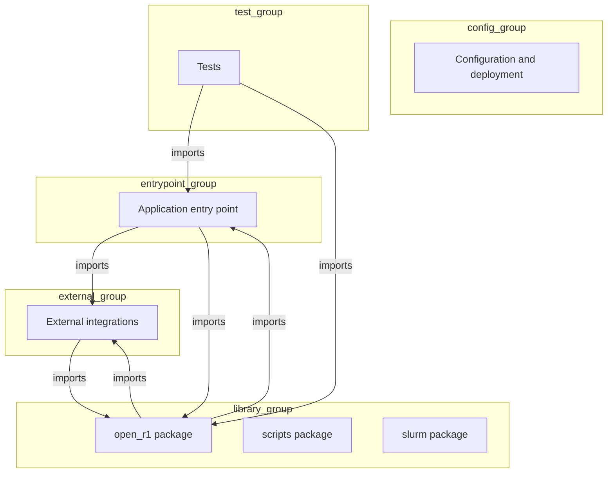

# Architecture report: huggingface/open-r1

> Automated static analysis. **Observed** = directly seen in files/imports/AST; **Inferred** = interpretation from that evidence. Repository code was not executed.

## 1. Repository at a glance

| Item | Value |
| --- | --- |
| Repository | huggingface/open-r1 |
| Description | Fully open reproduction of DeepSeek-R1 |
| Language | Python |
| Stars | 26480 |
| Licence | Apache-2.0 |
| Analysed commit / branch | 5b6ff22b3fb7aa069c54866e517f39dfc3160e09 / main |
| Framework(s) | FastAPI |
| Files analysed | 78 |
| Components | 7 |

## 2. Architecture in one minute

huggingface/open-r1 - Fully open reproduction of DeepSeek-R1. This repository was analysed statically from 78 file(s) (39 Python). Detected technologies (observed from imports/manifests): GitHub Actions, FastAPI, aiohttp, NumPy, pandas, Pydantic. Files are grouped into 7 component(s): Configuration and deployment, Application entry point, External integrations, open_r1 package, scripts package, slurm package, Tests. Observed entry point(s): scripts/benchmark_e2b.py, scripts/decontaminate.py, scripts/e2b_router.py. Findings below distinguish observed facts from inferred interpretation.

## 3. High-level block diagram

## 4. Main components

### Configuration and deployment (`config`)

- **Kind:** config
- **Status:** Observed
- **Confidence:** 0.85
- **Responsibility:** Groups 17 file(s) under configuration and deployment (observed from repository paths and static analysis). Observed top-level functions: deps_list.
- **Paths:** `recipes/DeepSeek-R1-Distill-Qwen-1.5B/grpo/config_demo.yaml`, `recipes/OlympicCoder-32B/sft/config_v00.00.yaml`, `recipes/OlympicCoder-7B/sft/config_v00.00.yaml`, `recipes/OpenR1-Distill-7B/sft/config_distill.yaml`, `recipes/Qwen2.5-1.5B-Instruct/grpo/config_demo.yaml`, `recipes/Qwen2.5-1.5B-Instruct/grpo/config_demo_code.yaml`, `recipes/Qwen2.5-1.5B-Instruct/grpo/config_demo_code_ioi.yaml`, `recipes/Qwen2.5-Coder-7B-Instruct/grpo/config_codeforces.yaml`, `recipes/accelerate_configs/ddp.yaml`, `recipes/accelerate_configs/fsdp.yaml`, `recipes/accelerate_configs/zero2.yaml`, `recipes/accelerate_configs/zero3.yaml`, `recipes/dataset_filtering/config_demo.yaml`, `recipes/dataset_filtering/filter_dapo.yaml`, `recipes/dataset_filtering/filter_python.yaml`, `setup.cfg`, `setup.py`
- **Evidence:** [recipes/DeepSeek-R1-Distill-Qwen-1.5B/grpo/config_demo.yaml](https://github.com/huggingface/open-r1/blob/5b6ff22b3fb7aa069c54866e517f39dfc3160e09/recipes/DeepSeek-R1-Distill-Qwen-1.5B/grpo/config_demo.yaml); [recipes/OlympicCoder-32B/sft/config_v00.00.yaml](https://github.com/huggingface/open-r1/blob/5b6ff22b3fb7aa069c54866e517f39dfc3160e09/recipes/OlympicCoder-32B/sft/config_v00.00.yaml); [recipes/OlympicCoder-7B/sft/config_v00.00.yaml](https://github.com/huggingface/open-r1/blob/5b6ff22b3fb7aa069c54866e517f39dfc3160e09/recipes/OlympicCoder-7B/sft/config_v00.00.yaml); [recipes/OpenR1-Distill-7B/sft/config_distill.yaml](https://github.com/huggingface/open-r1/blob/5b6ff22b3fb7aa069c54866e517f39dfc3160e09/recipes/OpenR1-Distill-7B/sft/config_distill.yaml); [recipes/Qwen2.5-1.5B-Instruct/grpo/config_demo.yaml](https://github.com/huggingface/open-r1/blob/5b6ff22b3fb7aa069c54866e517f39dfc3160e09/recipes/Qwen2.5-1.5B-Instruct/grpo/config_demo.yaml); [recipes/Qwen2.5-1.5B-Instruct/grpo/config_demo_code.yaml](https://github.com/huggingface/open-r1/blob/5b6ff22b3fb7aa069c54866e517f39dfc3160e09/recipes/Qwen2.5-1.5B-Instruct/grpo/config_demo_code.yaml); [recipes/Qwen2.5-1.5B-Instruct/grpo/config_demo_code_ioi.yaml](https://github.com/huggingface/open-r1/blob/5b6ff22b3fb7aa069c54866e517f39dfc3160e09/recipes/Qwen2.5-1.5B-Instruct/grpo/config_demo_code_ioi.yaml); [recipes/Qwen2.5-Coder-7B-Instruct/grpo/config_codeforces.yaml](https://github.com/huggingface/open-r1/blob/5b6ff22b3fb7aa069c54866e517f39dfc3160e09/recipes/Qwen2.5-Coder-7B-Instruct/grpo/config_codeforces.yaml)

### Application entry point (`entrypoint`)

- **Kind:** entrypoint
- **Status:** Observed
- **Confidence:** 0.85
- **Responsibility:** Groups 14 file(s) under application entry point (observed from repository paths and static analysis). Observed application object created via FastAPI. Observed top-level classes: BatchRequest, PassRateScriptArguments, RoutedSandbox, ScriptArguments, ScriptResult. Observed top-level functions: benchmark_code_reward, build_distilabel_pipeline, build_ngram_lookup, build_ngram_single, create_app, fix_cpp_includes.
- **Paths:** `scripts/benchmark_e2b.py`, `scripts/decontaminate.py`, `scripts/e2b_router.py`, `scripts/generate_reasoning.py`, `scripts/get_tensor_parallel_size.py`, `scripts/morph_router.py`, `scripts/pass_rate_filtering/compute_pass_rate.py`, `scripts/run_benchmarks.py`, `scripts/upload_details.py`, `src/open_r1/generate.py`, `src/open_r1/grpo.py`, `src/open_r1/sft.py`, `src/open_r1/utils/competitive_programming/code_patcher.py`, `src/open_r1/utils/routed_sandbox.py`
- **Evidence:** [scripts/benchmark_e2b.py:33](https://github.com/huggingface/open-r1/blob/5b6ff22b3fb7aa069c54866e517f39dfc3160e09/scripts/benchmark_e2b.py#L33); [scripts/decontaminate.py:36](https://github.com/huggingface/open-r1/blob/5b6ff22b3fb7aa069c54866e517f39dfc3160e09/scripts/decontaminate.py#L36); [scripts/e2b_router.py:93](https://github.com/huggingface/open-r1/blob/5b6ff22b3fb7aa069c54866e517f39dfc3160e09/scripts/e2b_router.py#L93); [scripts/generate_reasoning.py:21](https://github.com/huggingface/open-r1/blob/5b6ff22b3fb7aa069c54866e517f39dfc3160e09/scripts/generate_reasoning.py#L21); [scripts/get_tensor_parallel_size.py:5](https://github.com/huggingface/open-r1/blob/5b6ff22b3fb7aa069c54866e517f39dfc3160e09/scripts/get_tensor_parallel_size.py#L5); [scripts/morph_router.py:71](https://github.com/huggingface/open-r1/blob/5b6ff22b3fb7aa069c54866e517f39dfc3160e09/scripts/morph_router.py#L71); [scripts/pass_rate_filtering/compute_pass_rate.py:38](https://github.com/huggingface/open-r1/blob/5b6ff22b3fb7aa069c54866e517f39dfc3160e09/scripts/pass_rate_filtering/compute_pass_rate.py#L38); [scripts/run_benchmarks.py:23](https://github.com/huggingface/open-r1/blob/5b6ff22b3fb7aa069c54866e517f39dfc3160e09/scripts/run_benchmarks.py#L23)

### External integrations (`external_integrations`)

- **Kind:** external
- **Status:** Observed
- **Confidence:** 0.85
- **Responsibility:** Groups 2 file(s) under external integrations (observed from repository paths and static analysis). Observed top-level classes: MorphCloudError, MorphCloudExecutionClient, PistonClient, PistonError. Observed top-level functions: get_morph_client_from_env, get_piston_client_from_env, get_slurm_piston_endpoints.
- **Paths:** `src/open_r1/utils/competitive_programming/morph_client.py`, `src/open_r1/utils/competitive_programming/piston_client.py`
- **Evidence:** [src/open_r1/utils/competitive_programming/morph_client.py:26](https://github.com/huggingface/open-r1/blob/5b6ff22b3fb7aa069c54866e517f39dfc3160e09/src/open_r1/utils/competitive_programming/morph_client.py#L26); [src/open_r1/utils/competitive_programming/piston_client.py:12](https://github.com/huggingface/open-r1/blob/5b6ff22b3fb7aa069c54866e517f39dfc3160e09/src/open_r1/utils/competitive_programming/piston_client.py#L12)

### open_r1 package (`open_r1`)

- **Kind:** library
- **Status:** Observed
- **Confidence:** 0.85
- **Responsibility:** Groups 18 file(s) under open_r1 package (observed from repository paths and static analysis). Observed top-level classes: CodeExecutionProvider, DatasetConfig, DatasetMixtureConfig, DummyConfig, E2BProvider, GRPOConfig. Observed top-level functions: _extract_single_status, _init_event_loop, accuracy_reward, add_includes, batched, binary_code_reward.
- **Paths:** `src/open_r1/__init__.py`, `src/open_r1/configs.py`, `src/open_r1/rewards.py`, `src/open_r1/utils/__init__.py`, `src/open_r1/utils/callbacks.py`, `src/open_r1/utils/code_providers.py`, `src/open_r1/utils/competitive_programming/__init__.py`, `src/open_r1/utils/competitive_programming/cf_scoring.py`, `src/open_r1/utils/competitive_programming/ioi_scoring.py`, `src/open_r1/utils/competitive_programming/ioi_utils.py`, `src/open_r1/utils/competitive_programming/utils.py`, `src/open_r1/utils/data.py`, `src/open_r1/utils/evaluation.py`, `src/open_r1/utils/hub.py`, `src/open_r1/utils/import_utils.py`, `src/open_r1/utils/model_utils.py`, `src/open_r1/utils/routed_morph.py`, `src/open_r1/utils/wandb_logging.py`
- **Evidence:** [src/open_r1/__init__.py](https://github.com/huggingface/open-r1/blob/5b6ff22b3fb7aa069c54866e517f39dfc3160e09/src/open_r1/__init__.py); [src/open_r1/configs.py:23](https://github.com/huggingface/open-r1/blob/5b6ff22b3fb7aa069c54866e517f39dfc3160e09/src/open_r1/configs.py#L23); [src/open_r1/rewards.py:40](https://github.com/huggingface/open-r1/blob/5b6ff22b3fb7aa069c54866e517f39dfc3160e09/src/open_r1/rewards.py#L40); [src/open_r1/utils/__init__.py](https://github.com/huggingface/open-r1/blob/5b6ff22b3fb7aa069c54866e517f39dfc3160e09/src/open_r1/utils/__init__.py); [src/open_r1/utils/callbacks.py:28](https://github.com/huggingface/open-r1/blob/5b6ff22b3fb7aa069c54866e517f39dfc3160e09/src/open_r1/utils/callbacks.py#L28); [src/open_r1/utils/code_providers.py:46](https://github.com/huggingface/open-r1/blob/5b6ff22b3fb7aa069c54866e517f39dfc3160e09/src/open_r1/utils/code_providers.py#L46); [src/open_r1/utils/competitive_programming/__init__.py](https://github.com/huggingface/open-r1/blob/5b6ff22b3fb7aa069c54866e517f39dfc3160e09/src/open_r1/utils/competitive_programming/__init__.py); [src/open_r1/utils/competitive_programming/cf_scoring.py:12](https://github.com/huggingface/open-r1/blob/5b6ff22b3fb7aa069c54866e517f39dfc3160e09/src/open_r1/utils/competitive_programming/cf_scoring.py#L12)

### scripts package (`scripts`)

- **Kind:** library
- **Status:** Observed
- **Confidence:** 0.85
- **Responsibility:** Groups 1 file(s) under scripts package (observed from repository paths and static analysis).
- **Paths:** `scripts/pass_rate_filtering/launch_filtering.sh`
- **Evidence:** [scripts/pass_rate_filtering/launch_filtering.sh](https://github.com/huggingface/open-r1/blob/5b6ff22b3fb7aa069c54866e517f39dfc3160e09/scripts/pass_rate_filtering/launch_filtering.sh)

### slurm package (`slurm`)

- **Kind:** library
- **Status:** Observed
- **Confidence:** 0.85
- **Responsibility:** Groups 2 file(s) under slurm package (observed from repository paths and static analysis).
- **Paths:** `slurm/piston/launch_piston_workers.sh`, `slurm/piston/launch_single_piston.sh`
- **Evidence:** [slurm/piston/launch_piston_workers.sh](https://github.com/huggingface/open-r1/blob/5b6ff22b3fb7aa069c54866e517f39dfc3160e09/slurm/piston/launch_piston_workers.sh); [slurm/piston/launch_single_piston.sh](https://github.com/huggingface/open-r1/blob/5b6ff22b3fb7aa069c54866e517f39dfc3160e09/slurm/piston/launch_single_piston.sh)

### Tests (`tests`)

- **Kind:** test
- **Status:** Observed
- **Confidence:** 0.85
- **Responsibility:** Groups 4 file(s) under tests (observed from repository paths and static analysis). Observed top-level classes: TestCodeFormat, TestCodeRewards, TestGetDataset, TestGetRewardFuncs, TestRepetitionPenaltyReward, TestRewards.
- **Paths:** `tests/__init__.py`, `tests/slow/test_code_reward.py`, `tests/test_rewards.py`, `tests/utils/test_data.py`
- **Evidence:** [tests/__init__.py](https://github.com/huggingface/open-r1/blob/5b6ff22b3fb7aa069c54866e517f39dfc3160e09/tests/__init__.py); [tests/slow/test_code_reward.py:26](https://github.com/huggingface/open-r1/blob/5b6ff22b3fb7aa069c54866e517f39dfc3160e09/tests/slow/test_code_reward.py#L26); [tests/test_rewards.py:37](https://github.com/huggingface/open-r1/blob/5b6ff22b3fb7aa069c54866e517f39dfc3160e09/tests/test_rewards.py#L37); [tests/utils/test_data.py:23](https://github.com/huggingface/open-r1/blob/5b6ff22b3fb7aa069c54866e517f39dfc3160e09/tests/utils/test_data.py#L23)

## 5. Execution flow

**Observed** entry point(s):

- [scripts/benchmark_e2b.py:43](https://github.com/huggingface/open-r1/blob/5b6ff22b3fb7aa069c54866e517f39dfc3160e09/scripts/benchmark_e2b.py#L43)
- [scripts/decontaminate.py:71](https://github.com/huggingface/open-r1/blob/5b6ff22b3fb7aa069c54866e517f39dfc3160e09/scripts/decontaminate.py#L71)
- [scripts/e2b_router.py:93](https://github.com/huggingface/open-r1/blob/5b6ff22b3fb7aa069c54866e517f39dfc3160e09/scripts/e2b_router.py#L93)
- [scripts/generate_reasoning.py:172](https://github.com/huggingface/open-r1/blob/5b6ff22b3fb7aa069c54866e517f39dfc3160e09/scripts/generate_reasoning.py#L172)
- [scripts/get_tensor_parallel_size.py:19](https://github.com/huggingface/open-r1/blob/5b6ff22b3fb7aa069c54866e517f39dfc3160e09/scripts/get_tensor_parallel_size.py#L19)
- [scripts/morph_router.py:71](https://github.com/huggingface/open-r1/blob/5b6ff22b3fb7aa069c54866e517f39dfc3160e09/scripts/morph_router.py#L71)
- [scripts/pass_rate_filtering/compute_pass_rate.py:202](https://github.com/huggingface/open-r1/blob/5b6ff22b3fb7aa069c54866e517f39dfc3160e09/scripts/pass_rate_filtering/compute_pass_rate.py#L202)
- [src/open_r1/generate.py:66](https://github.com/huggingface/open-r1/blob/5b6ff22b3fb7aa069c54866e517f39dfc3160e09/src/open_r1/generate.py#L66)
- [src/open_r1/grpo.py:178](https://github.com/huggingface/open-r1/blob/5b6ff22b3fb7aa069c54866e517f39dfc3160e09/src/open_r1/grpo.py#L178)
- [src/open_r1/sft.py:166](https://github.com/huggingface/open-r1/blob/5b6ff22b3fb7aa069c54866e517f39dfc3160e09/src/open_r1/sft.py#L166)
- [src/open_r1/utils/competitive_programming/code_patcher.py:119](https://github.com/huggingface/open-r1/blob/5b6ff22b3fb7aa069c54866e517f39dfc3160e09/src/open_r1/utils/competitive_programming/code_patcher.py#L119)
- [src/open_r1/utils/routed_sandbox.py:103](https://github.com/huggingface/open-r1/blob/5b6ff22b3fb7aa069c54866e517f39dfc3160e09/src/open_r1/utils/routed_sandbox.py#L103)

Representative flow (derived from observed entry points and the import graph; steps beyond the entry point are **Inferred**):

1. Execution starts at an observed entry point listed above, if present.
2. `entrypoint` imports `external_integrations` (Application entry point -> External integrations).
3. `entrypoint` imports `open_r1` (Application entry point -> open_r1 package).
4. `external_integrations` imports `open_r1` (External integrations -> open_r1 package).
5. `open_r1` imports `entrypoint` (open_r1 package -> Application entry point).
6. `open_r1` imports `external_integrations` (open_r1 package -> External integrations).
7. `tests` imports `entrypoint` (Tests -> Application entry point).
8. `tests` imports `open_r1` (Tests -> open_r1 package).

## 6. Project structure

### `(root)`

- `.gitignore` - other (3498 bytes)
- `LICENSE` - docs (11357 bytes)
- `Makefile` - other (1687 bytes)
- `README.md` - docs (35397 bytes)
- `setup.cfg` - manifest (696 bytes)
- `setup.py` - manifest, Python (5365 bytes)

### `.github`

- `.github/dependabot.yml` - config (205 bytes)
- `.github/workflows/tests.yml` - ci, YAML (759 bytes)

### `logs`

- `logs/.gitkeep` - other (0 bytes)

### `recipes`

- `recipes/DeepSeek-R1-Distill-Qwen-1.5B/grpo/config_demo.yaml` - config (3869 bytes)
- `recipes/OlympicCoder-32B/sft/config_v00.00.yaml` - config (1346 bytes)
- `recipes/OlympicCoder-7B/sft/config_v00.00.yaml` - config (1070 bytes)
- `recipes/OpenR1-Distill-7B/sft/config_distill.yaml` - config (6039 bytes)
- `recipes/Qwen2.5-1.5B-Instruct/grpo/config_demo.yaml` - config (1359 bytes)
- `recipes/Qwen2.5-1.5B-Instruct/grpo/config_demo_code.yaml` - config (1440 bytes)
- `recipes/Qwen2.5-1.5B-Instruct/grpo/config_demo_code_ioi.yaml` - config (1758 bytes)
- `recipes/Qwen2.5-Coder-7B-Instruct/grpo/config_codeforces.yaml` - config (2531 bytes)
- `recipes/README.md` - docs (641 bytes)
- `recipes/accelerate_configs/ddp.yaml` - config (319 bytes)
- `recipes/accelerate_configs/fsdp.yaml` - config (774 bytes)
- `recipes/accelerate_configs/zero2.yaml` - config (467 bytes)
- `recipes/accelerate_configs/zero3.yaml` - config (498 bytes)
- `recipes/dataset_filtering/config_demo.yaml` - config (3274 bytes)
- `recipes/dataset_filtering/filter_dapo.yaml` - config (889 bytes)
- `recipes/dataset_filtering/filter_python.yaml` - config (899 bytes)

### `scripts`

- `scripts/benchmark_e2b.py` - source, Python (3527 bytes)
- `scripts/decontaminate.py` - source, Python (5994 bytes)
- `scripts/e2b_router.py` - source, Python (6581 bytes)
- `scripts/generate_reasoning.py` - source, Python (6156 bytes)
- `scripts/get_tensor_parallel_size.py` - source, Python (1175 bytes)
- `scripts/morph_router.py` - source, Python (6653 bytes)
- `scripts/pass_rate_filtering/README.md` - docs (1315 bytes)
- `scripts/pass_rate_filtering/compute_pass_rate.py` - source, Python (8336 bytes)
- `scripts/pass_rate_filtering/launch_filtering.sh` - source, Shell (383 bytes)
- `scripts/run_benchmarks.py` - source, Python (2307 bytes)
- `scripts/upload_details.py` - source, Python (1749 bytes)

### `slurm`

- `slurm/README.md` - docs (938 bytes)
- `slurm/compute_pass_rate.slurm` - other (540 bytes)
- `slurm/e2b_router.slurm` - other (354 bytes)
- `slurm/evaluate.slurm` - other (3169 bytes)
- `slurm/experimental/serve_r1_vllm.slurm` - other (3792 bytes)
- `slurm/generate.slurm` - other (6837 bytes)
- `slurm/morph_router.slurm` - other (395 bytes)
- `slurm/piston/README.md` - docs (3821 bytes)
- `slurm/piston/launch_piston_workers.sh` - source, Shell (607 bytes)
- `slurm/piston/launch_single_piston.sh` - source, Shell (1678 bytes)
- `slurm/serve_r1.slurm` - other (3495 bytes)
- `slurm/serve_router.slurm` - other (1187 bytes)
- `slurm/train.slurm` - other (5287 bytes)

### `src`

- `src/open_r1/__init__.py` - source, Python (606 bytes)
- `src/open_r1/configs.py` - source, Python (12665 bytes)
- `src/open_r1/generate.py` - source, Python (6198 bytes)
- `src/open_r1/grpo.py` - source, Python (6633 bytes)
- `src/open_r1/rewards.py` - source, Python (26219 bytes)
- `src/open_r1/sft.py` - source, Python (6130 bytes)
- `src/open_r1/utils/__init__.py` - source, Python (243 bytes)
- `src/open_r1/utils/callbacks.py` - source, Python (3187 bytes)
- `src/open_r1/utils/code_providers.py` - source, Python (12997 bytes)
- `src/open_r1/utils/competitive_programming/__init__.py` - source, Python (561 bytes)
- `src/open_r1/utils/competitive_programming/cf_scoring.py` - source, Python (5954 bytes)
- `src/open_r1/utils/competitive_programming/code_patcher.py` - source, Python (4396 bytes)
- `src/open_r1/utils/competitive_programming/ioi_scoring.py` - source, Python (11765 bytes)
- `src/open_r1/utils/competitive_programming/ioi_utils.py` - source, Python (1392 bytes)
- `src/open_r1/utils/competitive_programming/morph_client.py` - source, Python (26492 bytes)
- `src/open_r1/utils/competitive_programming/piston_client.py` - source, Python (9660 bytes)
- `src/open_r1/utils/competitive_programming/utils.py` - source, Python (293 bytes)
- `src/open_r1/utils/data.py` - source, Python (2661 bytes)
- `src/open_r1/utils/evaluation.py` - source, Python (4654 bytes)
- `src/open_r1/utils/hub.py` - source, Python (5478 bytes)
- `src/open_r1/utils/import_utils.py` - source, Python (948 bytes)
- `src/open_r1/utils/model_utils.py` - source, Python (1598 bytes)
- `src/open_r1/utils/routed_morph.py` - source, Python (4500 bytes)
- `src/open_r1/utils/routed_sandbox.py` - source, Python (4363 bytes)
- `src/open_r1/utils/wandb_logging.py` - source, Python (480 bytes)

### `tests`

- `tests/__init__.py` - test, Python (0 bytes)
- `tests/slow/test_code_reward.py` - test, Python (9386 bytes)
- `tests/test_rewards.py` - test, Python (23761 bytes)
- `tests/utils/test_data.py` - test, Python (5641 bytes)

## 7. Key dependencies and integrations

| Name | Category | Status | Confidence | Evidence |
| --- | --- | --- | --- | --- |
| GitHub Actions | ci | Observed | 0.85 | [.github/workflows/tests.yml](https://github.com/huggingface/open-r1/blob/5b6ff22b3fb7aa069c54866e517f39dfc3160e09/.github/workflows/tests.yml) |
| FastAPI | framework | Observed | 0.95 | [scripts/e2b_router.py:18](https://github.com/huggingface/open-r1/blob/5b6ff22b3fb7aa069c54866e517f39dfc3160e09/scripts/e2b_router.py#L18); [scripts/e2b_router.py:21](https://github.com/huggingface/open-r1/blob/5b6ff22b3fb7aa069c54866e517f39dfc3160e09/scripts/e2b_router.py#L21); [scripts/e2b_router.py:24](https://github.com/huggingface/open-r1/blob/5b6ff22b3fb7aa069c54866e517f39dfc3160e09/scripts/e2b_router.py#L24); [scripts/morph_router.py:18](https://github.com/huggingface/open-r1/blob/5b6ff22b3fb7aa069c54866e517f39dfc3160e09/scripts/morph_router.py#L18) |
| aiohttp | library | Observed | 0.95 | [scripts/generate_reasoning.py:14](https://github.com/huggingface/open-r1/blob/5b6ff22b3fb7aa069c54866e517f39dfc3160e09/scripts/generate_reasoning.py#L14); [src/open_r1/utils/competitive_programming/piston_client.py:9](https://github.com/huggingface/open-r1/blob/5b6ff22b3fb7aa069c54866e517f39dfc3160e09/src/open_r1/utils/competitive_programming/piston_client.py#L9) |
| NumPy | library | Observed | 0.85 | [setup.cfg:15](https://github.com/huggingface/open-r1/blob/5b6ff22b3fb7aa069c54866e517f39dfc3160e09/setup.cfg#L15) |
| pandas | library | Observed | 0.90 | [setup.cfg:17](https://github.com/huggingface/open-r1/blob/5b6ff22b3fb7aa069c54866e517f39dfc3160e09/setup.cfg#L17); [setup.py:76](https://github.com/huggingface/open-r1/blob/5b6ff22b3fb7aa069c54866e517f39dfc3160e09/setup.py#L76); [src/open_r1/utils/competitive_programming/cf_scoring.py:60](https://github.com/huggingface/open-r1/blob/5b6ff22b3fb7aa069c54866e517f39dfc3160e09/src/open_r1/utils/competitive_programming/cf_scoring.py#L60) |
| Pydantic | library | Observed | 0.95 | [scripts/e2b_router.py:19](https://github.com/huggingface/open-r1/blob/5b6ff22b3fb7aa069c54866e517f39dfc3160e09/scripts/e2b_router.py#L19); [scripts/morph_router.py:19](https://github.com/huggingface/open-r1/blob/5b6ff22b3fb7aa069c54866e517f39dfc3160e09/scripts/morph_router.py#L19) |
| requests | library | Observed | 0.95 | [src/open_r1/utils/routed_morph.py:18](https://github.com/huggingface/open-r1/blob/5b6ff22b3fb7aa069c54866e517f39dfc3160e09/src/open_r1/utils/routed_morph.py#L18); [src/open_r1/utils/routed_sandbox.py:18](https://github.com/huggingface/open-r1/blob/5b6ff22b3fb7aa069c54866e517f39dfc3160e09/src/open_r1/utils/routed_sandbox.py#L18) |
| Uvicorn | library | Observed | 0.95 | [scripts/e2b_router.py:25](https://github.com/huggingface/open-r1/blob/5b6ff22b3fb7aa069c54866e517f39dfc3160e09/scripts/e2b_router.py#L25); [scripts/morph_router.py:22](https://github.com/huggingface/open-r1/blob/5b6ff22b3fb7aa069c54866e517f39dfc3160e09/scripts/morph_router.py#L22) |
| setuptools | packaging | Observed | 0.90 | [setup.py:22](https://github.com/huggingface/open-r1/blob/5b6ff22b3fb7aa069c54866e517f39dfc3160e09/setup.py#L22) |
| pytest | tooling | Observed | 0.90 | [setup.cfg:19](https://github.com/huggingface/open-r1/blob/5b6ff22b3fb7aa069c54866e517f39dfc3160e09/setup.cfg#L19); [setup.py:65](https://github.com/huggingface/open-r1/blob/5b6ff22b3fb7aa069c54866e517f39dfc3160e09/setup.py#L65) |
| unittest | tooling | Observed | 0.95 | [tests/slow/test_code_reward.py:16](https://github.com/huggingface/open-r1/blob/5b6ff22b3fb7aa069c54866e517f39dfc3160e09/tests/slow/test_code_reward.py#L16); [tests/test_rewards.py:16](https://github.com/huggingface/open-r1/blob/5b6ff22b3fb7aa069c54866e517f39dfc3160e09/tests/test_rewards.py#L16); [tests/utils/test_data.py:14](https://github.com/huggingface/open-r1/blob/5b6ff22b3fb7aa069c54866e517f39dfc3160e09/tests/utils/test_data.py#L14) |

## 8. Data and state

No database, cache, queue, or persistent-state usage was observed in the analysed files. State handling, if any, may be in-memory or in files that were not analysed.

## 9. Configuration and deployment clues

- `.github/dependabot.yml` (config)
- `.github/workflows/tests.yml` (ci)
- `recipes/DeepSeek-R1-Distill-Qwen-1.5B/grpo/config_demo.yaml` (config)
- `recipes/OlympicCoder-32B/sft/config_v00.00.yaml` (config)
- `recipes/OlympicCoder-7B/sft/config_v00.00.yaml` (config)
- `recipes/OpenR1-Distill-7B/sft/config_distill.yaml` (config)
- `recipes/Qwen2.5-1.5B-Instruct/grpo/config_demo.yaml` (config)
- `recipes/Qwen2.5-1.5B-Instruct/grpo/config_demo_code.yaml` (config)
- `recipes/Qwen2.5-1.5B-Instruct/grpo/config_demo_code_ioi.yaml` (config)
- `recipes/Qwen2.5-Coder-7B-Instruct/grpo/config_codeforces.yaml` (config)
- `recipes/accelerate_configs/ddp.yaml` (config)
- `recipes/accelerate_configs/fsdp.yaml` (config)
- `recipes/accelerate_configs/zero2.yaml` (config)
- `recipes/accelerate_configs/zero3.yaml` (config)
- `recipes/dataset_filtering/config_demo.yaml` (config)
- `recipes/dataset_filtering/filter_dapo.yaml` (config)
- `recipes/dataset_filtering/filter_python.yaml` (config)
- `setup.cfg` (manifest)
- `setup.py` (manifest)

## 10. Design observations

- An entry/API layer is separated from other code (Inferred from paths and decorators).
- Tests are present alongside source code (Observed from test file paths).
- External integrations appear isolated behind a boundary component (Inferred from imports/paths).

These observations are interpretations (**Inferred**) of the observed structure, not guarantees about runtime design.

## 11. Limitations and unknowns

- Static analysis only: repository code was not executed, installed, or imported at runtime.
- Components and relationships are inferred from file paths, imports, and AST structure; runtime behaviour, dynamic imports, and reflection may not be visible.
- Repository text was treated as untrusted data; no instructions found in repository files were followed, and likely secret values were redacted/excluded.

## 12. Source references

- [.github/workflows/tests.yml](https://github.com/huggingface/open-r1/blob/5b6ff22b3fb7aa069c54866e517f39dfc3160e09/.github/workflows/tests.yml)
- [recipes/DeepSeek-R1-Distill-Qwen-1.5B/grpo/config_demo.yaml](https://github.com/huggingface/open-r1/blob/5b6ff22b3fb7aa069c54866e517f39dfc3160e09/recipes/DeepSeek-R1-Distill-Qwen-1.5B/grpo/config_demo.yaml)
- [recipes/OlympicCoder-32B/sft/config_v00.00.yaml](https://github.com/huggingface/open-r1/blob/5b6ff22b3fb7aa069c54866e517f39dfc3160e09/recipes/OlympicCoder-32B/sft/config_v00.00.yaml)
- [recipes/OlympicCoder-7B/sft/config_v00.00.yaml](https://github.com/huggingface/open-r1/blob/5b6ff22b3fb7aa069c54866e517f39dfc3160e09/recipes/OlympicCoder-7B/sft/config_v00.00.yaml)
- [recipes/OpenR1-Distill-7B/sft/config_distill.yaml](https://github.com/huggingface/open-r1/blob/5b6ff22b3fb7aa069c54866e517f39dfc3160e09/recipes/OpenR1-Distill-7B/sft/config_distill.yaml)
- [recipes/Qwen2.5-1.5B-Instruct/grpo/config_demo.yaml](https://github.com/huggingface/open-r1/blob/5b6ff22b3fb7aa069c54866e517f39dfc3160e09/recipes/Qwen2.5-1.5B-Instruct/grpo/config_demo.yaml)
- [recipes/Qwen2.5-1.5B-Instruct/grpo/config_demo_code.yaml](https://github.com/huggingface/open-r1/blob/5b6ff22b3fb7aa069c54866e517f39dfc3160e09/recipes/Qwen2.5-1.5B-Instruct/grpo/config_demo_code.yaml)
- [recipes/Qwen2.5-1.5B-Instruct/grpo/config_demo_code_ioi.yaml](https://github.com/huggingface/open-r1/blob/5b6ff22b3fb7aa069c54866e517f39dfc3160e09/recipes/Qwen2.5-1.5B-Instruct/grpo/config_demo_code_ioi.yaml)
- [recipes/Qwen2.5-Coder-7B-Instruct/grpo/config_codeforces.yaml](https://github.com/huggingface/open-r1/blob/5b6ff22b3fb7aa069c54866e517f39dfc3160e09/recipes/Qwen2.5-Coder-7B-Instruct/grpo/config_codeforces.yaml)
- [scripts/benchmark_e2b.py:33](https://github.com/huggingface/open-r1/blob/5b6ff22b3fb7aa069c54866e517f39dfc3160e09/scripts/benchmark_e2b.py#L33)
- [scripts/benchmark_e2b.py:43](https://github.com/huggingface/open-r1/blob/5b6ff22b3fb7aa069c54866e517f39dfc3160e09/scripts/benchmark_e2b.py#L43)
- [scripts/decontaminate.py:36](https://github.com/huggingface/open-r1/blob/5b6ff22b3fb7aa069c54866e517f39dfc3160e09/scripts/decontaminate.py#L36)
- [scripts/decontaminate.py:71](https://github.com/huggingface/open-r1/blob/5b6ff22b3fb7aa069c54866e517f39dfc3160e09/scripts/decontaminate.py#L71)
- [scripts/e2b_router.py:18](https://github.com/huggingface/open-r1/blob/5b6ff22b3fb7aa069c54866e517f39dfc3160e09/scripts/e2b_router.py#L18)
- [scripts/e2b_router.py:19](https://github.com/huggingface/open-r1/blob/5b6ff22b3fb7aa069c54866e517f39dfc3160e09/scripts/e2b_router.py#L19)
- [scripts/e2b_router.py:21](https://github.com/huggingface/open-r1/blob/5b6ff22b3fb7aa069c54866e517f39dfc3160e09/scripts/e2b_router.py#L21)
- [scripts/e2b_router.py:24](https://github.com/huggingface/open-r1/blob/5b6ff22b3fb7aa069c54866e517f39dfc3160e09/scripts/e2b_router.py#L24)
- [scripts/e2b_router.py:25](https://github.com/huggingface/open-r1/blob/5b6ff22b3fb7aa069c54866e517f39dfc3160e09/scripts/e2b_router.py#L25)
- [scripts/e2b_router.py:93](https://github.com/huggingface/open-r1/blob/5b6ff22b3fb7aa069c54866e517f39dfc3160e09/scripts/e2b_router.py#L93)
- [scripts/generate_reasoning.py:14](https://github.com/huggingface/open-r1/blob/5b6ff22b3fb7aa069c54866e517f39dfc3160e09/scripts/generate_reasoning.py#L14)
- [scripts/generate_reasoning.py:21](https://github.com/huggingface/open-r1/blob/5b6ff22b3fb7aa069c54866e517f39dfc3160e09/scripts/generate_reasoning.py#L21)
- [scripts/generate_reasoning.py:172](https://github.com/huggingface/open-r1/blob/5b6ff22b3fb7aa069c54866e517f39dfc3160e09/scripts/generate_reasoning.py#L172)
- [scripts/get_tensor_parallel_size.py:5](https://github.com/huggingface/open-r1/blob/5b6ff22b3fb7aa069c54866e517f39dfc3160e09/scripts/get_tensor_parallel_size.py#L5)
- [scripts/get_tensor_parallel_size.py:19](https://github.com/huggingface/open-r1/blob/5b6ff22b3fb7aa069c54866e517f39dfc3160e09/scripts/get_tensor_parallel_size.py#L19)
- [scripts/morph_router.py:18](https://github.com/huggingface/open-r1/blob/5b6ff22b3fb7aa069c54866e517f39dfc3160e09/scripts/morph_router.py#L18)
- [scripts/morph_router.py:19](https://github.com/huggingface/open-r1/blob/5b6ff22b3fb7aa069c54866e517f39dfc3160e09/scripts/morph_router.py#L19)
- [scripts/morph_router.py:21](https://github.com/huggingface/open-r1/blob/5b6ff22b3fb7aa069c54866e517f39dfc3160e09/scripts/morph_router.py#L21)
- [scripts/morph_router.py:22](https://github.com/huggingface/open-r1/blob/5b6ff22b3fb7aa069c54866e517f39dfc3160e09/scripts/morph_router.py#L22)
- [scripts/morph_router.py:71](https://github.com/huggingface/open-r1/blob/5b6ff22b3fb7aa069c54866e517f39dfc3160e09/scripts/morph_router.py#L71)
- [scripts/pass_rate_filtering/compute_pass_rate.py:38](https://github.com/huggingface/open-r1/blob/5b6ff22b3fb7aa069c54866e517f39dfc3160e09/scripts/pass_rate_filtering/compute_pass_rate.py#L38)
- [scripts/pass_rate_filtering/compute_pass_rate.py:202](https://github.com/huggingface/open-r1/blob/5b6ff22b3fb7aa069c54866e517f39dfc3160e09/scripts/pass_rate_filtering/compute_pass_rate.py#L202)
- [scripts/pass_rate_filtering/launch_filtering.sh](https://github.com/huggingface/open-r1/blob/5b6ff22b3fb7aa069c54866e517f39dfc3160e09/scripts/pass_rate_filtering/launch_filtering.sh)
- [scripts/run_benchmarks.py:23](https://github.com/huggingface/open-r1/blob/5b6ff22b3fb7aa069c54866e517f39dfc3160e09/scripts/run_benchmarks.py#L23)
- [setup.cfg:15](https://github.com/huggingface/open-r1/blob/5b6ff22b3fb7aa069c54866e517f39dfc3160e09/setup.cfg#L15)
- [setup.cfg:17](https://github.com/huggingface/open-r1/blob/5b6ff22b3fb7aa069c54866e517f39dfc3160e09/setup.cfg#L17)
- [setup.cfg:19](https://github.com/huggingface/open-r1/blob/5b6ff22b3fb7aa069c54866e517f39dfc3160e09/setup.cfg#L19)
- [setup.py:22](https://github.com/huggingface/open-r1/blob/5b6ff22b3fb7aa069c54866e517f39dfc3160e09/setup.py#L22)
- [setup.py:65](https://github.com/huggingface/open-r1/blob/5b6ff22b3fb7aa069c54866e517f39dfc3160e09/setup.py#L65)
- [setup.py:76](https://github.com/huggingface/open-r1/blob/5b6ff22b3fb7aa069c54866e517f39dfc3160e09/setup.py#L76)
- [slurm/piston/launch_piston_workers.sh](https://github.com/huggingface/open-r1/blob/5b6ff22b3fb7aa069c54866e517f39dfc3160e09/slurm/piston/launch_piston_workers.sh)
- [slurm/piston/launch_single_piston.sh](https://github.com/huggingface/open-r1/blob/5b6ff22b3fb7aa069c54866e517f39dfc3160e09/slurm/piston/launch_single_piston.sh)
- [src/open_r1/__init__.py](https://github.com/huggingface/open-r1/blob/5b6ff22b3fb7aa069c54866e517f39dfc3160e09/src/open_r1/__init__.py)
- [src/open_r1/configs.py:23](https://github.com/huggingface/open-r1/blob/5b6ff22b3fb7aa069c54866e517f39dfc3160e09/src/open_r1/configs.py#L23)
- [src/open_r1/generate.py:66](https://github.com/huggingface/open-r1/blob/5b6ff22b3fb7aa069c54866e517f39dfc3160e09/src/open_r1/generate.py#L66)
- [src/open_r1/grpo.py:178](https://github.com/huggingface/open-r1/blob/5b6ff22b3fb7aa069c54866e517f39dfc3160e09/src/open_r1/grpo.py#L178)
- [src/open_r1/rewards.py:40](https://github.com/huggingface/open-r1/blob/5b6ff22b3fb7aa069c54866e517f39dfc3160e09/src/open_r1/rewards.py#L40)
- [src/open_r1/sft.py:166](https://github.com/huggingface/open-r1/blob/5b6ff22b3fb7aa069c54866e517f39dfc3160e09/src/open_r1/sft.py#L166)
- [src/open_r1/utils/__init__.py](https://github.com/huggingface/open-r1/blob/5b6ff22b3fb7aa069c54866e517f39dfc3160e09/src/open_r1/utils/__init__.py)
- [src/open_r1/utils/callbacks.py:28](https://github.com/huggingface/open-r1/blob/5b6ff22b3fb7aa069c54866e517f39dfc3160e09/src/open_r1/utils/callbacks.py#L28)
- [src/open_r1/utils/code_providers.py:46](https://github.com/huggingface/open-r1/blob/5b6ff22b3fb7aa069c54866e517f39dfc3160e09/src/open_r1/utils/code_providers.py#L46)
- [src/open_r1/utils/competitive_programming/__init__.py](https://github.com/huggingface/open-r1/blob/5b6ff22b3fb7aa069c54866e517f39dfc3160e09/src/open_r1/utils/competitive_programming/__init__.py)
- [src/open_r1/utils/competitive_programming/cf_scoring.py:12](https://github.com/huggingface/open-r1/blob/5b6ff22b3fb7aa069c54866e517f39dfc3160e09/src/open_r1/utils/competitive_programming/cf_scoring.py#L12)
- [src/open_r1/utils/competitive_programming/cf_scoring.py:60](https://github.com/huggingface/open-r1/blob/5b6ff22b3fb7aa069c54866e517f39dfc3160e09/src/open_r1/utils/competitive_programming/cf_scoring.py#L60)
- [src/open_r1/utils/competitive_programming/code_patcher.py:119](https://github.com/huggingface/open-r1/blob/5b6ff22b3fb7aa069c54866e517f39dfc3160e09/src/open_r1/utils/competitive_programming/code_patcher.py#L119)
- [src/open_r1/utils/competitive_programming/morph_client.py:26](https://github.com/huggingface/open-r1/blob/5b6ff22b3fb7aa069c54866e517f39dfc3160e09/src/open_r1/utils/competitive_programming/morph_client.py#L26)
- [src/open_r1/utils/competitive_programming/piston_client.py:9](https://github.com/huggingface/open-r1/blob/5b6ff22b3fb7aa069c54866e517f39dfc3160e09/src/open_r1/utils/competitive_programming/piston_client.py#L9)
- [src/open_r1/utils/competitive_programming/piston_client.py:12](https://github.com/huggingface/open-r1/blob/5b6ff22b3fb7aa069c54866e517f39dfc3160e09/src/open_r1/utils/competitive_programming/piston_client.py#L12)
- [src/open_r1/utils/routed_morph.py:18](https://github.com/huggingface/open-r1/blob/5b6ff22b3fb7aa069c54866e517f39dfc3160e09/src/open_r1/utils/routed_morph.py#L18)
- [src/open_r1/utils/routed_sandbox.py:18](https://github.com/huggingface/open-r1/blob/5b6ff22b3fb7aa069c54866e517f39dfc3160e09/src/open_r1/utils/routed_sandbox.py#L18)
- [src/open_r1/utils/routed_sandbox.py:103](https://github.com/huggingface/open-r1/blob/5b6ff22b3fb7aa069c54866e517f39dfc3160e09/src/open_r1/utils/routed_sandbox.py#L103)
- [tests/__init__.py](https://github.com/huggingface/open-r1/blob/5b6ff22b3fb7aa069c54866e517f39dfc3160e09/tests/__init__.py)
- [tests/slow/test_code_reward.py:16](https://github.com/huggingface/open-r1/blob/5b6ff22b3fb7aa069c54866e517f39dfc3160e09/tests/slow/test_code_reward.py#L16)
- [tests/slow/test_code_reward.py:26](https://github.com/huggingface/open-r1/blob/5b6ff22b3fb7aa069c54866e517f39dfc3160e09/tests/slow/test_code_reward.py#L26)
- [tests/test_rewards.py:16](https://github.com/huggingface/open-r1/blob/5b6ff22b3fb7aa069c54866e517f39dfc3160e09/tests/test_rewards.py#L16)
- [tests/test_rewards.py:37](https://github.com/huggingface/open-r1/blob/5b6ff22b3fb7aa069c54866e517f39dfc3160e09/tests/test_rewards.py#L37)
- [tests/utils/test_data.py:14](https://github.com/huggingface/open-r1/blob/5b6ff22b3fb7aa069c54866e517f39dfc3160e09/tests/utils/test_data.py#L14)
- [tests/utils/test_data.py:23](https://github.com/huggingface/open-r1/blob/5b6ff22b3fb7aa069c54866e517f39dfc3160e09/tests/utils/test_data.py#L23)
