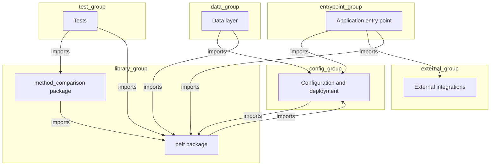

# Architecture report: huggingface/peft

> Automated static analysis. **Observed** = directly seen in files/imports/AST; **Inferred** = interpretation from that evidence. Repository code was not executed.

## 1. Repository at a glance

| Item | Value |
| --- | --- |
| Repository | huggingface/peft |
| Description | 🤗 PEFT: State-of-the-art Parameter-Efficient Fine-Tuning. |
| Language | Python |
| Stars | 21887 |
| Licence | Apache-2.0 |
| Analysed commit / branch | 66a7c305bac9d7f8183b1f158280b77be971a3d4 / main |
| Framework(s) | Typer |
| Files analysed | 800 |
| Components | 7 |

## 2. Architecture in one minute

huggingface/peft - 🤗 PEFT: State-of-the-art Parameter-Efficient Fine-Tuning.. This repository was analysed statically from 800 file(s) (245 Python). Detected technologies (observed from imports/manifests): GitHub Actions, Typer, aiohttp, NumPy, pandas, requests. Files are grouped into 7 component(s): Configuration and deployment, Data layer, Application entry point, External integrations, method_comparison package, peft package, Tests. Observed entry point(s): method_comparison/MetaMathQA/run.py, method_comparison/image-gen/evaluate.py, method_comparison/image-gen/run.py. Findings below distinguish observed facts from inferred interpretation.

## 3. High-level block diagram

## 4. Main components

### Configuration and deployment (`config`)

- **Kind:** config
- **Status:** Observed
- **Confidence:** 0.85
- **Responsibility:** Groups 314 file(s) under configuration and deployment (observed from repository paths and static analysis). Observed top-level classes: AdaLoraConfig, AdamssConfig, AdaptionPromptConfig, BOFTConfig, BeftConfig, C3AConfig. Observed top-level functions: _check_and_remove_unused_kwargs, _get_commit_hash, _is_dev_version, _sort_keys, prepare_config.
- **Paths:** `docker/peft-cpu/Dockerfile`, `docker/peft-gpu/Dockerfile`, `method_comparison/MetaMathQA/default_training_params.json`, `method_comparison/MetaMathQA/experiments/adalora/llama-3.2-3B-rank32/adapter_config.json`, `method_comparison/MetaMathQA/experiments/adamss/llama-3.2-3B-rank32/adapter_config.json`, `method_comparison/MetaMathQA/experiments/adamss/llama-3.2-3B-rank32/training_params.json`, `method_comparison/MetaMathQA/experiments/adaptionprompt/llama-3.2-3B-lr_0.0005/adapter_config.json`, `method_comparison/MetaMathQA/experiments/adaptionprompt/llama-3.2-3B-lr_0.0005/training_params.json`, `method_comparison/MetaMathQA/experiments/adaptionprompt/llama-3.2-3B-lr_5e-3/adapter_config.json`, `method_comparison/MetaMathQA/experiments/adaptionprompt/llama-3.2-3B-lr_5e-3/training_params.json`, `method_comparison/MetaMathQA/experiments/beft/llama-3.2-3B-target-v_proj/adapter_config.json`, `method_comparison/MetaMathQA/experiments/boft/llama-3.2-3B-default/adapter_config.json`, `method_comparison/MetaMathQA/experiments/c3a/llama-3.2-3B-default/adapter_config.json`, `method_comparison/MetaMathQA/experiments/c3a/llama-3.2-3B-default/training_params.json`, `method_comparison/MetaMathQA/experiments/deft/llama-3.2-3B-rank32-para/adapter_config.json`, `method_comparison/MetaMathQA/experiments/deft/llama-3.2-3B-rank32/adapter_config.json`, `method_comparison/MetaMathQA/experiments/delora/llama-3.2-3B-rank32/adapter_config.json`, `method_comparison/MetaMathQA/experiments/delora/llama-3.2-3B-rank32/training_params.json`, `method_comparison/MetaMathQA/experiments/fourierft/llama-3.2-3B-default/adapter_config.json`, `method_comparison/MetaMathQA/experiments/fourierft/llama-3.2-3B-n_frequency-5000/adapter_config.json`, `method_comparison/MetaMathQA/experiments/frod/llama-3.2-3B-default/adapter_config.json`, `method_comparison/MetaMathQA/experiments/frod/llama-3.2-3B-sparse0.02-lr_0.001/adapter_config.json`, `method_comparison/MetaMathQA/experiments/frod/llama-3.2-3B-sparse0.02-lr_0.001/training_params.json`, `method_comparison/MetaMathQA/experiments/full-finetuning/llama-3.2-3B-lr_0.00001/training_params.json`, `method_comparison/MetaMathQA/experiments/glora/llama-3.2-3B-default/adapter_config.json`, `method_comparison/MetaMathQA/experiments/glora/llama-3.2-3B-vector-paths/adapter_config.json`, `method_comparison/MetaMathQA/experiments/glora/llama-3.2-3B-vector-paths/training_params.json`, `method_comparison/MetaMathQA/experiments/gralora/llama-3.2-3B-rank32/adapter_config.json`, `method_comparison/MetaMathQA/experiments/gralora/llama-3.2-3B-rank32/training_params.json`, `method_comparison/MetaMathQA/experiments/hira/llama-3.2-3B-rank32-lr4.5e-3/adapter_config.json`, `method_comparison/MetaMathQA/experiments/hira/llama-3.2-3B-rank32-lr4.5e-3/training_params.json`, `method_comparison/MetaMathQA/experiments/hra/llama-3.2-3B-rank32/adapter_config.json`, `method_comparison/MetaMathQA/experiments/ia3/llama-3.2-3B-all-attn-5k-lr0.005/adapter_config.json`, `method_comparison/MetaMathQA/experiments/ia3/llama-3.2-3B-all-attn-5k-lr0.005/training_params.json`, `method_comparison/MetaMathQA/experiments/ia3/llama-3.2-3B-default/adapter_config.json`, `method_comparison/MetaMathQA/experiments/ia3/llama-3.2-3B-lr_0.001/adapter_config.json`, `method_comparison/MetaMathQA/experiments/ia3/llama-3.2-3B-lr_0.001/training_params.json`, `method_comparison/MetaMathQA/experiments/lily/llama-3.2-3B-rank140-mlp-a2-b2-s8.0/adapter_config.json`, `method_comparison/MetaMathQA/experiments/lily/llama-3.2-3B-rank896-a2-b2-s2.0/adapter_config.json`, `method_comparison/MetaMathQA/experiments/ln_tuning/llama-3.2-3B-default/adapter_config.json`, `method_comparison/MetaMathQA/experiments/loha/llama-3.2-3B-rank32/adapter_config.json`, `method_comparison/MetaMathQA/experiments/loha/llama-3.2-3B-rank32/training_params.json`, `method_comparison/MetaMathQA/experiments/lokr/llama-3.2-3B-rank32-factor4-lr0.003/adapter_config.json`, `method_comparison/MetaMathQA/experiments/lokr/llama-3.2-3B-rank32-factor4-lr0.003/training_params.json`, `method_comparison/MetaMathQA/experiments/lora/llama-3.2-3B-rank10-target-mlp-velora/adapter_config.json`, `method_comparison/MetaMathQA/experiments/lora/llama-3.2-3B-rank10-target-mlp/adapter_config.json`, `method_comparison/MetaMathQA/experiments/lora/llama-3.2-3B-rank14-target-mlp-bdlora/adapter_config.json`, `method_comparison/MetaMathQA/experiments/lora/llama-3.2-3B-rank32-dora/adapter_config.json`, `method_comparison/MetaMathQA/experiments/lora/llama-3.2-3B-rank32-kasa/adapter_config.json`, `method_comparison/MetaMathQA/experiments/lora/llama-3.2-3B-rank32-lorafa/adapter_config.json`, `method_comparison/MetaMathQA/experiments/lora/llama-3.2-3B-rank32-lorafa/training_params.json`, `method_comparison/MetaMathQA/experiments/lora/llama-3.2-3B-rank32-mica/adapter_config.json`, `method_comparison/MetaMathQA/experiments/lora/llama-3.2-3B-rank32-riemannian/adapter_config.json`, `method_comparison/MetaMathQA/experiments/lora/llama-3.2-3B-rank32-riemannian/training_params.json`, `method_comparison/MetaMathQA/experiments/lora/llama-3.2-3B-rank32/adapter_config.json`, `method_comparison/MetaMathQA/experiments/lora/llama-3.2-3B-rank64-rslora/adapter_config.json`, `method_comparison/MetaMathQA/experiments/lora/llama-3.2-3B-rank64/adapter_config.json`, `method_comparison/MetaMathQA/experiments/miss/llama-3.2-3B-bat/adapter_config.json`, `method_comparison/MetaMathQA/experiments/miss/llama-3.2-3B-default/adapter_config.json`, `method_comparison/MetaMathQA/experiments/miss/llama-3.2-3B-mini/adapter_config.json`, `method_comparison/MetaMathQA/experiments/oft/llama-3.2-3B-rank32/adapter_config.json`, `method_comparison/MetaMathQA/experiments/osf/llama-3.2-3B-rank128/adapter_config.json`, `method_comparison/MetaMathQA/experiments/osf/llama-3.2-3B-rank128/training_params.json`, `method_comparison/MetaMathQA/experiments/paca/llama-3.2-3B-rank32-all-linear-lr5e-4/adapter_config.json`, `method_comparison/MetaMathQA/experiments/paca/llama-3.2-3B-rank32-all-linear-lr5e-4/training_params.json`, `method_comparison/MetaMathQA/experiments/paca/llama-3.2-3B-rank80/adapter_config.json`, `method_comparison/MetaMathQA/experiments/peanut/llama-3.2-3B-rank1-relu-depth0-s32.0/adapter_config.json`, `method_comparison/MetaMathQA/experiments/peanut/llama-3.2-3B-rank32-relu-depth0-s2.0/adapter_config.json`, `method_comparison/MetaMathQA/experiments/prefixtuning/llama-3.2-3B-lr_0.001/adapter_config.json`, `method_comparison/MetaMathQA/experiments/prefixtuning/llama-3.2-3B-lr_0.001/training_params.json`, `method_comparison/MetaMathQA/experiments/prefixtuning/llama-3.2-3B-lr_0.005_zero_init/adapter_config.json`, `method_comparison/MetaMathQA/experiments/prefixtuning/llama-3.2-3B-lr_0.005_zero_init/training_params.json`, `method_comparison/MetaMathQA/experiments/prefixtuning/llama-3.2-3B-tokens50-init_prefix-lr_0.005/adapter_config.json`, `method_comparison/MetaMathQA/experiments/prefixtuning/llama-3.2-3B-tokens50-init_prefix-lr_0.005/training_params.json`, `method_comparison/MetaMathQA/experiments/prompt_tuning/llama-3.2-3B-default/adapter_config.json`, `method_comparison/MetaMathQA/experiments/prompt_tuning/llama-3.2-3B-lr_0.001/adapter_config.json`, `method_comparison/MetaMathQA/experiments/prompt_tuning/llama-3.2-3B-lr_0.001/training_params.json`, `method_comparison/MetaMathQA/experiments/prompt_tuning/llama-3.2-3B-sample_vocab-lr_0.001/adapter_config.json`, `method_comparison/MetaMathQA/experiments/prompt_tuning/llama-3.2-3B-sample_vocab-lr_0.001/training_params.json`, `method_comparison/MetaMathQA/experiments/psoft/llama-3.2-3B-default/adapter_config.json`, `method_comparison/MetaMathQA/experiments/psoft/llama-3.2-3B-fast/adapter_config.json`, `method_comparison/MetaMathQA/experiments/ptuning/llama-3.2-3B-default/adapter_config.json`, `method_comparison/MetaMathQA/experiments/pvera/llama-3.2-3B-default/adapter_config.json`, `method_comparison/MetaMathQA/experiments/pvera/llama-3.2-3B-default/training_params.json`, `method_comparison/MetaMathQA/experiments/pvera/llama-3.2-3B-rank64/adapter_config.json`, `method_comparison/MetaMathQA/experiments/pvera/llama-3.2-3B-rank64/training_params.json`, `method_comparison/MetaMathQA/experiments/randlora/llama-3.2-3B-default/adapter_config.json`, `method_comparison/MetaMathQA/experiments/road/llama-3.2-3B-lr_0.001/adapter_config.json`, `method_comparison/MetaMathQA/experiments/road/llama-3.2-3B-lr_0.001/training_params.json`, `method_comparison/MetaMathQA/experiments/shadow/llama-3.2-3B-mirror/adapter_config.json`, `method_comparison/MetaMathQA/experiments/shadow/llama-3.2-3B-mirror/training_params.json`, `method_comparison/MetaMathQA/experiments/shira/llama-3.2-3B-lr_0.0003-random_seed_42/adapter_config.json`, `method_comparison/MetaMathQA/experiments/shira/llama-3.2-3B-lr_0.0003-random_seed_42/training_params.json`, `method_comparison/MetaMathQA/experiments/supertuning/llama-3.2-3B-s974-topk/adapter_config.json`, `method_comparison/MetaMathQA/experiments/supertuning/llama-3.2-3B-s99-supra-r32/adapter_config.json`, `method_comparison/MetaMathQA/experiments/supertuning/llama-3.2-3B-s99-supra-r8/adapter_config.json`, `method_comparison/MetaMathQA/experiments/supertuning/llama-3.2-3B-s9935-bottomk/adapter_config.json`, `method_comparison/MetaMathQA/experiments/supertuning/llama-3.2-3B-s9935-topk/adapter_config.json`, `method_comparison/MetaMathQA/experiments/tinylora/llama-3.2-3B-default/adapter_config.json`, `method_comparison/MetaMathQA/experiments/tinylora/llama-3.2-3B-default/training_params.json`, `method_comparison/MetaMathQA/experiments/tinylora/llama-3.2-3B-weight-tying/adapter_config.json`, `method_comparison/MetaMathQA/experiments/tinylora/llama-3.2-3B-weight-tying/training_params.json`, `method_comparison/MetaMathQA/experiments/trainable_tokens/llama-3.2-3B-sos+eos/adapter_config.json`, `method_comparison/MetaMathQA/experiments/trainable_tokens/llama-3.2-3B-sos+eos/training_params.json`, `method_comparison/MetaMathQA/experiments/unilora/llama-3.2-3B-r4-td131072-lr0.002/adapter_config.json`, `method_comparison/MetaMathQA/experiments/unilora/llama-3.2-3B-r4-td131072-lr0.002/training_params.json`, `method_comparison/MetaMathQA/experiments/vblora/llama-3.2-3B-bank1024-lr5e4/adapter_config.json`, `method_comparison/MetaMathQA/experiments/vblora/llama-3.2-3B-bank1024-lr5e4/training_params.json`, `method_comparison/MetaMathQA/experiments/vblora/llama-3.2-3B-default/adapter_config.json`, `method_comparison/MetaMathQA/experiments/vera/llama-3.2-3B-default/adapter_config.json`, `method_comparison/MetaMathQA/experiments/vera/llama-3.2-3B-default/training_params.json`, `method_comparison/MetaMathQA/experiments/waveft/llama-3.2-3B-n_frequency-5000/adapter_config.json`, `method_comparison/MetaMathQA/requirements.txt`, `method_comparison/MetaMathQA/results/adalora--llama-3.2-3B-rank32.json`, `method_comparison/MetaMathQA/results/adamss--llama-3.2-3B-rank32.json`, `method_comparison/MetaMathQA/results/adaptionprompt--llama-3.2-3B-lr_0.0005.json`, `method_comparison/MetaMathQA/results/adaptionprompt--llama-3.2-3B-lr_5e-3.json`, `method_comparison/MetaMathQA/results/beft--llama-3.2-3B-target-v_proj.json`, `method_comparison/MetaMathQA/results/boft--llama-3.2-3B-default.json`, `method_comparison/MetaMathQA/results/c3a--llama-3.2-3B-default.json`, `method_comparison/MetaMathQA/results/deft--llama-3.2-3B-rank32-para.json`, `method_comparison/MetaMathQA/results/deft--llama-3.2-3B-rank32.json`, `method_comparison/MetaMathQA/results/delora--llama-3.2-3B-rank32.json`, `method_comparison/MetaMathQA/results/fourierft--llama-3.2-3B-default.json`, `method_comparison/MetaMathQA/results/fourierft--llama-3.2-3B-n_frequency-5000.json`, `method_comparison/MetaMathQA/results/frod--llama-3.2-3B-default.json`, `method_comparison/MetaMathQA/results/frod--llama-3.2-3B-sparse0.02-lr_0.001.json`, `method_comparison/MetaMathQA/results/full-finetuning--llama-3.2-3B-lr_0.00001.json`, `method_comparison/MetaMathQA/results/glora--llama-3.2-3B-default.json`, `method_comparison/MetaMathQA/results/glora--llama-3.2-3B-vector-paths.json`, `method_comparison/MetaMathQA/results/gralora--llama-3.2-3B-rank32.json`, `method_comparison/MetaMathQA/results/hira--llama-3.2-3B-rank32-lr4.5e-3.json`, `method_comparison/MetaMathQA/results/ia3--llama-3.2-3B-all-attn-5k-lr0.005.json`, `method_comparison/MetaMathQA/results/ia3--llama-3.2-3B-default.json`, `method_comparison/MetaMathQA/results/ia3--llama-3.2-3B-lr_0.001.json`, `method_comparison/MetaMathQA/results/lily--llama-3.2-3B-rank140-mlp-a2-b2-s8.0.json`, `method_comparison/MetaMathQA/results/lily--llama-3.2-3B-rank896-a2-b2-s2.0.json`, `method_comparison/MetaMathQA/results/ln_tuning--llama-3.2-3B-default.json`, `method_comparison/MetaMathQA/results/loha--llama-3.2-3B-rank32.json`, `method_comparison/MetaMathQA/results/lokr--llama-3.2-3B-rank32-factor4-lr0.003.json`, `method_comparison/MetaMathQA/results/lora--llama-3.2-3B-rank10-target-mlp.json`, `method_comparison/MetaMathQA/results/lora--llama-3.2-3B-rank14-target-mlp-bdlora.json`, `method_comparison/MetaMathQA/results/lora--llama-3.2-3B-rank32-dora.json`, `method_comparison/MetaMathQA/results/lora--llama-3.2-3B-rank32-kasa.json`, `method_comparison/MetaMathQA/results/lora--llama-3.2-3B-rank32-lorafa.json`, `method_comparison/MetaMathQA/results/lora--llama-3.2-3B-rank32-mica.json`, `method_comparison/MetaMathQA/results/lora--llama-3.2-3B-rank32-riemannian.json`, `method_comparison/MetaMathQA/results/lora--llama-3.2-3B-rank32.json`, `method_comparison/MetaMathQA/results/lora--llama-3.2-3B-rank64-rslora.json`, `method_comparison/MetaMathQA/results/lora--llama-3.2-3B-rank64.json`, `method_comparison/MetaMathQA/results/miss--llama-3.2-3B-bat.json`, `method_comparison/MetaMathQA/results/miss--llama-3.2-3B-default.json`, `method_comparison/MetaMathQA/results/miss--llama-3.2-3B-mini.json`, `method_comparison/MetaMathQA/results/oft--llama-3.2-3B-rank32.json`, `method_comparison/MetaMathQA/results/osf--llama-3.2-3B-rank128.json`, `method_comparison/MetaMathQA/results/peanut--llama-3.2-3B-rank1-relu-depth0-s32.0.json`, `method_comparison/MetaMathQA/results/peanut--llama-3.2-3B-rank32-relu-depth0-s2.0.json`, `method_comparison/MetaMathQA/results/prefixtuning--llama-3.2-3B-lr_0.001.json`, `method_comparison/MetaMathQA/results/prefixtuning--llama-3.2-3B-lr_0.005_zero_init.json`, `method_comparison/MetaMathQA/results/prefixtuning--llama-3.2-3B-tokens50-init_prefix-lr_0.005.json`, `method_comparison/MetaMathQA/results/prompt_tuning--llama-3.2-3B-default.json`, `method_comparison/MetaMathQA/results/prompt_tuning--llama-3.2-3B-lr_0.001.json`, `method_comparison/MetaMathQA/results/prompt_tuning--llama-3.2-3B-sample_vocab-lr_0.001.json`, `method_comparison/MetaMathQA/results/psoft--llama-3.2-3B-default.json`, `method_comparison/MetaMathQA/results/psoft--llama-3.2-3B-fast.json`, `method_comparison/MetaMathQA/results/ptuning--llama-3.2-3B-default.json`, `method_comparison/MetaMathQA/results/pvera--llama-3.2-3B-default.json`, `method_comparison/MetaMathQA/results/pvera--llama-3.2-3B-rank64.json`, `method_comparison/MetaMathQA/results/randlora--llama-3.2-3B-default.json`, `method_comparison/MetaMathQA/results/road--llama-3.2-3B-lr_0.001.json`, `method_comparison/MetaMathQA/results/shadow--llama-3.2-3B-mirror.json`, `method_comparison/MetaMathQA/results/shira--llama-3.2-3B-lr_0.0003-random_seed_42.json`, `method_comparison/MetaMathQA/results/supertuning--llama-3.2-3B-s974-topk.json`, `method_comparison/MetaMathQA/results/supertuning--llama-3.2-3B-s99-supra-r32.json`, `method_comparison/MetaMathQA/results/supertuning--llama-3.2-3B-s99-supra-r8.json`, `method_comparison/MetaMathQA/results/supertuning--llama-3.2-3B-s9935-bottomk.json`, `method_comparison/MetaMathQA/results/supertuning--llama-3.2-3B-s9935-topk.json`, `method_comparison/MetaMathQA/results/tinylora--llama-3.2-3B-default.json`, `method_comparison/MetaMathQA/results/tinylora--llama-3.2-3B-weight-tying.json`, `method_comparison/MetaMathQA/results/trainable_tokens--llama-3.2-3B-sos+eos.json`, `method_comparison/MetaMathQA/results/unilora--llama-3.2-3B-r4-td131072-lr0.002.json`, `method_comparison/MetaMathQA/results/vblora--llama-3.2-3B-bank1024-lr5e4.json`, `method_comparison/MetaMathQA/results/vblora--llama-3.2-3B-default.json`, `method_comparison/MetaMathQA/results/vera--llama-3.2-3B-default.json`, `method_comparison/MetaMathQA/results/waveft--llama-3.2-3B-n_frequency-5000.json`, `method_comparison/image-gen/default_training_params.json`, `method_comparison/image-gen/experiments/adalora/flux2-klein-default/adapter_config.json`, `method_comparison/image-gen/experiments/adamss/flux2-klein-default/adapter_config.json`, `method_comparison/image-gen/experiments/beft/flux2-klein-default/adapter_config.json`, `method_comparison/image-gen/experiments/boft/flux2-klein-default/adapter_config.json`, `method_comparison/image-gen/experiments/c3a/flux2-klein-default/adapter_config.json`, `method_comparison/image-gen/experiments/c3a/flux2-klein-default/training_params.json`, `method_comparison/image-gen/experiments/deft/flux2-klein-default/adapter_config.json`, `method_comparison/image-gen/experiments/deft/flux2-klein-para/adapter_config.json`, `method_comparison/image-gen/experiments/delora/flux2-klein-default/adapter_config.json`, `method_comparison/image-gen/experiments/delora/flux2-klein-default/training_params.json`, `method_comparison/image-gen/experiments/dora/flux2-klein-rank64/adapter_config.json`, `method_comparison/image-gen/experiments/fourierft/flux2-klein-default/adapter_config.json`, `method_comparison/image-gen/experiments/fourierft/flux2-klein-default/training_params.json`, `method_comparison/image-gen/experiments/frod/flux2-klein-default/adapter_config.json`, `method_comparison/image-gen/experiments/frod/flux2-klein-default/training_params.json`, `method_comparison/image-gen/experiments/full-finetuning/flux2-klein-default/training_params.json`, `method_comparison/image-gen/experiments/glora/flux2-klein-default/adapter_config.json`, `method_comparison/image-gen/experiments/gralora/flux2-klein-default/adapter_config.json`, `method_comparison/image-gen/experiments/hira/flux2-klein-default/adapter_config.json`, `method_comparison/image-gen/experiments/hira/flux2-klein-default/training_params.json`, `method_comparison/image-gen/experiments/hra/flux2-klein-default/adapter_config.json`, `method_comparison/image-gen/experiments/ia3/flux2-klein-default/adapter_config.json`, `method_comparison/image-gen/experiments/ia3/flux2-klein-default/training_params.json`, `method_comparison/image-gen/experiments/lily/flux2-klein-default/adapter_config.json`, `method_comparison/image-gen/experiments/ln_tuning/flux2-klein-default/adapter_config.json`, `method_comparison/image-gen/experiments/ln_tuning/flux2-klein-default/training_params.json`, `method_comparison/image-gen/experiments/loha/flux2-klein-default/adapter_config.json`, `method_comparison/image-gen/experiments/loha/flux2-klein-default/training_params.json`, `method_comparison/image-gen/experiments/lokr/flux2-klein-lr1e-3/adapter_config.json`, `method_comparison/image-gen/experiments/lokr/flux2-klein-lr1e-3/training_params.json`, `method_comparison/image-gen/experiments/lora/flux2-klein-bd-lora/adapter_config.json`, `method_comparison/image-gen/experiments/lora/flux2-klein-default/adapter_config.json`, `method_comparison/image-gen/experiments/lora/flux2-klein-monteclora/adapter_config.json`, `method_comparison/image-gen/experiments/lora/flux2-klein-rank64-kasa/adapter_config.json`, `method_comparison/image-gen/experiments/lora/flux2-klein-rank64/adapter_config.json`, `method_comparison/image-gen/experiments/lora/flux2-klein-velora/adapter_config.json`, `method_comparison/image-gen/experiments/miss/flux2-klein-default/adapter_config.json`, `method_comparison/image-gen/experiments/oft/flux2-klein-default/adapter_config.json`, `method_comparison/image-gen/experiments/osf/flux2-klein-default/adapter_config.json`, `method_comparison/image-gen/experiments/paca/flux2-klein-default/adapter_config.json`, `method_comparison/image-gen/experiments/peanut/flux2-klein-default/adapter_config.json`, `method_comparison/image-gen/experiments/psoft/flux2-klein-default/adapter_config.json`, `method_comparison/image-gen/experiments/pvera/flux2-klein-default/adapter_config.json`, `method_comparison/image-gen/experiments/pvera/flux2-klein-default/training_params.json`, `method_comparison/image-gen/experiments/randlora/flux2-klein-default/adapter_config.json`, `method_comparison/image-gen/experiments/road/flux2-klein-default/adapter_config.json`, `method_comparison/image-gen/experiments/road/flux2-klein-default/training_params.json`, `method_comparison/image-gen/experiments/shadow/flux2-klein-explicit/adapter_config.json`, `method_comparison/image-gen/experiments/shadow/flux2-klein-mirror/adapter_config.json`, `method_comparison/image-gen/experiments/shira/flux2-klein-default/adapter_config.json`, `method_comparison/image-gen/experiments/supertuning/flux2-klein-topk-lr3e-4/adapter_config.json`, `method_comparison/image-gen/experiments/supertuning/flux2-klein-topk-lr3e-4/training_params.json`, `method_comparison/image-gen/experiments/tinylora/flux2-klein-default/adapter_config.json`, `method_comparison/image-gen/experiments/unilora/flux2-klein-default/adapter_config.json`, `method_comparison/image-gen/experiments/vblora/flux2-klein-default/adapter_config.json`, `method_comparison/image-gen/experiments/vera/flux2-klein-default/adapter_config.json`, `method_comparison/image-gen/experiments/vera/flux2-klein-default/training_params.json`, `method_comparison/image-gen/experiments/waveft/flux2-klein-default/adapter_config.json`, `method_comparison/image-gen/requirements.txt`, `method_comparison/image-gen/results/adalora--flux2-klein-default.json`, `method_comparison/image-gen/results/adamss--flux2-klein-default.json`, `method_comparison/image-gen/results/beft--flux2-klein-default.json`, `method_comparison/image-gen/results/boft--flux2-klein-default.json`, `method_comparison/image-gen/results/c3a--flux2-klein-default.json`, `method_comparison/image-gen/results/deft--flux2-klein-default.json`, `method_comparison/image-gen/results/deft--flux2-klein-para.json`, `method_comparison/image-gen/results/delora--flux2-klein-default.json`, `method_comparison/image-gen/results/dora--flux2-klein-rank64.json`, `method_comparison/image-gen/results/fourierft--flux2-klein-default.json`, `method_comparison/image-gen/results/frod--flux2-klein-default.json`, `method_comparison/image-gen/results/full-finetuning--flux2-klein-default.json`, `method_comparison/image-gen/results/glora--flux2-klein-default.json`, `method_comparison/image-gen/results/gralora--flux2-klein-default.json`, `method_comparison/image-gen/results/hira--flux2-klein-default.json`, `method_comparison/image-gen/results/hra--flux2-klein-default.json`, `method_comparison/image-gen/results/ia3--flux2-klein-default.json`, `method_comparison/image-gen/results/lily--flux2-klein-default.json`, `method_comparison/image-gen/results/ln_tuning--flux2-klein-default.json`, `method_comparison/image-gen/results/loha--flux2-klein-default.json`, `method_comparison/image-gen/results/lokr--flux2-klein-lr1e-3.json`, `method_comparison/image-gen/results/lora--flux2-klein-default.json`, `method_comparison/image-gen/results/lora--flux2-klein-rank64-kasa.json`, `method_comparison/image-gen/results/lora--flux2-klein-rank64.json`, `method_comparison/image-gen/results/miss--flux2-klein-default.json`, `method_comparison/image-gen/results/oft--flux2-klein-default.json`, `method_comparison/image-gen/results/osf--flux2-klein-default.json`, `method_comparison/image-gen/results/peanut--flux2-klein-default.json`, `method_comparison/image-gen/results/psoft--flux2-klein-default.json`, `method_comparison/image-gen/results/pvera--flux2-klein-default.json`, `method_comparison/image-gen/results/randlora--flux2-klein-default.json`, `method_comparison/image-gen/results/road--flux2-klein-default.json`, `method_comparison/image-gen/results/shadow--flux2-klein-explicit.json`, `method_comparison/image-gen/results/shadow--flux2-klein-mirror.json`, `method_comparison/image-gen/results/shira--flux2-klein-default.json`, `method_comparison/image-gen/results/unilora--flux2-klein-default.json`, `method_comparison/image-gen/results/vblora--flux2-klein-default.json`, `method_comparison/image-gen/results/vera--flux2-klein-default.json`, `method_comparison/image-gen/results/waveft--flux2-klein-default.json`, `method_comparison/peft-shop/requirements.txt`, `method_comparison/requirements-app.txt`, `method_comparison/text_generation_benchmark/configs/prompts.json`, `method_comparison/text_generation_benchmark/default_benchmark_params.json`, `method_comparison/text_generation_benchmark/experiments/lora/lora_r8/adapter_config.json`, `pyproject.toml`, `requirements.txt`, `setup.py`, `src/peft/config.py`, `src/peft/tuners/adalora/config.py`, `src/peft/tuners/adamss/config.py`, `src/peft/tuners/adaption_prompt/config.py`, `src/peft/tuners/beft/config.py`, `src/peft/tuners/boft/config.py`, `src/peft/tuners/c3a/config.py`, `src/peft/tuners/cartridge/config.py`, `src/peft/tuners/cpt/config.py`, `src/peft/tuners/deft/config.py`, `src/peft/tuners/delora/config.py`, `src/peft/tuners/fourierft/config.py`, `src/peft/tuners/frod/config.py`, `src/peft/tuners/glora/config.py`, `src/peft/tuners/gralora/config.py`, `src/peft/tuners/hira/config.py`, `src/peft/tuners/hra/config.py`, `src/peft/tuners/ia3/config.py`, `src/peft/tuners/lily/config.py`, `src/peft/tuners/ln_tuning/config.py`, `src/peft/tuners/loha/config.py`, `src/peft/tuners/lokr/config.py`
- **Evidence:** [docker/peft-cpu/Dockerfile](https://github.com/huggingface/peft/blob/66a7c305bac9d7f8183b1f158280b77be971a3d4/docker/peft-cpu/Dockerfile); [docker/peft-gpu/Dockerfile](https://github.com/huggingface/peft/blob/66a7c305bac9d7f8183b1f158280b77be971a3d4/docker/peft-gpu/Dockerfile); [method_comparison/MetaMathQA/default_training_params.json](https://github.com/huggingface/peft/blob/66a7c305bac9d7f8183b1f158280b77be971a3d4/method_comparison/MetaMathQA/default_training_params.json); [method_comparison/MetaMathQA/experiments/adalora/llama-3.2-3B-rank32/adapter_config.json](https://github.com/huggingface/peft/blob/66a7c305bac9d7f8183b1f158280b77be971a3d4/method_comparison/MetaMathQA/experiments/adalora/llama-3.2-3B-rank32/adapter_config.json); [method_comparison/MetaMathQA/experiments/adamss/llama-3.2-3B-rank32/adapter_config.json](https://github.com/huggingface/peft/blob/66a7c305bac9d7f8183b1f158280b77be971a3d4/method_comparison/MetaMathQA/experiments/adamss/llama-3.2-3B-rank32/adapter_config.json); [method_comparison/MetaMathQA/experiments/adamss/llama-3.2-3B-rank32/training_params.json](https://github.com/huggingface/peft/blob/66a7c305bac9d7f8183b1f158280b77be971a3d4/method_comparison/MetaMathQA/experiments/adamss/llama-3.2-3B-rank32/training_params.json); [method_comparison/MetaMathQA/experiments/adaptionprompt/llama-3.2-3B-lr_0.0005/adapter_config.json](https://github.com/huggingface/peft/blob/66a7c305bac9d7f8183b1f158280b77be971a3d4/method_comparison/MetaMathQA/experiments/adaptionprompt/llama-3.2-3B-lr_0.0005/adapter_config.json); [method_comparison/MetaMathQA/experiments/adaptionprompt/llama-3.2-3B-lr_0.0005/training_params.json](https://github.com/huggingface/peft/blob/66a7c305bac9d7f8183b1f158280b77be971a3d4/method_comparison/MetaMathQA/experiments/adaptionprompt/llama-3.2-3B-lr_0.0005/training_params.json)

### Data layer (`data_layer`)

- **Kind:** data
- **Status:** Observed
- **Confidence:** 0.85
- **Responsibility:** Groups 21 file(s) under data layer (observed from repository paths and static analysis). Observed top-level classes: AdaLoraModel, AdamssModel, AdaptionPromptModel, BOFTModel, BeftModel, C3AModel. Observed top-level functions: _adapter_names_pre_forward_hook, _category_from_key, _get_encoder, _get_tuner_layer_class, _layer_index_from_key, _projection_from_weights.
- **Paths:** `src/peft/tuners/adalora/model.py`, `src/peft/tuners/adamss/model.py`, `src/peft/tuners/adaption_prompt/model.py`, `src/peft/tuners/beft/model.py`, `src/peft/tuners/boft/model.py`, `src/peft/tuners/c3a/model.py`, `src/peft/tuners/cartridge/model.py`, `src/peft/tuners/cpt/model.py`, `src/peft/tuners/deft/model.py`, `src/peft/tuners/delora/model.py`, `src/peft/tuners/fourierft/model.py`, `src/peft/tuners/frod/model.py`, `src/peft/tuners/glora/model.py`, `src/peft/tuners/gralora/model.py`, `src/peft/tuners/hira/model.py`, `src/peft/tuners/hra/model.py`, `src/peft/tuners/ia3/model.py`, `src/peft/tuners/lily/model.py`, `src/peft/tuners/ln_tuning/model.py`, `src/peft/tuners/loha/model.py`, `src/peft/tuners/lokr/model.py`
- **Evidence:** [src/peft/tuners/adalora/model.py:36](https://github.com/huggingface/peft/blob/66a7c305bac9d7f8183b1f158280b77be971a3d4/src/peft/tuners/adalora/model.py#L36); [src/peft/tuners/adamss/model.py:31](https://github.com/huggingface/peft/blob/66a7c305bac9d7f8183b1f158280b77be971a3d4/src/peft/tuners/adamss/model.py#L31); [src/peft/tuners/adaption_prompt/model.py:27](https://github.com/huggingface/peft/blob/66a7c305bac9d7f8183b1f158280b77be971a3d4/src/peft/tuners/adaption_prompt/model.py#L27); [src/peft/tuners/beft/model.py:26](https://github.com/huggingface/peft/blob/66a7c305bac9d7f8183b1f158280b77be971a3d4/src/peft/tuners/beft/model.py#L26); [src/peft/tuners/boft/model.py:35](https://github.com/huggingface/peft/blob/66a7c305bac9d7f8183b1f158280b77be971a3d4/src/peft/tuners/boft/model.py#L35); [src/peft/tuners/c3a/model.py:29](https://github.com/huggingface/peft/blob/66a7c305bac9d7f8183b1f158280b77be971a3d4/src/peft/tuners/c3a/model.py#L29); [src/peft/tuners/cartridge/model.py:22](https://github.com/huggingface/peft/blob/66a7c305bac9d7f8183b1f158280b77be971a3d4/src/peft/tuners/cartridge/model.py#L22); [src/peft/tuners/cpt/model.py:24](https://github.com/huggingface/peft/blob/66a7c305bac9d7f8183b1f158280b77be971a3d4/src/peft/tuners/cpt/model.py#L24)

### Application entry point (`entrypoint`)

- **Kind:** entrypoint
- **Status:** Observed
- **Confidence:** 0.85
- **Responsibility:** Groups 19 file(s) under application entry point (observed from repository paths and static analysis). Observed top-level classes: AuxiliaryModulesTask, BenchmarkSpec, CategoryTask, Diagnostics, DummyGradScaler, ExtrasTask. Observed top-level functions: _add_mention, _build_short_name_index, _dynamic_all, _format_exception, _generate_images, _get_bucket_fs.
- **Paths:** `method_comparison/MetaMathQA/run.py`, `method_comparison/app.py`, `method_comparison/image-gen/evaluate.py`, `method_comparison/image-gen/run.py`, `method_comparison/peft-shop/app.py`, `method_comparison/text_generation_benchmark/run.py`, `method_comparison/text_generation_benchmark/run_base.py`, `scripts/check_doc_coverage.py`, `scripts/ci_clean_cache.py`, `scripts/convert-bone-to-miss.py`, `scripts/create-dummy-lora-for-hotswap.py`, `scripts/evaluate-lora-conversion.py`, `scripts/generate_method_capabilities.py`, `scripts/launch_notebook_mp.py`, `scripts/log_reports.py`, `scripts/report_test_durations.py`, `scripts/stale.py`, `scripts/train_memory.py`, `scripts/triage_prs.py`
- **Evidence:** [method_comparison/MetaMathQA/run.py:72](https://github.com/huggingface/peft/blob/66a7c305bac9d7f8183b1f158280b77be971a3d4/method_comparison/MetaMathQA/run.py#L72); [method_comparison/app.py:49](https://github.com/huggingface/peft/blob/66a7c305bac9d7f8183b1f158280b77be971a3d4/method_comparison/app.py#L49); [method_comparison/image-gen/evaluate.py:65](https://github.com/huggingface/peft/blob/66a7c305bac9d7f8183b1f158280b77be971a3d4/method_comparison/image-gen/evaluate.py#L65); [method_comparison/image-gen/run.py:75](https://github.com/huggingface/peft/blob/66a7c305bac9d7f8183b1f158280b77be971a3d4/method_comparison/image-gen/run.py#L75); [method_comparison/peft-shop/app.py:75](https://github.com/huggingface/peft/blob/66a7c305bac9d7f8183b1f158280b77be971a3d4/method_comparison/peft-shop/app.py#L75); [method_comparison/text_generation_benchmark/run.py:46](https://github.com/huggingface/peft/blob/66a7c305bac9d7f8183b1f158280b77be971a3d4/method_comparison/text_generation_benchmark/run.py#L46); [method_comparison/text_generation_benchmark/run_base.py:47](https://github.com/huggingface/peft/blob/66a7c305bac9d7f8183b1f158280b77be971a3d4/method_comparison/text_generation_benchmark/run_base.py#L47); [scripts/check_doc_coverage.py:106](https://github.com/huggingface/peft/blob/66a7c305bac9d7f8183b1f158280b77be971a3d4/scripts/check_doc_coverage.py#L106)

### External integrations (`external_integrations`)

- **Kind:** external
- **Status:** Inferred
- **Confidence:** 0.70
- **Responsibility:** Groups 0 file(s) under external integrations (observed from repository paths and static analysis).
- **Evidence:** [examples/bdlora_finetuning/chat.py:18](https://github.com/huggingface/peft/blob/66a7c305bac9d7f8183b1f158280b77be971a3d4/examples/bdlora_finetuning/chat.py#L18); [scripts/triage_prs.py:30](https://github.com/huggingface/peft/blob/66a7c305bac9d7f8183b1f158280b77be971a3d4/scripts/triage_prs.py#L30)

### method_comparison package (`method_comparison`)

- **Kind:** library
- **Status:** Observed
- **Confidence:** 0.85
- **Responsibility:** Groups 11 file(s) under method_comparison package (observed from repository paths and static analysis). Observed top-level classes: BenchmarkConfig, BenchmarkResult, BenchmarkStatus, BucketIterator, DummyScheduler, MetaInfo. Observed top-level functions: _build_train_pixel_values, _evaluate_node, _get_metric_explanation, _preprocess_common, _preprocess_image_gen, _preprocess_metamathqa.
- **Paths:** `method_comparison/MetaMathQA/data.py`, `method_comparison/MetaMathQA/run_with_jobs.py`, `method_comparison/MetaMathQA/utils.py`, `method_comparison/__init__.py`, `method_comparison/app_embed.py`, `method_comparison/image-gen/data.py`, `method_comparison/image-gen/utils.py`, `method_comparison/processing.py`, `method_comparison/sanitizer.py`, `method_comparison/text_generation_benchmark/data.py`, `method_comparison/text_generation_benchmark/utils.py`
- **Evidence:** [method_comparison/MetaMathQA/data.py:35](https://github.com/huggingface/peft/blob/66a7c305bac9d7f8183b1f158280b77be971a3d4/method_comparison/MetaMathQA/data.py#L35); [method_comparison/MetaMathQA/run_with_jobs.py](https://github.com/huggingface/peft/blob/66a7c305bac9d7f8183b1f158280b77be971a3d4/method_comparison/MetaMathQA/run_with_jobs.py); [method_comparison/MetaMathQA/utils.py:71](https://github.com/huggingface/peft/blob/66a7c305bac9d7f8183b1f158280b77be971a3d4/method_comparison/MetaMathQA/utils.py#L71); [method_comparison/__init__.py](https://github.com/huggingface/peft/blob/66a7c305bac9d7f8183b1f158280b77be971a3d4/method_comparison/__init__.py); [method_comparison/app_embed.py:38](https://github.com/huggingface/peft/blob/66a7c305bac9d7f8183b1f158280b77be971a3d4/method_comparison/app_embed.py#L38); [method_comparison/image-gen/data.py:24](https://github.com/huggingface/peft/blob/66a7c305bac9d7f8183b1f158280b77be971a3d4/method_comparison/image-gen/data.py#L24); [method_comparison/image-gen/utils.py:65](https://github.com/huggingface/peft/blob/66a7c305bac9d7f8183b1f158280b77be971a3d4/method_comparison/image-gen/utils.py#L65); [method_comparison/processing.py:62](https://github.com/huggingface/peft/blob/66a7c305bac9d7f8183b1f158280b77be971a3d4/method_comparison/processing.py#L62)

### peft package (`peft`)

- **Kind:** library
- **Status:** Observed
- **Confidence:** 0.85
- **Responsibility:** Groups 67 file(s) under peft package (observed from repository paths and static analysis). Observed top-level classes: AdaLoraLayer, AdamssAsaCallback, AdamssLayer, AdaptedAttention, AdaptedAttentionGPT, AutoPeftModel. Observed top-level functions: __getattr__, _add_modules_to_save, _check_config_compatible, _collect_lora_pairs, _filter_expected_adapter_keys, _get_layer_kv_target_shape.
- **Paths:** `src/peft/__init__.py`, `src/peft/auto.py`, `src/peft/functional.py`, `src/peft/helpers.py`, `src/peft/import_utils.py`, `src/peft/mapping.py`, `src/peft/mapping_func.py`, `src/peft/mixed_model.py`, `src/peft/optimizers/__init__.py`, `src/peft/optimizers/lorafa.py`, `src/peft/optimizers/loraplus.py`, `src/peft/optimizers/riemannian.py`, `src/peft/peft_model.py`, `src/peft/tuners/__init__.py`, `src/peft/tuners/_buffer_dict.py`, `src/peft/tuners/adalora/__init__.py`, `src/peft/tuners/adalora/bnb.py`, `src/peft/tuners/adalora/gptq.py`, `src/peft/tuners/adalora/layer.py`, `src/peft/tuners/adamss/__init__.py`, `src/peft/tuners/adamss/asa_callback.py`, `src/peft/tuners/adamss/layer.py`, `src/peft/tuners/adamss/utils.py`, `src/peft/tuners/adaption_prompt/__init__.py`, `src/peft/tuners/adaption_prompt/layer.py`, `src/peft/tuners/adaption_prompt/utils.py`, `src/peft/tuners/beft/__init__.py`, `src/peft/tuners/beft/layer.py`, `src/peft/tuners/boft/__init__.py`, `src/peft/tuners/boft/fbd/__init__.py`, `src/peft/tuners/boft/fbd/fbd_cuda.cpp`, `src/peft/tuners/boft/layer.py`, `src/peft/tuners/c3a/__init__.py`, `src/peft/tuners/c3a/layer.py`, `src/peft/tuners/c3a/utils.py`, `src/peft/tuners/cartridge/__init__.py`, `src/peft/tuners/cartridge/utils.py`, `src/peft/tuners/cpt/__init__.py`, `src/peft/tuners/deft/__init__.py`, `src/peft/tuners/deft/layer.py`, `src/peft/tuners/delora/__init__.py`, `src/peft/tuners/delora/layer.py`, `src/peft/tuners/fourierft/__init__.py`, `src/peft/tuners/fourierft/layer.py`, `src/peft/tuners/frod/__init__.py`, `src/peft/tuners/frod/layer.py`, `src/peft/tuners/glora/__init__.py`, `src/peft/tuners/glora/layer.py`, `src/peft/tuners/gralora/__init__.py`, `src/peft/tuners/gralora/layer.py`, `src/peft/tuners/hira/__init__.py`, `src/peft/tuners/hira/bnb.py`, `src/peft/tuners/hira/layer.py`, `src/peft/tuners/hra/__init__.py`, `src/peft/tuners/hra/layer.py`, `src/peft/tuners/ia3/__init__.py`, `src/peft/tuners/ia3/bnb.py`, `src/peft/tuners/ia3/layer.py`, `src/peft/tuners/lily/__init__.py`, `src/peft/tuners/lily/layer.py`, `src/peft/tuners/ln_tuning/__init__.py`, `src/peft/tuners/ln_tuning/layer.py`, `src/peft/tuners/loha/__init__.py`, `src/peft/tuners/loha/layer.py`, `src/peft/tuners/lokr/__init__.py`, `src/peft/tuners/lokr/layer.py`, `src/peft/tuners/lora/__init__.py`
- **Evidence:** [src/peft/__init__.py](https://github.com/huggingface/peft/blob/66a7c305bac9d7f8183b1f158280b77be971a3d4/src/peft/__init__.py); [src/peft/auto.py:55](https://github.com/huggingface/peft/blob/66a7c305bac9d7f8183b1f158280b77be971a3d4/src/peft/auto.py#L55); [src/peft/functional.py](https://github.com/huggingface/peft/blob/66a7c305bac9d7f8183b1f158280b77be971a3d4/src/peft/functional.py); [src/peft/helpers.py:35](https://github.com/huggingface/peft/blob/66a7c305bac9d7f8183b1f158280b77be971a3d4/src/peft/helpers.py#L35); [src/peft/import_utils.py:52](https://github.com/huggingface/peft/blob/66a7c305bac9d7f8183b1f158280b77be971a3d4/src/peft/import_utils.py#L52); [src/peft/mapping.py:36](https://github.com/huggingface/peft/blob/66a7c305bac9d7f8183b1f158280b77be971a3d4/src/peft/mapping.py#L36); [src/peft/mapping_func.py:105](https://github.com/huggingface/peft/blob/66a7c305bac9d7f8183b1f158280b77be971a3d4/src/peft/mapping_func.py#L105); [src/peft/mixed_model.py:34](https://github.com/huggingface/peft/blob/66a7c305bac9d7f8183b1f158280b77be971a3d4/src/peft/mixed_model.py#L34)

### Tests (`tests`)

- **Kind:** test
- **Status:** Observed
- **Confidence:** 0.85
- **Responsibility:** Groups 4 file(s) under tests (observed from repository paths and static analysis). Observed top-level functions: collate_fn, compute_metrics, df_products, main, preprocess_train, preprocess_val.
- **Paths:** `examples/adamss_finetuning/test_adamss_quick.py`, `examples/boft_controlnet/test_controlnet.py`, `examples/boft_controlnet/test_controlnet.sh`, `method_comparison/test_sanitizer.py`
- **Evidence:** [examples/adamss_finetuning/test_adamss_quick.py:61](https://github.com/huggingface/peft/blob/66a7c305bac9d7f8183b1f158280b77be971a3d4/examples/adamss_finetuning/test_adamss_quick.py#L61); [examples/boft_controlnet/test_controlnet.py:52](https://github.com/huggingface/peft/blob/66a7c305bac9d7f8183b1f158280b77be971a3d4/examples/boft_controlnet/test_controlnet.py#L52); [examples/boft_controlnet/test_controlnet.sh](https://github.com/huggingface/peft/blob/66a7c305bac9d7f8183b1f158280b77be971a3d4/examples/boft_controlnet/test_controlnet.sh); [method_comparison/test_sanitizer.py:8](https://github.com/huggingface/peft/blob/66a7c305bac9d7f8183b1f158280b77be971a3d4/method_comparison/test_sanitizer.py#L8)

## 5. Execution flow

**Observed** entry point(s):

- [method_comparison/MetaMathQA/run.py:532](https://github.com/huggingface/peft/blob/66a7c305bac9d7f8183b1f158280b77be971a3d4/method_comparison/MetaMathQA/run.py#L532)
- [method_comparison/image-gen/evaluate.py:265](https://github.com/huggingface/peft/blob/66a7c305bac9d7f8183b1f158280b77be971a3d4/method_comparison/image-gen/evaluate.py#L265)
- [method_comparison/image-gen/run.py:717](https://github.com/huggingface/peft/blob/66a7c305bac9d7f8183b1f158280b77be971a3d4/method_comparison/image-gen/run.py#L717)
- [method_comparison/peft-shop/app.py:1324](https://github.com/huggingface/peft/blob/66a7c305bac9d7f8183b1f158280b77be971a3d4/method_comparison/peft-shop/app.py#L1324)
- [method_comparison/text_generation_benchmark/run.py:357](https://github.com/huggingface/peft/blob/66a7c305bac9d7f8183b1f158280b77be971a3d4/method_comparison/text_generation_benchmark/run.py#L357)
- [method_comparison/text_generation_benchmark/run_base.py:185](https://github.com/huggingface/peft/blob/66a7c305bac9d7f8183b1f158280b77be971a3d4/method_comparison/text_generation_benchmark/run_base.py#L185)
- [scripts/check_doc_coverage.py:596](https://github.com/huggingface/peft/blob/66a7c305bac9d7f8183b1f158280b77be971a3d4/scripts/check_doc_coverage.py#L596)
- [scripts/ci_clean_cache.py:45](https://github.com/huggingface/peft/blob/66a7c305bac9d7f8183b1f158280b77be971a3d4/scripts/ci_clean_cache.py#L45)
- [scripts/convert-bone-to-miss.py:68](https://github.com/huggingface/peft/blob/66a7c305bac9d7f8183b1f158280b77be971a3d4/scripts/convert-bone-to-miss.py#L68)
- [scripts/create-dummy-lora-for-hotswap.py:58](https://github.com/huggingface/peft/blob/66a7c305bac9d7f8183b1f158280b77be971a3d4/scripts/create-dummy-lora-for-hotswap.py#L58)
- [scripts/evaluate-lora-conversion.py:135](https://github.com/huggingface/peft/blob/66a7c305bac9d7f8183b1f158280b77be971a3d4/scripts/evaluate-lora-conversion.py#L135)
- [scripts/generate_method_capabilities.py:768](https://github.com/huggingface/peft/blob/66a7c305bac9d7f8183b1f158280b77be971a3d4/scripts/generate_method_capabilities.py#L768)

Representative flow (derived from observed entry points and the import graph; steps beyond the entry point are **Inferred**):

1. Execution starts at an observed entry point listed above, if present.
2. `config` imports `peft` (Configuration and deployment -> peft package).
3. `data_layer` imports `config` (Data layer -> Configuration and deployment).
4. `data_layer` imports `peft` (Data layer -> peft package).
5. `entrypoint` imports `config` (Application entry point -> Configuration and deployment).
6. `entrypoint` imports `external_integrations` (Application entry point -> External integrations).
7. `entrypoint` imports `peft` (Application entry point -> peft package).
8. `method_comparison` imports `peft` (method_comparison package -> peft package).
9. `peft` imports `config` (peft package -> Configuration and deployment).

## 6. Project structure

### `(root)`

- `.gitignore` - other (2010 bytes)
- `.pre-commit-config.yaml` - config (303 bytes)
- `LICENSE` - docs (11357 bytes)
- `Makefile` - other (4434 bytes)
- `README.md` - docs (12250 bytes)
- `SECURITY.md` - docs (7002 bytes)
- `pyproject.toml` - manifest (2308 bytes)
- `requirements.txt` - manifest (127 bytes)
- `setup.py` - manifest, Python (4780 bytes)

### `.ai`

- `.ai/AGENTS.md` - docs (8576 bytes)
- `.ai/skills/peft-method-changes/SKILL.md` - docs (10344 bytes)

### `.github`

- `.github/ISSUE_TEMPLATE/bug-report.yml` - config (1805 bytes)
- `.github/ISSUE_TEMPLATE/feature-request.yml` - config (614 bytes)
- `.github/PULL_REQUEST_TEMPLATE.md` - docs (351 bytes)
- `.github/dependabot.yml` - config (338 bytes)
- `.github/workflows/build_docker_images.yml` - ci, YAML (3409 bytes)
- `.github/workflows/build_documentation.yml` - ci, YAML (663 bytes)
- `.github/workflows/build_pr_documentation.yml` - ci, YAML (542 bytes)
- `.github/workflows/deploy_method_comparison_app.yml` - ci, YAML (2512 bytes)
- `.github/workflows/deploy_peft_shop_app.yml` - ci, YAML (3413 bytes)
- `.github/workflows/integrations_tests.yml` - ci, YAML (3063 bytes)
- `.github/workflows/nightly.yml` - ci, YAML (4409 bytes)
- `.github/workflows/stale.yml` - ci, YAML (770 bytes)
- `.github/workflows/test-docker-build.yml` - ci, YAML (2251 bytes)
- `.github/workflows/tests-main.yml` - ci, YAML (2992 bytes)
- `.github/workflows/tests.yml` - ci, YAML (6736 bytes)
- `.github/workflows/tests_macos.yml` - ci, YAML (1608 bytes)
- `.github/workflows/torch_compile_tests.yml` - ci, YAML (1839 bytes)
- `.github/workflows/triage_prs.yml` - ci, YAML (2907 bytes)
- `.github/workflows/trufflehog.yml` - ci, YAML (403 bytes)
- `.github/workflows/upload_pr_documentation.yml` - ci, YAML (559 bytes)
- `.github/workflows/zizmor.yaml` - ci, YAML (605 bytes)
- `.github/zizmor.yml` - config (978 bytes)

### `docker`

- `docker/README.md` - docs (327 bytes)
- `docker/peft-cpu/Dockerfile` - container (1689 bytes)
- `docker/peft-gpu/Dockerfile` - container (4046 bytes)

### `docs`

- `docs/Makefile` - docs (585 bytes)
- `docs/README.md` - docs (10429 bytes)
- `docs/source/_config.py` - docs (280 bytes)
- `docs/source/_redirects.yml` - config (141 bytes)
- `docs/source/_toctree.yml` - config (8552 bytes)
- `docs/source/accelerate/deepspeed.md` - docs (22845 bytes)
- `docs/source/accelerate/fsdp.md` - docs (14735 bytes)
- `docs/source/developer_guides/checkpoint.md` - docs (13951 bytes)
- `docs/source/developer_guides/contributing.md` - docs (14523 bytes)
- `docs/source/developer_guides/custom_models.md` - docs (15461 bytes)
- `docs/source/developer_guides/low_level_api.md` - docs (8738 bytes)
- `docs/source/developer_guides/memory_efficient_training.md` - docs (5537 bytes)
- `docs/source/developer_guides/mixed_models.md` - docs (2782 bytes)
- `docs/source/developer_guides/model_merging.md` - docs (8503 bytes)
- `docs/source/developer_guides/quantization.md` - docs (20048 bytes)
- `docs/source/developer_guides/torch_compile.md` - docs (3601 bytes)
- `docs/source/developer_guides/troubleshooting.md` - docs (34513 bytes)
- `docs/source/guides/peft_integrations.md` - docs (7340 bytes)
- `docs/source/guides/peft_model_config.md` - docs (7997 bytes)
- `docs/source/index.md` - docs (3191 bytes)
- `docs/source/install.md` - docs (2338 bytes)
- `docs/source/methods/overview.md` - docs (7362 bytes)
- `docs/source/package_reference/adalora.md` - docs (5941 bytes)
- `docs/source/package_reference/adamss.md` - docs (3455 bytes)
- `docs/source/package_reference/adapter_utils.md` - docs (1276 bytes)
- `docs/source/package_reference/auto_class.md` - docs (1688 bytes)
- `docs/source/package_reference/beft.md` - docs (3096 bytes)
- `docs/source/package_reference/boft.md` - docs (6486 bytes)
- `docs/source/package_reference/c3a.md` - docs (3149 bytes)
- `docs/source/package_reference/cartridges.md` - docs (4309 bytes)
- `docs/source/package_reference/config.md` - docs (905 bytes)
- `docs/source/package_reference/cpt.md` - docs (9170 bytes)
- `docs/source/package_reference/deft.md` - docs (4825 bytes)
- `docs/source/package_reference/delora.md` - docs (3303 bytes)
- `docs/source/package_reference/errors.md` - docs (95 bytes)
- `docs/source/package_reference/fourierft.md` - docs (2875 bytes)
- `docs/source/package_reference/frod.md` - docs (3428 bytes)
- `docs/source/package_reference/functional.md` - docs (1288 bytes)
- `docs/source/package_reference/glora.md` - docs (4789 bytes)
- `docs/source/package_reference/gralora.md` - docs (2917 bytes)
- `docs/source/package_reference/helpers.md` - docs (1669 bytes)
- `docs/source/package_reference/hira.md` - docs (2930 bytes)
- `docs/source/package_reference/hotswap.md` - docs (7201 bytes)
- `docs/source/package_reference/hra.md` - docs (3965 bytes)
- `docs/source/package_reference/ia3.md` - docs (6386 bytes)
- `docs/source/package_reference/layernorm_tuning.md` - docs (3034 bytes)
- `docs/source/package_reference/lily.md` - docs (3544 bytes)
- `docs/source/package_reference/llama_adapter.md` - docs (4060 bytes)
- `docs/source/package_reference/loha.md` - docs (5262 bytes)
- `docs/source/package_reference/lokr.md` - docs (3671 bytes)
- `docs/source/package_reference/lora.md` - docs (76280 bytes)
- `docs/source/package_reference/lora_conversion.md` - docs (12193 bytes)
- `docs/source/package_reference/lora_variant_bdlora.md` - docs (2318 bytes)
- `docs/source/package_reference/lora_variant_dora.md` - docs (4165 bytes)
- `docs/source/package_reference/lora_variant_kasa.md` - docs (4052 bytes)
- `docs/source/package_reference/lora_variant_monteclora.md` - docs (3146 bytes)
- `docs/source/package_reference/lora_variant_velora.md` - docs (2603 bytes)
- `docs/source/package_reference/merge_utils.md` - docs (1217 bytes)
- `docs/source/package_reference/miss.md` - docs (5011 bytes)
- `docs/source/package_reference/multitask_prompt_tuning.md` - docs (3692 bytes)
- `docs/source/package_reference/oft.md` - docs (5682 bytes)
- `docs/source/package_reference/osf.md` - docs (10587 bytes)
- `docs/source/package_reference/p_tuning.md` - docs (3900 bytes)
- `docs/source/package_reference/paca.md` - docs (7176 bytes)
- `docs/source/package_reference/peanut.md` - docs (3673 bytes)
- `docs/source/package_reference/peft_model.md` - docs (1886 bytes)
- `docs/source/package_reference/peft_types.md` - docs (975 bytes)
- `docs/source/package_reference/poly.md` - docs (4807 bytes)
- `docs/source/package_reference/prefix_tuning.md` - docs (6290 bytes)
- `docs/source/package_reference/prompt_tuning.md` - docs (4048 bytes)
- `docs/source/package_reference/psoft.md` - docs (7180 bytes)
- `docs/source/package_reference/pvera.md` - docs (4036 bytes)
- `docs/source/package_reference/randlora.md` - docs (6327 bytes)
- `docs/source/package_reference/road.md` - docs (2582 bytes)
- `docs/source/package_reference/shadow.md` - docs (7863 bytes)
- `docs/source/package_reference/shira.md` - docs (3512 bytes)
- `docs/source/package_reference/supertuning.md` - docs (3227 bytes)
- `docs/source/package_reference/tinylora.md` - docs (4025 bytes)
- `docs/source/package_reference/trainable_tokens.md` - docs (3124 bytes)
- `docs/source/package_reference/tuners.md` - docs (1300 bytes)
- `docs/source/package_reference/unilora.md` - docs (3118 bytes)
- `docs/source/package_reference/vblora.md` - docs (3765 bytes)
- `docs/source/package_reference/vera.md` - docs (6209 bytes)
- `docs/source/package_reference/warnings.md` - docs (53 bytes)
- `docs/source/package_reference/waveft.md` - docs (2696 bytes)
- `docs/source/package_reference/xlora.md` - docs (6665 bytes)
- `docs/source/quicktour.md` - docs (13772 bytes)

### `examples`

- `examples/KappaTune/README.md` - docs (18071 bytes)
- `examples/KappaTune/experiments_kappatune_peft.py` - source, Python (5630 bytes)
- `examples/adamss_finetuning/README.md` - docs (7059 bytes)
- `examples/adamss_finetuning/glue_adamss_asa_example.py` - source, Python (14851 bytes)
- `examples/adamss_finetuning/glue_adamss_asa_manual_example.py` - source, Python (16423 bytes)
- `examples/adamss_finetuning/image_classification_adamss_asa.py` - source, Python (17091 bytes)
- `examples/adamss_finetuning/test_adamss_quick.py` - test, Python (4374 bytes)
- `examples/alora_finetuning/README.md` - docs (3030 bytes)
- `examples/alora_finetuning/alora_finetuning.py` - source, Python (9580 bytes)
- `examples/arrow_multitask/arrow_phi3_mini.py` - source, Python (14372 bytes)
- `examples/arrow_multitask/requirements.txt` - manifest (76 bytes)
- `examples/astra_finetuning/README.md` - docs (5372 bytes)
- `examples/astra_finetuning/astra_finetuning.py` - source, Python (10335 bytes)
- `examples/astra_finetuning/datautils.py` - source, Python (9049 bytes)
- `examples/astra_finetuning/preprocess.py` - source, Python (3925 bytes)
- `examples/bdlora_finetuning/README.md` - docs (1481 bytes)
- `examples/bdlora_finetuning/bdlora_peft_demo.ipynb` - other (17032 bytes)
- `examples/bdlora_finetuning/chat.py` - source, Python (1908 bytes)
- `examples/bdlora_finetuning/vllm_server.bash` - other (351 bytes)
- `examples/beft_finetuning/README.md` - docs (1350 bytes)
- `examples/beft_finetuning/beft_finetuning.py` - source, Python (3961 bytes)
- `examples/boft_controlnet/__init__.py` - source, Python (0 bytes)
- `examples/boft_controlnet/boft_controlnet.md` - docs (7212 bytes)
- `examples/boft_controlnet/eval.py` - source, Python (7308 bytes)
- `examples/boft_controlnet/eval.sh` - source, Shell (833 bytes)
- `examples/boft_controlnet/requirements.txt` - manifest (219 bytes)
- `examples/boft_controlnet/test_controlnet.py` - test, Python (4493 bytes)
- `examples/boft_controlnet/test_controlnet.sh` - test, Shell (859 bytes)
- `examples/boft_controlnet/train_controlnet.py` - source, Python (22958 bytes)
- `examples/boft_controlnet/train_controlnet.sh` - source, Shell (1286 bytes)
- `examples/boft_controlnet/utils/__init__.py` - source, Python (1 bytes)
- `examples/boft_controlnet/utils/args_loader.py` - source, Python (17829 bytes)
- `examples/boft_controlnet/utils/dataset.py` - source, Python (7735 bytes)
- `examples/boft_controlnet/utils/light_controlnet.py` - source, Python (10916 bytes)
- `examples/boft_controlnet/utils/pipeline_controlnet.py` - source, Python (22647 bytes)
- `examples/boft_controlnet/utils/tracemalloc.py` - source, Python (2025 bytes)
- `examples/boft_controlnet/utils/unet_2d_condition.py` - source, Python (13377 bytes)
- `examples/boft_dreambooth/.gitignore` - other (6 bytes)
- `examples/boft_dreambooth/__init__.py` - source, Python (0 bytes)
- `examples/boft_dreambooth/boft_dreambooth.md` - docs (8840 bytes)
- `examples/boft_dreambooth/dreambooth_inference.ipynb` - other (5666 bytes)
- `examples/boft_dreambooth/requirements.txt` - manifest (174 bytes)
- `examples/boft_dreambooth/train_dreambooth.py` - source, Python (28241 bytes)
- `examples/boft_dreambooth/train_dreambooth.sh` - source, Shell (8044 bytes)
- `examples/boft_dreambooth/utils/__init__.py` - source, Python (0 bytes)
- `examples/boft_dreambooth/utils/args_loader.py` - source, Python (14150 bytes)
- `examples/boft_dreambooth/utils/dataset.py` - source, Python (4402 bytes)
- `examples/boft_dreambooth/utils/tracemalloc.py` - source, Python (2025 bytes)
- `examples/cartridge_self_study/README.md` - docs (3332 bytes)
- `examples/cartridge_self_study/arxiv_synthesize.py` - source, Python (3423 bytes)
- `examples/cartridge_self_study/arxiv_train.py` - source, Python (4212 bytes)
- `examples/cartridge_self_study/requirements.txt` - manifest (29 bytes)
- `examples/cartridge_self_study/synthesize.py` - source, Python (12515 bytes)
- `examples/cartridge_self_study/train_distill.py` - source, Python (8737 bytes)
- `examples/causal_language_modeling/accelerate_ds_zero3_cpu_offload_config.yaml` - config (506 bytes)
- `examples/causal_language_modeling/peft_ln_tuning_clm.ipynb` - other (53634 bytes)
- `examples/causal_language_modeling/peft_lora_clm_accelerate_ds_zero3_offload.py` - source, Python (16046 bytes)
- `examples/causal_language_modeling/peft_lora_clm_with_additional_tokens.ipynb` - other (39242 bytes)
- `examples/causal_language_modeling/peft_prefix_tuning_clm.ipynb` - other (72103 bytes)
- `examples/causal_language_modeling/peft_prompt_tuning_clm.ipynb` - other (68424 bytes)
- `examples/causal_language_modeling/requirements.txt` - manifest (84 bytes)
- `examples/conditional_generation/accelerate_ds_zero3_cpu_offload_config.yaml` - config (506 bytes)
- `examples/conditional_generation/multitask_prompt_tuning.ipynb` - other (13195 bytes)
- `examples/conditional_generation/peft_adalora_seq2seq.py` - source, Python (5739 bytes)
- `examples/conditional_generation/peft_ia3_seq2seq.ipynb` - other (94823 bytes)
- `examples/conditional_generation/peft_lora_seq2seq.ipynb` - other (12520 bytes)
- `examples/conditional_generation/peft_lora_seq2seq_accelerate_ds_zero3_offload.py` - source, Python (13573 bytes)
- `examples/conditional_generation/peft_lora_seq2seq_accelerate_fsdp.py` - source, Python (5713 bytes)
- `examples/conditional_generation/peft_prefix_tuning_seq2seq.ipynb` - other (13299 bytes)
- `examples/conditional_generation/peft_prompt_tuning_seq2seq.ipynb` - other (22821 bytes)
- `examples/conditional_generation/peft_prompt_tuning_seq2seq_with_generate.ipynb` - other (24614 bytes)
- `examples/conditional_generation/requirements.txt` - manifest (81 bytes)
- `examples/corda_finetuning/README.md` - docs (12849 bytes)
- `examples/corda_finetuning/corda_finetuning.py` - source, Python (10335 bytes)
- `examples/corda_finetuning/datautils.py` - source, Python (9049 bytes)
- `examples/corda_finetuning/preprocess.py` - source, Python (4627 bytes)
- `examples/cpt_finetuning/README.md` - docs (4867 bytes)
- `examples/cpt_finetuning/cpt_train_and_inference.ipynb` - other (78513 bytes)
- `examples/deft_dreambooth/README.md` - docs (2514 bytes)
- `examples/deft_dreambooth/deft_dreambooth_inference.ipynb` - other (2279 bytes)
- `examples/deft_dreambooth/train_dreambooth.py` - source, Python (45850 bytes)
- `examples/deft_finetuning/README.md` - docs (3800 bytes)
- `examples/deft_finetuning/deft_finetuning.py` - source, Python (7020 bytes)
- `examples/delora_finetuning/README.md` - docs (4361 bytes)
- `examples/delora_finetuning/delora_finetuning.py` - source, Python (6689 bytes)
- `examples/dna_language_models/dna_lm.ipynb` - other (108121 bytes)
- `examples/dora_finetuning/README.md` - docs (4392 bytes)
- `examples/dora_finetuning/dora-caching.py` - source, Python (4789 bytes)
- `examples/dora_finetuning/dora_finetuning.py` - source, Python (7595 bytes)
- `examples/ephemeral_gpu_offloading/load_with_dora.py` - source, Python (4524 bytes)
- `examples/eva_finetuning/README.md` - docs (9851 bytes)
- `examples/eva_finetuning/eva_finetuning.py` - source, Python (2893 bytes)
- `examples/eva_finetuning/eva_finetuning_multi_accelerator.py` - source, Python (4004 bytes)
- `examples/eva_finetuning/utils.py` - source, Python (3513 bytes)
- `examples/evaluation/lora-lm-eval.ipynb` - other (131970 bytes)
- `examples/feature_extraction/peft_lora_embedding_semantic_search.py` - source, Python (20972 bytes)
- `examples/feature_extraction/peft_lora_embedding_semantic_similarity_inference.ipynb` - other (174119 bytes)
- `examples/feature_extraction/requirements.txt` - manifest (96 bytes)
- `examples/fp4_finetuning/finetune_fp4_opt_bnb_peft.py` - source, Python (6746 bytes)
- `examples/frod_finetuning/README.md` - docs (1170 bytes)
- `examples/frod_finetuning/frod_image_classification.py` - source, Python (6635 bytes)
- `examples/frod_finetuning/frod_text_classification.py` - source, Python (4625 bytes)
- `examples/frod_finetuning/requirements.txt` - manifest (58 bytes)
- `examples/glora_finetuning/README.md` - docs (999 bytes)
- `examples/glora_finetuning/glora_finetuning.py` - source, Python (7981 bytes)
- `examples/gralora_finetuning/README.md` - docs (2816 bytes)
- `examples/gralora_finetuning/gralora_finetuning.py` - source, Python (6819 bytes)
- `examples/hira_finetuning/README.md` - docs (867 bytes)
- `examples/hira_finetuning/hira_finetuning.py` - source, Python (7512 bytes)
- `examples/hra_dreambooth/README.md` - docs (4614 bytes)
- `examples/hra_dreambooth/requirements.txt` - manifest (156 bytes)
- `examples/hra_dreambooth/train_dreambooth.py` - source, Python (27892 bytes)
- `examples/hra_dreambooth/train_dreambooth.sh` - source, Shell (7738 bytes)
- `examples/hra_dreambooth/utils/__init__.py` - source, Python (0 bytes)
- `examples/hra_dreambooth/utils/args_loader.py` - source, Python (14372 bytes)
- `examples/hra_dreambooth/utils/dataset.py` - source, Python (4515 bytes)
- `examples/hra_dreambooth/utils/tracemalloc.py` - source, Python (2138 bytes)
- `examples/image_classification/README.md` - docs (1476 bytes)
- `examples/int8_training/config.yaml` - config (346 bytes)
- `examples/int8_training/fine_tune_blip2_int8.py` - source, Python (3545 bytes)
- `examples/int8_training/peft_adalora_whisper_large_training.py` - source, Python (32918 bytes)
- `examples/int8_training/requirements.txt` - manifest (151 bytes)
- `examples/int8_training/run_adalora_whisper_int8.sh` - source, Shell (1125 bytes)
- `examples/kasa_finetuning/README.md` - docs (4677 bytes)
- `examples/kasa_finetuning/kasa_finetuning.py` - source, Python (4046 bytes)
- `examples/lily_finetuning/README.md` - docs (5085 bytes)
- `examples/lily_finetuning/lily_finetuning.py` - source, Python (6673 bytes)
- `examples/loftq_finetuning/LoftQ_weight_replacement.ipynb` - other (31233 bytes)
- `examples/loftq_finetuning/README.md` - docs (4896 bytes)
- `examples/loftq_finetuning/int8_correction.py` - source, Python (11330 bytes)
- `examples/loftq_finetuning/quantize_save_load.py` - source, Python (6624 bytes)
- `examples/loftq_finetuning/train_gsm8k_llama.py` - source, Python (34898 bytes)
- `examples/lora_dreambooth/colab_notebook.ipynb` - other (1043 bytes)
- `examples/lora_dreambooth/convert_kohya_ss_sd_lora_to_peft.py` - source, Python (6632 bytes)
- `examples/lora_dreambooth/convert_peft_sd_lora_to_kohya_ss.py` - source, Python (3625 bytes)
- `examples/lora_dreambooth/requirements.txt` - manifest (109 bytes)
- `examples/lora_dreambooth/train_dreambooth.py` - source, Python (45966 bytes)
- `examples/lora_finetuning_transformer_engine/Dockerfile` - container (180 bytes)
- `examples/lora_finetuning_transformer_engine/README.md` - docs (3652 bytes)
- `examples/lora_finetuning_transformer_engine/lora_finetuning_te.py` - source, Python (12037 bytes)
- `examples/lora_finetuning_transformer_engine/requirements.txt` - manifest (294 bytes)
- `examples/lora_ga_finetuning/README.md` - docs (10197 bytes)
- `examples/lora_ga_finetuning/lora_ga_finetuning.py` - source, Python (9674 bytes)
- `examples/lorafa_finetune/README.md` - docs (6344 bytes)
- `examples/lorafa_finetune/lorafa_finetuning.py` - source, Python (8009 bytes)
- `examples/mica_finetuning/README.md` - docs (4293 bytes)
- `examples/mica_finetuning/mica_finetuning.py` - source, Python (3019 bytes)
- `examples/miss_finetuning/README.md` - docs (3324 bytes)
- `examples/miss_finetuning/miss_finetuning.py` - source, Python (4095 bytes)
- `examples/monteclora_finetuning/sequence_classification_finetune_monteclora.py` - source, Python (7796 bytes)
- `examples/multi_adapter_examples/Lora_Merging.ipynb` - other (6867 bytes)
- `examples/multi_adapter_examples/PEFT_Multi_LoRA_Inference.ipynb` - other (10435 bytes)
- `examples/multilayer_perceptron/README.md` - docs (635 bytes)
- `examples/multilayer_perceptron/multilayer_perceptron_lora.ipynb` - other (22154 bytes)
- `examples/oft_dreambooth/train_dreambooth.py` - source, Python (46102 bytes)
- `examples/olora_finetuning/README.md` - docs (4438 bytes)
- `examples/olora_finetuning/olora_finetuning.py` - source, Python (7116 bytes)
- `examples/orthogonal_subspace_learning/README.md` - docs (10337 bytes)
- `examples/orthogonal_subspace_learning/osf_continual_learning.py` - source, Python (24752 bytes)
- `examples/orthogonal_subspace_learning/utils.py` - source, Python (9993 bytes)
- `examples/paca_finetuning/README.md` - docs (3014 bytes)
- `examples/paca_finetuning/paca_finetuning.py` - source, Python (6191 bytes)
- `examples/peanut_finetuning/README.md` - docs (4230 bytes)
- `examples/peanut_finetuning/peanut_finetuning.py` - source, Python (7215 bytes)
- `examples/pissa_finetuning/README.md` - docs (6552 bytes)
- `examples/pissa_finetuning/pissa_finetuning.py` - source, Python (6265 bytes)
- `examples/pissa_finetuning/preprocess.py` - source, Python (2592 bytes)
- `examples/psoft_finetuning/README.md` - docs (3420 bytes)
- `examples/psoft_finetuning/psoft_finetuning.py` - source, Python (7037 bytes)
- `examples/pvera/README.md` - docs (633 bytes)
- `examples/pvera/confidence_interval_generation.py` - source, Python (2920 bytes)
- `examples/qalora_finetuning/README.md` - docs (5812 bytes)
- `examples/qalora_finetuning/qalora_gptq_finetuning.py` - source, Python (12499 bytes)
- `examples/randlora_finetuning/README.md` - docs (6363 bytes)
- `examples/randlora_finetuning/randlora_finetuning.py` - source, Python (8731 bytes)
- `examples/road_finetuning/README.md` - docs (2913 bytes)
- `examples/road_finetuning/road_finetuning.py` - source, Python (7309 bytes)
- `examples/semantic_segmentation/README.md` - docs (904 bytes)
- `examples/sequence_classification/C3A.ipynb` - other (14913 bytes)
- `examples/sequence_classification/FourierFT.ipynb` - other (16573 bytes)
- `examples/sequence_classification/LoRA-torchao-8bit-dynamic-activation.ipynb` - other (25560 bytes)
- `examples/sequence_classification/LoRA-torchao-8bit.ipynb` - other (24652 bytes)
- `examples/sequence_classification/LoRA.ipynb` - other (31919 bytes)
- `examples/sequence_classification/P_Tuning.ipynb` - other (31658 bytes)
- `examples/sequence_classification/Prompt_Tuning.ipynb` - other (31819 bytes)
- `examples/sequence_classification/VBLoRA.ipynb` - other (22942 bytes)
- `examples/sequence_classification/VeRA.ipynb` - other (16128 bytes)
- `examples/sequence_classification/peft_lora_relation_extraction.ipynb` - other (12492 bytes)
- `examples/sequence_classification/peft_lora_relation_extraction.py` - source, Python (7461 bytes)
- `examples/sequence_classification/peft_no_lora_accelerate.py` - source, Python (7927 bytes)
- `examples/sequence_classification/prefix_tuning.ipynb` - other (32056 bytes)
- `examples/sequence_classification/requirements.txt` - manifest (54 bytes)
- `examples/sft/README.md` - docs (3531 bytes)
- `examples/sft/configs/deepspeed_config.yaml` - config (669 bytes)
- `examples/sft/configs/deepspeed_config_z3_qlora.yaml` - config (636 bytes)
- `examples/sft/configs/fsdp_config.yaml` - config (641 bytes)
- `examples/sft/configs/fsdp_config_qlora.yaml` - config (940 bytes)
- `examples/sft/requirements.txt` - manifest (462 bytes)
- `examples/sft/requirements_colab.txt` - manifest (471 bytes)
- `examples/sft/requirements_xpu.txt` - manifest (382 bytes)
- `examples/sft/run_peft.sh` - source, Shell (1085 bytes)
- `examples/sft/run_peft_deepspeed.sh` - source, Shell (1091 bytes)
- `examples/sft/run_peft_fsdp.sh` - source, Shell (1080 bytes)
- `examples/sft/run_peft_fsdp_gptq.sh` - source, Shell (1076 bytes)
- `examples/sft/run_peft_multigpu.sh` - source, Shell (1127 bytes)
- `examples/sft/run_peft_qlora_deepspeed_stage3.sh` - source, Shell (1200 bytes)
- `examples/sft/run_peft_qlora_fsdp.sh` - source, Shell (1191 bytes)
- `examples/sft/run_unsloth_peft.sh` - source, Shell (1159 bytes)
- `examples/sft/train.py` - source, Python (5627 bytes)
- `examples/sft/utils.py` - source, Python (8926 bytes)
- `examples/shadow_finetuning/README.md` - docs (2087 bytes)
- `examples/shadow_finetuning/shadow_finetuning.py` - source, Python (6036 bytes)
- `examples/shira_finetuning/README.md` - docs (3636 bytes)
- `examples/shira_finetuning/shira_finetuning.py` - source, Python (8405 bytes)
- `examples/stable_diffusion/convert_sd_adapter_to_peft.py` - source, Python (22319 bytes)
- `examples/stable_diffusion/inc_flux_lora_hpu.py` - source, Python (2247 bytes)
- `examples/stable_diffusion/train_dreambooth.py` - source, Python (51765 bytes)
- `examples/supertuning_finetuning/README.md` - docs (3948 bytes)
- `examples/supertuning_finetuning/supertuning_finetuning.py` - source, Python (7100 bytes)
- `examples/token_classification/peft_lora_ner.ipynb` - other (15111 bytes)
- `examples/token_classification/requirements.txt` - manifest (65 bytes)
- `examples/unilora_finetuning/README.md` - docs (2461 bytes)
- `examples/unilora_finetuning/unilora_finetuning.py` - source, Python (4845 bytes)
- `examples/waveft_finetuning/README.md` - docs (2746 bytes)
- `examples/waveft_finetuning/waveft_finetuning.py` - source, Python (6810 bytes)
- `examples/xlora/README.md` - docs (1010 bytes)
- `examples/xlora/xlora_inference_mistralrs.py` - source, Python (905 bytes)

### `method_comparison`

- `method_comparison/MetaMathQA/Makefile` - other (3617 bytes)
- `method_comparison/MetaMathQA/README.md` - docs (12972 bytes)
- `method_comparison/MetaMathQA/cancelled_results/.gitkeep` - other (0 bytes)
- `method_comparison/MetaMathQA/data.py` - source, Python (5030 bytes)
- `method_comparison/MetaMathQA/default_training_params.json` - config (647 bytes)
- `method_comparison/MetaMathQA/experiments/adalora/llama-3.2-3B-rank32/adapter_config.json` - config (855 bytes)
- `method_comparison/MetaMathQA/experiments/adamss/llama-3.2-3B-rank32/adapter_config.json` - config (191 bytes)
- `method_comparison/MetaMathQA/experiments/adamss/llama-3.2-3B-rank32/training_params.json` - config (173 bytes)
- `method_comparison/MetaMathQA/experiments/adaptionprompt/llama-3.2-3B-lr_0.0005/adapter_config.json` - config (242 bytes)
- `method_comparison/MetaMathQA/experiments/adaptionprompt/llama-3.2-3B-lr_0.0005/training_params.json` - config (48 bytes)
- `method_comparison/MetaMathQA/experiments/adaptionprompt/llama-3.2-3B-lr_5e-3/adapter_config.json` - config (296 bytes)
- `method_comparison/MetaMathQA/experiments/adaptionprompt/llama-3.2-3B-lr_5e-3/training_params.json` - config (56 bytes)
- `method_comparison/MetaMathQA/experiments/beft/llama-3.2-3B-target-v_proj/adapter_config.json` - config (284 bytes)
- `method_comparison/MetaMathQA/experiments/boft/llama-3.2-3B-default/adapter_config.json` - config (460 bytes)
- `method_comparison/MetaMathQA/experiments/c3a/llama-3.2-3B-default/adapter_config.json` - config (435 bytes)
- `method_comparison/MetaMathQA/experiments/c3a/llama-3.2-3B-default/training_params.json` - config (73 bytes)
- `method_comparison/MetaMathQA/experiments/deft/llama-3.2-3B-rank32-para/adapter_config.json` - config (526 bytes)
- `method_comparison/MetaMathQA/experiments/deft/llama-3.2-3B-rank32/adapter_config.json` - config (528 bytes)
- `method_comparison/MetaMathQA/experiments/delora/llama-3.2-3B-rank32/adapter_config.json` - config (446 bytes)
- `method_comparison/MetaMathQA/experiments/delora/llama-3.2-3B-rank32/training_params.json` - config (48 bytes)
- `method_comparison/MetaMathQA/experiments/fourierft/llama-3.2-3B-default/adapter_config.json` - config (488 bytes)
- `method_comparison/MetaMathQA/experiments/fourierft/llama-3.2-3B-n_frequency-5000/adapter_config.json` - config (488 bytes)
- `method_comparison/MetaMathQA/experiments/frod/llama-3.2-3B-default/adapter_config.json` - config (512 bytes)
- `method_comparison/MetaMathQA/experiments/frod/llama-3.2-3B-sparse0.02-lr_0.001/adapter_config.json` - config (512 bytes)
- `method_comparison/MetaMathQA/experiments/frod/llama-3.2-3B-sparse0.02-lr_0.001/training_params.json` - config (47 bytes)
- `method_comparison/MetaMathQA/experiments/full-finetuning/llama-3.2-3B-lr_0.00001/training_params.json` - config (48 bytes)
- `method_comparison/MetaMathQA/experiments/glora/llama-3.2-3B-default/adapter_config.json` - config (348 bytes)
- `method_comparison/MetaMathQA/experiments/glora/llama-3.2-3B-vector-paths/adapter_config.json` - config (352 bytes)
- `method_comparison/MetaMathQA/experiments/glora/llama-3.2-3B-vector-paths/training_params.json` - config (72 bytes)
- `method_comparison/MetaMathQA/experiments/gralora/llama-3.2-3B-rank32/adapter_config.json` - config (462 bytes)
- `method_comparison/MetaMathQA/experiments/gralora/llama-3.2-3B-rank32/training_params.json` - config (47 bytes)
- `method_comparison/MetaMathQA/experiments/hira/llama-3.2-3B-rank32-lr4.5e-3/adapter_config.json` - config (412 bytes)
- `method_comparison/MetaMathQA/experiments/hira/llama-3.2-3B-rank32-lr4.5e-3/training_params.json` - config (74 bytes)
- `method_comparison/MetaMathQA/experiments/hra/llama-3.2-3B-rank32/adapter_config.json` - config (403 bytes)
- `method_comparison/MetaMathQA/experiments/ia3/llama-3.2-3B-all-attn-5k-lr0.005/adapter_config.json` - config (424 bytes)
- `method_comparison/MetaMathQA/experiments/ia3/llama-3.2-3B-all-attn-5k-lr0.005/training_params.json` - config (72 bytes)
- `method_comparison/MetaMathQA/experiments/ia3/llama-3.2-3B-default/adapter_config.json` - config (317 bytes)
- `method_comparison/MetaMathQA/experiments/ia3/llama-3.2-3B-lr_0.001/adapter_config.json` - config (317 bytes)
- `method_comparison/MetaMathQA/experiments/ia3/llama-3.2-3B-lr_0.001/training_params.json` - config (48 bytes)
- `method_comparison/MetaMathQA/experiments/lily/llama-3.2-3B-rank140-mlp-a2-b2-s8.0/adapter_config.json` - config (450 bytes)
- `method_comparison/MetaMathQA/experiments/lily/llama-3.2-3B-rank896-a2-b2-s2.0/adapter_config.json` - config (445 bytes)
- `method_comparison/MetaMathQA/experiments/ln_tuning/llama-3.2-3B-default/adapter_config.json` - config (237 bytes)
- `method_comparison/MetaMathQA/experiments/loha/llama-3.2-3B-rank32/adapter_config.json` - config (493 bytes)
- `method_comparison/MetaMathQA/experiments/loha/llama-3.2-3B-rank32/training_params.json` - config (72 bytes)
- `method_comparison/MetaMathQA/experiments/lokr/llama-3.2-3B-rank32-factor4-lr0.003/adapter_config.json` - config (576 bytes)
- `method_comparison/MetaMathQA/experiments/lokr/llama-3.2-3B-rank32-factor4-lr0.003/training_params.json` - config (72 bytes)
- `method_comparison/MetaMathQA/experiments/lora/llama-3.2-3B-rank10-target-mlp-velora/adapter_config.json` - config (1219 bytes)
- `method_comparison/MetaMathQA/experiments/lora/llama-3.2-3B-rank10-target-mlp/adapter_config.json` - config (729 bytes)
- `method_comparison/MetaMathQA/experiments/lora/llama-3.2-3B-rank14-target-mlp-bdlora/adapter_config.json` - config (1109 bytes)
- `method_comparison/MetaMathQA/experiments/lora/llama-3.2-3B-rank32-dora/adapter_config.json` - config (695 bytes)
- `method_comparison/MetaMathQA/experiments/lora/llama-3.2-3B-rank32-kasa/adapter_config.json` - config (759 bytes)
- `method_comparison/MetaMathQA/experiments/lora/llama-3.2-3B-rank32-lorafa/adapter_config.json` - config (696 bytes)
- `method_comparison/MetaMathQA/experiments/lora/llama-3.2-3B-rank32-lorafa/training_params.json` - config (138 bytes)
- `method_comparison/MetaMathQA/experiments/lora/llama-3.2-3B-rank32-mica/adapter_config.json` - config (698 bytes)
- `method_comparison/MetaMathQA/experiments/lora/llama-3.2-3B-rank32-riemannian/adapter_config.json` - config (696 bytes)
- `method_comparison/MetaMathQA/experiments/lora/llama-3.2-3B-rank32-riemannian/training_params.json` - config (123 bytes)
- `method_comparison/MetaMathQA/experiments/lora/llama-3.2-3B-rank32/adapter_config.json` - config (696 bytes)
- `method_comparison/MetaMathQA/experiments/lora/llama-3.2-3B-rank64-rslora/adapter_config.json` - config (695 bytes)
- `method_comparison/MetaMathQA/experiments/lora/llama-3.2-3B-rank64/adapter_config.json` - config (697 bytes)
- `method_comparison/MetaMathQA/experiments/miss/llama-3.2-3B-bat/adapter_config.json` - config (381 bytes)
- `method_comparison/MetaMathQA/experiments/miss/llama-3.2-3B-default/adapter_config.json` - config (380 bytes)
- `method_comparison/MetaMathQA/experiments/miss/llama-3.2-3B-mini/adapter_config.json` - config (383 bytes)
- `method_comparison/MetaMathQA/experiments/oft/llama-3.2-3B-rank32/adapter_config.json` - config (546 bytes)
- `method_comparison/MetaMathQA/experiments/osf/llama-3.2-3B-rank128/adapter_config.json` - config (500 bytes)
- `method_comparison/MetaMathQA/experiments/osf/llama-3.2-3B-rank128/training_params.json` - config (83 bytes)
- `method_comparison/MetaMathQA/experiments/paca/llama-3.2-3B-rank32-all-linear-lr5e-4/adapter_config.json` - config (380 bytes)
- `method_comparison/MetaMathQA/experiments/paca/llama-3.2-3B-rank32-all-linear-lr5e-4/training_params.json` - config (72 bytes)
- `method_comparison/MetaMathQA/experiments/paca/llama-3.2-3B-rank80/adapter_config.json` - config (315 bytes)
- `method_comparison/MetaMathQA/experiments/peanut/llama-3.2-3B-rank1-relu-depth0-s32.0/adapter_config.json` - config (447 bytes)
- `method_comparison/MetaMathQA/experiments/peanut/llama-3.2-3B-rank32-relu-depth0-s2.0/adapter_config.json` - config (447 bytes)
- `method_comparison/MetaMathQA/experiments/prefixtuning/llama-3.2-3B-lr_0.001/adapter_config.json` - config (363 bytes)
- `method_comparison/MetaMathQA/experiments/prefixtuning/llama-3.2-3B-lr_0.001/training_params.json` - config (48 bytes)
- `method_comparison/MetaMathQA/experiments/prefixtuning/llama-3.2-3B-lr_0.005_zero_init/adapter_config.json` - config (390 bytes)
- `method_comparison/MetaMathQA/experiments/prefixtuning/llama-3.2-3B-lr_0.005_zero_init/training_params.json` - config (48 bytes)
- `method_comparison/MetaMathQA/experiments/prefixtuning/llama-3.2-3B-tokens50-init_prefix-lr_0.005/adapter_config.json` - config (389 bytes)
- `method_comparison/MetaMathQA/experiments/prefixtuning/llama-3.2-3B-tokens50-init_prefix-lr_0.005/training_params.json` - config (348 bytes)
- `method_comparison/MetaMathQA/experiments/prompt_tuning/llama-3.2-3B-default/adapter_config.json` - config (433 bytes)
- `method_comparison/MetaMathQA/experiments/prompt_tuning/llama-3.2-3B-lr_0.001/adapter_config.json` - config (433 bytes)
- `method_comparison/MetaMathQA/experiments/prompt_tuning/llama-3.2-3B-lr_0.001/training_params.json` - config (48 bytes)
- `method_comparison/MetaMathQA/experiments/prompt_tuning/llama-3.2-3B-sample_vocab-lr_0.001/adapter_config.json` - config (440 bytes)
- `method_comparison/MetaMathQA/experiments/prompt_tuning/llama-3.2-3B-sample_vocab-lr_0.001/training_params.json` - config (48 bytes)
- `method_comparison/MetaMathQA/experiments/psoft/llama-3.2-3B-default/adapter_config.json` - config (622 bytes)
- `method_comparison/MetaMathQA/experiments/psoft/llama-3.2-3B-fast/adapter_config.json` - config (624 bytes)
- `method_comparison/MetaMathQA/experiments/ptuning/llama-3.2-3B-default/adapter_config.json` - config (424 bytes)
- `method_comparison/MetaMathQA/experiments/pvera/llama-3.2-3B-default/adapter_config.json` - config (443 bytes)
- `method_comparison/MetaMathQA/experiments/pvera/llama-3.2-3B-default/training_params.json` - config (48 bytes)
- `method_comparison/MetaMathQA/experiments/pvera/llama-3.2-3B-rank64/adapter_config.json` - config (442 bytes)
- `method_comparison/MetaMathQA/experiments/pvera/llama-3.2-3B-rank64/training_params.json` - config (46 bytes)
- `method_comparison/MetaMathQA/experiments/randlora/llama-3.2-3B-default/adapter_config.json` - config (496 bytes)
- `method_comparison/MetaMathQA/experiments/road/llama-3.2-3B-lr_0.001/adapter_config.json` - config (246 bytes)
- `method_comparison/MetaMathQA/experiments/road/llama-3.2-3B-lr_0.001/training_params.json` - config (47 bytes)
- `method_comparison/MetaMathQA/experiments/shadow/llama-3.2-3B-mirror/adapter_config.json` - config (631 bytes)
- `method_comparison/MetaMathQA/experiments/shadow/llama-3.2-3B-mirror/training_params.json` - config (82 bytes)
- `method_comparison/MetaMathQA/experiments/shira/llama-3.2-3B-lr_0.0003-random_seed_42/adapter_config.json` - config (314 bytes)
- `method_comparison/MetaMathQA/experiments/shira/llama-3.2-3B-lr_0.0003-random_seed_42/training_params.json` - config (48 bytes)
- `method_comparison/MetaMathQA/experiments/supertuning/llama-3.2-3B-s974-topk/adapter_config.json` - config (373 bytes)
- `method_comparison/MetaMathQA/experiments/supertuning/llama-3.2-3B-s99-supra-r32/adapter_config.json` - config (370 bytes)
- `method_comparison/MetaMathQA/experiments/supertuning/llama-3.2-3B-s99-supra-r8/adapter_config.json` - config (369 bytes)
- `method_comparison/MetaMathQA/experiments/supertuning/llama-3.2-3B-s9935-bottomk/adapter_config.json` - config (375 bytes)
- `method_comparison/MetaMathQA/experiments/supertuning/llama-3.2-3B-s9935-topk/adapter_config.json` - config (374 bytes)
- `method_comparison/MetaMathQA/experiments/tinylora/llama-3.2-3B-default/adapter_config.json` - config (459 bytes)
- `method_comparison/MetaMathQA/experiments/tinylora/llama-3.2-3B-default/training_params.json` - config (47 bytes)
- `method_comparison/MetaMathQA/experiments/tinylora/llama-3.2-3B-weight-tying/adapter_config.json` - config (459 bytes)
- `method_comparison/MetaMathQA/experiments/tinylora/llama-3.2-3B-weight-tying/training_params.json` - config (47 bytes)
- `method_comparison/MetaMathQA/experiments/trainable_tokens/llama-3.2-3B-sos+eos/adapter_config.json` - config (162 bytes)
- `method_comparison/MetaMathQA/experiments/trainable_tokens/llama-3.2-3B-sos+eos/training_params.json` - config (46 bytes)
- `method_comparison/MetaMathQA/experiments/unilora/llama-3.2-3B-r4-td131072-lr0.002/adapter_config.json` - config (509 bytes)
- `method_comparison/MetaMathQA/experiments/unilora/llama-3.2-3B-r4-td131072-lr0.002/training_params.json` - config (47 bytes)
- `method_comparison/MetaMathQA/experiments/vblora/llama-3.2-3B-bank1024-lr5e4/adapter_config.json` - config (555 bytes)
- `method_comparison/MetaMathQA/experiments/vblora/llama-3.2-3B-bank1024-lr5e4/training_params.json` - config (74 bytes)
- `method_comparison/MetaMathQA/experiments/vblora/llama-3.2-3B-default/adapter_config.json` - config (553 bytes)
- `method_comparison/MetaMathQA/experiments/vera/llama-3.2-3B-default/adapter_config.json` - config (441 bytes)
- `method_comparison/MetaMathQA/experiments/vera/llama-3.2-3B-default/training_params.json` - config (48 bytes)
- `method_comparison/MetaMathQA/experiments/waveft/llama-3.2-3B-n_frequency-5000/adapter_config.json` - config (576 bytes)
- `method_comparison/MetaMathQA/requirements.txt` - manifest (33 bytes)
- `method_comparison/MetaMathQA/results/.gitkeep` - other (0 bytes)
- `method_comparison/MetaMathQA/results/adalora--llama-3.2-3B-rank32.json` - config (77812 bytes)
- `method_comparison/MetaMathQA/results/adamss--llama-3.2-3B-rank32.json` - config (14592 bytes)
- `method_comparison/MetaMathQA/results/adaptionprompt--llama-3.2-3B-lr_0.0005.json` - config (14088 bytes)
- `method_comparison/MetaMathQA/results/adaptionprompt--llama-3.2-3B-lr_5e-3.json` - config (14059 bytes)
- `method_comparison/MetaMathQA/results/beft--llama-3.2-3B-target-v_proj.json` - config (14111 bytes)
- `method_comparison/MetaMathQA/results/boft--llama-3.2-3B-default.json` - config (14407 bytes)
- `method_comparison/MetaMathQA/results/c3a--llama-3.2-3B-default.json` - config (14274 bytes)
- `method_comparison/MetaMathQA/results/deft--llama-3.2-3B-rank32-para.json` - config (14438 bytes)
- `method_comparison/MetaMathQA/results/deft--llama-3.2-3B-rank32.json` - config (14417 bytes)
- `method_comparison/MetaMathQA/results/delora--llama-3.2-3B-rank32.json` - config (14347 bytes)
- `method_comparison/MetaMathQA/results/fourierft--llama-3.2-3B-default.json` - config (14360 bytes)
- `method_comparison/MetaMathQA/results/fourierft--llama-3.2-3B-n_frequency-5000.json` - config (14414 bytes)
- `method_comparison/MetaMathQA/results/frod--llama-3.2-3B-default.json` - config (14473 bytes)
- `method_comparison/MetaMathQA/results/frod--llama-3.2-3B-sparse0.02-lr_0.001.json` - config (14469 bytes)
- `method_comparison/MetaMathQA/results/full-finetuning--llama-3.2-3B-lr_0.00001.json` - config (13774 bytes)
- `method_comparison/MetaMathQA/results/glora--llama-3.2-3B-default.json` - config (14265 bytes)
- `method_comparison/MetaMathQA/results/glora--llama-3.2-3B-vector-paths.json` - config (14275 bytes)
- `method_comparison/MetaMathQA/results/gralora--llama-3.2-3B-rank32.json` - config (14341 bytes)
- `method_comparison/MetaMathQA/results/hira--llama-3.2-3B-rank32-lr4.5e-3.json` - config (14353 bytes)
- `method_comparison/MetaMathQA/results/ia3--llama-3.2-3B-all-attn-5k-lr0.005.json` - config (14393 bytes)
- `method_comparison/MetaMathQA/results/ia3--llama-3.2-3B-default.json` - config (14292 bytes)
- `method_comparison/MetaMathQA/results/ia3--llama-3.2-3B-lr_0.001.json` - config (14252 bytes)
- `method_comparison/MetaMathQA/results/lily--llama-3.2-3B-rank140-mlp-a2-b2-s8.0.json` - config (14338 bytes)
- `method_comparison/MetaMathQA/results/lily--llama-3.2-3B-rank896-a2-b2-s2.0.json` - config (14323 bytes)
- `method_comparison/MetaMathQA/results/ln_tuning--llama-3.2-3B-default.json` - config (14169 bytes)
- `method_comparison/MetaMathQA/results/loha--llama-3.2-3B-rank32.json` - config (14412 bytes)
- `method_comparison/MetaMathQA/results/lokr--llama-3.2-3B-rank32-factor4-lr0.003.json` - config (14509 bytes)
- `method_comparison/MetaMathQA/results/lora--llama-3.2-3B-rank10-target-mlp.json` - config (15058 bytes)
- `method_comparison/MetaMathQA/results/lora--llama-3.2-3B-rank14-target-mlp-bdlora.json` - config (15324 bytes)
- `method_comparison/MetaMathQA/results/lora--llama-3.2-3B-rank32-dora.json` - config (15034 bytes)
- `method_comparison/MetaMathQA/results/lora--llama-3.2-3B-rank32-kasa.json` - config (15133 bytes)
- `method_comparison/MetaMathQA/results/lora--llama-3.2-3B-rank32-lorafa.json` - config (15072 bytes)
- `method_comparison/MetaMathQA/results/lora--llama-3.2-3B-rank32-mica.json` - config (15035 bytes)
- `method_comparison/MetaMathQA/results/lora--llama-3.2-3B-rank32-riemannian.json` - config (15119 bytes)
- `method_comparison/MetaMathQA/results/lora--llama-3.2-3B-rank32.json` - config (15022 bytes)
- `method_comparison/MetaMathQA/results/lora--llama-3.2-3B-rank64-rslora.json` - config (15028 bytes)
- `method_comparison/MetaMathQA/results/lora--llama-3.2-3B-rank64.json` - config (15024 bytes)
- `method_comparison/MetaMathQA/results/miss--llama-3.2-3B-bat.json` - config (14304 bytes)
- `method_comparison/MetaMathQA/results/miss--llama-3.2-3B-default.json` - config (14317 bytes)
- `method_comparison/MetaMathQA/results/miss--llama-3.2-3B-mini.json` - config (14311 bytes)
- `method_comparison/MetaMathQA/results/oft--llama-3.2-3B-rank32.json` - config (14504 bytes)
- `method_comparison/MetaMathQA/results/osf--llama-3.2-3B-rank128.json` - config (14537 bytes)
- `method_comparison/MetaMathQA/results/peanut--llama-3.2-3B-rank1-relu-depth0-s32.0.json` - config (14310 bytes)
- `method_comparison/MetaMathQA/results/peanut--llama-3.2-3B-rank32-relu-depth0-s2.0.json` - config (14334 bytes)
- `method_comparison/MetaMathQA/results/prefixtuning--llama-3.2-3B-lr_0.001.json` - config (14285 bytes)
- `method_comparison/MetaMathQA/results/prefixtuning--llama-3.2-3B-lr_0.005_zero_init.json` - config (14304 bytes)
- `method_comparison/MetaMathQA/results/prefixtuning--llama-3.2-3B-tokens50-init_prefix-lr_0.005.json` - config (14567 bytes)
- `method_comparison/MetaMathQA/results/prompt_tuning--llama-3.2-3B-default.json` - config (14348 bytes)
- `method_comparison/MetaMathQA/results/prompt_tuning--llama-3.2-3B-lr_0.001.json` - config (14331 bytes)
- `method_comparison/MetaMathQA/results/prompt_tuning--llama-3.2-3B-sample_vocab-lr_0.001.json` - config (14284 bytes)
- `method_comparison/MetaMathQA/results/psoft--llama-3.2-3B-default.json` - config (14614 bytes)
- `method_comparison/MetaMathQA/results/psoft--llama-3.2-3B-fast.json` - config (14627 bytes)
- `method_comparison/MetaMathQA/results/ptuning--llama-3.2-3B-default.json` - config (14335 bytes)
- `method_comparison/MetaMathQA/results/pvera--llama-3.2-3B-default.json` - config (14389 bytes)
- `method_comparison/MetaMathQA/results/pvera--llama-3.2-3B-rank64.json` - config (14408 bytes)
- `method_comparison/MetaMathQA/results/randlora--llama-3.2-3B-default.json` - config (14477 bytes)
- `method_comparison/MetaMathQA/results/road--llama-3.2-3B-lr_0.001.json` - config (14142 bytes)
- `method_comparison/MetaMathQA/results/shadow--llama-3.2-3B-mirror.json` - config (15322 bytes)
- `method_comparison/MetaMathQA/results/shira--llama-3.2-3B-lr_0.0003-random_seed_42.json` - config (14228 bytes)
- `method_comparison/MetaMathQA/results/supertuning--llama-3.2-3B-s974-topk.json` - config (14350 bytes)
- `method_comparison/MetaMathQA/results/supertuning--llama-3.2-3B-s99-supra-r32.json` - config (14322 bytes)
- `method_comparison/MetaMathQA/results/supertuning--llama-3.2-3B-s99-supra-r8.json` - config (14333 bytes)
- `method_comparison/MetaMathQA/results/supertuning--llama-3.2-3B-s9935-bottomk.json` - config (14354 bytes)
- `method_comparison/MetaMathQA/results/supertuning--llama-3.2-3B-s9935-topk.json` - config (14339 bytes)
- `method_comparison/MetaMathQA/results/tinylora--llama-3.2-3B-default.json` - config (14398 bytes)
- `method_comparison/MetaMathQA/results/tinylora--llama-3.2-3B-weight-tying.json` - config (14391 bytes)
- `method_comparison/MetaMathQA/results/trainable_tokens--llama-3.2-3B-sos+eos.json` - config (14137 bytes)
- `method_comparison/MetaMathQA/results/unilora--llama-3.2-3B-r4-td131072-lr0.002.json` - config (14430 bytes)
- `method_comparison/MetaMathQA/results/vblora--llama-3.2-3B-bank1024-lr5e4.json` - config (14506 bytes)
- `method_comparison/MetaMathQA/results/vblora--llama-3.2-3B-default.json` - config (14475 bytes)
- `method_comparison/MetaMathQA/results/vera--llama-3.2-3B-default.json` - config (14351 bytes)
- `method_comparison/MetaMathQA/results/waveft--llama-3.2-3B-n_frequency-5000.json` - config (14502 bytes)
- `method_comparison/MetaMathQA/run.py` - source, Python (22575 bytes)
- `method_comparison/MetaMathQA/run_with_jobs.py` - source, Python (4539 bytes)
- `method_comparison/MetaMathQA/temporary_results/.gitkeep` - other (0 bytes)
- `method_comparison/MetaMathQA/utils.py` - source, Python (28601 bytes)
- `method_comparison/README.md` - docs (9941 bytes)
- `method_comparison/__init__.py` - source, Python (0 bytes)
- `method_comparison/app.py` - source, Python (24486 bytes)
- `method_comparison/app_embed.py` - source, Python (9228 bytes)
- `method_comparison/image-gen/Makefile` - other (3648 bytes)
- `method_comparison/image-gen/README.md` - docs (4537 bytes)
- `method_comparison/image-gen/cancelled_results/.gitkeep` - other (0 bytes)
- `method_comparison/image-gen/data.py` - source, Python (3820 bytes)
- `method_comparison/image-gen/default_training_params.json` - config (2665 bytes)
- `method_comparison/image-gen/evaluate.py` - source, Python (10555 bytes)
- `method_comparison/image-gen/experiments/adalora/flux2-klein-default/adapter_config.json` - config (1331 bytes)
- `method_comparison/image-gen/experiments/adamss/flux2-klein-default/adapter_config.json` - config (863 bytes)
- `method_comparison/image-gen/experiments/beft/flux2-klein-default/adapter_config.json` - config (482 bytes)
- `method_comparison/image-gen/experiments/boft/flux2-klein-default/adapter_config.json` - config (683 bytes)
- `method_comparison/image-gen/experiments/c3a/flux2-klein-default/adapter_config.json` - config (587 bytes)
- `method_comparison/image-gen/experiments/c3a/flux2-klein-default/training_params.json` - config (73 bytes)
- `method_comparison/image-gen/experiments/deft/flux2-klein-default/adapter_config.json` - config (702 bytes)
- `method_comparison/image-gen/experiments/deft/flux2-klein-para/adapter_config.json` - config (701 bytes)
- `method_comparison/image-gen/experiments/delora/flux2-klein-default/adapter_config.json` - config (680 bytes)
- `method_comparison/image-gen/experiments/delora/flux2-klein-default/training_params.json` - config (48 bytes)
- `method_comparison/image-gen/experiments/dora/flux2-klein-rank64/adapter_config.json` - config (907 bytes)
- `method_comparison/image-gen/experiments/fourierft/flux2-klein-default/adapter_config.json` - config (685 bytes)
- `method_comparison/image-gen/experiments/fourierft/flux2-klein-default/training_params.json` - config (74 bytes)
- `method_comparison/image-gen/experiments/frod/flux2-klein-default/adapter_config.json` - config (687 bytes)
- `method_comparison/image-gen/experiments/frod/flux2-klein-default/training_params.json` - config (48 bytes)
- `method_comparison/image-gen/experiments/full-finetuning/flux2-klein-default/training_params.json` - config (117 bytes)
- `method_comparison/image-gen/experiments/glora/flux2-klein-default/adapter_config.json` - config (514 bytes)
- `method_comparison/image-gen/experiments/gralora/flux2-klein-default/adapter_config.json` - config (663 bytes)
- `method_comparison/image-gen/experiments/hira/flux2-klein-default/adapter_config.json` - config (619 bytes)
- `method_comparison/image-gen/experiments/hira/flux2-klein-default/training_params.json` - config (77 bytes)
- `method_comparison/image-gen/experiments/hra/flux2-klein-default/adapter_config.json` - config (604 bytes)
- `method_comparison/image-gen/experiments/ia3/flux2-klein-default/adapter_config.json` - config (722 bytes)
- `method_comparison/image-gen/experiments/ia3/flux2-klein-default/training_params.json` - config (48 bytes)
- `method_comparison/image-gen/experiments/lily/flux2-klein-default/adapter_config.json` - config (596 bytes)
- `method_comparison/image-gen/experiments/ln_tuning/flux2-klein-default/adapter_config.json` - config (311 bytes)
- `method_comparison/image-gen/experiments/ln_tuning/flux2-klein-default/training_params.json` - config (75 bytes)
- `method_comparison/image-gen/experiments/loha/flux2-klein-default/adapter_config.json` - config (688 bytes)
- `method_comparison/image-gen/experiments/loha/flux2-klein-default/training_params.json` - config (75 bytes)
- `method_comparison/image-gen/experiments/lokr/flux2-klein-lr1e-3/adapter_config.json` - config (772 bytes)
- `method_comparison/image-gen/experiments/lokr/flux2-klein-lr1e-3/training_params.json` - config (76 bytes)
- `method_comparison/image-gen/experiments/lora/flux2-klein-bd-lora/adapter_config.json` - config (1559 bytes)
- `method_comparison/image-gen/experiments/lora/flux2-klein-default/adapter_config.json` - config (929 bytes)
- `method_comparison/image-gen/experiments/lora/flux2-klein-monteclora/adapter_config.json` - config (1397 bytes)
- `method_comparison/image-gen/experiments/lora/flux2-klein-rank64-kasa/adapter_config.json` - config (1088 bytes)
- `method_comparison/image-gen/experiments/lora/flux2-klein-rank64/adapter_config.json` - config (908 bytes)
- `method_comparison/image-gen/experiments/lora/flux2-klein-velora/adapter_config.json` - config (1320 bytes)
- `method_comparison/image-gen/experiments/miss/flux2-klein-default/adapter_config.json` - config (603 bytes)
- `method_comparison/image-gen/experiments/oft/flux2-klein-default/adapter_config.json` - config (778 bytes)
- `method_comparison/image-gen/experiments/osf/flux2-klein-default/adapter_config.json` - config (531 bytes)
- `method_comparison/image-gen/experiments/paca/flux2-klein-default/adapter_config.json` - config (587 bytes)
- `method_comparison/image-gen/experiments/peanut/flux2-klein-default/adapter_config.json` - config (602 bytes)
- `method_comparison/image-gen/experiments/psoft/flux2-klein-default/adapter_config.json` - config (869 bytes)
- `method_comparison/image-gen/experiments/pvera/flux2-klein-default/adapter_config.json` - config (697 bytes)
- `method_comparison/image-gen/experiments/pvera/flux2-klein-default/training_params.json` - config (48 bytes)
- `method_comparison/image-gen/experiments/randlora/flux2-klein-default/adapter_config.json` - config (702 bytes)
- `method_comparison/image-gen/experiments/road/flux2-klein-default/adapter_config.json` - config (495 bytes)
- `method_comparison/image-gen/experiments/road/flux2-klein-default/training_params.json` - config (47 bytes)
- `method_comparison/image-gen/experiments/shadow/flux2-klein-explicit/adapter_config.json` - config (698 bytes)
- `method_comparison/image-gen/experiments/shadow/flux2-klein-mirror/adapter_config.json` - config (659 bytes)
- `method_comparison/image-gen/experiments/shira/flux2-klein-default/adapter_config.json` - config (539 bytes)
- `method_comparison/image-gen/experiments/supertuning/flux2-klein-topk-lr3e-4/adapter_config.json` - config (597 bytes)
- `method_comparison/image-gen/experiments/supertuning/flux2-klein-topk-lr3e-4/training_params.json` - config (75 bytes)
- `method_comparison/image-gen/experiments/tinylora/flux2-klein-default/adapter_config.json` - config (707 bytes)
- `method_comparison/image-gen/experiments/unilora/flux2-klein-default/adapter_config.json` - config (695 bytes)
- `method_comparison/image-gen/experiments/vblora/flux2-klein-default/adapter_config.json` - config (749 bytes)
- `method_comparison/image-gen/experiments/vera/flux2-klein-default/adapter_config.json` - config (663 bytes)
- `method_comparison/image-gen/experiments/vera/flux2-klein-default/training_params.json` - config (48 bytes)
- `method_comparison/image-gen/experiments/waveft/flux2-klein-default/adapter_config.json` - config (782 bytes)
- `method_comparison/image-gen/requirements.txt` - manifest (57 bytes)
- `method_comparison/image-gen/results/.gitkeep` - other (0 bytes)
- `method_comparison/image-gen/results/adalora--flux2-klein-default.json` - config (60490 bytes)
- `method_comparison/image-gen/results/adamss--flux2-klein-default.json` - config (11452 bytes)
- `method_comparison/image-gen/results/beft--flux2-klein-default.json` - config (10947 bytes)
- `method_comparison/image-gen/results/boft--flux2-klein-default.json` - config (11246 bytes)
- `method_comparison/image-gen/results/c3a--flux2-klein-default.json` - config (11139 bytes)
- `method_comparison/image-gen/results/deft--flux2-klein-default.json` - config (11218 bytes)
- `method_comparison/image-gen/results/deft--flux2-klein-para.json` - config (11221 bytes)
- `method_comparison/image-gen/results/delora--flux2-klein-default.json` - config (11208 bytes)
- `method_comparison/image-gen/results/dora--flux2-klein-rank64.json` - config (11814 bytes)
- `method_comparison/image-gen/results/fourierft--flux2-klein-default.json` - config (11269 bytes)
- `method_comparison/image-gen/results/frod--flux2-klein-default.json` - config (11253 bytes)
- `method_comparison/image-gen/results/full-finetuning--flux2-klein-default.json` - config (8951 bytes)
- `method_comparison/image-gen/results/glora--flux2-klein-default.json` - config (11070 bytes)
- `method_comparison/image-gen/results/gralora--flux2-klein-default.json` - config (11224 bytes)
- `method_comparison/image-gen/results/hira--flux2-klein-default.json` - config (11176 bytes)
- `method_comparison/image-gen/results/hra--flux2-klein-default.json` - config (11146 bytes)
- `method_comparison/image-gen/results/ia3--flux2-klein-default.json` - config (11279 bytes)
- `method_comparison/image-gen/results/lily--flux2-klein-default.json` - config (11155 bytes)
- `method_comparison/image-gen/results/ln_tuning--flux2-klein-default.json` - config (10791 bytes)
- `method_comparison/image-gen/results/loha--flux2-klein-default.json` - config (11269 bytes)
- `method_comparison/image-gen/results/lokr--flux2-klein-lr1e-3.json` - config (11314 bytes)
- `method_comparison/image-gen/results/lora--flux2-klein-default.json` - config (11858 bytes)
- `method_comparison/image-gen/results/lora--flux2-klein-rank64-kasa.json` - config (11929 bytes)
- `method_comparison/image-gen/results/lora--flux2-klein-rank64.json` - config (11828 bytes)
- `method_comparison/image-gen/results/miss--flux2-klein-default.json` - config (11163 bytes)
- `method_comparison/image-gen/results/oft--flux2-klein-default.json` - config (11332 bytes)
- `method_comparison/image-gen/results/osf--flux2-klein-default.json` - config (11065 bytes)
- `method_comparison/image-gen/results/peanut--flux2-klein-default.json` - config (11182 bytes)
- `method_comparison/image-gen/results/psoft--flux2-klein-default.json` - config (11464 bytes)
- `method_comparison/image-gen/results/pvera--flux2-klein-default.json` - config (11270 bytes)
- `method_comparison/image-gen/results/randlora--flux2-klein-default.json` - config (11287 bytes)
- `method_comparison/image-gen/results/road--flux2-klein-default.json` - config (11014 bytes)
- `method_comparison/image-gen/results/shadow--flux2-klein-explicit.json` - config (11268 bytes)
- `method_comparison/image-gen/results/shadow--flux2-klein-mirror.json` - config (11221 bytes)
- `method_comparison/image-gen/results/shira--flux2-klein-default.json` - config (11088 bytes)
- `method_comparison/image-gen/results/unilora--flux2-klein-default.json` - config (11248 bytes)
- `method_comparison/image-gen/results/vblora--flux2-klein-default.json` - config (11340 bytes)
- `method_comparison/image-gen/results/vera--flux2-klein-default.json` - config (11199 bytes)
- `method_comparison/image-gen/results/waveft--flux2-klein-default.json` - config (11348 bytes)
- `method_comparison/image-gen/run.py` - source, Python (31172 bytes)
- `method_comparison/image-gen/sample-images/cancelled_results/.gitkeep` - other (0 bytes)
- `method_comparison/image-gen/sample-images/results/.gitkeep` - other (0 bytes)
- `method_comparison/image-gen/sample-images/temporary_results/.gitkeep` - other (0 bytes)
- `method_comparison/image-gen/temporary_results/.gitkeep` - other (0 bytes)
- `method_comparison/image-gen/utils.py` - source, Python (23849 bytes)
- `method_comparison/peft-shop/.gitignore` - other (35 bytes)
- `method_comparison/peft-shop/README.md` - docs (3026 bytes)
- `method_comparison/peft-shop/app.py` - source, Python (67008 bytes)
- `method_comparison/peft-shop/requirements.txt` - manifest (12 bytes)
- `method_comparison/processing.py` - source, Python (11321 bytes)
- `method_comparison/requirements-app.txt` - manifest (51 bytes)
- `method_comparison/sanitizer.py` - source, Python (4294 bytes)
- `method_comparison/test_sanitizer.py` - test, Python (1441 bytes)
- `method_comparison/text_generation_benchmark/README.md` - docs (6856 bytes)
- `method_comparison/text_generation_benchmark/cancelled_results/.gitkeep` - other (0 bytes)
- `method_comparison/text_generation_benchmark/configs/prompts.json` - config (2147 bytes)
- `method_comparison/text_generation_benchmark/data.py` - source, Python (3515 bytes)
- `method_comparison/text_generation_benchmark/default_benchmark_params.json` - config (308 bytes)
- `method_comparison/text_generation_benchmark/experiments/lora/lora_r8/adapter_config.json` - config (358 bytes)
- `method_comparison/text_generation_benchmark/results/.gitkeep` - other (0 bytes)
- `method_comparison/text_generation_benchmark/run.py` - source, Python (14116 bytes)
- `method_comparison/text_generation_benchmark/run_base.py` - source, Python (7105 bytes)
- `method_comparison/text_generation_benchmark/temporary_results/.gitkeep` - other (0 bytes)
- `method_comparison/text_generation_benchmark/utils.py` - source, Python (17938 bytes)

### `scripts`

- `scripts/check_doc_coverage.py` - source, Python (22968 bytes)
- `scripts/ci_clean_cache.py` - source, Python (2387 bytes)
- `scripts/convert-bone-to-miss.py` - source, Python (2367 bytes)
- `scripts/create-dummy-lora-for-hotswap.py` - source, Python (2394 bytes)
- `scripts/evaluate-lora-conversion.py` - source, Python (5711 bytes)
- `scripts/generate_method_capabilities.py` - source, Python (33113 bytes)
- `scripts/launch_notebook_mp.py` - source, Python (1551 bytes)
- `scripts/log_reports.py` - source, Python (4782 bytes)
- `scripts/report_test_durations.py` - source, Python (3347 bytes)
- `scripts/stale.py` - source, Python (2296 bytes)
- `scripts/train_memory.py` - source, Python (10909 bytes)
- `scripts/triage_prs.py` - source, Python (17057 bytes)

### `src`

- `src/peft/__init__.py` - source, Python (8150 bytes)
- `src/peft/auto.py` - source, Python (9306 bytes)
- `src/peft/config.py` - source, Python (19608 bytes)
- `src/peft/functional.py` - source, Python (1318 bytes)
- `src/peft/helpers.py` - source, Python (26806 bytes)
- `src/peft/import_utils.py` - source, Python (8234 bytes)
- `src/peft/mapping.py` - source, Python (4340 bytes)
- `src/peft/mapping_func.py` - source, Python (8959 bytes)
- `src/peft/mixed_model.py` - source, Python (22074 bytes)
- `src/peft/optimizers/__init__.py` - source, Python (843 bytes)
- `src/peft/optimizers/lorafa.py` - source, Python (15215 bytes)
- `src/peft/optimizers/loraplus.py` - source, Python (5136 bytes)
- `src/peft/optimizers/riemannian.py` - source, Python (8778 bytes)
- `src/peft/peft_model.py` - source, Python (186421 bytes)
- `src/peft/py.typed` - other (0 bytes)
- `src/peft/tuners/__init__.py` - source, Python (5500 bytes)
- `src/peft/tuners/_buffer_dict.py` - source, Python (5529 bytes)
- `src/peft/tuners/adalora/__init__.py` - source, Python (1534 bytes)
- `src/peft/tuners/adalora/bnb.py` - source, Python (5426 bytes)
- `src/peft/tuners/adalora/config.py` - source, Python (5614 bytes)
- `src/peft/tuners/adalora/gptq.py` - source, Python (2672 bytes)
- `src/peft/tuners/adalora/layer.py` - source, Python (22086 bytes)
- `src/peft/tuners/adalora/model.py` - source, Python (16853 bytes)
- `src/peft/tuners/adamss/__init__.py` - source, Python (1006 bytes)
- `src/peft/tuners/adamss/asa_callback.py` - source, Python (3209 bytes)
- `src/peft/tuners/adamss/config.py` - source, Python (19258 bytes)
- `src/peft/tuners/adamss/layer.py` - source, Python (29089 bytes)
- `src/peft/tuners/adamss/model.py` - source, Python (11393 bytes)
- `src/peft/tuners/adamss/utils.py` - source, Python (5093 bytes)
- `src/peft/tuners/adaption_prompt/__init__.py` - source, Python (949 bytes)
- `src/peft/tuners/adaption_prompt/config.py` - source, Python (3157 bytes)
- `src/peft/tuners/adaption_prompt/layer.py` - source, Python (9687 bytes)
- `src/peft/tuners/adaption_prompt/model.py` - source, Python (12005 bytes)
- `src/peft/tuners/adaption_prompt/utils.py` - source, Python (7183 bytes)
- `src/peft/tuners/beft/__init__.py` - source, Python (909 bytes)
- `src/peft/tuners/beft/config.py` - source, Python (3357 bytes)
- `src/peft/tuners/beft/layer.py` - source, Python (6580 bytes)
- `src/peft/tuners/beft/model.py` - source, Python (3618 bytes)
- `src/peft/tuners/boft/__init__.py` - source, Python (865 bytes)
- `src/peft/tuners/boft/config.py` - source, Python (9524 bytes)
- `src/peft/tuners/boft/fbd/__init__.py` - source, Python (0 bytes)
- `src/peft/tuners/boft/fbd/fbd_cuda.cpp` - source, C++ (815 bytes)
- `src/peft/tuners/boft/fbd/fbd_cuda_kernel.cu` - other (3076 bytes)
- `src/peft/tuners/boft/layer.py` - source, Python (43619 bytes)
- `src/peft/tuners/boft/model.py` - source, Python (5165 bytes)
- `src/peft/tuners/c3a/__init__.py` - source, Python (879 bytes)
- `src/peft/tuners/c3a/config.py` - source, Python (6542 bytes)
- `src/peft/tuners/c3a/layer.py` - source, Python (9016 bytes)
- `src/peft/tuners/c3a/model.py` - source, Python (3524 bytes)
- `src/peft/tuners/c3a/utils.py` - source, Python (1767 bytes)
- `src/peft/tuners/cartridge/__init__.py` - source, Python (864 bytes)
- `src/peft/tuners/cartridge/config.py` - source, Python (3509 bytes)
- `src/peft/tuners/cartridge/model.py` - source, Python (4973 bytes)
- `src/peft/tuners/cartridge/utils.py` - source, Python (9601 bytes)
- `src/peft/tuners/cpt/__init__.py` - source, Python (829 bytes)
- `src/peft/tuners/cpt/config.py` - source, Python (4158 bytes)
- `src/peft/tuners/cpt/model.py` - source, Python (8508 bytes)
- `src/peft/tuners/deft/__init__.py` - source, Python (891 bytes)
- `src/peft/tuners/deft/config.py` - source, Python (10755 bytes)
- `src/peft/tuners/deft/layer.py` - source, Python (19004 bytes)
- `src/peft/tuners/deft/model.py` - source, Python (4411 bytes)
- `src/peft/tuners/delora/__init__.py` - source, Python (912 bytes)
- `src/peft/tuners/delora/config.py` - source, Python (8973 bytes)
- `src/peft/tuners/delora/layer.py` - source, Python (10615 bytes)
- `src/peft/tuners/delora/model.py` - source, Python (4018 bytes)
- `src/peft/tuners/fourierft/__init__.py` - source, Python (946 bytes)
- `src/peft/tuners/fourierft/config.py` - source, Python (11937 bytes)
- `src/peft/tuners/fourierft/layer.py` - source, Python (8971 bytes)
- `src/peft/tuners/fourierft/model.py` - source, Python (4619 bytes)
- `src/peft/tuners/frod/__init__.py` - source, Python (899 bytes)
- `src/peft/tuners/frod/config.py` - source, Python (9370 bytes)
- `src/peft/tuners/frod/layer.py` - source, Python (19977 bytes)
- `src/peft/tuners/frod/model.py` - source, Python (16188 bytes)
- `src/peft/tuners/glora/__init__.py` - source, Python (902 bytes)
- `src/peft/tuners/glora/config.py` - source, Python (6636 bytes)
- `src/peft/tuners/glora/layer.py` - source, Python (16884 bytes)
- `src/peft/tuners/glora/model.py` - source, Python (4174 bytes)
- `src/peft/tuners/gralora/__init__.py` - source, Python (892 bytes)
- `src/peft/tuners/gralora/config.py` - source, Python (10133 bytes)
- `src/peft/tuners/gralora/layer.py` - source, Python (16094 bytes)
- `src/peft/tuners/gralora/model.py` - source, Python (4472 bytes)
- `src/peft/tuners/hira/__init__.py` - source, Python (1341 bytes)
- `src/peft/tuners/hira/bnb.py` - source, Python (21113 bytes)
- `src/peft/tuners/hira/config.py` - source, Python (8839 bytes)
- `src/peft/tuners/hira/layer.py` - source, Python (27905 bytes)
- `src/peft/tuners/hira/model.py` - source, Python (8915 bytes)
- `src/peft/tuners/hra/__init__.py` - source, Python (904 bytes)
- `src/peft/tuners/hra/config.py` - source, Python (6763 bytes)
- `src/peft/tuners/hra/layer.py` - source, Python (22182 bytes)
- `src/peft/tuners/hra/model.py` - source, Python (4497 bytes)
- `src/peft/tuners/ia3/__init__.py` - source, Python (1349 bytes)
- `src/peft/tuners/ia3/bnb.py` - source, Python (4668 bytes)
- `src/peft/tuners/ia3/config.py` - source, Python (5924 bytes)
- `src/peft/tuners/ia3/layer.py` - source, Python (16968 bytes)
- `src/peft/tuners/ia3/model.py` - source, Python (13683 bytes)
- `src/peft/tuners/lily/__init__.py` - source, Python (932 bytes)
- `src/peft/tuners/lily/config.py` - source, Python (14896 bytes)
- `src/peft/tuners/lily/layer.py` - source, Python (6850 bytes)
- `src/peft/tuners/lily/model.py` - source, Python (6481 bytes)
- `src/peft/tuners/ln_tuning/__init__.py` - source, Python (852 bytes)
- `src/peft/tuners/ln_tuning/config.py` - source, Python (3406 bytes)
- `src/peft/tuners/ln_tuning/layer.py` - source, Python (5158 bytes)
- `src/peft/tuners/ln_tuning/model.py` - source, Python (5265 bytes)
- `src/peft/tuners/loha/__init__.py` - source, Python (943 bytes)
- `src/peft/tuners/loha/config.py` - source, Python (7535 bytes)
- `src/peft/tuners/loha/layer.py` - source, Python (18787 bytes)
- `src/peft/tuners/loha/model.py` - source, Python (4414 bytes)
- `src/peft/tuners/lokr/__init__.py` - source, Python (927 bytes)
- `src/peft/tuners/lokr/config.py` - source, Python (8329 bytes)
- `src/peft/tuners/lokr/layer.py` - source, Python (20081 bytes)
- `src/peft/tuners/lokr/model.py` - source, Python (4476 bytes)
- `src/peft/tuners/lora/__init__.py` - source, Python (2454 bytes)

## 7. Key dependencies and integrations

| Name | Category | Status | Confidence | Evidence |
| --- | --- | --- | --- | --- |
| GitHub Actions | ci | Observed | 0.90 | [.github/workflows/build_docker_images.yml](https://github.com/huggingface/peft/blob/66a7c305bac9d7f8183b1f158280b77be971a3d4/.github/workflows/build_docker_images.yml); [.github/workflows/build_documentation.yml](https://github.com/huggingface/peft/blob/66a7c305bac9d7f8183b1f158280b77be971a3d4/.github/workflows/build_documentation.yml); [.github/workflows/build_pr_documentation.yml](https://github.com/huggingface/peft/blob/66a7c305bac9d7f8183b1f158280b77be971a3d4/.github/workflows/build_pr_documentation.yml); [.github/workflows/deploy_method_comparison_app.yml](https://github.com/huggingface/peft/blob/66a7c305bac9d7f8183b1f158280b77be971a3d4/.github/workflows/deploy_method_comparison_app.yml) |
| Typer | framework | Observed | 0.90 | [examples/bdlora_finetuning/chat.py:19](https://github.com/huggingface/peft/blob/66a7c305bac9d7f8183b1f158280b77be971a3d4/examples/bdlora_finetuning/chat.py#L19) |
| aiohttp | library | Observed | 0.90 | [examples/bdlora_finetuning/chat.py:18](https://github.com/huggingface/peft/blob/66a7c305bac9d7f8183b1f158280b77be971a3d4/examples/bdlora_finetuning/chat.py#L18) |
| NumPy | library | Observed | 0.95 | [examples/adamss_finetuning/glue_adamss_asa_example.py:24](https://github.com/huggingface/peft/blob/66a7c305bac9d7f8183b1f158280b77be971a3d4/examples/adamss_finetuning/glue_adamss_asa_example.py#L24); [examples/adamss_finetuning/glue_adamss_asa_manual_example.py:32](https://github.com/huggingface/peft/blob/66a7c305bac9d7f8183b1f158280b77be971a3d4/examples/adamss_finetuning/glue_adamss_asa_manual_example.py#L32); [examples/arrow_multitask/arrow_phi3_mini.py:85](https://github.com/huggingface/peft/blob/66a7c305bac9d7f8183b1f158280b77be971a3d4/examples/arrow_multitask/arrow_phi3_mini.py#L85); [examples/arrow_multitask/requirements.txt:7](https://github.com/huggingface/peft/blob/66a7c305bac9d7f8183b1f158280b77be971a3d4/examples/arrow_multitask/requirements.txt#L7) |
| pandas | library | Observed | 0.95 | [examples/feature_extraction/requirements.txt:7](https://github.com/huggingface/peft/blob/66a7c305bac9d7f8183b1f158280b77be971a3d4/examples/feature_extraction/requirements.txt#L7); [examples/lora_finetuning_transformer_engine/lora_finetuning_te.py:22](https://github.com/huggingface/peft/blob/66a7c305bac9d7f8183b1f158280b77be971a3d4/examples/lora_finetuning_transformer_engine/lora_finetuning_te.py#L22); [examples/lora_finetuning_transformer_engine/requirements.txt:7](https://github.com/huggingface/peft/blob/66a7c305bac9d7f8183b1f158280b77be971a3d4/examples/lora_finetuning_transformer_engine/requirements.txt#L7); [examples/sft/requirements.txt:18](https://github.com/huggingface/peft/blob/66a7c305bac9d7f8183b1f158280b77be971a3d4/examples/sft/requirements.txt#L18) |
| requests | library | Observed | 0.90 | [scripts/triage_prs.py:30](https://github.com/huggingface/peft/blob/66a7c305bac9d7f8183b1f158280b77be971a3d4/scripts/triage_prs.py#L30); [setup.py:30](https://github.com/huggingface/peft/blob/66a7c305bac9d7f8183b1f158280b77be971a3d4/setup.py#L30) |
| Poetry | packaging | Observed | 0.85 | [pyproject.toml](https://github.com/huggingface/peft/blob/66a7c305bac9d7f8183b1f158280b77be971a3d4/pyproject.toml) |
| setuptools | packaging | Observed | 0.90 | [requirements.txt:15](https://github.com/huggingface/peft/blob/66a7c305bac9d7f8183b1f158280b77be971a3d4/requirements.txt#L15); [setup.py:15](https://github.com/huggingface/peft/blob/66a7c305bac9d7f8183b1f158280b77be971a3d4/setup.py#L15) |
| Docker | tooling | Observed | 0.90 | [.github/workflows/build_docker_images.yml:1](https://github.com/huggingface/peft/blob/66a7c305bac9d7f8183b1f158280b77be971a3d4/.github/workflows/build_docker_images.yml#L1); [.github/workflows/test-docker-build.yml:1](https://github.com/huggingface/peft/blob/66a7c305bac9d7f8183b1f158280b77be971a3d4/.github/workflows/test-docker-build.yml#L1); [docker/peft-cpu/Dockerfile](https://github.com/huggingface/peft/blob/66a7c305bac9d7f8183b1f158280b77be971a3d4/docker/peft-cpu/Dockerfile); [docker/peft-gpu/Dockerfile](https://github.com/huggingface/peft/blob/66a7c305bac9d7f8183b1f158280b77be971a3d4/docker/peft-gpu/Dockerfile) |
| pytest | tooling | Observed | 0.90 | [.github/workflows/integrations_tests.yml:48](https://github.com/huggingface/peft/blob/66a7c305bac9d7f8183b1f158280b77be971a3d4/.github/workflows/integrations_tests.yml#L48); [.github/workflows/nightly.yml:42](https://github.com/huggingface/peft/blob/66a7c305bac9d7f8183b1f158280b77be971a3d4/.github/workflows/nightly.yml#L42); [.github/workflows/tests-main.yml:78](https://github.com/huggingface/peft/blob/66a7c305bac9d7f8183b1f158280b77be971a3d4/.github/workflows/tests-main.yml#L78); [.github/workflows/tests.yml:135](https://github.com/huggingface/peft/blob/66a7c305bac9d7f8183b1f158280b77be971a3d4/.github/workflows/tests.yml#L135) |

## 8. Data and state

- Data component `data_layer` (Observed): Groups 21 file(s) under data layer (observed from repository paths and static analysis). Observed top-level classes: AdaLoraModel, AdamssModel, AdaptionPromptModel, BOFTModel, BeftModel, C3AModel. Observed top-level functions: _adapter_names_pre_forward_hook, _category_from_key, _get_encoder, _get_…

## 9. Configuration and deployment clues

- `.github/ISSUE_TEMPLATE/bug-report.yml` (config)
- `.github/ISSUE_TEMPLATE/feature-request.yml` (config)
- `.github/dependabot.yml` (config)
- `.github/workflows/build_docker_images.yml` (ci)
- `.github/workflows/build_documentation.yml` (ci)
- `.github/workflows/build_pr_documentation.yml` (ci)
- `.github/workflows/deploy_method_comparison_app.yml` (ci)
- `.github/workflows/deploy_peft_shop_app.yml` (ci)
- `.github/workflows/integrations_tests.yml` (ci)
- `.github/workflows/nightly.yml` (ci)
- `.github/workflows/stale.yml` (ci)
- `.github/workflows/test-docker-build.yml` (ci)
- `.github/workflows/tests-main.yml` (ci)
- `.github/workflows/tests.yml` (ci)
- `.github/workflows/tests_macos.yml` (ci)
- `.github/workflows/torch_compile_tests.yml` (ci)
- `.github/workflows/triage_prs.yml` (ci)
- `.github/workflows/trufflehog.yml` (ci)
- `.github/workflows/upload_pr_documentation.yml` (ci)
- `.github/workflows/zizmor.yaml` (ci)
- `.github/zizmor.yml` (config)
- `.pre-commit-config.yaml` (config)
- `docker/peft-cpu/Dockerfile` (container)
- `docker/peft-gpu/Dockerfile` (container)
- `docs/source/_redirects.yml` (config)
- `docs/source/_toctree.yml` (config)
- `examples/arrow_multitask/requirements.txt` (manifest)
- `examples/boft_controlnet/requirements.txt` (manifest)
- `examples/boft_dreambooth/requirements.txt` (manifest)
- `examples/cartridge_self_study/requirements.txt` (manifest)
- `examples/causal_language_modeling/accelerate_ds_zero3_cpu_offload_config.yaml` (config)
- `examples/causal_language_modeling/requirements.txt` (manifest)
- `examples/conditional_generation/accelerate_ds_zero3_cpu_offload_config.yaml` (config)
- `examples/conditional_generation/requirements.txt` (manifest)
- `examples/feature_extraction/requirements.txt` (manifest)
- `examples/frod_finetuning/requirements.txt` (manifest)
- `examples/hra_dreambooth/requirements.txt` (manifest)
- `examples/int8_training/config.yaml` (config)
- `examples/int8_training/requirements.txt` (manifest)
- `examples/lora_dreambooth/requirements.txt` (manifest)
- `examples/lora_finetuning_transformer_engine/Dockerfile` (container)
- `examples/lora_finetuning_transformer_engine/requirements.txt` (manifest)
- `examples/sequence_classification/requirements.txt` (manifest)
- `examples/sft/configs/deepspeed_config.yaml` (config)
- `examples/sft/configs/deepspeed_config_z3_qlora.yaml` (config)
- `examples/sft/configs/fsdp_config.yaml` (config)
- `examples/sft/configs/fsdp_config_qlora.yaml` (config)
- `examples/sft/requirements.txt` (manifest)
- `examples/sft/requirements_colab.txt` (manifest)
- `examples/sft/requirements_xpu.txt` (manifest)
- `examples/token_classification/requirements.txt` (manifest)
- `method_comparison/MetaMathQA/default_training_params.json` (config)
- `method_comparison/MetaMathQA/experiments/adalora/llama-3.2-3B-rank32/adapter_config.json` (config)
- `method_comparison/MetaMathQA/experiments/adamss/llama-3.2-3B-rank32/adapter_config.json` (config)
- `method_comparison/MetaMathQA/experiments/adamss/llama-3.2-3B-rank32/training_params.json` (config)
- `method_comparison/MetaMathQA/experiments/adaptionprompt/llama-3.2-3B-lr_0.0005/adapter_config.json` (config)
- `method_comparison/MetaMathQA/experiments/adaptionprompt/llama-3.2-3B-lr_0.0005/training_params.json` (config)
- `method_comparison/MetaMathQA/experiments/adaptionprompt/llama-3.2-3B-lr_5e-3/adapter_config.json` (config)
- `method_comparison/MetaMathQA/experiments/adaptionprompt/llama-3.2-3B-lr_5e-3/training_params.json` (config)
- `method_comparison/MetaMathQA/experiments/beft/llama-3.2-3B-target-v_proj/adapter_config.json` (config)
- `method_comparison/MetaMathQA/experiments/boft/llama-3.2-3B-default/adapter_config.json` (config)
- `method_comparison/MetaMathQA/experiments/c3a/llama-3.2-3B-default/adapter_config.json` (config)
- `method_comparison/MetaMathQA/experiments/c3a/llama-3.2-3B-default/training_params.json` (config)
- `method_comparison/MetaMathQA/experiments/deft/llama-3.2-3B-rank32-para/adapter_config.json` (config)
- `method_comparison/MetaMathQA/experiments/deft/llama-3.2-3B-rank32/adapter_config.json` (config)
- `method_comparison/MetaMathQA/experiments/delora/llama-3.2-3B-rank32/adapter_config.json` (config)
- `method_comparison/MetaMathQA/experiments/delora/llama-3.2-3B-rank32/training_params.json` (config)
- `method_comparison/MetaMathQA/experiments/fourierft/llama-3.2-3B-default/adapter_config.json` (config)
- `method_comparison/MetaMathQA/experiments/fourierft/llama-3.2-3B-n_frequency-5000/adapter_config.json` (config)
- `method_comparison/MetaMathQA/experiments/frod/llama-3.2-3B-default/adapter_config.json` (config)
- `method_comparison/MetaMathQA/experiments/frod/llama-3.2-3B-sparse0.02-lr_0.001/adapter_config.json` (config)
- `method_comparison/MetaMathQA/experiments/frod/llama-3.2-3B-sparse0.02-lr_0.001/training_params.json` (config)
- `method_comparison/MetaMathQA/experiments/full-finetuning/llama-3.2-3B-lr_0.00001/training_params.json` (config)
- `method_comparison/MetaMathQA/experiments/glora/llama-3.2-3B-default/adapter_config.json` (config)
- `method_comparison/MetaMathQA/experiments/glora/llama-3.2-3B-vector-paths/adapter_config.json` (config)
- `method_comparison/MetaMathQA/experiments/glora/llama-3.2-3B-vector-paths/training_params.json` (config)
- `method_comparison/MetaMathQA/experiments/gralora/llama-3.2-3B-rank32/adapter_config.json` (config)
- `method_comparison/MetaMathQA/experiments/gralora/llama-3.2-3B-rank32/training_params.json` (config)
- `method_comparison/MetaMathQA/experiments/hira/llama-3.2-3B-rank32-lr4.5e-3/adapter_config.json` (config)
- `method_comparison/MetaMathQA/experiments/hira/llama-3.2-3B-rank32-lr4.5e-3/training_params.json` (config)
- `method_comparison/MetaMathQA/experiments/hra/llama-3.2-3B-rank32/adapter_config.json` (config)
- `method_comparison/MetaMathQA/experiments/ia3/llama-3.2-3B-all-attn-5k-lr0.005/adapter_config.json` (config)
- `method_comparison/MetaMathQA/experiments/ia3/llama-3.2-3B-all-attn-5k-lr0.005/training_params.json` (config)
- `method_comparison/MetaMathQA/experiments/ia3/llama-3.2-3B-default/adapter_config.json` (config)
- `method_comparison/MetaMathQA/experiments/ia3/llama-3.2-3B-lr_0.001/adapter_config.json` (config)
- `method_comparison/MetaMathQA/experiments/ia3/llama-3.2-3B-lr_0.001/training_params.json` (config)
- `method_comparison/MetaMathQA/experiments/lily/llama-3.2-3B-rank140-mlp-a2-b2-s8.0/adapter_config.json` (config)
- `method_comparison/MetaMathQA/experiments/lily/llama-3.2-3B-rank896-a2-b2-s2.0/adapter_config.json` (config)
- `method_comparison/MetaMathQA/experiments/ln_tuning/llama-3.2-3B-default/adapter_config.json` (config)
- `method_comparison/MetaMathQA/experiments/loha/llama-3.2-3B-rank32/adapter_config.json` (config)
- `method_comparison/MetaMathQA/experiments/loha/llama-3.2-3B-rank32/training_params.json` (config)
- `method_comparison/MetaMathQA/experiments/lokr/llama-3.2-3B-rank32-factor4-lr0.003/adapter_config.json` (config)
- `method_comparison/MetaMathQA/experiments/lokr/llama-3.2-3B-rank32-factor4-lr0.003/training_params.json` (config)
- `method_comparison/MetaMathQA/experiments/lora/llama-3.2-3B-rank10-target-mlp-velora/adapter_config.json` (config)
- `method_comparison/MetaMathQA/experiments/lora/llama-3.2-3B-rank10-target-mlp/adapter_config.json` (config)
- `method_comparison/MetaMathQA/experiments/lora/llama-3.2-3B-rank14-target-mlp-bdlora/adapter_config.json` (config)
- `method_comparison/MetaMathQA/experiments/lora/llama-3.2-3B-rank32-dora/adapter_config.json` (config)
- `method_comparison/MetaMathQA/experiments/lora/llama-3.2-3B-rank32-kasa/adapter_config.json` (config)
- `method_comparison/MetaMathQA/experiments/lora/llama-3.2-3B-rank32-lorafa/adapter_config.json` (config)
- `method_comparison/MetaMathQA/experiments/lora/llama-3.2-3B-rank32-lorafa/training_params.json` (config)
- `method_comparison/MetaMathQA/experiments/lora/llama-3.2-3B-rank32-mica/adapter_config.json` (config)
- `method_comparison/MetaMathQA/experiments/lora/llama-3.2-3B-rank32-riemannian/adapter_config.json` (config)
- `method_comparison/MetaMathQA/experiments/lora/llama-3.2-3B-rank32-riemannian/training_params.json` (config)
- `method_comparison/MetaMathQA/experiments/lora/llama-3.2-3B-rank32/adapter_config.json` (config)
- `method_comparison/MetaMathQA/experiments/lora/llama-3.2-3B-rank64-rslora/adapter_config.json` (config)
- `method_comparison/MetaMathQA/experiments/lora/llama-3.2-3B-rank64/adapter_config.json` (config)
- `method_comparison/MetaMathQA/experiments/miss/llama-3.2-3B-bat/adapter_config.json` (config)
- `method_comparison/MetaMathQA/experiments/miss/llama-3.2-3B-default/adapter_config.json` (config)
- `method_comparison/MetaMathQA/experiments/miss/llama-3.2-3B-mini/adapter_config.json` (config)
- `method_comparison/MetaMathQA/experiments/oft/llama-3.2-3B-rank32/adapter_config.json` (config)
- `method_comparison/MetaMathQA/experiments/osf/llama-3.2-3B-rank128/adapter_config.json` (config)
- `method_comparison/MetaMathQA/experiments/osf/llama-3.2-3B-rank128/training_params.json` (config)
- `method_comparison/MetaMathQA/experiments/paca/llama-3.2-3B-rank32-all-linear-lr5e-4/adapter_config.json` (config)
- `method_comparison/MetaMathQA/experiments/paca/llama-3.2-3B-rank32-all-linear-lr5e-4/training_params.json` (config)
- `method_comparison/MetaMathQA/experiments/paca/llama-3.2-3B-rank80/adapter_config.json` (config)
- `method_comparison/MetaMathQA/experiments/peanut/llama-3.2-3B-rank1-relu-depth0-s32.0/adapter_config.json` (config)
- `method_comparison/MetaMathQA/experiments/peanut/llama-3.2-3B-rank32-relu-depth0-s2.0/adapter_config.json` (config)
- `method_comparison/MetaMathQA/experiments/prefixtuning/llama-3.2-3B-lr_0.001/adapter_config.json` (config)
- `method_comparison/MetaMathQA/experiments/prefixtuning/llama-3.2-3B-lr_0.001/training_params.json` (config)
- `method_comparison/MetaMathQA/experiments/prefixtuning/llama-3.2-3B-lr_0.005_zero_init/adapter_config.json` (config)
- `method_comparison/MetaMathQA/experiments/prefixtuning/llama-3.2-3B-lr_0.005_zero_init/training_params.json` (config)
- `method_comparison/MetaMathQA/experiments/prefixtuning/llama-3.2-3B-tokens50-init_prefix-lr_0.005/adapter_config.json` (config)
- `method_comparison/MetaMathQA/experiments/prefixtuning/llama-3.2-3B-tokens50-init_prefix-lr_0.005/training_params.json` (config)
- `method_comparison/MetaMathQA/experiments/prompt_tuning/llama-3.2-3B-default/adapter_config.json` (config)
- `method_comparison/MetaMathQA/experiments/prompt_tuning/llama-3.2-3B-lr_0.001/adapter_config.json` (config)
- `method_comparison/MetaMathQA/experiments/prompt_tuning/llama-3.2-3B-lr_0.001/training_params.json` (config)
- `method_comparison/MetaMathQA/experiments/prompt_tuning/llama-3.2-3B-sample_vocab-lr_0.001/adapter_config.json` (config)
- `method_comparison/MetaMathQA/experiments/prompt_tuning/llama-3.2-3B-sample_vocab-lr_0.001/training_params.json` (config)
- `method_comparison/MetaMathQA/experiments/psoft/llama-3.2-3B-default/adapter_config.json` (config)
- `method_comparison/MetaMathQA/experiments/psoft/llama-3.2-3B-fast/adapter_config.json` (config)
- `method_comparison/MetaMathQA/experiments/ptuning/llama-3.2-3B-default/adapter_config.json` (config)
- `method_comparison/MetaMathQA/experiments/pvera/llama-3.2-3B-default/adapter_config.json` (config)
- `method_comparison/MetaMathQA/experiments/pvera/llama-3.2-3B-default/training_params.json` (config)
- `method_comparison/MetaMathQA/experiments/pvera/llama-3.2-3B-rank64/adapter_config.json` (config)
- `method_comparison/MetaMathQA/experiments/pvera/llama-3.2-3B-rank64/training_params.json` (config)
- `method_comparison/MetaMathQA/experiments/randlora/llama-3.2-3B-default/adapter_config.json` (config)
- `method_comparison/MetaMathQA/experiments/road/llama-3.2-3B-lr_0.001/adapter_config.json` (config)
- `method_comparison/MetaMathQA/experiments/road/llama-3.2-3B-lr_0.001/training_params.json` (config)
- `method_comparison/MetaMathQA/experiments/shadow/llama-3.2-3B-mirror/adapter_config.json` (config)
- `method_comparison/MetaMathQA/experiments/shadow/llama-3.2-3B-mirror/training_params.json` (config)
- `method_comparison/MetaMathQA/experiments/shira/llama-3.2-3B-lr_0.0003-random_seed_42/adapter_config.json` (config)
- `method_comparison/MetaMathQA/experiments/shira/llama-3.2-3B-lr_0.0003-random_seed_42/training_params.json` (config)
- `method_comparison/MetaMathQA/experiments/supertuning/llama-3.2-3B-s974-topk/adapter_config.json` (config)
- `method_comparison/MetaMathQA/experiments/supertuning/llama-3.2-3B-s99-supra-r32/adapter_config.json` (config)
- `method_comparison/MetaMathQA/experiments/supertuning/llama-3.2-3B-s99-supra-r8/adapter_config.json` (config)
- `method_comparison/MetaMathQA/experiments/supertuning/llama-3.2-3B-s9935-bottomk/adapter_config.json` (config)
- `method_comparison/MetaMathQA/experiments/supertuning/llama-3.2-3B-s9935-topk/adapter_config.json` (config)
- `method_comparison/MetaMathQA/experiments/tinylora/llama-3.2-3B-default/adapter_config.json` (config)
- `method_comparison/MetaMathQA/experiments/tinylora/llama-3.2-3B-default/training_params.json` (config)
- `method_comparison/MetaMathQA/experiments/tinylora/llama-3.2-3B-weight-tying/adapter_config.json` (config)
- `method_comparison/MetaMathQA/experiments/tinylora/llama-3.2-3B-weight-tying/training_params.json` (config)
- `method_comparison/MetaMathQA/experiments/trainable_tokens/llama-3.2-3B-sos+eos/adapter_config.json` (config)
- `method_comparison/MetaMathQA/experiments/trainable_tokens/llama-3.2-3B-sos+eos/training_params.json` (config)
- `method_comparison/MetaMathQA/experiments/unilora/llama-3.2-3B-r4-td131072-lr0.002/adapter_config.json` (config)
- `method_comparison/MetaMathQA/experiments/unilora/llama-3.2-3B-r4-td131072-lr0.002/training_params.json` (config)
- `method_comparison/MetaMathQA/experiments/vblora/llama-3.2-3B-bank1024-lr5e4/adapter_config.json` (config)
- `method_comparison/MetaMathQA/experiments/vblora/llama-3.2-3B-bank1024-lr5e4/training_params.json` (config)
- `method_comparison/MetaMathQA/experiments/vblora/llama-3.2-3B-default/adapter_config.json` (config)
- `method_comparison/MetaMathQA/experiments/vera/llama-3.2-3B-default/adapter_config.json` (config)
- `method_comparison/MetaMathQA/experiments/vera/llama-3.2-3B-default/training_params.json` (config)
- `method_comparison/MetaMathQA/experiments/waveft/llama-3.2-3B-n_frequency-5000/adapter_config.json` (config)
- `method_comparison/MetaMathQA/requirements.txt` (manifest)
- `method_comparison/MetaMathQA/results/adalora--llama-3.2-3B-rank32.json` (config)
- `method_comparison/MetaMathQA/results/adamss--llama-3.2-3B-rank32.json` (config)
- `method_comparison/MetaMathQA/results/adaptionprompt--llama-3.2-3B-lr_0.0005.json` (config)
- `method_comparison/MetaMathQA/results/adaptionprompt--llama-3.2-3B-lr_5e-3.json` (config)
- `method_comparison/MetaMathQA/results/beft--llama-3.2-3B-target-v_proj.json` (config)
- `method_comparison/MetaMathQA/results/boft--llama-3.2-3B-default.json` (config)
- `method_comparison/MetaMathQA/results/c3a--llama-3.2-3B-default.json` (config)
- `method_comparison/MetaMathQA/results/deft--llama-3.2-3B-rank32-para.json` (config)
- `method_comparison/MetaMathQA/results/deft--llama-3.2-3B-rank32.json` (config)
- `method_comparison/MetaMathQA/results/delora--llama-3.2-3B-rank32.json` (config)
- `method_comparison/MetaMathQA/results/fourierft--llama-3.2-3B-default.json` (config)
- `method_comparison/MetaMathQA/results/fourierft--llama-3.2-3B-n_frequency-5000.json` (config)
- `method_comparison/MetaMathQA/results/frod--llama-3.2-3B-default.json` (config)
- `method_comparison/MetaMathQA/results/frod--llama-3.2-3B-sparse0.02-lr_0.001.json` (config)
- `method_comparison/MetaMathQA/results/full-finetuning--llama-3.2-3B-lr_0.00001.json` (config)
- `method_comparison/MetaMathQA/results/glora--llama-3.2-3B-default.json` (config)
- `method_comparison/MetaMathQA/results/glora--llama-3.2-3B-vector-paths.json` (config)
- `method_comparison/MetaMathQA/results/gralora--llama-3.2-3B-rank32.json` (config)
- `method_comparison/MetaMathQA/results/hira--llama-3.2-3B-rank32-lr4.5e-3.json` (config)
- `method_comparison/MetaMathQA/results/ia3--llama-3.2-3B-all-attn-5k-lr0.005.json` (config)
- `method_comparison/MetaMathQA/results/ia3--llama-3.2-3B-default.json` (config)
- `method_comparison/MetaMathQA/results/ia3--llama-3.2-3B-lr_0.001.json` (config)
- `method_comparison/MetaMathQA/results/lily--llama-3.2-3B-rank140-mlp-a2-b2-s8.0.json` (config)
- `method_comparison/MetaMathQA/results/lily--llama-3.2-3B-rank896-a2-b2-s2.0.json` (config)
- `method_comparison/MetaMathQA/results/ln_tuning--llama-3.2-3B-default.json` (config)
- `method_comparison/MetaMathQA/results/loha--llama-3.2-3B-rank32.json` (config)
- `method_comparison/MetaMathQA/results/lokr--llama-3.2-3B-rank32-factor4-lr0.003.json` (config)
- `method_comparison/MetaMathQA/results/lora--llama-3.2-3B-rank10-target-mlp.json` (config)
- `method_comparison/MetaMathQA/results/lora--llama-3.2-3B-rank14-target-mlp-bdlora.json` (config)
- `method_comparison/MetaMathQA/results/lora--llama-3.2-3B-rank32-dora.json` (config)
- `method_comparison/MetaMathQA/results/lora--llama-3.2-3B-rank32-kasa.json` (config)
- `method_comparison/MetaMathQA/results/lora--llama-3.2-3B-rank32-lorafa.json` (config)
- `method_comparison/MetaMathQA/results/lora--llama-3.2-3B-rank32-mica.json` (config)
- `method_comparison/MetaMathQA/results/lora--llama-3.2-3B-rank32-riemannian.json` (config)
- `method_comparison/MetaMathQA/results/lora--llama-3.2-3B-rank32.json` (config)
- `method_comparison/MetaMathQA/results/lora--llama-3.2-3B-rank64-rslora.json` (config)
- `method_comparison/MetaMathQA/results/lora--llama-3.2-3B-rank64.json` (config)
- `method_comparison/MetaMathQA/results/miss--llama-3.2-3B-bat.json` (config)
- `method_comparison/MetaMathQA/results/miss--llama-3.2-3B-default.json` (config)
- `method_comparison/MetaMathQA/results/miss--llama-3.2-3B-mini.json` (config)
- `method_comparison/MetaMathQA/results/oft--llama-3.2-3B-rank32.json` (config)
- `method_comparison/MetaMathQA/results/osf--llama-3.2-3B-rank128.json` (config)
- `method_comparison/MetaMathQA/results/peanut--llama-3.2-3B-rank1-relu-depth0-s32.0.json` (config)
- `method_comparison/MetaMathQA/results/peanut--llama-3.2-3B-rank32-relu-depth0-s2.0.json` (config)
- `method_comparison/MetaMathQA/results/prefixtuning--llama-3.2-3B-lr_0.001.json` (config)
- `method_comparison/MetaMathQA/results/prefixtuning--llama-3.2-3B-lr_0.005_zero_init.json` (config)
- `method_comparison/MetaMathQA/results/prefixtuning--llama-3.2-3B-tokens50-init_prefix-lr_0.005.json` (config)
- `method_comparison/MetaMathQA/results/prompt_tuning--llama-3.2-3B-default.json` (config)
- `method_comparison/MetaMathQA/results/prompt_tuning--llama-3.2-3B-lr_0.001.json` (config)
- `method_comparison/MetaMathQA/results/prompt_tuning--llama-3.2-3B-sample_vocab-lr_0.001.json` (config)
- `method_comparison/MetaMathQA/results/psoft--llama-3.2-3B-default.json` (config)
- `method_comparison/MetaMathQA/results/psoft--llama-3.2-3B-fast.json` (config)
- `method_comparison/MetaMathQA/results/ptuning--llama-3.2-3B-default.json` (config)
- `method_comparison/MetaMathQA/results/pvera--llama-3.2-3B-default.json` (config)
- `method_comparison/MetaMathQA/results/pvera--llama-3.2-3B-rank64.json` (config)
- `method_comparison/MetaMathQA/results/randlora--llama-3.2-3B-default.json` (config)
- `method_comparison/MetaMathQA/results/road--llama-3.2-3B-lr_0.001.json` (config)
- `method_comparison/MetaMathQA/results/shadow--llama-3.2-3B-mirror.json` (config)
- `method_comparison/MetaMathQA/results/shira--llama-3.2-3B-lr_0.0003-random_seed_42.json` (config)
- `method_comparison/MetaMathQA/results/supertuning--llama-3.2-3B-s974-topk.json` (config)
- `method_comparison/MetaMathQA/results/supertuning--llama-3.2-3B-s99-supra-r32.json` (config)
- `method_comparison/MetaMathQA/results/supertuning--llama-3.2-3B-s99-supra-r8.json` (config)
- `method_comparison/MetaMathQA/results/supertuning--llama-3.2-3B-s9935-bottomk.json` (config)
- `method_comparison/MetaMathQA/results/supertuning--llama-3.2-3B-s9935-topk.json` (config)
- `method_comparison/MetaMathQA/results/tinylora--llama-3.2-3B-default.json` (config)
- `method_comparison/MetaMathQA/results/tinylora--llama-3.2-3B-weight-tying.json` (config)
- `method_comparison/MetaMathQA/results/trainable_tokens--llama-3.2-3B-sos+eos.json` (config)
- `method_comparison/MetaMathQA/results/unilora--llama-3.2-3B-r4-td131072-lr0.002.json` (config)
- `method_comparison/MetaMathQA/results/vblora--llama-3.2-3B-bank1024-lr5e4.json` (config)
- `method_comparison/MetaMathQA/results/vblora--llama-3.2-3B-default.json` (config)
- `method_comparison/MetaMathQA/results/vera--llama-3.2-3B-default.json` (config)
- `method_comparison/MetaMathQA/results/waveft--llama-3.2-3B-n_frequency-5000.json` (config)
- `method_comparison/image-gen/default_training_params.json` (config)
- `method_comparison/image-gen/experiments/adalora/flux2-klein-default/adapter_config.json` (config)
- `method_comparison/image-gen/experiments/adamss/flux2-klein-default/adapter_config.json` (config)
- `method_comparison/image-gen/experiments/beft/flux2-klein-default/adapter_config.json` (config)
- `method_comparison/image-gen/experiments/boft/flux2-klein-default/adapter_config.json` (config)
- `method_comparison/image-gen/experiments/c3a/flux2-klein-default/adapter_config.json` (config)
- `method_comparison/image-gen/experiments/c3a/flux2-klein-default/training_params.json` (config)
- `method_comparison/image-gen/experiments/deft/flux2-klein-default/adapter_config.json` (config)
- `method_comparison/image-gen/experiments/deft/flux2-klein-para/adapter_config.json` (config)
- `method_comparison/image-gen/experiments/delora/flux2-klein-default/adapter_config.json` (config)
- `method_comparison/image-gen/experiments/delora/flux2-klein-default/training_params.json` (config)
- `method_comparison/image-gen/experiments/dora/flux2-klein-rank64/adapter_config.json` (config)
- `method_comparison/image-gen/experiments/fourierft/flux2-klein-default/adapter_config.json` (config)
- `method_comparison/image-gen/experiments/fourierft/flux2-klein-default/training_params.json` (config)
- `method_comparison/image-gen/experiments/frod/flux2-klein-default/adapter_config.json` (config)
- `method_comparison/image-gen/experiments/frod/flux2-klein-default/training_params.json` (config)
- `method_comparison/image-gen/experiments/full-finetuning/flux2-klein-default/training_params.json` (config)
- `method_comparison/image-gen/experiments/glora/flux2-klein-default/adapter_config.json` (config)
- `method_comparison/image-gen/experiments/gralora/flux2-klein-default/adapter_config.json` (config)
- `method_comparison/image-gen/experiments/hira/flux2-klein-default/adapter_config.json` (config)
- `method_comparison/image-gen/experiments/hira/flux2-klein-default/training_params.json` (config)
- `method_comparison/image-gen/experiments/hra/flux2-klein-default/adapter_config.json` (config)
- `method_comparison/image-gen/experiments/ia3/flux2-klein-default/adapter_config.json` (config)
- `method_comparison/image-gen/experiments/ia3/flux2-klein-default/training_params.json` (config)
- `method_comparison/image-gen/experiments/lily/flux2-klein-default/adapter_config.json` (config)
- `method_comparison/image-gen/experiments/ln_tuning/flux2-klein-default/adapter_config.json` (config)
- `method_comparison/image-gen/experiments/ln_tuning/flux2-klein-default/training_params.json` (config)
- `method_comparison/image-gen/experiments/loha/flux2-klein-default/adapter_config.json` (config)
- `method_comparison/image-gen/experiments/loha/flux2-klein-default/training_params.json` (config)
- `method_comparison/image-gen/experiments/lokr/flux2-klein-lr1e-3/adapter_config.json` (config)
- `method_comparison/image-gen/experiments/lokr/flux2-klein-lr1e-3/training_params.json` (config)
- `method_comparison/image-gen/experiments/lora/flux2-klein-bd-lora/adapter_config.json` (config)
- `method_comparison/image-gen/experiments/lora/flux2-klein-default/adapter_config.json` (config)
- `method_comparison/image-gen/experiments/lora/flux2-klein-monteclora/adapter_config.json` (config)
- `method_comparison/image-gen/experiments/lora/flux2-klein-rank64-kasa/adapter_config.json` (config)
- `method_comparison/image-gen/experiments/lora/flux2-klein-rank64/adapter_config.json` (config)
- `method_comparison/image-gen/experiments/lora/flux2-klein-velora/adapter_config.json` (config)
- `method_comparison/image-gen/experiments/miss/flux2-klein-default/adapter_config.json` (config)
- `method_comparison/image-gen/experiments/oft/flux2-klein-default/adapter_config.json` (config)
- `method_comparison/image-gen/experiments/osf/flux2-klein-default/adapter_config.json` (config)
- `method_comparison/image-gen/experiments/paca/flux2-klein-default/adapter_config.json` (config)
- `method_comparison/image-gen/experiments/peanut/flux2-klein-default/adapter_config.json` (config)
- `method_comparison/image-gen/experiments/psoft/flux2-klein-default/adapter_config.json` (config)
- `method_comparison/image-gen/experiments/pvera/flux2-klein-default/adapter_config.json` (config)
- `method_comparison/image-gen/experiments/pvera/flux2-klein-default/training_params.json` (config)
- `method_comparison/image-gen/experiments/randlora/flux2-klein-default/adapter_config.json` (config)
- `method_comparison/image-gen/experiments/road/flux2-klein-default/adapter_config.json` (config)
- `method_comparison/image-gen/experiments/road/flux2-klein-default/training_params.json` (config)
- `method_comparison/image-gen/experiments/shadow/flux2-klein-explicit/adapter_config.json` (config)
- `method_comparison/image-gen/experiments/shadow/flux2-klein-mirror/adapter_config.json` (config)
- `method_comparison/image-gen/experiments/shira/flux2-klein-default/adapter_config.json` (config)
- `method_comparison/image-gen/experiments/supertuning/flux2-klein-topk-lr3e-4/adapter_config.json` (config)
- `method_comparison/image-gen/experiments/supertuning/flux2-klein-topk-lr3e-4/training_params.json` (config)
- `method_comparison/image-gen/experiments/tinylora/flux2-klein-default/adapter_config.json` (config)
- `method_comparison/image-gen/experiments/unilora/flux2-klein-default/adapter_config.json` (config)
- `method_comparison/image-gen/experiments/vblora/flux2-klein-default/adapter_config.json` (config)
- `method_comparison/image-gen/experiments/vera/flux2-klein-default/adapter_config.json` (config)
- `method_comparison/image-gen/experiments/vera/flux2-klein-default/training_params.json` (config)
- `method_comparison/image-gen/experiments/waveft/flux2-klein-default/adapter_config.json` (config)
- `method_comparison/image-gen/requirements.txt` (manifest)
- `method_comparison/image-gen/results/adalora--flux2-klein-default.json` (config)
- `method_comparison/image-gen/results/adamss--flux2-klein-default.json` (config)
- `method_comparison/image-gen/results/beft--flux2-klein-default.json` (config)
- `method_comparison/image-gen/results/boft--flux2-klein-default.json` (config)
- `method_comparison/image-gen/results/c3a--flux2-klein-default.json` (config)
- `method_comparison/image-gen/results/deft--flux2-klein-default.json` (config)
- `method_comparison/image-gen/results/deft--flux2-klein-para.json` (config)
- `method_comparison/image-gen/results/delora--flux2-klein-default.json` (config)
- `method_comparison/image-gen/results/dora--flux2-klein-rank64.json` (config)
- `method_comparison/image-gen/results/fourierft--flux2-klein-default.json` (config)
- `method_comparison/image-gen/results/frod--flux2-klein-default.json` (config)
- `method_comparison/image-gen/results/full-finetuning--flux2-klein-default.json` (config)
- `method_comparison/image-gen/results/glora--flux2-klein-default.json` (config)
- `method_comparison/image-gen/results/gralora--flux2-klein-default.json` (config)
- `method_comparison/image-gen/results/hira--flux2-klein-default.json` (config)
- `method_comparison/image-gen/results/hra--flux2-klein-default.json` (config)
- `method_comparison/image-gen/results/ia3--flux2-klein-default.json` (config)
- `method_comparison/image-gen/results/lily--flux2-klein-default.json` (config)
- `method_comparison/image-gen/results/ln_tuning--flux2-klein-default.json` (config)
- `method_comparison/image-gen/results/loha--flux2-klein-default.json` (config)
- `method_comparison/image-gen/results/lokr--flux2-klein-lr1e-3.json` (config)
- `method_comparison/image-gen/results/lora--flux2-klein-default.json` (config)
- `method_comparison/image-gen/results/lora--flux2-klein-rank64-kasa.json` (config)
- `method_comparison/image-gen/results/lora--flux2-klein-rank64.json` (config)
- `method_comparison/image-gen/results/miss--flux2-klein-default.json` (config)
- `method_comparison/image-gen/results/oft--flux2-klein-default.json` (config)
- `method_comparison/image-gen/results/osf--flux2-klein-default.json` (config)
- `method_comparison/image-gen/results/peanut--flux2-klein-default.json` (config)
- `method_comparison/image-gen/results/psoft--flux2-klein-default.json` (config)
- `method_comparison/image-gen/results/pvera--flux2-klein-default.json` (config)
- `method_comparison/image-gen/results/randlora--flux2-klein-default.json` (config)
- `method_comparison/image-gen/results/road--flux2-klein-default.json` (config)
- `method_comparison/image-gen/results/shadow--flux2-klein-explicit.json` (config)
- `method_comparison/image-gen/results/shadow--flux2-klein-mirror.json` (config)
- `method_comparison/image-gen/results/shira--flux2-klein-default.json` (config)
- `method_comparison/image-gen/results/unilora--flux2-klein-default.json` (config)
- `method_comparison/image-gen/results/vblora--flux2-klein-default.json` (config)
- `method_comparison/image-gen/results/vera--flux2-klein-default.json` (config)
- `method_comparison/image-gen/results/waveft--flux2-klein-default.json` (config)
- `method_comparison/peft-shop/requirements.txt` (manifest)
- `method_comparison/requirements-app.txt` (manifest)
- `method_comparison/text_generation_benchmark/configs/prompts.json` (config)
- `method_comparison/text_generation_benchmark/default_benchmark_params.json` (config)
- `method_comparison/text_generation_benchmark/experiments/lora/lora_r8/adapter_config.json` (config)
- `pyproject.toml` (manifest)
- `requirements.txt` (manifest)
- `setup.py` (manifest)

## 10. Design observations

- An entry/API layer is separated from other code (Inferred from paths and decorators).
- Data-related code is grouped separately, suggesting a data-layer boundary (Inferred).
- Tests are present alongside source code (Observed from test file paths).
- External integrations appear isolated behind a boundary component (Inferred from imports/paths).

These observations are interpretations (**Inferred**) of the observed structure, not guarantees about runtime design.

## 11. Limitations and unknowns

- Static analysis only: repository code was not executed, installed, or imported at runtime.
- Components and relationships are inferred from file paths, imports, and AST structure; runtime behaviour, dynamic imports, and reflection may not be visible.
- Repository text was treated as untrusted data; no instructions found in repository files were followed, and likely secret values were redacted/excluded.

## 12. Source references

- [.github/workflows/build_docker_images.yml](https://github.com/huggingface/peft/blob/66a7c305bac9d7f8183b1f158280b77be971a3d4/.github/workflows/build_docker_images.yml)
- [.github/workflows/build_docker_images.yml:1](https://github.com/huggingface/peft/blob/66a7c305bac9d7f8183b1f158280b77be971a3d4/.github/workflows/build_docker_images.yml#L1)
- [.github/workflows/build_documentation.yml](https://github.com/huggingface/peft/blob/66a7c305bac9d7f8183b1f158280b77be971a3d4/.github/workflows/build_documentation.yml)
- [.github/workflows/build_pr_documentation.yml](https://github.com/huggingface/peft/blob/66a7c305bac9d7f8183b1f158280b77be971a3d4/.github/workflows/build_pr_documentation.yml)
- [.github/workflows/deploy_method_comparison_app.yml](https://github.com/huggingface/peft/blob/66a7c305bac9d7f8183b1f158280b77be971a3d4/.github/workflows/deploy_method_comparison_app.yml)
- [.github/workflows/deploy_peft_shop_app.yml](https://github.com/huggingface/peft/blob/66a7c305bac9d7f8183b1f158280b77be971a3d4/.github/workflows/deploy_peft_shop_app.yml)
- [.github/workflows/integrations_tests.yml](https://github.com/huggingface/peft/blob/66a7c305bac9d7f8183b1f158280b77be971a3d4/.github/workflows/integrations_tests.yml)
- [.github/workflows/integrations_tests.yml:48](https://github.com/huggingface/peft/blob/66a7c305bac9d7f8183b1f158280b77be971a3d4/.github/workflows/integrations_tests.yml#L48)
- [.github/workflows/nightly.yml](https://github.com/huggingface/peft/blob/66a7c305bac9d7f8183b1f158280b77be971a3d4/.github/workflows/nightly.yml)
- [.github/workflows/nightly.yml:42](https://github.com/huggingface/peft/blob/66a7c305bac9d7f8183b1f158280b77be971a3d4/.github/workflows/nightly.yml#L42)
- [.github/workflows/stale.yml](https://github.com/huggingface/peft/blob/66a7c305bac9d7f8183b1f158280b77be971a3d4/.github/workflows/stale.yml)
- [.github/workflows/test-docker-build.yml:1](https://github.com/huggingface/peft/blob/66a7c305bac9d7f8183b1f158280b77be971a3d4/.github/workflows/test-docker-build.yml#L1)
- [.github/workflows/tests-main.yml:78](https://github.com/huggingface/peft/blob/66a7c305bac9d7f8183b1f158280b77be971a3d4/.github/workflows/tests-main.yml#L78)
- [.github/workflows/tests.yml:135](https://github.com/huggingface/peft/blob/66a7c305bac9d7f8183b1f158280b77be971a3d4/.github/workflows/tests.yml#L135)
- [.github/workflows/tests_macos.yml:45](https://github.com/huggingface/peft/blob/66a7c305bac9d7f8183b1f158280b77be971a3d4/.github/workflows/tests_macos.yml#L45)
- [.github/workflows/torch_compile_tests.yml:46](https://github.com/huggingface/peft/blob/66a7c305bac9d7f8183b1f158280b77be971a3d4/.github/workflows/torch_compile_tests.yml#L46)
- [docker/peft-cpu/Dockerfile](https://github.com/huggingface/peft/blob/66a7c305bac9d7f8183b1f158280b77be971a3d4/docker/peft-cpu/Dockerfile)
- [docker/peft-gpu/Dockerfile](https://github.com/huggingface/peft/blob/66a7c305bac9d7f8183b1f158280b77be971a3d4/docker/peft-gpu/Dockerfile)
- [examples/adamss_finetuning/glue_adamss_asa_example.py:24](https://github.com/huggingface/peft/blob/66a7c305bac9d7f8183b1f158280b77be971a3d4/examples/adamss_finetuning/glue_adamss_asa_example.py#L24)
- [examples/adamss_finetuning/glue_adamss_asa_manual_example.py:32](https://github.com/huggingface/peft/blob/66a7c305bac9d7f8183b1f158280b77be971a3d4/examples/adamss_finetuning/glue_adamss_asa_manual_example.py#L32)
- [examples/adamss_finetuning/test_adamss_quick.py:61](https://github.com/huggingface/peft/blob/66a7c305bac9d7f8183b1f158280b77be971a3d4/examples/adamss_finetuning/test_adamss_quick.py#L61)
- [examples/arrow_multitask/arrow_phi3_mini.py:85](https://github.com/huggingface/peft/blob/66a7c305bac9d7f8183b1f158280b77be971a3d4/examples/arrow_multitask/arrow_phi3_mini.py#L85)
- [examples/arrow_multitask/requirements.txt:7](https://github.com/huggingface/peft/blob/66a7c305bac9d7f8183b1f158280b77be971a3d4/examples/arrow_multitask/requirements.txt#L7)
- [examples/astra_finetuning/datautils.py:18](https://github.com/huggingface/peft/blob/66a7c305bac9d7f8183b1f158280b77be971a3d4/examples/astra_finetuning/datautils.py#L18)
- [examples/bdlora_finetuning/chat.py:18](https://github.com/huggingface/peft/blob/66a7c305bac9d7f8183b1f158280b77be971a3d4/examples/bdlora_finetuning/chat.py#L18)
- [examples/bdlora_finetuning/chat.py:19](https://github.com/huggingface/peft/blob/66a7c305bac9d7f8183b1f158280b77be971a3d4/examples/bdlora_finetuning/chat.py#L19)
- [examples/boft_controlnet/eval.py:24](https://github.com/huggingface/peft/blob/66a7c305bac9d7f8183b1f158280b77be971a3d4/examples/boft_controlnet/eval.py#L24)
- [examples/boft_controlnet/requirements.txt:10](https://github.com/huggingface/peft/blob/66a7c305bac9d7f8183b1f158280b77be971a3d4/examples/boft_controlnet/requirements.txt#L10)
- [examples/boft_controlnet/test_controlnet.py:23](https://github.com/huggingface/peft/blob/66a7c305bac9d7f8183b1f158280b77be971a3d4/examples/boft_controlnet/test_controlnet.py#L23)
- [examples/boft_controlnet/test_controlnet.py:52](https://github.com/huggingface/peft/blob/66a7c305bac9d7f8183b1f158280b77be971a3d4/examples/boft_controlnet/test_controlnet.py#L52)
- [examples/boft_controlnet/test_controlnet.sh](https://github.com/huggingface/peft/blob/66a7c305bac9d7f8183b1f158280b77be971a3d4/examples/boft_controlnet/test_controlnet.sh)
- [examples/feature_extraction/requirements.txt:7](https://github.com/huggingface/peft/blob/66a7c305bac9d7f8183b1f158280b77be971a3d4/examples/feature_extraction/requirements.txt#L7)
- [examples/lora_finetuning_transformer_engine/Dockerfile](https://github.com/huggingface/peft/blob/66a7c305bac9d7f8183b1f158280b77be971a3d4/examples/lora_finetuning_transformer_engine/Dockerfile)
- [examples/lora_finetuning_transformer_engine/lora_finetuning_te.py:22](https://github.com/huggingface/peft/blob/66a7c305bac9d7f8183b1f158280b77be971a3d4/examples/lora_finetuning_transformer_engine/lora_finetuning_te.py#L22)
- [examples/lora_finetuning_transformer_engine/requirements.txt:7](https://github.com/huggingface/peft/blob/66a7c305bac9d7f8183b1f158280b77be971a3d4/examples/lora_finetuning_transformer_engine/requirements.txt#L7)
- [examples/sft/requirements.txt:18](https://github.com/huggingface/peft/blob/66a7c305bac9d7f8183b1f158280b77be971a3d4/examples/sft/requirements.txt#L18)
- [examples/sft/requirements_colab.txt:17](https://github.com/huggingface/peft/blob/66a7c305bac9d7f8183b1f158280b77be971a3d4/examples/sft/requirements_colab.txt#L17)
- [examples/sft/requirements_xpu.txt:16](https://github.com/huggingface/peft/blob/66a7c305bac9d7f8183b1f158280b77be971a3d4/examples/sft/requirements_xpu.txt#L16)
- [method_comparison/MetaMathQA/data.py:35](https://github.com/huggingface/peft/blob/66a7c305bac9d7f8183b1f158280b77be971a3d4/method_comparison/MetaMathQA/data.py#L35)
- [method_comparison/MetaMathQA/default_training_params.json](https://github.com/huggingface/peft/blob/66a7c305bac9d7f8183b1f158280b77be971a3d4/method_comparison/MetaMathQA/default_training_params.json)
- [method_comparison/MetaMathQA/experiments/adalora/llama-3.2-3B-rank32/adapter_config.json](https://github.com/huggingface/peft/blob/66a7c305bac9d7f8183b1f158280b77be971a3d4/method_comparison/MetaMathQA/experiments/adalora/llama-3.2-3B-rank32/adapter_config.json)
- [method_comparison/MetaMathQA/experiments/adamss/llama-3.2-3B-rank32/adapter_config.json](https://github.com/huggingface/peft/blob/66a7c305bac9d7f8183b1f158280b77be971a3d4/method_comparison/MetaMathQA/experiments/adamss/llama-3.2-3B-rank32/adapter_config.json)
- [method_comparison/MetaMathQA/experiments/adamss/llama-3.2-3B-rank32/training_params.json](https://github.com/huggingface/peft/blob/66a7c305bac9d7f8183b1f158280b77be971a3d4/method_comparison/MetaMathQA/experiments/adamss/llama-3.2-3B-rank32/training_params.json)
- [method_comparison/MetaMathQA/experiments/adaptionprompt/llama-3.2-3B-lr_0.0005/adapter_config.json](https://github.com/huggingface/peft/blob/66a7c305bac9d7f8183b1f158280b77be971a3d4/method_comparison/MetaMathQA/experiments/adaptionprompt/llama-3.2-3B-lr_0.0005/adapter_config.json)
- [method_comparison/MetaMathQA/experiments/adaptionprompt/llama-3.2-3B-lr_0.0005/training_params.json](https://github.com/huggingface/peft/blob/66a7c305bac9d7f8183b1f158280b77be971a3d4/method_comparison/MetaMathQA/experiments/adaptionprompt/llama-3.2-3B-lr_0.0005/training_params.json)
- [method_comparison/MetaMathQA/run.py:72](https://github.com/huggingface/peft/blob/66a7c305bac9d7f8183b1f158280b77be971a3d4/method_comparison/MetaMathQA/run.py#L72)
- [method_comparison/MetaMathQA/run.py:532](https://github.com/huggingface/peft/blob/66a7c305bac9d7f8183b1f158280b77be971a3d4/method_comparison/MetaMathQA/run.py#L532)
- [method_comparison/MetaMathQA/run_with_jobs.py](https://github.com/huggingface/peft/blob/66a7c305bac9d7f8183b1f158280b77be971a3d4/method_comparison/MetaMathQA/run_with_jobs.py)
- [method_comparison/MetaMathQA/utils.py:71](https://github.com/huggingface/peft/blob/66a7c305bac9d7f8183b1f158280b77be971a3d4/method_comparison/MetaMathQA/utils.py#L71)
- [method_comparison/__init__.py](https://github.com/huggingface/peft/blob/66a7c305bac9d7f8183b1f158280b77be971a3d4/method_comparison/__init__.py)
- [method_comparison/app.py:49](https://github.com/huggingface/peft/blob/66a7c305bac9d7f8183b1f158280b77be971a3d4/method_comparison/app.py#L49)
- [method_comparison/app_embed.py:38](https://github.com/huggingface/peft/blob/66a7c305bac9d7f8183b1f158280b77be971a3d4/method_comparison/app_embed.py#L38)
- [method_comparison/image-gen/data.py:24](https://github.com/huggingface/peft/blob/66a7c305bac9d7f8183b1f158280b77be971a3d4/method_comparison/image-gen/data.py#L24)
- [method_comparison/image-gen/evaluate.py:65](https://github.com/huggingface/peft/blob/66a7c305bac9d7f8183b1f158280b77be971a3d4/method_comparison/image-gen/evaluate.py#L65)
- [method_comparison/image-gen/evaluate.py:265](https://github.com/huggingface/peft/blob/66a7c305bac9d7f8183b1f158280b77be971a3d4/method_comparison/image-gen/evaluate.py#L265)
- [method_comparison/image-gen/run.py:75](https://github.com/huggingface/peft/blob/66a7c305bac9d7f8183b1f158280b77be971a3d4/method_comparison/image-gen/run.py#L75)
- [method_comparison/image-gen/run.py:717](https://github.com/huggingface/peft/blob/66a7c305bac9d7f8183b1f158280b77be971a3d4/method_comparison/image-gen/run.py#L717)
- [method_comparison/image-gen/utils.py:65](https://github.com/huggingface/peft/blob/66a7c305bac9d7f8183b1f158280b77be971a3d4/method_comparison/image-gen/utils.py#L65)
- [method_comparison/peft-shop/app.py:75](https://github.com/huggingface/peft/blob/66a7c305bac9d7f8183b1f158280b77be971a3d4/method_comparison/peft-shop/app.py#L75)
- [method_comparison/peft-shop/app.py:1324](https://github.com/huggingface/peft/blob/66a7c305bac9d7f8183b1f158280b77be971a3d4/method_comparison/peft-shop/app.py#L1324)
- [method_comparison/processing.py:20](https://github.com/huggingface/peft/blob/66a7c305bac9d7f8183b1f158280b77be971a3d4/method_comparison/processing.py#L20)
- [method_comparison/processing.py:62](https://github.com/huggingface/peft/blob/66a7c305bac9d7f8183b1f158280b77be971a3d4/method_comparison/processing.py#L62)
- [method_comparison/requirements-app.txt:5](https://github.com/huggingface/peft/blob/66a7c305bac9d7f8183b1f158280b77be971a3d4/method_comparison/requirements-app.txt#L5)
- [method_comparison/test_sanitizer.py:2](https://github.com/huggingface/peft/blob/66a7c305bac9d7f8183b1f158280b77be971a3d4/method_comparison/test_sanitizer.py#L2)
- [method_comparison/test_sanitizer.py:8](https://github.com/huggingface/peft/blob/66a7c305bac9d7f8183b1f158280b77be971a3d4/method_comparison/test_sanitizer.py#L8)
- [method_comparison/text_generation_benchmark/run.py:46](https://github.com/huggingface/peft/blob/66a7c305bac9d7f8183b1f158280b77be971a3d4/method_comparison/text_generation_benchmark/run.py#L46)
- [method_comparison/text_generation_benchmark/run.py:357](https://github.com/huggingface/peft/blob/66a7c305bac9d7f8183b1f158280b77be971a3d4/method_comparison/text_generation_benchmark/run.py#L357)
- [method_comparison/text_generation_benchmark/run_base.py:47](https://github.com/huggingface/peft/blob/66a7c305bac9d7f8183b1f158280b77be971a3d4/method_comparison/text_generation_benchmark/run_base.py#L47)
- [method_comparison/text_generation_benchmark/run_base.py:185](https://github.com/huggingface/peft/blob/66a7c305bac9d7f8183b1f158280b77be971a3d4/method_comparison/text_generation_benchmark/run_base.py#L185)
- [pyproject.toml](https://github.com/huggingface/peft/blob/66a7c305bac9d7f8183b1f158280b77be971a3d4/pyproject.toml)
- [requirements.txt:10](https://github.com/huggingface/peft/blob/66a7c305bac9d7f8183b1f158280b77be971a3d4/requirements.txt#L10)
- [requirements.txt:15](https://github.com/huggingface/peft/blob/66a7c305bac9d7f8183b1f158280b77be971a3d4/requirements.txt#L15)
- [scripts/check_doc_coverage.py:106](https://github.com/huggingface/peft/blob/66a7c305bac9d7f8183b1f158280b77be971a3d4/scripts/check_doc_coverage.py#L106)
- [scripts/check_doc_coverage.py:596](https://github.com/huggingface/peft/blob/66a7c305bac9d7f8183b1f158280b77be971a3d4/scripts/check_doc_coverage.py#L596)
- [scripts/ci_clean_cache.py:45](https://github.com/huggingface/peft/blob/66a7c305bac9d7f8183b1f158280b77be971a3d4/scripts/ci_clean_cache.py#L45)
- [scripts/convert-bone-to-miss.py:68](https://github.com/huggingface/peft/blob/66a7c305bac9d7f8183b1f158280b77be971a3d4/scripts/convert-bone-to-miss.py#L68)
- [scripts/create-dummy-lora-for-hotswap.py:58](https://github.com/huggingface/peft/blob/66a7c305bac9d7f8183b1f158280b77be971a3d4/scripts/create-dummy-lora-for-hotswap.py#L58)
- [scripts/evaluate-lora-conversion.py:135](https://github.com/huggingface/peft/blob/66a7c305bac9d7f8183b1f158280b77be971a3d4/scripts/evaluate-lora-conversion.py#L135)
- [scripts/generate_method_capabilities.py:768](https://github.com/huggingface/peft/blob/66a7c305bac9d7f8183b1f158280b77be971a3d4/scripts/generate_method_capabilities.py#L768)
- [scripts/triage_prs.py:30](https://github.com/huggingface/peft/blob/66a7c305bac9d7f8183b1f158280b77be971a3d4/scripts/triage_prs.py#L30)
- [setup.py:15](https://github.com/huggingface/peft/blob/66a7c305bac9d7f8183b1f158280b77be971a3d4/setup.py#L15)
- [setup.py:30](https://github.com/huggingface/peft/blob/66a7c305bac9d7f8183b1f158280b77be971a3d4/setup.py#L30)
- [src/peft/__init__.py](https://github.com/huggingface/peft/blob/66a7c305bac9d7f8183b1f158280b77be971a3d4/src/peft/__init__.py)
- [src/peft/auto.py:55](https://github.com/huggingface/peft/blob/66a7c305bac9d7f8183b1f158280b77be971a3d4/src/peft/auto.py#L55)
- [src/peft/functional.py](https://github.com/huggingface/peft/blob/66a7c305bac9d7f8183b1f158280b77be971a3d4/src/peft/functional.py)
- [src/peft/helpers.py:35](https://github.com/huggingface/peft/blob/66a7c305bac9d7f8183b1f158280b77be971a3d4/src/peft/helpers.py#L35)
- [src/peft/import_utils.py:52](https://github.com/huggingface/peft/blob/66a7c305bac9d7f8183b1f158280b77be971a3d4/src/peft/import_utils.py#L52)
- [src/peft/mapping.py:36](https://github.com/huggingface/peft/blob/66a7c305bac9d7f8183b1f158280b77be971a3d4/src/peft/mapping.py#L36)
- [src/peft/mapping_func.py:105](https://github.com/huggingface/peft/blob/66a7c305bac9d7f8183b1f158280b77be971a3d4/src/peft/mapping_func.py#L105)
- [src/peft/mixed_model.py:34](https://github.com/huggingface/peft/blob/66a7c305bac9d7f8183b1f158280b77be971a3d4/src/peft/mixed_model.py#L34)
- [src/peft/tuners/adalora/model.py:36](https://github.com/huggingface/peft/blob/66a7c305bac9d7f8183b1f158280b77be971a3d4/src/peft/tuners/adalora/model.py#L36)
- [src/peft/tuners/adamss/model.py:31](https://github.com/huggingface/peft/blob/66a7c305bac9d7f8183b1f158280b77be971a3d4/src/peft/tuners/adamss/model.py#L31)
- [src/peft/tuners/adaption_prompt/model.py:27](https://github.com/huggingface/peft/blob/66a7c305bac9d7f8183b1f158280b77be971a3d4/src/peft/tuners/adaption_prompt/model.py#L27)
- [src/peft/tuners/beft/model.py:26](https://github.com/huggingface/peft/blob/66a7c305bac9d7f8183b1f158280b77be971a3d4/src/peft/tuners/beft/model.py#L26)
- [src/peft/tuners/boft/model.py:35](https://github.com/huggingface/peft/blob/66a7c305bac9d7f8183b1f158280b77be971a3d4/src/peft/tuners/boft/model.py#L35)
- [src/peft/tuners/c3a/model.py:29](https://github.com/huggingface/peft/blob/66a7c305bac9d7f8183b1f158280b77be971a3d4/src/peft/tuners/c3a/model.py#L29)
- [src/peft/tuners/cartridge/model.py:22](https://github.com/huggingface/peft/blob/66a7c305bac9d7f8183b1f158280b77be971a3d4/src/peft/tuners/cartridge/model.py#L22)
- [src/peft/tuners/cpt/model.py:24](https://github.com/huggingface/peft/blob/66a7c305bac9d7f8183b1f158280b77be971a3d4/src/peft/tuners/cpt/model.py#L24)
