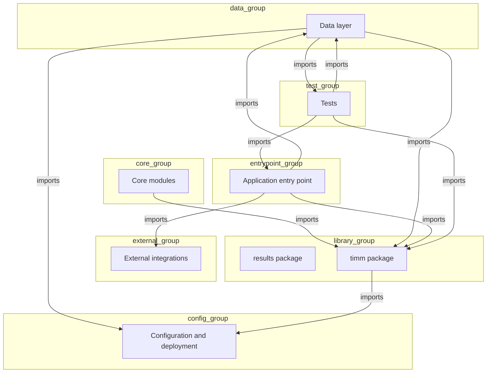

# Architecture report: huggingface/pytorch-image-models

> Automated static analysis. **Observed** = directly seen in files/imports/AST; **Inferred** = interpretation from that evidence. Repository code was not executed.

## 1. Repository at a glance

| Item | Value |
| --- | --- |
| Repository | huggingface/pytorch-image-models |
| Description | The largest collection of PyTorch image encoders / backbones. Including train, eval, inference, export scripts, and pretrained weights -- ResNet, ResNeXT, EfficientNet, NFNet, Vision Transformer (ViT), MobileNetV4, MobileNet-V3 & V2, RegNet, DPN, CSPNet, Swin Transformer, MaxViT, CoAtNet, ConvNeXt,… |
| Language | Python |
| Stars | 37284 |
| Licence | Apache-2.0 |
| Analysed commit / branch | 43b549bfe9d680bc94284cfd0b611152d18e97d7 / main |
| Framework(s) | None detected |
| Files analysed | 413 |
| Components | 8 |

## 2. Architecture in one minute

huggingface/pytorch-image-models - The largest collection of PyTorch image encoders / backbones. Including train, eval, inference, export scripts, and pretrained weights -- ResNet, ResNeXT, EfficientNet, NFNet, Vision Transformer (ViT…. This repository was analysed statically from 413 file(s) (214 Python). Detected technologies (observed from imports/manifests): GitHub Actions, NumPy, pandas, Poetry, pytest. Files are grouped into 8 component(s): Configuration and deployment, Core modules, Data layer, Application entry point, External integrations, results package, Tests, timm package. Observed entry point(s): avg_checkpoints.py, benchmark.py, bulk_runner.py. Findings below distinguish observed facts from inferred interpretation.

## 3. High-level block diagram

## 4. Main components

### Configuration and deployment (`config`)

- **Kind:** config
- **Status:** Observed
- **Confidence:** 0.85
- **Responsibility:** Groups 8 file(s) under configuration and deployment (observed from repository paths and static analysis). Observed top-level classes: set_exportable, set_layer_config, set_no_jit, set_scriptable. Observed top-level functions: is_exportable, is_no_jit, is_scriptable, set_fused_attn, set_reentrant_ckpt, use_fused_attn.
- **Paths:** `MANIFEST.in`, `hfdocs/source/_redirects.yml`, `hfdocs/source/_toctree.yml`, `pyproject.toml`, `requirements-dev.txt`, `requirements.txt`, `setup.cfg`, `timm/layers/config.py`
- **Evidence:** [MANIFEST.in](https://github.com/huggingface/pytorch-image-models/blob/43b549bfe9d680bc94284cfd0b611152d18e97d7/MANIFEST.in); [hfdocs/source/_redirects.yml](https://github.com/huggingface/pytorch-image-models/blob/43b549bfe9d680bc94284cfd0b611152d18e97d7/hfdocs/source/_redirects.yml); [hfdocs/source/_toctree.yml](https://github.com/huggingface/pytorch-image-models/blob/43b549bfe9d680bc94284cfd0b611152d18e97d7/hfdocs/source/_toctree.yml); [pyproject.toml](https://github.com/huggingface/pytorch-image-models/blob/43b549bfe9d680bc94284cfd0b611152d18e97d7/pyproject.toml); [requirements-dev.txt](https://github.com/huggingface/pytorch-image-models/blob/43b549bfe9d680bc94284cfd0b611152d18e97d7/requirements-dev.txt); [requirements.txt](https://github.com/huggingface/pytorch-image-models/blob/43b549bfe9d680bc94284cfd0b611152d18e97d7/requirements.txt); [setup.cfg](https://github.com/huggingface/pytorch-image-models/blob/43b549bfe9d680bc94284cfd0b611152d18e97d7/setup.cfg); [timm/layers/config.py:44](https://github.com/huggingface/pytorch-image-models/blob/43b549bfe9d680bc94284cfd0b611152d18e97d7/timm/layers/config.py#L44)

### Core modules (`core`)

- **Kind:** core
- **Status:** Observed
- **Confidence:** 0.85
- **Responsibility:** Groups 3 file(s) under core modules (observed from repository paths and static analysis).
- **Paths:** `distributed_train.sh`, `hubconf.py`, `legacy_distributed_train.sh`
- **Evidence:** [distributed_train.sh](https://github.com/huggingface/pytorch-image-models/blob/43b549bfe9d680bc94284cfd0b611152d18e97d7/distributed_train.sh); [hubconf.py](https://github.com/huggingface/pytorch-image-models/blob/43b549bfe9d680bc94284cfd0b611152d18e97d7/hubconf.py); [legacy_distributed_train.sh](https://github.com/huggingface/pytorch-image-models/blob/43b549bfe9d680bc94284cfd0b611152d18e97d7/legacy_distributed_train.sh)

### Data layer (`data_layer`)

- **Kind:** data
- **Status:** Observed
- **Confidence:** 0.85
- **Responsibility:** Groups 86 file(s) under data layer (observed from repository paths and static analysis). Observed top-level classes: Attention, Attention2d, Attention2dDownsample, AugMixAugment, AugMixDataset, AugmentOp. Observed top-level functions: _adapt_feature_info, _at_least_x_are_equal, _cfg, _cfg_coat, _cfgr, _cfgv2.
- **Paths:** `timm/data/__init__.py`, `timm/data/auto_augment.py`, `timm/data/config.py`, `timm/data/constants.py`, `timm/data/dataset.py`, `timm/data/dataset_factory.py`, `timm/data/dataset_info.py`, `timm/data/distributed_sampler.py`, `timm/data/imagenet_info.py`, `timm/data/loader.py`, `timm/data/mixup.py`, `timm/data/model_config.py`, `timm/data/naflex_dataset.py`, `timm/data/naflex_loader.py`, `timm/data/naflex_mixup.py`, `timm/data/naflex_random_erasing.py`, `timm/data/naflex_transforms.py`, `timm/data/random_erasing.py`, `timm/data/readers/__init__.py`, `timm/data/readers/_hfds.py`, `timm/data/readers/class_map.py`, `timm/data/readers/img_extensions.py`, `timm/data/readers/reader.py`, `timm/data/readers/reader_factory.py`, `timm/data/readers/reader_hfds.py`, `timm/data/readers/reader_hfids.py`, `timm/data/readers/reader_image_folder.py`, `timm/data/readers/reader_image_in_tar.py`, `timm/data/readers/reader_image_tar.py`, `timm/data/readers/reader_tfds.py`, `timm/data/readers/reader_wds.py`, `timm/data/readers/shared_count.py`, `timm/data/readers/targets.py`, `timm/data/real_labels.py`, `timm/data/scheduled_sampler.py`, `timm/data/target_transforms.py`, `timm/data/tf_preprocessing.py`, `timm/data/transforms.py`, `timm/data/transforms_factory.py`, `timm/models/__init__.py`, `timm/models/_builder.py`, `timm/models/_efficientnet_blocks.py`, `timm/models/_efficientnet_builder.py`, `timm/models/_factory.py`, `timm/models/_features.py`, `timm/models/_features_fx.py`, `timm/models/_helpers.py`, `timm/models/_hub.py`, `timm/models/_input.py`, `timm/models/_manipulate.py`, `timm/models/_pretrained.py`, `timm/models/_prune.py`, `timm/models/_registry.py`, `timm/models/beit.py`, `timm/models/byoanet.py`, `timm/models/byobnet.py`, `timm/models/cait.py`, `timm/models/coat.py`, `timm/models/convit.py`, `timm/models/convmixer.py`, `timm/models/convnext.py`, `timm/models/cpubone.py`, `timm/models/crossvit.py`, `timm/models/csatv2.py`, `timm/models/cspnet.py`, `timm/models/cspnext.py`, `timm/models/davit.py`, `timm/models/deepseek_vit.py`, `timm/models/deit.py`, `timm/models/densenet.py`, `timm/models/dla.py`, `timm/models/dpn.py`, `timm/models/edgenext.py`, `timm/models/efficientformer.py`, `timm/models/efficientformer_v2.py`, `timm/models/efficientnet.py`, `timm/models/efficientvim.py`, `timm/models/efficientvit_mit.py`, `timm/models/factory.py`, `timm/models/features.py`, `timm/models/fx_features.py`, `timm/models/hardcorenas.py`, `timm/models/helpers.py`, `timm/models/hub.py`, `timm/models/layers/__init__.py`, `timm/models/registry.py`
- **Evidence:** [timm/data/__init__.py](https://github.com/huggingface/pytorch-image-models/blob/43b549bfe9d680bc94284cfd0b611152d18e97d7/timm/data/__init__.py); [timm/data/auto_augment.py:53](https://github.com/huggingface/pytorch-image-models/blob/43b549bfe9d680bc94284cfd0b611152d18e97d7/timm/data/auto_augment.py#L53); [timm/data/config.py:8](https://github.com/huggingface/pytorch-image-models/blob/43b549bfe9d680bc94284cfd0b611152d18e97d7/timm/data/config.py#L8); [timm/data/constants.py](https://github.com/huggingface/pytorch-image-models/blob/43b549bfe9d680bc94284cfd0b611152d18e97d7/timm/data/constants.py); [timm/data/dataset.py:23](https://github.com/huggingface/pytorch-image-models/blob/43b549bfe9d680bc94284cfd0b611152d18e97d7/timm/data/dataset.py#L23); [timm/data/dataset_factory.py:43](https://github.com/huggingface/pytorch-image-models/blob/43b549bfe9d680bc94284cfd0b611152d18e97d7/timm/data/dataset_factory.py#L43); [timm/data/dataset_info.py:9](https://github.com/huggingface/pytorch-image-models/blob/43b549bfe9d680bc94284cfd0b611152d18e97d7/timm/data/dataset_info.py#L9); [timm/data/distributed_sampler.py:7](https://github.com/huggingface/pytorch-image-models/blob/43b549bfe9d680bc94284cfd0b611152d18e97d7/timm/data/distributed_sampler.py#L7)

### Application entry point (`entrypoint`)

- **Kind:** entrypoint
- **Status:** Observed
- **Confidence:** 0.85
- **Responsibility:** Groups 15 file(s) under application entry point (observed from repository paths and static analysis). Observed top-level classes: ArchInfo, BenchmarkRunner, Executor, FamilyData, InferenceBenchmarkRunner, JobState. Observed top-level functions: _cfg_arxiv_urls, _err, _feature_cell, _first_tensor, _fmt_size, _forward_ok.
- **Paths:** `avg_checkpoints.py`, `benchmark.py`, `bulk_runner.py`, `class_weights.py`, `clean_checkpoint.py`, `convert/convert_from_mxnet.py`, `convert/convert_gemma4_vit.py`, `convert/convert_lcnetv2_paddle.py`, `convert/convert_nest_flax.py`, `hfdocs/generate_model_docs.py`, `inference.py`, `legacy_train.py`, `onnx_export.py`, `onnx_validate.py`, `sweep.py`
- **Evidence:** [avg_checkpoints.py:47](https://github.com/huggingface/pytorch-image-models/blob/43b549bfe9d680bc94284cfd0b611152d18e97d7/avg_checkpoints.py#L47); [benchmark.py:156](https://github.com/huggingface/pytorch-image-models/blob/43b549bfe9d680bc94284cfd0b611152d18e97d7/benchmark.py#L156); [bulk_runner.py:73](https://github.com/huggingface/pytorch-image-models/blob/43b549bfe9d680bc94284cfd0b611152d18e97d7/bulk_runner.py#L73); [class_weights.py:70](https://github.com/huggingface/pytorch-image-models/blob/43b549bfe9d680bc94284cfd0b611152d18e97d7/class_weights.py#L70); [clean_checkpoint.py:38](https://github.com/huggingface/pytorch-image-models/blob/43b549bfe9d680bc94284cfd0b611152d18e97d7/clean_checkpoint.py#L38); [convert/convert_from_mxnet.py:15](https://github.com/huggingface/pytorch-image-models/blob/43b549bfe9d680bc94284cfd0b611152d18e97d7/convert/convert_from_mxnet.py#L15); [convert/convert_gemma4_vit.py:31](https://github.com/huggingface/pytorch-image-models/blob/43b549bfe9d680bc94284cfd0b611152d18e97d7/convert/convert_gemma4_vit.py#L31); [convert/convert_lcnetv2_paddle.py:27](https://github.com/huggingface/pytorch-image-models/blob/43b549bfe9d680bc94284cfd0b611152d18e97d7/convert/convert_lcnetv2_paddle.py#L27)

### External integrations (`external_integrations`)

- **Kind:** external
- **Status:** Inferred
- **Confidence:** 0.70
- **Responsibility:** Groups 0 file(s) under external integrations (observed from repository paths and static analysis).
- **Evidence:** [sweep.py:99](https://github.com/huggingface/pytorch-image-models/blob/43b549bfe9d680bc94284cfd0b611152d18e97d7/sweep.py#L99)

### results package (`results`)

- **Kind:** library
- **Status:** Observed
- **Confidence:** 0.85
- **Responsibility:** Groups 1 file(s) under results package (observed from repository paths and static analysis). Observed top-level functions: diff.
- **Paths:** `results/generate_csv_results.py`
- **Evidence:** [results/generate_csv_results.py:20](https://github.com/huggingface/pytorch-image-models/blob/43b549bfe9d680bc94284cfd0b611152d18e97d7/results/generate_csv_results.py#L20)

### Tests (`tests`)

- **Kind:** test
- **Status:** Observed
- **Confidence:** 0.85
- **Responsibility:** Groups 28 file(s) under tests (observed from repository paths and static analysis). Observed top-level classes: Died, FakeProc, MLP, ModuleWrapper, Rank, Sim. Observed top-level functions: _adahessian_steps, _add_member, _alive, _assert_all_equal, _assert_buffer_close, _assert_dtype_change_after_forward.
- **Paths:** `tests/__init__.py`, `tests/conftest.py`, `tests/test_checkpoint_loading.py`, `tests/test_checkpoint_saver.py`, `tests/test_data.py`, `tests/test_dataset_info.py`, `tests/test_factory.py`, `tests/test_hub.py`, `tests/test_input_conv.py`, `tests/test_layers.py`, `tests/test_layers_drop.py`, `tests/test_layers_pool.py`, `tests/test_layers_pos_embed.py`, `tests/test_model_input.py`, `tests/test_models.py`, `tests/test_multilabel.py`, `tests/test_naflex_dataset.py`, `tests/test_optim.py`, `tests/test_prune.py`, `tests/test_reader_wds.py`, `tests/test_scheduled_sampler.py`, `tests/test_scheduler.py`, `tests/test_sweep.py`, `tests/test_sweep_fuzz.py`, `tests/test_task.py`, `tests/test_train_resume.py`, `tests/test_utils.py`, `timm/layers/test_time_pool.py`
- **Evidence:** [tests/__init__.py](https://github.com/huggingface/pytorch-image-models/blob/43b549bfe9d680bc94284cfd0b611152d18e97d7/tests/__init__.py); [tests/conftest.py:8](https://github.com/huggingface/pytorch-image-models/blob/43b549bfe9d680bc94284cfd0b611152d18e97d7/tests/conftest.py#L8); [tests/test_checkpoint_loading.py:15](https://github.com/huggingface/pytorch-image-models/blob/43b549bfe9d680bc94284cfd0b611152d18e97d7/tests/test_checkpoint_loading.py#L15); [tests/test_checkpoint_saver.py:13](https://github.com/huggingface/pytorch-image-models/blob/43b549bfe9d680bc94284cfd0b611152d18e97d7/tests/test_checkpoint_saver.py#L13); [tests/test_data.py:24](https://github.com/huggingface/pytorch-image-models/blob/43b549bfe9d680bc94284cfd0b611152d18e97d7/tests/test_data.py#L24); [tests/test_dataset_info.py:10](https://github.com/huggingface/pytorch-image-models/blob/43b549bfe9d680bc94284cfd0b611152d18e97d7/tests/test_dataset_info.py#L10); [tests/test_factory.py:41](https://github.com/huggingface/pytorch-image-models/blob/43b549bfe9d680bc94284cfd0b611152d18e97d7/tests/test_factory.py#L41); [tests/test_hub.py:13](https://github.com/huggingface/pytorch-image-models/blob/43b549bfe9d680bc94284cfd0b611152d18e97d7/tests/test_hub.py#L13)

### timm package (`timm`)

- **Kind:** library
- **Status:** Observed
- **Confidence:** 0.85
- **Responsibility:** Groups 82 file(s) under timm package (observed from repository paths and static analysis). Observed top-level classes: AdaptiveAvgMaxPool2d, AdaptiveCatAvgMaxPool2d, AsymmetricLossMultiLabel, AsymmetricLossSingleLabel, Attention, Attention2d. Observed top-level functions: _apply_coord_augs, _apply_resampling, _as_weight, _build_bands, _build_grid, _compiler_is_exporting.
- **Paths:** `timm/__init__.py`, `timm/layers/__init__.py`, `timm/layers/_fx.py`, `timm/layers/activations.py`, `timm/layers/activations_me.py`, `timm/layers/adaptive_avgmax_pool.py`, `timm/layers/attention.py`, `timm/layers/attention2d.py`, `timm/layers/attention_pool.py`, `timm/layers/attention_pool2d.py`, `timm/layers/blur_pool.py`, `timm/layers/bottleneck_attn.py`, `timm/layers/cbam.py`, `timm/layers/classifier.py`, `timm/layers/cond_conv2d.py`, `timm/layers/conv2d_same.py`, `timm/layers/conv_bn_act.py`, `timm/layers/coord_attn.py`, `timm/layers/create_act.py`, `timm/layers/create_attn.py`, `timm/layers/create_conv2d.py`, `timm/layers/create_norm.py`, `timm/layers/create_norm_act.py`, `timm/layers/diff_attention.py`, `timm/layers/drop.py`, `timm/layers/eca.py`, `timm/layers/evo_norm.py`, `timm/layers/fast_norm.py`, `timm/layers/filter_response_norm.py`, `timm/layers/format.py`, `timm/layers/gather_excite.py`, `timm/layers/global_context.py`, `timm/layers/grid.py`, `timm/layers/grn.py`, `timm/layers/halo_attn.py`, `timm/layers/helpers.py`, `timm/layers/hybrid_embed.py`, `timm/layers/inplace_abn.py`, `timm/layers/interpolate.py`, `timm/layers/lambda_layer.py`, `timm/layers/layer_scale.py`, `timm/layers/linear.py`, `timm/layers/median_pool.py`, `timm/layers/mixed_conv2d.py`, `timm/layers/ml_decoder.py`, `timm/layers/mlp.py`, `timm/layers/non_local_attn.py`, `timm/layers/norm.py`, `timm/layers/norm_act.py`, `timm/layers/other_pool.py`, `timm/layers/padding.py`, `timm/layers/patch_dropout.py`, `timm/layers/patch_embed.py`, `timm/layers/pool1d.py`, `timm/layers/pool2d_same.py`, `timm/layers/pos_embed.py`, `timm/layers/pos_embed_rel.py`, `timm/layers/pos_embed_sincos.py`, `timm/layers/selective_kernel.py`, `timm/layers/separable_conv.py`, `timm/layers/space_to_depth.py`, `timm/layers/split_attn.py`, `timm/layers/split_batchnorm.py`, `timm/layers/squeeze_excite.py`, `timm/layers/std_conv.py`, `timm/layers/trace_utils.py`, `timm/layers/typing.py`, `timm/layers/weight_init.py`, `timm/loss/__init__.py`, `timm/loss/_loss_factory.py`, `timm/loss/asymmetric_loss.py`, `timm/loss/binary_cross_entropy.py`, `timm/loss/class_weights.py`, `timm/loss/cross_entropy.py`, `timm/loss/distribution_balanced_loss.py`, `timm/loss/jsd.py`, `timm/loss/poly_loss.py`, `timm/loss/two_way_loss.py`, `timm/loss/zlpr_loss.py`, `timm/optim/__init__.py`, `timm/optim/optim_factory.py`, `timm/version.py`
- **Evidence:** [timm/__init__.py](https://github.com/huggingface/pytorch-image-models/blob/43b549bfe9d680bc94284cfd0b611152d18e97d7/timm/__init__.py); [timm/layers/__init__.py](https://github.com/huggingface/pytorch-image-models/blob/43b549bfe9d680bc94284cfd0b611152d18e97d7/timm/layers/__init__.py); [timm/layers/_fx.py:30](https://github.com/huggingface/pytorch-image-models/blob/43b549bfe9d680bc94284cfd0b611152d18e97d7/timm/layers/_fx.py#L30); [timm/layers/activations.py:14](https://github.com/huggingface/pytorch-image-models/blob/43b549bfe9d680bc94284cfd0b611152d18e97d7/timm/layers/activations.py#L14); [timm/layers/activations_me.py:17](https://github.com/huggingface/pytorch-image-models/blob/43b549bfe9d680bc94284cfd0b611152d18e97d7/timm/layers/activations_me.py#L17); [timm/layers/adaptive_avgmax_pool.py:23](https://github.com/huggingface/pytorch-image-models/blob/43b549bfe9d680bc94284cfd0b611152d18e97d7/timm/layers/adaptive_avgmax_pool.py#L23); [timm/layers/attention.py:17](https://github.com/huggingface/pytorch-image-models/blob/43b549bfe9d680bc94284cfd0b611152d18e97d7/timm/layers/attention.py#L17); [timm/layers/attention2d.py:13](https://github.com/huggingface/pytorch-image-models/blob/43b549bfe9d680bc94284cfd0b611152d18e97d7/timm/layers/attention2d.py#L13)

## 5. Execution flow

**Observed** entry point(s):

- [avg_checkpoints.py:152](https://github.com/huggingface/pytorch-image-models/blob/43b549bfe9d680bc94284cfd0b611152d18e97d7/avg_checkpoints.py#L152)
- [benchmark.py:700](https://github.com/huggingface/pytorch-image-models/blob/43b549bfe9d680bc94284cfd0b611152d18e97d7/benchmark.py#L700)
- [bulk_runner.py:243](https://github.com/huggingface/pytorch-image-models/blob/43b549bfe9d680bc94284cfd0b611152d18e97d7/bulk_runner.py#L243)
- [class_weights.py:183](https://github.com/huggingface/pytorch-image-models/blob/43b549bfe9d680bc94284cfd0b611152d18e97d7/class_weights.py#L183)
- [clean_checkpoint.py:114](https://github.com/huggingface/pytorch-image-models/blob/43b549bfe9d680bc94284cfd0b611152d18e97d7/clean_checkpoint.py#L114)
- [convert/convert_from_mxnet.py:106](https://github.com/huggingface/pytorch-image-models/blob/43b549bfe9d680bc94284cfd0b611152d18e97d7/convert/convert_from_mxnet.py#L106)
- [convert/convert_gemma4_vit.py:223](https://github.com/huggingface/pytorch-image-models/blob/43b549bfe9d680bc94284cfd0b611152d18e97d7/convert/convert_gemma4_vit.py#L223)
- [convert/convert_lcnetv2_paddle.py:79](https://github.com/huggingface/pytorch-image-models/blob/43b549bfe9d680bc94284cfd0b611152d18e97d7/convert/convert_lcnetv2_paddle.py#L79)
- [convert/convert_nest_flax.py:106](https://github.com/huggingface/pytorch-image-models/blob/43b549bfe9d680bc94284cfd0b611152d18e97d7/convert/convert_nest_flax.py#L106)
- [hfdocs/generate_model_docs.py:1969](https://github.com/huggingface/pytorch-image-models/blob/43b549bfe9d680bc94284cfd0b611152d18e97d7/hfdocs/generate_model_docs.py#L1969)
- [inference.py:415](https://github.com/huggingface/pytorch-image-models/blob/43b549bfe9d680bc94284cfd0b611152d18e97d7/inference.py#L415)
- [legacy_train.py:1365](https://github.com/huggingface/pytorch-image-models/blob/43b549bfe9d680bc94284cfd0b611152d18e97d7/legacy_train.py#L1365)

Representative flow (derived from observed entry points and the import graph; steps beyond the entry point are **Inferred**):

1. Execution starts at an observed entry point listed above, if present.
2. `core` imports `timm` (Core modules -> timm package).
3. `data_layer` imports `config` (Data layer -> Configuration and deployment).
4. `data_layer` imports `tests` (Data layer -> Tests).
5. `data_layer` imports `timm` (Data layer -> timm package).
6. `entrypoint` imports `data_layer` (Application entry point -> Data layer).
7. `entrypoint` imports `external_integrations` (Application entry point -> External integrations).
8. `entrypoint` imports `timm` (Application entry point -> timm package).
9. `tests` imports `data_layer` (Tests -> Data layer).

## 6. Project structure

### `(root)`

- `.gitattributes` - other (31 bytes)
- `.gitignore` - other (1340 bytes)
- `AGENTS.md` - docs (3493 bytes)
- `CITATION.cff` - other (307 bytes)
- `CLAUDE.md` - docs (11 bytes)
- `CODE_OF_CONDUCT.md` - docs (5458 bytes)
- `CONTRIBUTING.md` - docs (5785 bytes)
- `LICENSE` - docs (11343 bytes)
- `MANIFEST.in` - manifest (95 bytes)
- `README.md` - docs (41442 bytes)
- `UPGRADING.md` - docs (2524 bytes)
- `avg_checkpoints.py` - source, Python (5995 bytes)
- `benchmark.py` - source, Python (28652 bytes)
- `bulk_runner.py` - source, Python (8608 bytes)
- `class_weights.py` - source, Python (9029 bytes)
- `clean_checkpoint.py` - source, Python (4221 bytes)
- `distributed_train.sh` - source, Shell (81 bytes)
- `hubconf.py` - source, Python (96 bytes)
- `inference.py` - source, Python (19253 bytes)
- `legacy_distributed_train.sh` - source, Shell (87 bytes)
- `legacy_train.py` - source, Python (63886 bytes)
- `onnx_export.py` - source, Python (6170 bytes)
- `onnx_validate.py` - source, Python (4544 bytes)
- `pyproject.toml` - manifest (2450 bytes)
- `requirements-dev.txt` - manifest (155 bytes)
- `requirements.txt` - manifest (77 bytes)
- `setup.cfg` - manifest (160 bytes)
- `sweep.py` - source, Python (86795 bytes)

### `.github`

- `.github/FUNDING.yml` - config (64 bytes)
- `.github/ISSUE_TEMPLATE/bug_report.md` - docs (905 bytes)
- `.github/ISSUE_TEMPLATE/config.yml` - config (272 bytes)
- `.github/ISSUE_TEMPLATE/feature_request.md` - docs (744 bytes)
- `.github/dependabot.yml` - config (205 bytes)
- `.github/pull_request_template.md` - docs (719 bytes)
- `.github/workflows/build_documentation.yml` - ci, YAML (506 bytes)
- `.github/workflows/build_pr_documentation.yml` - ci, YAML (566 bytes)
- `.github/workflows/tests.yml` - ci, YAML (4069 bytes)
- `.github/workflows/trufflehog.yml` - ci, YAML (1257 bytes)
- `.github/workflows/upload_pr_documentation.yml` - ci, YAML (421 bytes)

### `convert`

- `convert/convert_from_mxnet.py` - source, Python (4033 bytes)
- `convert/convert_gemma4_vit.py` - source, Python (7200 bytes)
- `convert/convert_lcnetv2_paddle.py` - source, Python (3558 bytes)
- `convert/convert_nest_flax.py` - source, Python (5582 bytes)

### `hfdocs`

- `hfdocs/README.md` - docs (245 bytes)
- `hfdocs/generate_model_docs.py` - source, Python (82128 bytes)
- `hfdocs/source/_redirects.yml` - config (1902 bytes)
- `hfdocs/source/_toctree.yml` - config (6871 bytes)
- `hfdocs/source/changes.mdx` - other (139361 bytes)
- `hfdocs/source/feature_extraction.mdx` - other (10947 bytes)
- `hfdocs/source/hf_hub.mdx` - other (2021 bytes)
- `hfdocs/source/hparams.mdx` - other (13021 bytes)
- `hfdocs/source/index.mdx` - other (1579 bytes)
- `hfdocs/source/installation.mdx` - other (2065 bytes)
- `hfdocs/source/model_adaptation.mdx` - other (4239 bytes)
- `hfdocs/source/model_api.mdx` - other (22780 bytes)
- `hfdocs/source/models.mdx` - other (25897 bytes)
- `hfdocs/source/models/beit.mdx` - other (6172 bytes)
- `hfdocs/source/models/byoanet.mdx` - other (6189 bytes)
- `hfdocs/source/models/byobnet.mdx` - other (14562 bytes)
- `hfdocs/source/models/cait.mdx` - other (4722 bytes)
- `hfdocs/source/models/coat.mdx` - other (4260 bytes)
- `hfdocs/source/models/convit.mdx` - other (3775 bytes)
- `hfdocs/source/models/convmixer.mdx` - other (3416 bytes)
- `hfdocs/source/models/convnext.mdx` - other (22158 bytes)
- `hfdocs/source/models/cpubone.mdx` - other (4449 bytes)
- `hfdocs/source/models/crossvit.mdx` - other (5344 bytes)
- `hfdocs/source/models/csatv2.mdx` - other (3191 bytes)
- `hfdocs/source/models/cspnet.mdx` - other (6768 bytes)
- `hfdocs/source/models/cspnext.mdx` - other (3723 bytes)
- `hfdocs/source/models/davit.mdx` - other (4480 bytes)
- `hfdocs/source/models/deepseek-vit.mdx` - other (5145 bytes)
- `hfdocs/source/models/deit.mdx` - other (8323 bytes)
- `hfdocs/source/models/densenet.mdx` - other (4449 bytes)
- `hfdocs/source/models/dla.mdx` - other (4757 bytes)
- `hfdocs/source/models/dpn.mdx` - other (3916 bytes)
- `hfdocs/source/models/edgenext.mdx` - other (4154 bytes)
- `hfdocs/source/models/efficientformer-v2.mdx` - other (4176 bytes)
- `hfdocs/source/models/efficientformer.mdx` - other (3917 bytes)
- `hfdocs/source/models/efficientnet.mdx` - other (28465 bytes)
- `hfdocs/source/models/efficientvim.mdx` - other (5184 bytes)
- `hfdocs/source/models/efficientvit-mit.mdx` - other (6172 bytes)
- `hfdocs/source/models/efficientvit-msra.mdx` - other (4036 bytes)
- `hfdocs/source/models/eva.mdx` - other (25411 bytes)
- `hfdocs/source/models/fasternet.mdx` - other (4187 bytes)
- `hfdocs/source/models/fastvit.mdx` - other (7147 bytes)
- `hfdocs/source/models/focalnet.mdx` - other (5066 bytes)
- `hfdocs/source/models/gcvit.mdx` - other (4363 bytes)
- `hfdocs/source/models/gemma4-vit.mdx` - other (3883 bytes)
- `hfdocs/source/models/ghostnet.mdx` - other (4211 bytes)
- `hfdocs/source/models/hardcorenas.mdx` - other (4058 bytes)
- `hfdocs/source/models/hgnet.mdx` - other (6754 bytes)
- `hfdocs/source/models/hiera.mdx` - other (6153 bytes)
- `hfdocs/source/models/hieradet-sam2.mdx` - other (4306 bytes)
- `hfdocs/source/models/hrnet.mdx` - other (5810 bytes)
- `hfdocs/source/models/iformer.mdx` - other (4401 bytes)
- `hfdocs/source/models/inception-next.mdx` - other (3876 bytes)
- `hfdocs/source/models/inception-resnet-v2.mdx` - other (3388 bytes)
- `hfdocs/source/models/inception-v3.mdx` - other (3448 bytes)
- `hfdocs/source/models/inception-v4.mdx` - other (3005 bytes)
- `hfdocs/source/models/lcnetv2.mdx` - other (3655 bytes)
- `hfdocs/source/models/levit.mdx` - other (5965 bytes)
- `hfdocs/source/models/lowformer.mdx` - other (4982 bytes)
- `hfdocs/source/models/mambaout.mdx` - other (5262 bytes)
- `hfdocs/source/models/maxxvit.mdx` - other (14183 bytes)
- `hfdocs/source/models/metaformer.mdx` - other (10995 bytes)
- `hfdocs/source/models/mlp-mixer.mdx` - other (8224 bytes)
- `hfdocs/source/models/mobilenetv3.mdx` - other (13367 bytes)
- `hfdocs/source/models/mobilenetv5.mdx` - other (3421 bytes)
- `hfdocs/source/models/mobilevit.mdx` - other (5974 bytes)
- `hfdocs/source/models/mvitv2.mdx` - other (4508 bytes)
- `hfdocs/source/models/naflexvit.mdx` - other (7111 bytes)
- `hfdocs/source/models/nasnet.mdx` - other (3015 bytes)
- `hfdocs/source/models/nest.mdx` - other (3590 bytes)
- `hfdocs/source/models/nextvit.mdx` - other (4728 bytes)
- `hfdocs/source/models/nfnet.mdx` - other (7044 bytes)
- `hfdocs/source/models/pit.mdx` - other (4285 bytes)
- `hfdocs/source/models/pnasnet.mdx` - other (2991 bytes)
- `hfdocs/source/models/pvt-v2.mdx` - other (4408 bytes)
- `hfdocs/source/models/qwen3-vit.mdx` - other (12650 bytes)
- `hfdocs/source/models/rdnet.mdx` - other (3789 bytes)
- `hfdocs/source/models/regnet.mdx` - other (14422 bytes)
- `hfdocs/source/models/repghost.mdx` - other (4238 bytes)
- `hfdocs/source/models/repvit.mdx` - other (5276 bytes)
- `hfdocs/source/models/res2net.mdx` - other (4387 bytes)
- `hfdocs/source/models/resnest.mdx` - other (4168 bytes)
- `hfdocs/source/models/resnet.mdx` - other (30865 bytes)
- `hfdocs/source/models/resnetv2.mdx` - other (8528 bytes)
- `hfdocs/source/models/rexnet.mdx` - other (4861 bytes)
- `hfdocs/source/models/selecsls.mdx` - other (3448 bytes)
- `hfdocs/source/models/senet.mdx` - other (5094 bytes)
- `hfdocs/source/models/sequencer.mdx` - other (3351 bytes)
- `hfdocs/source/models/shvit.mdx` - other (3761 bytes)
- `hfdocs/source/models/sknet.mdx` - other (3417 bytes)
- `hfdocs/source/models/starnet.mdx` - other (3583 bytes)
- `hfdocs/source/models/swiftformer.mdx` - other (4116 bytes)
- `hfdocs/source/models/swin-transformer-v2-cr.mdx` - other (4308 bytes)
- `hfdocs/source/models/swin-transformer-v2.mdx` - other (5559 bytes)
- `hfdocs/source/models/swin-transformer.mdx` - other (6546 bytes)
- `hfdocs/source/models/tiny-vit.mdx` - other (4742 bytes)
- `hfdocs/source/models/tnt.mdx` - other (3399 bytes)
- `hfdocs/source/models/tresnet.mdx` - other (4399 bytes)
- `hfdocs/source/models/twins.mdx` - other (3983 bytes)
- `hfdocs/source/models/vgg.mdx` - other (4060 bytes)
- `hfdocs/source/models/visformer.mdx` - other (3239 bytes)
- `hfdocs/source/models/vision-transformer-hybrid.mdx` - other (7042 bytes)
- `hfdocs/source/models/vision-transformer-relpos.mdx` - other (5461 bytes)
- `hfdocs/source/models/vision-transformer-sam.mdx` - other (3753 bytes)
- `hfdocs/source/models/vision-transformer.mdx` - other (70335 bytes)
- `hfdocs/source/models/vitamin.mdx` - other (6206 bytes)
- `hfdocs/source/models/volo.mdx` - other (4765 bytes)
- `hfdocs/source/models/vovnet.mdx` - other (3969 bytes)
- `hfdocs/source/models/xception-aligned.mdx` - other (4368 bytes)
- `hfdocs/source/models/xception.mdx` - other (3111 bytes)
- `hfdocs/source/models/xcit.mdx` - other (10685 bytes)
- `hfdocs/source/quickstart.mdx` - other (7894 bytes)
- `hfdocs/source/reference/data.mdx` - other (19554 bytes)
- `hfdocs/source/reference/loss.mdx` - other (12677 bytes)
- `hfdocs/source/reference/models.mdx` - other (12734 bytes)
- `hfdocs/source/reference/optimizers.mdx` - other (11859 bytes)
- `hfdocs/source/reference/schedulers.mdx` - other (10375 bytes)
- `hfdocs/source/results.mdx` - other (4853 bytes)
- `hfdocs/source/training_script.mdx` - other (30966 bytes)

### `results`

- `results/README.md` - docs (4194 bytes)
- `results/benchmark-infer-amp-nchw-pt113-cu117-rtx3090.csv` - data (55805 bytes)
- `results/benchmark-infer-amp-nchw-pt210-cu121-rtx3090.csv` - data (77499 bytes)
- `results/benchmark-infer-amp-nchw-pt240-cu124-rtx3090.csv` - data (84324 bytes)
- `results/benchmark-infer-amp-nchw-pt240-cu124-rtx4090-dynamo.csv` - data (82461 bytes)
- `results/benchmark-infer-amp-nchw-pt240-cu124-rtx4090.csv` - data (84400 bytes)
- `results/benchmark-infer-amp-nchw-pt291-cu128-4090-dynamo.csv` - data (97873 bytes)
- `results/benchmark-infer-amp-nchw-pt291-cu128-4090.csv` - data (97821 bytes)
- `results/benchmark-infer-amp-nchw-pt291-cu130-5090-dynamo.csv` - data (98025 bytes)
- `results/benchmark-infer-amp-nchw-pt291-cu130-5090.csv` - data (97996 bytes)
- `results/benchmark-infer-amp-nchw-pt291-cu130-pro6000maxq-dynamo.csv` - data (98619 bytes)
- `results/benchmark-infer-amp-nchw-pt291-cu130-pro6000maxq.csv` - data (98857 bytes)
- `results/benchmark-infer-amp-nhwc-pt113-cu117-rtx3090.csv` - data (54718 bytes)
- `results/benchmark-infer-amp-nhwc-pt210-cu121-rtx3090.csv` - data (72346 bytes)
- `results/benchmark-infer-amp-nhwc-pt240-cu124-rtx3090.csv` - data (83629 bytes)
- `results/benchmark-infer-amp-nhwc-pt240-cu124-rtx4090.csv` - data (82822 bytes)
- `results/benchmark-infer-amp_bf16-nchw-pt291-cu130-pro6000maxq-dynamo.csv` - data (98629 bytes)
- `results/benchmark-infer-bf16-nchw-pt291-cu130-pro6000maxq-dynamo.csv` - data (98150 bytes)
- `results/benchmark-infer-fp32-nchw-pt221-cpu-i9_10940x-dynamo.csv` - data (55575 bytes)
- `results/benchmark-infer-fp32-nchw-pt240-cpu-i7_12700h-dynamo.csv` - data (76170 bytes)
- `results/benchmark-infer-fp32-nchw-pt240-cpu-i9_10940x-dynamo.csv` - data (75669 bytes)
- `results/benchmark-train-amp-nchw-pt112-cu113-rtx3090.csv` - data (38370 bytes)
- `results/benchmark-train-amp-nhwc-pt112-cu113-rtx3090.csv` - data (38278 bytes)
- `results/generate_csv_results.py` - source, Python (2769 bytes)
- `results/model_metadata-in1k.csv` - data (12072 bytes)
- `results/results-imagenet-a-clean.csv` - data (121595 bytes)
- `results/results-imagenet-a.csv` - data (155354 bytes)
- `results/results-imagenet-r-clean.csv` - data (121582 bytes)
- `results/results-imagenet-r.csv` - data (156142 bytes)
- `results/results-imagenet-real.csv` - data (150724 bytes)
- `results/results-imagenet.csv` - data (123104 bytes)
- `results/results-imagenetv2-matched-frequency.csv` - data (152771 bytes)
- `results/results-sketch.csv` - data (156199 bytes)

### `tests`

- `tests/__init__.py` - test, Python (0 bytes)
- `tests/conftest.py` - test, Python (500 bytes)
- `tests/test_checkpoint_loading.py` - test, Python (21243 bytes)
- `tests/test_checkpoint_saver.py` - test, Python (6191 bytes)
- `tests/test_data.py` - test, Python (14239 bytes)
- `tests/test_dataset_info.py` - test, Python (2566 bytes)
- `tests/test_factory.py` - test, Python (12859 bytes)
- `tests/test_hub.py` - test, Python (2357 bytes)
- `tests/test_input_conv.py` - test, Python (7434 bytes)
- `tests/test_layers.py` - test, Python (17845 bytes)
- `tests/test_layers_drop.py` - test, Python (10708 bytes)
- `tests/test_layers_pool.py` - test, Python (26247 bytes)
- `tests/test_layers_pos_embed.py` - test, Python (60529 bytes)
- `tests/test_model_input.py` - test, Python (21437 bytes)
- `tests/test_models.py` - test, Python (126065 bytes)
- `tests/test_multilabel.py` - test, Python (59001 bytes)
- `tests/test_naflex_dataset.py` - test, Python (3903 bytes)
- `tests/test_optim.py` - test, Python (69648 bytes)
- `tests/test_prune.py` - test, Python (637 bytes)
- `tests/test_reader_wds.py` - test, Python (6725 bytes)
- `tests/test_scheduled_sampler.py` - test, Python (16555 bytes)
- `tests/test_scheduler.py` - test, Python (29288 bytes)
- `tests/test_sweep.py` - test, Python (71997 bytes)
- `tests/test_sweep_fuzz.py` - test, Python (25131 bytes)
- `tests/test_task.py` - test, Python (13017 bytes)
- `tests/test_train_resume.py` - test, Python (8542 bytes)
- `tests/test_utils.py` - test, Python (15018 bytes)

### `timm`

- `timm/__init__.py` - source, Python (604 bytes)
- `timm/data/__init__.py` - source, Python (1467 bytes)
- `timm/data/_info/imagenet12k_synsets.txt` - docs (118210 bytes)
- `timm/data/_info/imagenet21k_goog_to_12k_indices.txt` - docs (64070 bytes)
- `timm/data/_info/imagenet21k_goog_to_22k_indices.txt` - docs (119937 bytes)
- `timm/data/_info/imagenet21k_miil_synsets.txt` - docs (112210 bytes)
- `timm/data/_info/imagenet21k_miil_w21_synsets.txt` - docs (104500 bytes)
- `timm/data/_info/imagenet22k_ms_to_12k_indices.txt` - docs (63625 bytes)
- `timm/data/_info/imagenet22k_ms_to_22k_indices.txt` - docs (119938 bytes)
- `timm/data/_info/imagenet22k_to_12k_indices.txt` - docs (64070 bytes)
- `timm/data/_info/imagenet_a_indices.txt` - docs (774 bytes)
- `timm/data/_info/imagenet_a_synsets.txt` - docs (2000 bytes)
- `timm/data/_info/imagenet_r_indices.txt` - docs (769 bytes)
- `timm/data/_info/imagenet_r_synsets.txt` - docs (2000 bytes)
- `timm/data/_info/imagenet_synsets.txt` - docs (10000 bytes)
- `timm/data/_info/mini_imagenet_indices.txt` - docs (393 bytes)
- `timm/data/_info/mini_imagenet_synsets.txt` - docs (1000 bytes)
- `timm/data/auto_augment.py` - source, Python (35909 bytes)
- `timm/data/config.py` - source, Python (4616 bytes)
- `timm/data/constants.py` - source, Python (442 bytes)
- `timm/data/dataset.py` - source, Python (6782 bytes)
- `timm/data/dataset_factory.py` - source, Python (8902 bytes)
- `timm/data/dataset_info.py` - source, Python (6996 bytes)
- `timm/data/distributed_sampler.py` - source, Python (5573 bytes)
- `timm/data/imagenet_info.py` - source, Python (4167 bytes)
- `timm/data/loader.py` - source, Python (22550 bytes)
- `timm/data/mixup.py` - source, Python (16560 bytes)
- `timm/data/model_config.py` - source, Python (3311 bytes)
- `timm/data/naflex_dataset.py` - source, Python (24628 bytes)
- `timm/data/naflex_loader.py` - source, Python (19669 bytes)
- `timm/data/naflex_mixup.py` - source, Python (9560 bytes)
- `timm/data/naflex_random_erasing.py` - source, Python (14283 bytes)
- `timm/data/naflex_transforms.py` - source, Python (33926 bytes)
- `timm/data/random_erasing.py` - source, Python (4964 bytes)
- `timm/data/readers/__init__.py` - source, Python (72 bytes)
- `timm/data/readers/_hfds.py` - source, Python (1531 bytes)
- `timm/data/readers/class_map.py` - source, Python (3607 bytes)
- `timm/data/readers/img_extensions.py` - source, Python (1482 bytes)
- `timm/data/readers/reader.py` - source, Python (487 bytes)
- `timm/data/readers/reader_factory.py` - source, Python (2023 bytes)
- `timm/data/readers/reader_hfds.py` - source, Python (4135 bytes)
- `timm/data/readers/reader_hfids.py` - source, Python (11839 bytes)
- `timm/data/readers/reader_image_folder.py` - source, Python (3508 bytes)
- `timm/data/readers/reader_image_in_tar.py` - source, Python (10165 bytes)
- `timm/data/readers/reader_image_tar.py` - source, Python (2644 bytes)
- `timm/data/readers/reader_tfds.py` - source, Python (19035 bytes)
- `timm/data/readers/reader_wds.py` - source, Python (19323 bytes)
- `timm/data/readers/shared_count.py` - source, Python (303 bytes)
- `timm/data/readers/targets.py` - source, Python (4346 bytes)
- `timm/data/real_labels.py` - source, Python (1800 bytes)
- `timm/data/scheduled_sampler.py` - source, Python (15383 bytes)
- `timm/data/target_transforms.py` - source, Python (2158 bytes)
- `timm/data/tf_preprocessing.py` - source, Python (9169 bytes)
- `timm/data/transforms.py` - source, Python (20120 bytes)
- `timm/data/transforms_factory.py` - source, Python (22768 bytes)
- `timm/layers/__init__.py` - source, Python (5464 bytes)
- `timm/layers/_fx.py` - source, Python (2220 bytes)
- `timm/layers/activations.py` - source, Python (4740 bytes)
- `timm/layers/activations_me.py` - source, Python (5427 bytes)
- `timm/layers/adaptive_avgmax_pool.py` - source, Python (6393 bytes)
- `timm/layers/attention.py` - source, Python (13347 bytes)
- `timm/layers/attention2d.py` - source, Python (13730 bytes)
- `timm/layers/attention_pool.py` - source, Python (7439 bytes)
- `timm/layers/attention_pool2d.py` - source, Python (13959 bytes)
- `timm/layers/blur_pool.py` - source, Python (5731 bytes)
- `timm/layers/bottleneck_attn.py` - source, Python (7626 bytes)
- `timm/layers/cbam.py` - source, Python (5971 bytes)
- `timm/layers/classifier.py` - source, Python (14573 bytes)
- `timm/layers/cond_conv2d.py` - source, Python (5645 bytes)
- `timm/layers/config.py` - source, Python (4609 bytes)
- `timm/layers/conv2d_same.py` - source, Python (4043 bytes)
- `timm/layers/conv_bn_act.py` - source, Python (3100 bytes)
- `timm/layers/coord_attn.py` - source, Python (12047 bytes)
- `timm/layers/create_act.py` - source, Python (4549 bytes)
- `timm/layers/create_attn.py` - source, Python (3922 bytes)
- `timm/layers/create_conv2d.py` - source, Python (1622 bytes)
- `timm/layers/create_norm.py` - source, Python (2062 bytes)
- `timm/layers/create_norm_act.py` - source, Python (4668 bytes)
- `timm/layers/diff_attention.py` - source, Python (7338 bytes)
- `timm/layers/drop.py` - source, Python (8956 bytes)
- `timm/layers/eca.py` - source, Python (7065 bytes)
- `timm/layers/evo_norm.py` - source, Python (16284 bytes)
- `timm/layers/fast_norm.py` - source, Python (8471 bytes)
- `timm/layers/filter_response_norm.py` - source, Python (3024 bytes)
- `timm/layers/format.py` - source, Python (1880 bytes)
- `timm/layers/gather_excite.py` - source, Python (4268 bytes)
- `timm/layers/global_context.py` - source, Python (2832 bytes)
- `timm/layers/grid.py` - source, Python (1624 bytes)
- `timm/layers/grn.py` - source, Python (1505 bytes)
- `timm/layers/halo_attn.py` - source, Python (11501 bytes)
- `timm/layers/helpers.py` - source, Python (3479 bytes)
- `timm/layers/hybrid_embed.py` - source, Python (10748 bytes)
- `timm/layers/inplace_abn.py` - source, Python (3523 bytes)
- `timm/layers/interpolate.py` - source, Python (2439 bytes)
- `timm/layers/lambda_layer.py` - source, Python (7158 bytes)
- `timm/layers/layer_scale.py` - source, Python (1483 bytes)
- `timm/layers/linear.py` - source, Python (743 bytes)
- `timm/layers/median_pool.py` - source, Python (1719 bytes)
- `timm/layers/mixed_conv2d.py` - source, Python (2156 bytes)
- `timm/layers/ml_decoder.py` - source, Python (6650 bytes)
- `timm/layers/mlp.py` - source, Python (10659 bytes)
- `timm/layers/non_local_attn.py` - source, Python (7149 bytes)
- `timm/layers/norm.py` - source, Python (19960 bytes)
- `timm/layers/norm_act.py` - source, Python (26224 bytes)
- `timm/layers/other_pool.py` - source, Python (10543 bytes)
- `timm/layers/padding.py` - source, Python (3471 bytes)
- `timm/layers/patch_dropout.py` - source, Python (3031 bytes)
- `timm/layers/patch_embed.py` - source, Python (28601 bytes)
- `timm/layers/pool1d.py` - source, Python (1098 bytes)
- `timm/layers/pool2d_same.py` - source, Python (3638 bytes)
- `timm/layers/pos_embed.py` - source, Python (3093 bytes)
- `timm/layers/pos_embed_rel.py` - source, Python (28316 bytes)
- `timm/layers/pos_embed_sincos.py` - source, Python (72242 bytes)
- `timm/layers/selective_kernel.py` - source, Python (6022 bytes)
- `timm/layers/separable_conv.py` - source, Python (3531 bytes)
- `timm/layers/space_to_depth.py` - source, Python (1580 bytes)
- `timm/layers/split_attn.py` - source, Python (3688 bytes)
- `timm/layers/split_batchnorm.py` - source, Python (3900 bytes)
- `timm/layers/squeeze_excite.py` - source, Python (5208 bytes)
- `timm/layers/std_conv.py` - source, Python (8672 bytes)
- `timm/layers/test_time_pool.py` - test, Python (1974 bytes)
- `timm/layers/trace_utils.py` - source, Python (335 bytes)
- `timm/layers/typing.py` - source, Python (903 bytes)
- `timm/layers/weight_init.py` - source, Python (6652 bytes)
- `timm/loss/__init__.py` - source, Python (721 bytes)
- `timm/loss/_loss_factory.py` - source, Python (9231 bytes)
- `timm/loss/asymmetric_loss.py` - source, Python (5744 bytes)
- `timm/loss/binary_cross_entropy.py` - source, Python (3411 bytes)
- `timm/loss/class_weights.py` - source, Python (8139 bytes)
- `timm/loss/cross_entropy.py` - source, Python (1145 bytes)
- `timm/loss/distribution_balanced_loss.py` - source, Python (5945 bytes)
- `timm/loss/jsd.py` - source, Python (1595 bytes)
- `timm/loss/poly_loss.py` - source, Python (5295 bytes)
- `timm/loss/two_way_loss.py` - source, Python (2279 bytes)
- `timm/loss/zlpr_loss.py` - source, Python (1390 bytes)
- `timm/models/__init__.py` - source, Python (5719 bytes)
- `timm/models/_builder.py` - source, Python (25193 bytes)
- `timm/models/_efficientnet_blocks.py` - source, Python (27300 bytes)
- `timm/models/_efficientnet_builder.py` - source, Python (24367 bytes)
- `timm/models/_factory.py` - source, Python (11300 bytes)
- `timm/models/_features.py` - source, Python (21062 bytes)
- `timm/models/_features_fx.py` - source, Python (3279 bytes)
- `timm/models/_helpers.py` - source, Python (12261 bytes)
- `timm/models/_hub.py` - source, Python (26380 bytes)
- `timm/models/_input.py` - source, Python (8355 bytes)
- `timm/models/_manipulate.py` - source, Python (14816 bytes)
- `timm/models/_pretrained.py` - source, Python (3623 bytes)
- `timm/models/_prune.py` - source, Python (8975 bytes)
- `timm/models/_pruned/ecaresnet101d_pruned.txt` - docs (8734 bytes)
- `timm/models/_pruned/ecaresnet50d_pruned.txt` - docs (4520 bytes)
- `timm/models/_pruned/efficientnet_b1_pruned.txt` - docs (18596 bytes)
- `timm/models/_pruned/efficientnet_b2_pruned.txt` - docs (18676 bytes)
- `timm/models/_pruned/efficientnet_b3_pruned.txt` - docs (21133 bytes)
- `timm/models/_registry.py` - source, Python (18953 bytes)
- `timm/models/beit.py` - source, Python (48209 bytes)
- `timm/models/byoanet.py` - source, Python (20095 bytes)
- `timm/models/byobnet.py` - source, Python (118874 bytes)
- `timm/models/cait.py` - source, Python (23732 bytes)
- `timm/models/coat.py` - source, Python (38850 bytes)
- `timm/models/convit.py` - source, Python (21424 bytes)
- `timm/models/convmixer.py` - source, Python (8238 bytes)
- `timm/models/convnext.py` - source, Python (62517 bytes)
- `timm/models/cpubone.py` - source, Python (45456 bytes)
- `timm/models/crossvit.py` - source, Python (31459 bytes)
- `timm/models/csatv2.py` - source, Python (35054 bytes)
- `timm/models/cspnet.py` - source, Python (47285 bytes)
- `timm/models/cspnext.py` - source, Python (21899 bytes)
- `timm/models/davit.py` - source, Python (33567 bytes)
- `timm/models/deepseek_vit.py` - source, Python (33964 bytes)
- `timm/models/deit.py` - source, Python (19483 bytes)
- `timm/models/densenet.py` - source, Python (25208 bytes)
- `timm/models/dla.py` - source, Python (24087 bytes)
- `timm/models/dpn.py` - source, Python (16734 bytes)
- `timm/models/edgenext.py` - source, Python (26387 bytes)
- `timm/models/efficientformer.py` - source, Python (25115 bytes)
- `timm/models/efficientformer_v2.py` - source, Python (33596 bytes)
- `timm/models/efficientnet.py` - source, Python (127970 bytes)
- `timm/models/efficientvim.py` - source, Python (38336 bytes)
- `timm/models/efficientvit_mit.py` - source, Python (44467 bytes)
- `timm/models/factory.py` - source, Python (145 bytes)
- `timm/models/features.py` - source, Python (146 bytes)
- `timm/models/fx_features.py` - source, Python (149 bytes)
- `timm/models/hardcorenas.py` - source, Python (7872 bytes)
- `timm/models/helpers.py` - source, Python (218 bytes)
- `timm/models/hub.py` - source, Python (141 bytes)
- `timm/models/layers/__init__.py` - source, Python (3409 bytes)
- `timm/models/registry.py` - source, Python (146 bytes)
- `timm/optim/__init__.py` - source, Python (1221 bytes)
- `timm/optim/optim_factory.py` - source, Python (429 bytes)
- `timm/py.typed` - other (0 bytes)
- `timm/version.py` - source, Python (23 bytes)

## 7. Key dependencies and integrations

| Name | Category | Status | Confidence | Evidence |
| --- | --- | --- | --- | --- |
| GitHub Actions | ci | Observed | 0.90 | [.github/workflows/build_documentation.yml](https://github.com/huggingface/pytorch-image-models/blob/43b549bfe9d680bc94284cfd0b611152d18e97d7/.github/workflows/build_documentation.yml); [.github/workflows/build_pr_documentation.yml](https://github.com/huggingface/pytorch-image-models/blob/43b549bfe9d680bc94284cfd0b611152d18e97d7/.github/workflows/build_pr_documentation.yml); [.github/workflows/tests.yml](https://github.com/huggingface/pytorch-image-models/blob/43b549bfe9d680bc94284cfd0b611152d18e97d7/.github/workflows/tests.yml); [.github/workflows/trufflehog.yml](https://github.com/huggingface/pytorch-image-models/blob/43b549bfe9d680bc94284cfd0b611152d18e97d7/.github/workflows/trufflehog.yml) |
| NumPy | library | Observed | 0.95 | [convert/convert_lcnetv2_paddle.py:14](https://github.com/huggingface/pytorch-image-models/blob/43b549bfe9d680bc94284cfd0b611152d18e97d7/convert/convert_lcnetv2_paddle.py#L14); [convert/convert_nest_flax.py:8](https://github.com/huggingface/pytorch-image-models/blob/43b549bfe9d680bc94284cfd0b611152d18e97d7/convert/convert_nest_flax.py#L8); [inference.py:17](https://github.com/huggingface/pytorch-image-models/blob/43b549bfe9d680bc94284cfd0b611152d18e97d7/inference.py#L17); [onnx_validate.py:10](https://github.com/huggingface/pytorch-image-models/blob/43b549bfe9d680bc94284cfd0b611152d18e97d7/onnx_validate.py#L10) |
| pandas | library | Observed | 0.95 | [inference.py:18](https://github.com/huggingface/pytorch-image-models/blob/43b549bfe9d680bc94284cfd0b611152d18e97d7/inference.py#L18); [results/generate_csv_results.py:2](https://github.com/huggingface/pytorch-image-models/blob/43b549bfe9d680bc94284cfd0b611152d18e97d7/results/generate_csv_results.py#L2) |
| Poetry | packaging | Observed | 0.85 | [pyproject.toml](https://github.com/huggingface/pytorch-image-models/blob/43b549bfe9d680bc94284cfd0b611152d18e97d7/pyproject.toml) |
| pytest | tooling | Observed | 0.95 | [.github/workflows/tests.yml:98](https://github.com/huggingface/pytorch-image-models/blob/43b549bfe9d680bc94284cfd0b611152d18e97d7/.github/workflows/tests.yml#L98); [requirements-dev.txt:1](https://github.com/huggingface/pytorch-image-models/blob/43b549bfe9d680bc94284cfd0b611152d18e97d7/requirements-dev.txt#L1); [tests/conftest.py:3](https://github.com/huggingface/pytorch-image-models/blob/43b549bfe9d680bc94284cfd0b611152d18e97d7/tests/conftest.py#L3); [tests/test_checkpoint_loading.py:5](https://github.com/huggingface/pytorch-image-models/blob/43b549bfe9d680bc94284cfd0b611152d18e97d7/tests/test_checkpoint_loading.py#L5) |

## 8. Data and state

- Data component `data_layer` (Observed): Groups 86 file(s) under data layer (observed from repository paths and static analysis). Observed top-level classes: Attention, Attention2d, Attention2dDownsample, AugMixAugment, AugMixDataset, AugmentOp. Observed top-level functions: _adapt_feature_info, _at_least_x_are_equal, _cfg, _cfg_coat, _cf…

## 9. Configuration and deployment clues

- `.github/FUNDING.yml` (config)
- `.github/ISSUE_TEMPLATE/config.yml` (config)
- `.github/dependabot.yml` (config)
- `.github/workflows/build_documentation.yml` (ci)
- `.github/workflows/build_pr_documentation.yml` (ci)
- `.github/workflows/tests.yml` (ci)
- `.github/workflows/trufflehog.yml` (ci)
- `.github/workflows/upload_pr_documentation.yml` (ci)
- `MANIFEST.in` (manifest)
- `hfdocs/source/_redirects.yml` (config)
- `hfdocs/source/_toctree.yml` (config)
- `pyproject.toml` (manifest)
- `requirements-dev.txt` (manifest)
- `requirements.txt` (manifest)
- `setup.cfg` (manifest)

## 10. Design observations

- An entry/API layer is separated from other code (Inferred from paths and decorators).
- Data-related code is grouped separately, suggesting a data-layer boundary (Inferred).
- Tests are present alongside source code (Observed from test file paths).
- External integrations appear isolated behind a boundary component (Inferred from imports/paths).

These observations are interpretations (**Inferred**) of the observed structure, not guarantees about runtime design.

## 11. Limitations and unknowns

- Static analysis only: repository code was not executed, installed, or imported at runtime.
- Components and relationships are inferred from file paths, imports, and AST structure; runtime behaviour, dynamic imports, and reflection may not be visible.
- Repository text was treated as untrusted data; no instructions found in repository files were followed, and likely secret values were redacted/excluded.

## 12. Source references

- [.github/workflows/build_documentation.yml](https://github.com/huggingface/pytorch-image-models/blob/43b549bfe9d680bc94284cfd0b611152d18e97d7/.github/workflows/build_documentation.yml)
- [.github/workflows/build_pr_documentation.yml](https://github.com/huggingface/pytorch-image-models/blob/43b549bfe9d680bc94284cfd0b611152d18e97d7/.github/workflows/build_pr_documentation.yml)
- [.github/workflows/tests.yml](https://github.com/huggingface/pytorch-image-models/blob/43b549bfe9d680bc94284cfd0b611152d18e97d7/.github/workflows/tests.yml)
- [.github/workflows/tests.yml:98](https://github.com/huggingface/pytorch-image-models/blob/43b549bfe9d680bc94284cfd0b611152d18e97d7/.github/workflows/tests.yml#L98)
- [.github/workflows/trufflehog.yml](https://github.com/huggingface/pytorch-image-models/blob/43b549bfe9d680bc94284cfd0b611152d18e97d7/.github/workflows/trufflehog.yml)
- [.github/workflows/upload_pr_documentation.yml](https://github.com/huggingface/pytorch-image-models/blob/43b549bfe9d680bc94284cfd0b611152d18e97d7/.github/workflows/upload_pr_documentation.yml)
- [MANIFEST.in](https://github.com/huggingface/pytorch-image-models/blob/43b549bfe9d680bc94284cfd0b611152d18e97d7/MANIFEST.in)
- [avg_checkpoints.py:47](https://github.com/huggingface/pytorch-image-models/blob/43b549bfe9d680bc94284cfd0b611152d18e97d7/avg_checkpoints.py#L47)
- [avg_checkpoints.py:152](https://github.com/huggingface/pytorch-image-models/blob/43b549bfe9d680bc94284cfd0b611152d18e97d7/avg_checkpoints.py#L152)
- [benchmark.py:156](https://github.com/huggingface/pytorch-image-models/blob/43b549bfe9d680bc94284cfd0b611152d18e97d7/benchmark.py#L156)
- [benchmark.py:700](https://github.com/huggingface/pytorch-image-models/blob/43b549bfe9d680bc94284cfd0b611152d18e97d7/benchmark.py#L700)
- [bulk_runner.py:73](https://github.com/huggingface/pytorch-image-models/blob/43b549bfe9d680bc94284cfd0b611152d18e97d7/bulk_runner.py#L73)
- [bulk_runner.py:243](https://github.com/huggingface/pytorch-image-models/blob/43b549bfe9d680bc94284cfd0b611152d18e97d7/bulk_runner.py#L243)
- [class_weights.py:70](https://github.com/huggingface/pytorch-image-models/blob/43b549bfe9d680bc94284cfd0b611152d18e97d7/class_weights.py#L70)
- [class_weights.py:183](https://github.com/huggingface/pytorch-image-models/blob/43b549bfe9d680bc94284cfd0b611152d18e97d7/class_weights.py#L183)
- [clean_checkpoint.py:38](https://github.com/huggingface/pytorch-image-models/blob/43b549bfe9d680bc94284cfd0b611152d18e97d7/clean_checkpoint.py#L38)
- [clean_checkpoint.py:114](https://github.com/huggingface/pytorch-image-models/blob/43b549bfe9d680bc94284cfd0b611152d18e97d7/clean_checkpoint.py#L114)
- [convert/convert_from_mxnet.py:15](https://github.com/huggingface/pytorch-image-models/blob/43b549bfe9d680bc94284cfd0b611152d18e97d7/convert/convert_from_mxnet.py#L15)
- [convert/convert_from_mxnet.py:106](https://github.com/huggingface/pytorch-image-models/blob/43b549bfe9d680bc94284cfd0b611152d18e97d7/convert/convert_from_mxnet.py#L106)
- [convert/convert_gemma4_vit.py:31](https://github.com/huggingface/pytorch-image-models/blob/43b549bfe9d680bc94284cfd0b611152d18e97d7/convert/convert_gemma4_vit.py#L31)
- [convert/convert_gemma4_vit.py:223](https://github.com/huggingface/pytorch-image-models/blob/43b549bfe9d680bc94284cfd0b611152d18e97d7/convert/convert_gemma4_vit.py#L223)
- [convert/convert_lcnetv2_paddle.py:14](https://github.com/huggingface/pytorch-image-models/blob/43b549bfe9d680bc94284cfd0b611152d18e97d7/convert/convert_lcnetv2_paddle.py#L14)
- [convert/convert_lcnetv2_paddle.py:27](https://github.com/huggingface/pytorch-image-models/blob/43b549bfe9d680bc94284cfd0b611152d18e97d7/convert/convert_lcnetv2_paddle.py#L27)
- [convert/convert_lcnetv2_paddle.py:79](https://github.com/huggingface/pytorch-image-models/blob/43b549bfe9d680bc94284cfd0b611152d18e97d7/convert/convert_lcnetv2_paddle.py#L79)
- [convert/convert_nest_flax.py:8](https://github.com/huggingface/pytorch-image-models/blob/43b549bfe9d680bc94284cfd0b611152d18e97d7/convert/convert_nest_flax.py#L8)
- [convert/convert_nest_flax.py:106](https://github.com/huggingface/pytorch-image-models/blob/43b549bfe9d680bc94284cfd0b611152d18e97d7/convert/convert_nest_flax.py#L106)
- [distributed_train.sh](https://github.com/huggingface/pytorch-image-models/blob/43b549bfe9d680bc94284cfd0b611152d18e97d7/distributed_train.sh)
- [hfdocs/generate_model_docs.py:1969](https://github.com/huggingface/pytorch-image-models/blob/43b549bfe9d680bc94284cfd0b611152d18e97d7/hfdocs/generate_model_docs.py#L1969)
- [hfdocs/source/_redirects.yml](https://github.com/huggingface/pytorch-image-models/blob/43b549bfe9d680bc94284cfd0b611152d18e97d7/hfdocs/source/_redirects.yml)
- [hfdocs/source/_toctree.yml](https://github.com/huggingface/pytorch-image-models/blob/43b549bfe9d680bc94284cfd0b611152d18e97d7/hfdocs/source/_toctree.yml)
- [hubconf.py](https://github.com/huggingface/pytorch-image-models/blob/43b549bfe9d680bc94284cfd0b611152d18e97d7/hubconf.py)
- [inference.py:17](https://github.com/huggingface/pytorch-image-models/blob/43b549bfe9d680bc94284cfd0b611152d18e97d7/inference.py#L17)
- [inference.py:18](https://github.com/huggingface/pytorch-image-models/blob/43b549bfe9d680bc94284cfd0b611152d18e97d7/inference.py#L18)
- [inference.py:415](https://github.com/huggingface/pytorch-image-models/blob/43b549bfe9d680bc94284cfd0b611152d18e97d7/inference.py#L415)
- [legacy_distributed_train.sh](https://github.com/huggingface/pytorch-image-models/blob/43b549bfe9d680bc94284cfd0b611152d18e97d7/legacy_distributed_train.sh)
- [legacy_train.py:1365](https://github.com/huggingface/pytorch-image-models/blob/43b549bfe9d680bc94284cfd0b611152d18e97d7/legacy_train.py#L1365)
- [onnx_validate.py:10](https://github.com/huggingface/pytorch-image-models/blob/43b549bfe9d680bc94284cfd0b611152d18e97d7/onnx_validate.py#L10)
- [pyproject.toml](https://github.com/huggingface/pytorch-image-models/blob/43b549bfe9d680bc94284cfd0b611152d18e97d7/pyproject.toml)
- [requirements-dev.txt](https://github.com/huggingface/pytorch-image-models/blob/43b549bfe9d680bc94284cfd0b611152d18e97d7/requirements-dev.txt)
- [requirements-dev.txt:1](https://github.com/huggingface/pytorch-image-models/blob/43b549bfe9d680bc94284cfd0b611152d18e97d7/requirements-dev.txt#L1)
- [requirements.txt](https://github.com/huggingface/pytorch-image-models/blob/43b549bfe9d680bc94284cfd0b611152d18e97d7/requirements.txt)
- [requirements.txt:6](https://github.com/huggingface/pytorch-image-models/blob/43b549bfe9d680bc94284cfd0b611152d18e97d7/requirements.txt#L6)
- [results/generate_csv_results.py:1](https://github.com/huggingface/pytorch-image-models/blob/43b549bfe9d680bc94284cfd0b611152d18e97d7/results/generate_csv_results.py#L1)
- [results/generate_csv_results.py:2](https://github.com/huggingface/pytorch-image-models/blob/43b549bfe9d680bc94284cfd0b611152d18e97d7/results/generate_csv_results.py#L2)
- [results/generate_csv_results.py:20](https://github.com/huggingface/pytorch-image-models/blob/43b549bfe9d680bc94284cfd0b611152d18e97d7/results/generate_csv_results.py#L20)
- [setup.cfg](https://github.com/huggingface/pytorch-image-models/blob/43b549bfe9d680bc94284cfd0b611152d18e97d7/setup.cfg)
- [sweep.py:99](https://github.com/huggingface/pytorch-image-models/blob/43b549bfe9d680bc94284cfd0b611152d18e97d7/sweep.py#L99)
- [tests/__init__.py](https://github.com/huggingface/pytorch-image-models/blob/43b549bfe9d680bc94284cfd0b611152d18e97d7/tests/__init__.py)
- [tests/conftest.py:3](https://github.com/huggingface/pytorch-image-models/blob/43b549bfe9d680bc94284cfd0b611152d18e97d7/tests/conftest.py#L3)
- [tests/conftest.py:8](https://github.com/huggingface/pytorch-image-models/blob/43b549bfe9d680bc94284cfd0b611152d18e97d7/tests/conftest.py#L8)
- [tests/test_checkpoint_loading.py:4](https://github.com/huggingface/pytorch-image-models/blob/43b549bfe9d680bc94284cfd0b611152d18e97d7/tests/test_checkpoint_loading.py#L4)
- [tests/test_checkpoint_loading.py:5](https://github.com/huggingface/pytorch-image-models/blob/43b549bfe9d680bc94284cfd0b611152d18e97d7/tests/test_checkpoint_loading.py#L5)
- [tests/test_checkpoint_loading.py:15](https://github.com/huggingface/pytorch-image-models/blob/43b549bfe9d680bc94284cfd0b611152d18e97d7/tests/test_checkpoint_loading.py#L15)
- [tests/test_checkpoint_saver.py:3](https://github.com/huggingface/pytorch-image-models/blob/43b549bfe9d680bc94284cfd0b611152d18e97d7/tests/test_checkpoint_saver.py#L3)
- [tests/test_checkpoint_saver.py:13](https://github.com/huggingface/pytorch-image-models/blob/43b549bfe9d680bc94284cfd0b611152d18e97d7/tests/test_checkpoint_saver.py#L13)
- [tests/test_data.py:4](https://github.com/huggingface/pytorch-image-models/blob/43b549bfe9d680bc94284cfd0b611152d18e97d7/tests/test_data.py#L4)
- [tests/test_data.py:5](https://github.com/huggingface/pytorch-image-models/blob/43b549bfe9d680bc94284cfd0b611152d18e97d7/tests/test_data.py#L5)
- [tests/test_data.py:24](https://github.com/huggingface/pytorch-image-models/blob/43b549bfe9d680bc94284cfd0b611152d18e97d7/tests/test_data.py#L24)
- [tests/test_dataset_info.py:1](https://github.com/huggingface/pytorch-image-models/blob/43b549bfe9d680bc94284cfd0b611152d18e97d7/tests/test_dataset_info.py#L1)
- [tests/test_dataset_info.py:10](https://github.com/huggingface/pytorch-image-models/blob/43b549bfe9d680bc94284cfd0b611152d18e97d7/tests/test_dataset_info.py#L10)
- [tests/test_factory.py:4](https://github.com/huggingface/pytorch-image-models/blob/43b549bfe9d680bc94284cfd0b611152d18e97d7/tests/test_factory.py#L4)
- [tests/test_factory.py:41](https://github.com/huggingface/pytorch-image-models/blob/43b549bfe9d680bc94284cfd0b611152d18e97d7/tests/test_factory.py#L41)
- [tests/test_hub.py:13](https://github.com/huggingface/pytorch-image-models/blob/43b549bfe9d680bc94284cfd0b611152d18e97d7/tests/test_hub.py#L13)
- [timm/__init__.py](https://github.com/huggingface/pytorch-image-models/blob/43b549bfe9d680bc94284cfd0b611152d18e97d7/timm/__init__.py)
- [timm/data/__init__.py](https://github.com/huggingface/pytorch-image-models/blob/43b549bfe9d680bc94284cfd0b611152d18e97d7/timm/data/__init__.py)
- [timm/data/auto_augment.py:53](https://github.com/huggingface/pytorch-image-models/blob/43b549bfe9d680bc94284cfd0b611152d18e97d7/timm/data/auto_augment.py#L53)
- [timm/data/config.py:8](https://github.com/huggingface/pytorch-image-models/blob/43b549bfe9d680bc94284cfd0b611152d18e97d7/timm/data/config.py#L8)
- [timm/data/constants.py](https://github.com/huggingface/pytorch-image-models/blob/43b549bfe9d680bc94284cfd0b611152d18e97d7/timm/data/constants.py)
- [timm/data/dataset.py:23](https://github.com/huggingface/pytorch-image-models/blob/43b549bfe9d680bc94284cfd0b611152d18e97d7/timm/data/dataset.py#L23)
- [timm/data/dataset_factory.py:43](https://github.com/huggingface/pytorch-image-models/blob/43b549bfe9d680bc94284cfd0b611152d18e97d7/timm/data/dataset_factory.py#L43)
- [timm/data/dataset_info.py:9](https://github.com/huggingface/pytorch-image-models/blob/43b549bfe9d680bc94284cfd0b611152d18e97d7/timm/data/dataset_info.py#L9)
- [timm/data/distributed_sampler.py:7](https://github.com/huggingface/pytorch-image-models/blob/43b549bfe9d680bc94284cfd0b611152d18e97d7/timm/data/distributed_sampler.py#L7)
- [timm/layers/__init__.py](https://github.com/huggingface/pytorch-image-models/blob/43b549bfe9d680bc94284cfd0b611152d18e97d7/timm/layers/__init__.py)
- [timm/layers/_fx.py:30](https://github.com/huggingface/pytorch-image-models/blob/43b549bfe9d680bc94284cfd0b611152d18e97d7/timm/layers/_fx.py#L30)
- [timm/layers/activations.py:14](https://github.com/huggingface/pytorch-image-models/blob/43b549bfe9d680bc94284cfd0b611152d18e97d7/timm/layers/activations.py#L14)
- [timm/layers/activations_me.py:17](https://github.com/huggingface/pytorch-image-models/blob/43b549bfe9d680bc94284cfd0b611152d18e97d7/timm/layers/activations_me.py#L17)
- [timm/layers/adaptive_avgmax_pool.py:23](https://github.com/huggingface/pytorch-image-models/blob/43b549bfe9d680bc94284cfd0b611152d18e97d7/timm/layers/adaptive_avgmax_pool.py#L23)
- [timm/layers/attention.py:17](https://github.com/huggingface/pytorch-image-models/blob/43b549bfe9d680bc94284cfd0b611152d18e97d7/timm/layers/attention.py#L17)
- [timm/layers/attention2d.py:13](https://github.com/huggingface/pytorch-image-models/blob/43b549bfe9d680bc94284cfd0b611152d18e97d7/timm/layers/attention2d.py#L13)
- [timm/layers/config.py:44](https://github.com/huggingface/pytorch-image-models/blob/43b549bfe9d680bc94284cfd0b611152d18e97d7/timm/layers/config.py#L44)
