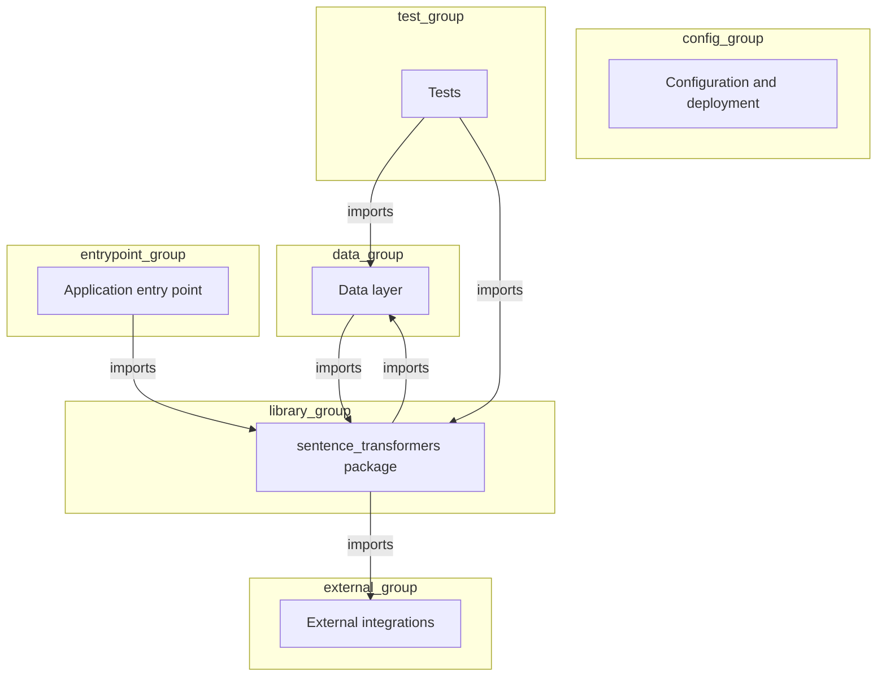

# Architecture report: huggingface/sentence-transformers

> Automated static analysis. **Observed** = directly seen in files/imports/AST; **Inferred** = interpretation from that evidence. Repository code was not executed.

## 1. Repository at a glance

| Item | Value |
| --- | --- |
| Repository | huggingface/sentence-transformers |
| Description | State-of-the-Art Embeddings, Retrieval, and Reranking |
| Language | Python |
| Stars | 19285 |
| Licence | Apache-2.0 |
| Analysed commit / branch | 688fd663e7b242f41f3f62296d08c69937efeb00 / main |
| Framework(s) | None detected |
| Files analysed | 800 |
| Components | 6 |

## 2. Architecture in one minute

huggingface/sentence-transformers - State-of-the-Art Embeddings, Retrieval, and Reranking. This repository was analysed statically from 800 file(s) (574 Python). Detected technologies (observed from imports/manifests): GitHub Actions, httpx, NumPy, pandas, Poetry, setuptools. Files are grouped into 6 component(s): Configuration and deployment, Data layer, Application entry point, External integrations, sentence_transformers package, Tests. Observed entry point(s): skills/train-sentence-transformers/scripts/mine_hard_negatives.py, skills/train-sentence-transformers/scripts/train_cross_encoder_distillation_example.py, skills/train-sentence-transformers/scripts/train_cross_encoder_example.py. Findings below distinguish observed facts from inferred interpretation.

## 3. High-level block diagram

## 4. Main components

### Configuration and deployment (`config`)

- **Kind:** config
- **Status:** Observed
- **Confidence:** 0.85
- **Responsibility:** Groups 1 file(s) under configuration and deployment (observed from repository paths and static analysis).
- **Paths:** `pyproject.toml`
- **Evidence:** [pyproject.toml](https://github.com/huggingface/sentence-transformers/blob/688fd663e7b242f41f3f62296d08c69937efeb00/pyproject.toml)

### Data layer (`data_layer`)

- **Kind:** data
- **Status:** Observed
- **Confidence:** 0.85
- **Responsibility:** Groups 5 file(s) under data layer (observed from repository paths and static analysis). Observed top-level classes: BaseModel, CrossEncoder, MultiVectorEncoder, SentenceTransformer, SparseEncoder, _Float32Linear.
- **Paths:** `sentence_transformers/base/model.py`, `sentence_transformers/cross_encoder/model.py`, `sentence_transformers/multi_vector_encoder/model.py`, `sentence_transformers/sentence_transformer/model.py`, `sentence_transformers/sparse_encoder/model.py`
- **Evidence:** [sentence_transformers/base/model.py:68](https://github.com/huggingface/sentence-transformers/blob/688fd663e7b242f41f3f62296d08c69937efeb00/sentence_transformers/base/model.py#L68); [sentence_transformers/cross_encoder/model.py:41](https://github.com/huggingface/sentence-transformers/blob/688fd663e7b242f41f3f62296d08c69937efeb00/sentence_transformers/cross_encoder/model.py#L41); [sentence_transformers/multi_vector_encoder/model.py:54](https://github.com/huggingface/sentence-transformers/blob/688fd663e7b242f41f3f62296d08c69937efeb00/sentence_transformers/multi_vector_encoder/model.py#L54); [sentence_transformers/sentence_transformer/model.py:43](https://github.com/huggingface/sentence-transformers/blob/688fd663e7b242f41f3f62296d08c69937efeb00/sentence_transformers/sentence_transformer/model.py#L43); [sentence_transformers/sparse_encoder/model.py:35](https://github.com/huggingface/sentence-transformers/blob/688fd663e7b242f41f3f62296d08c69937efeb00/sentence_transformers/sparse_encoder/model.py#L35)

### Application entry point (`entrypoint`)

- **Kind:** entrypoint
- **Status:** Observed
- **Confidence:** 0.85
- **Responsibility:** Groups 14 file(s) under application entry point (observed from repository paths and static analysis). Observed top-level functions: autocast_ctx, build_evaluator, build_parser, load_pair_dataset, load_parallel_data, load_resolved_dataset.
- **Paths:** `skills/train-sentence-transformers/scripts/mine_hard_negatives.py`, `skills/train-sentence-transformers/scripts/train_cross_encoder_distillation_example.py`, `skills/train-sentence-transformers/scripts/train_cross_encoder_example.py`, `skills/train-sentence-transformers/scripts/train_cross_encoder_listwise_example.py`, `skills/train-sentence-transformers/scripts/train_multi_vector_encoder_example.py`, `skills/train-sentence-transformers/scripts/train_sentence_transformer_distillation_example.py`, `skills/train-sentence-transformers/scripts/train_sentence_transformer_example.py`, `skills/train-sentence-transformers/scripts/train_sentence_transformer_make_multilingual_example.py`, `skills/train-sentence-transformers/scripts/train_sentence_transformer_matryoshka_example.py`, `skills/train-sentence-transformers/scripts/train_sentence_transformer_multi_dataset_example.py`, `skills/train-sentence-transformers/scripts/train_sentence_transformer_static_embedding_example.py`, `skills/train-sentence-transformers/scripts/train_sentence_transformer_with_lora_example.py`, `skills/train-sentence-transformers/scripts/train_sparse_encoder_distillation_example.py`, `skills/train-sentence-transformers/scripts/train_sparse_encoder_example.py`
- **Evidence:** [skills/train-sentence-transformers/scripts/mine_hard_negatives.py:83](https://github.com/huggingface/sentence-transformers/blob/688fd663e7b242f41f3f62296d08c69937efeb00/skills/train-sentence-transformers/scripts/mine_hard_negatives.py#L83); [skills/train-sentence-transformers/scripts/train_cross_encoder_distillation_example.py:65](https://github.com/huggingface/sentence-transformers/blob/688fd663e7b242f41f3f62296d08c69937efeb00/skills/train-sentence-transformers/scripts/train_cross_encoder_distillation_example.py#L65); [skills/train-sentence-transformers/scripts/train_cross_encoder_example.py:56](https://github.com/huggingface/sentence-transformers/blob/688fd663e7b242f41f3f62296d08c69937efeb00/skills/train-sentence-transformers/scripts/train_cross_encoder_example.py#L56); [skills/train-sentence-transformers/scripts/train_cross_encoder_listwise_example.py:73](https://github.com/huggingface/sentence-transformers/blob/688fd663e7b242f41f3f62296d08c69937efeb00/skills/train-sentence-transformers/scripts/train_cross_encoder_listwise_example.py#L73); [skills/train-sentence-transformers/scripts/train_multi_vector_encoder_example.py:69](https://github.com/huggingface/sentence-transformers/blob/688fd663e7b242f41f3f62296d08c69937efeb00/skills/train-sentence-transformers/scripts/train_multi_vector_encoder_example.py#L69); [skills/train-sentence-transformers/scripts/train_sentence_transformer_distillation_example.py:94](https://github.com/huggingface/sentence-transformers/blob/688fd663e7b242f41f3f62296d08c69937efeb00/skills/train-sentence-transformers/scripts/train_sentence_transformer_distillation_example.py#L94); [skills/train-sentence-transformers/scripts/train_sentence_transformer_example.py:69](https://github.com/huggingface/sentence-transformers/blob/688fd663e7b242f41f3f62296d08c69937efeb00/skills/train-sentence-transformers/scripts/train_sentence_transformer_example.py#L69); [skills/train-sentence-transformers/scripts/train_sentence_transformer_make_multilingual_example.py:64](https://github.com/huggingface/sentence-transformers/blob/688fd663e7b242f41f3f62296d08c69937efeb00/skills/train-sentence-transformers/scripts/train_sentence_transformer_make_multilingual_example.py#L64)

### External integrations (`external_integrations`)

- **Kind:** external
- **Status:** Inferred
- **Confidence:** 0.70
- **Responsibility:** Groups 0 file(s) under external integrations (observed from repository paths and static analysis).
- **Evidence:** [sentence_transformers/util/file_io.py:22](https://github.com/huggingface/sentence-transformers/blob/688fd663e7b242f41f3f62296d08c69937efeb00/sentence_transformers/util/file_io.py#L22)

### sentence_transformers package (`sentence_transformers`)

- **Kind:** library
- **Status:** Observed
- **Confidence:** 0.85
- **Responsibility:** Groups 211 file(s) under sentence_transformers package (observed from repository paths and static analysis). Observed top-level classes: ADRMSELoss, AdaptiveLayerLoss, AnglELoss, AudioDict, BaseDataCollator, BaseEvaluator. Observed top-level functions: _add_output_column, _as_sequence, _backward_hook, _batch_singular_input, _build_mako_lut, _canonicalize_side.
- **Paths:** `sentence_transformers/__init__.py`, `sentence_transformers/backend/__init__.py`, `sentence_transformers/backend/load.py`, `sentence_transformers/backend/optimize.py`, `sentence_transformers/backend/quantize.py`, `sentence_transformers/backend/utils.py`, `sentence_transformers/base/__init__.py`, `sentence_transformers/base/data_collator.py`, `sentence_transformers/base/evaluation/__init__.py`, `sentence_transformers/base/evaluation/evaluator.py`, `sentence_transformers/base/evaluation/sequential.py`, `sentence_transformers/base/losses/__init__.py`, `sentence_transformers/base/losses/gradcache.py`, `sentence_transformers/base/losses/merged_forward.py`, `sentence_transformers/base/merging.py`, `sentence_transformers/base/modality.py`, `sentence_transformers/base/modality_types.py`, `sentence_transformers/base/model_card.py`, `sentence_transformers/base/modules/__init__.py`, `sentence_transformers/base/modules/dense.py`, `sentence_transformers/base/modules/input_module.py`, `sentence_transformers/base/modules/module.py`, `sentence_transformers/base/modules/normalize.py`, `sentence_transformers/base/modules/router.py`, `sentence_transformers/base/modules/transformer.py`, `sentence_transformers/base/peft_mixin.py`, `sentence_transformers/base/sampler.py`, `sentence_transformers/base/trainer.py`, `sentence_transformers/base/training_args.py`, `sentence_transformers/cross_encoder/__init__.py`, `sentence_transformers/cross_encoder/data_collator.py`, `sentence_transformers/cross_encoder/evaluation/__init__.py`, `sentence_transformers/cross_encoder/evaluation/classification.py`, `sentence_transformers/cross_encoder/evaluation/correlation.py`, `sentence_transformers/cross_encoder/evaluation/deprecated.py`, `sentence_transformers/cross_encoder/evaluation/nano_beir.py`, `sentence_transformers/cross_encoder/evaluation/reranking.py`, `sentence_transformers/cross_encoder/fit_mixin.py`, `sentence_transformers/cross_encoder/losses/__init__.py`, `sentence_transformers/cross_encoder/losses/adr_mse.py`, `sentence_transformers/cross_encoder/losses/binary_cross_entropy.py`, `sentence_transformers/cross_encoder/losses/cached_multiple_negatives_ranking.py`, `sentence_transformers/cross_encoder/losses/cross_entropy.py`, `sentence_transformers/cross_encoder/losses/lambda_loss.py`, `sentence_transformers/cross_encoder/losses/list_mle.py`, `sentence_transformers/cross_encoder/losses/list_net.py`, `sentence_transformers/cross_encoder/losses/margin_mse.py`, `sentence_transformers/cross_encoder/losses/mse.py`, `sentence_transformers/cross_encoder/losses/multiple_negatives_ranking.py`, `sentence_transformers/cross_encoder/losses/plist_mle.py`, `sentence_transformers/cross_encoder/losses/rank_net.py`, `sentence_transformers/cross_encoder/model_card.py`, `sentence_transformers/cross_encoder/modules/__init__.py`, `sentence_transformers/cross_encoder/modules/logit_score.py`, `sentence_transformers/cross_encoder/trainer.py`, `sentence_transformers/cross_encoder/training_args.py`, `sentence_transformers/cross_encoder/util.py`, `sentence_transformers/multi_vector_encoder/__init__.py`, `sentence_transformers/multi_vector_encoder/data_collator.py`, `sentence_transformers/multi_vector_encoder/evaluation/__init__.py`, `sentence_transformers/multi_vector_encoder/evaluation/distillation.py`, `sentence_transformers/multi_vector_encoder/evaluation/information_retrieval.py`, `sentence_transformers/multi_vector_encoder/evaluation/nano_beir.py`, `sentence_transformers/multi_vector_encoder/evaluation/reranking.py`, `sentence_transformers/multi_vector_encoder/evaluation/triplet.py`, `sentence_transformers/multi_vector_encoder/evaluation/utils.py`, `sentence_transformers/multi_vector_encoder/interpretability.py`, `sentence_transformers/multi_vector_encoder/losses/__init__.py`, `sentence_transformers/multi_vector_encoder/losses/cached_multiple_negatives_ranking.py`, `sentence_transformers/multi_vector_encoder/losses/distill_kl_div.py`, `sentence_transformers/multi_vector_encoder/losses/margin_mse.py`, `sentence_transformers/multi_vector_encoder/losses/matryoshka.py`, `sentence_transformers/multi_vector_encoder/losses/multiple_negatives_ranking.py`, `sentence_transformers/multi_vector_encoder/losses/token_pooling.py`, `sentence_transformers/multi_vector_encoder/model_card.py`, `sentence_transformers/multi_vector_encoder/modules/__init__.py`, `sentence_transformers/multi_vector_encoder/modules/multi_vector_mask.py`, `sentence_transformers/multi_vector_encoder/modules/token_pooling.py`, `sentence_transformers/multi_vector_encoder/scoring/__init__.py`, `sentence_transformers/multi_vector_encoder/scoring/colbert.py`, `sentence_transformers/multi_vector_encoder/scoring/xtr.py`, `sentence_transformers/multi_vector_encoder/trainer.py`, `sentence_transformers/multi_vector_encoder/training_args.py`, `sentence_transformers/sentence_transformer/__init__.py`, `sentence_transformers/sentence_transformer/data_collator.py`, `sentence_transformers/sentence_transformer/datasets/__init__.py`, `sentence_transformers/sentence_transformer/datasets/denoising_auto_encoder.py`, `sentence_transformers/sentence_transformer/datasets/no_duplicates_dataloader.py`, `sentence_transformers/sentence_transformer/datasets/parallel_sentences.py`, `sentence_transformers/sentence_transformer/datasets/sentence_label.py`, `sentence_transformers/sentence_transformer/datasets/sentences.py`, `sentence_transformers/sentence_transformer/deprecated_model_card_templates.py`, `sentence_transformers/sentence_transformer/evaluation/__init__.py`, `sentence_transformers/sentence_transformer/evaluation/binary_classification.py`, `sentence_transformers/sentence_transformer/evaluation/embedding_similarity.py`, `sentence_transformers/sentence_transformer/evaluation/information_retrieval.py`, `sentence_transformers/sentence_transformer/evaluation/label_accuracy.py`, `sentence_transformers/sentence_transformer/evaluation/mse.py`, `sentence_transformers/sentence_transformer/evaluation/mse_from_dataframe.py`, `sentence_transformers/sentence_transformer/evaluation/nano_beir.py`, `sentence_transformers/sentence_transformer/evaluation/paraphrase_mining.py`, `sentence_transformers/sentence_transformer/evaluation/reranking.py`, `sentence_transformers/sentence_transformer/evaluation/translation.py`, `sentence_transformers/sentence_transformer/evaluation/triplet.py`, `sentence_transformers/sentence_transformer/fit_mixin.py`, `sentence_transformers/sentence_transformer/losses/__init__.py`, `sentence_transformers/sentence_transformer/losses/adaptive_layer.py`, `sentence_transformers/sentence_transformer/losses/angle.py`, `sentence_transformers/sentence_transformer/losses/batch_all_triplet.py`, `sentence_transformers/sentence_transformer/losses/batch_hard_soft_margin_triplet.py`, `sentence_transformers/sentence_transformer/losses/batch_hard_triplet.py`, `sentence_transformers/sentence_transformer/losses/batch_semi_hard_triplet.py`, `sentence_transformers/sentence_transformer/losses/cached_gist_embed.py`, `sentence_transformers/sentence_transformer/losses/cached_multiple_negatives_ranking.py`, `sentence_transformers/sentence_transformer/losses/cached_multiple_negatives_symmetric_ranking.py`, `sentence_transformers/sentence_transformer/losses/contrastive.py`, `sentence_transformers/sentence_transformer/losses/contrastive_tension.py`, `sentence_transformers/sentence_transformer/losses/cosent.py`, `sentence_transformers/sentence_transformer/losses/cosine_similarity.py`, `sentence_transformers/sentence_transformer/losses/denoising_auto_encoder.py`, `sentence_transformers/sentence_transformer/losses/distill_kl_div.py`, `sentence_transformers/sentence_transformer/losses/embed_distill.py`, `sentence_transformers/sentence_transformer/losses/gist_embed.py`, `sentence_transformers/sentence_transformer/losses/global_orthogonal_regularization.py`, `sentence_transformers/sentence_transformer/losses/margin_mse.py`, `sentence_transformers/sentence_transformer/losses/matryoshka.py`, `sentence_transformers/sentence_transformer/losses/matryoshka_2d.py`, `sentence_transformers/sentence_transformer/losses/mega_batch_margin.py`, `sentence_transformers/sentence_transformer/losses/mse.py`, `sentence_transformers/sentence_transformer/losses/multiple_negatives_ranking.py`, `sentence_transformers/sentence_transformer/losses/multiple_negatives_symmetric_ranking.py`, `sentence_transformers/sentence_transformer/losses/online_contrastive.py`, `sentence_transformers/sentence_transformer/losses/softmax.py`, `sentence_transformers/sentence_transformer/losses/triplet.py`, `sentence_transformers/sentence_transformer/model_card.py`, `sentence_transformers/sentence_transformer/modules/__init__.py`, `sentence_transformers/sentence_transformer/modules/bow.py`, `sentence_transformers/sentence_transformer/modules/clip_model.py`, `sentence_transformers/sentence_transformer/modules/cnn.py`, `sentence_transformers/sentence_transformer/modules/dropout.py`, `sentence_transformers/sentence_transformer/modules/layer_norm.py`, `sentence_transformers/sentence_transformer/modules/lstm.py`, `sentence_transformers/sentence_transformer/modules/pooling.py`, `sentence_transformers/sentence_transformer/modules/static_embedding.py`, `sentence_transformers/sentence_transformer/modules/tokenizer/__init__.py`, `sentence_transformers/sentence_transformer/modules/tokenizer/phrase.py`, `sentence_transformers/sentence_transformer/modules/tokenizer/whitespace.py`, `sentence_transformers/sentence_transformer/modules/tokenizer/word.py`, `sentence_transformers/sentence_transformer/modules/weighted_layer_pooling.py`, `sentence_transformers/sentence_transformer/modules/word_embeddings.py`, `sentence_transformers/sentence_transformer/modules/word_weights.py`, `sentence_transformers/sentence_transformer/readers/__init__.py`, `sentence_transformers/sentence_transformer/readers/input_example.py`, `sentence_transformers/sentence_transformer/readers/label_sentence.py`, `sentence_transformers/sentence_transformer/readers/nli_data.py`, `sentence_transformers/sentence_transformer/readers/paired_files.py`, `sentence_transformers/sentence_transformer/readers/sts_data.py`, `sentence_transformers/sentence_transformer/readers/triplet.py`, `sentence_transformers/sentence_transformer/trainer.py`, `sentence_transformers/sentence_transformer/training_args.py`, `sentence_transformers/sparse_encoder/__init__.py`, `sentence_transformers/sparse_encoder/callbacks/__init__.py`, `sentence_transformers/sparse_encoder/callbacks/splade_callbacks.py`, `sentence_transformers/sparse_encoder/data_collator.py`, `sentence_transformers/sparse_encoder/evaluation/__init__.py`, `sentence_transformers/sparse_encoder/evaluation/reciprocal_rank_fusion.py`, `sentence_transformers/sparse_encoder/evaluation/sparse_binary_classification.py`, `sentence_transformers/sparse_encoder/evaluation/sparse_embedding_similarity.py`, `sentence_transformers/sparse_encoder/evaluation/sparse_information_retrieval.py`, `sentence_transformers/sparse_encoder/evaluation/sparse_mse.py`, `sentence_transformers/sparse_encoder/evaluation/sparse_nano_beir.py`, `sentence_transformers/sparse_encoder/evaluation/sparse_reranking.py`, `sentence_transformers/sparse_encoder/evaluation/sparse_translation.py`, `sentence_transformers/sparse_encoder/evaluation/sparse_triplet.py`, `sentence_transformers/sparse_encoder/losses/__init__.py`, `sentence_transformers/sparse_encoder/losses/cached_splade.py`, `sentence_transformers/sparse_encoder/losses/csr.py`, `sentence_transformers/sparse_encoder/losses/flops.py`, `sentence_transformers/sparse_encoder/losses/sparse_angle.py`, `sentence_transformers/sparse_encoder/losses/sparse_cosent.py`, `sentence_transformers/sparse_encoder/losses/sparse_cosine_similarity.py`, `sentence_transformers/sparse_encoder/losses/sparse_distill_kl_div.py`, `sentence_transformers/sparse_encoder/losses/sparse_margin_mse.py`, `sentence_transformers/sparse_encoder/losses/sparse_mse.py`, `sentence_transformers/sparse_encoder/losses/sparse_multiple_negatives_ranking.py`, `sentence_transformers/sparse_encoder/losses/sparse_triplet.py`, `sentence_transformers/sparse_encoder/losses/splade.py`, `sentence_transformers/sparse_encoder/model_card.py`, `sentence_transformers/sparse_encoder/modules/__init__.py`, `sentence_transformers/sparse_encoder/modules/mlm_transformer.py`, `sentence_transformers/sparse_encoder/modules/sparse_auto_encoder.py`, `sentence_transformers/sparse_encoder/modules/sparse_static_embedding.py`, `sentence_transformers/sparse_encoder/modules/splade_pooling.py`, `sentence_transformers/sparse_encoder/search_engines.py`, `sentence_transformers/sparse_encoder/trainer.py`, `sentence_transformers/sparse_encoder/training_args.py`, `sentence_transformers/util/__init__.py`, `sentence_transformers/util/dataset.py`, `sentence_transformers/util/decorators.py`, `sentence_transformers/util/deprecated_import.py`, `sentence_transformers/util/distributed.py`, `sentence_transformers/util/environment.py`, `sentence_transformers/util/file_io.py`, `sentence_transformers/util/hard_negatives.py`, `sentence_transformers/util/kernels.py`, `sentence_transformers/util/logging.py`, `sentence_transformers/util/misc.py`, `sentence_transformers/util/quantization.py`, `sentence_transformers/util/retrieval.py`, `sentence_transformers/util/similarity.py`, `sentence_transformers/util/tensor.py`
- **Evidence:** [sentence_transformers/__init__.py](https://github.com/huggingface/sentence-transformers/blob/688fd663e7b242f41f3f62296d08c69937efeb00/sentence_transformers/__init__.py); [sentence_transformers/backend/__init__.py](https://github.com/huggingface/sentence-transformers/blob/688fd663e7b242f41f3f62296d08c69937efeb00/sentence_transformers/backend/__init__.py); [sentence_transformers/backend/load.py:14](https://github.com/huggingface/sentence-transformers/blob/688fd663e7b242f41f3f62296d08c69937efeb00/sentence_transformers/backend/load.py#L14); [sentence_transformers/backend/optimize.py:19](https://github.com/huggingface/sentence-transformers/blob/688fd663e7b242f41f3f62296d08c69937efeb00/sentence_transformers/backend/optimize.py#L19); [sentence_transformers/backend/quantize.py:24](https://github.com/huggingface/sentence-transformers/blob/688fd663e7b242f41f3f62296d08c69937efeb00/sentence_transformers/backend/quantize.py#L24); [sentence_transformers/backend/utils.py:21](https://github.com/huggingface/sentence-transformers/blob/688fd663e7b242f41f3f62296d08c69937efeb00/sentence_transformers/backend/utils.py#L21); [sentence_transformers/base/__init__.py](https://github.com/huggingface/sentence-transformers/blob/688fd663e7b242f41f3f62296d08c69937efeb00/sentence_transformers/base/__init__.py); [sentence_transformers/base/data_collator.py:18](https://github.com/huggingface/sentence-transformers/blob/688fd663e7b242f41f3f62296d08c69937efeb00/sentence_transformers/base/data_collator.py#L18)

### Tests (`tests`)

- **Kind:** test
- **Status:** Observed
- **Confidence:** 0.85
- **Responsibility:** Groups 165 file(s) under tests (observed from repository paths and static analysis). Observed top-level classes: BaseModelPreprocessTest, ControlledNegativeScoreModel, CustomNormalize, FakeProcessor, ForwardMethodWrapper, HookRecordingModule. Observed top-level functions: _assert_output_equal, _base_params, _build_features, _build_flattened_features, _build_loss, _cached_mnrl.
- **Paths:** `tests/__init__.py`, `tests/backend/__init__.py`, `tests/backend/test_utils.py`, `tests/base/__init__.py`, `tests/base/evaluation/test_sequential.py`, `tests/base/modules/__init__.py`, `tests/base/modules/test_dense.py`, `tests/base/modules/test_input_module.py`, `tests/base/modules/test_normalize.py`, `tests/base/modules/test_router.py`, `tests/base/modules/test_transformer.py`, `tests/base/modules/transformer/__init__.py`, `tests/base/modules/transformer/conftest.py`, `tests/base/modules/transformer/test_any_to_any.py`, `tests/base/modules/transformer/test_feature_extraction.py`, `tests/base/modules/transformer/test_fill_mask.py`, `tests/base/modules/transformer/test_sequence_classification.py`, `tests/base/modules/transformer/test_text_generation.py`, `tests/base/modules/transformer/transformers_tiny_models.json`, `tests/base/modules/transformer/update_transformers_tiny_models.py`, `tests/base/samplers/__init__.py`, `tests/base/samplers/test_group_by_label_batch_sampler.py`, `tests/base/samplers/test_no_duplicates_batch_sampler.py`, `tests/base/samplers/test_round_robin_batch_sampler.py`, `tests/base/test_data_collator.py`, `tests/base/test_distributed_evaluation.py`, `tests/base/test_gradcache_distributed.py`, `tests/base/test_modality.py`, `tests/base/test_model.py`, `tests/base/test_model_card.py`, `tests/base/test_model_type_subclass.py`, `tests/base/test_multi_process.py`, `tests/base/test_trainer.py`, `tests/base/test_training_args.py`, `tests/conftest.py`, `tests/cross_encoder/__init__.py`, `tests/cross_encoder/conftest.py`, `tests/cross_encoder/evaluation/__init__.py`, `tests/cross_encoder/evaluation/test_deprecated.py`, `tests/cross_encoder/evaluation/test_misc.py`, `tests/cross_encoder/evaluation/test_reranking.py`, `tests/cross_encoder/losses/__init__.py`, `tests/cross_encoder/losses/test_cached_multiple_negatives_ranking.py`, `tests/cross_encoder/losses/test_misc.py`, `tests/cross_encoder/test_backends.py`, `tests/cross_encoder/test_data_collator.py`, `tests/cross_encoder/test_model.py`, `tests/cross_encoder/test_model_card.py`, `tests/cross_encoder/test_multi_process.py`, `tests/cross_encoder/test_pretrained.py`, `tests/cross_encoder/test_train_stsb.py`, `tests/cross_encoder/test_trainer.py`, `tests/multi_vector_encoder/__init__.py`, `tests/multi_vector_encoder/evaluation/__init__.py`, `tests/multi_vector_encoder/evaluation/test_distillation.py`, `tests/multi_vector_encoder/evaluation/test_information_retrieval.py`, `tests/multi_vector_encoder/evaluation/test_nano_beir.py`, `tests/multi_vector_encoder/evaluation/test_reranking.py`, `tests/multi_vector_encoder/evaluation/test_triplet.py`, `tests/multi_vector_encoder/evaluation/test_utils.py`, `tests/multi_vector_encoder/losses/__init__.py`, `tests/multi_vector_encoder/losses/test_matryoshka.py`, `tests/multi_vector_encoder/losses/test_misc.py`, `tests/multi_vector_encoder/losses/test_token_pooling.py`, `tests/multi_vector_encoder/modules/__init__.py`, `tests/multi_vector_encoder/modules/test_token_pooling.py`, `tests/multi_vector_encoder/test_backends.py`, `tests/multi_vector_encoder/test_interpretability.py`, `tests/multi_vector_encoder/test_model.py`, `tests/multi_vector_encoder/test_model_card.py`, `tests/multi_vector_encoder/test_multi_process.py`, `tests/multi_vector_encoder/test_pretrained.py`, `tests/multi_vector_encoder/test_trainer.py`, `tests/sentence_transformer/__init__.py`, `tests/sentence_transformer/evaluation/__init__.py`, `tests/sentence_transformer/evaluation/test_binary_classification_evaluator.py`, `tests/sentence_transformer/evaluation/test_embedding_similarity_evaluator.py`, `tests/sentence_transformer/evaluation/test_information_retrieval_evaluator.py`, `tests/sentence_transformer/evaluation/test_label_accuracy_evaluator.py`, `tests/sentence_transformer/evaluation/test_mse_evaluator.py`, `tests/sentence_transformer/evaluation/test_nanobeir_evaluator.py`, `tests/sentence_transformer/evaluation/test_paraphrase_mining_evaluator.py`, `tests/sentence_transformer/evaluation/test_reranking_evaluator.py`, `tests/sentence_transformer/evaluation/test_translation_evaluator.py`, `tests/sentence_transformer/evaluation/test_triplet_evaluator.py`, `tests/sentence_transformer/losses/__init__.py`, `tests/sentence_transformer/losses/test_adaptive_layer.py`, `tests/sentence_transformer/losses/test_batch_all_triplet.py`, `tests/sentence_transformer/losses/test_cached_gist_embed.py`, `tests/sentence_transformer/losses/test_cached_mnsrl.py`, `tests/sentence_transformer/losses/test_cmnrl.py`, `tests/sentence_transformer/losses/test_contrastive.py`, `tests/sentence_transformer/losses/test_contrastive_tension.py`, `tests/sentence_transformer/losses/test_cosent.py`, `tests/sentence_transformer/losses/test_denoising_auto_encoder.py`, `tests/sentence_transformer/losses/test_distill_kl_div.py`, `tests/sentence_transformer/losses/test_embed_distill.py`, `tests/sentence_transformer/losses/test_gist_embed.py`, `tests/sentence_transformer/losses/test_global_orthogonal_regularization.py`, `tests/sentence_transformer/losses/test_gradcache.py`, `tests/sentence_transformer/losses/test_matryoshka.py`, `tests/sentence_transformer/losses/test_mega_batch_margin.py`, `tests/sentence_transformer/losses/test_merged_forward.py`, `tests/sentence_transformer/losses/test_misc.py`, `tests/sentence_transformer/losses/test_softmax.py`, `tests/sentence_transformer/losses/test_triplet.py`, `tests/sentence_transformer/losses/test_triplet_distance_precision.py`, `tests/sentence_transformer/losses/utils.py`, `tests/sentence_transformer/modules/__init__.py`, `tests/sentence_transformer/modules/test_cnn.py`, `tests/sentence_transformer/modules/test_pooling.py`, `tests/sentence_transformer/modules/test_static_embedding.py`, `tests/sentence_transformer/modules/test_word_embeddings.py`, `tests/sentence_transformer/test_backends.py`, `tests/sentence_transformer/test_compute_embeddings.py`, `tests/sentence_transformer/test_custom_models.py`, `tests/sentence_transformer/test_image_embeddings.py`, `tests/sentence_transformer/test_model.py`, `tests/sentence_transformer/test_model_card.py`, `tests/sentence_transformer/test_model_card_data.py`, `tests/sentence_transformer/test_multi_process.py`, `tests/sentence_transformer/test_pretrained.py`, `tests/sentence_transformer/test_pretrained_stsb.py`, `tests/sentence_transformer/test_train_stsb.py`, `tests/sentence_transformer/test_trainer.py`, `tests/sentence_transformer/test_training_args.py`, `tests/sparse_encoder/__init__.py`, `tests/sparse_encoder/evaluation/__init__.py`, `tests/sparse_encoder/evaluation/test_binary_classification_evaluator.py`, `tests/sparse_encoder/evaluation/test_embedding_similarity_evaluator.py`, `tests/sparse_encoder/evaluation/test_information_retrieval_evaluator.py`, `tests/sparse_encoder/evaluation/test_reranking_evaluator.py`, `tests/sparse_encoder/evaluation/test_triplet_evaluator.py`, `tests/sparse_encoder/losses/__init__.py`, `tests/sparse_encoder/losses/test_cached_splade.py`, `tests/sparse_encoder/losses/test_csr.py`, `tests/sparse_encoder/losses/test_merged_forward.py`, `tests/sparse_encoder/losses/test_sparse_cosent.py`, `tests/sparse_encoder/losses/test_sparse_distill_kl_div.py`, `tests/sparse_encoder/modules/__init__.py`, `tests/sparse_encoder/modules/test_csr.py`, `tests/sparse_encoder/modules/test_sparse_static_embedding.py`, `tests/sparse_encoder/modules/test_splade_pooling.py`, `tests/sparse_encoder/test_backends.py`, `tests/sparse_encoder/test_model.py`, `tests/sparse_encoder/test_model_card.py`, `tests/sparse_encoder/test_multi_process.py`, `tests/sparse_encoder/test_opensearch_models.py`, `tests/sparse_encoder/test_pretrained.py`, `tests/sparse_encoder/test_reciprocal_rank_fusion.py`, `tests/sparse_encoder/test_search_engines.py`, `tests/sparse_encoder/test_train_stsb.py`, `tests/sparse_encoder/test_trainer.py`, `tests/sparse_encoder/utils.py`, `tests/test_kernels.py`, `tests/test_merging.py`, `tests/util/__init__.py`, `tests/util/test_backend.py`, `tests/util/test_dataset.py`, `tests/util/test_decorators.py`, `tests/util/test_deprecated_import.py`, `tests/util/test_environment.py`, `tests/util/test_file_io.py`, `tests/util/test_hard_negatives.py`, `tests/util/test_import.py`
- **Evidence:** [tests/__init__.py](https://github.com/huggingface/sentence-transformers/blob/688fd663e7b242f41f3f62296d08c69937efeb00/tests/__init__.py); [tests/backend/__init__.py](https://github.com/huggingface/sentence-transformers/blob/688fd663e7b242f41f3f62296d08c69937efeb00/tests/backend/__init__.py); [tests/backend/test_utils.py:23](https://github.com/huggingface/sentence-transformers/blob/688fd663e7b242f41f3f62296d08c69937efeb00/tests/backend/test_utils.py#L23); [tests/base/__init__.py](https://github.com/huggingface/sentence-transformers/blob/688fd663e7b242f41f3f62296d08c69937efeb00/tests/base/__init__.py); [tests/base/evaluation/test_sequential.py:9](https://github.com/huggingface/sentence-transformers/blob/688fd663e7b242f41f3f62296d08c69937efeb00/tests/base/evaluation/test_sequential.py#L9); [tests/base/modules/__init__.py](https://github.com/huggingface/sentence-transformers/blob/688fd663e7b242f41f3f62296d08c69937efeb00/tests/base/modules/__init__.py); [tests/base/modules/test_dense.py:20](https://github.com/huggingface/sentence-transformers/blob/688fd663e7b242f41f3f62296d08c69937efeb00/tests/base/modules/test_dense.py#L20); [tests/base/modules/test_input_module.py:10](https://github.com/huggingface/sentence-transformers/blob/688fd663e7b242f41f3f62296d08c69937efeb00/tests/base/modules/test_input_module.py#L10)

## 5. Execution flow

**Observed** entry point(s):

- [skills/train-sentence-transformers/scripts/mine_hard_negatives.py:198](https://github.com/huggingface/sentence-transformers/blob/688fd663e7b242f41f3f62296d08c69937efeb00/skills/train-sentence-transformers/scripts/mine_hard_negatives.py#L198)
- [skills/train-sentence-transformers/scripts/train_cross_encoder_distillation_example.py:253](https://github.com/huggingface/sentence-transformers/blob/688fd663e7b242f41f3f62296d08c69937efeb00/skills/train-sentence-transformers/scripts/train_cross_encoder_distillation_example.py#L253)
- [skills/train-sentence-transformers/scripts/train_cross_encoder_example.py:252](https://github.com/huggingface/sentence-transformers/blob/688fd663e7b242f41f3f62296d08c69937efeb00/skills/train-sentence-transformers/scripts/train_cross_encoder_example.py#L252)
- [skills/train-sentence-transformers/scripts/train_cross_encoder_listwise_example.py:281](https://github.com/huggingface/sentence-transformers/blob/688fd663e7b242f41f3f62296d08c69937efeb00/skills/train-sentence-transformers/scripts/train_cross_encoder_listwise_example.py#L281)
- [skills/train-sentence-transformers/scripts/train_multi_vector_encoder_example.py:239](https://github.com/huggingface/sentence-transformers/blob/688fd663e7b242f41f3f62296d08c69937efeb00/skills/train-sentence-transformers/scripts/train_multi_vector_encoder_example.py#L239)
- [skills/train-sentence-transformers/scripts/train_sentence_transformer_distillation_example.py:302](https://github.com/huggingface/sentence-transformers/blob/688fd663e7b242f41f3f62296d08c69937efeb00/skills/train-sentence-transformers/scripts/train_sentence_transformer_distillation_example.py#L302)
- [skills/train-sentence-transformers/scripts/train_sentence_transformer_example.py:226](https://github.com/huggingface/sentence-transformers/blob/688fd663e7b242f41f3f62296d08c69937efeb00/skills/train-sentence-transformers/scripts/train_sentence_transformer_example.py#L226)
- [skills/train-sentence-transformers/scripts/train_sentence_transformer_make_multilingual_example.py:307](https://github.com/huggingface/sentence-transformers/blob/688fd663e7b242f41f3f62296d08c69937efeb00/skills/train-sentence-transformers/scripts/train_sentence_transformer_make_multilingual_example.py#L307)
- [skills/train-sentence-transformers/scripts/train_sentence_transformer_matryoshka_example.py:211](https://github.com/huggingface/sentence-transformers/blob/688fd663e7b242f41f3f62296d08c69937efeb00/skills/train-sentence-transformers/scripts/train_sentence_transformer_matryoshka_example.py#L211)
- [skills/train-sentence-transformers/scripts/train_sentence_transformer_multi_dataset_example.py:257](https://github.com/huggingface/sentence-transformers/blob/688fd663e7b242f41f3f62296d08c69937efeb00/skills/train-sentence-transformers/scripts/train_sentence_transformer_multi_dataset_example.py#L257)
- [skills/train-sentence-transformers/scripts/train_sentence_transformer_static_embedding_example.py:272](https://github.com/huggingface/sentence-transformers/blob/688fd663e7b242f41f3f62296d08c69937efeb00/skills/train-sentence-transformers/scripts/train_sentence_transformer_static_embedding_example.py#L272)
- [skills/train-sentence-transformers/scripts/train_sentence_transformer_with_lora_example.py:274](https://github.com/huggingface/sentence-transformers/blob/688fd663e7b242f41f3f62296d08c69937efeb00/skills/train-sentence-transformers/scripts/train_sentence_transformer_with_lora_example.py#L274)

Representative flow (derived from observed entry points and the import graph; steps beyond the entry point are **Inferred**):

1. Execution starts at an observed entry point listed above, if present.
2. `data_layer` imports `sentence_transformers` (Data layer -> sentence_transformers package).
3. `entrypoint` imports `sentence_transformers` (Application entry point -> sentence_transformers package).
4. `sentence_transformers` imports `data_layer` (sentence_transformers package -> Data layer).
5. `sentence_transformers` imports `external_integrations` (sentence_transformers package -> External integrations).
6. `tests` imports `data_layer` (Tests -> Data layer).
7. `tests` imports `sentence_transformers` (Tests -> sentence_transformers package).

## 6. Project structure

### `(root)`

- `.git-blame-ignore-revs` - other (422 bytes)
- `.gitignore` - other (816 bytes)
- `.pre-commit-config.yaml` - config (343 bytes)
- `CONTRIBUTING.md` - docs (5086 bytes)
- `LICENSE` - docs (11338 bytes)
- `Makefile` - other (579 bytes)
- `NOTICE.txt` - docs (330 bytes)
- `README.md` - docs (17559 bytes)
- `SECURITY.md` - docs (7614 bytes)
- `index.rst` - docs (22639 bytes)
- `pyproject.toml` - manifest (5292 bytes)

### `.github`

- `.github/dependabot.yml` - config (205 bytes)
- `.github/workflows/min-versions.yml` - ci, YAML (2482 bytes)
- `.github/workflows/quality.yml` - ci, YAML (877 bytes)
- `.github/workflows/sync-skills.yml` - ci, YAML (4056 bytes)
- `.github/workflows/tests.yml` - ci, YAML (2634 bytes)

### `docs`

- `docs/.htaccess` - docs (8273 bytes)
- `docs/Makefile` - docs (83 bytes)
- `docs/_static/css/custom.css` - docs (3195 bytes)
- `docs/_static/html/models_en_sentence_embeddings.html` - docs (50983 bytes)
- `docs/_static/js/custom.js` - docs (11693 bytes)
- `docs/_templates/layout.html` - docs (397 bytes)
- `docs/conf.py` - docs (11753 bytes)
- `docs/cross_encoder/loss_overview.md` - docs (12499 bytes)
- `docs/cross_encoder/pretrained_models.md` - docs (11170 bytes)
- `docs/cross_encoder/training/examples.rst` - docs (704 bytes)
- `docs/cross_encoder/training_overview.md` - docs (81240 bytes)
- `docs/cross_encoder/usage/backend_export_sidebar.rst` - docs (311 bytes)
- `docs/cross_encoder/usage/custom_models.rst` - docs (28112 bytes)
- `docs/cross_encoder/usage/efficiency.rst` - docs (36240 bytes)
- `docs/cross_encoder/usage/usage.rst` - docs (7230 bytes)
- `docs/img/hf-logo.svg` - docs (44996 bytes)
- `docs/img/logo.svg` - docs (8632 bytes)
- `docs/input_formats.rst` - docs (14796 bytes)
- `docs/installation.md` - docs (10389 bytes)
- `docs/migration_guide.md` - docs (97076 bytes)
- `docs/multi_vector_encoder/loss_overview.md` - docs (11004 bytes)
- `docs/multi_vector_encoder/pretrained_models.md` - docs (14756 bytes)
- `docs/multi_vector_encoder/training/examples.rst` - docs (839 bytes)
- `docs/multi_vector_encoder/training_overview.md` - docs (59784 bytes)
- `docs/multi_vector_encoder/usage/custom_models.rst` - docs (12343 bytes)
- `docs/multi_vector_encoder/usage/efficiency.rst` - docs (36438 bytes)
- `docs/multi_vector_encoder/usage/kernels.rst` - docs (9934 bytes)
- `docs/multi_vector_encoder/usage/usage.rst` - docs (10023 bytes)
- `docs/package_reference/base/evaluation.rst` - docs (163 bytes)
- `docs/package_reference/base/index.rst` - docs (99 bytes)
- `docs/package_reference/base/model.rst` - docs (889 bytes)
- `docs/package_reference/base/modules.rst` - docs (920 bytes)
- `docs/package_reference/base/sampler.md` - docs (913 bytes)
- `docs/package_reference/base/trainer.rst` - docs (490 bytes)
- `docs/package_reference/base/training_args.rst` - docs (200 bytes)
- `docs/package_reference/cross_encoder/evaluation.md` - docs (714 bytes)
- `docs/package_reference/cross_encoder/index.rst` - docs (116 bytes)
- `docs/package_reference/cross_encoder/losses.md` - docs (2506 bytes)
- `docs/package_reference/cross_encoder/model.md` - docs (999 bytes)
- `docs/package_reference/cross_encoder/modules.md` - docs (460 bytes)
- `docs/package_reference/cross_encoder/trainer.md` - docs (518 bytes)
- `docs/package_reference/cross_encoder/training_args.md` - docs (207 bytes)
- `docs/package_reference/multi_vector_encoder/evaluation.md` - docs (1021 bytes)
- `docs/package_reference/multi_vector_encoder/index.rst` - docs (179 bytes)
- `docs/package_reference/multi_vector_encoder/interpretability.md` - docs (1245 bytes)
- `docs/package_reference/multi_vector_encoder/losses.md` - docs (1173 bytes)
- `docs/package_reference/multi_vector_encoder/model.md` - docs (1020 bytes)
- `docs/package_reference/multi_vector_encoder/modules.md` - docs (1018 bytes)
- `docs/package_reference/multi_vector_encoder/scoring.md` - docs (1754 bytes)
- `docs/package_reference/multi_vector_encoder/trainer.md` - docs (533 bytes)
- `docs/package_reference/multi_vector_encoder/training_args.md` - docs (223 bytes)
- `docs/package_reference/sentence_transformer/datasets.md` - docs (2068 bytes)
- `docs/package_reference/sentence_transformer/evaluation.md` - docs (1502 bytes)
- `docs/package_reference/sentence_transformer/index.rst` - docs (141 bytes)
- `docs/package_reference/sentence_transformer/losses.md` - docs (5196 bytes)
- `docs/package_reference/sentence_transformer/model.md` - docs (962 bytes)
- `docs/package_reference/sentence_transformer/modules.md` - docs (1202 bytes)
- `docs/package_reference/sentence_transformer/trainer.md` - docs (539 bytes)
- `docs/package_reference/sentence_transformer/training_args.md` - docs (228 bytes)
- `docs/package_reference/sparse_encoder/callbacks.md` - docs (196 bytes)
- `docs/package_reference/sparse_encoder/evaluation.md` - docs (1441 bytes)
- `docs/package_reference/sparse_encoder/index.rst` - docs (166 bytes)
- `docs/package_reference/sparse_encoder/losses.md` - docs (2797 bytes)
- `docs/package_reference/sparse_encoder/model.md` - docs (982 bytes)
- `docs/package_reference/sparse_encoder/modules.md` - docs (704 bytes)
- `docs/package_reference/sparse_encoder/search_engines.md` - docs (401 bytes)
- `docs/package_reference/sparse_encoder/trainer.md` - docs (517 bytes)
- `docs/package_reference/sparse_encoder/training_args.md` - docs (207 bytes)
- `docs/package_reference/util/backend.rst` - docs (267 bytes)
- `docs/package_reference/util/dataset.rst` - docs (82 bytes)
- `docs/package_reference/util/distributed.rst` - docs (93 bytes)
- `docs/package_reference/util/environment.rst` - docs (93 bytes)
- `docs/package_reference/util/file_io.rst` - docs (81 bytes)
- `docs/package_reference/util/hard_negatives.rst` - docs (102 bytes)
- `docs/package_reference/util/index.rst` - docs (194 bytes)
- `docs/package_reference/util/misc.rst` - docs (72 bytes)
- `docs/package_reference/util/quantization.md` - docs (733 bytes)
- `docs/package_reference/util/retrieval.rst` - docs (87 bytes)
- `docs/package_reference/util/similarity.rst` - docs (90 bytes)
- `docs/package_reference/util/tensor.rst` - docs (78 bytes)
- `docs/pretrained-models/ce-msmarco.md` - docs (2849 bytes)
- `docs/pretrained-models/dpr.md` - docs (1953 bytes)
- `docs/pretrained-models/msmarco-v1.md` - docs (1285 bytes)
- `docs/pretrained-models/msmarco-v2.md` - docs (2143 bytes)
- `docs/pretrained-models/msmarco-v3.md` - docs (5283 bytes)
- `docs/pretrained-models/msmarco-v5.md` - docs (5720 bytes)
- `docs/pretrained-models/nli-models.md` - docs (2218 bytes)
- `docs/pretrained-models/nq-v1.md` - docs (1208 bytes)
- `docs/pretrained-models/sts-models.md` - docs (1708 bytes)
- `docs/pretrained-models/wikipedia-sections-models.md` - docs (2140 bytes)
- `docs/publications.md` - docs (8761 bytes)
- `docs/quickstart.rst` - docs (20968 bytes)
- `docs/sentence_transformer/dataset_overview.md` - docs (25004 bytes)
- `docs/sentence_transformer/loss_overview.md` - docs (18200 bytes)
- `docs/sentence_transformer/pretrained_models.md` - docs (20935 bytes)
- `docs/sentence_transformer/training/distributed.rst` - docs (5649 bytes)
- `docs/sentence_transformer/training/examples.rst` - docs (1476 bytes)
- `docs/sentence_transformer/training_overview.md` - docs (65028 bytes)
- `docs/sentence_transformer/usage/backend_export_sidebar.rst` - docs (311 bytes)
- `docs/sentence_transformer/usage/custom_models.rst` - docs (26180 bytes)
- `docs/sentence_transformer/usage/efficiency.rst` - docs (42719 bytes)
- `docs/sentence_transformer/usage/mteb_evaluation.md` - docs (6716 bytes)
- `docs/sentence_transformer/usage/semantic_textual_similarity.rst` - docs (6144 bytes)
- `docs/sentence_transformer/usage/usage.rst` - docs (7257 bytes)
- `docs/sparse_encoder/loss_overview.md` - docs (13000 bytes)
- `docs/sparse_encoder/pretrained_models.md` - docs (11348 bytes)
- `docs/sparse_encoder/training/examples.rst` - docs (741 bytes)
- `docs/sparse_encoder/training_overview.md` - docs (68510 bytes)
- `docs/sparse_encoder/usage/backend_export_sidebar.rst` - docs (311 bytes)
- `docs/sparse_encoder/usage/efficiency.rst` - docs (30369 bytes)
- `docs/sparse_encoder/usage/usage.rst` - docs (4621 bytes)

### `examples`

- `examples/cross_encoder/applications/README.md` - docs (3668 bytes)
- `examples/cross_encoder/applications/cross_encoder_reranking.py` - source, Python (8654 bytes)
- `examples/cross_encoder/applications/cross_encoder_usage.py` - source, Python (1473 bytes)
- `examples/cross_encoder/training/README.md` - docs (1353 bytes)
- `examples/cross_encoder/training/distillation/README.md` - docs (6231 bytes)
- `examples/cross_encoder/training/distillation/train_cross_encoder_kd_margin_mse.py` - source, Python (5737 bytes)
- `examples/cross_encoder/training/distillation/train_cross_encoder_kd_mse.py` - source, Python (5603 bytes)
- `examples/cross_encoder/training/merging/README.md` - docs (5783 bytes)
- `examples/cross_encoder/training/merging/model_merging.py` - source, Python (1033 bytes)
- `examples/cross_encoder/training/ms_marco/README.md` - docs (10107 bytes)
- `examples/cross_encoder/training/ms_marco/eval_cross_encoder_trec_dl.py` - source, Python (3386 bytes)
- `examples/cross_encoder/training/ms_marco/training_ms_marco_adrmse.py` - source, Python (5874 bytes)
- `examples/cross_encoder/training/ms_marco/training_ms_marco_bce.py` - source, Python (4828 bytes)
- `examples/cross_encoder/training/ms_marco/training_ms_marco_bce_preprocessed.py` - source, Python (5819 bytes)
- `examples/cross_encoder/training/ms_marco/training_ms_marco_cmnrl.py` - source, Python (5548 bytes)
- `examples/cross_encoder/training/ms_marco/training_ms_marco_lambda.py` - source, Python (6547 bytes)
- `examples/cross_encoder/training/ms_marco/training_ms_marco_lambda_hard_neg.py` - source, Python (8644 bytes)
- `examples/cross_encoder/training/ms_marco/training_ms_marco_lambda_preprocessed.py` - source, Python (5591 bytes)
- `examples/cross_encoder/training/ms_marco/training_ms_marco_listmle.py` - source, Python (6389 bytes)
- `examples/cross_encoder/training/ms_marco/training_ms_marco_listnet.py` - source, Python (6348 bytes)
- `examples/cross_encoder/training/ms_marco/training_ms_marco_plistmle.py` - source, Python (7019 bytes)
- `examples/cross_encoder/training/ms_marco/training_ms_marco_ranknet.py` - source, Python (6521 bytes)
- `examples/cross_encoder/training/multimodal/README.md` - docs (5673 bytes)
- `examples/cross_encoder/training/multimodal/training_doodles_any_to_any.py` - source, Python (9168 bytes)
- `examples/cross_encoder/training/multimodal/training_doodles_feature_extraction.py` - source, Python (10217 bytes)
- `examples/cross_encoder/training/nli/README.md` - docs (3143 bytes)
- `examples/cross_encoder/training/nli/training_nli.py` - source, Python (4618 bytes)
- `examples/cross_encoder/training/quora_duplicate_questions/README.md` - docs (3898 bytes)
- `examples/cross_encoder/training/quora_duplicate_questions/training_quora_duplicate_questions.py` - source, Python (4647 bytes)
- `examples/cross_encoder/training/rerankers/README.md` - docs (10178 bytes)
- `examples/cross_encoder/training/rerankers/training_gooaq_bce.py` - source, Python (7446 bytes)
- `examples/cross_encoder/training/rerankers/training_gooaq_cmnrl.py` - source, Python (4099 bytes)
- `examples/cross_encoder/training/rerankers/training_gooaq_lambda.py` - source, Python (7235 bytes)
- `examples/cross_encoder/training/rerankers/training_nq_bce.py` - source, Python (7473 bytes)
- `examples/cross_encoder/training/sts/README.md` - docs (3881 bytes)
- `examples/cross_encoder/training/sts/training_stsbenchmark.py` - source, Python (4542 bytes)
- `examples/multi_vector_encoder/applications/README.md` - docs (2513 bytes)
- `examples/multi_vector_encoder/applications/retrieve_rerank.py` - source, Python (3249 bytes)
- `examples/multi_vector_encoder/applications/semantic_search.py` - source, Python (2465 bytes)
- `examples/multi_vector_encoder/compression/token_pooling.py` - source, Python (3795 bytes)
- `examples/multi_vector_encoder/evaluation/README.md` - docs (6732 bytes)
- `examples/multi_vector_encoder/evaluation/nano_beir.py` - source, Python (879 bytes)
- `examples/multi_vector_encoder/interpretability/heatmap.py` - source, Python (4496 bytes)
- `examples/multi_vector_encoder/interpretability/text_similarity_map.py` - source, Python (6481 bytes)
- `examples/multi_vector_encoder/training/matryoshka/README.md` - docs (9354 bytes)
- `examples/multi_vector_encoder/training/matryoshka/evaluate_matryoshka.py` - source, Python (2236 bytes)
- `examples/multi_vector_encoder/training/matryoshka/training_cached_contrastive.py` - source, Python (4689 bytes)
- `examples/multi_vector_encoder/training/merging/README.md` - docs (5607 bytes)
- `examples/multi_vector_encoder/training/merging/model_merging.py` - source, Python (866 bytes)
- `examples/multi_vector_encoder/training/miriad/README.md` - docs (1344 bytes)
- `examples/multi_vector_encoder/training/miriad/training_contrastive.py` - source, Python (8740 bytes)
- `examples/multi_vector_encoder/training/msmarco/README.md` - docs (3700 bytes)
- `examples/multi_vector_encoder/training/msmarco/training_cached_contrastive.py` - source, Python (7186 bytes)
- `examples/multi_vector_encoder/training/msmarco/training_contrastive.py` - source, Python (6615 bytes)
- `examples/multi_vector_encoder/training/msmarco/training_kd.py` - source, Python (9294 bytes)
- `examples/multi_vector_encoder/training/multimodal/README.md` - docs (4466 bytes)
- `examples/multi_vector_encoder/training/multimodal/finetuning_colqwen2.py` - source, Python (8453 bytes)
- `examples/multi_vector_encoder/training/multimodal/training_visual_document_retrieval.py` - source, Python (7878 bytes)
- `examples/multi_vector_encoder/training/peft/README.md` - docs (3755 bytes)
- `examples/multi_vector_encoder/training/peft/training_msmarco_lora.py` - source, Python (7814 bytes)
- `examples/multi_vector_encoder/training/token_pooling/README.md` - docs (11913 bytes)
- `examples/multi_vector_encoder/training/token_pooling/evaluate_token_pooling.py` - source, Python (2989 bytes)
- `examples/multi_vector_encoder/training/token_pooling/training_cached_contrastive.py` - source, Python (5009 bytes)
- `examples/multi_vector_encoder/training/xtr/README.md` - docs (1832 bytes)
- `examples/multi_vector_encoder/training/xtr/training_contrastive.py` - source, Python (5786 bytes)
- `examples/sentence_transformer/README.md` - docs (842 bytes)
- `examples/sentence_transformer/applications/README.md` - docs (2244 bytes)
- `examples/sentence_transformer/applications/clustering/README.md` - docs (3634 bytes)
- `examples/sentence_transformer/applications/clustering/agglomerative.py` - source, Python (1755 bytes)
- `examples/sentence_transformer/applications/clustering/fast_clustering.py` - source, Python (2653 bytes)
- `examples/sentence_transformer/applications/clustering/kmeans.py` - source, Python (1348 bytes)
- `examples/sentence_transformer/applications/computing-embeddings/README.rst` - docs (10242 bytes)
- `examples/sentence_transformer/applications/computing-embeddings/computing_embeddings.py` - source, Python (1102 bytes)
- `examples/sentence_transformer/applications/computing-embeddings/computing_embeddings_multi_gpu.py` - source, Python (1161 bytes)
- `examples/sentence_transformer/applications/computing-embeddings/computing_embeddings_streaming.py` - source, Python (2110 bytes)
- `examples/sentence_transformer/applications/embedding-quantization/README.md` - docs (12628 bytes)
- `examples/sentence_transformer/applications/embedding-quantization/semantic_search_faiss.py` - source, Python (4765 bytes)
- `examples/sentence_transformer/applications/embedding-quantization/semantic_search_faiss_benchmark.py` - source, Python (2198 bytes)
- `examples/sentence_transformer/applications/embedding-quantization/semantic_search_recommended.py` - source, Python (4966 bytes)
- `examples/sentence_transformer/applications/embedding-quantization/semantic_search_usearch.py` - source, Python (4752 bytes)
- `examples/sentence_transformer/applications/embedding-quantization/semantic_search_usearch_benchmark.py` - source, Python (2202 bytes)
- `examples/sentence_transformer/applications/image-search/Image_Classification.ipynb` - other (32399 bytes)
- `examples/sentence_transformer/applications/image-search/README.md` - docs (2883 bytes)
- `examples/sentence_transformer/applications/parallel-sentence-mining/README.md` - docs (2660 bytes)
- `examples/sentence_transformer/applications/parallel-sentence-mining/bitext_mining.py` - source, Python (6214 bytes)
- `examples/sentence_transformer/applications/parallel-sentence-mining/bitext_mining_utils.py` - source, Python (1850 bytes)
- `examples/sentence_transformer/applications/parallel-sentence-mining/bucc2018.py` - source, Python (7967 bytes)
- `examples/sentence_transformer/applications/paraphrase-mining/README.md` - docs (2651 bytes)
- `examples/sentence_transformer/applications/retrieve_rerank/README.md` - docs (5683 bytes)
- `examples/sentence_transformer/applications/retrieve_rerank/in_document_search_crossencoder.py` - source, Python (9348 bytes)
- `examples/sentence_transformer/applications/retrieve_rerank/retrieve_rerank_simple_wikipedia.ipynb` - other (123943 bytes)
- `examples/sentence_transformer/applications/semantic-search/README.md` - docs (15125 bytes)
- `examples/sentence_transformer/applications/semantic-search/semantic_search.py` - source, Python (3001 bytes)
- `examples/sentence_transformer/applications/semantic-search/semantic_search_nq_opensearch.py` - source, Python (5332 bytes)
- `examples/sentence_transformer/applications/semantic-search/semantic_search_publications.py` - source, Python (8193 bytes)
- `examples/sentence_transformer/applications/semantic-search/semantic_search_quora_annoy.py` - source, Python (5796 bytes)
- `examples/sentence_transformer/applications/semantic-search/semantic_search_quora_elasticsearch.py` - source, Python (4761 bytes)
- `examples/sentence_transformer/applications/semantic-search/semantic_search_quora_faiss.py` - source, Python (6215 bytes)
- `examples/sentence_transformer/applications/semantic-search/semantic_search_quora_hnswlib.py` - source, Python (5491 bytes)
- `examples/sentence_transformer/applications/semantic-search/semantic_search_quora_pytorch.py` - source, Python (3049 bytes)
- `examples/sentence_transformer/applications/semantic-search/semantic_search_wikipedia_qa.py` - source, Python (3475 bytes)
- `examples/sentence_transformer/applications/text-summarization/README.md` - docs (540 bytes)
- `examples/sentence_transformer/applications/text-summarization/lex_rank.py` - source, Python (3096 bytes)
- `examples/sentence_transformer/applications/text-summarization/text_summarization.py` - source, Python (7169 bytes)
- `examples/sentence_transformer/domain_adaptation/README.md` - docs (9009 bytes)
- `examples/sentence_transformer/evaluation/evaluation_inference_speed.py` - source, Python (1107 bytes)
- `examples/sentence_transformer/evaluation/evaluation_no_dup_batch_sampler_speed.py` - source, Python (17696 bytes)
- `examples/sentence_transformer/evaluation/evaluation_stsbenchmark.py` - source, Python (1826 bytes)
- `examples/sentence_transformer/evaluation/evaluation_translation_matching.py` - source, Python (2565 bytes)
- `examples/sentence_transformer/training/README.md` - docs (3009 bytes)
- `examples/sentence_transformer/training/adaptive_layer/README.md` - docs (12378 bytes)
- `examples/sentence_transformer/training/adaptive_layer/adaptive_layer_nli.py` - source, Python (5265 bytes)
- `examples/sentence_transformer/training/adaptive_layer/adaptive_layer_sts.py` - source, Python (4883 bytes)
- `examples/sentence_transformer/training/avg_word_embeddings/training_stsbenchmark_avg_word_embeddings.py` - source, Python (5083 bytes)
- `examples/sentence_transformer/training/avg_word_embeddings/training_stsbenchmark_bilstm.py` - source, Python (4386 bytes)
- `examples/sentence_transformer/training/avg_word_embeddings/training_stsbenchmark_bow.py` - source, Python (5909 bytes)
- `examples/sentence_transformer/training/avg_word_embeddings/training_stsbenchmark_cnn.py` - source, Python (4799 bytes)
- `examples/sentence_transformer/training/avg_word_embeddings/training_stsbenchmark_tf_idf_word_embeddings.py` - source, Python (6356 bytes)
- `examples/sentence_transformer/training/clip/train_clip.ipynb` - other (18834 bytes)
- `examples/sentence_transformer/training/clip/training_clip_flickr8k_mlflow.py` - source, Python (4084 bytes)
- `examples/sentence_transformer/training/data_augmentation/README.md` - docs (7177 bytes)
- `examples/sentence_transformer/training/data_augmentation/train_sts_indomain_bm25.py` - source, Python (11053 bytes)
- `examples/sentence_transformer/training/data_augmentation/train_sts_indomain_nlpaug.py` - source, Python (7527 bytes)
- `examples/sentence_transformer/training/data_augmentation/train_sts_indomain_semantic.py` - source, Python (10126 bytes)
- `examples/sentence_transformer/training/data_augmentation/train_sts_qqp_crossdomain.py` - source, Python (8699 bytes)
- `examples/sentence_transformer/training/data_augmentation/train_sts_seed_optimization.py` - source, Python (6877 bytes)
- `examples/sentence_transformer/training/distillation/README.md` - docs (4787 bytes)
- `examples/sentence_transformer/training/distillation/dimensionality_reduction.py` - source, Python (3738 bytes)
- `examples/sentence_transformer/training/distillation/model_distillation.py` - source, Python (9862 bytes)
- `examples/sentence_transformer/training/distillation/model_distillation_layer_reduction.py` - source, Python (10400 bytes)
- `examples/sentence_transformer/training/distillation/model_quantization.py` - source, Python (5452 bytes)
- `examples/sentence_transformer/training/hpo/README.rst` - docs (15989 bytes)
- `examples/sentence_transformer/training/hpo/hpo_nli.py` - source, Python (3743 bytes)
- `examples/sentence_transformer/training/matryoshka/2d_matryoshka_nli.py` - source, Python (5351 bytes)
- `examples/sentence_transformer/training/matryoshka/2d_matryoshka_sts.py` - source, Python (4913 bytes)
- `examples/sentence_transformer/training/matryoshka/README.md` - docs (9288 bytes)
- `examples/sentence_transformer/training/matryoshka/matryoshka_eval_stsb.py` - source, Python (6062 bytes)
- `examples/sentence_transformer/training/matryoshka/matryoshka_nli.py` - source, Python (5895 bytes)
- `examples/sentence_transformer/training/matryoshka/matryoshka_nli_reduced_dim.py` - source, Python (6564 bytes)
- `examples/sentence_transformer/training/matryoshka/matryoshka_sts.py` - source, Python (5498 bytes)
- `examples/sentence_transformer/training/merging/README.md` - docs (7955 bytes)
- `examples/sentence_transformer/training/merging/model_merging.py` - source, Python (2096 bytes)
- `examples/sentence_transformer/training/ms_marco/README.md` - docs (9812 bytes)
- `examples/sentence_transformer/training/ms_marco/eval_msmarco.py` - source, Python (2464 bytes)
- `examples/sentence_transformer/training/ms_marco/multilingual/README.md` - docs (1067 bytes)
- `examples/sentence_transformer/training/ms_marco/multilingual/translate_queries.py` - source, Python (2506 bytes)
- `examples/sentence_transformer/training/ms_marco/train_bi_encoder_margin_mse.py` - source, Python (6458 bytes)
- `examples/sentence_transformer/training/ms_marco/train_bi_encoder_margin_mse_mnrl.py` - source, Python (11973 bytes)
- `examples/sentence_transformer/training/ms_marco/train_bi_encoder_mnrl.py` - source, Python (10756 bytes)
- `examples/sentence_transformer/training/ms_marco/train_kldiv.py` - source, Python (3957 bytes)
- `examples/sentence_transformer/training/multilingual/README.md` - docs (10557 bytes)
- `examples/sentence_transformer/training/multilingual/get_parallel_data_opus.py` - source, Python (2787 bytes)
- `examples/sentence_transformer/training/multilingual/get_parallel_data_talks.py` - source, Python (1908 bytes)
- `examples/sentence_transformer/training/multilingual/get_parallel_data_tatoeba.py` - source, Python (2039 bytes)
- `examples/sentence_transformer/training/multilingual/get_parallel_data_wikimatrix.py` - source, Python (2019 bytes)
- `examples/sentence_transformer/training/multilingual/make_multilingual.py` - source, Python (11309 bytes)
- `examples/sentence_transformer/training/multimodal/README.md` - docs (5712 bytes)
- `examples/sentence_transformer/training/multimodal/training_visual_document_retrieval.py` - source, Python (5388 bytes)
- `examples/sentence_transformer/training/nli/README.md` - docs (9514 bytes)
- `examples/sentence_transformer/training/nli/training_nli.py` - source, Python (5160 bytes)
- `examples/sentence_transformer/training/nli/training_nli_angle.py` - source, Python (5517 bytes)
- `examples/sentence_transformer/training/nli/training_nli_v2.py` - source, Python (5331 bytes)
- `examples/sentence_transformer/training/nli/training_nli_v3.py` - source, Python (5455 bytes)
- `examples/sentence_transformer/training/other/training_batch_hard_trec.py` - source, Python (7109 bytes)
- `examples/sentence_transformer/training/other/training_gooaq_infonce_gor.py` - source, Python (7102 bytes)
- `examples/sentence_transformer/training/other/training_multi_task.py` - source, Python (5800 bytes)
- `examples/sentence_transformer/training/other/training_wikipedia_sections.py` - source, Python (4835 bytes)
- `examples/sentence_transformer/training/paraphrases/README.md` - docs (2856 bytes)
- `examples/sentence_transformer/training/paraphrases/training.py` - source, Python (6522 bytes)
- `examples/sentence_transformer/training/peft/README.md` - docs (6861 bytes)
- `examples/sentence_transformer/training/peft/training_gooaq_lora.py` - source, Python (4135 bytes)
- `examples/sentence_transformer/training/prompts/README.md` - docs (12171 bytes)
- `examples/sentence_transformer/training/prompts/training_nq_prompts.py` - source, Python (3827 bytes)
- `examples/sentence_transformer/training/quora_duplicate_questions/README.md` - docs (9378 bytes)
- `examples/sentence_transformer/training/quora_duplicate_questions/application_duplicate_questions_mining.py` - source, Python (1856 bytes)
- `examples/sentence_transformer/training/quora_duplicate_questions/create_splits.py` - source, Python (17766 bytes)
- `examples/sentence_transformer/training/quora_duplicate_questions/training_multi_task_learning.py` - source, Python (9703 bytes)
- `examples/sentence_transformer/training/quora_duplicate_questions/training_multiple_negatives_ranking_loss.py` - source, Python (9292 bytes)
- `examples/sentence_transformer/training/quora_duplicate_questions/training_online_contrastive_loss.py` - source, Python (8505 bytes)
- `examples/sentence_transformer/training/sts/README.md` - docs (5082 bytes)
- `examples/sentence_transformer/training/sts/training_stsbenchmark.py` - source, Python (5016 bytes)
- `examples/sentence_transformer/training/sts/training_stsbenchmark_continue_training.py` - source, Python (4925 bytes)
- `examples/sentence_transformer/training/unsloth/README.md` - docs (6043 bytes)
- `examples/sentence_transformer/training/unsloth/training_gooaq_unsloth.py` - source, Python (4487 bytes)
- `examples/sentence_transformer/training/unsloth/training_medical_unsloth.py` - source, Python (6829 bytes)
- `examples/sentence_transformer/unsupervised_learning/CT/README.md` - docs (3068 bytes)
- `examples/sentence_transformer/unsupervised_learning/CT/train_askubuntu_ct.py` - source, Python (4765 bytes)
- `examples/sentence_transformer/unsupervised_learning/CT/train_ct_from_file.py` - source, Python (4943 bytes)
- `examples/sentence_transformer/unsupervised_learning/CT/train_stsb_ct.py` - source, Python (4407 bytes)
- `examples/sentence_transformer/unsupervised_learning/CT_In-Batch_Negatives/README.md` - docs (2606 bytes)
- `examples/sentence_transformer/unsupervised_learning/CT_In-Batch_Negatives/train_askubuntu_ct_improved.py` - source, Python (4043 bytes)
- `examples/sentence_transformer/unsupervised_learning/CT_In-Batch_Negatives/train_ct_improved_from_file.py` - source, Python (4443 bytes)
- `examples/sentence_transformer/unsupervised_learning/CT_In-Batch_Negatives/train_stsb_ct_improved.py` - source, Python (3583 bytes)
- `examples/sentence_transformer/unsupervised_learning/MLM/README.md` - docs (2216 bytes)
- `examples/sentence_transformer/unsupervised_learning/MLM/train_mlm.py` - source, Python (2579 bytes)
- `examples/sentence_transformer/unsupervised_learning/README.md` - docs (5467 bytes)
- `examples/sentence_transformer/unsupervised_learning/SimCSE/README.md` - docs (4193 bytes)
- `examples/sentence_transformer/unsupervised_learning/SimCSE/train_askubuntu_simcse.py` - source, Python (4325 bytes)
- `examples/sentence_transformer/unsupervised_learning/SimCSE/train_simcse_from_file.py` - source, Python (3916 bytes)
- `examples/sentence_transformer/unsupervised_learning/SimCSE/train_stsb_simcse.py` - source, Python (4299 bytes)
- `examples/sentence_transformer/unsupervised_learning/TSDAE/README.md` - docs (5001 bytes)
- `examples/sentence_transformer/unsupervised_learning/TSDAE/eval_askubuntu.py` - source, Python (1110 bytes)
- `examples/sentence_transformer/unsupervised_learning/TSDAE/train_askubuntu_tsdae.py` - source, Python (7493 bytes)
- `examples/sentence_transformer/unsupervised_learning/TSDAE/train_stsb_tsdae.py` - source, Python (7355 bytes)
- `examples/sentence_transformer/unsupervised_learning/TSDAE/train_tsdae_from_file.py` - source, Python (7802 bytes)
- `examples/sentence_transformer/unsupervised_learning/query_generation/1_programming_query_generation.py` - source, Python (3252 bytes)
- `examples/sentence_transformer/unsupervised_learning/query_generation/2_programming_train_bi_encoder.py` - source, Python (2761 bytes)
- `examples/sentence_transformer/unsupervised_learning/query_generation/3_programming_semantic_search.py` - source, Python (2211 bytes)
- `examples/sentence_transformer/unsupervised_learning/query_generation/README.md` - docs (5277 bytes)
- `examples/sentence_transformer/unsupervised_learning/query_generation/example_query_generation.py` - source, Python (11458 bytes)
- `examples/sparse_encoder/applications/README.md` - docs (895 bytes)
- `examples/sparse_encoder/applications/computing_embeddings/README.rst` - docs (12895 bytes)
- `examples/sparse_encoder/applications/computing_embeddings/compute_embeddings.py` - source, Python (3884 bytes)
- `examples/sparse_encoder/applications/retrieve_rerank/README.md` - docs (5325 bytes)
- `examples/sparse_encoder/applications/retrieve_rerank/hybrid_search.py` - source, Python (12095 bytes)
- `examples/sparse_encoder/applications/retrieve_rerank/retrieve_rerank_simple_wikipedia.ipynb` - other (105939 bytes)
- `examples/sparse_encoder/applications/semantic_search/README.md` - docs (30536 bytes)
- `examples/sparse_encoder/applications/semantic_search/semantic_search_elasticsearch.py` - source, Python (2416 bytes)
- `examples/sparse_encoder/applications/semantic_search/semantic_search_manual.py` - source, Python (8652 bytes)
- `examples/sparse_encoder/applications/semantic_search/semantic_search_opensearch.py` - source, Python (3049 bytes)
- `examples/sparse_encoder/applications/semantic_search/semantic_search_qdrant.py` - source, Python (2075 bytes)
- `examples/sparse_encoder/applications/semantic_search/semantic_search_seismic.py` - source, Python (2267 bytes)
- `examples/sparse_encoder/applications/semantic_search/semantic_search_splade_index.py` - source, Python (1725 bytes)
- `examples/sparse_encoder/applications/semantic_textual_similarity/README.rst` - docs (5453 bytes)
- `examples/sparse_encoder/applications/semantic_textual_similarity/semantic_textual_similarity.py` - source, Python (1578 bytes)
- `examples/sparse_encoder/evaluation/README.md` - docs (6495 bytes)
- `examples/sparse_encoder/evaluation/sparse_classification_evaluator.py` - source, Python (2764 bytes)
- `examples/sparse_encoder/evaluation/sparse_mse_evaluator.py` - source, Python (1323 bytes)
- `examples/sparse_encoder/evaluation/sparse_nanobeir_advanced_evaluator.py` - source, Python (1331 bytes)
- `examples/sparse_encoder/evaluation/sparse_nanobeir_evaluator.py` - source, Python (2460 bytes)
- `examples/sparse_encoder/evaluation/sparse_reranking_evaluator.py` - source, Python (1883 bytes)
- `examples/sparse_encoder/evaluation/sparse_retrieval_evaluator.py` - source, Python (2614 bytes)
- `examples/sparse_encoder/evaluation/sparse_similarity_evaluator.py` - source, Python (1430 bytes)
- `examples/sparse_encoder/evaluation/sparse_translation_evaluator.py` - source, Python (1367 bytes)
- `examples/sparse_encoder/evaluation/sparse_triplet_evaluator.py` - source, Python (1473 bytes)
- `examples/sparse_encoder/training/README.md` - docs (1371 bytes)
- `examples/sparse_encoder/training/distillation/README.md` - docs (2817 bytes)
- `examples/sparse_encoder/training/distillation/train_splade_msmarco_margin_mse.py` - source, Python (5754 bytes)
- `examples/sparse_encoder/training/merging/README.md` - docs (6026 bytes)
- `examples/sparse_encoder/training/merging/model_merging.py` - source, Python (1068 bytes)
- `examples/sparse_encoder/training/ms_marco/README.md` - docs (5794 bytes)
- `examples/sparse_encoder/training/ms_marco/train_splade_msmarco_mnrl.py` - source, Python (6002 bytes)
- `examples/sparse_encoder/training/nli/README.md` - docs (5298 bytes)
- `examples/sparse_encoder/training/nli/train_splade_nli.py` - source, Python (6263 bytes)
- `examples/sparse_encoder/training/peft/train_splade_gooaq_peft.py` - source, Python (5951 bytes)
- `examples/sparse_encoder/training/quora_duplicate_questions/README.md` - docs (3218 bytes)
- `examples/sparse_encoder/training/quora_duplicate_questions/training_splade_quora.py` - source, Python (7233 bytes)
- `examples/sparse_encoder/training/retrievers/README.md` - docs (11054 bytes)
- `examples/sparse_encoder/training/retrievers/train_csr_nq.py` - source, Python (6423 bytes)
- `examples/sparse_encoder/training/retrievers/train_splade_gooaq.py` - source, Python (5377 bytes)
- `examples/sparse_encoder/training/retrievers/train_splade_nq.py` - source, Python (5444 bytes)
- `examples/sparse_encoder/training/retrievers/train_splade_nq_cached.py` - source, Python (5606 bytes)
- `examples/sparse_encoder/training/sts/README.md` - docs (3135 bytes)
- `examples/sparse_encoder/training/sts/train_splade_stsbenchmark.py` - source, Python (5558 bytes)

### `sentence_transformers`

- `sentence_transformers/__init__.py` - source, Python (3283 bytes)
- `sentence_transformers/backend/__init__.py` - source, Python (666 bytes)
- `sentence_transformers/backend/load.py` - source, Python (7028 bytes)
- `sentence_transformers/backend/optimize.py` - source, Python (4598 bytes)
- `sentence_transformers/backend/quantize.py` - source, Python (10783 bytes)
- `sentence_transformers/backend/utils.py` - source, Python (17564 bytes)
- `sentence_transformers/base/__init__.py` - source, Python (853 bytes)
- `sentence_transformers/base/data_collator.py` - source, Python (9251 bytes)
- `sentence_transformers/base/evaluation/__init__.py` - source, Python (224 bytes)
- `sentence_transformers/base/evaluation/evaluator.py` - source, Python (4029 bytes)
- `sentence_transformers/base/evaluation/sequential.py` - source, Python (2508 bytes)
- `sentence_transformers/base/losses/__init__.py` - source, Python (359 bytes)
- `sentence_transformers/base/losses/gradcache.py` - source, Python (26867 bytes)
- `sentence_transformers/base/losses/merged_forward.py` - source, Python (12255 bytes)
- `sentence_transformers/base/merging.py` - source, Python (11627 bytes)
- `sentence_transformers/base/modality.py` - source, Python (42853 bytes)
- `sentence_transformers/base/modality_types.py` - source, Python (3116 bytes)
- `sentence_transformers/base/model.py` - source, Python (107129 bytes)
- `sentence_transformers/base/model_card.py` - source, Python (92646 bytes)
- `sentence_transformers/base/model_card_template.md` - docs (10047 bytes)
- `sentence_transformers/base/modules/__init__.py` - source, Python (334 bytes)
- `sentence_transformers/base/modules/dense.py` - source, Python (7971 bytes)
- `sentence_transformers/base/modules/input_module.py` - source, Python (7558 bytes)
- `sentence_transformers/base/modules/module.py` - source, Python (24279 bytes)
- `sentence_transformers/base/modules/normalize.py` - source, Python (2665 bytes)
- `sentence_transformers/base/modules/router.py` - source, Python (35248 bytes)
- `sentence_transformers/base/modules/transformer.py` - source, Python (141504 bytes)
- `sentence_transformers/base/peft_mixin.py` - source, Python (8503 bytes)
- `sentence_transformers/base/sampler.py` - source, Python (38724 bytes)
- `sentence_transformers/base/trainer.py` - source, Python (66369 bytes)
- `sentence_transformers/base/training_args.py` - source, Python (16785 bytes)
- `sentence_transformers/cross_encoder/__init__.py` - source, Python (432 bytes)
- `sentence_transformers/cross_encoder/data_collator.py` - source, Python (4288 bytes)
- `sentence_transformers/cross_encoder/evaluation/__init__.py` - source, Python (842 bytes)
- `sentence_transformers/cross_encoder/evaluation/classification.py` - source, Python (8124 bytes)
- `sentence_transformers/cross_encoder/evaluation/correlation.py` - source, Python (5779 bytes)
- `sentence_transformers/cross_encoder/evaluation/deprecated.py` - source, Python (4170 bytes)
- `sentence_transformers/cross_encoder/evaluation/nano_beir.py` - source, Python (19740 bytes)
- `sentence_transformers/cross_encoder/evaluation/reranking.py` - source, Python (15609 bytes)
- `sentence_transformers/cross_encoder/fit_mixin.py` - source, Python (25577 bytes)
- `sentence_transformers/cross_encoder/losses/__init__.py` - source, Python (1142 bytes)
- `sentence_transformers/cross_encoder/losses/adr_mse.py` - source, Python (11523 bytes)
- `sentence_transformers/cross_encoder/losses/binary_cross_entropy.py` - source, Python (6339 bytes)
- `sentence_transformers/cross_encoder/losses/cached_multiple_negatives_ranking.py` - source, Python (14320 bytes)
- `sentence_transformers/cross_encoder/losses/cross_entropy.py` - source, Python (4093 bytes)
- `sentence_transformers/cross_encoder/losses/lambda_loss.py` - source, Python (16360 bytes)
- `sentence_transformers/cross_encoder/losses/list_mle.py` - source, Python (6075 bytes)
- `sentence_transformers/cross_encoder/losses/list_net.py` - source, Python (8897 bytes)
- `sentence_transformers/cross_encoder/losses/margin_mse.py` - source, Python (9806 bytes)
- `sentence_transformers/cross_encoder/losses/mse.py` - source, Python (5382 bytes)
- `sentence_transformers/cross_encoder/losses/multiple_negatives_ranking.py` - source, Python (9619 bytes)
- `sentence_transformers/cross_encoder/losses/plist_mle.py` - source, Python (14086 bytes)
- `sentence_transformers/cross_encoder/losses/rank_net.py` - source, Python (6231 bytes)
- `sentence_transformers/cross_encoder/model.py` - source, Python (47887 bytes)
- `sentence_transformers/cross_encoder/model_card.py` - source, Python (11003 bytes)
- `sentence_transformers/cross_encoder/model_card_template.md` - docs (10602 bytes)
- `sentence_transformers/cross_encoder/modules/__init__.py` - source, Python (552 bytes)
- `sentence_transformers/cross_encoder/modules/logit_score.py` - source, Python (2391 bytes)
- `sentence_transformers/cross_encoder/trainer.py` - source, Python (13162 bytes)
- `sentence_transformers/cross_encoder/training_args.py` - source, Python (3162 bytes)
- `sentence_transformers/cross_encoder/util.py` - source, Python (258 bytes)
- `sentence_transformers/multi_vector_encoder/__init__.py` - source, Python (604 bytes)
- `sentence_transformers/multi_vector_encoder/data_collator.py` - source, Python (1030 bytes)
- `sentence_transformers/multi_vector_encoder/evaluation/__init__.py` - source, Python (536 bytes)
- `sentence_transformers/multi_vector_encoder/evaluation/distillation.py` - source, Python (15593 bytes)
- `sentence_transformers/multi_vector_encoder/evaluation/information_retrieval.py` - source, Python (12390 bytes)
- `sentence_transformers/multi_vector_encoder/evaluation/nano_beir.py` - source, Python (8689 bytes)
- `sentence_transformers/multi_vector_encoder/evaluation/reranking.py` - source, Python (5990 bytes)
- `sentence_transformers/multi_vector_encoder/evaluation/triplet.py` - source, Python (4259 bytes)
- `sentence_transformers/multi_vector_encoder/evaluation/utils.py` - source, Python (1107 bytes)
- `sentence_transformers/multi_vector_encoder/interpretability.py` - source, Python (12826 bytes)
- `sentence_transformers/multi_vector_encoder/losses/__init__.py` - source, Python (669 bytes)
- `sentence_transformers/multi_vector_encoder/losses/cached_multiple_negatives_ranking.py` - source, Python (17940 bytes)
- `sentence_transformers/multi_vector_encoder/losses/distill_kl_div.py` - source, Python (10924 bytes)
- `sentence_transformers/multi_vector_encoder/losses/margin_mse.py` - source, Python (9231 bytes)
- `sentence_transformers/multi_vector_encoder/losses/matryoshka.py` - source, Python (9938 bytes)
- `sentence_transformers/multi_vector_encoder/losses/multiple_negatives_ranking.py` - source, Python (10558 bytes)
- `sentence_transformers/multi_vector_encoder/losses/token_pooling.py` - source, Python (12926 bytes)
- `sentence_transformers/multi_vector_encoder/model.py` - source, Python (84258 bytes)
- `sentence_transformers/multi_vector_encoder/model_card.py` - source, Python (9437 bytes)
- `sentence_transformers/multi_vector_encoder/model_card_template.md` - docs (10414 bytes)
- `sentence_transformers/multi_vector_encoder/modules/__init__.py` - source, Python (293 bytes)
- `sentence_transformers/multi_vector_encoder/modules/multi_vector_mask.py` - source, Python (8568 bytes)
- `sentence_transformers/multi_vector_encoder/modules/token_pooling.py` - source, Python (30640 bytes)
- `sentence_transformers/multi_vector_encoder/scoring/__init__.py` - source, Python (596 bytes)
- `sentence_transformers/multi_vector_encoder/scoring/colbert.py` - source, Python (15652 bytes)
- `sentence_transformers/multi_vector_encoder/scoring/xtr.py` - source, Python (12063 bytes)
- `sentence_transformers/multi_vector_encoder/trainer.py` - source, Python (5852 bytes)
- `sentence_transformers/multi_vector_encoder/training_args.py` - source, Python (2224 bytes)
- `sentence_transformers/py.typed` - other (0 bytes)
- `sentence_transformers/sentence_transformer/__init__.py` - source, Python (502 bytes)
- `sentence_transformers/sentence_transformer/data_collator.py` - source, Python (220 bytes)
- `sentence_transformers/sentence_transformer/datasets/__init__.py` - source, Python (943 bytes)
- `sentence_transformers/sentence_transformer/datasets/denoising_auto_encoder.py` - source, Python (2488 bytes)
- `sentence_transformers/sentence_transformer/datasets/no_duplicates_dataloader.py` - source, Python (2327 bytes)
- `sentence_transformers/sentence_transformer/datasets/parallel_sentences.py` - source, Python (8283 bytes)
- `sentence_transformers/sentence_transformer/datasets/sentence_label.py` - source, Python (4707 bytes)
- `sentence_transformers/sentence_transformer/datasets/sentences.py` - source, Python (1292 bytes)
- `sentence_transformers/sentence_transformer/deprecated_model_card_templates.py` - source, Python (5922 bytes)
- `sentence_transformers/sentence_transformer/evaluation/__init__.py` - source, Python (1407 bytes)
- `sentence_transformers/sentence_transformer/evaluation/binary_classification.py` - source, Python (16490 bytes)
- `sentence_transformers/sentence_transformer/evaluation/embedding_similarity.py` - source, Python (12178 bytes)
- `sentence_transformers/sentence_transformer/evaluation/information_retrieval.py` - source, Python (28782 bytes)
- `sentence_transformers/sentence_transformer/evaluation/label_accuracy.py` - source, Python (3713 bytes)
- `sentence_transformers/sentence_transformer/evaluation/mse.py` - source, Python (6526 bytes)
- `sentence_transformers/sentence_transformer/evaluation/mse_from_dataframe.py` - source, Python (5543 bytes)
- `sentence_transformers/sentence_transformer/evaluation/nano_beir.py` - source, Python (25174 bytes)
- `sentence_transformers/sentence_transformer/evaluation/paraphrase_mining.py` - source, Python (13257 bytes)
- `sentence_transformers/sentence_transformer/evaluation/reranking.py` - source, Python (15656 bytes)
- `sentence_transformers/sentence_transformer/evaluation/translation.py` - source, Python (7714 bytes)
- `sentence_transformers/sentence_transformer/evaluation/triplet.py` - source, Python (12494 bytes)
- `sentence_transformers/sentence_transformer/fit_mixin.py` - source, Python (33461 bytes)
- `sentence_transformers/sentence_transformer/losses/__init__.py` - source, Python (2728 bytes)
- `sentence_transformers/sentence_transformer/losses/adaptive_layer.py` - source, Python (15706 bytes)
- `sentence_transformers/sentence_transformer/losses/angle.py` - source, Python (6544 bytes)
- `sentence_transformers/sentence_transformer/losses/batch_all_triplet.py` - source, Python (7011 bytes)
- `sentence_transformers/sentence_transformer/losses/batch_hard_soft_margin_triplet.py` - source, Python (7672 bytes)
- `sentence_transformers/sentence_transformer/losses/batch_hard_triplet.py` - source, Python (13044 bytes)
- `sentence_transformers/sentence_transformer/losses/batch_semi_hard_triplet.py` - source, Python (8452 bytes)
- `sentence_transformers/sentence_transformer/losses/cached_gist_embed.py` - source, Python (23186 bytes)
- `sentence_transformers/sentence_transformer/losses/cached_multiple_negatives_ranking.py` - source, Python (21587 bytes)
- `sentence_transformers/sentence_transformer/losses/cached_multiple_negatives_symmetric_ranking.py` - source, Python (7343 bytes)
- `sentence_transformers/sentence_transformer/losses/contrastive.py` - source, Python (6053 bytes)
- `sentence_transformers/sentence_transformer/losses/contrastive_tension.py` - source, Python (14347 bytes)
- `sentence_transformers/sentence_transformer/losses/cosent.py` - source, Python (6296 bytes)
- `sentence_transformers/sentence_transformer/losses/cosine_similarity.py` - source, Python (4711 bytes)
- `sentence_transformers/sentence_transformer/losses/denoising_auto_encoder.py` - source, Python (12134 bytes)
- `sentence_transformers/sentence_transformer/losses/distill_kl_div.py` - source, Python (12143 bytes)
- `sentence_transformers/sentence_transformer/losses/embed_distill.py` - source, Python (14827 bytes)
- `sentence_transformers/sentence_transformer/losses/gist_embed.py` - source, Python (13992 bytes)
- `sentence_transformers/sentence_transformer/losses/global_orthogonal_regularization.py` - source, Python (10607 bytes)
- `sentence_transformers/sentence_transformer/losses/margin_mse.py` - source, Python (12473 bytes)
- `sentence_transformers/sentence_transformer/losses/matryoshka.py` - source, Python (13207 bytes)
- `sentence_transformers/sentence_transformer/losses/matryoshka_2d.py` - source, Python (7170 bytes)
- `sentence_transformers/sentence_transformer/losses/mega_batch_margin.py` - source, Python (10811 bytes)
- `sentence_transformers/sentence_transformer/losses/mse.py` - source, Python (5789 bytes)
- `sentence_transformers/sentence_transformer/losses/multiple_negatives_ranking.py` - source, Python (21984 bytes)
- `sentence_transformers/sentence_transformer/losses/multiple_negatives_symmetric_ranking.py` - source, Python (5485 bytes)
- `sentence_transformers/sentence_transformer/losses/online_contrastive.py` - source, Python (5418 bytes)
- `sentence_transformers/sentence_transformer/losses/softmax.py` - source, Python (8087 bytes)
- `sentence_transformers/sentence_transformer/losses/triplet.py` - source, Python (4885 bytes)
- `sentence_transformers/sentence_transformer/model.py` - source, Python (63404 bytes)
- `sentence_transformers/sentence_transformer/model_card.py` - source, Python (9279 bytes)
- `sentence_transformers/sentence_transformer/model_card_template.md` - docs (11074 bytes)
- `sentence_transformers/sentence_transformer/modules/__init__.py` - source, Python (1136 bytes)
- `sentence_transformers/sentence_transformer/modules/bow.py` - source, Python (3207 bytes)
- `sentence_transformers/sentence_transformer/modules/clip_model.py` - source, Python (2817 bytes)
- `sentence_transformers/sentence_transformer/modules/cnn.py` - source, Python (3304 bytes)
- `sentence_transformers/sentence_transformer/modules/dropout.py` - source, Python (761 bytes)
- `sentence_transformers/sentence_transformer/modules/layer_norm.py` - source, Python (1650 bytes)
- `sentence_transformers/sentence_transformer/modules/lstm.py` - source, Python (3420 bytes)
- `sentence_transformers/sentence_transformer/modules/pooling.py` - source, Python (17011 bytes)
- `sentence_transformers/sentence_transformer/modules/static_embedding.py` - source, Python (13397 bytes)
- `sentence_transformers/sentence_transformer/modules/tokenizer/__init__.py` - source, Python (346 bytes)
- `sentence_transformers/sentence_transformer/modules/tokenizer/phrase.py` - source, Python (4595 bytes)
- `sentence_transformers/sentence_transformer/modules/tokenizer/whitespace.py` - source, Python (2414 bytes)
- `sentence_transformers/sentence_transformer/modules/tokenizer/word.py` - source, Python (6247 bytes)
- `sentence_transformers/sentence_transformer/modules/weighted_layer_pooling.py` - source, Python (2870 bytes)
- `sentence_transformers/sentence_transformer/modules/word_embeddings.py` - source, Python (7949 bytes)
- `sentence_transformers/sentence_transformer/modules/word_weights.py` - source, Python (2918 bytes)
- `sentence_transformers/sentence_transformer/readers/__init__.py` - source, Python (951 bytes)
- `sentence_transformers/sentence_transformer/readers/input_example.py` - source, Python (1258 bytes)
- `sentence_transformers/sentence_transformer/readers/label_sentence.py` - source, Python (1869 bytes)
- `sentence_transformers/sentence_transformer/readers/nli_data.py` - source, Python (2227 bytes)
- `sentence_transformers/sentence_transformer/readers/paired_files.py` - source, Python (1669 bytes)
- `sentence_transformers/sentence_transformer/readers/sts_data.py` - source, Python (3545 bytes)
- `sentence_transformers/sentence_transformer/readers/triplet.py` - source, Python (1985 bytes)
- `sentence_transformers/sentence_transformer/trainer.py` - source, Python (11094 bytes)
- `sentence_transformers/sentence_transformer/training_args.py` - source, Python (3958 bytes)
- `sentence_transformers/sparse_encoder/__init__.py` - source, Python (442 bytes)
- `sentence_transformers/sparse_encoder/callbacks/__init__.py` - source, Python (195 bytes)
- `sentence_transformers/sparse_encoder/callbacks/splade_callbacks.py` - source, Python (6355 bytes)
- `sentence_transformers/sparse_encoder/data_collator.py` - source, Python (214 bytes)
- `sentence_transformers/sparse_encoder/evaluation/__init__.py` - source, Python (1379 bytes)
- `sentence_transformers/sparse_encoder/evaluation/reciprocal_rank_fusion.py` - source, Python (14098 bytes)
- `sentence_transformers/sparse_encoder/evaluation/sparse_binary_classification.py` - source, Python (8776 bytes)
- `sentence_transformers/sparse_encoder/evaluation/sparse_embedding_similarity.py` - source, Python (7475 bytes)
- `sentence_transformers/sparse_encoder/evaluation/sparse_information_retrieval.py` - source, Python (15213 bytes)
- `sentence_transformers/sparse_encoder/evaluation/sparse_mse.py` - source, Python (6841 bytes)
- `sentence_transformers/sparse_encoder/evaluation/sparse_nano_beir.py` - source, Python (16176 bytes)
- `sentence_transformers/sparse_encoder/evaluation/sparse_reranking.py` - source, Python (8917 bytes)
- `sentence_transformers/sparse_encoder/evaluation/sparse_translation.py` - source, Python (6466 bytes)
- `sentence_transformers/sparse_encoder/evaluation/sparse_triplet.py` - source, Python (8769 bytes)
- `sentence_transformers/sparse_encoder/losses/__init__.py` - source, Python (1028 bytes)
- `sentence_transformers/sparse_encoder/losses/cached_splade.py` - source, Python (11681 bytes)
- `sentence_transformers/sparse_encoder/losses/csr.py` - source, Python (9769 bytes)
- `sentence_transformers/sparse_encoder/losses/flops.py` - source, Python (2982 bytes)
- `sentence_transformers/sparse_encoder/losses/sparse_angle.py` - source, Python (4245 bytes)
- `sentence_transformers/sparse_encoder/losses/sparse_cosent.py` - source, Python (3470 bytes)
- `sentence_transformers/sparse_encoder/losses/sparse_cosine_similarity.py` - source, Python (3537 bytes)
- `sentence_transformers/sparse_encoder/losses/sparse_distill_kl_div.py` - source, Python (8254 bytes)
- `sentence_transformers/sparse_encoder/losses/sparse_margin_mse.py` - source, Python (9906 bytes)
- `sentence_transformers/sparse_encoder/losses/sparse_mse.py` - source, Python (2666 bytes)
- `sentence_transformers/sparse_encoder/losses/sparse_multiple_negatives_ranking.py` - source, Python (9166 bytes)
- `sentence_transformers/sparse_encoder/losses/sparse_triplet.py` - source, Python (3175 bytes)
- `sentence_transformers/sparse_encoder/losses/splade.py` - source, Python (11350 bytes)
- `sentence_transformers/sparse_encoder/model.py` - source, Python (69044 bytes)
- `sentence_transformers/sparse_encoder/model_card.py` - source, Python (6615 bytes)
- `sentence_transformers/sparse_encoder/model_card_template.md` - docs (10742 bytes)
- `sentence_transformers/sparse_encoder/modules/__init__.py` - source, Python (792 bytes)
- `sentence_transformers/sparse_encoder/modules/mlm_transformer.py` - source, Python (2003 bytes)
- `sentence_transformers/sparse_encoder/modules/sparse_auto_encoder.py` - source, Python (9490 bytes)
- `sentence_transformers/sparse_encoder/modules/sparse_static_embedding.py` - source, Python (8584 bytes)
- `sentence_transformers/sparse_encoder/modules/splade_pooling.py` - source, Python (8644 bytes)
- `sentence_transformers/sparse_encoder/search_engines.py` - source, Python (22273 bytes)
- `sentence_transformers/sparse_encoder/trainer.py` - source, Python (12708 bytes)
- `sentence_transformers/sparse_encoder/training_args.py` - source, Python (3759 bytes)
- `sentence_transformers/util/__init__.py` - source, Python (3792 bytes)
- `sentence_transformers/util/dataset.py` - source, Python (22342 bytes)
- `sentence_transformers/util/decorators.py` - source, Python (9717 bytes)
- `sentence_transformers/util/deprecated_import.py` - source, Python (21955 bytes)
- `sentence_transformers/util/distributed.py` - source, Python (8833 bytes)
- `sentence_transformers/util/environment.py` - source, Python (8525 bytes)
- `sentence_transformers/util/file_io.py` - source, Python (14294 bytes)
- `sentence_transformers/util/hard_negatives.py` - source, Python (51373 bytes)
- `sentence_transformers/util/kernels.py` - source, Python (4669 bytes)
- `sentence_transformers/util/logging.py` - source, Python (1830 bytes)
- `sentence_transformers/util/misc.py` - source, Python (15279 bytes)
- `sentence_transformers/util/quantization.py` - source, Python (26817 bytes)
- `sentence_transformers/util/retrieval.py` - source, Python (17173 bytes)
- `sentence_transformers/util/similarity.py` - source, Python (46306 bytes)
- `sentence_transformers/util/tensor.py` - source, Python (17157 bytes)

### `skills`

- `skills/README.md` - docs (3673 bytes)
- `skills/train-sentence-transformers/SKILL.md` - docs (10502 bytes)
- `skills/train-sentence-transformers/references/base_model_selection.md` - docs (7647 bytes)
- `skills/train-sentence-transformers/references/dataset_formats.md` - docs (6484 bytes)
- `skills/train-sentence-transformers/references/evaluators_cross_encoder.md` - docs (5602 bytes)
- `skills/train-sentence-transformers/references/evaluators_multi_vector_encoder.md` - docs (7210 bytes)
- `skills/train-sentence-transformers/references/evaluators_sentence_transformer.md` - docs (5986 bytes)
- `skills/train-sentence-transformers/references/evaluators_sparse_encoder.md` - docs (5024 bytes)
- `skills/train-sentence-transformers/references/hardware_guide.md` - docs (6031 bytes)
- `skills/train-sentence-transformers/references/hf_jobs_execution.md` - docs (7210 bytes)
- `skills/train-sentence-transformers/references/losses_cross_encoder.md` - docs (9736 bytes)
- `skills/train-sentence-transformers/references/losses_multi_vector_encoder.md` - docs (12215 bytes)
- `skills/train-sentence-transformers/references/losses_sentence_transformer.md` - docs (10980 bytes)
- `skills/train-sentence-transformers/references/losses_sparse_encoder.md` - docs (5174 bytes)
- `skills/train-sentence-transformers/references/model_architectures.md` - docs (9176 bytes)
- `skills/train-sentence-transformers/references/prompts_and_instructions.md` - docs (6540 bytes)
- `skills/train-sentence-transformers/references/training_args.md` - docs (15387 bytes)
- `skills/train-sentence-transformers/references/troubleshooting.md` - docs (13237 bytes)
- `skills/train-sentence-transformers/scripts/mine_hard_negatives.py` - source, Python (8460 bytes)
- `skills/train-sentence-transformers/scripts/train_cross_encoder_distillation_example.py` - source, Python (9412 bytes)
- `skills/train-sentence-transformers/scripts/train_cross_encoder_example.py` - source, Python (9232 bytes)
- `skills/train-sentence-transformers/scripts/train_cross_encoder_listwise_example.py` - source, Python (10411 bytes)
- `skills/train-sentence-transformers/scripts/train_multi_vector_encoder_example.py` - source, Python (9017 bytes)
- `skills/train-sentence-transformers/scripts/train_sentence_transformer_distillation_example.py` - source, Python (12232 bytes)
- `skills/train-sentence-transformers/scripts/train_sentence_transformer_example.py` - source, Python (7722 bytes)
- `skills/train-sentence-transformers/scripts/train_sentence_transformer_make_multilingual_example.py` - source, Python (11825 bytes)
- `skills/train-sentence-transformers/scripts/train_sentence_transformer_matryoshka_example.py` - source, Python (7302 bytes)
- `skills/train-sentence-transformers/scripts/train_sentence_transformer_multi_dataset_example.py` - source, Python (10115 bytes)
- `skills/train-sentence-transformers/scripts/train_sentence_transformer_static_embedding_example.py` - source, Python (10517 bytes)
- `skills/train-sentence-transformers/scripts/train_sentence_transformer_with_lora_example.py` - source, Python (10567 bytes)
- `skills/train-sentence-transformers/scripts/train_sparse_encoder_distillation_example.py` - source, Python (9655 bytes)
- `skills/train-sentence-transformers/scripts/train_sparse_encoder_example.py` - source, Python (8259 bytes)

### `tests`

- `tests/__init__.py` - test, Python (0 bytes)
- `tests/backend/__init__.py` - test, Python (0 bytes)
- `tests/backend/test_utils.py` - test, Python (11603 bytes)
- `tests/base/__init__.py` - test, Python (0 bytes)
- `tests/base/evaluation/test_sequential.py` - test, Python (1495 bytes)
- `tests/base/modules/__init__.py` - test, Python (1 bytes)
- `tests/base/modules/test_dense.py` - test, Python (10182 bytes)
- `tests/base/modules/test_input_module.py` - test, Python (3107 bytes)
- `tests/base/modules/test_normalize.py` - test, Python (799 bytes)
- `tests/base/modules/test_router.py` - test, Python (60748 bytes)
- `tests/base/modules/test_transformer.py` - test, Python (125007 bytes)
- `tests/base/modules/transformer/__init__.py` - test, Python (0 bytes)
- `tests/base/modules/transformer/conftest.py` - test, Python (34935 bytes)
- `tests/base/modules/transformer/test_any_to_any.py` - test, Python (10036 bytes)
- `tests/base/modules/transformer/test_feature_extraction.py` - test, Python (12278 bytes)
- `tests/base/modules/transformer/test_fill_mask.py` - test, Python (5451 bytes)
- `tests/base/modules/transformer/test_sequence_classification.py` - test, Python (9841 bytes)
- `tests/base/modules/transformer/test_text_generation.py` - test, Python (9439 bytes)
- `tests/base/modules/transformer/transformers_tiny_models.json` - test (25716 bytes)
- `tests/base/modules/transformer/update_transformers_tiny_models.py` - test, Python (4201 bytes)
- `tests/base/samplers/__init__.py` - test, Python (1 bytes)
- `tests/base/samplers/test_group_by_label_batch_sampler.py` - test, Python (11308 bytes)
- `tests/base/samplers/test_no_duplicates_batch_sampler.py` - test, Python (22153 bytes)
- `tests/base/samplers/test_round_robin_batch_sampler.py` - test, Python (7256 bytes)
- `tests/base/test_data_collator.py` - test, Python (9823 bytes)
- `tests/base/test_distributed_evaluation.py` - test, Python (9907 bytes)
- `tests/base/test_gradcache_distributed.py` - test, Python (8718 bytes)
- `tests/base/test_modality.py` - test, Python (82089 bytes)
- `tests/base/test_model.py` - test, Python (104087 bytes)
- `tests/base/test_model_card.py` - test, Python (71567 bytes)
- `tests/base/test_model_type_subclass.py` - test, Python (3438 bytes)
- `tests/base/test_multi_process.py` - test, Python (8347 bytes)
- `tests/base/test_trainer.py` - test, Python (23034 bytes)
- `tests/base/test_training_args.py` - test, Python (5351 bytes)
- `tests/conftest.py` - test, Python (11380 bytes)
- `tests/cross_encoder/__init__.py` - test, Python (0 bytes)
- `tests/cross_encoder/conftest.py` - test, Python (1397 bytes)
- `tests/cross_encoder/evaluation/__init__.py` - test, Python (0 bytes)
- `tests/cross_encoder/evaluation/test_deprecated.py` - test, Python (2391 bytes)
- `tests/cross_encoder/evaluation/test_misc.py` - test, Python (1445 bytes)
- `tests/cross_encoder/evaluation/test_reranking.py` - test, Python (7365 bytes)
- `tests/cross_encoder/losses/__init__.py` - test, Python (0 bytes)
- `tests/cross_encoder/losses/test_cached_multiple_negatives_ranking.py` - test, Python (9934 bytes)
- `tests/cross_encoder/losses/test_misc.py` - test, Python (16196 bytes)
- `tests/cross_encoder/test_backends.py` - test, Python (8529 bytes)
- `tests/cross_encoder/test_data_collator.py` - test, Python (1535 bytes)
- `tests/cross_encoder/test_model.py` - test, Python (71581 bytes)
- `tests/cross_encoder/test_model_card.py` - test, Python (13681 bytes)
- `tests/cross_encoder/test_multi_process.py` - test, Python (8306 bytes)
- `tests/cross_encoder/test_pretrained.py` - test, Python (8442 bytes)
- `tests/cross_encoder/test_train_stsb.py` - test, Python (3489 bytes)
- `tests/cross_encoder/test_trainer.py` - test, Python (18692 bytes)
- `tests/multi_vector_encoder/__init__.py` - test, Python (0 bytes)
- `tests/multi_vector_encoder/evaluation/__init__.py` - test, Python (0 bytes)
- `tests/multi_vector_encoder/evaluation/test_distillation.py` - test, Python (14345 bytes)
- `tests/multi_vector_encoder/evaluation/test_information_retrieval.py` - test, Python (11436 bytes)
- `tests/multi_vector_encoder/evaluation/test_nano_beir.py` - test, Python (7122 bytes)
- `tests/multi_vector_encoder/evaluation/test_reranking.py` - test, Python (1786 bytes)
- `tests/multi_vector_encoder/evaluation/test_triplet.py` - test, Python (3672 bytes)
- `tests/multi_vector_encoder/evaluation/test_utils.py` - test, Python (2278 bytes)
- `tests/multi_vector_encoder/losses/__init__.py` - test, Python (0 bytes)
- `tests/multi_vector_encoder/losses/test_matryoshka.py` - test, Python (9171 bytes)
- `tests/multi_vector_encoder/losses/test_misc.py` - test, Python (46037 bytes)
- `tests/multi_vector_encoder/losses/test_token_pooling.py` - test, Python (18299 bytes)
- `tests/multi_vector_encoder/modules/__init__.py` - test, Python (0 bytes)
- `tests/multi_vector_encoder/modules/test_token_pooling.py` - test, Python (43335 bytes)
- `tests/multi_vector_encoder/test_backends.py` - test, Python (5046 bytes)
- `tests/multi_vector_encoder/test_interpretability.py` - test, Python (14724 bytes)
- `tests/multi_vector_encoder/test_model.py` - test, Python (100291 bytes)
- `tests/multi_vector_encoder/test_model_card.py` - test, Python (12678 bytes)
- `tests/multi_vector_encoder/test_multi_process.py` - test, Python (3731 bytes)
- `tests/multi_vector_encoder/test_pretrained.py` - test, Python (15834 bytes)
- `tests/multi_vector_encoder/test_trainer.py` - test, Python (10107 bytes)
- `tests/sentence_transformer/__init__.py` - test, Python (0 bytes)
- `tests/sentence_transformer/evaluation/__init__.py` - test, Python (0 bytes)
- `tests/sentence_transformer/evaluation/test_binary_classification_evaluator.py` - test, Python (8433 bytes)
- `tests/sentence_transformer/evaluation/test_embedding_similarity_evaluator.py` - test, Python (2459 bytes)
- `tests/sentence_transformer/evaluation/test_information_retrieval_evaluator.py` - test, Python (9298 bytes)
- `tests/sentence_transformer/evaluation/test_label_accuracy_evaluator.py` - test, Python (1702 bytes)
- `tests/sentence_transformer/evaluation/test_mse_evaluator.py` - test, Python (2560 bytes)
- `tests/sentence_transformer/evaluation/test_nanobeir_evaluator.py` - test, Python (5651 bytes)
- `tests/sentence_transformer/evaluation/test_paraphrase_mining_evaluator.py` - test, Python (6260 bytes)
- `tests/sentence_transformer/evaluation/test_reranking_evaluator.py` - test, Python (3626 bytes)
- `tests/sentence_transformer/evaluation/test_translation_evaluator.py` - test, Python (2210 bytes)
- `tests/sentence_transformer/evaluation/test_triplet_evaluator.py` - test, Python (3116 bytes)
- `tests/sentence_transformer/losses/__init__.py` - test, Python (0 bytes)
- `tests/sentence_transformer/losses/test_adaptive_layer.py` - test, Python (13358 bytes)
- `tests/sentence_transformer/losses/test_batch_all_triplet.py` - test, Python (3452 bytes)
- `tests/sentence_transformer/losses/test_cached_gist_embed.py` - test, Python (20793 bytes)
- `tests/sentence_transformer/losses/test_cached_mnsrl.py` - test, Python (1969 bytes)
- `tests/sentence_transformer/losses/test_cmnrl.py` - test, Python (26833 bytes)
- `tests/sentence_transformer/losses/test_contrastive.py` - test, Python (4600 bytes)
- `tests/sentence_transformer/losses/test_contrastive_tension.py` - test, Python (2488 bytes)
- `tests/sentence_transformer/losses/test_cosent.py` - test, Python (7743 bytes)
- `tests/sentence_transformer/losses/test_denoising_auto_encoder.py` - test, Python (5221 bytes)
- `tests/sentence_transformer/losses/test_distill_kl_div.py` - test, Python (5455 bytes)
- `tests/sentence_transformer/losses/test_embed_distill.py` - test, Python (14051 bytes)
- `tests/sentence_transformer/losses/test_gist_embed.py` - test, Python (7378 bytes)
- `tests/sentence_transformer/losses/test_global_orthogonal_regularization.py` - test, Python (3128 bytes)
- `tests/sentence_transformer/losses/test_gradcache.py` - test, Python (26870 bytes)
- `tests/sentence_transformer/losses/test_matryoshka.py` - test, Python (15124 bytes)
- `tests/sentence_transformer/losses/test_mega_batch_margin.py` - test, Python (16947 bytes)
- `tests/sentence_transformer/losses/test_merged_forward.py` - test, Python (15210 bytes)
- `tests/sentence_transformer/losses/test_misc.py` - test, Python (3651 bytes)
- `tests/sentence_transformer/losses/test_softmax.py` - test, Python (4796 bytes)
- `tests/sentence_transformer/losses/test_triplet.py` - test, Python (7093 bytes)
- `tests/sentence_transformer/losses/test_triplet_distance_precision.py` - test, Python (4562 bytes)
- `tests/sentence_transformer/losses/utils.py` - test, Python (2284 bytes)
- `tests/sentence_transformer/modules/__init__.py` - test, Python (1 bytes)
- `tests/sentence_transformer/modules/test_cnn.py` - test, Python (2469 bytes)
- `tests/sentence_transformer/modules/test_pooling.py` - test, Python (37052 bytes)
- `tests/sentence_transformer/modules/test_static_embedding.py` - test, Python (10161 bytes)
- `tests/sentence_transformer/modules/test_word_embeddings.py` - test, Python (7344 bytes)
- `tests/sentence_transformer/test_backends.py` - test, Python (8438 bytes)
- `tests/sentence_transformer/test_compute_embeddings.py` - test, Python (4393 bytes)
- `tests/sentence_transformer/test_custom_models.py` - test, Python (4392 bytes)
- `tests/sentence_transformer/test_image_embeddings.py` - test, Python (901 bytes)
- `tests/sentence_transformer/test_model.py` - test, Python (64036 bytes)
- `tests/sentence_transformer/test_model_card.py` - test, Python (18813 bytes)
- `tests/sentence_transformer/test_model_card_data.py` - test, Python (1447 bytes)
- `tests/sentence_transformer/test_multi_process.py` - test, Python (18908 bytes)
- `tests/sentence_transformer/test_pretrained.py` - test, Python (9663 bytes)
- `tests/sentence_transformer/test_pretrained_stsb.py` - test, Python (6607 bytes)
- `tests/sentence_transformer/test_train_stsb.py` - test, Python (6022 bytes)
- `tests/sentence_transformer/test_trainer.py` - test, Python (63192 bytes)
- `tests/sentence_transformer/test_training_args.py` - test, Python (9427 bytes)
- `tests/sparse_encoder/__init__.py` - test, Python (0 bytes)
- `tests/sparse_encoder/evaluation/__init__.py` - test, Python (35 bytes)
- `tests/sparse_encoder/evaluation/test_binary_classification_evaluator.py` - test, Python (1607 bytes)
- `tests/sparse_encoder/evaluation/test_embedding_similarity_evaluator.py` - test, Python (1668 bytes)
- `tests/sparse_encoder/evaluation/test_information_retrieval_evaluator.py` - test, Python (2514 bytes)
- `tests/sparse_encoder/evaluation/test_reranking_evaluator.py` - test, Python (1810 bytes)
- `tests/sparse_encoder/evaluation/test_triplet_evaluator.py` - test, Python (1655 bytes)
- `tests/sparse_encoder/losses/__init__.py` - test, Python (0 bytes)
- `tests/sparse_encoder/losses/test_cached_splade.py` - test, Python (13270 bytes)
- `tests/sparse_encoder/losses/test_csr.py` - test, Python (2703 bytes)
- `tests/sparse_encoder/losses/test_merged_forward.py` - test, Python (5270 bytes)
- `tests/sparse_encoder/losses/test_sparse_cosent.py` - test, Python (2355 bytes)
- `tests/sparse_encoder/losses/test_sparse_distill_kl_div.py` - test, Python (1868 bytes)
- `tests/sparse_encoder/modules/__init__.py` - test, Python (1 bytes)
- `tests/sparse_encoder/modules/test_csr.py` - test, Python (9856 bytes)
- `tests/sparse_encoder/modules/test_sparse_static_embedding.py` - test, Python (4800 bytes)
- `tests/sparse_encoder/modules/test_splade_pooling.py` - test, Python (2578 bytes)
- `tests/sparse_encoder/test_backends.py` - test, Python (8303 bytes)
- `tests/sparse_encoder/test_model.py` - test, Python (41856 bytes)
- `tests/sparse_encoder/test_model_card.py` - test, Python (16889 bytes)
- `tests/sparse_encoder/test_multi_process.py` - test, Python (9032 bytes)
- `tests/sparse_encoder/test_opensearch_models.py` - test, Python (6590 bytes)
- `tests/sparse_encoder/test_pretrained.py` - test, Python (9208 bytes)
- `tests/sparse_encoder/test_reciprocal_rank_fusion.py` - test, Python (7671 bytes)
- `tests/sparse_encoder/test_search_engines.py` - test, Python (7377 bytes)
- `tests/sparse_encoder/test_train_stsb.py` - test, Python (3927 bytes)
- `tests/sparse_encoder/test_trainer.py` - test, Python (22029 bytes)
- `tests/sparse_encoder/utils.py` - test, Python (1357 bytes)
- `tests/test_kernels.py` - test, Python (45010 bytes)
- `tests/test_merging.py` - test, Python (22180 bytes)
- `tests/util/__init__.py` - test, Python (0 bytes)
- `tests/util/test_backend.py` - test, Python (2494 bytes)
- `tests/util/test_dataset.py` - test, Python (29522 bytes)
- `tests/util/test_decorators.py` - test, Python (16537 bytes)
- `tests/util/test_deprecated_import.py` - test, Python (4586 bytes)
- `tests/util/test_environment.py` - test, Python (9986 bytes)
- `tests/util/test_file_io.py` - test, Python (16871 bytes)
- `tests/util/test_hard_negatives.py` - test, Python (84256 bytes)
- `tests/util/test_import.py` - test, Python (1626 bytes)

## 7. Key dependencies and integrations

| Name | Category | Status | Confidence | Evidence |
| --- | --- | --- | --- | --- |
| GitHub Actions | ci | Observed | 0.90 | [.github/workflows/min-versions.yml](https://github.com/huggingface/sentence-transformers/blob/688fd663e7b242f41f3f62296d08c69937efeb00/.github/workflows/min-versions.yml); [.github/workflows/quality.yml](https://github.com/huggingface/sentence-transformers/blob/688fd663e7b242f41f3f62296d08c69937efeb00/.github/workflows/quality.yml); [.github/workflows/sync-skills.yml](https://github.com/huggingface/sentence-transformers/blob/688fd663e7b242f41f3f62296d08c69937efeb00/.github/workflows/sync-skills.yml); [.github/workflows/tests.yml](https://github.com/huggingface/sentence-transformers/blob/688fd663e7b242f41f3f62296d08c69937efeb00/.github/workflows/tests.yml) |
| httpx | library | Observed | 0.90 | [sentence_transformers/util/file_io.py:22](https://github.com/huggingface/sentence-transformers/blob/688fd663e7b242f41f3f62296d08c69937efeb00/sentence_transformers/util/file_io.py#L22) |
| NumPy | library | Observed | 0.95 | [examples/cross_encoder/applications/cross_encoder_usage.py:7](https://github.com/huggingface/sentence-transformers/blob/688fd663e7b242f41f3f62296d08c69937efeb00/examples/cross_encoder/applications/cross_encoder_usage.py#L7); [examples/cross_encoder/training/ms_marco/eval_cross_encoder_trec_dl.py:22](https://github.com/huggingface/sentence-transformers/blob/688fd663e7b242f41f3f62296d08c69937efeb00/examples/cross_encoder/training/ms_marco/eval_cross_encoder_trec_dl.py#L22); [examples/sentence_transformer/applications/computing-embeddings/computing_embeddings.py:8](https://github.com/huggingface/sentence-transformers/blob/688fd663e7b242f41f3f62296d08c69937efeb00/examples/sentence_transformer/applications/computing-embeddings/computing_embeddings.py#L8); [examples/sentence_transformer/applications/embedding-quantization/semantic_search_recommended.py:12](https://github.com/huggingface/sentence-transformers/blob/688fd663e7b242f41f3f62296d08c69937efeb00/examples/sentence_transformer/applications/embedding-quantization/semantic_search_recommended.py#L12) |
| pandas | library | Observed | 0.95 | [examples/sentence_transformer/training/distillation/model_distillation.py:34](https://github.com/huggingface/sentence-transformers/blob/688fd663e7b242f41f3f62296d08c69937efeb00/examples/sentence_transformer/training/distillation/model_distillation.py#L34); [examples/sentence_transformer/training/distillation/model_distillation_layer_reduction.py:32](https://github.com/huggingface/sentence-transformers/blob/688fd663e7b242f41f3f62296d08c69937efeb00/examples/sentence_transformer/training/distillation/model_distillation_layer_reduction.py#L32) |
| Poetry | packaging | Observed | 0.85 | [pyproject.toml](https://github.com/huggingface/sentence-transformers/blob/688fd663e7b242f41f3f62296d08c69937efeb00/pyproject.toml) |
| setuptools | packaging | Observed | 0.85 | [pyproject.toml:112](https://github.com/huggingface/sentence-transformers/blob/688fd663e7b242f41f3f62296d08c69937efeb00/pyproject.toml#L112) |
| pytest | tooling | Observed | 0.95 | [.github/workflows/min-versions.yml:64](https://github.com/huggingface/sentence-transformers/blob/688fd663e7b242f41f3f62296d08c69937efeb00/.github/workflows/min-versions.yml#L64); [.github/workflows/tests.yml:82](https://github.com/huggingface/sentence-transformers/blob/688fd663e7b242f41f3f62296d08c69937efeb00/.github/workflows/tests.yml#L82); [pyproject.toml:66](https://github.com/huggingface/sentence-transformers/blob/688fd663e7b242f41f3f62296d08c69937efeb00/pyproject.toml#L66); [tests/backend/test_utils.py:8](https://github.com/huggingface/sentence-transformers/blob/688fd663e7b242f41f3f62296d08c69937efeb00/tests/backend/test_utils.py#L8) |
| unittest | tooling | Observed | 0.95 | [tests/base/modules/test_dense.py:9](https://github.com/huggingface/sentence-transformers/blob/688fd663e7b242f41f3f62296d08c69937efeb00/tests/base/modules/test_dense.py#L9); [tests/base/modules/test_router.py:10](https://github.com/huggingface/sentence-transformers/blob/688fd663e7b242f41f3f62296d08c69937efeb00/tests/base/modules/test_router.py#L10); [tests/base/modules/test_transformer.py:10](https://github.com/huggingface/sentence-transformers/blob/688fd663e7b242f41f3f62296d08c69937efeb00/tests/base/modules/test_transformer.py#L10); [tests/base/test_model.py:14](https://github.com/huggingface/sentence-transformers/blob/688fd663e7b242f41f3f62296d08c69937efeb00/tests/base/test_model.py#L14) |

## 8. Data and state

- Data component `data_layer` (Observed): Groups 5 file(s) under data layer (observed from repository paths and static analysis). Observed top-level classes: BaseModel, CrossEncoder, MultiVectorEncoder, SentenceTransformer, SparseEncoder, _Float32Linear.

## 9. Configuration and deployment clues

- `.github/dependabot.yml` (config)
- `.github/workflows/min-versions.yml` (ci)
- `.github/workflows/quality.yml` (ci)
- `.github/workflows/sync-skills.yml` (ci)
- `.github/workflows/tests.yml` (ci)
- `.pre-commit-config.yaml` (config)
- `pyproject.toml` (manifest)

## 10. Design observations

- An entry/API layer is separated from other code (Inferred from paths and decorators).
- Data-related code is grouped separately, suggesting a data-layer boundary (Inferred).
- Tests are present alongside source code (Observed from test file paths).
- External integrations appear isolated behind a boundary component (Inferred from imports/paths).

These observations are interpretations (**Inferred**) of the observed structure, not guarantees about runtime design.

## 11. Limitations and unknowns

- Static analysis only: repository code was not executed, installed, or imported at runtime.
- Components and relationships are inferred from file paths, imports, and AST structure; runtime behaviour, dynamic imports, and reflection may not be visible.
- Repository text was treated as untrusted data; no instructions found in repository files were followed, and likely secret values were redacted/excluded.

## 12. Source references

- [.github/workflows/min-versions.yml](https://github.com/huggingface/sentence-transformers/blob/688fd663e7b242f41f3f62296d08c69937efeb00/.github/workflows/min-versions.yml)
- [.github/workflows/min-versions.yml:64](https://github.com/huggingface/sentence-transformers/blob/688fd663e7b242f41f3f62296d08c69937efeb00/.github/workflows/min-versions.yml#L64)
- [.github/workflows/quality.yml](https://github.com/huggingface/sentence-transformers/blob/688fd663e7b242f41f3f62296d08c69937efeb00/.github/workflows/quality.yml)
- [.github/workflows/sync-skills.yml](https://github.com/huggingface/sentence-transformers/blob/688fd663e7b242f41f3f62296d08c69937efeb00/.github/workflows/sync-skills.yml)
- [.github/workflows/tests.yml](https://github.com/huggingface/sentence-transformers/blob/688fd663e7b242f41f3f62296d08c69937efeb00/.github/workflows/tests.yml)
- [.github/workflows/tests.yml:82](https://github.com/huggingface/sentence-transformers/blob/688fd663e7b242f41f3f62296d08c69937efeb00/.github/workflows/tests.yml#L82)
- [examples/cross_encoder/applications/cross_encoder_usage.py:7](https://github.com/huggingface/sentence-transformers/blob/688fd663e7b242f41f3f62296d08c69937efeb00/examples/cross_encoder/applications/cross_encoder_usage.py#L7)
- [examples/cross_encoder/training/ms_marco/eval_cross_encoder_trec_dl.py:22](https://github.com/huggingface/sentence-transformers/blob/688fd663e7b242f41f3f62296d08c69937efeb00/examples/cross_encoder/training/ms_marco/eval_cross_encoder_trec_dl.py#L22)
- [examples/sentence_transformer/applications/computing-embeddings/computing_embeddings.py:8](https://github.com/huggingface/sentence-transformers/blob/688fd663e7b242f41f3f62296d08c69937efeb00/examples/sentence_transformer/applications/computing-embeddings/computing_embeddings.py#L8)
- [examples/sentence_transformer/applications/embedding-quantization/semantic_search_recommended.py:12](https://github.com/huggingface/sentence-transformers/blob/688fd663e7b242f41f3f62296d08c69937efeb00/examples/sentence_transformer/applications/embedding-quantization/semantic_search_recommended.py#L12)
- [examples/sentence_transformer/applications/parallel-sentence-mining/bitext_mining.py:18](https://github.com/huggingface/sentence-transformers/blob/688fd663e7b242f41f3f62296d08c69937efeb00/examples/sentence_transformer/applications/parallel-sentence-mining/bitext_mining.py#L18)
- [examples/sentence_transformer/applications/parallel-sentence-mining/bitext_mining_utils.py:14](https://github.com/huggingface/sentence-transformers/blob/688fd663e7b242f41f3f62296d08c69937efeb00/examples/sentence_transformer/applications/parallel-sentence-mining/bitext_mining_utils.py#L14)
- [examples/sentence_transformer/applications/parallel-sentence-mining/bucc2018.py:17](https://github.com/huggingface/sentence-transformers/blob/688fd663e7b242f41f3f62296d08c69937efeb00/examples/sentence_transformer/applications/parallel-sentence-mining/bucc2018.py#L17)
- [examples/sentence_transformer/applications/semantic-search/semantic_search_quora_faiss.py:31](https://github.com/huggingface/sentence-transformers/blob/688fd663e7b242f41f3f62296d08c69937efeb00/examples/sentence_transformer/applications/semantic-search/semantic_search_quora_faiss.py#L31)
- [examples/sentence_transformer/training/distillation/model_distillation.py:34](https://github.com/huggingface/sentence-transformers/blob/688fd663e7b242f41f3f62296d08c69937efeb00/examples/sentence_transformer/training/distillation/model_distillation.py#L34)
- [examples/sentence_transformer/training/distillation/model_distillation_layer_reduction.py:32](https://github.com/huggingface/sentence-transformers/blob/688fd663e7b242f41f3f62296d08c69937efeb00/examples/sentence_transformer/training/distillation/model_distillation_layer_reduction.py#L32)
- [pyproject.toml](https://github.com/huggingface/sentence-transformers/blob/688fd663e7b242f41f3f62296d08c69937efeb00/pyproject.toml)
- [pyproject.toml:66](https://github.com/huggingface/sentence-transformers/blob/688fd663e7b242f41f3f62296d08c69937efeb00/pyproject.toml#L66)
- [pyproject.toml:112](https://github.com/huggingface/sentence-transformers/blob/688fd663e7b242f41f3f62296d08c69937efeb00/pyproject.toml#L112)
- [sentence_transformers/__init__.py](https://github.com/huggingface/sentence-transformers/blob/688fd663e7b242f41f3f62296d08c69937efeb00/sentence_transformers/__init__.py)
- [sentence_transformers/backend/__init__.py](https://github.com/huggingface/sentence-transformers/blob/688fd663e7b242f41f3f62296d08c69937efeb00/sentence_transformers/backend/__init__.py)
- [sentence_transformers/backend/load.py:14](https://github.com/huggingface/sentence-transformers/blob/688fd663e7b242f41f3f62296d08c69937efeb00/sentence_transformers/backend/load.py#L14)
- [sentence_transformers/backend/optimize.py:19](https://github.com/huggingface/sentence-transformers/blob/688fd663e7b242f41f3f62296d08c69937efeb00/sentence_transformers/backend/optimize.py#L19)
- [sentence_transformers/backend/quantize.py:24](https://github.com/huggingface/sentence-transformers/blob/688fd663e7b242f41f3f62296d08c69937efeb00/sentence_transformers/backend/quantize.py#L24)
- [sentence_transformers/backend/utils.py:21](https://github.com/huggingface/sentence-transformers/blob/688fd663e7b242f41f3f62296d08c69937efeb00/sentence_transformers/backend/utils.py#L21)
- [sentence_transformers/base/__init__.py](https://github.com/huggingface/sentence-transformers/blob/688fd663e7b242f41f3f62296d08c69937efeb00/sentence_transformers/base/__init__.py)
- [sentence_transformers/base/data_collator.py:18](https://github.com/huggingface/sentence-transformers/blob/688fd663e7b242f41f3f62296d08c69937efeb00/sentence_transformers/base/data_collator.py#L18)
- [sentence_transformers/base/model.py:68](https://github.com/huggingface/sentence-transformers/blob/688fd663e7b242f41f3f62296d08c69937efeb00/sentence_transformers/base/model.py#L68)
- [sentence_transformers/cross_encoder/model.py:41](https://github.com/huggingface/sentence-transformers/blob/688fd663e7b242f41f3f62296d08c69937efeb00/sentence_transformers/cross_encoder/model.py#L41)
- [sentence_transformers/multi_vector_encoder/model.py:54](https://github.com/huggingface/sentence-transformers/blob/688fd663e7b242f41f3f62296d08c69937efeb00/sentence_transformers/multi_vector_encoder/model.py#L54)
- [sentence_transformers/sentence_transformer/model.py:43](https://github.com/huggingface/sentence-transformers/blob/688fd663e7b242f41f3f62296d08c69937efeb00/sentence_transformers/sentence_transformer/model.py#L43)
- [sentence_transformers/sparse_encoder/model.py:35](https://github.com/huggingface/sentence-transformers/blob/688fd663e7b242f41f3f62296d08c69937efeb00/sentence_transformers/sparse_encoder/model.py#L35)
- [sentence_transformers/util/file_io.py:22](https://github.com/huggingface/sentence-transformers/blob/688fd663e7b242f41f3f62296d08c69937efeb00/sentence_transformers/util/file_io.py#L22)
- [skills/train-sentence-transformers/scripts/mine_hard_negatives.py:83](https://github.com/huggingface/sentence-transformers/blob/688fd663e7b242f41f3f62296d08c69937efeb00/skills/train-sentence-transformers/scripts/mine_hard_negatives.py#L83)
- [skills/train-sentence-transformers/scripts/mine_hard_negatives.py:198](https://github.com/huggingface/sentence-transformers/blob/688fd663e7b242f41f3f62296d08c69937efeb00/skills/train-sentence-transformers/scripts/mine_hard_negatives.py#L198)
- [skills/train-sentence-transformers/scripts/train_cross_encoder_distillation_example.py:65](https://github.com/huggingface/sentence-transformers/blob/688fd663e7b242f41f3f62296d08c69937efeb00/skills/train-sentence-transformers/scripts/train_cross_encoder_distillation_example.py#L65)
- [skills/train-sentence-transformers/scripts/train_cross_encoder_distillation_example.py:253](https://github.com/huggingface/sentence-transformers/blob/688fd663e7b242f41f3f62296d08c69937efeb00/skills/train-sentence-transformers/scripts/train_cross_encoder_distillation_example.py#L253)
- [skills/train-sentence-transformers/scripts/train_cross_encoder_example.py:56](https://github.com/huggingface/sentence-transformers/blob/688fd663e7b242f41f3f62296d08c69937efeb00/skills/train-sentence-transformers/scripts/train_cross_encoder_example.py#L56)
- [skills/train-sentence-transformers/scripts/train_cross_encoder_example.py:252](https://github.com/huggingface/sentence-transformers/blob/688fd663e7b242f41f3f62296d08c69937efeb00/skills/train-sentence-transformers/scripts/train_cross_encoder_example.py#L252)
- [skills/train-sentence-transformers/scripts/train_cross_encoder_listwise_example.py:73](https://github.com/huggingface/sentence-transformers/blob/688fd663e7b242f41f3f62296d08c69937efeb00/skills/train-sentence-transformers/scripts/train_cross_encoder_listwise_example.py#L73)
- [skills/train-sentence-transformers/scripts/train_cross_encoder_listwise_example.py:281](https://github.com/huggingface/sentence-transformers/blob/688fd663e7b242f41f3f62296d08c69937efeb00/skills/train-sentence-transformers/scripts/train_cross_encoder_listwise_example.py#L281)
- [skills/train-sentence-transformers/scripts/train_multi_vector_encoder_example.py:69](https://github.com/huggingface/sentence-transformers/blob/688fd663e7b242f41f3f62296d08c69937efeb00/skills/train-sentence-transformers/scripts/train_multi_vector_encoder_example.py#L69)
- [skills/train-sentence-transformers/scripts/train_multi_vector_encoder_example.py:239](https://github.com/huggingface/sentence-transformers/blob/688fd663e7b242f41f3f62296d08c69937efeb00/skills/train-sentence-transformers/scripts/train_multi_vector_encoder_example.py#L239)
- [skills/train-sentence-transformers/scripts/train_sentence_transformer_distillation_example.py:94](https://github.com/huggingface/sentence-transformers/blob/688fd663e7b242f41f3f62296d08c69937efeb00/skills/train-sentence-transformers/scripts/train_sentence_transformer_distillation_example.py#L94)
- [skills/train-sentence-transformers/scripts/train_sentence_transformer_distillation_example.py:302](https://github.com/huggingface/sentence-transformers/blob/688fd663e7b242f41f3f62296d08c69937efeb00/skills/train-sentence-transformers/scripts/train_sentence_transformer_distillation_example.py#L302)
- [skills/train-sentence-transformers/scripts/train_sentence_transformer_example.py:69](https://github.com/huggingface/sentence-transformers/blob/688fd663e7b242f41f3f62296d08c69937efeb00/skills/train-sentence-transformers/scripts/train_sentence_transformer_example.py#L69)
- [skills/train-sentence-transformers/scripts/train_sentence_transformer_example.py:226](https://github.com/huggingface/sentence-transformers/blob/688fd663e7b242f41f3f62296d08c69937efeb00/skills/train-sentence-transformers/scripts/train_sentence_transformer_example.py#L226)
- [skills/train-sentence-transformers/scripts/train_sentence_transformer_make_multilingual_example.py:64](https://github.com/huggingface/sentence-transformers/blob/688fd663e7b242f41f3f62296d08c69937efeb00/skills/train-sentence-transformers/scripts/train_sentence_transformer_make_multilingual_example.py#L64)
- [skills/train-sentence-transformers/scripts/train_sentence_transformer_make_multilingual_example.py:307](https://github.com/huggingface/sentence-transformers/blob/688fd663e7b242f41f3f62296d08c69937efeb00/skills/train-sentence-transformers/scripts/train_sentence_transformer_make_multilingual_example.py#L307)
- [skills/train-sentence-transformers/scripts/train_sentence_transformer_matryoshka_example.py:211](https://github.com/huggingface/sentence-transformers/blob/688fd663e7b242f41f3f62296d08c69937efeb00/skills/train-sentence-transformers/scripts/train_sentence_transformer_matryoshka_example.py#L211)
- [skills/train-sentence-transformers/scripts/train_sentence_transformer_multi_dataset_example.py:257](https://github.com/huggingface/sentence-transformers/blob/688fd663e7b242f41f3f62296d08c69937efeb00/skills/train-sentence-transformers/scripts/train_sentence_transformer_multi_dataset_example.py#L257)
- [skills/train-sentence-transformers/scripts/train_sentence_transformer_static_embedding_example.py:272](https://github.com/huggingface/sentence-transformers/blob/688fd663e7b242f41f3f62296d08c69937efeb00/skills/train-sentence-transformers/scripts/train_sentence_transformer_static_embedding_example.py#L272)
- [skills/train-sentence-transformers/scripts/train_sentence_transformer_with_lora_example.py:274](https://github.com/huggingface/sentence-transformers/blob/688fd663e7b242f41f3f62296d08c69937efeb00/skills/train-sentence-transformers/scripts/train_sentence_transformer_with_lora_example.py#L274)
- [tests/__init__.py](https://github.com/huggingface/sentence-transformers/blob/688fd663e7b242f41f3f62296d08c69937efeb00/tests/__init__.py)
- [tests/backend/__init__.py](https://github.com/huggingface/sentence-transformers/blob/688fd663e7b242f41f3f62296d08c69937efeb00/tests/backend/__init__.py)
- [tests/backend/test_utils.py:8](https://github.com/huggingface/sentence-transformers/blob/688fd663e7b242f41f3f62296d08c69937efeb00/tests/backend/test_utils.py#L8)
- [tests/backend/test_utils.py:23](https://github.com/huggingface/sentence-transformers/blob/688fd663e7b242f41f3f62296d08c69937efeb00/tests/backend/test_utils.py#L23)
- [tests/base/__init__.py](https://github.com/huggingface/sentence-transformers/blob/688fd663e7b242f41f3f62296d08c69937efeb00/tests/base/__init__.py)
- [tests/base/evaluation/test_sequential.py:3](https://github.com/huggingface/sentence-transformers/blob/688fd663e7b242f41f3f62296d08c69937efeb00/tests/base/evaluation/test_sequential.py#L3)
- [tests/base/evaluation/test_sequential.py:9](https://github.com/huggingface/sentence-transformers/blob/688fd663e7b242f41f3f62296d08c69937efeb00/tests/base/evaluation/test_sequential.py#L9)
- [tests/base/modules/__init__.py](https://github.com/huggingface/sentence-transformers/blob/688fd663e7b242f41f3f62296d08c69937efeb00/tests/base/modules/__init__.py)
- [tests/base/modules/test_dense.py:9](https://github.com/huggingface/sentence-transformers/blob/688fd663e7b242f41f3f62296d08c69937efeb00/tests/base/modules/test_dense.py#L9)
- [tests/base/modules/test_dense.py:11](https://github.com/huggingface/sentence-transformers/blob/688fd663e7b242f41f3f62296d08c69937efeb00/tests/base/modules/test_dense.py#L11)
- [tests/base/modules/test_dense.py:20](https://github.com/huggingface/sentence-transformers/blob/688fd663e7b242f41f3f62296d08c69937efeb00/tests/base/modules/test_dense.py#L20)
- [tests/base/modules/test_input_module.py:5](https://github.com/huggingface/sentence-transformers/blob/688fd663e7b242f41f3f62296d08c69937efeb00/tests/base/modules/test_input_module.py#L5)
- [tests/base/modules/test_input_module.py:10](https://github.com/huggingface/sentence-transformers/blob/688fd663e7b242f41f3f62296d08c69937efeb00/tests/base/modules/test_input_module.py#L10)
- [tests/base/modules/test_router.py:10](https://github.com/huggingface/sentence-transformers/blob/688fd663e7b242f41f3f62296d08c69937efeb00/tests/base/modules/test_router.py#L10)
- [tests/base/modules/test_router.py:12](https://github.com/huggingface/sentence-transformers/blob/688fd663e7b242f41f3f62296d08c69937efeb00/tests/base/modules/test_router.py#L12)
- [tests/base/modules/test_transformer.py:10](https://github.com/huggingface/sentence-transformers/blob/688fd663e7b242f41f3f62296d08c69937efeb00/tests/base/modules/test_transformer.py#L10)
- [tests/base/test_model.py:14](https://github.com/huggingface/sentence-transformers/blob/688fd663e7b242f41f3f62296d08c69937efeb00/tests/base/test_model.py#L14)
- [tests/base/test_model_card.py:10](https://github.com/huggingface/sentence-transformers/blob/688fd663e7b242f41f3f62296d08c69937efeb00/tests/base/test_model_card.py#L10)
- [tests/base/test_trainer.py:10](https://github.com/huggingface/sentence-transformers/blob/688fd663e7b242f41f3f62296d08c69937efeb00/tests/base/test_trainer.py#L10)
- [tests/cross_encoder/evaluation/test_reranking.py:6](https://github.com/huggingface/sentence-transformers/blob/688fd663e7b242f41f3f62296d08c69937efeb00/tests/cross_encoder/evaluation/test_reranking.py#L6)
- [tests/sentence_transformer/evaluation/test_mse_evaluator.py:3](https://github.com/huggingface/sentence-transformers/blob/688fd663e7b242f41f3f62296d08c69937efeb00/tests/sentence_transformer/evaluation/test_mse_evaluator.py#L3)
